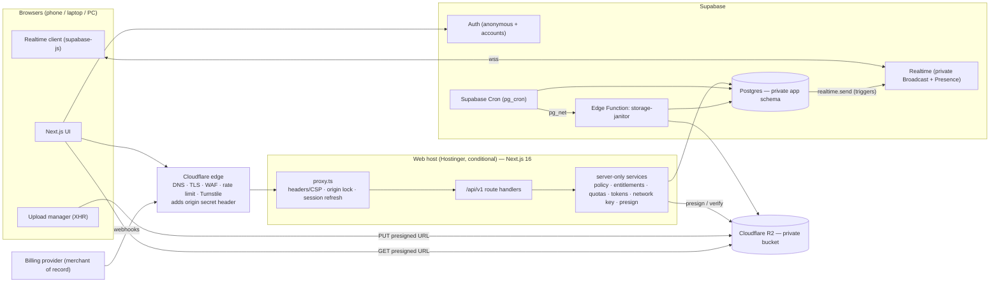

# 00 — Project Overview & Executive Summary

| Field | Value |
|---|---|
| Document status | DRAFT — awaiting owner review |
| Last updated | 2026-09-23 (CR-001: owner kept automatic same-network visibility) |
| Baseline commit | `be78415` "Initial commit from Create Next App" (plus an uncommitted pnpm version bump) |
| Implementation authorized? | **Phase 0 only** (owner, 2026-09-23). Phase 0 is BLOCKED on owner items (in-repo work done and verified locally, 2026-09-29); see [phase 0 §18](phases/phase-0-foundation.md#18-implementation-status). |

---

## 1. The product, as understood

A web SaaS for moving **text, images, documents and other files** between devices and people.

| Mode | Intended experience (from the brief and the reference diagram) |
|---|---|
| **Local / same network** | Devices on the same Wi-Fi open the website and automatically see the text, images and files posted there. No approval, QR code or link. Other networks see nothing automatically. **Confirmed by the owner on 2026-09-23 (DEC-031); approval-based sharing was explicitly declined.** |
| **Remote / different networks** | The sender explicitly shares a file or a room with a secure link, a QR code of that link, or a short code. The recipient gets only what was shared and cannot browse the sender's local room. |
| **One-time download** | Optional, off by default: "delete after first successful download", with no double-download race. |
| **Plans** | FREE (no account, 100 MB/file, 7-day expiry), PRO ($3–5/mo: 5 GB/file, 30/90-day expiry, passwords, private rooms, history, devices, one-time downloads, no ads), TEAM ($10–20/mo: workspace, members, admin, history, branding, longer storage with an enforced quota). |
| **Preferred stack** | Next.js, TypeScript, Tailwind CSS, shadcn/ui, Supabase (Postgres/Auth/Realtime), Cloudflare R2, Hostinger hosting, GitHub. |

---

## 2. Executive summary

1. **The repository is a clean slate.** It is an unmodified `create-next-app` scaffold: Next.js 16.3.5, React 19.2.8, Tailwind CSS 4.3, ESLint 9, TypeScript 5.9, pnpm. It has no backend, database, authentication, storage, realtime, deployment configuration, tests or security controls. Nothing conflicts with the product, and nothing domain-specific can be reused. See [01-codebase-audit.md](01-codebase-audit.md).

2. **Local mode keeps the original rule (owner decision, DEC-031).** Anyone on the same Wi-Fi/network sees local posts automatically. Other networks see nothing automatically. Remote access is only by link, QR code or share code. The approval-based alternative proposed earlier (DEC-002) was declined and is recorded as rejected in [CR-001](06-decisions-and-risks.md#5-change-records).

   The server's limits are unchanged, so the design has to work around them. It sees only a public IP address, which approximates the network:
   - One public IP can hide many unrelated networks: mobile-carrier CGNAT, universities, VPNs, iCloud Private Relay.
   - Devices on the same Wi-Fi can show up under different IPs: IPv4 vs IPv6, relays, multi-WAN routers.
   - Browsers deliberately hide LAN identity (no SSID/BSSID API, masked WebRTC addresses, Chrome's Local Network Access prompt).

   See [03-security-and-network-design.md §2](03-security-and-network-design.md#2-same-network-detection--technical-analysis).

3. **How local mode is made as safe as possible without an approval step** ([03 §3](03-security-and-network-design.md#3-local-mode-automatic-same-network-visibility-dec-031-dec-032-dec-033)):
   - **The server decides the network on every request**, from a client IP only Cloudflare can set. Clients can't choose or fake a network (DEC-004, DEC-032).
   - **Nothing is remembered.** Leave the Wi-Fi and the network's posts disappear on the next request. Your own posts stay under "My uploads".
   - **Fail closed where one IP may cover several networks.** Local mode switches itself off on relay, VPN, mobile-carrier and very large networks, where the server cannot tell networks apart. Users there share by link, QR code or code.
   - **Uploaders see their audience** before posting: *"Visible to everyone on this network · 3 devices here now"*. Only the creator can delete a post or create a link to it.

   **What remains, by the nature of the rule:**
   - everyone on the same Wi-Fi (guests, café customers, co-workers) sees local posts (RISK-025);
   - different networks behind one shared IP that isn't yet detected can see each other's local posts (RISK-001);
   - an IP address reassigned by the ISP can expose posts still live on it (RISK-026).

   These are stated in [03 §3.8](03-security-and-network-design.md#38-isolation-guarantees).

4. **The preferred stack is broadly right, with constraints** (details in [02-system-architecture.md §2](02-system-architecture.md#2-stack-evaluation)):
   - **Next.js + TypeScript + Tailwind + shadcn/ui: keep.**
   - **Supabase: keep, with a hard boundary.** The Next.js server is the only reader and writer of application tables, which live in a private schema. The browser uses Supabase only for sessions and Realtime. Realtime uses **Broadcast from database triggers on private channels with ID-only payloads**, not Postgres Changes. Anonymous sign-ins need CAPTCHA protection and scheduled cleanup.
   - **Cloudflare R2: keep.** Use a private bucket. Browsers upload **directly to R2** with presigned URLs, and download through short-lived presigned URLs issued only after an authorization check. File bytes never pass through the web server or Supabase.
   - **Hostinger: conditional.** Acceptable only if a Phase 0 spike proves that it runs Next.js 16 reliably and that the client IP can be trusted, with Cloudflare in front and the origin locked. Background jobs must not run on the web host. Fallback: a Hostinger VPS with Docker and Cloudflare Tunnel, or another Node.js host.
   - **Add:**
     - Cloudflare in front of the app: DNS, TLS, WAF, rate limiting, Turnstile.
     - Supabase Cron plus a "storage janitor" Edge Function.
     - A merchant-of-record billing provider.
     - Error monitoring with redaction.

5. **"Delete after first successful download" must be redefined as "burn on first download start"** (DEC-015). The first recipient atomically *claims* the share. Only that device may re-download during a short grace window, then the bytes are deleted. The original wording has three problems:
   - It cannot be verified when bytes flow directly from R2.
   - A recipient could abort at 99% to keep the content without consuming it.
   - Link-preview bots and email scanners could destroy files.

6. **Free, account-less file hosting with public links attracts abuse.** Quotas, rate limits, Turnstile, abuse reporting, takedown, attachment-only downloads and an executable-file policy are **launch requirements**, not later hardening (RISK-004, RISK-005).

7. **Plan limits can be enforced server-side.** Every write path consults an entitlements module. Storage is reserved atomically in Postgres. Plan snapshots are stored on shares and links. R2 lifecycle rules per retention class act as a backstop. See [07-plans-and-entitlements.md](07-plans-and-entitlements.md).

8. **Phasing:** keep the proposed order with four adjustments ([05-implementation-roadmap.md](05-implementation-roadmap.md)):
   - Phase 0 includes four technical spikes that de-risk hosting (and client-IP trust), R2, Realtime, and real-world network grouping.
   - Basic expiry enforcement moves into Phase 1. Full cleanup and one-time download stay in Phase 3.
   - Billing moves from Phase 6 into Phase 4 so that Pro can actually launch.
   - A **public beta** happens only after Phase 3 and a launch-gate checklist.

---

## 3. Recommended architecture at a glance

---

## 4. Requirement changes recommended before implementation

The full review is in [10-requirements-and-diagram-review.md](10-requirements-and-diagram-review.md). The most important:

REQ-001 and REQ-003 (an approval step for same-network access) were **withdrawn on 2026-09-23**. The owner kept automatic same-network visibility (CR-001).

| # | Original requirement | Recommended change | Why |
|---|---|---|---|
| REQ-002 | Other networks must not see local content | Kept, and enforced per request with fail-closed guards. Accept that local mode is off on relay, VPN, mobile-carrier and very large networks. | These are the places where one IP covers several networks |
| REQ-004 | Delete after first *completed successful* download | Burn on first download **claim**, with a same-device retry window | Completion is unverifiable and exploitable |
| REQ-006 | Free, no account, public links | Keep, but launch only with quotas, Turnstile, abuse reporting, takedown and an executable policy | Abuse and legal exposure |
| REQ-007 | Free has ads (implied by Pro "No ads") | No third-party ad or analytics scripts on pages that display user content | Those scripts can read shared text and download URLs |
| REQ-008 | Pro at $3–5/month | Prefer $4–5/month plus an annual plan | Merchant-of-record fees of about 5% + $0.50 take 15–22% of a $3–5 payment |
| REQ-009 | Pro 5 GB per file | Add a total active-storage quota; multipart uploads in Phase 4 | Otherwise storage is unbounded |
| REQ-024 | Payments in Phase 6 | Billing in Phase 4 | Pro cannot launch without real subscription state |

---

## 5. Top risks

Full register in [06-decisions-and-risks.md](06-decisions-and-risks.md#3-risk-register).

| ID | Risk | Severity |
|---|---|---|
| RISK-001 | Different networks behind one undetected shared IP see each other's local posts (inherent to automatic visibility; reduced by guards) | Critical |
| RISK-002 | Client-IP spoofing through forwarded headers or origin bypass: would reveal any network's local posts | Critical |
| RISK-004 | Abuse of free anonymous hosting (malware, phishing, piracy, illegal content) | Critical |
| RISK-025 | Everyone on the same Wi-Fi, including guests and strangers, sees local posts (inherent, accepted with DEC-031) | High |
| RISK-005 | Legal and compliance obligations (GDPR, DMCA, illegal-content reporting, terms of service) | High |
| RISK-003 | Unverified Hostinger platform behaviour (timeouts, IP headers, pnpm 12, memory) | High |
| RISK-020 | Scope and complexity for a small team | High |

---

## 6. Recommended Phase 0 (summary)

Full plan in [phases/phase-0-foundation.md](phases/phase-0-foundation.md). Phase 0 ships **no user-facing features**.

1. Repository hygiene: commit or revert the pnpm bump, rename `master` → `main`, create the GitHub remote and branch protection, fix `.gitignore` for `.env.example`, pin Node and pnpm.
2. Tooling: Vitest, Playwright, env validation, `server-only`, CI workflow (typecheck, lint, tests, build).
3. Accounts and infrastructure: Supabase staging and production projects, R2 buckets with CORS and lifecycle rules, Cloudflare zone, Turnstile keys.
4. Skeleton: `proxy.ts` security headers and origin lock, trusted client-IP helper, `/api/v1/health`, baseline `app` schema migration with deny-by-default grants, shadcn/ui initialization.
5. **Spikes, each with a written result:**
   - SP-01 Hostinger runtime and client IP (the client IP now decides local visibility)
   - SP-02 R2 direct upload and download semantics
   - SP-03 Supabase anonymous auth plus private Realtime Broadcast
   - SP-04 network grouping in real networks, the dual-stack probe, ASN forwarding and ISP address rotation
   - (SP-05, the WebRTC LAN proof, was withdrawn by CR-001)
6. Owner review of the decision log; decisions move from PROPOSED to ACCEPTED.

---

## 7. Decisions needed from the owner

The complete list with recommendations is in [06-decisions-and-risks.md §4](06-decisions-and-risks.md#4-open-questions). The ones that block early phases:

- ~~Q-001~~ Answered 2026-09-23: keep automatic same-network visibility (DEC-031).
- **Q-029 / Q-030** Large-network cap (proposed 50 devices/24 h) and default expiry for local posts (proposed 24 h) (block Phase 1).
- **Q-021** Only the creator edits a local text post (proposed) (blocks Phase 1).
- **Q-028** No link to a whole network's feed (proposed) (blocks Phase 2).
- **Q-012 / Q-013** Hosting budget and fallback: Hostinger managed Node.js vs VPS; Cloudflare Free vs Pro (blocks Phase 0 exit).
- **Q-020** Product name and production domain. CORS, CSP, cookies and Turnstile depend on it (blocks Phase 0 exit).
- **Q-010 / Q-027** Executable files and account-less remote links (blocks Phase 2).
- **Q-005 / Q-006 / Q-007** Business country (payment provider), prices, quotas (blocks Phase 4).
- **Q-023** Public beta only after Phase 3 plus the launch gate.

---

## 8. Glossary

| Term | Meaning in these documents |
|---|---|
| **Device** | One browser installation, identified by a Supabase auth user (anonymous or permanent) plus a `devices` row. |
| **Network key** | A keyed hash (HMAC) of a device's normalized public IP (IPv4 /32 or IPv6 /64), derived by the server on every request. Called "network hint" in earlier drafts. |
| **Network space** | The server's stand-in for "this network": one per network key, with no owner or members. Shown to users as "This network". |
| **Current network** | The network key(s) of the device's current request (plus a bound other-family key, if the dual-stack probe is adopted). Decides local visibility. |
| **Eligible (`ok`) network** | A network space where local mode is on. `shared_egress`, `too_large`, `blocked` and `unavailable` switch it off (fail closed). |
| **Presence** | The server's record that a device was on a network space in the last 10 minutes. Authorizes realtime and powers "N devices here now". |
| **Local share** | A share posted "to this network" (`scope = 'network'`). Visible automatically to every device currently on that network, and to its creator anywhere. |
| **Link-only share** | A share never shown on any network; reachable only through its links (Phase 2). |
| **Private room** | A Pro room (Phase 4) joined only by invite link or QR pairing. Membership-based and never visible on a network. Separate from local mode. |
| **Member** | A user with a `room_members` row in a private or workspace room (Phase 4+). Local mode has no members. |
| **Share** | A unit of content: a bundle of one or more files, or one text item, posted to a network, as link-only, or to a room. |
| **Share link** | An explicit remote-access grant to one share (or, for Pro, a read-only room), usable as a URL, QR code or short code. |
| **Link grant** | A server-side session created after a viewer proves possession of a link (and password, if set). |
| **Burn after download** | Optional one-time mode. The first download claim consumes the share. |
| **Claim / grace window** | The atomic consumption of a burn share, and the short period in which only the claiming device may re-download. |
| **Retention class** | The expiry bucket (`d7`, `d30`, `d90`, `ws`) encoded in the R2 object-key prefix. Lifecycle backstop rules act on it. |
| **Entitlements** | The resolved set of limits and features for an actor (Free, Pro, Team), enforced on the server. |
| **Storage janitor** | The scheduled worker that deletes R2 objects from the deletion outbox and reconciles storage. |
| **Tombstone** | Metadata kept after content deletion (for history or abuse handling), without the content itself. |
| **Spike** | A time-boxed technical experiment whose written result settles a decision. |
