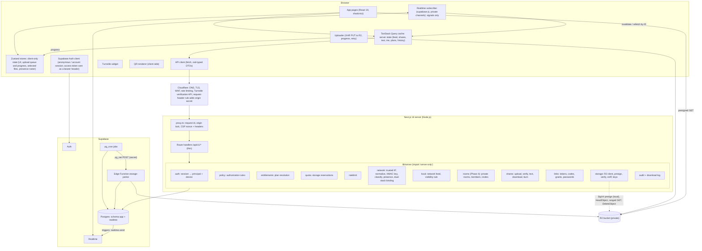
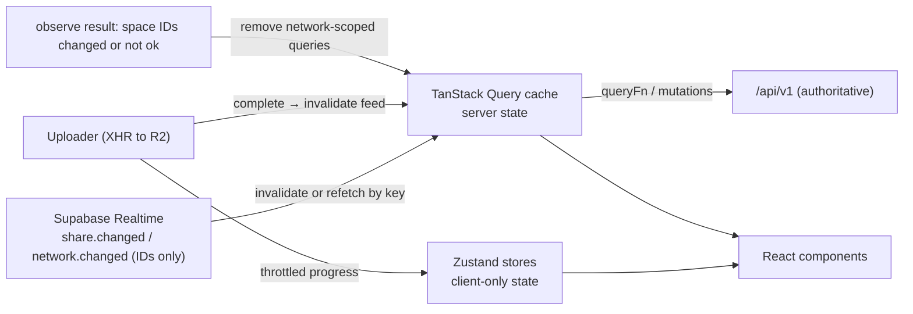
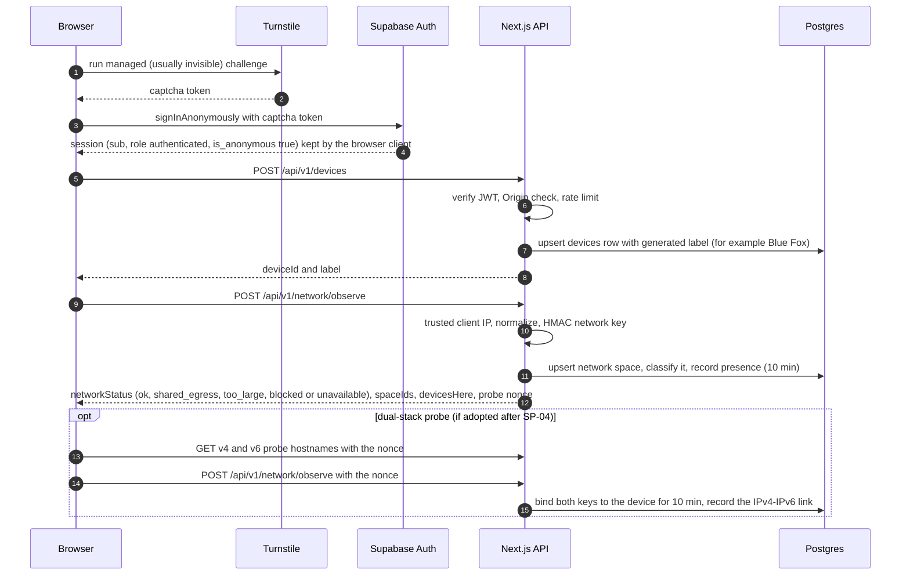
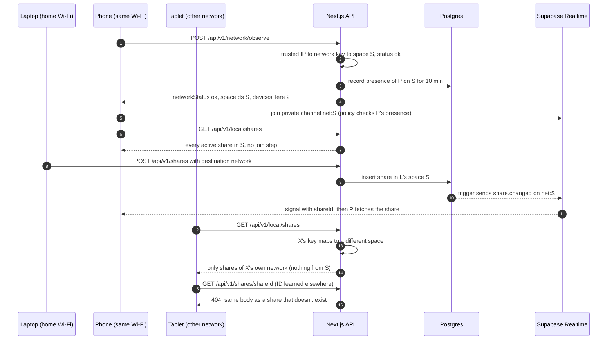
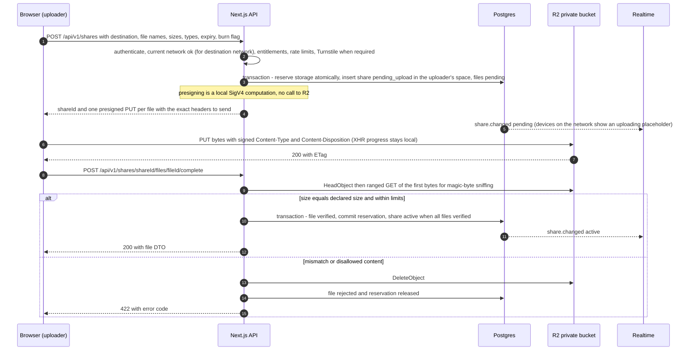
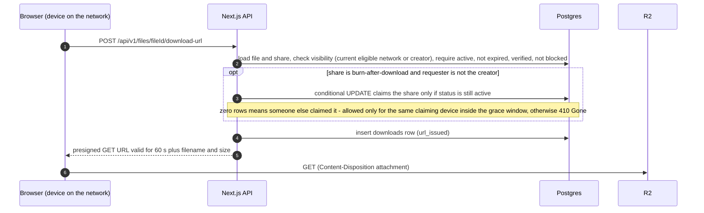
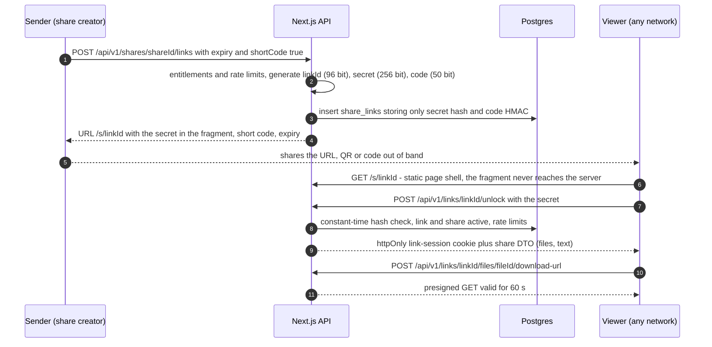
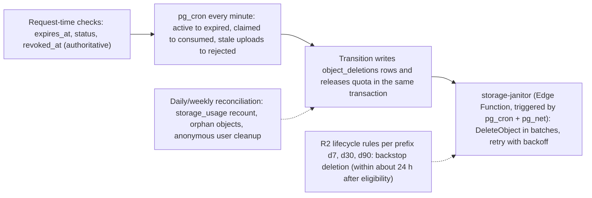

# 02 — System Architecture

| Field | Value |
|---|---|
| Document status | PROPOSED — awaiting owner review |
| Last updated | 2026-10-15 (Phase 1 as built: bearer-token API auth, no session refresh in `proxy.ts`, module layout, preview query key; second review pass: principle 8 on raw IPs). Earlier: 2026-09-29 (DEC-035: shadcn/ui initialized); 2026-09-23 (CR-001, DEC-034). |
| Related decisions | DEC-001 … DEC-035 in [06-decisions-and-risks.md](06-decisions-and-risks.md) |
| Related docs | Security and network design in [03](03-security-and-network-design.md). Schema, storage and cleanup in [04](04-database-and-storage-design.md). Plans in [07](07-plans-and-entitlements.md). Deployment in [08](08-deployment-and-operations.md). |

---

## 1. Architecture principles

1. **The server decides the network, on every request, and fails closed.** Local content is visible to every device currently on the same network, with no join step (DEC-031). The network is derived only from the Cloudflare-verified client IP, never supplied by the client, and local mode switches off wherever one IP may cover several networks (DEC-032). Everything outside local mode needs an explicit link grant or, from Phase 4, room membership.
2. **One enforcement point.** All authorization, entitlement, quota and rate-limit decisions happen in server-only code on the Next.js server, or in atomic Postgres functions it calls. The browser never talks to application tables directly (DEC-006).
3. **Bytes bypass the web tier.** File bytes go browser ↔ R2 directly through presigned URLs. The web server handles only small JSON requests (DEC-009).
4. **Realtime carries signals, not data.** Realtime messages carry IDs and state changes. Clients re-fetch authoritative DTOs through the API (DEC-011).
5. **One owner per kind of client state.** Zustand holds client-only state, TanStack Query holds server state, Supabase Realtime only signals changes (DEC-034, §3.3).
6. **Expiry is enforced at request time.** Cleanup jobs reclaim storage but are never the security boundary (DEC-016).
7. **Every secret is a hash at rest.** Link secrets, short codes, invite secrets and passwords are stored only as hashes or HMACs (DEC-013, DEC-014, DEC-021).
8. **Least data.** No raw IPs in the app's tables, query parameters or logs (Supabase Auth's own session IPs: Q-031), no file names in object keys or realtime payloads, text content erased at expiry.
9. **Boring and observable over clever.** Standard SQL, explicit state machines, an outbox for side effects, structured logs with redaction.

---

## 2. Stack evaluation

| Component | Proposed by owner | Verdict | Required changes / notes |
|---|---|---|---|
| **Next.js (App Router)** | Yes | **Keep — confirmed by the owner** (DEC-001 ACCEPTED, 2026-09-23) | The frontend and full-stack framework. Installed: 16.3.8 (16.3.5 until Phase 1, DV1-16). Use route handlers as a JSON API (`/api/v1`), `proxy.ts` for headers, CSP and the origin lock, and a server-only data access layer. `proxy.ts` does not refresh sessions: the browser refreshes its own Supabase session, and the server only verifies the bearer access token (phase 1 DV1-6, DV1-14). Don't route uploads through it. |
| **TypeScript** | Yes | **Keep** | `strict` is already on. Share zod schemas between client and server for API contracts. |
| **Tailwind CSS** | Yes | **Keep** | v4 is installed. |
| **shadcn/ui** | Yes | **Keep — accepted by the owner** (DEC-001, DEC-035, 2026-09-29) | Initialized in Phase 0: Radix base, Nova preset (Lucide, Geist), theme tokens as CSS variables in `app/globals.css`, components in `components/ui/`. Its Radix primitives give accessible dialogs, toasts and menus. Components are copied into the repo, so there is no runtime dependency lock-in. Radix's server-rendered `style` attributes need `style-src-attr 'unsafe-inline'` in the CSP ([03 §11](03-security-and-network-design.md#11-web-security-headers-and-content-security-policy)). |
| **Zustand** | Yes (2026-09-23) | **Add — accepted** (DEC-034) | **Client-only state:** UI state, the upload queue and progress, selected files, temporary state of the current network or room view. Stores are created per request through a context provider (no module-level singletons during server rendering). See §3.3. |
| **TanStack Query** | Yes (2026-09-23) | **Add — accepted** (DEC-034) | **Server state:** file lists, text posts, user data, plans and entitlements, history, network status. Fetches only through `/api/v1`. Provider set up as in the bundled Next.js 16 TanStack Query guide. See §3.3. |
| **Supabase Postgres** | Yes | **Keep** | Put application tables in a private `app` schema that is **not exposed** through the Data API. The server connects through the Supavisor pooler (the direct connection is IPv6-only without an add-on). SQL-first migrations. |
| **Supabase Auth** | Yes | **Keep, with care** | Anonymous sign-ins for devices (Turnstile-protected, scheduled cleanup). Email magic link / OAuth for accounts in Phase 4. Use the new publishable/secret API keys; legacy `anon`/`service_role` keys are being deprecated by end of 2026. |
| **Supabase Realtime** | Yes | **Keep, restricted** | **Live update signals only** (DEC-034): new uploads, deleted items, text updates. It updates the TanStack Query cache and never holds state itself. **Private Broadcast channels** fed by database triggers (`realtime.send`), plus **Presence** for online devices. Authorization comes from RLS policies on `realtime.messages`. **Don't use Postgres Changes**: it is single-threaded and runs one authorization check per subscriber per change, and Supabase recommends Broadcast at scale. Never send file data. |
| **Cloudflare R2** | Yes | **Keep** | Private buckets, presigned PUT for uploads (multipart for large files in Phase 4) and short-lived presigned GET for downloads. Egress is free, which matters most for a file-sharing product. Presigned URLs work only on the S3 endpoint, not on custom domains. |
| **Hostinger** | Yes | **Conditional** | Managed Node.js web apps support Next.js, pnpm, Node 18–24, GitHub deploys and environment variables. **Undocumented:** request timeouts, streaming, client-IP header behaviour, memory limits, graceful shutdown and outbound TCP. SP-01 must pass, otherwise use a Hostinger VPS (Docker + Cloudflare Tunnel) or another Node host (DEC-022). Background jobs never run here. |
| **GitHub** | Yes | **Keep** | Source, Actions CI, branch protection, a deploy branch that is fast-forwarded only after CI and migrations pass. |
| Cloudflare edge (DNS/WAF/Turnstile) | Implied by R2 | **Add** | Required to trust the client IP (origin lock plus `CF-Connecting-IP`), for coarse rate limits and bot protection, and for Turnstile CAPTCHA. |
| Scheduler / janitor | "Cleanup Job" in diagram | **Add** | Supabase Cron (pg_cron) for database state transitions, plus a Supabase Edge Function that deletes R2 objects from an outbox (DEC-017). |
| Billing | Not specified | **Add (Phase 4)** | A merchant-of-record provider such as Paddle, Lemon Squeezy or Polar, chosen by business country and tax needs (DEC-023, Q-005). |
| Error monitoring | Not specified | **Add** | Sentry or equivalent, with URL, fragment, cookie and token redaction (DEC-029). |
| Email | Not specified | **Add (Phase 4)** | Custom SMTP (Resend, Postmark, SES…) for Supabase Auth and invitations. Supabase's built-in email sender is meant for development only. |

**Alternatives considered and not chosen:**

| Alternative | Why not (now) |
|---|---|
| Supabase Storage instead of R2 | Egress is billed. For a product whose main cost driver is downloads, R2's free egress is decisive. |
| Pure peer-to-peer WebRTC transfer (Snapdrop/PairDrop style) | No persistence, expiry, history or remote links. Both peers must be online. Cross-network transfer needs paid TURN relays. Could return later as an optional "direct transfer" mode for large files between nearby devices that are both online. |
| Uploads through Next.js route handlers | Proxy buffering, memory, timeouts and bandwidth on a small web host. Direct-to-R2 is strictly better. |
| Vercel hosting | Best Next.js fidelity and trustworthy client-IP headers, but the Hobby plan does not allow commercial use and usage-based costs apply. It is the fallback if Hostinger fails SP-01 and a VPS is unwanted. |
| Next.js on Cloudflare Workers (OpenNext) | Closest to R2, with Cron Triggers and Queues. Next.js 16 compatibility must be verified. Re-evaluate in Phase 6. |
| Postgres Changes for realtime | Scalability limits (single-threaded, per-subscriber authorization checks, RLS not applied to DELETE events). |

---

## 3. Component view



### 3.1 Responsibilities

| Component | Owns | Must never |
|---|---|---|
| Browser app | UX, local upload progress, QR rendering, realtime-triggered re-fetches | Hold service credentials. Make authorization decisions. Read `app` tables. |
| Zustand stores (browser) | Client-only state (§3.3) | Hold server data, secrets or presigned URLs. Persist anything but harmless preferences. |
| TanStack Query cache (browser) | Server state fetched through `/api/v1` (§3.3) | Outlive the network it came from (removed on network change). Be persisted to storage. |
| Supabase Realtime client | Live update signals that invalidate or refetch queries | Carry or hold content. Act as a data source. |
| `proxy.ts` | Request ID, origin-lock check, security headers and CSP nonce. (No session refresh: the browser refreshes its own Supabase session; phase 1 DV1-6.) | Authorize access to resources. Query the database. |
| Route handlers | Parse and validate input (zod), call one service, map result to DTO and HTTP status | Contain business rules or SQL |
| Services (`lib/server`) | Authorization, entitlements, quotas, rate limits, state transitions, presigning, audit | Return raw rows to the client. Log secrets. |
| Postgres | Source of truth. Constraints. Atomic functions (claim, reserve, attempt counters). Triggers that emit realtime signals. Cron state transitions. | Store file bytes, raw IPs or plaintext secrets |
| Supabase Realtime | Deliver ID-only signals and presence to authorized subscribers | Carry file bytes, file names, text content or URLs |
| R2 | File bytes, with Content-Type and Content-Disposition fixed at upload | Be publicly readable. Be the expiry authority. |
| Storage janitor | Delete objects listed in the deletion outbox, abort stale multipart uploads, reconcile orphans | Decide what is expired (the database decides) |
| Cloudflare | TLS, coarse rate limits, WAF, the only path to the origin, a trustworthy client IP | Cache API or HTML responses containing user data |

### 3.2 Trust boundaries

| Boundary | Crossing | Control |
|---|---|---|
| Internet → Cloudflare | All traffic | TLS, WAF, rate-limit rule, bot protection |
| Cloudflare → origin | HTTP requests | Origin secret header (Transform Rule) checked in `proxy.ts`. `CF-Connecting-IP` trusted **only** when the secret is valid (DEC-004). Better: Cloudflare Tunnel on a VPS. |
| Browser → API | JSON over HTTPS with the Supabase access token as `Authorization: Bearer` (phase 1 DV1-14) | JWT verification, device ownership check, Origin check on mutations, zod validation, rate limits |
| Browser → R2 | Presigned URLs | Scoped to one object and one method. Short TTL. Content-Type/Disposition signed. Bucket CORS limited to app origins. |
| Browser → Supabase Realtime | WebSocket with the user's JWT | Private channels only ("Allow public access" disabled). RLS on `realtime.messages`. |
| Next.js → Postgres | Pooled TCP (TLS) | Dedicated DB role with least privilege on the `app` schema. Credentials in env. |
| Supabase Cron → Edge Function | HTTPS via pg_net | Shared secret stored in Supabase Vault |
| Billing provider → API | Webhook | Signature verification, idempotent event log, timestamp tolerance |

### 3.3 Frontend state management (DEC-034)

Each kind of client state has exactly one owner.

| Layer | Owns | Examples in this product | Must never |
|---|---|---|---|
| **Zustand** | **Client-only state** | Open dialogs and tabs, selection, composer drafts; the **upload queue and per-file progress**; **selected files** before upload; **temporary state of the current network or room view** (the Presence roster for "N devices here now", realtime connection status) | Copy server data, hold secrets or presigned URLs, persist anything except harmless preferences |
| **TanStack Query** | **Server state**, fetched only through `/api/v1` | Local feed and **file lists**, share details and **text posts**, "My uploads", the current network status (the `observe` result), **user data**, entitlements and **plans**, transfer **history**, link-viewer content | Be written by anything except query functions, mutations, and realtime-triggered updates |
| **Supabase Realtime** | **Live update signals only** | **New uploads, deleted items, text updates** (`share.changed`), network status changes (`network.changed`), Presence | Hold state or deliver content. Payloads are IDs only (DEC-011). |



**Query keys** (one `queryOptions` factory per resource in `lib/client/queries/*`, rule 11 of DEC-034):

| Key | Data | Freshness |
|---|---|---|
| `['network', 'current']` | `observe` result: status, space IDs, devices here now | Written by the 5-minute `observe` heartbeat and on `focus`/`online` |
| `['local', 'feed', spaceIds]` | Local feed for the current network | Realtime-invalidated. Refetch on focus. **Removed when the space IDs change.** |
| `['share', shareId]` | Share detail, including text | Realtime-invalidated. Removed on `404`/`410`. |
| `['me', 'shares']` | My uploads (from any network) | Invalidated by `share.changed` on the `user:` topic |
| `['preview', fileId]` | 300 s preview URL for an image (Phase 1) | Refetched after 4 minutes. Removed with the network's other data. |
| `['me']`, `['me', 'entitlements']` (Phase 4) | Account, plan, limits | Refetch on focus |
| `['history', …]` (Phase 4) | Transfer history | On demand |
| `['link', linkId, 'content']` (Phase 2) | Link-viewer DTO | 30 s refetch interval and on focus. No Realtime. |
| `['room', roomId, 'shares']` (Phase 4) | Private-room content | Realtime-invalidated on `room:` |

**Rules that matter for security** (full list in DEC-034):

- **Leaving a network clears its data.** When `observe` reports different space IDs, or a status other than `ok`, the client removes every `['local', …]` query and open share queries that belong to that network. It doesn't just hide them. Then it drops the old `net:` channel. This keeps G3 true on screen and in memory (RISK-027).
- **Realtime never writes content into a cache.** It passes IDs; the query layer fetches through the API, which re-checks the network on every request.
- **No persistence** of the query cache. Zustand `persist` only for harmless preferences.
- **Request isolation during server rendering:** a new `QueryClient` per server render and one reused in the browser, as in the bundled Next.js 16 TanStack Query guide. Zustand stores are created per request through a context provider.
- **No server-side caching of network- or secret-dependent data** (`use cache`, Cache Components, `fetch` caching). The local feed depends on the requester's IP, so a shared cache would show one network's content to another. Such data is fetched in the browser after hydration. Link-viewer content is always client-side, because its secret is in the URL fragment.
- **Retries:** none for `4xx`. `429` waits for `Retry-After`. Network errors and `5xx` are retried with backoff.

**Providers:** `lib/client/providers.tsx` (a `'use client'` component) renders `QueryClientProvider` and the Zustand store providers. It is rendered from the root layout, because the home page is the app. Revisit when marketing pages are added (Phase 4 pricing page).

---

## 4. Key flows

### 4.1 Device bootstrap (first visit)



Anonymous sign-in happens only when the app shell loads (not for bots that don't run JavaScript). Share-link **viewers** do not create Supabase users (see §4.6 and RISK-006).

### 4.2 Local mode: same network, no join step



When the phone leaves the Wi-Fi, its next request derives a different network key, so S's shares return 404 and the client moves to its new network's channel. The visibility rule is specified in [03 §3.6](03-security-and-network-design.md#36-visibility-rule-and-presence).

### 4.3 File upload (single PUT, ≤ 100 MB; multipart in Phase 4)



### 4.4 Download on the network (including burn-after-download)



### 4.5 Text item create and edit

- Create: `POST /api/v1/texts {content, expiresIn, destination}` creates a `shares` row (`kind = 'text'`) and a `text_items` row. A trigger emits `share.changed`.
- Edit (the creator only for local shares, Q-021): `PATCH /api/v1/shares/{shareId}/text {content, version}` runs `UPDATE … WHERE version = $version`. Zero rows returns **409 Conflict** with the current version. The client shows "updated on another device" and offers a reload. There is no character-level merging or CRDT (DEC-027).

### 4.6 Remote share link: create, open, download



Short code path: `POST /api/v1/codes/resolve {code}` creates the same link grant directly (valid for at most 12 h and never beyond link expiry) and returns only the `linkId`. The long-lived secret is **not** revealed through the short-lived code.

### 4.7 Expiry and cleanup (summary)



Details: [04 §9](04-database-and-storage-design.md#9-expiry-and-cleanup-architecture).

---

## 5. Realtime architecture

### 5.1 What uses realtime and what does not

| Event / need | Realtime? | Mechanism | Payload / notes |
|---|---|---|---|
| New text item appears | **Yes** | DB trigger → Broadcast `share.changed` on `net:{spaceId}` (or `room:{roomId}` from Phase 4) and on the creator's `user:{userId}` | `{v, type, shareId, status}`. The client fetches the DTO. |
| Text edited | **Yes** | Trigger on `text_items` version change | `{shareId, version}` |
| File metadata appears | **Yes** | `share.changed` with `pending_upload`, then `active` | Placeholder first, then the full item after verification |
| Item deleted / expired / claimed / blocked disappears | **Yes** | `share.changed` with the new status | Clients remove it immediately |
| Network status changes (for example to `too_large`) | **Yes** | `network.changed` on `net:{spaceId}` | Clients hide local content and show the status message |
| Devices on this network | **Yes** | Presence on `net:{spaceId}` | `{deviceId, label, platform}`, present devices only. Drives "N devices here now". |
| Moving to another network | **No** (client-side) | Re-observe on `online`, `focus` and connection changes; drop the old `net:` channel and join the new one | The API re-derives the network on every request anyway |
| Private-room member joined / removed (Phase 4) | **Yes** | `member.changed` on the room topic, `membership.changed` on `user:{userId}` | A removed device drops the channel and clears cached room data |
| Upload progress | **No** (local) | XHR `upload.onprogress` in the uploading browser | Other devices see only an "uploading…" placeholder. Optional later: throttled ephemeral broadcast (≤ 1 msg / 2 s). |
| Share-link viewer page | **No** | TanStack Query refetch every 30 s and on focus | Link viewers have no Supabase session (cost and simplicity) |
| File bytes, presigned URLs, text content, passwords, link secrets | **Never** | — | Realtime messages persist in `realtime.messages` for replay (≥ 72 h, ≤ 4 days) |
| Subscription / plan changes (Phase 4) | Optional | `account.changed` on the user topic, or re-fetch on focus | — |

### 5.2 Topics and authorization

All channels are **private** (`config: { private: true }`), with "Allow public access" disabled in Realtime settings.

| Topic | Who may receive | Who may track Presence | Client broadcast sends |
|---|---|---|---|
| `net:{spaceId}` | Devices the server recorded as present on that space in the last 10 minutes, while the space is `ok` | Present devices | **Denied**. Only database triggers send. |
| `room:{roomId}` (Phase 4) | Active members of the room | Active members | Denied |
| `user:{userId}` | That user only | — | Denied |
| `workspace:{workspaceId}` (Phase 5) | Active workspace members (admin events filtered by event type) | — | Denied |

Policies live on `realtime.messages` and call a `SECURITY DEFINER` helper, `app_realtime.can_access_topic(topic text)`, which checks presence or membership for `auth.uid()`. SQL sketch in [04 §6](04-database-and-storage-design.md#6-row-level-security-grants-and-realtime-authorization).

### 5.3 Delivery semantics and client rules

- Broadcast is treated as **at-most-once**. On (re)subscribe, the client **invalidates** the affected TanStack Query keys (local feed, open shares, My uploads) so they refetch. Broadcast Replay (`since`, max 25 messages, private channels only) may be used to shorten catch-up, but correctness never depends on it.
- A realtime handler only invalidates, refetches or removes query keys (§3.3). Anything it places in the cache comes from an API fetch, never from the payload, which holds only IDs. It never writes server data into Zustand. Presence events update the Zustand presence roster.
- Cache updates are idempotent, keyed by `shareId` plus `version` / `updatedAt`.
- **Revocation lag:** Supabase caches channel authorization for the connection until the client sends a new access token. When a device leaves a network (or, from Phase 4, a private-room member is removed), the well-behaved client unsubscribes. A malicious client could keep receiving **ID-only** signals until its JWT is refreshed or it reconnects; by then its presence has expired (10 min), so the check fails. That is why payloads never contain names or content (RISK-007). All data access goes through the API, which re-derives the network on every request.
- Cost control: one `net:` channel (two with dual-stack binding) plus one user channel per tab. Disconnect after 5 minutes hidden (Page Visibility API) and reconnect on focus.

---

## 6. API design

### 6.1 Conventions

| Concern | Convention |
|---|---|
| Base path | `/api/v1/…`. Breaking changes go to `/api/v2`. |
| Format | JSON request and response bodies. Mutating requests must send `Content-Type: application/json`. |
| Authentication | **As built in Phase 1 (DV1-14):** the browser sends its Supabase access token as `Authorization: Bearer …`; the server verifies it on every request (`getClaims`: JWKS with asymmetric keys, otherwise the Auth server) and never refreshes it. An expired token gets 401 and the client refreshes and retries once. (Planned: `@supabase/ssr` session cookies.) Link viewers (Phase 2) use a separate httpOnly `link_session` cookie. |
| Device binding | `X-Device-Id` header, verified to belong to the authenticated user |
| CSRF | Mutations require an exact `Origin` match against configured app origins and a JSON content type (a body-less `DELETE` needs only the Origin, DV1-13). The bearer header can't be sent by another site. GET never mutates. |
| Validation | zod schemas in `lib/shared/api/*`, used by both client and server |
| Errors | `{ "error": { "code": "SHARE_EXPIRED", "message": "…", "requestId": "…" } }`. Resources outside the caller's scope return **404** (not 403) to avoid revealing existence. |
| Idempotency | `Idempotency-Key` header on share creation, link creation and billing checkout (stored 24 h per user) |
| Pagination | Cursor-based (`?cursor=&limit=`), `limit ≤ 100` |
| Rate limiting | `429` with `Retry-After`. Limits per device, user, network key, link and room ([03 §10](03-security-and-network-design.md#10-rate-limiting-and-abuse-protection)). |
| Network input | **No endpoint accepts a network or space identifier.** The network is always derived from the trusted client IP ([03 §3](03-security-and-network-design.md#3-local-mode-automatic-same-network-visibility-dec-031-dec-032-dec-033)). |
| Caching | `Cache-Control: no-store` on every API response and every page showing user data |
| Tracing | `x-request-id` set in `proxy.ts`, propagated to logs and error bodies |
| Time | ISO-8601 UTC. The database's `now()` is authoritative for expiry. |

### 6.2 Endpoint catalogue (by phase)

**Phase 1 rows are implemented** (2026-10-15) except the probe. Request and response contracts: `lib/shared/api/schemas.ts`. `POST /api/v1/shares` and `POST /api/v1/texts` answer `201`; `DELETE` answers `204`. Error codes added in Phase 1: `UNAUTHENTICATED`, `DEVICE_REQUIRED`, `DEVICE_UNKNOWN` (401); `NOT_CREATOR`, `USER_SUSPENDED`, `UPLOADS_RESTRICTED` (403); `NOT_FOUND` (404, also for "not visible"); `LOCAL_SHARING_UNAVAILABLE`, `VERSION_CONFLICT`, `UPLOAD_INCOMPLETE`, `UPLOAD_EXPIRED`, `STORAGE_QUOTA_EXCEEDED` (409); `FILE_TOO_LARGE`, `TOO_MANY_FILES`, `TEXT_TOO_LARGE` (413); `EXPIRY_NOT_ALLOWED`, `UPLOAD_REJECTED`, `PREVIEW_UNAVAILABLE` (422); `RATE_LIMITED`, `DAILY_UPLOAD_LIMIT` (429 with `Retry-After`); `UPLOADS_DISABLED`, `SERVICE_NOT_CONFIGURED` (503).

| Phase | Method & path | Purpose | Caller |
|---|---|---|---|
| 0 | `GET /api/v1/health` | Liveness (no dependencies) and readiness (DB reachability) | Monitor |
| 1 | `POST /api/v1/devices` | Register or refresh the current device | Any session |
| 1 | `PATCH /api/v1/devices/{deviceId}` | Rename device label | Device owner |
| 1 | `POST /api/v1/network/observe` | Derive the current network, record presence, return statuses, space IDs and "devices here now" (plus a probe nonce if the dual-stack probe is adopted) | Device |
| 1 | `GET /api/v1/network/probe?n=` on the `v4.` and `v6.` hostnames (only if SP-04 adopts it) | Record this address family's network key for the nonce. Returns `204`. **Not built in Phase 1** (SP-04 not run, phase 1 DV1-3). | Device |
| 1 | `GET /api/v1/local/shares` | Local feed: active shares on the caller's current eligible network (cursor) | Device on an `ok` network |
| 1 | `GET /api/v1/me/shares` | My uploads, from any network | Creator |
| 1 | `POST /api/v1/shares` | Create a file share (`destination: "network"`) and get presigned uploads | Device on an `ok` network |
| 1 | `POST /api/v1/shares/{shareId}/files/{fileId}/complete` | Verify an uploaded object | Uploader |
| 1 | `POST /api/v1/texts` | Create a text share (`destination: "network"`) | Device on an `ok` network |
| 1 | `GET /api/v1/shares/{shareId}` · `PATCH …/text` · `DELETE /api/v1/shares/{shareId}` | Detail · edit text (versioned) · delete | Device on the share's network or creator · creator · creator |
| 1 | `POST /api/v1/files/{fileId}/download-url` · `…/preview-url` | Short-lived presigned GET | Device on the share's network, or creator |
| 2 | `POST /api/v1/shares` and `POST /api/v1/texts` accept `destination: "link_only"` | Shares that are never visible on any network | Any device |
| 2 | `POST /api/v1/shares/{shareId}/links` · `GET …/links` | Create / list share links | Share creator |
| 2 | `DELETE /api/v1/links/{linkId}` | Revoke link | Link creator (room owner from Phase 4) |
| 2 | `POST /api/v1/links/{linkId}/unlock` | Prove the secret and create a link grant | Anyone with the link |
| 2 | `GET /api/v1/links/{linkId}/content` | Viewer DTO (files, text) | Grant holder |
| 2 | `POST /api/v1/links/{linkId}/files/{fileId}/download-url` · `…/preview-url` | Presigned GET | Grant holder |
| 2 | `POST /api/v1/codes/resolve` | Short code → grant | Anyone |
| 2 | `POST /api/v1/reports` | Abuse report | Anyone (Turnstile) |
| 2 | *(no HTTP endpoint)* `app.admin_block_share()` / `app.admin_block_link()` SQL functions, run from the MFA-protected Supabase dashboard per the takedown runbook | Takedown | Operator |
| 4 | `POST /api/v1/admin/shares/{shareId}/block` · `…/links/{linkId}/block` (optional web admin) | Takedown UI | Allow-listed operator account with MFA |
| 3 | `POST /api/v1/shares/{shareId}/confirm-received` | Claimant ends the burn grace window early | Claimant |
| 4 | `POST /api/v1/rooms` · `GET /api/v1/rooms` · `GET · PATCH · DELETE /api/v1/rooms/{roomId}` | Private rooms: create · list mine · details · settings · delete | Pro user · member · member · owner · owner |
| 4 | `GET /api/v1/rooms/{roomId}/members` · `DELETE …/members/{userId}` | List · remove member or leave | Member · owner/self |
| 4 | `POST /api/v1/rooms/{roomId}/invites` · `POST /api/v1/invites/{inviteId}/accept` | QR pairing / invite link into a private room | Owner · invitee |
| 4 | `GET /api/v1/rooms/{roomId}/shares` · `POST /api/v1/shares` with `destination: {room}` | Room content | Member |
| 4 | `POST /api/v1/account/merge-anonymous` | Move an anonymous device's data into an existing account | Signed-in user holding a valid anonymous token |
| 4 | `GET /api/v1/me` · `GET /api/v1/me/entitlements` · `GET/DELETE /api/v1/me/devices/{deviceId}` · `DELETE /api/v1/me` | Account, entitlements, device management, account deletion | User |
| 4 | `GET /api/v1/history/shares` · `GET /api/v1/history/downloads` | Transfer history | Pro user |
| 4 | `PATCH /api/v1/links/{linkId}` | Set/remove password, change expiry (within limits) | Link creator |
| 4 | `POST /api/v1/rooms/{roomId}/links` | Read-only room link (private or workspace rooms only; never a network feed) | Pro owner |
| 4 | `POST …/files/{fileId}/multipart` · `POST …/parts` · `POST …/complete` · `POST …/abort` | Multipart uploads | Uploader |
| 4 | `POST /api/v1/shares/{shareId}/extend` | Extend expiry (may copy object to a longer retention prefix) | Pro creator |
| 4 | `POST /api/v1/billing/checkout` · `POST /api/v1/billing/portal` · `POST /api/v1/billing/webhook` | Billing | User · User · Provider |
| 5 | `/api/v1/workspaces/*` (members, invitations, policies, branding, audit, usage) | Team features | Workspace roles |

---

## 7. Application module layout (target)

No `src/` directory. The existing `@/*` → `./*` alias stays.

```text
app/
  layout.tsx, globals.css, page.tsx          # modified: product shell, providers, "This network" home
  (app)/uploads/page.tsx                     # My uploads
  (app)/rooms/[roomId]/page.tsx              # private rooms (Phase 4)
  (app)/settings/…                           # Phase 4
  (share)/s/[linkId]/page.tsx                # link viewer (Phase 2)
  (share)/c/page.tsx                         # short-code entry (Phase 2)
  (share)/j/[inviteId]/page.tsx              # private-room invite / pairing accept (Phase 4)
  (legal)/terms, privacy, acceptable-use, report   # Phase 2–3
  api/v1/**/route.ts                         # thin handlers (§6.2)
proxy.ts                                     # headers/CSP, origin lock, request id (no session refresh, DV1-6)
instrumentation.ts                           # boot-time env validation → lib/server/boot.ts (exits on bad env)
components.json                              # shadcn/ui CLI configuration (radix-nova, DEC-035)
components/ui/*                              # shadcn/ui generated: button, card, textarea, badge, dialog, progress, tabs, select, alert
components/local/*                           # Phase 1: home, composer, share card, feed list, upload queue, My uploads, status, notice, copy.ts
components/{room,share,qr}/*                 # later phases
lib/utils.ts                                 # shadcn alias target: re-exports cn()
lib/shared/
  api/schemas.ts                             # zod contracts for /api/v1 (server validation + client parsing)
  plans.ts                                   # Free plan numbers (UI hints; enforced on the server)
lib/client/
  providers.tsx                              # 'use client': config, QueryClientProvider, Zustand providers, runtime (DEC-034)
  config.tsx, runtime.tsx, supabase.ts       # public config from the layout; Supabase client + API client; device bootstrap
  api-client.ts, api-error.ts, query-client.ts
  queries/keys.ts, queries/shares.ts         # TanStack Query key contracts and queryOptions factories
  stores/                                    # Zustand: ui, session, uploads, presence
  realtime.ts, use-network.ts, network.ts    # signals → query invalidation; observe heartbeat; cache removal on network change
  uploader.ts, turnstile.ts, linkify.ts
lib/server/                                  # import 'server-only'
  env.ts, boot.ts, log.ts, flags.ts          # environment, boot check, logger, kill switches (≤ 30 s cache)
  config/  db/  http/
  auth/ (session.ts, device.ts)  policy/posting.ts  entitlements/plans.ts  ratelimit/limits.ts  audit/log.ts
  network/ (normalize, client-ip, key, current, observe)  local/visibility.ts
  shares/ (dto, read, create, complete, text, end, download, expiry)  devices/ (labels, service)
  storage/ (s3, keys, sniff)  security/ (crypto, ids, origin-lock, headers, filenames, content-disposition, file-risk)
  links/ (2)  rooms/ (4)  billing/ (4)  workspaces/ (5)
supabase/
  config.toml, seed.sql                      # seed: local-only app_server login
  migrations/*.sql                           # SQL-first, source of truth
  tests/*.test.sql                           # pgTAP
  functions/storage-janitor/index.ts         # Phase 3
scripts/local-stack.cjs                      # local stack: RustFS (R2 stand-in), .env.local generator
tests/unit · tests/component · tests/integration · tests/e2e   # Vitest / Vitest+jsdom / Vitest+next start+local stack / Playwright
.github/workflows/ci.yml · deploy.yml
```

---

## 8. Cross-cutting concerns

| Concern | Approach |
|---|---|
| Input validation | zod at every boundary: bodies, params, query, env, webhooks, R2 responses. Reject unknown fields. |
| Client state | Zustand for client-only state, TanStack Query for server state, Realtime for live signals only (DEC-034, §3.3). API responses are parsed with the shared zod schemas inside query functions before entering the cache. |
| Output shaping | DTO mappers per actor type (device on the network, creator, link viewer, room member). Never serialize rows. Enable React taint APIs for secrets as an extra layer. |
| Transactions and atomicity | Services own transactions. Race-sensitive operations (claim, reserve storage, attempt counters) are single conditional SQL statements or `SECURITY DEFINER` functions. |
| Side effects | DB outbox tables (`object_deletions`) instead of fire-and-forget calls. `after()` only for best-effort work after the response: logging, and in Phase 1 the storage deletion sweep (`lib/server/shares/end.ts`). The outbox row stays the durable record, so a sweep that doesn't run only delays the deletion. |
| Kill switches | `app.runtime_flags` table (cached ≤ 30 s): `uploads_enabled`, `remote_links_enabled`, `local_sharing_enabled`, `anonymous_uploads_enabled`, for incident and abuse response. Per-network block via `network_spaces.status`. |
| Logging | Structured JSON. Redact cookies, `authorization`, `x-origin-auth`, link secrets, codes, probe nonces, passwords and `X-Amz-Signature`. IPs never logged raw. |
| Accessibility | Radix-based shadcn/ui components. Keyboard-operable upload and download. Live regions for realtime updates. |
| Internationalization | Out of scope for now. Keep UI copy centralized. |
| Browser support | Chrome/Edge 111+, **Firefox 128+**, Safari 16.4+ (Q-019). Next.js 16 alone allows Firefox 111+; Tailwind CSS 4 compiles for Firefox 128. |

---

## 9. Scalability and cost notes

| Area | Expected pressure | Plan |
|---|---|---|
| Web tier | Low (JSON only) | Single instance initially. Scale-out requires `NEXT_SERVER_ACTIONS_ENCRYPTION_KEY`, `deploymentId` and no in-memory state (rate limits live in Postgres). |
| Postgres | Moderate: presence upserts, local-feed queries, rate-limit counters | Partial indexes on hot predicates (see [04](04-database-and-storage-design.md)). Batch cron jobs. Monitor slow queries. |
| Realtime | Concurrent connections are billed above plan quotas (Supabase Pro: 500 included, then $10 per 1,000) | Hidden-tab disconnects. No channels for link viewers. |
| Auth MAU | Anonymous devices likely count toward MAU (unconfirmed; Pro includes 100k MAU) | Lazy anonymous sign-in, no Supabase users for link viewers, exit ramp via custom-minted JWTs with an imported signing key (RISK-006) |
| R2 | Storage dominates ($0.015/GB-month). Operations are cheap. Egress is free. | Quotas per plan, prompt deletion, lifecycle backstop |
| Janitor | Proportional to expirations | Batched deletes, `SKIP LOCKED` claiming, backoff |
