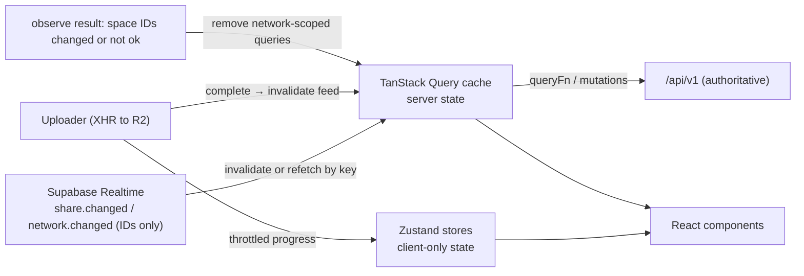
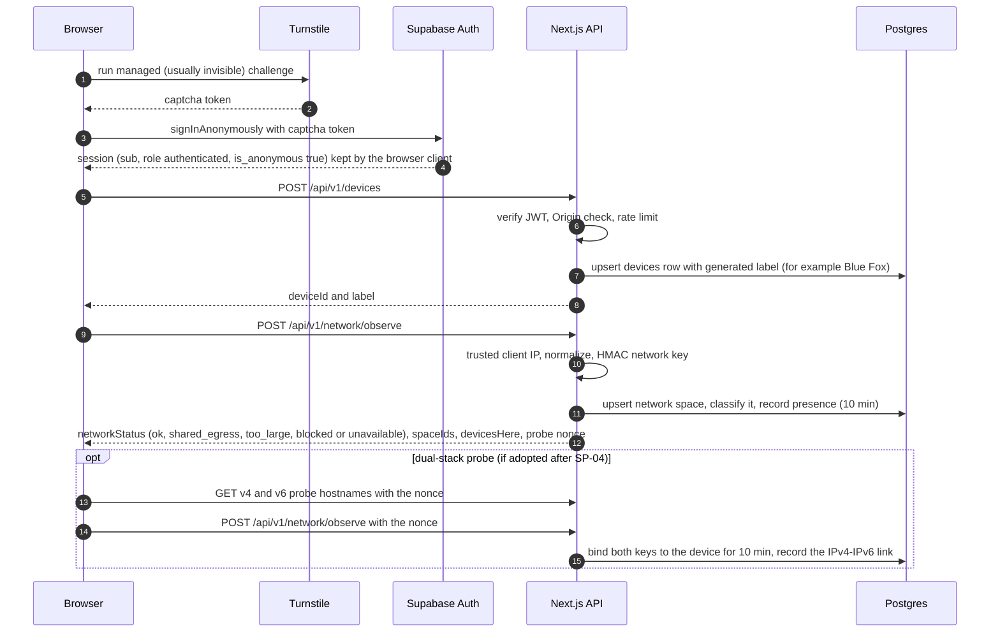
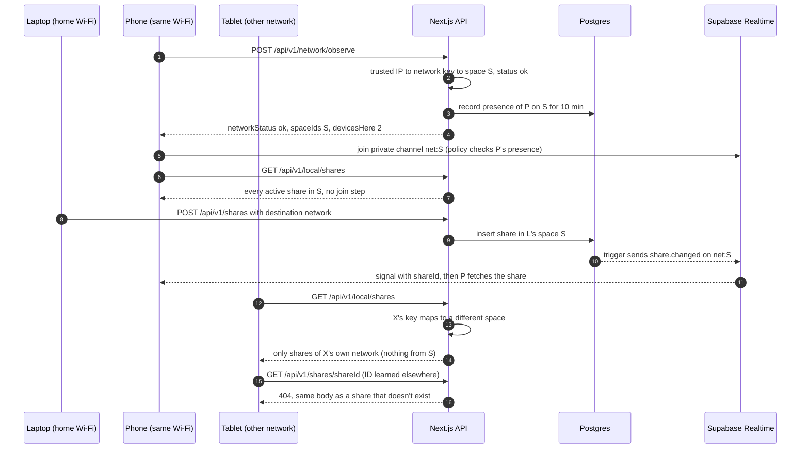
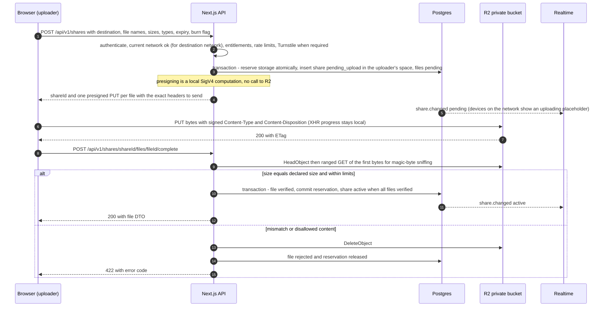
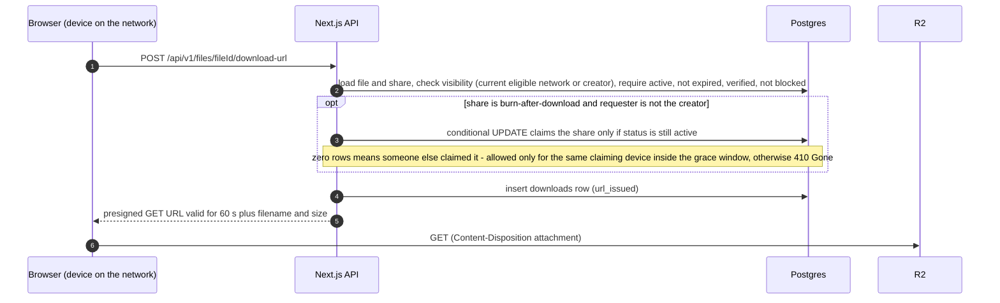
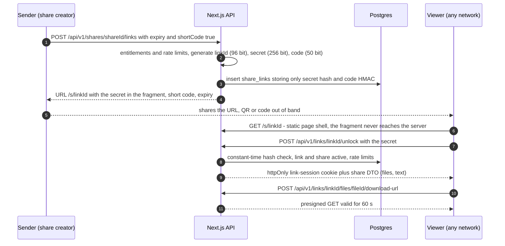
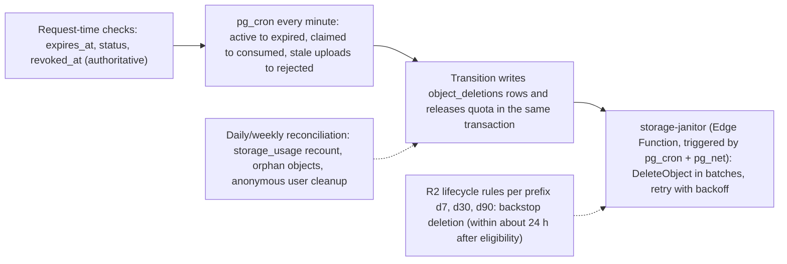

# 02 — System Architecture

| Field | Value |
|---|---|
| Document status | PROPOSED — awaiting owner review |
| Last updated | 2026-10-18 (Phase 4, P4-25: Phase 4 as built, uncommitted and NEEDS REVIEW: §2 Auth, R2, billing and email rows; §3 Supabase Auth for accounts, the billing provider, email and the reconcile job in the component view, responsibilities and trust boundaries (webhook, reconcile secret, device–session binding, room membership, room-link viewers, `aal2`); §3.3 session phases, query keys and providers; §4.3 multipart built; new §4.8 table of Phase 4 flows; §5 the `room:` topic, account events and the topic refusals; §6.1 and §6.2 Phase 4 rows marked built or not, missing routes added; §7 layout as built; §8 `after()`). 2026-10-15 (Phase 2 as built: §3.2 link-viewer boundary, §3.3 link query keys, §6.2 Phase 2 rows implemented plus the code endpoint, §7 layout). Earlier the same day: Phase 1 as built (bearer-token API auth, no session refresh in `proxy.ts`, module layout, preview query key; principle 8 on raw IPs). 2026-09-29 (DEC-035: shadcn/ui initialized); 2026-09-23 (CR-001, DEC-034). |
| Related decisions | DEC-001 … DEC-035 in [06-decisions-and-risks.md](06-decisions-and-risks.md) |
| Related docs | Security and network design in [03](03-security-and-network-design.md). Schema, storage and cleanup in [04](04-database-and-storage-design.md). Plans in [07](07-plans-and-entitlements.md). Deployment in [08](08-deployment-and-operations.md). |

---

## 1. Architecture principles

1. **The server decides the network, on every request, and fails closed.** Local content is visible to every device currently on the same network, with no join step (DEC-031). The network is derived only from the Cloudflare-verified client IP, never supplied by the client, and local mode switches off wherever one IP may cover several networks (DEC-032). Everything outside local mode needs an explicit link grant or, from Phase 4, room membership.
2. **One enforcement point.** All authorization, entitlement, quota and rate-limit decisions happen in server-only code on the Next.js server, or in atomic Postgres functions it calls. The browser never talks to application tables directly (DEC-006).
3. **Bytes bypass the web tier.** File bytes go browser ↔ R2 directly through presigned URLs. The web server handles only small JSON requests (DEC-009).
4. **Realtime carries signals, not data.** Realtime messages carry IDs and state changes. Clients re-fetch authoritative DTOs through the API (DEC-011).
5. **One owner per kind of client state.** Zustand holds client-only state, TanStack Query holds server state, Supabase Realtime only signals changes (DEC-034, §3.3).
6. **Expiry is enforced at request time.** Cleanup jobs reclaim storage but are never the security boundary (DEC-016).
7. **Every secret is a hash at rest.** Link secrets, short codes, invite secrets and passwords are stored only as hashes or HMACs (DEC-013, DEC-014, DEC-021).
8. **Least data.** No raw IPs in the app's tables, query parameters or logs (Supabase Auth's own session IPs: Q-031), no file names in object keys or realtime payloads, text content erased at expiry.
9. **Boring and observable over clever.** Standard SQL, explicit state machines, an outbox for side effects, structured logs with redaction.

---

## 2. Stack evaluation

| Component | Proposed by owner | Verdict | Required changes / notes |
|---|---|---|---|
| **Next.js (App Router)** | Yes | **Keep — confirmed by the owner** (DEC-001 ACCEPTED, 2026-09-23) | The frontend and full-stack framework. Installed: 16.3.8 (16.3.5 until Phase 1, DV1-16). Use route handlers as a JSON API (`/api/v1`), `proxy.ts` for headers, CSP and the origin lock, and a server-only data access layer. `proxy.ts` does not refresh sessions: the browser refreshes its own Supabase session, and the server only verifies the bearer access token (phase 1 DV1-6, DV1-14). Don't route uploads through it. |
| **TypeScript** | Yes | **Keep** | `strict` is already on. Share zod schemas between client and server for API contracts. |
| **Tailwind CSS** | Yes | **Keep** | v4 is installed. |
| **shadcn/ui** | Yes | **Keep — accepted by the owner** (DEC-001, DEC-035, 2026-09-29) | Initialized in Phase 0: Radix base, Nova preset (Lucide, Geist), theme tokens as CSS variables in `app/globals.css`, components in `components/ui/`. Its Radix primitives give accessible dialogs, toasts and menus. Components are copied into the repo, so there is no runtime dependency lock-in. Radix's server-rendered `style` attributes need `style-src-attr 'unsafe-inline'` in the CSP ([03 §11](03-security-and-network-design.md#11-web-security-headers-and-content-security-policy)). |
| **Zustand** | Yes (2026-09-23) | **Add — accepted** (DEC-034) | **Client-only state:** UI state, the upload queue and progress, selected files, temporary state of the current network or room view. Stores are created per request through a context provider (no module-level singletons during server rendering). See §3.3. |
| **TanStack Query** | Yes (2026-09-23) | **Add — accepted** (DEC-034) | **Server state:** file lists, text posts, user data, plans and entitlements, history, network status. Fetches only through `/api/v1`. Provider set up as in the bundled Next.js 16 TanStack Query guide. See §3.3. |
| **Supabase Postgres** | Yes | **Keep** | Put application tables in a private `app` schema that is **not exposed** through the Data API. The server connects through the Supavisor pooler (the direct connection is IPv6-only without an add-on). SQL-first migrations. |
| **Supabase Auth** | Yes | **Keep, with care** | Anonymous sign-ins for devices (Turnstile-protected, scheduled cleanup). Email magic link / OAuth for accounts in Phase 4. Use the new publishable/secret API keys; legacy `anon`/`service_role` keys are being deprecated by end of 2026. **As built (Phase 4, NEEDS REVIEW):** accounts by a 6-digit email code, the email's link as a fallback (P4-23, DV4-143), Google once an OAuth client exists (stubbed in tests), optional TOTP (P4-24); no passwords (D4-2, password sessions refused). Hosted settings unverified ([ARCHITECTURE §5.3](ARCHITECTURE.md#53-authentication-and-sessions)). |
| **Supabase Realtime** | Yes | **Keep, restricted** | **Live update signals only** (DEC-034): new uploads, deleted items, text updates. It updates the TanStack Query cache and never holds state itself. **Private Broadcast channels** fed by database triggers (`realtime.send`), plus **Presence** for online devices. Authorization comes from RLS policies on `realtime.messages`. **Don't use Postgres Changes**: it is single-threaded and runs one authorization check per subscriber per change, and Supabase recommends Broadcast at scale. Never send file data. |
| **Cloudflare R2** | Yes | **Keep** | Private buckets, presigned PUT for uploads (multipart above 100 MB: built in Phase 4, P4-14, tested on RustFS only) and short-lived presigned GET for downloads. Egress is free, which matters most for a file-sharing product. Presigned URLs work only on the S3 endpoint, not on custom domains. |
| **Hostinger** | Yes | **Conditional** | Managed Node.js web apps support Next.js, pnpm, Node 18–24, GitHub deploys and environment variables. **Undocumented:** request timeouts, streaming, client-IP header behaviour, memory limits, graceful shutdown and outbound TCP. SP-01 must pass, otherwise use a Hostinger VPS (Docker + Cloudflare Tunnel) or another Node host (DEC-022). Background jobs never run here. |
| **GitHub** | Yes | **Keep** | Source, Actions CI, branch protection, a deploy branch that is fast-forwarded only after CI and migrations pass. |
| Cloudflare edge (DNS/WAF/Turnstile) | Implied by R2 | **Add** | Required to trust the client IP (origin lock plus `CF-Connecting-IP`), for coarse rate limits and bot protection, and for Turnstile CAPTCHA. |
| Scheduler / janitor | "Cleanup Job" in diagram | **Add** | Supabase Cron (pg_cron) for database state transitions, plus a Supabase Edge Function that deletes R2 objects from an outbox (DEC-017). |
| Billing | Not specified | **Add (Phase 4)** | A merchant-of-record provider such as Paddle, Lemon Squeezy or Polar, chosen by business country and tax needs (DEC-023, Q-005). **As built (Phase 4C):** a provider-neutral core behind a `BillingProvider` interface with a **fake provider only**, refused in production. No provider is chosen (Q-005 open); the real adapter (P4-13) is not built ([ARCHITECTURE §5.10](ARCHITECTURE.md#510-billing-phase-4c-provider-neutral-core)). |
| Error monitoring | Not specified | **Add** | Sentry or equivalent, with URL, fragment, cookie and token redaction (DEC-029). |
| Email | Not specified | **Add (Phase 4)** | Custom SMTP (Resend, Postmark, SES…) for Supabase Auth and invitations. Supabase's built-in email sender is meant for development only. **As built (P4-23, local part only):** Supabase Auth sends every email and the app sends none (D4-7); room invitations are links, not emails. Templates in `supabase/templates/`, tested through Mailpit locally. Custom SMTP, SPF, DKIM and DMARC are written down in [`infra/email/README.md`](../infra/email/README.md) and **not applied** (DV4-145; provider D4-8 open). |

**Alternatives considered and not chosen:**

| Alternative | Why not (now) |
|---|---|
| Supabase Storage instead of R2 | Egress is billed. For a product whose main cost driver is downloads, R2's free egress is decisive. |
| Pure peer-to-peer WebRTC transfer (Snapdrop/PairDrop style) | No persistence, expiry, history or remote links. Both peers must be online. Cross-network transfer needs paid TURN relays. Could return later as an optional "direct transfer" mode for large files between nearby devices that are both online. |
| Uploads through Next.js route handlers | Proxy buffering, memory, timeouts and bandwidth on a small web host. Direct-to-R2 is strictly better. |
| Vercel hosting | Best Next.js fidelity and trustworthy client-IP headers, but the Hobby plan does not allow commercial use and usage-based costs apply. It is the fallback if Hostinger fails SP-01 and a VPS is unwanted. |
| Next.js on Cloudflare Workers (OpenNext) | Closest to R2, with Cron Triggers and Queues. Next.js 16 compatibility must be verified. Re-evaluate in Phase 6. |
| Postgres Changes for realtime | Scalability limits (single-threaded, per-subscriber authorization checks, RLS not applied to DELETE events). |

---

## 3. Component view

```mermaid
flowchart TB
  subgraph Client["Browser"]
    Pages["App pages (React 19, shadcn/ui)"]
    Store["Zustand stores: client-only state (UI, upload queue and progress, selected files, presence roster)"]
    Query["TanStack Query cache: server state (feed, shares, text, me, plans, history)"]
    ApiClient["API client (fetch, zod-typed DTOs)"]
    Uploader["Uploader (XHR PUT to R2, progress, retry)"]
    Realtime["Realtime subscriber (supabase-js, private channels): signals only"]
    SbAuth["Supabase Auth client (anonymous or account session: email code or link, Google, TOTP step; access token sent as a bearer header)"]
    Turnstile["Turnstile widget"]
    QR["QR renderer (client-side): links, room pairing, TOTP setup"]
  end

  Edge["Cloudflare: DNS, TLS, WAF, rate limiting, Turnstile verification API, request-header rule adds origin secret"]
  Provider["Billing provider, merchant of record (Phase 4C: not chosen, Q-005; only a local fake exists)"]
  Mail["Email: custom SMTP (not applied); Mailpit locally"]

  subgraph Next["Next.js 16 server (Node.js)"]
    Proxy["proxy.ts: request id, origin lock, CSP nonce + headers"]
    Routes["Route handlers /api/v1/* (thin; withApi, or withWebhook for the billing webhook and the internal reconcile route)"]
    subgraph DAL["lib/server (import 'server-only')"]
      Auth["auth: session → principal (aal, amr) + device bound to the session; MFA rule"]
      Accounts["accounts (Phase 4A): profile, merge, deletion"]
      Policy["policy: authorization rules"]
      Ent["entitlements: plan resolution (Phase 4B: Free, Pro, overrides, snapshots)"]
      Billing["billing (Phase 4C): provider interface, webhook, sync, checkout, reconcile"]
      Quota["quota: storage reservations"]
      RL["ratelimit"]
      Net["network: trusted IP, normalize, HMAC key, classify, presence, dual-stack binding"]
      Local["local: network feed, visibility rule"]
      Rooms["rooms (Phase 4D): private rooms, members, invites, QR pairing"]
      Shares["shares: upload (multipart), verify, text, download, burn, extend"]
      Links["links: tokens, codes, grants, passwords, room links"]
      History["history (Phase 4D): transfer history"]
      Storage["storage: R2 client, presign, verify, sniff, keys, multipart"]
      Audit["audit + download log"]
    end
  end

  subgraph Supabase
    AuthSvc["Auth"]
    DB[("Postgres: schema app + realtime")]
    RT["Realtime"]
    Cron["pg_cron jobs"]
    Janitor["Edge Function storage-janitor"]
  end

  R2[("R2 bucket (private)")]

  Pages --> Store
  Pages --> Query --> ApiClient --> Edge --> Proxy --> Routes --> DAL
  Uploader -- "progress" --> Store
  Realtime -- "invalidate / refetch by ID" --> Query
  DAL --> DB
  Storage -. "SigV4 presign (local), HeadObject, ranged GET, DeleteObject" .-> R2
  Uploader --> R2
  Pages -- "presigned GET" --> R2
  SbAuth --> AuthSvc
  AuthSvc -- "codes and links (Auth sends every email)" --> Mail
  Realtime <--> RT
  DB -- "triggers: realtime.send" --> RT
  Cron --> DB
  Cron -- "pg_net POST (secret)" --> Janitor --> R2
  Janitor --> DB
  Cron -- "pg_net POST, bearer secret: daily reconcile (flag off by default)" --> Edge
  Provider -- "signed webhook" --> Edge
  Billing -. "checkout, portal, fetch state (API key)" .-> Provider
  Pages -- "hosted checkout and portal" --> Provider
```



**As built (Phase 4, NEEDS REVIEW):** the diagram above now includes Phase 4's parts. Supabase Auth is the identity provider for permanent accounts as well as anonymous devices. The billing provider is reached only through its adapter and its signed webhook; only the fake adapter exists, and it is refused in production. Auth sends every email; SMTP is not set up. The daily reconcile job posts to an internal route of the web app, never to the provider. Details: [ARCHITECTURE §3](ARCHITECTURE.md#3-high-level-architecture), [§5.3](ARCHITECTURE.md#53-authentication-and-sessions), [§5.10](ARCHITECTURE.md#510-billing-phase-4c-provider-neutral-core).

### 3.1 Responsibilities

| Component | Owns | Must never |
|---|---|---|
| Browser app | UX, local upload progress, QR rendering, realtime-triggered re-fetches | Hold service credentials. Make authorization decisions. Read `app` tables. |
| Zustand stores (browser) | Client-only state (§3.3) | Hold server data, secrets or presigned URLs. Persist anything but harmless preferences. |
| TanStack Query cache (browser) | Server state fetched through `/api/v1` (§3.3) | Outlive the network it came from (removed on network change). Be persisted to storage. As built (Phase 4): room, account and history keys aren't network-scoped and survive a network change; the whole cache is cleared when the Auth user changes. |
| Supabase Realtime client | Live update signals that invalidate or refetch queries | Carry or hold content. Act as a data source. |
| `proxy.ts` | Request ID, origin-lock check, security headers and CSP nonce. (No session refresh: the browser refreshes its own Supabase session; phase 1 DV1-6.) | Authorize access to resources. Query the database. |
| Route handlers | Parse and validate input (zod), call one service, map result to DTO and HTTP status | Contain business rules or SQL |
| Services (`lib/server`) | Authorization, entitlements, quotas, rate limits, state transitions, presigning, audit | Return raw rows to the client. Log secrets. |
| Postgres | Source of truth. Constraints. Atomic functions (claim, reserve, attempt counters). Triggers that emit realtime signals. Cron state transitions. | Store file bytes, raw IPs or plaintext secrets |
| Supabase Realtime | Deliver ID-only signals and presence to authorized subscribers | Carry file bytes, file names, text content or URLs |
| R2 | File bytes, with Content-Type and Content-Disposition fixed at upload | Be publicly readable. Be the expiry authority. |
| Storage janitor | Delete objects listed in the deletion outbox, abort stale multipart uploads, reconcile orphans; since P4-14 abort an outbox row's multipart upload, since P4-15 copy an extended share's objects to a longer-lived key | Decide what is expired (the database decides) |
| Cloudflare | TLS, coarse rate limits, WAF, the only path to the origin, a trustworthy client IP | Cache API or HTML responses containing user data |
| Supabase Auth (Phase 4A, as built) | Identity for anonymous devices and permanent accounts: email code or link, Google (no OAuth client yet), optional TOTP factors (P4-24); sessions and their `aal`; every email the product sends (P4-23) | Decide what a user may see or do (the API does, from the verified token). Hand the app's server an email code or a TOTP key. |
| Billing provider (Phase 4C, as built: fake only) | Hosted checkout and portal, subscription state, payments, refunds and disputes, receipts (merchant of record) | Grant Pro by a redirect or a webhook payload: the app fetches the state from the provider and only `app.apply_subscription_state` writes it (fetch-on-event) |
| Email (Phase 4, P4-23 local part) | Delivering Auth's codes and links (Mailpit locally; custom SMTP not applied) | Carry anything the app composed: the app sends no email (D4-7) |
| Billing reconciliation (Phase 4C, D4-22) | pg_cron → `app.trigger_billing_reconcile()` → pg_net → `POST /api/v1/internal/billing/reconcile`; the web app fetches changes from the provider and applies them | Hold the provider's API key in the database. Post anything while the `billing_reconcile` flag is off (the default). |

### 3.2 Trust boundaries

| Boundary | Crossing | Control |
|---|---|---|
| Internet → Cloudflare | All traffic | TLS, WAF, rate-limit rule, bot protection |
| Cloudflare → origin | HTTP requests | Origin secret header (Transform Rule) checked in `proxy.ts`. `CF-Connecting-IP` trusted **only** when the secret is valid (DEC-004). Better: Cloudflare Tunnel on a VPS. |
| Browser → API | JSON over HTTPS with the Supabase access token as `Authorization: Bearer` (phase 1 DV1-14) | JWT verification, device ownership check, Origin check on mutations, zod validation, rate limits. **As built (Phase 4A):** the token must carry a `session_id`, and `X-Device-Id` must name a non-revoked device of the user **bound to that Auth session** (C4-2; else `401 DEVICE_UNKNOWN`); a revoked device gets `401 DEVICE_REVOKED` while its token lives (revocation deletes the Auth session); password sessions are refused (D4-2). **P4-24:** an account with a verified authenticator is served only at `aal2` (`403 MFA_REQUIRED` on every route, DV4-146). |
| Browser → Supabase Auth (Phase 4A, as built) | Email code or link (PKCE), Google, TOTP enrolment and challenge | The app's server never sees a code or a TOTP key. "Confirm email" must stay on (F4-1). Auth ends an account's other sessions when its first factor is confirmed. Hosted settings unverified. |
| Link viewer → API (Phase 2, as built) | JSON over HTTPS; the link secret once in the unlock body (or a short code), then only the httpOnly `__Host-link_session` cookie | Timing-safe HMAC check with a uniform 404, grants re-checked with the link and share on every request, Origin check on mutations, SameSite=Lax, rate limits per link, network key and session. **P4-16:** a password link also needs the grant's proof of the current password version (scrypt, DV4-70; [ARCHITECTURE §9.9](ARCHITECTURE.md#99-password-protected-links-phase-4d-p4-16)). |
| Room-link viewer → API (P4-19, as built) | The same link-session cookie and grant, for a link whose target is a room | Every file, preview, Reveal, "Got it" and report resolves its share **inside the link's room** (`404` otherwise); the viewer DTO has no room name, members, settings or posters; no short codes (DV4-108); the room's deletion revokes its links ([phase 4 §26.3](phases/phase-4-pro-accounts.md#263-the-room-link-security-model)) |
| Room member → API (P4-17, as built) | Room routes and room shares, from any network | **Membership is a new authorization dimension:** a room is found only through the caller's own active membership, a member by an opaque ID inside it, an invite by its secret (an HMAC, timing-safe) or the caller's ownership of its room. One `404` for "doesn't exist" and "not yours"; members asking for an owner's action `403 NOT_OWNER`. Posting checks membership twice, the second time under row locks. A removed member is refused at the next request ([phase 4 §24.3](phases/phase-4-pro-accounts.md#243-the-room-authorization-model)). |
| Browser → R2 | Presigned URLs | Scoped to one object and one method. Short TTL. Content-Type/Disposition signed. Bucket CORS limited to app origins. |
| Browser → Supabase Realtime | WebSocket with the user's JWT | Private channels only ("Allow public access" disabled). RLS on `realtime.messages`. As built (Phase 4): the same session rules as the API (§5.2). |
| Next.js → Postgres | Pooled TCP (TLS) | Dedicated DB role with least privilege on the `app` schema. Credentials in env. |
| Supabase Cron → Edge Function | HTTPS via pg_net | Shared secret stored in Supabase Vault |
| Billing provider → API | Webhook | Signature verification, idempotent event log, timestamp tolerance. **As built (Phase 4C, fake provider only):** `POST /api/v1/billing/webhook` behind `withWebhook` (no Origin or JSON check, raw body ≤ 256 KB); an HMAC over the raw bytes with the current or previous secret (timing-safe) and a signed timestamp within 300 s, else `400` and nothing stored; one stored event per provider event ID; the state applied is always **fetched from the provider**. The origin lock still applies, so the webhook must come through Cloudflare (Access bypass on staging: not set up). |
| Next.js → billing provider (Phase 4C) | HTTPS with the provider's API key | The key stays in the web tier (env, never the database or the browser); checkout bodies are strict and the subject is always the caller |
| Supabase Cron → internal reconcile route (Phase 4C, D4-22) | `POST /api/v1/internal/billing/reconcile` via pg_net, to the app origin's URL kept in Vault | Bearer `BILLING_RECONCILE_SECRET` (URL and secret in Vault), compared in constant time with the current and previous value; `withWebhook`; a session token is never enough; 6 per hour for the whole deployment; nothing is posted until the `billing_reconcile` flag is on (off by default) |

### 3.3 Frontend state management (DEC-034)

Each kind of client state has exactly one owner.

| Layer | Owns | Examples in this product | Must never |
|---|---|---|---|
| **Zustand** | **Client-only state** | Open dialogs and tabs, selection, composer drafts; the **upload queue and per-file progress**; **selected files** before upload; **temporary state of the current network or room view** (the Presence roster for "N devices here now", realtime connection status) | Copy server data, hold secrets or presigned URLs, persist anything except harmless preferences |
| **TanStack Query** | **Server state**, fetched only through `/api/v1` | Local feed and **file lists**, share details and **text posts**, "My uploads", the current network status (the `observe` result), **user data**, entitlements and **plans**, transfer **history**, link-viewer content | Be written by anything except query functions, mutations, and realtime-triggered updates |
| **Supabase Realtime** | **Live update signals only** | **New uploads, deleted items, text updates** (`share.changed`), network status changes (`network.changed`), Presence. As built (Phase 4): `account.changed`, `membership.changed`, and on `room:` topics `member.changed`, `room.updated`, `room.deleted` (§5.2) | Hold state or deliver content. Payloads are IDs only (DEC-011). |



**Query keys** (one `queryOptions` factory per resource in `lib/client/queries/*`, rule 11 of DEC-034):

| Key | Data | Freshness |
|---|---|---|
| `['network', 'current']` | `observe` result: status, space IDs, devices here now | Written by the 5-minute `observe` heartbeat and on `focus`/`online` |
| `['local', 'feed', spaceIds]` | Local feed for the current network | Realtime-invalidated. Refetch on focus. **Removed when the space IDs change.** |
| `['share', shareId]` | Share detail, including text | Realtime-invalidated. Removed on `404`/`410`. |
| `['me', 'shares']` | My uploads (from any network) | Invalidated by `share.changed` on the `user:` topic |
| `['preview', fileId]` | 300 s preview URL for an image (Phase 1) | Refetched after 4 minutes. Removed with the network's other data. |
| `['me']`, `['me', 'entitlements']` (Phase 4) | Account, plan, limits | Refetch on focus. **As built (4A, DV4-11):** `['me', 'account']` (`GET /me`) and `['me', 'devices']` instead of `['me']`, which is the prefix of every `me` key. `['me', 'account']` loads on the settings pages and, for an account, on every page (P4-22's deletion banner). `['me', 'entitlements']` (Phase 3, extended in 4B) is stale after a minute and polled every 2.5 s for up to 2 minutes while the billing page confirms a checkout. Both are invalidated by `account.changed`. |
| `['history', …]` (Phase 4) | Transfer history | On demand. **As built (P4-20):** `['history', 'shares', filters]` and `['history', 'downloads', filters]`, the filters from the page's URL; no Realtime; not network-scoped. |
| `['link', linkId, 'content']` (Phase 2) | Link-viewer DTO | 30 s refetch interval and on focus. No Realtime. As built: a 404 or 410 replaces the content and stops polling; previews are `['link', linkId, 'preview', fileId]`. |
| `['me', 'links', shareId]` (Phase 2, as built) | The creator's links to a share (no secrets) | While the share-link dialog is open; invalidated after create, revoke or a new code |
| `['room', roomId, 'shares']` (Phase 4) | Private-room content | Realtime-invalidated on `room:`. **As built (P4-17 … P4-19):** also `['rooms']` (the caller's rooms, invalidated by `membership.changed`), `['room', roomId]`, `[…, 'members']`, `[…, 'invites']` (the owner's open invites and pairing codes, never their secrets) and `[…, 'links']` (the owner's room links, never their secrets). Invalidated by `room:{id}` signals and on (re)subscribe. **Not network-scoped:** a network change keeps them; a `404` for the room removes its feed, members and invites. |

Keys as built: `lib/client/queries/keys.ts`; full table in [ARCHITECTURE §4.5](ARCHITECTURE.md#45-who-owns-which-state-dec-034).

**Session phases (Zustand `session` store, as built through P4-24).** The bootstrap (`lib/client/runtime.tsx`) runs once per Auth session and sets one phase:

| Phase | When |
|---|---|
| `starting` | Until the bootstrap finishes, and again after another user or session takes over the browser |
| `ready` | The device is registered for this session; `anonymous` says whether the user is anonymous or an account |
| `device_limit` | Phase 4A: an account at its 10-device cap (D4-5); only the device list works |
| `mfa` | P4-24: registration answered `403 MFA_REQUIRED`; `BootState` shows the authenticator step, then restarts the app at `aal2` |
| `error` | Any other failure, a suspended account included ("This account is suspended") |
| `not_configured` | No public config on this server |

A revoked device, or a session Auth no longer has (the account was deleted, or Auth ended it when a factor was added), is signed out locally and starts again as a new anonymous user with the notice "This device was signed out". A new session of the **same** user (an upgrade or an email change) only re-registers, which rebinds the device (DV4-16).

**Rules that matter for security** (full list in DEC-034):

- **Leaving a network clears its data.** When `observe` reports different space IDs, or a status other than `ok`, the client removes every `['local', …]` query and open share queries that belong to that network. It doesn't just hide them. Then it drops the old `net:` channel. This keeps G3 true on screen and in memory (RISK-027).
- **Changing user clears the whole cache** (as built, Phase 4A). When the bootstrap finds a different Auth user than before (sign-in, sign-out, merge, revocation), it clears the query cache before registering, so no data of one user is shown to the next.
- **Realtime never writes content into a cache.** It passes IDs; the query layer fetches through the API, which re-checks the network on every request.
- **No persistence** of the query cache. Zustand `persist` only for harmless preferences.
- **Request isolation during server rendering:** a new `QueryClient` per server render and one reused in the browser, as in the bundled Next.js 16 TanStack Query guide. Zustand stores are created per request through a context provider.
- **No server-side caching of network- or secret-dependent data** (`use cache`, Cache Components, `fetch` caching). The local feed depends on the requester's IP, so a shared cache would show one network's content to another. Such data is fetched in the browser after hydration. Link-viewer content is always client-side, because its secret is in the URL fragment.
- **Retries:** none for `4xx`. `429` waits for `Retry-After`. Network errors and `5xx` are retried with backoff.

**Providers:** `lib/client/providers.tsx` (a `'use client'` component) renders `QueryClientProvider` and the Zustand store providers. It is rendered from the root layout, because the home page is the app. Revisit when marketing pages are added (Phase 4 pricing page). **As built (Phase 2 DV2-12, Phase 4):** one provider layer per route group instead. The root layout has only `RootProviders` (public config, CSP nonce). `(app)` has `AppProviders`: the query client, the Zustand stores and the runtime. `(share)` has `ViewerProviders`: the query client only, no Supabase. `(auth)` (Phase 4A) has `AuthProviders`: the Supabase client and an API client, with **no bootstrap**, so `/login` never creates an anonymous user (C4-1). `(marketing)` (`/pricing`, Phase 4B) and `(legal)` have none ([ARCHITECTURE §4.4](ARCHITECTURE.md#44-providers-and-bootstrap)).

---

## 4. Key flows

### 4.1 Device bootstrap (first visit)



Anonymous sign-in happens only when the app shell loads (not for bots that don't run JavaScript). Share-link **viewers** do not create Supabase users (see §4.6 and RISK-006).

**As built (Phase 4A, P4-24):** the bootstrap reuses a stored session (anonymous or an account) and signs in anonymously only without one. For an account it first redeems a merge still pending from the sign-in (§4.8). `POST /api/v1/devices` registers, refreshes or **rebinds** the device to this Auth session; a rebound device's presence ends, so the new session must observe from its own network (DV4-7). Registration may answer `409 DEVICE_LIMIT`, `401 DEVICE_REVOKED`, `403 USER_SUSPENDED` or `403 MFA_REQUIRED`, which set the session phases in §3.3. The dual-stack probe is still not built (DV1-3).

### 4.2 Local mode: same network, no join step



When the phone leaves the Wi-Fi, its next request derives a different network key, so S's shares return 404 and the client moves to its new network's channel. The visibility rule is specified in [03 §3.6](03-security-and-network-design.md#36-visibility-rule-and-presence).

### 4.3 File upload (single PUT up to 100 MB; multipart above, built in Phase 4)

**As built (P4-14, NEEDS REVIEW):** the single PUT below is unchanged. A file above 100 MB (Pro only; Free stops at 100 MB) is planned by the server at `POST /api/v1/shares` (a `MULTIPART` target with part size and count, no URL); the browser asks for part URLs 20 at a time, each signed for its part's size; completion lists the parts in storage and checks every one before `CompleteMultipartUpload`; cancel, rejection, the 24-hour deadline and a share ending all abort through the outbox and the janitor; a reload resumes the missing parts. Pro's 5 GB is delivered (DV4-17 closed). Tested on RustFS only, not on R2 (SP-02). Sequence and rules: [ARCHITECTURE §7.9](ARCHITECTURE.md#79-multipart-uploads-phase-4d-p4-14).



### 4.4 Download on the network (including burn-after-download)



### 4.5 Text item create and edit

- Create: `POST /api/v1/texts {content, expiresIn, destination}` creates a `shares` row (`kind = 'text'`) and a `text_items` row. A trigger emits `share.changed`.
- Edit (the creator only for local shares, Q-021): `PATCH /api/v1/shares/{shareId}/text {content, version}` runs `UPDATE … WHERE version = $version`. Zero rows returns **409 Conflict** with the current version. The client shows "updated on another device" and offers a reload. There is no character-level merging or CRDT (DEC-027).

### 4.6 Remote share link: create, open, download



Short code path: `POST /api/v1/codes/resolve {code}` creates the same link grant directly (valid for at most 12 h and never beyond link expiry) and returns only the `linkId`. The long-lived secret is **not** revealed through the short-lived code.

**As built (P4-16):** on a password link the unlock (or the code) answers `409 PASSWORD_REQUIRED { linkId }` with the session cookie, and the grant opens nothing until `POST /api/v1/links/{linkId}/password` proves the password (`204`); the unlock may carry the password itself. **P4-19:** a room link uses the same path and shows the room's posts (§4.8).

### 4.7 Expiry and cleanup (summary)



Details: [04 §9](04-database-and-storage-design.md#9-expiry-and-cleanup-architecture).

### 4.8 Phase 4 flows (as built, NEEDS REVIEW)

Built locally and uncommitted; nothing is deployed. Each row is a summary; the linked sections hold the sequence and the rules.

| Flow | As built | Details |
|---|---|---|
| Sign-in, and the upgrade that keeps the user ID | An anonymous browser adds an email to itself (`updateUser({ email })`), then the 6-digit code (`verifyOtp`, type `email_change`): the **same user** becomes permanent, so nothing moves. Verifying issues a new session; the device is rebound without resetting the page. A browser with no session signs in with `signInWithOtp`. The email's link also works, through `/auth/callback#confirm=…` and a click on **Continue** (DV4-143). Google uses `linkIdentity` for the upgrade (no OAuth client exists; stubbed in tests). | [ARCHITECTURE §5.3](ARCHITECTURE.md#53-authentication-and-sessions), [phase 4 §18](phases/phase-4-pro-accounts.md#18-phase-4a-implementation-2026-10-16), [§30](phases/phase-4-pro-accounts.md#30-phase-4d-tenth-task-p4-23-email-2026-10-18) |
| Merge into an existing account | Supabase answers `email_exists`, and the page offers the merge. The anonymous session creates an intent (`POST /account/merge-intents`: a 256-bit secret shown once, an HMAC stored, bound to the device, 24 h). The browser signs in to the account by code, then redeems the intent (`POST /account/merge-anonymous`: the account's token, the anonymous device's ID and the secret). `app.merge_anonymous_user` moves every owned row in one transaction, binds the device to the account session and deletes the anonymous user. A failure leaves the intent open, and the browser retries at its next start. | [ARCHITECTURE §5.3](ARCHITECTURE.md#53-authentication-and-sessions), [phase 4 §17.9](phases/phase-4-pro-accounts.md#179-account-merge-security-review-risk-024), [§28](phases/phase-4-pro-accounts.md#28-phase-4d-eighth-task-p4-21-merge-and-deletion-coverage-for-rooms-history-and-links-2026-10-18) |
| The MFA step | Enrolling (account settings: a QR code drawn in the browser, then the first code) makes the session `aal2`, and Auth ends the account's other sessions. From then on an `aal1` session gets `403 MFA_REQUIRED` on every route and on Realtime (DV4-146). The bootstrap's `mfa` phase shows the authenticator step (`challengeAndVerify`), then restarts the app. A session Auth ended signs out. A pending merge waits for the step. A lost authenticator: [`runbooks/accounts.md`](runbooks/accounts.md). | [phase 4 §31.3](phases/phase-4-pro-accounts.md#313-the-mfa-lifecycle-as-built) |
| Upgrade to Pro (fake provider only) | `/settings/billing` → `POST /billing/checkout` (`Idempotency-Key` required) → the provider's hosted checkout. The provider's signed webhook → `withWebhook` → stored once → the subscription **fetched from the provider** → `app.apply_subscription_state` → `account.changed` → the client refetches `['me', 'entitlements']`. The return page only polls. No real provider (Q-005, P4-13). | [ARCHITECTURE §5.10](ARCHITECTURE.md#510-billing-phase-4c-provider-neutral-core), [`runbooks/billing.md`](runbooks/billing.md) |
| Extend | `POST /shares/{id}/extend { expiresIn }` (Pro, the creator). The share is extended in place (`200`) when every object outlives the new expiry by a day; otherwise `202` pending: the janitor copies each file to a longer-lived key, and the last copy swaps the keys in one transaction. The old keys are deleted through the outbox. | [ARCHITECTURE §7.10](ARCHITECTURE.md#710-extending-a-share-phase-4d-p4-15) |
| Private room and invite link | A Pro owner creates a room (`POST /rooms`) and an invite link (`POST /rooms/{id}/invites`, kind `invite_link`): `/j/{inviteId}#k={secret}`, the secret stored as an HMAC and returned once. The join page strips the fragment, previews the room (`POST /invites/{id}/preview`) and joins only on *Join* (`…/accept`). `app.accept_room_invite` re-checks everything under the room and invite locks. Members post with `destination: { room }`, from any network. | [ARCHITECTURE §9.10](ARCHITECTURE.md#910-private-rooms-phase-4d-p4-17-p4-18-p4-19), [phase 4 §24](phases/phase-4-pro-accounts.md#24-phase-4d-fourth-task-p4-17-private-rooms-2026-10-18) |
| QR pairing | The owner's *Show QR code* dialog creates an invite of kind `pairing` (one use, 10 minutes, any plan) and draws its URL in the browser. A phone's camera opens `/j/{inviteId}`, which previews and joins on *Join*. Closing the dialog revokes an unused code. There is no in-app scanner (DV4-106). | [phase 4 §25](phases/phase-4-pro-accounts.md#25-phase-4d-fifth-task-p4-18-qr-pairing-2026-10-18) |
| Read-only room link | The owner (Pro) creates it with `POST /rooms/{id}/links`; the URL is shown once. A viewer unlocks it like a share link (§4.6) and polls the room's active shares by cursor. Each file, Reveal, "Got it" and report names its share, which is checked against the link's room. There is no short code, and deleting the room revokes the link. | [phase 4 §26](phases/phase-4-pro-accounts.md#26-phase-4d-sixth-task-p4-19-read-only-room-links-2026-10-18) |
| Account deletion | `DELETE /me` needs a sign-in from the last 10 minutes (the dialog emails a code when the sign-in is older, DV4-140), and `aal2` when an authenticator is set. It answers `202 { scheduledFor }` (7 days) and stops the subscription renewing. During the grace the account is read-only, every page shows a banner, and `POST /me/deletion/cancel` works until the date. Then the hourly `delete-due-accounts` job (pg_cron only) deletes the account. Its browsers start again anonymously. | [phase 4 §29.3](phases/phase-4-pro-accounts.md#293-the-deletion-lifecycle-as-built), [`runbooks/account-deletion.md`](runbooks/account-deletion.md) |

---

## 5. Realtime architecture

### 5.1 What uses realtime and what does not

| Event / need | Realtime? | Mechanism | Payload / notes |
|---|---|---|---|
| New text item appears | **Yes** | DB trigger → Broadcast `share.changed` on `net:{spaceId}` (or `room:{roomId}` from Phase 4; as built in P4-17, room shares never reach a `net:` topic) and on the creator's `user:{userId}` | `{v, type, shareId, status}`. The client fetches the DTO. |
| Expiry changes and extensions (P4-15, as built) | **Yes** | `share.changed` when a share's expiry changes; an extension starting, failing or being cancelled signals the creator's `user:` topic only (DV4-66) | Same payload |
| Text edited | **Yes** | Trigger on `text_items` version change | `{shareId, version}` |
| File metadata appears | **Yes** | `share.changed` with `pending_upload`, then `active` | Placeholder first, then the full item after verification |
| Item deleted / expired / claimed / blocked disappears | **Yes** | `share.changed` with the new status | Clients remove it immediately |
| Network status changes (for example to `too_large`) | **Yes** | `network.changed` on `net:{spaceId}` | Clients hide local content and show the status message |
| Devices on this network | **Yes** | Presence on `net:{spaceId}` | `{deviceId, label, platform}`, present devices only. Drives "N devices here now". |
| Moving to another network | **No** (client-side) | Re-observe on `online`, `focus` and connection changes; drop the old `net:` channel and join the new one | The API re-derives the network on every request anyway |
| Private-room member joined / removed (Phase 4) | **Yes** | `member.changed` on the room topic, `membership.changed` on `user:{userId}` | A removed device drops the channel and clears cached room data. **As built (P4-17):** `member.changed { change }` (no user ID, DV4-100), `membership.changed { roomId, change }`; also `room.updated` and `room.deleted` on `room:{id}`. The removed browser refetches, gets `404` and drops the room's channel and its feed, members and invites. |
| Upload progress | **No** (local) | XHR `upload.onprogress` in the uploading browser | Other devices see only an "uploading…" placeholder. Optional later: throttled ephemeral broadcast (≤ 1 msg / 2 s). |
| Share-link viewer page | **No** | TanStack Query refetch every 30 s and on focus | Link viewers have no Supabase session (cost and simplicity) |
| File bytes, presigned URLs, text content, passwords, link secrets | **Never** | — | Realtime messages persist in `realtime.messages` for replay (≥ 72 h, ≤ 4 days) |
| Subscription / plan changes (Phase 4) | Optional | `account.changed` on the user topic, or re-fetch on focus | — **As built: Yes.** `account.changed { v, type }` (no IDs) on `user:{id}`, from triggers when the subscription changes (4C) and when the account's deletion state changes (P4-22, DV4-141). The client refetches `['me', 'account']` and `['me', 'entitlements']`. |

### 5.2 Topics and authorization

All channels are **private** (`config: { private: true }`), with "Allow public access" disabled in Realtime settings.

| Topic | Who may receive | Who may track Presence | Client broadcast sends |
|---|---|---|---|
| `net:{spaceId}` | Devices the server recorded as present on that space in the last 10 minutes, while the space is `ok` | Present devices | **Denied**. Only database triggers send. |
| `room:{roomId}` (Phase 4) | Active members of the room | Active members | Denied |
| `user:{userId}` | That user only | — | Denied |
| `workspace:{workspaceId}` (Phase 5) | Active workspace members (admin events filtered by event type) | — | Denied |

Policies live on `realtime.messages` and call a `SECURITY DEFINER` helper, `app_realtime.can_access_topic(topic text)`, which checks presence or membership for `auth.uid()`. SQL sketch in [04 §6](04-database-and-storage-design.md#6-row-level-security-grants-and-realtime-authorization).

**As built (Phase 4, NEEDS REVIEW; latest version in `20261018180000_phase4_mfa.sql`).** `can_access_topic` reads the token's `sub`, `session_id`, `amr` and `aal`:

| Topic | Who may receive (as built) | Presence | Events |
|---|---|---|---|
| `net:{spaceId}` | Since 4A, **the session whose bound device** is present on the space (within 10 minutes), the device not revoked, the user not suspended, the space `ok`, local sharing on. Before 4A any present device of the user counted (C4-2). | The same sessions | `share.changed`, `network.changed` |
| `room:{roomId}` (P4-17) | An active member of the open room, whose session is bound to a non-revoked device of theirs, not suspended (DV4-98) | **Nobody**: the presence policy allows `net:` only, so a room never shows who is online or where | `share.changed`, `member.changed`, `room.updated`, `room.deleted` |
| `user:{userId}` | That user only, on every browser of an account | Nobody | `share.changed`, `account.changed` (4C, P4-22), `membership.changed` (P4-17) |

**Refused on every topic:** a token without a `sub`, or a malformed topic (on `net:` and `room:` also a token without a `session_id`); a password session (D4-2); the session of a revoked device, whose access token stays valid until it expires (4A); and, since P4-24, a token below `aal2` (no `aal` claim counts as `aal1`) of an account with a verified authenticator. The API refuses the same sessions (§3.2). Workspace topics are not built (Phase 5). Details: [ARCHITECTURE §12.4](ARCHITECTURE.md#124-channel-authorization), [phase 4 §24.5](phases/phase-4-pro-accounts.md#245-the-realtime-security-model).

### 5.3 Delivery semantics and client rules

- Broadcast is treated as **at-most-once**. On (re)subscribe, the client **invalidates** the affected TanStack Query keys (local feed, open shares, My uploads) so they refetch. Broadcast Replay (`since`, max 25 messages, private channels only) may be used to shorten catch-up, but correctness never depends on it.
- A realtime handler only invalidates, refetches or removes query keys (§3.3). Anything it places in the cache comes from an API fetch, never from the payload, which holds only IDs. It never writes server data into Zustand. Presence events update the Zustand presence roster.
- Cache updates are idempotent, keyed by `shareId` plus `version` / `updatedAt`.
- **Revocation lag:** Supabase caches channel authorization for the connection until the client sends a new access token. When a device leaves a network (or, from Phase 4, a private-room member is removed), the well-behaved client unsubscribes. A malicious client could keep receiving **ID-only** signals until its JWT is refreshed or it reconnects; by then its presence has expired (10 min), so the check fails. That is why payloads never contain names or content (RISK-007). All data access goes through the API, which re-derives the network on every request. As built (Phase 4): the same lag applies to a **revoked device's** channel until its access token expires (at most 1 hour), and to a removed room member until its token refreshes or it reconnects; every API request refuses them at once.
- Cost control: one `net:` channel (two with dual-stack binding) plus one user channel per tab. Disconnect after 5 minutes hidden (Page Visibility API) and reconnect on focus. As built (P4-17): a room page adds one `room:` channel, with the same hidden-tab rule.

---

## 6. API design

### 6.1 Conventions

| Concern | Convention |
|---|---|
| Base path | `/api/v1/…`. Breaking changes go to `/api/v2`. |
| Format | JSON request and response bodies. Mutating requests must send `Content-Type: application/json`. |
| Authentication | **As built in Phase 1 (DV1-14):** the browser sends its Supabase access token as `Authorization: Bearer …`; the server verifies it on every request (`getClaims`: JWKS with asymmetric keys, otherwise the Auth server) and never refreshes it. An expired token gets 401 and the client refreshes and retries once. (Planned: `@supabase/ssr` session cookies.) Link viewers (Phase 2) use a separate httpOnly `link_session` cookie. **As built (Phase 4A, P4-24):** the token must carry a `session_id`; password sessions are refused; an account with a verified authenticator needs `aal2` on every route (`403 MFA_REQUIRED`). |
| Device binding | `X-Device-Id` header, verified to belong to the authenticated user. **As built (4A, C4-2):** and to be bound to the token's Auth session (`401 DEVICE_UNKNOWN` otherwise; `401 DEVICE_REVOKED` for a revoked device). Registration, the device list, revocation and the merge redemption need only a session. |
| CSRF | Mutations require an exact `Origin` match against configured app origins and a JSON content type (a body-less `DELETE` needs only the Origin, DV1-13). The bearer header can't be sent by another site. GET never mutates. **As built (4C):** the two `withWebhook` routes (the billing webhook, the internal reconcile route) skip both checks and authenticate their caller by a signature or a bearer secret; a unit test fails if any other route uses that wrapper. |
| Validation | zod schemas in `lib/shared/api/*`, used by both client and server |
| Errors | `{ "error": { "code": "SHARE_EXPIRED", "message": "…", "requestId": "…" } }`. Resources outside the caller's scope return **404** (not 403) to avoid revealing existence. |
| Idempotency | `Idempotency-Key` header on share creation, link creation and billing checkout (stored 24 h per user). **As built:** share creation (optional) and billing checkout (**required**, 4C: claimed before the provider is called; a concurrent duplicate gets `409 CHECKOUT_IN_PROGRESS`); not link creation (DV2-4) or room creation (DV4-99). |
| Pagination | Cursor-based (`?cursor=&limit=`), `limit ≤ 100` |
| Rate limiting | `429` with `Retry-After`. Limits per device, user, network key, link and room ([03 §10](03-security-and-network-design.md#10-rate-limiting-and-abuse-protection)). |
| Network input | **No endpoint accepts a network or space identifier.** The network is always derived from the trusted client IP ([03 §3](03-security-and-network-design.md#3-local-mode-automatic-same-network-visibility-dec-031-dec-032-dec-033)). |
| Caching | `Cache-Control: no-store` on every API response and every page showing user data |
| Tracing | `x-request-id` set in `proxy.ts`, propagated to logs and error bodies |
| Time | ISO-8601 UTC. The database's `now()` is authoritative for expiry. |

### 6.2 Endpoint catalogue (by phase)

**Phase 1 and Phase 2 rows are implemented** (2026-10-15) except the probe; Phase 2 adds error codes `LINK_UNAVAILABLE`, `CODE_UNAVAILABLE` (404), `LINK_EXPIRED` (410), `TURNSTILE_REQUIRED` (403), `LINK_NOT_ACTIVE` (409), `REMOTE_FILE_BLOCKED` (422), `LINK_DAILY_LIMIT` (429), `REMOTE_LINKS_DISABLED`, `SHORT_CODES_DISABLED` (503); link creation answers `201`, revocation `204`; link creation takes no `Idempotency-Key` (phase 2 DV2-4). As-built summary: [ARCHITECTURE.md §9](ARCHITECTURE.md#9-remote-sharing). Request and response contracts: `lib/shared/api/schemas.ts`. `POST /api/v1/shares` and `POST /api/v1/texts` answer `201`; `DELETE` answers `204`. Error codes added in Phase 1: `UNAUTHENTICATED`, `DEVICE_REQUIRED`, `DEVICE_UNKNOWN` (401); `NOT_CREATOR`, `USER_SUSPENDED`, `UPLOADS_RESTRICTED` (403); `NOT_FOUND` (404, also for "not visible"); `LOCAL_SHARING_UNAVAILABLE`, `VERSION_CONFLICT`, `UPLOAD_INCOMPLETE`, `UPLOAD_EXPIRED`, `STORAGE_QUOTA_EXCEEDED` (409); `FILE_TOO_LARGE`, `TOO_MANY_FILES`, `TEXT_TOO_LARGE` (413); `EXPIRY_NOT_ALLOWED`, `UPLOAD_REJECTED`, `PREVIEW_UNAVAILABLE` (422); `RATE_LIMITED`, `DAILY_UPLOAD_LIMIT` (429 with `Retry-After`); `UPLOADS_DISABLED`, `SERVICE_NOT_CONFIGURED` (503).

**Phase 3 rows are implemented** (committed in `cc2ac40`, NEEDS REVIEW). **Phase 4 rows (2026-10-18): implemented locally, uncommitted, NEEDS REVIEW**, except the operator admin row (not built; D4-23 is undecided and recommends Phase 6). The billing routes run against the **fake provider only**: the real adapter (P4-13) waits for Q-005. Rows marked *added* exist in the code but were not in the original catalogue. In all, `app/api/v1/**` has 66 handlers in 57 route files. Phase 4's status codes and error codes are listed in [ARCHITECTURE §5.2](ARCHITECTURE.md#52-api-surface) and [§5.6](ARCHITECTURE.md#56-errors), not repeated here.

| Phase | Method & path | Purpose | Caller |
|---|---|---|---|
| 0 | `GET /api/v1/health` | Liveness (no dependencies) and readiness (DB reachability) | Monitor |
| 1 | `POST /api/v1/devices` | Register or refresh the current device | Any session |
| 1 | `PATCH /api/v1/devices/{deviceId}` | Rename device label | Device owner |
| 1 | `POST /api/v1/network/observe` | Derive the current network, record presence, return statuses, space IDs and "devices here now" (plus a probe nonce if the dual-stack probe is adopted) | Device |
| 1 | `GET /api/v1/network/probe?n=` on the `v4.` and `v6.` hostnames (only if SP-04 adopts it) | Record this address family's network key for the nonce. Returns `204`. **Not built in Phase 1** (SP-04 not run, phase 1 DV1-3). | Device |
| 1 | `GET /api/v1/local/shares` | Local feed: active shares on the caller's current eligible network (cursor) | Device on an `ok` network |
| 1 | `GET /api/v1/me/shares` | My uploads, from any network | Creator |
| 1 | `POST /api/v1/shares` | Create a file share (`destination: "network"`) and get presigned uploads | Device on an `ok` network |
| 1 | `POST /api/v1/shares/{shareId}/files/{fileId}/complete` | Verify an uploaded object | Uploader |
| 1 | `POST /api/v1/texts` | Create a text share (`destination: "network"`) | Device on an `ok` network |
| 1 | `GET /api/v1/shares/{shareId}` · `PATCH …/text` · `DELETE /api/v1/shares/{shareId}` | Detail · edit text (versioned) · delete | Device on the share's network or creator · creator · creator |
| 1 | `POST /api/v1/files/{fileId}/download-url` · `…/preview-url` | Short-lived presigned GET | Device on the share's network, or creator |
| 2 | `POST /api/v1/shares` and `POST /api/v1/texts` accept `destination: "link_only"` | Shares that are never visible on any network | Any device |
| 2 | `POST /api/v1/shares/{shareId}/links` · `GET …/links` | Create / list share links | Share creator |
| 2 | `DELETE /api/v1/links/{linkId}` | Revoke link | Link creator (room owner from Phase 4) |
| 2 | `POST /api/v1/links/{linkId}/code` | New short code for a link; the old one stops working (as built, phase 2 DV2-5) | Link creator |
| 2 | `POST /api/v1/links/{linkId}/unlock` | Prove the secret and create a link grant | Anyone with the link |
| 2 | `GET /api/v1/links/{linkId}/content` | Viewer DTO (files, text) | Grant holder |
| 2 | `POST /api/v1/links/{linkId}/files/{fileId}/download-url` · `…/preview-url` | Presigned GET | Grant holder |
| 2 | `POST /api/v1/codes/resolve` | Short code → grant | Anyone |
| 2 | `POST /api/v1/reports` | Abuse report | Anyone (Turnstile) |
| 2 | *(no HTTP endpoint)* `app.admin_block_share()` / `app.admin_block_link()` SQL functions, run from the MFA-protected Supabase dashboard per the takedown runbook | Takedown | Operator |
| 4 | `POST /api/v1/admin/shares/{shareId}/block` · `…/links/{linkId}/block` (optional web admin) | Takedown UI. **Not built:** D4-23 is undecided and recommends Phase 6; takedown stays SQL from the dashboard (runbook). | Allow-listed operator account with MFA |
| 3 | `POST /api/v1/shares/{shareId}/confirm-received` | Claimant ends the burn grace window early (as built: `204`, also when repeated; anyone else `404`) | Claimant |
| 3 | `POST /api/v1/links/{linkId}/confirm-received` (added, C-7) | The same for a link-viewer claimant | Viewer claimant |
| 3 | `POST /api/v1/shares/{shareId}/reveal` · `POST /api/v1/links/{linkId}/reveal` (added, C-7) | Reveal a burn text, which is the claim; `{ "confirm": true }` | Device that can see it · grant holder |
| 3 | `GET /api/v1/me/entitlements` (added, C-7; Phase 4 extends it) | What this device may use now (`burnAfterDownload`). **Extended in 4B:** plan and source, limits, expiry options, features, storage usage, the subscription | Device |
| 3 | `GET /api/v1/health/cron` | Job health for the external uptime monitor; `503` when degraded (D-5) | Anyone |
| 3 | Download-url bodies `{ "confirm": true }`; `burnAfterDownload` on `POST /shares` and `POST /texts` | Burn claims and the entitlement gate ([phase 3 §18](phases/phase-3-expiry-one-time-download.md#18-implementation-2026-10-16)) | As before |
| 4 | `POST /api/v1/rooms` · `GET /api/v1/rooms` · `GET · PATCH · DELETE /api/v1/rooms/{roomId}` | Private rooms: create · list mine · details · settings · delete. **Built (P4-17).** | Pro user · member · member · owner · owner |
| 4 | `GET /api/v1/rooms/{roomId}/members` · `DELETE …/members/{userId}` | List · remove member or leave. **As built (P4-17):** `…/members/{memberId}`, an opaque member ID (C4-18), or `me` | Member · owner/self |
| 4 | `POST /api/v1/rooms/{roomId}/invites` · `POST /api/v1/invites/{inviteId}/accept` | QR pairing / invite link into a private room. **As built (P4-17):** invite links, plus `GET …/invites`, `DELETE /invites/{inviteId}` and `POST /invites/{inviteId}/preview` ([phase 4 §24](phases/phase-4-pro-accounts.md#24-phase-4d-fourth-task-p4-17-private-rooms-2026-10-18)). **P4-18:** QR pairing codes on the same routes, `{ kind: "pairing" }` ([§25](phases/phase-4-pro-accounts.md#25-phase-4d-fifth-task-p4-18-qr-pairing-2026-10-18)) | Owner · invitee |
| 4 | `GET /api/v1/rooms/{roomId}/shares` · `POST /api/v1/shares` with `destination: {room}` | Room content. **Built (P4-17):** also `POST /api/v1/texts` with `{ room }` | Member |
| 4 | `POST /api/v1/account/merge-intents` (*added*, 4A) | The anonymous session's one-time merge secret, created before signing in (`201`, the secret only in this response) | Anonymous device |
| 4 | `POST /api/v1/account/merge-anonymous` | Move an anonymous device's data into an existing account. **Built (4A):** the proof is the merge intent's secret, not an anonymous token ([§4.8](#48-phase-4-flows-as-built-needs-review)) | Signed-in user holding a valid anonymous token. **As built:** the account's session, plus the anonymous device's `X-Device-Id` and the intent's secret |
| 4 | `GET /api/v1/me` · `GET /api/v1/me/entitlements` · `GET/DELETE /api/v1/me/devices/{deviceId}` · `DELETE /api/v1/me` | Account, entitlements, device management, account deletion. **Built:** `GET /me` (4A), `GET /me/devices` (the list) and `DELETE /me/devices/{deviceId}` (revoke; no per-device `GET`), `DELETE /me` (P4-22: `202 { scheduledFor }`, 7 days' grace) | User. **As built:** the device list and revoke need only a session (a browser at the device cap has no device) |
| 4 | `PATCH /api/v1/me/profile` (*added*, 4A) | Display name | Account |
| 4 | `POST /api/v1/me/deletion/cancel` (*added*, P4-22) | Cancel a scheduled deletion until its date (`204`; `409 DELETION_DUE` after it) | Account |
| 4 | `GET /api/v1/history/shares` · `GET /api/v1/history/downloads` | Transfer history. **Built (P4-20)**, read-only; the caller's own shares only | Pro user |
| 4 | `PATCH /api/v1/links/{linkId}` | Set/remove password, change expiry (within limits). **As built (P4-16):** `{ password: string \| null }` only (changing the expiry is not built, DV4-77); `POST /api/v1/links/{linkId}/password` proves the password for a viewer's grant; see ARCHITECTURE §9.9. | Link creator · grant holder |
| 4 | `POST /api/v1/rooms/{roomId}/links` | Read-only room link (private or workspace rooms only; never a network feed). **As built (P4-19):** plus `GET …/links`; revoke and password through `DELETE`/`PATCH /links/{linkId}`; viewers use the share links' routes, with a `shareId` on reveal, confirm-received and reports ([phase 4 §26](phases/phase-4-pro-accounts.md#26-phase-4d-sixth-task-p4-19-read-only-room-links-2026-10-18)) | Pro owner |
| 4 | `POST …/files/{fileId}/multipart` · `POST …/parts` · `POST …/complete` · `POST …/abort` | Multipart uploads. **As built (P4-14):** started by `POST /shares` (a `MULTIPART` target); `POST …/files/{fileId}/multipart/parts`, `GET …/files/{fileId}/multipart` (resume), the existing `…/complete`, `POST …/files/{fileId}/multipart/abort`; plus `POST …/files/{fileId}/upload-url` (C4-13). See ARCHITECTURE §7.9. | Uploader |
| 4 | `POST /api/v1/shares/{shareId}/extend` | Extend expiry (may copy object to a longer retention prefix). **As built (P4-15):** `{ expiresIn }` → `200 { share }` in place or `202 { extension: { status: "pending" } }` while the storage janitor copies; see ARCHITECTURE §7.10. | Pro creator |
| 4 | `POST /api/v1/billing/checkout` · `POST /api/v1/billing/portal` · `POST /api/v1/billing/webhook` | Billing. **Built (4C) against the fake provider only;** the real adapter is P4-13 (Q-005). Without billing settings: `503 BILLING_NOT_CONFIGURED`. The webhook uses `withWebhook`. | User · User · Provider. **As built:** checkout and portal need an account (`403 ACCOUNT_REQUIRED` for anonymous users) |
| 4 | `POST /api/v1/internal/billing/reconcile` (*added*, 4C, D4-22) | Daily reconciliation with the provider: `202`, then runs after the response (`withWebhook`) | pg_net with the bearer secret only |
| 5 | `/api/v1/workspaces/*` (members, invitations, policies, branding, audit, usage) | Team features | Workspace roles |

---

## 7. Application module layout (target)

No `src/` directory. The existing `@/*` → `./*` alias stays.

**As built through Phase 4 (2026-10-18, P4-24; uncommitted, NEEDS REVIEW).** The tree below is the code as it stands. Entries for later phases are marked *(Phase 5)* or *(not written)*. The living version is [ARCHITECTURE §5.7](ARCHITECTURE.md#57-server-only-modules-and-configuration) and [§15](ARCHITECTURE.md#15-current-project-structure).

```text
app/
  layout.tsx, globals.css, robots.ts         # root: CSP nonce, public config (route groups add their providers, phase 2 DV2-12)
  (app)/layout.tsx, (app)/page.tsx           # the app's providers; "This network" home (moved here in Phase 2)
  (app)/uploads/page.tsx                     # My uploads
  (app)/rooms/page.tsx, rooms/[roomId]/page.tsx   # private rooms (P4-17): my rooms; one room
  (app)/j/[inviteId]/page.tsx                # invite link and QR pairing join page (P4-17, P4-18); in (app), not (share): joining needs a session
  (app)/history/page.tsx                     # transfer history (P4-20)
  (app)/settings/account, devices, billing/page.tsx   # Phase 4A account and devices (P4-22 deletion, P4-24 MFA); Phase 4C billing
  (auth)/layout.tsx, login/page.tsx, auth/callback/page.tsx   # Phase 4A sign-in: Supabase client, no bootstrap (C4-1)
  (marketing)/layout.tsx, pricing/page.tsx   # Phase 4B: the plan comparison, server-rendered, no client runtime
  (share)/layout.tsx                         # viewer providers only, generic metadata (Phase 2, built)
  (share)/s/[linkId]/page.tsx                # link viewer (Phase 2, built); a room link's posts (P4-19)
  (share)/c/page.tsx                         # short-code entry (Phase 2, built)
  (legal)/terms, privacy, acceptable-use, report   # drafts built in Phase 2; legal review before public beta
  api/v1/**/route.ts                         # thin handlers (§6.2): 66 handlers in 57 files
proxy.ts                                     # headers/CSP, origin lock, request id (no session refresh, DV1-6)
instrumentation.ts                           # boot-time env validation → lib/server/boot.ts (exits on bad env)
components.json                              # shadcn/ui CLI configuration (radix-nova, DEC-035)
components/ui/*                              # shadcn/ui generated: alert, badge, button, card, dialog, input, progress, select, tabs, textarea
components/local/*                           # Phase 1: home, composer, share card, feed list, upload queue, My uploads, status, notice, copy.ts; P4-15 extend-dialog
components/{share,qr,report,legal}/*        # Phase 2 (built): link dialog, share page, code entry, QR, reports, legal frame; P4-16 password field and prompt; P4-19 viewer-share, room-view
components/burn/*                            # Phase 3: burn confirmation and copy
components/account/*                         # Phase 4A: login form, auth callback, account panel, device list; P4-22 delete-account; P4-23 resend-button; P4-24 mfa-panel, mfa-challenge
components/billing/*                         # Phase 4B: pricing table, upgrade hint; Phase 4C: billing panel
components/room/*                            # P4-17: room list and view, create, members, settings, invite dialog, invite accept; P4-18 pairing-qr; P4-19 room-link-dialog
components/history/*                         # P4-20: history view, share and download lists
lib/utils.ts                                 # shadcn alias target: re-exports cn()
lib/shared/
  api/schemas.ts                             # zod contracts for /api/v1 (server validation + client parsing)
  plans.ts                                   # Free and Pro plans as delivered (UI hints; enforced on the server)
  short-code.ts, format.ts, multipart.ts, link-password.ts   # code normalization; formatting; the part plan (P4-14); password rules (P4-16)
lib/client/
  providers.tsx                              # 'use client': Root, App, Viewer and Auth providers (DEC-034, §3.3)
  config.tsx, runtime.tsx, supabase.ts       # public config from the layout; Supabase client (PKCE) + API client; per-session bootstrap and phases
  auth-runtime.tsx, sign-in.ts, merge.ts, account-storage.ts, mfa.ts   # Phase 4A sign-in, upgrade and merge; P4-24 Supabase MFA calls
  api-client.ts, api-error.ts, query-client.ts, viewer-api.ts, navigate.ts
  queries/ (keys, shares, links, account, entitlements, rooms, history)   # TanStack Query key contracts and queryOptions factories
  stores/                                    # Zustand: ui, session, uploads, presence
  realtime.ts, use-network.ts, network.ts    # signals → query invalidation (useRoomRealtime for room:); observe heartbeat; cache removal on network change
  uploader.ts, uploader-multipart.ts, upload-resume.ts, turnstile.ts, linkify.ts   # P4-14: parts and resume
lib/server/                                  # import 'server-only'
  env.ts, boot.ts, log.ts, flags.ts          # environment, boot check, logger, kill switches (≤ 30 s cache)
  config/  db/  http/ (handler, webhook: withWebhook since 4C, body, errors, origin)  jobs/health.ts (3)
  auth/ (session.ts, device.ts)  policy/posting.ts  ratelimit/limits.ts  audit/log.ts
  accounts/ (profile, merge, secrets, delete; 4A, P4-22)  devices/ (labels, service)
  entitlements/ (plans, resolve, snapshot, enforce, me, types; 4B)
  billing/ (types, provider, providers/fake, signature, webhook, sync, checkout, reconcile; 4C)
  network/ (normalize, client-ip, key, egress, current, observe, requester)  local/visibility.ts
  shares/ (dto, read, create, complete, text, end, download, expiry, burn; multipart, uploads, extend in 4D)
  storage/ (s3, keys, sniff, multipart)  security/ (crypto, ids, origin-lock, headers, filenames, content-disposition, file-risk, file-policy, turnstile)
  links/ (secrets, cookies, sessions, grants, create, unlock, codes, viewer; password in P4-16; room links in P4-19)  abuse/reports.ts (2)
  rooms/ (access, rooms, members, invites, labels; P4-17, P4-18)  history/history.ts (P4-20)
  workspaces/                                # (Phase 5)
supabase/
  config.toml, seed.sql                      # local Auth settings (confirmations on, TOTP), local-only roles and Vault secrets
  templates/*.html                           # Phase 4A, P4-23: Auth's emails
  migrations/*.sql                           # SQL-first, source of truth (Phase 4: thirteen migrations, 20261016140000 … 20261018200000)
  tests/*.test.sql                           # pgTAP
  functions/storage-janitor/, functions/_shared/   # Phase 3 janitor (multipart abort and extension copies in 4D)
infra/cloudflare/, infra/r2/, infra/email/README.md   # written, not applied (email: P4-23)
scripts/local-stack.cjs, load-egress-ranges.cjs   # local stack: RustFS (R2 stand-in), .env.local generator, Mailpit's URL; egress lists
tests/unit · tests/component · tests/integration · tests/e2e   # Vitest / Vitest+jsdom / Vitest+next start+local stack / Playwright
tests/support/fake-billing.ts, totp.ts       # Phase 4C fake billing provider (a local HTTP server); P4-24 TOTP helper
.github/workflows/ci.yml · refresh-egress-ranges.yml (3) · deploy.yml (not written)
```

Not built anywhere in the tree: the real billing adapter (P4-13), the operator web admin, Team workspaces (Phase 5), malware scanning (Phase 6).

---

## 8. Cross-cutting concerns

| Concern | Approach |
|---|---|
| Input validation | zod at every boundary: bodies, params, query, env, webhooks, R2 responses. Reject unknown fields. |
| Client state | Zustand for client-only state, TanStack Query for server state, Realtime for live signals only (DEC-034, §3.3). API responses are parsed with the shared zod schemas inside query functions before entering the cache. |
| Output shaping | DTO mappers per actor type (device on the network, creator, link viewer, room member). Never serialize rows. Enable React taint APIs for secrets as an extra layer. |
| Transactions and atomicity | Services own transactions. Race-sensitive operations (claim, reserve storage, attempt counters) are single conditional SQL statements or `SECURITY DEFINER` functions. |
| Side effects | DB outbox tables (`object_deletions`) instead of fire-and-forget calls. `after()` only for best-effort work after the response: logging, and in Phase 1 the storage deletion sweep (`lib/server/shares/end.ts`). The outbox row stays the durable record, so a sweep that doesn't run only delays the deletion. **As built now:** since Phase 3 the storage janitor is the only executor of the outbox (D-1), and the Phase 1 sweep is gone. The only `after()` left is Phase 4C's billing reconciliation, which the internal route runs after answering `202`. A run that doesn't finish leaves no success heartbeat, and the next run starts from the last success minus a day. |
| Kill switches | `app.runtime_flags` table (cached ≤ 30 s): `uploads_enabled`, `remote_links_enabled`, `local_sharing_enabled`, `anonymous_uploads_enabled`, for incident and abuse response. Per-network block via `network_spaces.status`. |
| Logging | Structured JSON. Redact cookies, `authorization`, `x-origin-auth`, link secrets, codes, probe nonces, passwords and `X-Amz-Signature`. IPs never logged raw. |
| Accessibility | Radix-based shadcn/ui components. Keyboard-operable upload and download. Live regions for realtime updates. |
| Internationalization | Out of scope for now. Keep UI copy centralized. |
| Browser support | Chrome/Edge 111+, **Firefox 128+**, Safari 16.4+ (Q-019). Next.js 16 alone allows Firefox 111+; Tailwind CSS 4 compiles for Firefox 128. |

---

## 9. Scalability and cost notes

| Area | Expected pressure | Plan |
|---|---|---|
| Web tier | Low (JSON only) | Single instance initially. Scale-out requires `NEXT_SERVER_ACTIONS_ENCRYPTION_KEY`, `deploymentId` and no in-memory state (rate limits live in Postgres). |
| Postgres | Moderate: presence upserts, local-feed queries, rate-limit counters | Partial indexes on hot predicates (see [04](04-database-and-storage-design.md)). Batch cron jobs. Monitor slow queries. |
| Realtime | Concurrent connections are billed above plan quotas (Supabase Pro: 500 included, then $10 per 1,000) | Hidden-tab disconnects. No channels for link viewers. |
| Auth MAU | Anonymous devices likely count toward MAU (unconfirmed; Pro includes 100k MAU) | Lazy anonymous sign-in, no Supabase users for link viewers, exit ramp via custom-minted JWTs with an imported signing key (RISK-006) |
| R2 | Storage dominates ($0.015/GB-month). Operations are cheap. Egress is free. | Quotas per plan, prompt deletion, lifecycle backstop |
| Janitor | Proportional to expirations | Batched deletes, `SKIP LOCKED` claiming, backoff |
