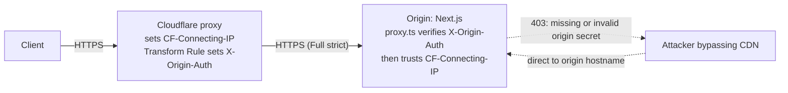
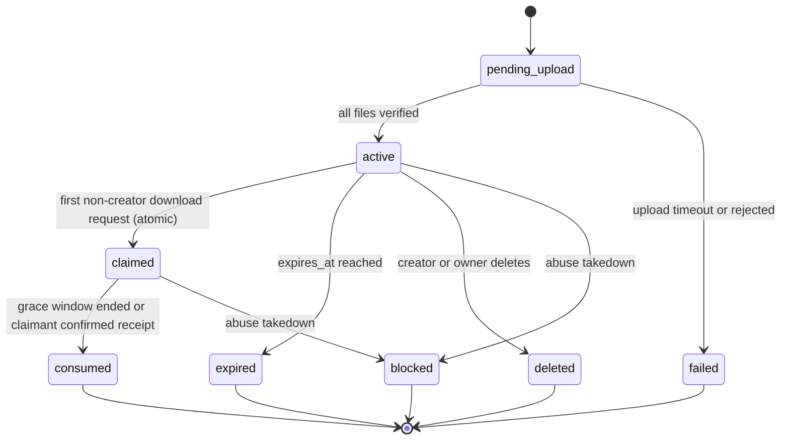

# 03 — Security and Network Design

| Field | Value |
|---|---|
| Document status | PROPOSED — awaiting owner review. §3 implements the owner's accepted rule for local mode (DEC-031, CR-001). |
| Last updated | 2026-10-18 (Phase 4, P4-25: as-built notes for §4.5–§4.8 (invites and QR pairing, room links, scrypt link passwords, revocation), §8 (accounts, device–session binding, merge proof, recent sign-in, MFA), §9 (Phase 4 actors and the tests that prove them), §10 (Phase 4 limits), §12 (Phase 4 secrets: no `INVITE_PEPPER`, SMTP and Google secrets only in Supabase), §13 (what Phase 4 stores and for how long), §14 (Phase 4 events); §1.1 assets. Nothing deployed; Phase 4 is NEEDS REVIEW). 2026-10-15 (Phase 2 as built: §4.1–§4.4 and §4.8 notes, §7.4 remote policy, §7.6 reports and takedown, §9 matrix tested with link viewers, §10 Phase 2 limits, §12 peppers and the Turnstile secret now used, §13 new data, §14 events). Earlier the same day: Phase 1 as built (§3.4–§3.5 fallback, stale egress lists fail closed, prefix-only egress lookup, §7.1, §7.3, §7.7, §13 IP inventory, §8 bearer tokens, §10 limits, §11 CSP notes) |
| Key decisions | DEC-031 (ACCEPTED), DEC-032, DEC-033, DEC-004, DEC-013, DEC-014, DEC-015, DEC-020, DEC-021, DEC-024, DEC-025 |
| Key risks | RISK-001, RISK-002, RISK-004, RISK-005, RISK-007, RISK-008, RISK-009, RISK-013, RISK-025, RISK-026 |

---

## 1. Threat model summary

### 1.1 Assets

| Asset | Sensitivity |
|---|---|
| File bytes and text content | High. Can include IDs, contracts, photos, credentials. |
| File names, share titles, room labels | Medium to high (often reveal content) |
| Share-link secrets, short codes, invite and pairing secrets, merge-intent secrets (Phase 4), link passwords | High (bearer credentials) |
| Device labels, network presence, private-room membership | Medium |
| Network keys (keyed hashes of IP addresses) | Medium. Pseudonymous personal data. |
| The trusted client IP | **Critical.** It decides local visibility (DEC-031). |
| Accounts (email, display name, devices, sessions), subscriptions, billing identifiers | Medium to high. Since Phase 4 the email and sessions live in Supabase Auth; for billing the app keeps the provider's IDs only, never payment details (§13). |
| Authenticator (TOTP) keys (Phase 4) | High (a second factor). Held only by Supabase Auth; they never reach the app's server (§8). |
| Service credentials (Supabase secret key, R2 keys, peppers, origin secret; since Phase 4 the billing API key and webhook and reconcile secrets, the SMTP password and the Google OAuth secret) | Critical (§12) |

### 1.2 Adversaries

| Adversary | Goal / capability |
|---|---|
| Anyone on the same Wi-Fi (guest, café or hotel customer, co-worker, neighbour with the password) | Sees all local content **by design** (DEC-031, R1). Goals beyond that: delete or alter others' posts, export them off the network, post abuse. |
| Stranger on a *different* network behind the same public IP (CGNAT, campus, VPN, relay) | See another network's local content (R2) |
| Internet attacker | Enumerate links and codes, brute-force passwords, **spoof headers to impersonate a network**, IDOR |
| Device that has left the network, or a removed private-room member | Keep access afterwards, exfiltrate |
| Link recipient | Access more than the shared item, keep burn content without consuming it |
| Abuser | Use free hosting for malware, phishing, piracy, illegal content, spam |
| Automated clients | Link unfurlers, email security scanners, crawlers. They follow links and could consume one-time content or index shares. |
| Compromised dependency / XSS | Steal sessions, secrets or presigned URLs from the page |
| Insider / credential leak | Use leaked service keys |

---

## 2. Same-network detection — technical analysis

### 2.1 What the server can reliably know

- **The source IP of the connection that reached the edge** (Cloudflare). Downstream services know it only through a header set by a proxy we control (§3.3).
- The IP family (IPv4 or IPv6).
- **Probabilistic** facts from databases: ASN/organization, country, and whether the address is a known relay, VPN, hosting or Tor egress. These lag and are incomplete.
- Request metadata: TLS/HTTP characteristics and user agent (spoofable), timing.
- Whatever the client *claims* (untrusted).

### 2.2 What the server cannot know

- Whether two requests from the same public IP come from the same LAN, SSID, building or household.
- Whether a public IP belongs to one home router or to a carrier or enterprise NAT shared by thousands (only heuristics).
- Whether two *different* public IPs belong to the same LAN (dual-stack, multi-WAN, relays, a VPN on one device).
- The LAN's private address range, gateway, SSID/BSSID or router identity.
- Whether yesterday's IP still belongs to the same people today (dynamic assignment).
- Anything trustworthy from `X-Forwarded-For`/`X-Real-IP` added by proxies it does not control. **Clients can write these headers.**

### 2.3 Why "same public IP = same network" is only an approximation

Under DEC-031 the network *does* decide local visibility, so the right-hand column is what happens without guards. The guards in §3.5 exist to contain these rows.

| Scenario | What the server sees | Error type | Consequence for local content (without guards) | Handled by |
|---|---|---|---|---|
| Mobile data behind carrier-grade NAT (CGNAT) | Many subscribers share a few rotating public IPv4 addresses | False positive and instability | **Strangers see each other's content** | `shared_egress` (mobile ASN, IPv4 bound to several IPv6 /64s) |
| University, school, enterprise, hospital network | A whole organisation behind a few NAT addresses | False positive (or "same network", literally) | Classmates or co-workers see each other's local posts | `too_large` cap; R1/R2 |
| Café, hotel, airport, coworking guest Wi-Fi | All guests share one IP | True positive: they *are* on the same Wi-Fi | Strangers see content | **By design (R1).** Audience indicator. |
| Home guest network / holiday rental | The guest SSID shares the host's public IP | Same network, by the product's definition | Guests see the host's local posts | By design (R1) |
| Residential CGNAT, including some fixed-wireless/5G home internet | Many homes behind one IP | False positive | Neighbours see each other's posts | IPv4-with-several-IPv6 detection, `too_large`; residual R2 |
| Commercial or corporate VPN, Cloudflare WARP | Unrelated users share exit IPs, and the VPN device differs from the rest of the home | False positive and false negative | Strangers grouped, own devices split | `shared_egress` (VPN/hosting ASNs); R2, R5 |
| iCloud Private Relay (Safari for iCloud+ users) | A relay egress IP shared by many users, different from the laptop's IP on the same Wi-Fi | False positive and false negative | Same as VPN | `shared_egress` (Apple's list); R5 |
| Dual-stack home (IPv4 + IPv6) | The phone connects over IPv6, the laptop over IPv4 | False negative | Own devices don't see each other | Dual-stack binding (§3.4); R5 |
| IPv6 prefix layout | Usually one /64 per LAN, but some networks use several /64s (VLANs), and mobile networks give a /64 per device | False negative | Inconsistent grouping | R5 |
| Multi-WAN / load-balanced NAT | Same LAN, alternating public IPs | False negative / flapping | Local content appears and disappears | R5 |
| Dynamic IP reassignment | Yesterday's address now belongs to another customer | False positive over time | The new holder sees content still live on that key | Short default expiry (Q-030); R3 |
| Misconfigured proxy trust | Attacker sends `X-Forwarded-For: <victim IP>`, or bypasses the CDN with a forged `CF-Connecting-IP` | Targeted false positive | **An attacker reads any network's local content** | Origin lock (§3.3). Must never happen. |
| Different textual forms | `::ffff:203.0.113.7`, NAT64 `64:ff9b::cb00:7107`, `203.0.113.7` | False negative if not normalized | Split networks | Normalization (§3.2) |

### 2.4 Can browser APIs identify LAN membership?

| Browser capability | Available to a public website? | Assessment |
|---|---|---|
| Wi-Fi SSID/BSSID, gateway MAC | **No API exists** | Intentionally withheld for privacy |
| Network Information API (`navigator.connection`) | Chromium only | Only connection type/speed hints. No identity. Absent in Safari and Firefox. |
| WebRTC ICE host candidates (local IP) | Local IPs are **masked as random `*.local` mDNS hostnames** in Chrome, Firefox and Safari unless the page holds camera/microphone permission | Can't read the LAN IP. Even raw private IPs (`192.168.1.x`) are reused by millions of homes. |
| WebRTC connection using only host candidates | Technically possible between two browsers online at the same time | Proves **local reachability, not trust** (café strangers pass). Fails under client/AP isolation, blocked multicast, VPNs, and some mobile OS behaviour. Needs another device online. **Chrome is prototyping Local Network Access restrictions for WebRTC**, which may add a permission prompt. Not used (SP-05 withdrawn by CR-001). |
| Requests to router or LAN devices (`http://192.168.1.1`) | Blocked or prompted. Mixed content and CORS apply, and **Chrome 142+ asks permission** ("Look for and connect to any device on your local network") for public sites reaching local addresses. | Scary prompt, fingerprinting-like, unreliable. Not acceptable. |
| Web Bluetooth / Web NFC / Wi-Fi Direct | Bluetooth: Chromium only with a chooser prompt, not iOS Safari. NFC: Android Chrome only. No Wi-Fi Direct API. | Not cross-platform, and still needs an explicit user action |
| Geolocation | Permission prompt | Physical proximity ≠ same network. Privacy cost. Spoofable. |
| Audio/ultrasonic pairing | Microphone permission | Invasive and unreliable |

### 2.5 Conclusion

> **The server cannot see a LAN. It sees a public IP address, which only approximates "the same network".**
>
> - Public-IP matching produces **false positives** (unrelated networks behind one IP) and **false negatives** (one network appearing under several IPs).
> - Browsers intentionally prevent LAN identification. WebRTC proves only adjacency, and may soon need a permission prompt.
>
> **Owner decision (2026-09-23, DEC-031, CR-001):** local mode keeps the product's original rule. Everyone on the same network sees local content automatically, with no approval step. The rest of this document designs the safest version of that rule:
>
> 1. The **server decides the network on every request**, from a client IP that only Cloudflare can set (§3.2–§3.4).
> 2. Wherever one public IP is known or suspected to cover several networks, **local mode switches itself off** (fail closed) (§3.5).
> 3. **Leaving the network ends access on the next request.** Nothing is remembered (§3.6).
> 4. **Uploaders are told who can see a post** before they post it (§3.7).
> 5. What cannot be prevented is stated plainly (§3.8).
>
> Identifying the actual LAN, rather than the public IP, would need native apps using mDNS/Bonjour, as AirDrop and LocalSend do (Q-025).

---

## 3. Local mode: automatic same-network visibility (DEC-031, DEC-032, DEC-033)

### 3.1 The rule and design principles

The owner's rule (DEC-031, **ACCEPTED**):

| Situation | Behaviour |
|---|---|
| Same Wi-Fi / network | Anyone on that network automatically sees the files, text and images posted to it. No approval, PIN, QR code or link. |
| Different network | Sees nothing automatically, not even that local content exists |
| Remote access | Only through an explicit share link, its QR code, or a short share code (§4) |

| # | Principle |
|---|---|
| P1 | **The server decides the network.** It is derived from the Cloudflare-verified client IP on every request. No endpoint accepts a network or space identifier from the client. |
| P2 | **Visibility is evaluated per request, never remembered.** Local mode has no memberships. |
| P3 | **Fail closed.** When the server cannot trust that an IP stands for one network, local mode is off there, for viewing and for posting. |
| P4 | **Tell the uploader who can see it** before they post. |
| P5 | **Minimal network data.** Keyed hashes only, short-lived presence, no raw IPs in the app's tables, query parameters or logs. |

### 3.2 Network key derivation (DEC-032)

1. **Obtain the trusted client IP** (§3.3). If unavailable, `networkStatus` is `unavailable` and local mode is off.
2. **Normalize:**
   - IPv4 → canonical dotted quad.
   - IPv4-mapped IPv6 `::ffff:a.b.c.d` → IPv4. NAT64 well-known prefix `64:ff9b::/96` → embedded IPv4.
   - IPv6 → **/64 prefix** (configurable `NETWORK_IPV6_PREFIX_LEN`, default 64).
   - **Reject non-global addresses** (private, loopback, link-local, `100.64.0.0/10`, `fc00::/7`, documentation ranges). This indicates a proxy misconfiguration: log an alert and return `unavailable`.
3. **Key:** `networkKey = HMAC-SHA256(NETWORK_KEY_SECRET[version], family + "|" + normalized)`. Store the 32-byte digest and the key version.
   - *Why a keyed HMAC:* the IPv4 space has only 2³² values, so a plain SHA-256 of an IP can be reversed by brute force in minutes. The secret lives only in server environment variables.
4. **Resolve the network space:** upsert `app.network_spaces` for the key. There is one space per key. A space has no owner, members or name; the UI calls it "This network".
5. **Classify** the space (§3.5) and **record presence** (§3.6).

**Key rotation:** a space must stay stable while its content lives (up to 90 days on Pro). Rotate the secret yearly or after an incident. During a rotation both versions are computed for 100 days, and a space is re-keyed the first time it is seen under the new version.

### 3.3 Trusted client IP and origin lock (DEC-004)

**Under DEC-031 this is the access boundary for local content.** A forged client IP would show an attacker the local content of any network.



Rules:

1. In production, `proxy.ts` rejects **every** request without a valid `X-Origin-Auth` value, using a timing-safe comparison. Two secrets are accepted during rotation.
2. Only after that check is `CF-Connecting-IP` read. `X-Forwarded-For` and `X-Real-IP` are **ignored** by default.
3. **Preferred on a VPS:** Cloudflare Tunnel (`cloudflared`), so the origin has no public ingress at all. The header check stays as defense in depth.
4. A test override (`X-Test-Client-IP`) is honoured only when `NODE_ENV !== "production"` **and** `ALLOW_TEST_CLIENT_IP=1`. The production boot sequence refuses to start if the flag is set.
5. **SP-01 must verify on Hostinger:**
   - Cloudflare overwrites client-supplied `CF-Connecting-IP` and `X-Origin-Auth`.
   - Hostinger's front proxy passes both headers through unchanged.
   - Direct requests to the Hostinger hostname are rejected.
   - TLS works in Full (strict) mode.

### 3.4 Dual-stack binding (conditional on SP-04)

**Problem:** a dual-stack home reaches the server over IPv4 or IPv6 depending on the connection. Devices on the same Wi-Fi can then land in different spaces, and one device can flip between them.

**Design:**

1. `POST /api/v1/network/observe` on the main host returns a single-use **probe nonce** (60 s).
2. The client calls `GET https://v4.{domain}/api/v1/network/probe?n={nonce}` and `GET https://v6.{domain}/api/v1/network/probe?n={nonce}`. Each hostname resolves in only one address family. Each probe records `(nonce, family, network key)` on the server, carries no cookies and returns only `204`.
3. The client calls `observe` again with the nonce. The server accepts the pair **only if the current request's own key is one of the probed keys**, then stores a **network binding** (server-side, 10-minute lifetime) holding both keys.
4. On every later request the server derives the current key:
   - If that key belongs to the device's live binding, the device's current network is **both** keys.
   - Otherwise the binding is discarded and only the current key counts. Moving to another network therefore never carries the old keys along.
5. Each binding also records an **IPv4 ↔ IPv6 link**, which detects carrier-grade NAT (§3.5).

**Placement:** a new local share goes into the uploader's **most specific** eligible space: the IPv6 /64 when present, otherwise the IPv4 address. Viewing covers every eligible space in the device's current network. A device with only IPv4, on a home where others use IPv6, therefore sees posts from other IPv4-only devices but may miss posts from IPv6 devices (a documented false negative, R5). This bias is deliberate: IPv4 addresses are far more often shared between unrelated homes.

**Phase 1 as built (2026-10-15): not adopted.** SP-04 has not run, so only the current request's key counts (phase 1 DV1-3); there is no probe endpoint and no binding table. normally answer both A and AAAA records ("IPv6 compatibility"), so single-family probe hostnames may need a separate zone or configuration. **If SP-04 finds this infeasible:** only the current request's key counts. Dual-stack devices may then flip between spaces (reduced by HTTP connection reuse). SP-04 records the resulting false-negative rate (RISK-013), and CGNAT detection relies on the ASN and crowding signals only.

### 3.5 Eligibility: classification and fail-closed guards (DEC-032)

| `networkStatus` | Detection | Local mode |
|---|---|---|
| `ok` | Default | **On:** view and post |
| `shared_egress` | (a) Address in Apple's iCloud Private Relay egress list or the Tor exit list. (b) Client ASN on a curated list: VPN and hosting providers (both families), and **mobile carriers for IPv4 only**, because carriers put many subscribers behind one IPv4 address but usually give each phone its own IPv6 /64. (c) An IPv4 key bound to **two or more different IPv6 /64s within one hour**: a strong carrier-NAT signal (needs §3.4). | **Off** |
| `too_large` | More than **50** distinct devices seen on the space in 24 h (tunable, Q-029). Catches shared IPs the lists miss (campus, enterprise NAT, residential CGNAT) and very large Wi-Fi networks. | **Off** |
| `blocked` | Operator action or abuse response | **Off** |
| `unavailable` | No trusted IP, a non-global address, the kill switch, or (staging/production) missing or stale egress lists | **Off** |

Rules:

- **Fail closed for existing content too.** When a space leaves `ok`, its shares stop being visible to anyone on that network until it returns to `ok`. Creators still see them under "My uploads" and can share them by link. A space that becomes `too_large` or `shared_egress` stays so for at least 7 days.
- Status copy: *"Local sharing is off on this network. It looks like a mobile, VPN, relay or very large shared network, where other people may share your internet address. Use a link, QR code or share code instead."*
- **ASN data:** Cloudflare's rules engine knows the client's ASN. Whether a Transform Rule can forward it to the origin on the chosen Cloudflare plan is verified in SP-04 (Q-013). The ASN list must be licensed for commercial use. Without ASN data, Phase 1 relies on (a), (c) and `too_large`, and ASN classification arrives in Phase 6.
- **Phase 1 as built (2026-10-15):** (a) via `app.network_egress_ranges`, loaded with `pnpm egress:load` ([runbook](runbooks/egress-lists.md)), and `too_large`. The client address never reaches the database: the app asks for the ranges overlapping its IPv4 /24 or IPv6 /48 (`app.egress_ranges_overlapping`, which refuses longer prefixes), matches the exact address itself and passes only the result to `app.observe_network` (Phase 1 F1-13); no ASN list (needs SP-04) and no (c) (needs §3.4). The cap is the runtime flag `network_large_cap` (default 50, Q-029 assumed), shared by `observe` and the status job. Statuses are applied in `app.observe_network()` and `app.refresh_network_status()`; every change is audited and signalled as `network.changed`. That denies convenience only, and is accepted.
- **Missing or stale egress lists fail closed (Phase 1 security review, M2):** in staging and production, local sharing is off everywhere (`unavailable`, reason `classification_unavailable`) while the lists were never loaded or the last load is older than 14 days (`lib/server/network/egress.ts`). Locally and in tests the lists are optional. A `shared_egress` space is lifted only by an observe after its sticky period, because only an observe knows the address to re-check; the status job never lifts it.
- The crowding threshold rose from 12 (the rejected discovery-only design) to 50, because under DEC-031 an ordinary office or café Wi-Fi is meant to work.

### 3.6 Visibility rule and presence

Checked on every request that touches a local share, the local feed, or a local file:

```text
current  = network keys of this request (+ the bound other-family key, §3.4)
eligible = { space(k) : k in current and space.status = 'ok' }

visible(share) =
      share.scope = 'network'
  and share.expires_at > now()
  and ( share.status = 'active'
        or (share.status = 'claimed' and caller is the claimant, §5) )
  and ( share.network_space_id in eligible
        or share.created_by_user_id = caller.user_id )
```

- Not visible → **404**, with the same body as for a share that doesn't exist.
- **No endpoint takes a network or space ID as input.** The feed (`GET /api/v1/local/shares`) returns only shares whose space is in `eligible`.
- **Presence** (`app.network_presence`) is written by `observe`: every 5 minutes while the app is open, and on `focus`/`online` events. A device counts as present for 10 minutes after its last observe. Observing from a different network ends its presence elsewhere immediately. Presence authorizes the realtime topic `net:{spaceId}` ([04 §6.2](04-database-and-storage-design.md#62-realtime-policies)), and feeds the "N devices here now" line and the `too_large` count.
- **Leaving the network:** the next API request derives a different key, so the old network's shares return 404. The client re-observes on `online`, `focus` and connection changes, drops the old channel and subscribes to the new one.

### 3.7 Posting to the network (DEC-033)

- **Destination picker** in the composer: **This network** (the default when the status is `ok`) or **Link only** (Phase 2; never visible on any network). Pro/Team add private and workspace rooms (Phase 4–5).
- **Audience line** before posting, under the composer: *"Visible to everyone on this network"*; the status bar shows *"This network · 3 devices here now"* (Phase 1 copy, owner decision 2026-10-15). A one-time notice explains that everyone connected to the same Wi-Fi, including guests, can see and download what is posted here.
- Posting to the network is disabled when the status is not `ok`.
- **Permissions:** anyone present can view, download, copy text and report. Only the creator can edit text, delete, and create or revoke links (Q-021).
- **My uploads:** the creator sees all their shares from any network, and can create links there.

### 3.8 Isolation guarantees

**Guaranteed (by design, covered by tests in [09](09-testing-strategy.md)):**

| ID | Guarantee |
|---|---|
| G1 | A local share's metadata, text, files and URLs are returned only to (a) devices whose current, server-derived network includes the share's space while that space is eligible, (b) its creator, or (c) a valid link-grant holder for that share. |
| G2 | Clients cannot choose, forge or replay a network. Keys come only from the Cloudflare-verified IP. Dual-stack bindings are server-side, short-lived, and honoured only while the current IP is part of them. |
| G3 | Leaving a network ends access on the next request. Local mode remembers nothing. |
| G4 | Link viewers can access only the link's target. They cannot list other shares, spaces, devices or presence. |
| G5 | Local mode is off, for viewing and posting, on networks classified `shared_egress`, `too_large`, `blocked` or `unavailable`. |
| G6 | Realtime channels are private and authorized by presence (or, from Phase 4, room membership). Payloads contain IDs only. |
| G7 | Nothing about a network's local content, not even whether any exists, is exposed to a device that is not on that network. |

**Not guaranteed (residual risks, inherent to DEC-031):**

| ID | Residual | Risk |
|---|---|---|
| R1 | **Everyone on the same Wi-Fi sees local content**: guests, café or hotel customers, co-workers, neighbours who know the password. This is the product rule. | RISK-025 |
| R2 | Different networks behind one public IP that is **not yet recognized as shared** (small-ISP CGNAT, enterprise proxies, VPNs missing from the lists) see each other's local content. The guards shrink this but cannot remove it. | RISK-001 |
| R3 | When an ISP reassigns an IP address or IPv6 prefix, its next holder sees local content still live on that key. | RISK-026 |
| R4 | A device that left the network may receive ID-only realtime signals until its token refreshes. | RISK-007 |
| R5 | Your own devices on the same Wi-Fi may not see each other (IPv4/IPv6 split without §3.4, VPN or Private Relay on one device, multi-WAN). Local mode is off on mobile data, most hotspots and large networks. Fallback: link, QR code or share code. | RISK-013 |
| R6 | Anyone who downloaded something can keep and forward it. | Inherent |

### 3.9 How this maps to the owner's requirements

| Requirement | Design |
|---|---|
| Same Wi-Fi → everyone sees uploads automatically | Opening the site on the Wi-Fi shows the "This network" feed with everything posted there. New posts appear in realtime. No join step. |
| No QR code or link for same-network access | None needed |
| Different network → nothing visible automatically | Per-request network check (G1, G3, G7) and fail-closed guards (G5) |
| Remote access only through QR code, link or share code | §4: links to one share (Pro/Team: also to a private or workspace room) |
| Brief: "public IP must not be treated as authorization" | **No longer fully true for local mode.** Under DEC-031 the network, which the server knows only through the public IP, is the access rule for local content. The design narrows this to a Cloudflare-verified IP with fail-closed guards and states the residual risk (R2). |

### 3.10 Options considered

| Option | Outcome |
|---|---|
| "Discover automatically, admit once, remember" (approval, PIN or open-join window; the earlier DEC-002) | **Rejected by the owner** on 2026-09-23 (CR-001) |
| Automatic visibility with no guards | Rejected: mobile-carrier, VPN and relay IPs would expose content between strangers immediately |
| Keep access after leaving the network | Rejected: contradicts "a different network sees nothing" and breaks when IPs change |
| WebRTC LAN proof | Withdrawn: needs another device online, can trigger a permission prompt (Chrome Local Network Access), and doesn't fit fully automatic visibility |
| Router probing / local IP discovery | Blocked or prompted by browsers. Unreliable. Invasive. |
| Native apps with mDNS | Future option (Q-025) |

---

## 4. Remote sharing design

### 4.1 Share links (DEC-013)

**Format:** `https://{domain}/s/{linkId}#k={secret}`

| Part | Spec | Rationale |
|---|---|---|
| `linkId` | 12 random bytes → 16-character base64url | Unguessable. Lets logs and abuse reports reference a link without the secret. |
| `secret` | 32 random bytes → 43-character base64url, stored only as `HMAC-SHA256(LINK_PEPPER, secret)` | 256-bit bearer secret. The pepper prevents offline verification if the database leaks. |
| Fragment (`#k=`) | Browsers never send the fragment in HTTP requests | Keeps secrets out of Cloudflare and host logs and out of `Referer`. The page strips the fragment from the address bar after unlocking. |

The share page `/s/[linkId]` is a static shell: `noindex`, `Referrer-Policy: no-referrer`, strict CSP, **no third-party scripts**.

**Link-preview bots** fetch `/s/{linkId}` without the fragment and receive generic metadata ("A file was shared with you"). They learn nothing and consume nothing.

Link fields: `expires_at` (≤ share expiry and ≤ plan maximum), `revoked_at`, optional password (Pro), `allow_download`, creator, plan snapshot.

**Phase 2 as built (2026-10-15):** as specified, with the HMAC bound to the link ID (`HMAC(LINK_PEPPER[v], linkId | secret)`), a revocation reason (`creator`, `share_ended`, `blocked`), and the URL built from `NEXT_PUBLIC_APP_ORIGIN`, never the request's Host. A link lasts until its share expires unless a shorter option is chosen (phase 2 DV2-13); a database trigger refuses one that would outlive its share. Password columns wait for Phase 4. Summary: [ARCHITECTURE.md §9](ARCHITECTURE.md#9-remote-sharing).

### 4.2 Link grants (viewer sessions)

`POST /api/v1/links/{linkId}/unlock { secret, password?, turnstileToken? }`:

1. Rate-limit by `linkId`, network key and link session.
2. Load the link. Compute the HMAC of the supplied secret **even if the link doesn't exist**, then compare timing-safely. A missing link or wrong secret returns a generic **404 `LINK_UNAVAILABLE`**.
3. **Only after the secret is proven**, reveal state: revoked or expired returns **410 `LINK_EXPIRED`**. A burn share that someone else claimed, or that is consumed, returns **410 `ALREADY_DOWNLOADED`** with `byYou` (Phase 3, DV3-6). Its claimant's own session unlocks again during grace.
4. Verify the password if one is set (Phase 4, §4.7).
5. Create or refresh the viewer session:
   - Cookie `__Host-link_session`: 256-bit random, httpOnly, Secure, SameSite=Lax, Path=/. It is stored hashed in `app.link_sessions`.
   - A grant row in `app.link_grants (session_id, link_id, password_version, expires_at = min(now() + 12 h, link.expires_at))`.
6. Return the viewer DTO.

Every viewer endpoint re-checks: grant valid, link active, `password_version` current, target still active.

**Viewers never receive:** network space or room IDs, presence, member or device info, other shares, uploader identity (except Team branding).

**Who may create a link:** only the share's creator (DEC-033), from any network. A link to a local share lets someone off the network open that one share; nothing else on the network becomes reachable.

Link viewers get **no Supabase user**. This avoids auth MAU costs (RISK-006). Viewer pages poll instead of subscribing to realtime.

**Phase 2 as built (2026-10-15):**

- Steps 1–3 and 5–6 as specified (no passwords before Phase 4). The cookie is `__Host-link_session` on HTTPS origins and plain `link_session` on the plain-HTTP origins of local development and tests (DV2-3), Max-Age 12 h, refreshed by each unlock or code.
- **Session fixation:** a presented cookie is reused only if its hash is a live stored session; any other value is ignored and a fresh one issued.
- **Grant expiry:** `min(now() + 12 h, link.expires_at, share.expires_at)`, also enforced by a check constraint. A grant holder whose link was revoked or expired, or whose share ended, gets `410 LINK_EXPIRED`; a grant that only timed out gets `404` (the link is needed again).
- Share and code pages run with a query client only: no Supabase client is ever created there (separate route-group layouts, DV2-12).

### 4.3 QR codes

- Generated **in the browser** from the full URL, including the fragment, with a local library. **Never use a third-party QR image API**, which would receive the secret.
- Displayed with the expiry time and the warning *"Anyone who scans this can open the share."*
- Error correction level M. A URL of about 80 characters fits a small, easily scanned code.
- **Phase 2 as built:** the `qr` library (no dependencies, DV2-8), drawn as one SVG path with a 4-module quiet zone; tests decode the rendered code back to the URL. Real phone scans are a manual step ([phase 2 procedure](phases/phase-2-manual-verification.md)).

### 4.4 Short codes (DEC-014)

| Property | Spec |
|---|---|
| Alphabet | Crockford Base32 (digits and letters without I, L, O, U) |
| Length | **10 characters (50 bits)**, displayed `7KQ4M-X9D2P` |
| Normalization | Uppercase. Strip spaces and hyphens. Map O→0 and I/L→1. |
| Storage | `HMAC-SHA256(CODE_PEPPER, normalized)`, unique among active codes. Plaintext is shown only at creation; "Generate new code" replaces it. |
| Validity | Default 1 h. Options 10 min / 1 h / 24 h (Free); up to 7 days (Pro). Never beyond the link's expiry. |
| Resolution | `POST /api/v1/codes/resolve { code }` creates a link grant (≤ 12 h) and returns only `linkId`. **The long-lived link secret is never revealed by a code.** Password-protected links still require the password. |
| Limits | Per device/session and per network key: 5 failures / 10 min, then Turnstile is required. 20 failures / day per network key gives a 24 h block. Global failure-rate alerting. |
| **Phase 2 as built** | As specified, with: only failures are counted; the 24 h block runs 24 hours from the 20th failure; without Turnstile configured (local only) the escalation is a wait until the window ends (DV2-19); the global alert is the error log `code.resolve_failure_spike` at 1,000 failures per 10 minutes; a code's expiry is clamped to its link's (DV2-14); "Generate new code" is `POST /api/v1/links/{linkId}/code` (DV2-5); expired codes are cleared by `purge-ephemeral`. |

**Entropy check:**

- With **1,000,000** active codes, one random guess succeeds with probability 10⁶ / 2⁵⁰ ≈ **8.9 × 10⁻¹⁰**.
- A botnet making **10⁶ guesses per day** despite per-IP limits expects ≈ 9 × 10⁻⁴ hits per day.
- With the diagram's 8-character `ABCD-1234` style (40 bits), the same attack expects ≈ **0.9 hits per day**. That is why 10 characters plus a short validity is recommended.

### 4.5 Private-room invites and QR pairing (Pro, Phase 4)

Local mode has no rooms or invites. Pro **private rooms** are membership-based and never visible on any network. Devices join them only through an invite:

- `https://{domain}/j/{inviteId}#k={secret}`. `inviteId` is 96-bit random. The secret is 256-bit, stored as an HMAC.
- **Pairing invites** (shown as a QR code): single use, 10 minutes. **Invite links:** multi-use, up to 7 days.
- Accepting requires the secret, creates membership (`joined_via = 'invite'`), and is rate-limited per invite and per network key. Invites are revocable.
- **As built (P4-17, P4-18, 2026-10-18; implemented and tested locally, not verified):** summary in [ARCHITECTURE §9.10](ARCHITECTURE.md#910-private-rooms-phase-4d-p4-17-p4-18-p4-19); details in [phase 4 §24.4](phases/phase-4-pro-accounts.md#244-the-invitation-security-model) and [§25.3](phases/phase-4-pro-accounts.md#253-the-qr-pairing-security-model).
  - **One mechanism for both kinds:** the same `room_invites` row, URL, secret, preview and accept. `joined_via` records `pairing` or `invite_link`. The secret's HMAC is under `LINK_PEPPER`, domain-separated (`invite|{id}|{secret}`), not a separate `INVITE_PEPPER` (DV4-83, waiting for the owner). The database accepts only a 32-byte HMAC.
  - **Invite links:** the owner's only; need Pro on the current plan (`multiUseInvites`, E21); 1 hour, 24 hours or 7 days, optionally a number of uses. A downgraded owner's existing invites keep working.
  - **Pairing codes:** the owner's only, on any plan (D4-16 applied as recommended, DV4-102); one use (the database also refuses a pairing invite without a maximum, DV4-101); 10 minutes from creation, set by the server. The owner's *Show QR code* dialog draws the URL in the browser and never shows it as text, caches or stores it; closing the dialog revokes an unused code (DV4-105). There is no in-app scanner: a phone's camera app opens the URL (`Permissions-Policy: camera=()`, DV4-106).
  - **Proof first:** the HMAC is compared timing-safely, against a random dummy for an unknown ID, so unknown, wrong and malformed all get one `404 INVITE_UNAVAILABLE` (DV4-94). Expiry, revocation, used-up and a deleted room show only after the proof (`410 INVITE_EXPIRED`). `app.accept_room_invite` checks again under the room and invite locks: 8 racing accepts of a one-use invite let exactly one person in, and the member cap holds under concurrent accepts.
  - **Limits:** preview and accept each allow 10 per 10 minutes per invite and 30 per hour per network key, counted before any lookup (DV4-95).
  - **Joining:** `/j/{inviteId}` needs a session (an anonymous browser joins as an anonymous member, D4-19). The page strips the fragment at once, previews (the room's name and size only) and joins only when the person taps *Join*, so a link unfurler or a scan alone joins nothing.
  - **Tests:** `tests/integration/rooms.test.ts`, `pairing.test.ts`, `supabase/tests/phase4_rooms.test.sql`, `phase4_pairing.test.sql`, the IDOR matrix's room actors and pairing pass. **Not verified:** a real phone's camera scanning a pairing code (T4-R15's manual half), Safari, Firefox and Edge, `/j/*` behind Cloudflare.

### 4.6 Read-only room links (Pro, Phase 4)

- Created by the owner of a **private or workspace room**. They grant read-only access to the room's **current and future active shares** until the link expires or is revoked.
- **There is no link to a whole network's feed** (DEC-033, Q-028). It would show other people's local posts to someone who is not on the network.
- Viewers never see members. A burn share opened through a room link follows the normal claim rules.
- The UI warns: *"Anyone with this link can see everything posted to this room until it expires."*
- **As built (P4-19, 2026-10-18; implemented and tested locally, not verified):** details in [phase 4 §26.3](phases/phase-4-pro-accounts.md#263-the-room-link-security-model).
  - **Who:** the owner of a private room, with Pro on the current plan (`roomLinks`, E22). Members get `403 NOT_OWNER` when creating or listing, and `404` on a room link's own routes (DV4-113); everyone else gets `404`. Workspace rooms are Phase 5.
  - **What:** a `share_links` row with `target_type = 'room'`, its secret an HMAC like any link's. 1 hour to 30 days (D4-17); the database caps it at 30 days and refuses a room link that follows a share's expiry. An optional password, through P4-16's machinery (§4.7). **No short code**: a database check, and the code route answers `404` (DV4-108, waiting for the owner).
  - **What a viewer sees:** the room's active shares, newest first, through the existing unlock, grant and viewer path. Never the room's name, members, invites, settings, who posted, networks or presence. Every file, preview, Reveal, "Got it" and report names its share, which must be inside the link's room (DV4-111). The remote file policy runs per file at download, under the link's snapshot: blocked files are listed as `blocked` and refused (DV4-112). The first viewer to download or reveal a burn share claims it, as a member would.
  - **Ending:** revoked, expired, the room deleted (`delete_room` revokes its links as `room_deleted`) or the owner suspended: `410` after the secret is proven.
  - **Open:** members aren't told a link to their room exists (DV4-121, an owner decision); transfer history later tells a member, by kind only, that their post was fetched through a room link (DV4-124).
  - **Tests:** `tests/integration/room-links.test.ts` (T4-R5, R6, R12), `supabase/tests/phase4_room_links.test.sql`, the IDOR matrix's two room-link viewers. **Not verified:** `/s/*` for room links behind Cloudflare, real phones.

### 4.7 Password-protected links (Pro, Phase 4; DEC-021)

- Passwords protect **links**, not room membership. A viewer needs **both** the link secret and the password.
- Hashing (design): **Argon2id** (m = 19 MiB, t = 2, p = 1, the OWASP baseline), stored as a PHC string. **Not built:** Phase 4 uses scrypt (DV4-70, below).
- Minimum length 8, with a warning for very common passwords.
- Limits: 10 failures / 15 min per link, then a 15-minute lock for that link and Turnstile. 20 failures / hour per network key. Audit event `link.password_failed`.
- Changing or removing a password increments `password_version`, which invalidates existing grants.
- Passwords are never logged or returned.
- **Phase 4 as built (P4-16, 2026-10-17):** scrypt (N = 2¹⁷, r = 8, p = 1) from `node:crypto` instead of Argon2id, because no package was approved (D4-24, phase 4 DV4-70); the database accepts only that PHC format. Length 8–128 characters after NFC. The password is checked on the grant in `accessFor`, so on every viewer request, also for grants made by a code. Setting a password, or a new unlock or code, starts the grant unverified; a removal invalidates grants too, and the link then opens without one. After a lock, Turnstile is required until an hour after it ends. Each attempt reserves its failure slot before the hash, so concurrent attempts can't exceed the limits. Summary: [ARCHITECTURE §9.9](ARCHITECTURE.md#99-password-protected-links-phase-4d-p4-16); details: [phase 4 §23.3](phases/phase-4-pro-accounts.md#233-the-password-security-model).
  - **Also as built:** failures count over the current and the previous window, so failures either side of a boundary still lock the link (DV4-76); a lock clears the link's count. `423 LINK_LOCKED` comes before any hash, even for the right password. Attempts, right or wrong, are also limited per link session (20 per 10 minutes) and per network key (60 per 10 minutes) before the hash (DV4-75). At most 4 hashes run at once per process (32 waiting, then `503 SERVER_BUSY`). Without Turnstile configured (local only), a wait replaces it (DV4-74).
  - **Plans:** setting or changing a password needs `linkPasswords` (Pro) on the current plan; removing is always allowed, also after a downgrade (D4-12); an existing password is enforced whatever the plan.
  - **Residual:** anyone holding a password link's secret can lock it for 15 minutes at a time. Grants that already proved the password keep working; new viewers wait (RISK-044, proposed).
  - **Moving to Argon2id later** needs an approved package (D4-24), a widened database check, verification of both formats and a rehash after a successful scrypt check.
  - **Tests:** `tests/integration/passwords.test.ts` (T4-P1 … P7, P9), `tests/unit/password.test.ts` (T4-P8), `supabase/tests/phase4_link_passwords.test.sql`. **Not verified:** real Turnstile after a lock (staging), and the scrypt cost on the chosen host (about 0.4 s of a core and 128 MiB per hash here).

### 4.8 Revocation and expiry

- Revoking a link sets `revoked_at`. Grants stop working on the **next request**. Presigned GET URLs already issued stay valid for at most 60 s (bearer semantics, RISK-009).
- Share deletion, expiry, claim or block invalidates all of its links.
- Creators (and, from Phase 4, room owners) can list and revoke active links.
- **Phase 2 as built:** `end_share` (deletion, expiry, upload failure, takedown) revokes every link of the share and clears its codes in the same transaction; every viewer request re-checks the link and the share, so this takes effect on the next request (tested, T-031).
- **Phase 4 as built:**
  - A room's owner lists and revokes the room's **room links and invites**. A member's share links stay their creator's to manage: the owner gets `403 NOT_CREATOR` (phase 4 §27.5, finding 4).
  - Deleting a room revokes its room links (`room_deleted`) and invites, and ends its shares, whose links `end_share` revokes.
  - Account deletion deletes the account's rooms and ends its shares first, so their links and invites end with them (P4-21).
  - Setting, changing or removing a password invalidates every grant of the link at its next request (§4.7).
  - A suspended creator's links make no new grants (unlock `410` after the secret, a code `404`, DV4-27); grants already issued run out within 12 hours.
  - Tests: `rooms.test.ts`, `room-links.test.ts`, `account-coverage.test.ts`, `passwords.test.ts`, `entitlements.test.ts`.

### 4.9 Enumeration and probing defenses

- High-entropy identifiers: UUIDv4 for rows, 96-bit IDs for links and invites. No sequential numbers anywhere in the UI or API.
- Uniform **404** for "doesn't exist" and "not yours". Detailed state only after the credential is proven.
- Timing-safe comparisons, with the HMAC computed even when the record is missing.
- Rate limits keyed by link, invite, network key, device and session.
- `robots.txt` disallows `/s/`, `/j/`, `/c`, `/rooms`. `X-Robots-Tag: noindex, nofollow` on those routes.
- No endpoint accepts a network or space identifier. Listing endpoints return only what the caller's current network, membership or grant allows.

---

## 5. One-time download ("burn after download") — DEC-015

### 5.1 Why not "delete after the first *completed successful* download"

| Problem | Detail |
|---|---|
| Completion is unobservable | Bytes flow browser ↔ R2 directly. The server cannot tell whether a download finished or the file was saved. |
| Bypass | If only completion consumed the share, a recipient could abort at 99%, keeping almost all the bytes while leaving it available. |
| Races | Invalidating only on completion lets two people start simultaneously and both finish. |
| Bots | Email security scanners and link unfurlers open links automatically and could trigger consumption. |

**Recommended semantics:** *the first download request claims the share*. Only the claiming device (or link session) can fetch it during a short **grace window** for retries. After that the content is deleted.

### 5.2 State machine



### 5.3 Atomic claim

```sql
-- One statement: no read-then-write gap.
update app.shares
   set status                  = 'claimed',
       claimed_at              = now(),
       claimed_by_user_id      = $actor_user_id,      -- null for link viewers
       claimed_device_id       = $actor_device_id,    -- null for link viewers
       claimed_link_session_id = $link_session_id,    -- null for devices on the network or room members
       claim_grace_until       = now() + $grace
 where id = $share_id
   and status = 'active'
   and burn_after_download
   and expires_at > now()
returning id, claim_grace_until;
```

- **Zero rows returned:** re-read the share. Issue a URL only if `status = 'claimed'`, the claimant matches (device or link session), `now() < claim_grace_until`, and issuances for that file are fewer than 3. Otherwise return **410 `ALREADY_DOWNLOADED`**.
- **Why it is race-free:** under READ COMMITTED, a concurrent second `UPDATE` waits for the first transaction's row lock, then re-evaluates the `WHERE` clause against the committed row. `status` is no longer `'active'`, so it updates zero rows. Exactly one claimant wins. [09](09-testing-strategy.md) requires a 50-way concurrency test.

### 5.4 Rules

| Rule | Detail |
|---|---|
| Grace window | `15 min + ceil(total_bytes / 1 MiB)` seconds, capped at 6 h, so slow downloads of large files can finish. Presigned GET URLs live 60 s, with at most 3 issuances per file during grace. |
| Deletion | A cron transition to `consumed` after `claim_grace_until`, plus a 5-minute margin, enqueues object deletion. The claimant may end grace early via `confirm-received`. |
| Creator exemption | Downloads by the share's creator (same user) never claim. |
| No previews | Burn shares have no thumbnails or inline previews. Text burn shares require a **Reveal** click, which is the claim. |
| POST only | Claims happen only through `POST` with a JSON body and an Origin check. Bots issuing GETs cannot consume. The share page asks for confirmation: *"This will be deleted after you open it."* |
| Multi-file | One claim covers the whole share. The claimant gets URLs for each file during grace. |
| Network and room behaviour | Once claimed, the share disappears for everyone else on the network (or in the room) via `share.changed`. On a busy network the first device to open it wins; the composer says so. |
| Plan | Pro feature per the plan list. **Q-008 answered (owner, 2026-10-16):** Pro at paid launch; Free only while the runtime flag `free_burn_after_download` is on (beta and testing; default off). |

### As built in Phase 3 (2026-10-16)

[Phase 3 §18](phases/phase-3-expiry-one-time-download.md#18-implementation-2026-10-16) records the details. Differences from §5.3–§5.4, and what was added:

- **Claimant column.** The link-session claimant is `claimed_link_session_hash`: link sessions are keyed by the SHA-256 of their cookie (C-8). The link used is `claimed_link_id`, without a foreign key (DV3-2).
- **Grace.** It is capped at `expires_at` as well as 6 h (D-6). Every check uses the database clock.
- **READ COMMITTED.** `app.claim_burn_share` refuses REPEATABLE READ and SERIALIZABLE (`25001`): under them a losing claimant would fail with `40001` instead of losing cleanly.
- **Confirmation.** A claim needs `{ "confirm": true }` in the POST body. Without it the answer is `409 CONFIRMATION_REQUIRED` and nothing changes, so a client unaware of burn can't claim by accident.
- **Text.** It is withheld from every DTO except the creator's. `POST …/reveal` is the claim and returns it, up to 3 times.
- **Creator (D-7).** The verified creator may download until the share is consumed. A creator who opens their own link in a browser is a link viewer and claims it (RISK-039).
- **Consumption.** It happens through `end_share('consumed')`. Objects are deleted 5 minutes later by the storage janitor.
- **Retries and limits.** The claimant gets 3 URLs per file (`409 BURN_RETRY_LIMIT` after that). Anyone else who could see the share gets `410 ALREADY_DOWNLOADED`, and everyone else `404`.
- **Tested.** 50 simultaneous claims give exactly one winner, at the SQL level (50 connections) and the API level (50 devices; 25 devices + 25 viewers), with a mutation check.

### 5.5 Residual risks

- The claimant can forward a presigned URL within its 60 s life.
- The claimant can keep the file forever (inherent).
- If the claimant's device fails and grace ends, the content is gone. The UI says so.

---

## 6. Download authorization and signed URLs

| Check (every issuance) | Device path (local share, or room share from Phase 4) | Link-viewer path |
|---|---|---|
| Authenticated principal | Supabase session plus device ownership | Valid `link_session` plus grant |
| Scope | **Local share:** the visibility rule in §3.6 (current eligible network, or creator). **Room share:** active membership in `file.room_id`. | `file.share_id = link.share_id` (share link) or `file.room_id = link.room_id` (room link) |
| Share state | `active`, or `claimed` by this device within grace | Same, with the link session as claimant |
| Time | `share.expires_at > now()` and, for links, `link.expires_at > now()` | Same |
| File state | `upload_status = 'verified'`, not blocked. Scan policy satisfied (Phase 6). | Same |
| Burn | Atomic claim (§5.3) unless the requester is the creator | Atomic claim |
| Rate limit | Per device and per network space | Per link session and per link |
| Log | `downloads` row (`url_issued`) | Same, with `link_id` |

**Presigned GET rules:**

- TTL **60 s** for downloads, **300 s** for image previews. GET only, one object.
- Objects carry `Content-Type` and `Content-Disposition: attachment; filename="<ascii-fallback>"; filename*=UTF-8''<percent-encoded>`, **fixed at upload through signed headers**. The design does not depend on `response-content-disposition` overrides, whose R2 support is uncertain (verified in SP-02, RISK-011).
- Downloads are served from R2's S3 hostname, **a different origin from the app**. Active content cannot touch app cookies or the DOM.
- **Previews:** only raster images whose magic bytes match JPEG, PNG, GIF, WebP or AVIF, ≤ 20 MB, rendered with ``. No `next/image` optimization, which would route and cache private bytes on the web server. **No inline SVG, HTML, PDF or video in the MVP.**
- **Text** is rendered as plain text (React-escaped). No Markdown or HTML rendering. Auto-linked URLs get `rel="noopener noreferrer nofollow ugc"`.
- Presigned URLs are bearer tokens reusable until expiry, hence short TTLs (RISK-009).
- **Future option (Phase 6+):** a Cloudflare Worker download gateway using the R2 binding. It would enable a custom download domain, exact completion tracking and per-link bandwidth caps.

---

## 7. Upload validation and content safety (DEC-025)

### 7.1 At upload initialization (server)

- File count, per-file size, total size and daily upload bytes against entitlements.
- Expiry choice, burn flag and link options against entitlements.
- Declared MIME type and extension against the policy in §7.4.
- Filename sanitization (§7.2).
- Turnstile for anonymous users when risk rules trigger (for example, above N shares per day). *(Not in Phase 1: Turnstile guards anonymous sign-in only.)*
- **Signed PUT (Phase 1 as built).** Each file gets one presigned `PUT` (15 min, never beyond the upload deadline or the share's expiry; each expiry is recorded in `files.upload_url_expires_at` before the URL is handed out) that signs `Content-Type`, `Content-Disposition`, `Cache-Control`, **`Content-Length`** (storage refuses any other size, DV1-15) and **`If-None-Match: *`** (write-once: the object can't be replaced once it exists, DV1-18). Storage keeps headers the signature doesn't cover, so §7.3 checks them.

### 7.2 Filename sanitization

- Unicode NFC normalization.
- Strip control characters (U+0000–U+001F, U+007F), **bidirectional overrides** (U+202A–U+202E, U+2066–U+2069, used for `invoice‮fdp.exe` spoofing) and zero-width characters.
- Replace `/ \ : * ? " < > |`. Trim leading and trailing dots and spaces. Avoid Windows reserved names (`CON`, `PRN`, `AUX`, `NUL`, `COM1–9`, `LPT1–9`).
- ≤ 255 UTF-8 bytes, preserving the extension. Show a double-extension warning (`report.pdf.exe`).
- Original names are stored only in Postgres, **never in object keys or realtime payloads**.

### 7.3 At upload completion

- `HeadObject` size must **equal** the declared size and be within limits. Otherwise the object is deleted and the file rejected.
- The share must still be `pending_upload` and unexpired, and the upload deadline not passed, checked under lock with the database clock (Phase 1 F1-15).
- The stored `Content-Type`, `Content-Disposition` and `Cache-Control` must equal the signed values, and there must be **no `Content-Encoding`** (a browser would decode it on download). Otherwise the object is deleted and the file rejected (`metadata_mismatch`; Phase 1 security review M1).
- Ranged GET of the first 4,100 bytes for magic-byte detection. This sets `detected_mime` and `preview_kind`.
- If the declared type is image but the bytes are not, the file is kept as a generic file with no preview.

### 7.4 Executable and risky file policy (proposal; Q-010)

| Context | Executables, scripts, installers, disk images | Archives |
|---|---|---|
| Local share (visible to everyone on the network) | Allowed, with a warning badge and a confirmation before download (*"Anyone on this network could have posted this"*) | Allowed, with a warning |
| Remote link from a Free/anonymous user | **Blocked** until malware scanning exists (Phase 6) | Allowed, with a warning |
| Remote link from Pro/Team | Allowed with a warning. After Phase 6, a `clean` scan is required before remote download. | Allowed, with a warning |

Detection uses extension **and** magic bytes: PE/MZ, ELF, Mach-O, MSI/OLE, APK/JAR (ZIP with a manifest), `.bat .cmd .ps1 .vbs .js .jse .wsf .hta .scr .lnk .reg .sh .command`, `.iso .img .dmg`.

**Phase 2 as built (`lib/server/security/file-policy.ts`; Q-010 answered by the owner on 2026-10-16: block for anonymous/Free remote sharing, archives allowed with a warning, local sharing unchanged):** Free (every user) blocks `executable`, `script` and `disk_image` flags in remote links (`422 REMOTE_FILE_BLOCKED` at link creation, and again before any viewer URL); link-only shares refuse them by name at upload start and by content at completion. Archives pass with the `archive` flag, and the share page asks before downloading them. Content detection gained APK/JAR (a ZIP whose first entry is the manifest) and the installer extensions `pkg`, `mpkg`, `appimage`, `xapk` (DV2-18). MSI/OLE content is not sniffed (it would also flag old Office documents); `.msi` is caught by extension. Local shares are unchanged.

### 7.5 Malware scanning (Phase 6)

- Asynchronous scanning (for example ClamAV in a container on a small VPS or Cloudflare Containers) for files up to a size limit. Records `scan_status`.
- **Do not send user files to public multi-scanner services** such as VirusTotal: submitted files can be shared with third parties.

### 7.6 Illegal content and abuse handling

- Report button on share pages, local feed items and room items → `POST /api/v1/reports` (Turnstile) → `app.abuse_reports` → operator notification.
- Operator actions: block the share or link (`status = 'blocked'`, links revoked, objects deleted or quarantined as legal advice requires), block a whole network space (`network_spaces.status = 'blocked'`), audit, reporter follow-up.
- **Legal obligations vary by jurisdiction.** For example, US providers must report apparent child sexual abuse material to NCMEC once aware (18 U.S.C. § 2258A). The EU Digital Services Act imposes notice-and-action duties. **Legal review is required before public launch** (RISK-005, Q-022). Hash-matching tools are evaluated in Phase 6.
- **Phase 2 as built:** `POST /api/v1/reports` (a device that can see the share, or a link viewer holding the link's grant; Turnstile where configured; 10 an hour per network key and per reporter); each report is stored, audited (`report.created`) and logged as the warn event `abuse.report_received`. **Nothing notifies a person:** Phase 2 has no email, chat, SMS or pager alert (owner decision 2026-10-16); the alert, its channel and the named operator are future operational requirements (Q-022, DV2-11). Takedown is `app.admin_block_share` / `app.admin_block_link`, run from the dashboard per the [takedown runbook](runbooks/takedown.md). **Not built:** quarantine or evidence preservation; blocked files are queued for deletion like any ended share (RISK-031).

### 7.7 Deleting objects while upload URLs are live (Phase 1 as built)

A presigned upload URL can't be revoked before it expires. If a deleted object's key were simply freed, its write-once URL could create the object again (Phase 1 F1-12). So:

- Each URL's expiry is recorded (`files.upload_url_expires_at`) before the URL is handed out, and no URL outlives the upload deadline or the share's expiry.
- Ending a share or rejecting a file queues its object in the outbox as before. When the executor claims it (`app.claim_object_deletions`) while a URL may still be live (its expiry plus 5 min of clock-skew grace), it **overwrites the object with an empty tombstone** instead of deleting it. The content is gone at once; the key stays taken, so storage refuses the URL (412). The tombstone is deleted when the hold ends.
- Completion re-checks the share and the deadline under lock, so a deleted, failed or expired share never comes back.
- Every executor (the Phase 1 request-time executor and sweep, the Phase 3 janitor) must follow this rule.

---

## 8. Authentication and session security

| Topic | Design |
|---|---|
| Devices | Supabase anonymous sign-in with CAPTCHA/Turnstile. Enabling CAPTCHA in Supabase applies to all auth flows, so account forms need tokens too. |
| Accounts (Phase 4) | Email magic link and/or OAuth (Q-014). Optional TOTP MFA. MFA **required** for operator accounts. |
| API keys | Publishable key in the browser. **Secret key only on the server and Edge Function.** Supabase rejects secret keys from browsers. Legacy `anon`/`service_role` keys disabled after setup (deprecated by end of 2026). |
| JWT | Verified server-side on every request (JWKS / `getClaims`, confirmed in SP-03). Consider a 30-minute expiry (instead of 1 h) to shorten realtime revocation lag. |
| Session transport | **As built in Phase 1 (DV1-14):** the browser keeps its Supabase session and sends the access token as `Authorization: Bearer`; the server verifies it on every request and never refreshes it (no refresh-token rotation races; the header can't be sent cross-site). Planned originally: `@supabase/ssr` cookies refreshed in `proxy.ts`. Link sessions (Phase 2): `__Host-link_session`, httpOnly. |
| Device binding | `X-Device-Id` must belong to `auth.uid()`. Revoked devices get 401 and the client resets. |
| CSRF | Exact Origin allow-list on mutations, JSON-only bodies (a body-less DELETE needs only the Origin), bearer header that other sites can't send, no GET mutations |
| Anonymous → account | `linkIdentity`/`updateUser` keeps the user ID. Signing into an **existing** account runs a merge flow that requires the still-valid anonymous access token as proof (Phase 4, RISK-024). |
| Operator tools | Phase 2–3: takedown SQL functions run only from the MFA-protected Supabase dashboard, each call writing an audit event. Phase 4+: optional web admin for allow-listed operator accounts with **required** MFA. Every action is audited. |

The table is the design. What Phase 4 built follows.

### As built in Phase 4 (2026-10-16 … 2026-10-18)

Implemented and tested on the local stack only, uncommitted; **NEEDS REVIEW, not VERIFIED**. Nothing is deployed, and no hosted Supabase setting has been checked (08 §5). Summary: [ARCHITECTURE §5.3](ARCHITECTURE.md#53-authentication-and-sessions). Details: [phase 4 §18](phases/phase-4-pro-accounts.md#18-phase-4a-implementation-2026-10-16) (accounts), [§29](phases/phase-4-pro-accounts.md#29-phase-4d-ninth-task-p4-22-the-account-deletion-flow-2026-10-18) (deletion), [§30.4](phases/phase-4-pro-accounts.md#304-security-controls) (email), [§31](phases/phase-4-pro-accounts.md#31-phase-4d-eleventh-task-p4-24-mfa-2026-10-18) (MFA).

- **Permanent accounts.** Sign-in by email: one email carries a 6-digit code (1 hour, single use, bound to the address) and a link. The link opens `/auth/callback#confirm=…` and is followed only on **Continue**, and only to this project's verify URL, because mail scanners opening Supabase's link used up the code (DV4-143). Only Supabase Auth sends email (D4-7); codes never reach the app's server. **Google:** the code paths exist and are tested with a stub; no OAuth client exists. Q-014 is open; D4-2 (code and link, plus Google, no passwords) is applied as recommended.
- **Upgrade keeps the user ID.** An anonymous user adds an email with `updateUser({ email })` and the code, so nothing moves; the device binding follows the new session Auth issues (S4-3). **"Confirm email" must stay on**: with it off, the address was set at once without any code (F4-1). Google's upgrade uses `linkIdentity` (untested without a client). **Captcha:** the client sends a Turnstile token with `signInWithOtp` when a site key is configured, but supabase-js's `updateUser` takes none (S4-10, to check on staging with captcha on).
- **No passwords (DV4-9).** Supabase's email provider still accepts them, so the API and Realtime refuse password sessions, and registering an account removes its password and ends its password sessions (the pre-hijack, F4-2). Residual: the moment between the owner's confirmation and that registration (proposed RISK-051); an Auth hook refusing password sign-ins on hosted projects is D4-31, open.
- **Device–session binding (C4-2).** `app.register_device` binds each device to one Auth session, under the user's row lock. `X-Device-Id` must name a non-revoked device of the user bound to the token's session, otherwise `401 DEVICE_UNKNOWN` or `DEVICE_REVOKED`. A revoked device's still-valid token can't register a new device (DV4-1). An account has at most 10 devices (D4-5, `409 DEVICE_LIMIT`); registration allows 10 an hour per Auth session (DV4-3).
- **Revocation deletes the Auth session.** `app.revoke_device` records why, deletes the device's Auth session (its refresh token dies) and ends its presence. Its access token stays valid until it expires (`jwt_expiry` is still 1 hour; the 30-minute idea above is a hosted review item), so the API and Realtime refuse it through the binding meanwhile. Sign-out revokes the current device first (DV4-8).
  - **Fixed in P4-26 (found by reading the code for P4-25):** `GET /me/devices` and `DELETE /me/devices/{id}` take the token alone, so a browser at the device cap can still manage its devices. Until P4-26 neither checked that the token's session still existed or that its device was revoked; with asymmetric signing keys, which `getClaims` verifies locally (S4-1), a revoked or signed-out browser's token could list the account's devices and revoke the others until it expired (at most 1 hour). Both now ask `app.auth_session_state` (`requireLiveSession`): `401 DEVICE_REVOKED` for a revoked device's session, `401 UNAUTHENTICATED` for a signed-out one; integration tests cover both.
- **Merge proof (RISK-024, [phase 4 §17.9](phases/phase-4-pro-accounts.md#179-account-merge-security-review-risk-024)).** Before signing in, the anonymous session creates a **merge intent**: a 256-bit secret shown once, stored as an HMAC under `LINK_PEPPER` (`merge|…`, DV4-5), bound to that device, valid 24 hours, one open per user. Redeeming it needs a session **of the target account**, the secret and the same device ID. One transaction moves everything or nothing; a suspended source is refused. Coverage tests fail on any new column holding a user or device ID until both the merge and account deletion say what they do with it (P4-21, [§28.3](phases/phase-4-pro-accounts.md#283-coverage-as-built)).
- **Recent sign-in for deletion (D4-30, DV4-139).** `DELETE /me` needs an `amr` entry other than `anonymous` at most 10 minutes old (`403 REAUTH_REQUIRED`), **and** `aal2` when the account has a verified factor (`403 MFA_REQUIRED`). The UI re-authenticates with an emailed code, which starts a new session (DV4-140). The grace and the date are server constants. D4-30 is applied as recommended, waiting for the owner.
- **MFA: `aal2` everywhere once enrolled (P4-24, DV4-146).** Optional TOTP through Supabase Auth's own calls; the key never reaches the app's server. Once an account has a verified factor, **every API route** answers `403 MFA_REQUIRED` to an `aal1` session (`requireCaller` after the device checks and before the suspension check; `requirePrincipal` or `requireLiveSession` on the routes without a device), and `app_realtime.can_access_topic` refuses every topic. The level comes from the verified token, the factor from `auth.mfa_factors` (`app.mfa_enrolled`); nothing the request says counts. This is wider than D4-30's three actions, so that the email code alone opens nothing.
  - **Sessions Auth deletes at enrolment.** Confirming the first factor makes Auth delete the account's other `aal1` sessions. Their access tokens stay valid until they expire; the rule refuses them, and the browser signs out and starts again. Residual: the same token window applies whenever Auth ends a session for another reason ([phase 4 §31.6](phases/phase-4-pro-accounts.md#316-findings-while-building-and-how-they-were-handled), finding 2).
  - **Auth's own rules:** removing a factor or adding a second needs `aal2`; anonymous users can't enrol; another user's factor or challenge is `404`; a challenge expires after 5 minutes. **Auth accepts the same TOTP code again with a new challenge within its 30-second window** (finding 1). Not changed: it would need a second mechanism inside Auth's tables. The owner is to accept it or raise it with Supabase; a test fails if Auth closes the gap. The local stack doesn't limit wrong codes; the hosted limit is unchecked (finding 3).
  - **No recovery codes** (Supabase TOTP has none; RISK-045, proposed). A lost authenticator is an operator procedure: [accounts runbook §4](runbooks/accounts.md#4-lost-authenticator-risk-045). Its waiting period is an owner decision.
- **Machine callers (Phase 4C).** The billing webhook and the reconcile route run behind `withWebhook`: no Origin check, but a provider signature or a bearer secret (§12). A unit test allows `withWebhook` in exactly these two routes.
- **Operators.** No web admin: D4-23 (recommends Phase 6) is open. Operators grant and revoke Pro by SQL (`app.admin_grant_override`, audited) and follow runbooks for deletion requests ([account deletion](runbooks/account-deletion.md)) and lost authenticators. MFA on the Supabase organisation's dashboard is an owner item, not configured (no hosted project).
- **Tests:** `tests/integration/{accounts,devices,merge,merge-concurrency,account-deletion,mfa,email}.test.ts`, `supabase/tests/phase4_accounts.test.sql`, `phase4_mfa.test.sql`, the IDOR matrix, component and E2E suites, each with mutation checks. **Not verified:** hosted Supabase ("Confirm email", manual linking, TOTP and its wrong-code limit, captcha on `signInWithOtp`, the redirect allow-list, the migration role's rights on `auth.users` and `auth.sessions`, the JWT expiry), real email and Google, browsers other than Chromium.

---

## 9. Authorization matrix

Legend: ✅ allowed · ⚙️ allowed if a setting or entitlement permits · ❌ denied (404 wherever the caller must not learn that the item exists) · — not applicable.

"Same network" always means the server-derived current network with status `ok` (§3.6).

**Local mode (Phase 1+):**

| Action | Device on the same network | Device on another network | Share creator (any network) | Link viewer | Operator |
|---|---|---|---|---|---|
| See the local feed and local share details | ✅ | ❌ 404 | ✅ own shares ("My uploads") | ❌ | ❌ (reports only) |
| Post to the network | ✅ | ❌ | — | ❌ | ❌ |
| Get download/preview URL for a local share | ✅ | ❌ 404 | ✅ | ✅ within target | ❌ |
| Edit a local text share | ❌ (Q-021) | ❌ 404 | ✅ | ❌ | ❌ |
| Delete a local share | ❌ | ❌ 404 | ✅ | ❌ | ✅ (block) |
| Create or revoke a link for a share | ❌ | ❌ 404 | ✅ | ❌ | ✅ (revoke) |
| Set a link password (Pro) | ❌ | ❌ | ✅ entitlement | ❌ | ❌ |
| See devices present ("N devices here now", labels) | ✅ | ❌ | — | ❌ | ❌ |
| Report content | ✅ | ❌ | — | ✅ | — |
| Block a share, link or network space | ❌ | ❌ | ❌ | ❌ | ✅ |

**Phase 2 as built:** the link-viewer column holds, and is tested route by route in `tests/integration/authz-matrix.test.ts` with two viewer actors (this share's link, another share's link). A link viewer reports a share through its link; creating, listing, revoking and re-coding links are creator-only (403 `NOT_CREATOR` on the share's network, 404 elsewhere). Blocking is SQL-only (no operator endpoint; Phase 4 added none, D4-23).

**Rooms (Phase 4–5):**

| Action | Non-member | Private-room member | Room owner | Share creator | Link viewer | Workspace admin (Phase 5) | Operator |
|---|---|---|---|---|---|---|---|
| List room shares | ❌ 404 | ✅ | ✅ | — | ⚙️ room link only | ✅ | ❌ (reports only) |
| Create a share in the room | ❌ | ✅ | ✅ | — | ❌ | ✅ | ❌ |
| Edit a text share | ❌ | ✅ (Q-021) | ✅ | ✅ | ❌ | ✅ | ❌ |
| Delete a share | ❌ | ❌ | ✅ | ✅ | ❌ | ✅ | ✅ (block) |
| Create a share link | ❌ | ⚙️ own shares | ✅ | ✅ | ❌ | ✅ (policy) | ❌ |
| Create a room link / invite | ❌ | ❌ | ✅ entitlement | — | ❌ | ✅ (policy) | ❌ |
| Remove member | ❌ | self only | ✅ | — | ❌ | ✅ | ❌ |
| Change room settings / delete room | ❌ | ❌ | ✅ | — | ❌ | ✅ | ❌ |

**Phase 4 as built: rooms (P4-17 … P4-19).** Workspace admins are Phase 5. Where the build differs from the table above: the owner deletes anyone's room share but edits only their own texts; the owner makes share links only for their own shares (a member's share is its creator's: `403 NOT_CREATOR`); members edit and delete their own posts. Details: [phase 4 §24.3](phases/phase-4-pro-accounts.md#243-the-room-authorization-model).

| Action | Non-member, removed member, another room's member | Member | Room owner | Room-link viewer |
|---|---|---|---|---|
| See the room, its members and feed | ❌ 404 | ✅ | ✅ | ⚙️ the room's active shares only: no name, members or posters |
| Post texts and files | ❌ 404 | ✅ | ✅ | ❌ 401 |
| Download or preview a room share; claim a burn share | ❌ 404 | ✅ | ✅ | ✅ inside the link's room |
| Edit or delete a post | ❌ 404. A removed creator keeps delete and their existing links; anything else is `403 NOT_ROOM_MEMBER` (DV4-93) | ✅ own | ✅ own; delete any | ❌ |
| Create a share link to a room share | ❌ | ⚙️ own posts, while `membersCanCreateLinks` | ✅ own posts | ❌ |
| Create an invite link · a QR pairing code · a room link | ❌ 404 | ❌ 403 `NOT_OWNER` | ✅ Pro (`multiUseInvites`) · any plan (D4-16) · Pro (`roomLinks`) | ❌ |
| List or revoke invites and room links | ❌ 404 | ❌ 403 to list, 404 to revoke | ✅ | ❌ |
| Accept an invite | ✅ with its secret and any session, anonymous included (D4-19) | ✅ (nothing used) | ✅ | ❌ 401 |
| Remove a member | ❌ 404 | ⚙️ only themselves (leave) | ✅ (can't leave: `409 OWNER_CANNOT_LEAVE`) | ❌ |
| Change settings, delete the room | ❌ 404 | ❌ 403 `NOT_OWNER` | ✅ | ❌ |
| Join `room:{id}` (Realtime) | ❌ | ✅ | ✅ | — (viewers poll) |

**Account (Phase 4+):** transfer history is visible to its own user (Pro) and within workspace scope to Team admins. Operators see audit data only.

**Phase 4 as built: accounts, billing and history.** No route takes a user ID: the account is always the token's.

| Action | No session, link viewer | Anonymous browser | Account (its own) | Another account | Proven by |
|---|---|---|---|---|---|
| `GET /me`, `GET /me/entitlements` | ❌ 401 | ✅ own | ✅ own | — | matrix |
| Change the display name | ❌ 401 | ❌ 403 `ACCOUNT_REQUIRED` | ✅ | — | matrix, `accounts.test.ts` |
| List and revoke devices | ❌ 401 | ✅ own | ✅ own (10 at most) | ❌ 404 | matrix, `devices.test.ts` |
| Merge: create an intent · redeem it | ❌ 401 | ✅ · ❌ 403 | ❌ 403 `NOT_ANONYMOUS` · ✅ with the secret, from the intent's device | ❌ 404 `MERGE_UNAVAILABLE` | `merge.test.ts`, `merge-concurrency.test.ts` |
| Request · cancel deletion | ❌ 401 | ❌ 403 | ✅ recent sign-in, plus `aal2` with a factor · ✅ before the date | ❌ nothing to cancel (404) | `account-deletion.test.ts` |
| Checkout · billing portal | ❌ 401 | ❌ 403 | ✅ unless in the deletion grace or already subscribed · ✅ own billing customer only | ❌ 404 (portal) | `billing.test.ts` |
| Transfer history | ❌ 401 | ❌ 403 | ⚙️ Pro on the current plan, own shares only | ❌ another user's `shareId` is `404` | `history.test.ts` |

The billing webhook accepts only the provider's signature, and the reconcile route only its bearer secret: a session or a link grant changes nothing (`400`, `401`).

**Phase 4 as built: states that change every answer.**

- **MFA:** an `aal1` session of an account with a verified factor gets `403 MFA_REQUIRED` on every route and no Realtime topic (DV4-146; `mfa.test.ts`, `phase4_mfa.test.sql`).
- **Revoked device:** `401 DEVICE_REVOKED` on every route that needs a device; its session can't register again, redeem a merge or join a topic (`devices.test.ts`, `phase4_accounts.test.sql`). The token-only device list and revoke routes are the exception (§8, residual).
- **Suspended:** `403 USER_SUSPENDED` on every device route, after the device and MFA checks; no `net:` or `room:` topic. Its links make no new grants (unlock `410`, code `404`, DV4-27), and its room links answer `410`. It can't request or cancel a deletion, and the deletion job skips it (DV4-13). Tests: `devices.test.ts`, `entitlements.test.ts`, `room-links.test.ts`, `pairing.test.ts`, `account-deletion.test.ts`.
- **Deletion pending (E30, read-only):** new shares, texts, links, rooms, invites, pairing codes, room links and checkouts get `403 ACCOUNT_DELETION_PENDING`. Edits, new codes on existing links, extending, finishing an earlier upload, reading history and cancelling still work (DV4-26). Tests: `entitlements.test.ts`, `account-deletion.test.ts`, `rooms.test.ts`, `room-links.test.ts`.
- **Plan:** raises limits and unlocks features, never access to someone else's data. The matrix's `proOther` (a Pro account on another network) gets exactly what a Free stranger gets.
- **Operator:** SQL from the Supabase dashboard only (takedown, suspension, plan overrides, deletion requests, lost authenticators). No endpoint or web admin (D4-23 open).

**Tests.** `tests/integration/authz-matrix.test.ts` fails if any route or method has no row. Phase 4 added rows for every Phase 4 route and the actors `proOther`, `roomOwner`, `roomMember` (an anonymous browser), `removedMember`, `roomLinkViewer` and `otherRoomLinkViewer`, plus a pairing pass. MFA, revoked devices, suspension and deletion-pending are not matrix actors: the suites named above test them route by route.

---

## 10. Rate limiting and abuse protection

Initial values are proposals; tune them from production data. Implemented as `app.rate_limit_hit(key, limit, window)`, an atomic fixed-window upsert in Postgres (DEC-020), plus one coarse Cloudflare edge rule on `/api/`.

| Action | Keys | Initial limit | On exceed |
|---|---|---|---|
| Anonymous sign-in | IP (Supabase built-in) | 30/h per IP (Supabase default; may need raising for CGNAT, since Turnstile is the main control) | 429 from Supabase |
| Register device | user | 10/h | 429 |
| Network observe | device | 30/min | 429, client backs off |
| Network probe (dual-stack) | nonce, network key | 1 per nonce and family · 60/min per network key | 429 |
| Local feed | device | 60/min | 429 |
| Create share (upload init) | user, network key | Free: 30/h, 2 GB/day/user, 10 GB/day/network key · Pro: 300/h, 200 GB/day | 429 / `QUOTA_EXCEEDED` |
| Complete upload | user | 120/min | 429 |
| Text create/edit | user, network space or room | 60/min/user · 300/min per space or room | 429 |
| Download/preview URL | device or link session, link, network space | 120/min per device/session · Free links: 500 issuances/day per link | 429 / Turnstile |
| Create link | user | Free: 30/h · Pro: 300/h | 429 |
| Unlock link | link, network key | 30/10 min per link · 60/10 min per network key | 429 |
| Resolve short code | session/device, network key, global | 5 fails/10 min then Turnstile · 20 fails/day/network key gives a 24 h block · global alert | 429 / challenge |
| Password attempt (Phase 4) | link, network key | 10 fails/15 min/link, then 15 min lock + Turnstile · 20 fails/h/network key | 423 / 429 |
| Invite accept (Phase 4) | invite, network key | 10/10 min per invite · 30/h per network key | 429 |
| Abuse report | network key | 10/h + Turnstile | 429 |

**Phase 4 as built (`lib/server/ratelimit/limits.ts`; full table in [ARCHITECTURE §5.8](ARCHITECTURE.md#58-rate-limits)):**

- **Register device:** 10/h per **Auth session**, not per user, so an account's browsers don't lock each other out (DV4-3).
- **Plans:** create share and create link 30/h on Free, 300/h on Pro (D4-29); daily volume 2 GiB on Free, 200 GiB on Pro; Pro uploads don't count against the network's 10 GiB (D4-10); viewer URLs 500 a day per link created on Free, 10,000 on Pro (the link's snapshot, E15). These values are recommendations applied, waiting for the owner.
- **Password attempts:** as in the table, plus 20 attempts (right or wrong) per 10 minutes per link session and 60 per network key before the hash (DV4-75); failures counted over the current and the previous window, with each attempt's slot reserved before the hash (DV4-76); Turnstile for an hour after a lock (DV4-74); at most 4 hashes at once per process (`503 SERVER_BUSY`).
- **Invites:** preview and accept each 10 per 10 minutes per invite and 30/h per network key, before any lookup (DV4-95). New invite links 30/h and pairing codes 30/h per owner (DV4-103).
- **Accounts:** merge intent 5/h per user; redemption 10 per 10 minutes per user and per device; device revoke 20/h; deletion request 3 a day, cancel 10 a day.
- **Billing:** checkout 10/h and portal 20/h per user; the reconcile route 6/h for the whole deployment; the webhook has no limit of its own (the provider retries; a coarse Cloudflare rule, not set up).
- **Rooms and history:** per user for writes and per device for reads; room texts 300/min and other people's download URLs 600/min per room; history 60/min per device per route.
- **Auth's own limits** (one email per address per 60 s, wrong TOTP codes, anonymous sign-ins) are hosted Supabase settings, unchecked.

**Phase 2 as built (`lib/server/ratelimit/limits.ts`):** create link 30/h per user; list links 60/min per device; revoke 60/min per user; new code 30/h per user; unlock 30/10 min per link and 60/10 min per network key; viewer content 60/min per link session; viewer URLs 120/min per link session plus 500/day per link (downloads and previews together, DV2-15; from the link's entitlement snapshot); codes as in §4.4; reports 10/h per network key and 10/h per reporter. Network keys for these limits are derived per request (`lib/server/network/requester.ts`), never stored with a session. Kill switches `remote_links_enabled` and `short_codes_enabled` are in the table and answer `503`. **Accepted by the owner as implemented (Q-027, 2026-10-16):** no limit is loosened or added. Two consequences to know: the per-link unlock limit counts every attempt, so at most 30 new browsers can open one link in 10 minutes (RISK-033); and only failed code attempts are counted, so successful resolutions are limited only by Cloudflare's per-IP rule (RISK-032).

**Phase 1 as built:** `lib/server/ratelimit/limits.ts` implements register device (10/h per user), rename (20/h), observe (30/min per device), local feed and My uploads (60/min per device), share detail (120/min per device), create share (30/h per user plus daily volume 2 GB per user and 10 GB per network space, counted in KiB), complete (120/min per user), text create/edit (60/min per user, 300/min per space), delete (60/min per user) and download/preview URLs (120/min per device). Every 429 carries `Retry-After`.: `uploads_enabled`, `anonymous_uploads_enabled`, `local_sharing_enabled`, `remote_links_enabled`, `short_codes_enabled`. Also per-network blocks (`network_spaces.status = 'blocked'`) and per-user suspension (`app.user_flags`).

---

## 11. Web security headers and Content Security Policy

Set in `proxy.ts`. Nonces require dynamic rendering, which app pages already use.

| Header | Value |
|---|---|
| `Content-Security-Policy` | See below |
| `Strict-Transport-Security` | `max-age=63072000; includeSubDomains; preload` (enable `preload` only once the domain is final) |
| `X-Content-Type-Options` | `nosniff` |
| `Referrer-Policy` | `strict-origin-when-cross-origin` for the app, **`no-referrer`** on `/s`, `/j`, `/c` |
| `Permissions-Policy` | `camera=(), microphone=(), geolocation=(), payment=(), usb=(), bluetooth=()` (revisit if in-app QR scanning is added) |
| `Cross-Origin-Opener-Policy` | `same-origin` |
| `Cross-Origin-Resource-Policy` | `same-origin` |
| `X-Frame-Options` | `DENY` (legacy, alongside CSP `frame-ancestors 'none'`) |
| `Cache-Control` | `no-store` on API responses and pages with user data |
| `X-Robots-Tag` | `noindex, nofollow` on `/s`, `/j`, `/c`, `/rooms` |
| `X-Powered-By` | Removed (`poweredByHeader: false`) |

CSP (app and share pages; hosts filled from env at build/boot):

```text
default-src 'self';
script-src 'self' 'nonce-{nonce}' 'strict-dynamic' https://challenges.cloudflare.com;
style-src 'self' 'nonce-{nonce}';
style-src-attr 'unsafe-inline';
img-src 'self' blob: data: https://{r2-s3-host};
connect-src 'self' https://{project}.supabase.co wss://{project}.supabase.co https://{r2-s3-host};
frame-src https://challenges.cloudflare.com;
font-src 'self';
object-src 'none'; base-uri 'none'; form-action 'self'; frame-ancestors 'none';
upgrade-insecure-requests
```

Notes:

- `{r2-s3-host}` must be the **exact** R2 S3 host used by presigned URLs, not `*.r2.cloudflarestorage.com`, which would allow any R2 account.
- **`style-src-attr 'unsafe-inline'` (verified and adopted in Phase 0, 2026-09-29, DEC-035).** Radix UI server-renders inline `style` attributes, which nonces cannot cover. A production build with a Radix Progress bar showed the browser blocking the attribute (`style-src-attr` violation) and the bar drawing at the wrong width. The directive allows only `style=""` attributes: they cannot run script, `<style>` elements still need the nonce, and `script-src` is unchanged. Development builds already allow inline styles, so only production builds show the problem ([phase 0 F-7](phases/phase-0-foundation.md#182-findings-during-implementation)).
- **Strict-CSP compatibility found in Phase 1 (F1-5):** zod 4 probes `new Function`, which the browser reports as a `script-src eval` violation even though zod catches it, so browser-side zod runs with `jitless`. Radix's scroll lock inserts a `<style>` tag; the root layout passes the request's nonce to `get-nonce` so the tag carries it. The multi-device E2E tests assert zero violations.

---

## 12. Secrets and key management

| Secret | Used by | Storage | Rotation | Blast radius if leaked |
|---|---|---|---|---|
| `SUPABASE_SECRET_KEY` | **Nothing.** The server validates it when set (`lib/server/env.ts`), but no code uses it. The Phase 3 storage janitor does **not** use it either: it connects as the least-privilege `app_janitor` role (C-4). Supabase still injects it, the service-role key and `SUPABASE_DB_URL` (user `postgres`) into every Edge Function, and the runtime can't remove them (security review, RISK-036). **Phase 4 adds no use in the app:** the merge, device revocation, MFA checks and account deletion work in SQL (the deletion job runs from pg_cron as the migration role, which may delete from `auth.users`). Operators may use it from a trusted machine for the Auth admin API ([accounts runbook §4](runbooks/accounts.md#4-lost-authenticator-risk-045)). | Host env | 90 days / on incident | Full data access (bypasses RLS) |
| `DATABASE_URL` (least-privilege app role) | Server | Host env | 90 days | Application data |
| R2 access keys: **web** token (object read/write, one bucket), **janitor** token (separate) | Server; janitor (since Phase 3: `JANITOR_S3_ACCESS_KEY_ID`, `JANITOR_S3_SECRET_ACCESS_KEY` as function secrets) | Env; function secrets | 90 days | Bucket objects. The janitor token can read and overwrite every object (no delete-only scope, RISK-037). |
| Database role passwords (Phase 3): `app_janitor`, `app_egress_loader` | The janitor (`JANITOR_DATABASE_URL`); the egress workflow (`EGRESS_LOADER_DATABASE_URL`) | Function secrets; GitHub environment secrets | 90 days / on incident | Only the functions each role may run: no table access |
| `NETWORK_KEY_SECRET` (current + previous) | Server | Env | Yearly or on incident, with a 100-day overlap (§3.2) | De-anonymization of network keys (IPv4 keys can be brute-forced with the secret). It does **not** by itself grant access to local content, which also needs a request from that network. |
| `LINK_PEPPER`, `CODE_PEPPER` (versioned); planned `INVITE_PEPPER` | Server: `LINK_PEPPER` and `CODE_PEPPER` since Phase 2 (link secrets, short codes; ≥ 32 characters, different from each other, required when deployed). **Since Phase 4 `LINK_PEPPER` also hashes merge-intent secrets (`merge\|…`, DV4-5), invite and pairing secrets (`invite\|…`, DV4-83) and room-link secrets** (like any link's), domain-separated. **`INVITE_PEPPER` is not built** (DV4-83, waiting for the owner): `lib/server/env.ts` doesn't read it, though `.env.example` still lists it. | Env (`PEPPER_VERSION`, `*_PREVIOUS` during a rotation) | Rarely (version column allows it) | Offline verification of leaked link, code, merge-intent and invite hashes |
| `ORIGIN_SHARED_SECRET` (2 accepted during rotation) | Cloudflare Transform Rule and `proxy.ts` | Cloudflare and env | 90 days | Origin-lock bypass → IP spoofing |
| Turnstile secret key | Supabase Auth, which verifies the Turnstile token at anonymous sign-in; **since Phase 2 also the server** (`TURNSTILE_SECRET_KEY`: code-guessing escalation and reports, required when deployed, DV2-6) | The Supabase project's Auth captcha settings and the host env | Yearly / incident | Bot protection bypass |
| `JANITOR_TRIGGER_SECRET` (Phase 3; `_PREVIOUS` during rotation) | pg_cron (Vault `storage_janitor_secret`) → the `storage-janitor` Edge Function | Supabase Vault and function secrets | 90 days | Starting a janitor run, which still obeys its guard rails |
| Billing API key / webhook secret (Phase 4; built in 4C as `BILLING_API_KEY`, `BILLING_WEBHOOK_SECRET` with `_PREVIOUS` during a rotation; the webhook secret ≥ 32 characters) | Server only: the provider adapter (never an Edge Function, RISK-036). **Only the fake provider exists**, for tests and local development; it and `BILLING_FAKE_API_URL` are refused in production builds and deployments. The real adapter waits for Q-005 (P4-13). All `BILLING_*` provider settings are set together or not at all; without them the billing routes answer `503`. | Env | Per provider guidance; the webhook secret by rotation with the previous value accepted | API key: the provider account's data and actions. Webhook secret: forged events, which the app answers by fetching the subscription from the provider (fetch-on-event), so a forger can only make it look again, not grant Pro (B14). |
| `BILLING_RECONCILE_SECRET` (Phase 4C; `_PREVIOUS` during rotation; ≥ 32 characters) | pg_cron (its Vault twin `billing_reconcile_secret`, posted by pg_net) → the web app's reconcile route, compared in constant time. The job posts nothing until the `billing_reconcile` flag is on (off by default). | Supabase Vault and host env (the same value) | 90 days | Starting a reconciliation run (at most 6 an hour), which only applies provider-confirmed state |
| SMTP password (Phase 4, P4-23: the email provider's API key or SMTP credential) | Supabase Auth's custom SMTP, which sends every email. **Not configured:** no provider (D4-8), domain (Q-020) or staging yet; locally Mailpit needs none. | The Supabase project's SMTP settings only; never the app, its env or a `.env` file | New key at the provider, set in Supabase, a test sign-in, then revoke the old ([`infra/email` §9](../infra/email/README.md)) | Sending mail as the product (phishing from a trusted sender); the provider's account |
| Google OAuth client secret (Phase 4) | Supabase Auth's Google provider (sign-in and `linkIdentity`). **No OAuth client exists yet** (owner item); locally the provider is off and `config.toml` reads `SUPABASE_AUTH_EXTERNAL_GOOGLE_SECRET` only if someone enables it | The Supabase project's Auth provider settings only; never the app | Per Google's guidance and on incident | Acting as the app's OAuth client (for example, exchanging intercepted authorization codes); no account access on its own |
| `NEXT_SERVER_ACTIONS_ENCRYPTION_KEY` (only if multi-instance) | Next.js | Env | On deploy policy | Action closure decryption |

Rules:

- Never prefix secrets with `NEXT_PUBLIC_`.
- Validate all environment variables at boot with zod. The process must not start with missing or placeholder secrets.
- Separate values per environment. Least-privilege tokens.
- Secret scanning in CI and GitHub push protection.
- Incident rotation runbook: written in Phase 3 ([secret rotation](runbooks/secret-rotation.md)), as the public beta gate needs it (C-13). P4-25 extends it with Phase 4's secrets (the billing secrets, the reconcile secret and its Vault twin, the SMTP password, the Google client secret); billing go-live is in the [billing runbook](runbooks/billing.md).
- **Phase 4 as built:** the app validates the billing settings at boot like the other secrets (minimum lengths, all-or-none, the fake provider refused when deployed; `lib/server/env.ts`). TOTP keys and email codes are users' secrets, held by Supabase Auth and never by the app (§13). Merge intents and invites added no new secret (DV4-5, DV4-83).

---

## 13. Privacy and data minimization

| Data | Retention | Notes |
|---|---|---|
| Raw IP addresses | **Not stored by the app**, and never sent to the database: the egress-list lookup sends only the IPv4 /24 or IPv6 /48 around the address (Phase 1 F1-13, tested with full statement logging) | Used transiently in memory to compute network keys and match the egress lists. **Supabase Auth stores the client IP of each session (`auth.sessions.ip`) and in its audit log**, for as long as the session exists (Phase 1 F1-14, Q-031). Cloudflare and the host may log it per their settings (08 §4–§5). |
| Network spaces (network key, status, device counts) | Until 30 days after the last active share or presence | Pseudonymous personal data, stated in the privacy policy |
| Network presence | 10 min "present"; rows deleted 24 h after last seen | Needed for realtime authorization and the large-network cap |
| Dual-stack bindings, probe nonces, IPv4↔IPv6 links | 10 min · 60 s · 7 days | CGNAT detection |
| IP-derived HMACs in logs/audit | ≤ 7 days (security logs) | Rate-limit keys expire with their windows |
| File bytes | Since Phase 3, deleted by the storage janitor within about a minute of a share ending, whatever the reason: expiry, deletion, rejection, consumption (+5 minutes). Tombstoned first while an upload URL may be live (deleted ≤ 20 min later). **Takedowns are held** until an operator releases them (D-2). Backstop: lifecycle rule per class, 8 / 31 / 91 days, which also applies to held objects. | — |
| Text content | **Nulled** in the same transaction that ends the share | — |
| Share/file metadata tombstones | Free: 30 days after end (abuse handling). Pro: **365 days** for shares created on Pro, from the share's snapshot (Phase 4B, Q-015 recommendation, C4-17: file names and sizes outlive the share a year); Team: per history retention (Q-015). Purged daily since Phase 3, **except shares with abuse reports** (D-3) and shares whose deletions are still open or held. Burn claims (claimant user and device IDs, or the link-session hash) stay with the share until then. | — |
| Download log | Free: 30 days (purged since Phase 3, except for reported shares). Pro: 365 days for shares and links created on Pro (Phase 4B, the snapshot); Team: per plan. Since Phase 3 it includes the burn events `burn_claimed`, `burn_retry` and `text_revealed` (no content). | — |
| Audit events | Security events ≥ 90 days (purged since Phase 3, except `admin.*`, `report.*` and events about reported shares or links, D-3). Team: per workspace policy. | — |
| Anonymous users | Deleted after 30 days of inactivity with nothing open (Phase 3), **never while suspended** (D-9). Since Phase 4A the cleanup also skips users with an open merge intent, and a merge deletes the anonymous user it moved. | Cascades devices, presence, flags, idempotency keys and Auth sessions (with their stored IPs) |
| Job heartbeats, reconcile runs (Phase 3) | Overwritten per job; runs kept | Counts and short error codes only: no keys, names or secrets |
| Realtime messages | Supabase keeps broadcast-from-DB messages ≥ 72 h and ≤ 4 days | Hence ID-only payloads |
| Link viewer sessions (Phase 2) | Cookie 12 h from the last unlock or code; the stored SHA-256 is deleted 24 h after expiry by `purge-ephemeral` | No viewer identity, network key or IP is stored with a session (DV2-10) |
| Link grants (Phase 2) | ≤ 12 h; deleted after expiry by `purge-ephemeral` | — |
| Link and code hashes (Phase 2) | Link rows stay with their share until the tombstone purge (Phase 3); code HMACs are cleared once the code expires | Secrets and codes are never stored in clear |
| Downloads by link viewers (Phase 2) | As the download log (30 days, purge in Phase 3), with the link ID and browser family only | — |
| Abuse reports and evidence | Per legal advice. As built (Phase 2): category, details, optional email, reporter kind, the reporting anonymous user for devices; kept until reviewed, no retention job (Q-022). Phase 3: takedown objects are held and copied to `hold/`, out of the lifecycle rules' reach, until an operator releases them. Reported shares and their records are kept (D-2, D-3). How long is a legal decision (RISK-031). | — |
| Rate counters keyed by network key (Phase 2) | Until their window ends; a code block 24 h | Keyed hashes, not addresses |
| **Phase 4 as built** (the rows below; local only, nothing deployed) | | |
| Account email and sign-in identities (4A) | In Supabase Auth (`auth.users`, `auth.identities`) until the account is deleted | The app stores no email in its own tables: it reads the address from the verified token. Only Supabase Auth sends email (D4-7); the SMTP provider will see addresses and messages (D4-8 open). |
| Display name (4A) | Optional, 1–60 characters, in `profiles`, until the account is deleted | Members of a room see it (D4-15); never in audit metadata |
| Devices of accounts (4A) | Label, coarse platform, last seen and the bound Auth session ID, at most 10 active per account; revoked rows deleted 30 days after revocation; all deleted with the account | — |
| Auth sessions of accounts (4A) | As long as the session lives: no time-box is configured. Deleted by device revocation, sign-out (it revokes the device first), Auth when a first authenticator is confirmed (the account's other `aal1` sessions), and account deletion. | Each stores the client IP (Q-031, RISK-029: **not solved**). Account deletion doesn't touch Auth's audit log (`auth.audit_log_entries`, which also holds IPs and the user's ID); how long Supabase keeps it is part of Q-031. |
| MFA factors (P4-24) | In Supabase Auth (`auth.mfa_factors`: the TOTP key and the factor's name) until removed, or deleted with the Auth user | The app stores nothing: it asks only whether a verified factor exists (`app.mfa_enrolled`), and `GET /me` returns `{ enrolled, aal }`. The key goes between the browser and Auth only. |
| Merge intents (4A) | Open at most 24 hours; deleted 30 days after they end; deleted with the account (P4-21) | The secret only as an HMAC; the result holds counts only |
| Rooms, memberships, invites (P4-17 … P4-19) | A room's name and settings until it is deleted, then purged 30 days later once no share row refers to it. Removed memberships deleted 30 days after removal. Invites, an HMAC and never the secret, deleted 7 days after they end. | Member lists show names or device labels, never user IDs (DV4-100). No network, presence or device count reaches a room DTO. |
| Transfer history (P4-20) | No new data: Pro reads its own tombstones and download log, within its plan's window (365 days, the Q-015 recommendation) | Actor kinds only, never who (D4-20, RISK-048 proposed). Free and anonymous users can't read it. |
| Billing records (4C) | Subscriptions, the customer mapping and lost disputes: no purge, and **kept after account deletion** (no foreign key to the user; DV4-131, waiting for the owner). Checkouts expire after 24 hours and are deleted after 30 days. The webhook log (`billing_events`) is kept 400 days. Operator overrides are kept. | Provider IDs, statuses, periods, amounts and currency only: no card or bank details, which only the provider holds. No real provider exists yet (Q-005). |
| Account deletion (P4-22, with P4-21's coverage) | A 7-day read-only grace, cancellable until the date (D4-6's recommendation, applied, not decided). Then the hourly job deletes the account's rooms; ends its shares (objects to the janitor); finishes the burn claims it holds; clears its user and device IDs from other people's records (download log, claims, removals, text edits); deletes its reservations, merge intents, devices, ledger row, profile and Auth user (sessions, identities, MFA factors, flags and memberships go with it). | **Kept:** audit events (their own retention), billing records, operator overrides, abuse reports' reporter, the payer on tombstones until their dates; its shares' tombstones stay until their dates without its user ID. **Suspended accounts are not deleted** (DV4-13, D4-6 open). Not rehearsed on staging (AC-4.7). [Phase 4 §28.3](phases/phase-4-pro-accounts.md#283-coverage-as-built), [§29.3](phases/phase-4-pro-accounts.md#293-the-deletion-lifecycle-as-built), [runbook](runbooks/account-deletion.md). |

GDPR and similar laws: hashed identifiers are still personal data. Before public launch you need:

- A privacy policy and a subprocessor list (Supabase, Cloudflare, host, billing, email, error monitoring; Google for sign-in from Phase 4).
- A deletion process, and an export process in Phase 4/6. **Phase 4 built account deletion** (local only, above); **data export is not built**.
- A data processing agreement for Team customers.

Keep app and share pages free of third-party trackers. If analytics are needed, use a privacy-friendly tool behind consent where required.

---

## 14. Logging, audit and security monitoring

- **Audit events:**
  - Networks: `network.status_changed{from, to, reason}` (for example to `shared_egress` or `too_large`), `network.blocked`.
  - Rooms and membership (Phase 4+): `room.created`, `member.joined{via}`, `member.removed`, `invite.created`/`accepted`/`revoked`.
  - Shares: `share.created{scope}`/`deleted`/`claimed`/`blocked`.
  - Links and downloads: `link.created`/`revoked`, `link.unlock_failed` (aggregated), `link.password_failed`, `code.resolve_failed` (aggregated), `download.url_issued`.
  - Operations: `report.created`, `admin.block`.
- **Phase 2 as built:** audit events `link.created`, `link.revoked`, `link.code_created`, `report.created` (actor `device` or `link_viewer`), `code.resolve_failed` and `code.resolve_blocked` (at the challenge and block thresholds, without network data), `admin.block` (actor `operator`, with the operator's name and reason), and `share.ended` with reason `blocked`. Unlock failures are aggregated by the rate limiter (log `link.unlock_rate_limited`); download URLs are recorded in `downloads`, not as audit events. Log events that future alerts will watch (Phase 2 delivers none, Q-022): `abuse.report_received`, `code.resolve_failures`, `code.resolve_blocked`, `code.resolve_failure_spike`, `link.unlock_rate_limited`.
- **Phase 4 as built** (`lib/server/audit/log.ts` and the database functions; metadata never holds a secret, password, code, room name or another user's ID):
  - Accounts: `profile.updated` (never the value), `account.merge_intent_created`, `account.merged` (counts), `account.password_removed` (a password session existed, F4-2), `device.revoked {reason}`, `account.deletion_requested`, `account.deletion_cancelled`, `account.deleted` (system, counts).
  - Plans and billing: `admin.override_granted`, `admin.override_revoked`, `billing.checkout_created`, `billing.subscription_changed {from, to}`, `billing.dispute_lost`, `billing.upload_restricted`.
  - Shares and links: `share.upload_cancelled`, `share.extended`, `share.extension_requested`, `share.extension_failed`; `link.password_set`, `link.password_removed`, `link.password_failed` (at the lock and at the network limit only); `link.created` gains `password` and, for room links, `roomId`.
  - Rooms: `room.created`, `room.updated` (which settings, never the name), `room.deleted`, `member.joined {via}`, `member.removed`, `invite.created`, `invite.accepted`, `invite.revoked`, `share.deleted {by: room_owner}`.
  - MFA has no app audit event: Supabase Auth's audit log records factor changes ([accounts runbook](runbooks/accounts.md)).
  - Log events for future alerts (none is delivered, Q-022): `link.password_failure_spike` (1,000 failures in 10 minutes), `link.password_locked`, `link.password_network_limited`, `billing.webhook_invalid`, `billing.webhook_failed`, `billing.reconcile_failed`, `billing.subject_unknown`, `account.deletion_renewal_not_stopped`, `api.caller_gone` (a write whose own user was merged or deleted mid-request, DV4-133). `/health/cron` gains `billingWebhooks` and `billingReconcile`, and the `delete-due-accounts` job reports through the job heartbeats.
- **Redaction:** cookies, `authorization`, `x-origin-auth`, `secret`, `code`, `password`, probe nonces, URL fragments and `X-Amz-Signature` query values are removed before logging and before sending errors to monitoring.
- **Alerts:**
  - Spikes in code or password failures.
  - Origin-lock rejections (possible bypass attempts). **Any** request reaching application code without a valid origin secret in production is a critical alert, because it could mean a spoofed network.
  - `unavailable` network spikes (proxy misconfiguration).
  - Spikes in spaces switching to `shared_egress` or `too_large` (classification drift or abuse).
  - Janitor backlog or failures.
  - Abuse report volume.
  - Unusual per-link download volume.

---

## 15. Security testing requirements

Defined in [09-testing-strategy.md](09-testing-strategy.md). At minimum:

- Cross-network isolation (G1–G7), including leaving a network and dual-stack binding replay.
- IDOR matrix per endpoint.
- Header spoofing and origin bypass.
- Eligibility guards fail closed (`shared_egress`, `too_large`, `blocked`, `unavailable`).
- Code and password brute-force limits.
- 50-way burn-claim race.
- Storage reservation race.
- CSRF and Origin checks.
- Realtime channel authorization.
- Enumeration response uniformity.
- Filename spoofing.
- Unfurler non-consumption.
