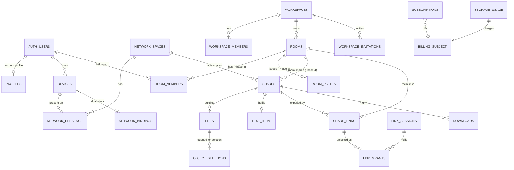

# 04 — Database and Storage Design

| Field | Value |
|---|---|
| Document status | PROPOSED. Phase 0–3 migrations are implemented; Phase 4's twelve migrations are built and applied to local databases only (uncommitted, IMPLEMENTED / NEEDS REVIEW, not verified) (§12). Later phases' column-level detail (Team, Phase 5) is indicative and finalized in each phase's migration review. |
| Last updated | 2026-10-18 (Phase 4, P4-25: as-built notes for Phase 3's and Phase 4's migrations in §1–§12: device binding and revocation, profiles, merge intents, rooms, Realtime authorization and triggers, shares, links, grants, extension copies, storage keys, multipart, deletion and quota, the job catalogue, billing and override tables, key functions, the §12 migration list; the false "`rooms` has no `kind` column" corrected). 2026-10-15 (§12: Phase 2 migration implemented, with its differences from §7.4–§7.6 and §10.4). Earlier the same day: Phase 1 migration implemented (§7.2 upload URL expiry, §9.2 storage executor and tombstones, §11 functions, §12 as-built list). 2026-09-29 (baseline executed locally); 2026-09-23 (CR-001) |
| Key decisions | DEC-006, DEC-007, DEC-009, DEC-010, DEC-012, DEC-016, DEC-017, DEC-019, DEC-026, DEC-027, DEC-031, DEC-032 |

---

## 1. Principles and conventions

| Topic | Convention |
|---|---|
| Schemas | `app` holds all application tables and functions and is **not exposed** through the Supabase Data API. `app_realtime` holds `SECURITY DEFINER` helpers used by Realtime policies. Supabase's `auth` and `realtime` schemas are used as provided. |
| Access roles | `app_owner` (NOLOGIN, owns objects, used by migrations). `app_server` (LOGIN, used by Next.js through the pooler, DML only). Supabase `authenticated` gets **no** privileges on `app`. As built, Phase 3 adds `app_janitor` and `app_egress_loader` (§12). |
| RLS | Enabled on every `app` table. Only explicit `TO app_server` policies exist. Any other role is denied by default, even if the schema were exposed by mistake. |
| IDs | `uuid default gen_random_uuid()` for rows. 96-bit random base64url text IDs for anything placed in URLs (links, invites). No sequential public identifiers. |
| Enumerations | `text` with `CHECK` constraints (simpler migrations than native enums) |
| Time | `timestamptz`, UTC. `now()` in the database is the clock for expiry. |
| Sizes | `bigint` bytes |
| Secrets | `bytea` HMAC/SHA-256 digests with a `pepper_version`. Argon2id PHC strings for passwords. Never plaintext. **As built (P4-16):** passwords are scrypt PHC strings, not Argon2id ([DV4-70](phases/phase-4-pro-accounts.md#234-deviations-from-the-plan)). |
| Email | `citext` |
| Soft vs hard delete | Content-bearing entities end in a **state** (`status`, `ended_at`) and later become purged tombstones. Ephemeral entities are hard-deleted by jobs. |
| Side effects | Outbox tables (`object_deletions`) written in the same transaction as the state change |

---

## 2. Entity overview



`BILLING_SUBJECT` is a user or a workspace, referenced as `(subject_type, subject_id)`.

**As built (through Phase 4; current tables in [ARCHITECTURE §10.2](ARCHITECTURE.md#102-major-tables)):** rooms, members, invites, room shares and room links exist for **private rooms only** (P4-17 … P4-19); workspaces don't (Phase 5). The billing subject is always a user (`subject_type = 'user'`). Not drawn above: `merge_intents` (§3.3), `upload_volume_charges` (§8.8), `share_extension_files` (§7.7), `billing_checkouts` and `billing_disputes` (§10.1), and Phase 3's `job_heartbeats` and `storage_reconcile_runs` (§10.4). There is no multipart table: a multipart upload is three `files` columns, and its parts are listed from storage (§8.5).

### 2.1 Mapping from requested entities

| Requested entity | Proposed table(s) | Why |
|---|---|---|
| `users` | `auth.users` (Supabase) + `app.profiles` | Supabase owns identities, both anonymous and permanent. `profiles` holds app data for permanent accounts. |
| `anonymous_sessions` | `auth.users` with `is_anonymous = true` + `app.devices` | A Supabase anonymous user *is* the session identity. `devices` adds labels, platform, last-seen and revocation. |
| `network_rooms` | `app.network_spaces` + `app.network_presence` (+ `network_bindings`, `network_probe_nonces`, `network_key_links`) | The "network room" is a **network space**: one per network key, with no owner or members. Visibility is decided per request from the caller's current network (DEC-031, DEC-032). |
| `rooms` | `app.rooms` (Phase 4–5) | Kinds `private` (Pro) and `workspace` (Team). Local mode doesn't use rooms. As built in Phase 4: kind `private` only. |
| `room_members` | `app.room_members` + `app.room_invites` (Phase 4) | Membership for private and workspace rooms only. There is no admission step in local mode. |
| `shares` | `app.shares` | A content bundle posted to a network space, as link-only, or to a room, with lifecycle state |
| `files` | `app.files` | One R2 object per row |
| `text_items` | `app.text_items` | Versioned text, erased at end |
| `share_tokens` | `app.share_links` + `app.link_sessions` + `app.link_grants` | The link secret, short code, password and viewer sessions |
| `downloads` | `app.downloads` | URL issuances and claims (history and abuse handling) |
| `subscriptions` | `app.subscriptions` + `app.billing_customers` + `app.billing_events` | Provider-agnostic subscription state and an idempotent webhook log. As built (Phase 4C): also `billing_checkouts` and `billing_disputes` (§10.1). |
| `team` / `workspace` | `app.workspaces` + `app.workspace_invitations` | — |
| `workspace_members` | `app.workspace_members` | — |
| `storage_usage` | `app.storage_usage` + `app.storage_reservations` + `app.rate_counters` | Atomic quota ledger plus daily volume counters |
| *(additional)* | `app.object_deletions`, `app.audit_events`, `app.abuse_reports`, `app.entitlement_overrides`, `app.runtime_flags`, `app.user_flags`, `app.idempotency_keys`, `app.network_egress_ranges`, `app.network_egress_asns` | Outbox, audit, safety, operations |

---

## 3. Identity and devices

### 3.1 `app.profiles`

- **Purpose:** app profile for **permanent** accounts. Anonymous users have none.
- **Key fields:** `user_id uuid PK → auth.users(id) ON DELETE CASCADE`, `display_name text`, `created_at`, `updated_at`, `deletion_requested_at`.
- **Relationships:** 1:1 with `auth.users`. A subject for subscriptions, workspace ownership and history.
- **Expiry:** none. Removed with account deletion (Phase 4 deletion flow).
- **As built (P4-03, P4-22; `20261016140000_phase4_accounts.sql`):** as designed, plus `deletion_scheduled_for` (set and cleared together with `deletion_requested_at`, a check). `display_name` is 1–60 characters. `ensure_profile` makes the row on first sight of an account; anonymous users never get one. `delete_due_accounts` deletes it (§9.2). A change of the deletion fields sends `account.changed` (§6.3).

### 3.2 `app.devices` — "anonymous_sessions"

- **Purpose:** one row per browser installation acting for a user. Provides the label shown to other devices on the network ("devices here now"), a last-seen time, and revocation.
- **Key fields:**

| Column | Type | Notes |
|---|---|---|
| `id` | uuid PK | Sent by the client as `X-Device-Id`, verified against `user_id` |
| `user_id` | uuid → `auth.users` ON DELETE CASCADE | An anonymous user normally has one device |
| `label` | text (≤ 40) | Generated ("Blue Fox"), renameable |
| `platform` | text | Coarse, for example "iPhone · Safari" |
| `created_at`, `last_seen_at` | timestamptz | `last_seen_at` is refreshed by `observe` calls |
| `revoked_at` | timestamptz null | Revoked devices get 401 |

- **Indexes:** `(user_id)`.
- **Expiry:** deleted with the user. Anonymous users inactive for 30 days are deleted by `cleanup-anonymous-users`. Revoked devices are purged after 30 days.
- **As built (P4-02, P4-03, P4-07; [phase 4 §18](phases/phase-4-pro-accounts.md#18-phase-4a-implementation-2026-10-16), [ARCHITECTURE §5.3](ARCHITECTURE.md#53-authentication-and-sessions)):**
  - `auth_session_id` binds a device to the token's Auth session (`session_id` claim). One active device per session (unique partial index). `requireCaller` checks the binding on every request, and Realtime's `net:` and `room:` topics need it (§6.2, C4-2).
  - `revoked_reason` (`user`, `merge`, `account_deleted`, `operator`; required with `revoked_at`) and `revoked_by_device_id`. `revoke_device` also deletes the device's Auth session and ends its presence; the API answers `401 DEVICE_REVOKED` until the access token expires.
  - `register_device` binds, rebinds or creates under the user's row lock and refuses a revoked device's session (DV4-1). Rebinding an own device ends its presence (DV4-7). An account has at most 10 active devices (D4-5, as recommended); anonymous users have no cap. Phase 1–3 rows bind at their next registration.
  - Revoked devices are purged by `purge-ephemeral`, not `purge-tombstones` (DV4-6). A merge moves the merging device to the account; account deletion deletes the account's devices (§11).

### 3.3 `app.merge_intents` (Phase 4A, as built)

- **Purpose:** the proof that lets an anonymous user's data move into an account (the merge, [phase 4 §18](phases/phase-4-pro-accounts.md#183-what-was-built)). Created by the anonymous session before sign-in.
- **Key fields:** `id uuid PK`, `anon_user_id`, `anon_device_id`, `secret_hmac` (32 bytes, HMAC under the versioned `LINK_PEPPER`, domain-separated as `merge|{id}|{secret}`, DV4-5), `pepper_version`, `status` (`open`, `completed`, `revoked`, `expired`), `target_user_id`, `created_at`, `expires_at` (≤ 24 h), `completed_at`, `result` (counts only).
- **Constraints:** one open intent per anonymous user (unique partial index). **No foreign keys**, so a completed intent outlives the user it describes (DV4-4).
- **Access:** read-only for `app_server`; written only by `create_merge_intent` and `merge_anonymous_user`.
- **Expiry:** `purge-ephemeral` marks open intents expired when due and deletes intents 30 days after they end. Account deletion deletes the account's intents (P4-21).

---

## 4. Local networks (DEC-031, DEC-032)

Local mode has no rooms, owners or members. A **network space** stands for one network key. Visibility is decided on every request from the caller's current network ([03 §3.6](03-security-and-network-design.md#36-visibility-rule-and-presence)); nothing here records who is *allowed* in.

### 4.1 `app.network_spaces`

- **Purpose:** one row per network key. Local shares belong to a space.
- **Key fields:**

| Column | Type | Notes |
|---|---|---|
| `id` | uuid PK | Used in realtime topics `net:{id}`. Never accepted from clients as input. |
| `network_key`, `key_version` | bytea(32), smallint | HMAC of the normalized IP ([03 §3.2](03-security-and-network-design.md#32-network-key-derivation-dec-032)). Unique `(key_version, network_key)`. |
| `family` | smallint (4 \| 6) | |
| `status` | text CHECK (`ok`, `shared_egress`, `too_large`, `blocked`, `unavailable`) | Only `ok` has local mode ([03 §3.5](03-security-and-network-design.md#35-eligibility-classification-and-fail-closed-guards-dec-032)) |
| `status_reason`, `status_until` | text, timestamptz null | `status_until` keeps `shared_egress` / `too_large` sticky for ≥ 7 days |
| `devices_24h` | int | Cached distinct-device count, refreshed by `observe` and the status job |
| `created_at`, `last_seen_at`, `last_share_at` | timestamptz | |

- **Expiry:** deleted by `purge-idle-spaces` when it has had no active shares and no presence for 30 days. `shares.network_space_id` uses `ON DELETE RESTRICT`, so a space with content can never be deleted.

### 4.2 `app.network_presence`

- **Purpose:** which devices are, or were recently, on a space. Authorizes realtime topics, powers "N devices here now", and feeds the `too_large` count.
- **Key fields:** `space_id → network_spaces ON DELETE CASCADE`, `device_id → devices ON DELETE CASCADE`, `user_id` (denormalized for the realtime policy), `first_seen_at`, `last_seen_at`, `present_until` (last observe + 10 min; set to `now()` when the device observes from another network). **PK** `(space_id, device_id)`.
- **Indexes:** `(user_id, space_id, present_until)` for realtime checks, `(space_id, last_seen_at)` for counts.
- **Expiry:** rows deleted 24 h after `last_seen_at`.

### 4.3 Dual-stack binding tables (conditional on SP-04)

| Table | Key fields | Expiry |
|---|---|---|
| `app.network_probe_nonces` | `nonce_hash bytea PK`, `device_id`, `v4_space_id null`, `v6_space_id null`, `created_at`, `expires_at` (+60 s) | Deleted after expiry. Single use. |
| `app.network_bindings` | `device_id PK → devices`, `v4_space_id`, `v6_space_id`, `created_at`, `expires_at` (+10 min) | One live binding per device. Honoured only while the current request's key is one of the two ([03 §3.4](03-security-and-network-design.md#34-dual-stack-binding-conditional-on-sp-04)). |
| `app.network_key_links` | `(v4_space_id, v6_space_id) PK`, `first_seen_at`, `last_seen_at` | 7 days. An IPv4 space linked to ≥ 2 IPv6 spaces within one hour becomes `shared_egress`. |

### 4.4 Classification data

| Table | Key fields | Notes |
|---|---|---|
| `app.network_egress_ranges` | `cidr cidr`, `source CHECK (private_relay, tor, vpn, hosting)`, `updated_at`. GiST index (`inet_ops`) for overlap lookups. | Phase 1: iCloud Private Relay (Apple publishes the CSV) and the Tor exit list, loaded by `pnpm egress:load` with adjacent ranges merged (about 14,700 rows); weekly by runbook in Phase 1, daily job from Phase 3. Queried only through `app.egress_ranges_overlapping(prefix)` (§11). |
| `app.network_egress_asns` | `asn int PK`, `category CHECK (vpn, hosting, mobile_carrier)`, `families smallint[]` (mobile carriers: `{4}` only), `source`, `updated_at` | Phase 1 only if SP-04 confirms Cloudflare can forward the client ASN; otherwise Phase 6. The list source must be licensed for commercial use. |

---

## 5. Rooms and membership (Pro and Team, Phase 4–5)

Rooms are **membership-based** spaces for Pro private rooms and Team workspace rooms. They are **never visible on any network**. Free local mode doesn't use them. These tables are created in Phase 4.

### 5.1 `app.rooms`

| Column | Type | Notes |
|---|---|---|
| `id` | uuid PK | |
| `kind` | text CHECK (`private`, `workspace`) | `private` is Pro, `workspace` is Team |
| `workspace_id` | uuid null → workspaces | Required if and only if `kind = 'workspace'` |
| `owner_user_id` | uuid null → auth.users ON DELETE SET NULL | Promotion job fills this in when null |
| `label`, `label_is_custom`, `avatar_seed` | text, bool, text | Custom names are Pro |
| `members_can_create_links` | bool | Default `true` (own shares only) |
| `default_expiry_seconds` | int null | Room default within entitlements |
| `created_at`, `last_activity_at`, `deleted_at` | timestamptz | |

- **Relationships:** 1:N `room_members`, `shares` (`scope = 'room'`), `room_invites`, `share_links` (room links).
- **Expiry:**
  - `private` rooms persist while they exist. After a downgrade they stay usable by existing members, but new private rooms can't be created.
  - `workspace` rooms persist until deleted by an admin or with the workspace.
- **Deletion path:** a service or job ends all active shares first (outbox), then soft-deletes. Hard FKs from `shares` use `ON DELETE RESTRICT` so that deleting a room row can never orphan objects.

### 5.2 `app.room_members`

- **Key fields:** `room_id → rooms ON DELETE CASCADE`, `user_id → auth.users ON DELETE CASCADE`, `role CHECK (owner, member)`, `joined_via CHECK (creator, invite, workspace)`, `invited_by_user_id`, `created_at`, `last_active_at`, `removed_at`, `removed_by_user_id`. **PK** `(room_id, user_id)`.
- **Constraints:** unique partial index `(room_id) WHERE role = 'owner' AND removed_at IS NULL`.
- **Indexes:** `(user_id) WHERE removed_at IS NULL`.
- **Expiry:** removed rows are kept for 30 days (audit context), then deleted.

### 5.3 `app.room_invites` (QR pairing and invite links)

- **Key fields:** `id text PK` (96-bit), `room_id`, `secret_hmac`, `pepper_version`, `kind CHECK (pairing, invite_link)`, `created_by_user_id`, `created_at`, `expires_at`, `max_uses`, `use_count`, `revoked_at`.
- **Expiry:** pairing invites (QR) last 10 min and are single use. Invite links last ≤ 7 days. Rows are deleted 7 days after expiry.

**As built (P4-17, 2026-10-18; `20261017200000_phase4_rooms.sql`):** `rooms.kind` allows only `private`; `rooms` has no `workspace_id` or `avatar_seed` yet (Phase 5) and adds the owner's `entitlement_snapshot` (the member cap) and `rooms_owner_while_open`; `room_members` uses `joined_via` `creator`, `pairing`, `invite_link`, adds the opaque `id` (the API's `memberId`), `invite_id`, `joined_device_id`, `joined_at` and `removed_reason`, and keeps the owner's membership until the room is deleted; `room_invites` checks the 10-minute and 7-day lifetimes, a pairing's single use and `use_count ≤ max_uses`. Functions `room_role`, `create_room`, `accept_room_invite`, `delete_room` ([phase 4 §24.2](phases/phase-4-pro-accounts.md#242-what-was-built)). **P4-18 (`20261018100000_phase4_pairing.sql`):** a pairing invite must name exactly one use (P4-17's check let a missing maximum, read as unlimited, through) ([phase 4 §25](phases/phase-4-pro-accounts.md#25-phase-4d-fifth-task-p4-18-qr-pairing-2026-10-18)).

**Lifecycle as built (P4-17 … P4-22; [ARCHITECTURE §9.10](ARCHITECTURE.md#910-private-rooms-phase-4d-p4-17-p4-18-p4-19)):**
- **No promotion job and no ownership transfer.** An open room always has its owner (`rooms_owner_while_open`), and the owner can't leave (D4-18). Account deletion deletes the owner's open rooms first (DV4-92).
- **Deletion:** `delete_room` (the owner, or the deletion job) ends the room's open shares (`room_deleted`), revokes its invites and, since P4-19, its room links, removes every member and soft-deletes. `purge-ephemeral` hard-deletes the room 30 days later, once no share row refers to it. Removed memberships go after 30 days, invites 7 days after they end (as designed).
- **Accounts:** a merge moves the anonymous user's memberships to the account (DV4-88). An account's memberships in other rooms cascade with its Auth user, so the `removed_reason` values `merged` and `account_deleted` stay unused (DV4-132).
- **Not maintained:** `last_activity_at` exists but nothing updates it (DV4-87).
- **After a downgrade:** the room stays usable for its members; renames and new rooms are refused (as designed).

---

## 6. Row Level Security, grants and Realtime authorization

### 6.1 Grants and RLS posture

```sql
-- Nothing in app is reachable by client roles.
revoke all on schema app from public, anon, authenticated;
grant usage on schema app to app_server;

-- Per table (repeated in migrations):
alter table app.shares enable row level security;
create policy app_server_all on app.shares
  for all to app_server using (true) with check (true);
grant select, insert, update, delete on app.shares to app_server;
```

- `app` is **not** added to the Data API's exposed schemas.
- Supabase's secret key (`service_role`) is used only for Auth admin operations (for example deleting anonymous users) and by the janitor if needed, not for normal app queries.
- **As built (Phase 3–4; [ARCHITECTURE §10.4](ARCHITECTURE.md#104-rls-strategy)):**
  - The pattern holds, with narrower grants where the app only reads. `merge_intents`, `subscriptions`, `entitlement_overrides`, `billing_customers`, `billing_events` and `billing_disputes` are SELECT-only for `app_server`; definer functions write them. `share_extension_files` accepts only untried `pending` inserts. `job_heartbeats` is read-only and `storage_reconcile_runs` has no app access (Phase 3).
  - Functions that read or change the `auth` schema are owned by the migration role (`app_owner` can't reach `auth`).
  - No app code uses the Supabase secret key (it is optional configuration). Anonymous-user cleanup, the merge and account deletion delete `auth.users` rows in SQL as the migration role, and the janitor connects as `app_janitor` (Phase 3, C-4).

### 6.2 Realtime policies

```sql
create schema if not exists app_realtime;
grant usage on schema app_realtime to authenticated;

create or replace function app_realtime.can_access_topic(p_topic text)
returns boolean
language plpgsql stable security definer set search_path = ''
as $$
declare
  v_uid  uuid := auth.uid();
  v_kind text := split_part(p_topic, ':', 1);
  v_id   uuid;
begin
  if v_uid is null then return false; end if;
  begin
    v_id := split_part(p_topic, ':', 2)::uuid;
  exception when others then
    return false;
  end;
  if v_kind = 'user' then
    return v_id = v_uid;
  elsif v_kind = 'net' then
    -- Local mode: the server has recorded this user's device as present
    -- on the space within the last 10 minutes, and the space is eligible.
    return exists (
      select 1 from app.network_presence p
      join app.network_spaces s on s.id = p.space_id
      where p.space_id = v_id and p.user_id = v_uid
        and p.present_until > now() and s.status = 'ok');
  elsif v_kind = 'room' then  -- Phase 4+
    return exists (
      select 1 from app.room_members m
      join app.rooms r on r.id = m.room_id
      where m.room_id = v_id and m.user_id = v_uid
        and m.removed_at is null and r.deleted_at is null);
  elsif v_kind = 'workspace' then
    return exists (
      select 1 from app.workspace_members w
      where w.workspace_id = v_id and w.user_id = v_uid
        and w.removed_at is null and w.status = 'active');
  end if;
  return false;
end $$;
grant execute on function app_realtime.can_access_topic(text) to authenticated;

-- Receive broadcasts and presence on authorized topics.
create policy "authorized topics can be received"
  on realtime.messages for select to authenticated
  using ( app_realtime.can_access_topic((select realtime.topic())) );

-- Clients may track presence, but may NOT send broadcasts (no broadcast insert policy).
create policy "authorized devices can track presence"
  on realtime.messages for insert to authenticated
  with check (
    realtime.messages.extension = 'presence'
    and app_realtime.can_access_topic((select realtime.topic()))
  );
```

Realtime setting **"Allow public access" = disabled**. Clients subscribe with `{ config: { private: true } }`. SP-03 validates all of this, including how quickly a device that stops being present loses the channel (policy re-evaluation on token refresh, RISK-007).

**As built (P4-02, P4-17, P4-24; [ARCHITECTURE §12.4](ARCHITECTURE.md#124-channel-authorization)).** `can_access_topic` reads `sub`, `session_id`, `amr` and `aal` from `request.jwt.claims` and refuses a malformed topic or token.
- **On every topic** it refuses a password session (D4-2, DV4-9), the session of a revoked device (its access token stays valid until it expires), and, since P4-24, a token below `aal2` whose account has a verified TOTP factor (`app.mfa_enrolled`, granted to `app_owner` for this; DV4-146).
- **`user:`** the user itself.
- **`net:`** the device **bound to this session** is present on the space (C4-2), not revoked; the user isn't suspended; the space is `ok`; the `local_sharing_enabled` kill switch is on.
- **`room:`** an active membership of an open room, a session bound to a non-revoked device of the user, and no suspension (DV4-98).
- **No `workspace` branch** (Phase 5); the design above stays the target for it.
- **Presence:** Phase 1's insert policy allows presence on `net:` topics only, so room topics carry no presence.

### 6.3 Realtime event triggers

```sql
create or replace function app.emit_share_changed()
returns trigger language plpgsql security definer set search_path = '' as $$
declare
  v_payload jsonb := jsonb_build_object('v', 1, 'type', 'share.changed',
                                        'shareId', new.id, 'status', new.status);
begin
  if tg_op = 'INSERT'
     or new.status is distinct from old.status
     or new.title  is distinct from old.title then
    -- Where the share lives: its network space, or its room (Phase 4+).
    if new.scope = 'network' then
      perform realtime.send(v_payload, 'share.changed',
                            'net:' || new.network_space_id::text, true);
    elsif new.scope = 'room' then
      perform realtime.send(v_payload, 'share.changed',
                            'room:' || new.room_id::text, true);
    end if;
    -- The creator's own topic, so "My uploads" updates on any network.
    if new.created_by_user_id is not null then
      perform realtime.send(v_payload, 'share.changed',
                            'user:' || new.created_by_user_id::text, true);
    end if;
  end if;
  return null;
end $$;

create trigger shares_emit_changed
after insert or update on app.shares
for each row execute function app.emit_share_changed();
```

| Event | Source trigger | Topic | Payload (IDs only) |
|---|---|---|---|
| `share.changed` | `shares` insert / status or title change. **As built:** status or expiry change (DV4-66), not title; an extension starting, failing or cancelled goes to the creator's topic only | `net:{spaceId}` (local) or `room:{roomId}` (Phase 4+), plus `user:{creatorId}` | `shareId`, `status` |
| `share.changed` | `text_items` version change | same | `shareId`, `version` |
| `network.changed` | `network_spaces` status change | `net:{spaceId}` | `spaceId`, `status`. Clients hide local content and show the status message when it is not `ok`. |
| `member.changed` (Phase 4) | `room_members` insert / `removed_at` change | `room:{roomId}` | `userId`, `change`. **As built (P4-17):** `change` only (no user ID leaves the server) |
| `membership.changed` (Phase 4) | same | `user:{userId}` | `roomId`, `change` |
| `room.updated` (Phase 4) | `rooms` settings change | `room:{roomId}` | `roomId`. **As built:** no ID (the topic names the room); also `room.deleted` |
| `workspace.changed` (Phase 5) | workspace members, policies | `workspace:{workspaceId}` | `workspaceId`, `change` |
| `account.changed` (Phase 4, as built) | `subscriptions` insert or a change that matters for entitlements (P4-12); `profiles` deletion fields (P4-22) | `user:{userId}` | none: `{ v, type }` (DV4-42) |

**Triggers as built (Phase 4; [ARCHITECTURE §12.1](ARCHITECTURE.md#121-what-is-sent)):**
- `shares_emit_changed` fires on insert and on updates of `status`, `expires_at` and `extension_pending` (P4-15). Room shares go to `room:{id}` and never to a `net:` topic (P4-17). `text_items_emit_changed` sends a room text's edits to `room:{id}`.
- `room_members_emit_changed` (insert, update, delete: a merge's move counts as `joined`, the cascade delete of an active row as `removed`) and `rooms_emit_updated` (P4-17).
- `subscriptions_emit_account_changed` (P4-12) and `profiles_emit_deletion_changed` (P4-22).
- Their functions are all `SECURITY DEFINER` and owned by the migration role, as in Phase 1. Phase 4's other triggers send nothing: `share_links_password_state` (§7.4) and `object_deletions_multipart_upload` (§8.7).

`realtime.send` writes into `realtime.messages` inside the calling transaction, so a rolled-back transaction should emit nothing. **SP-03 must confirm this.** Messages are retained 3–4 days for Broadcast Replay, which is why payloads contain no names or content.

---

## 7. Content

### 7.1 `app.shares`

| Column | Type | Notes |
|---|---|---|
| `id` | uuid PK | |
| `scope` | text CHECK (`network`, `link_only`, `room`) | `network` from Phase 1, `link_only` from Phase 2, `room` from Phase 4 (DEC-012) |
| `network_space_id` | uuid null → network_spaces **ON DELETE RESTRICT** | The uploader's most specific eligible space at creation. Required if and only if `scope = 'network'`. |
| `room_id` | uuid null → rooms **ON DELETE RESTRICT** (column added in Phase 4) | Required if and only if `scope = 'room'`. As built (P4-17). |
| `workspace_id` | uuid null | Denormalized for policy and quota. Not built (Phase 5). |
| `kind` | text CHECK (`files`, `text`) | |
| `title` | text null (≤ 120) | |
| `created_by_user_id`, `created_by_device_id` | uuid null (SET NULL on delete) | |
| `billing_subject_type`, `billing_subject_id` | text, uuid | Whose quota is charged: the uploader (local, link-only and private-room shares), or the workspace for workspace rooms |
| `status` | text CHECK (`pending_upload`, `active`, `claimed`, `consumed`, `expired`, `deleted`, `blocked`, `failed`) | State machine in [03 §5.2](03-security-and-network-design.md#52-state-machine) |
| `retention_class` | text CHECK (`d7`, `d30`, `d90`, `ws`) | Matches the object key prefix |
| `expires_at` | timestamptz null | Null only when `retention_class = 'ws'` and workspace policy allows no expiry |
| `burn_after_download` | bool default false | |
| `claimed_at`, `claimed_by_user_id`, `claimed_device_id`, `claimed_link_session_hash`, `claimed_link_id`, `claim_grace_until` | | Burn claim state. **As built (Phase 3):** `claimed_link_session_hash bytea` (32 bytes: link sessions are keyed by the cookie's SHA-256, C-8); `claimed_link_id text`, checked, without a foreign key (DV3-2). |
| `file_count`, `total_bytes` | int, bigint | |
| `entitlement_snapshot` | jsonb not null | Limits and features applied at creation |
| `ended_at`, `end_reason` | timestamptz, text CHECK (`expired`, `consumed`, `deleted_by_creator`, `deleted_by_owner`, `blocked`, `upload_failed`, `room_deleted`, `account_deleted`) | |
| `metadata_purge_after` | timestamptz null | Tombstone retention deadline |
| `created_at`, `updated_at` | timestamptz | |

- **Constraints:**
  - `CHECK ((scope = 'network') = (network_space_id IS NOT NULL))`
  - `CHECK ((scope = 'room') = (room_id IS NOT NULL))` (Phase 4)
  - `CHECK (expires_at IS NOT NULL OR retention_class = 'ws')`
  - `CHECK (status <> 'claimed' OR burn_after_download)`
  - `CHECK ((status IN ('pending_upload','active','claimed')) = (ended_at IS NULL))`
  - Phase 3, as built:
    - `shares_claim_columns`: no claim columns on `pending_upload` or `active` shares. An ended share keeps its claim for audit (DV3-3).
    - `shares_claim_complete`: a claimed share has `claimed_at`, `claim_grace_until` and exactly one claimant kind.
    - `shares_claim_grace`: grace ≤ `claimed_at + 6 h` and ≤ `expires_at` (D-6).
    - `shares_consumed_requires_burn`.
  - Phase 4, as built: `shares_room_scope` is the room check above (with Phase 1's `shares_network_scope`, a room share never has a space); `shares_extension_open`: no pending extension on an ended share.
- **Indexes:**
  - `(network_space_id, created_at DESC) WHERE status IN ('pending_upload','active')` for the local feed
  - `(room_id, created_at DESC) WHERE status IN ('pending_upload','active')` (Phase 4). As built: `shares_room_feed_idx` also covers `claimed`, plus `shares_room_idx (room_id) WHERE room_id IS NOT NULL`.
  - `(expires_at) WHERE status = 'active'`
  - `(claim_grace_until) WHERE status = 'claimed'`
  - `(created_by_user_id, created_at DESC)` for "My uploads" and history
  - `(metadata_purge_after) WHERE ended_at IS NOT NULL`
- **Expiry:** access ends at `expires_at` (checked at request time). The `expire-shares` job calls `app.end_share()` within about 1 minute. The tombstone is purged at `metadata_purge_after` (Free: +30 days; Pro/Team: history retention).
- **As built (Phase 4):**
  - New columns `extension_pending` and `extension_failed_at` (P4-15, DV4-61; §7.7).
  - Every share is billed to its uploader (`billing_subject_type = 'user'`), room shares included.
  - The end reasons `room_deleted` (`delete_room`) and `account_deleted` (`delete_due_accounts`) are accepted by `end_share` since Phase 4A.
  - `metadata_purge_after` uses the snapshot's `historyRetentionDays`: 30 days on Free, 365 on Pro (Q-015 recommendation). P4-20's transfer history reads these tombstones.
  - A merge re-points the anonymous user's creator, payer and claimant columns; account deletion ends the account's open shares and clears its claims on others' shares (§11).

### 7.2 `app.files`

| Column | Type | Notes |
|---|---|---|
| `id` | uuid PK | Also the last segment of the object key |
| `share_id` | uuid → shares ON DELETE CASCADE | |
| `network_space_id`, `room_id` | uuid null | Denormalized from the share |
| `object_key` | text UNIQUE | `{class}/{yyyy}/{mm}/{dd}/{id}` |
| `original_name`, `extension` | text | Sanitized ([03 §7.2](03-security-and-network-design.md#72-filename-sanitization)) |
| `declared_mime`, `detected_mime` | text | |
| `declared_size_bytes`, `size_bytes` | bigint | `size_bytes` is set at verification and must equal the declared size |
| `upload_mode` | text CHECK (`single`, `multipart`) | |
| `multipart_upload_id`, `part_size_bytes`, `part_count` | text, bigint, int | Phase 4 (as built in P4-14: all three or none; the count covers the declared size exactly) |
| `upload_status` | text CHECK (`pending`, `verified`, `rejected`, `deleted`) | |
| `upload_expires_at` | timestamptz | Completion deadline (single: +2 h; multipart: +24 h) |
| `upload_url_expires_at` | timestamptz null | Latest expiry of any presigned PUT issued for the file, recorded before the URL is handed out; URLs never outlive `upload_expires_at` or the share. Storage deletion holds the key until then ([03 §7.7](03-security-and-network-design.md#77-deleting-objects-while-upload-urls-are-live-phase-1-as-built)). |
| `position` | smallint | Order the uploader listed the files in (Phase 1 DV1-17) |
| `rejection_reason` | text null | |
| `preview_kind` | text CHECK (`image`, `none`) | Raster images only |
| `risk_flags` | text[] | `executable`, `script`, `archive`, `double_extension`, `disk_image` |
| `scan_status`, `scanned_at`, `scan_engine` | | Phase 6. Default `not_scanned`. |
| `created_at`, `verified_at`, `object_deleted_at` | timestamptz | |

- **Indexes:** `(share_id)`, `(upload_expires_at) WHERE upload_status = 'pending'`.
- **Expiry:** follows the share. The object is enqueued for deletion when the share ends. The row goes with the share tombstone.
- **As built (Phase 4):** `files` has no `room_id` column (nor has `text_items`, §7.3): a file's room is its share's (P4-17). Every file of a share that has a multipart file gets the 24-hour deadline (DV4-46). An extension by copy swaps `object_key` to the new key (§8.3).

### 7.3 `app.text_items`

- **Key fields:** `share_id uuid PK → shares ON DELETE CASCADE`, `network_space_id null`, `room_id null`, `content text null`, `content_bytes int`, `version int default 1`, `updated_at`, `updated_by_device_id`.
- **Constraints:** `CHECK (content_bytes <= 1048576)` is the hard ceiling. Plan limits are enforced in services (Free 100 KB, Pro/Team 1 MB, proposed).
- **Expiry:** `content` is **set to NULL** in the same transaction that ends the share. The row is purged with the tombstone.
- **Editing:** optimistic concurrency with `UPDATE … WHERE version = $expected` (DEC-027).
- **As built (Phase 4):** no `room_id` column (§7.2). Plan limits: Free 100 KiB, Pro 1 MiB (Phase 4B, binary units); an edit is checked against the share's snapshot. Account deletion clears `updated_by_device_id` for the account's devices (P4-21).

### 7.4 `app.share_links` — "share_tokens"

| Column | Type | Notes |
|---|---|---|
| `id` | text PK | 96-bit random base64url, used in the URL path |
| `target_type` | text CHECK (`share`, `room`) | `room` is Pro (Phase 4; as built in P4-19) |
| `share_id` | uuid null → shares ON DELETE CASCADE | Required if and only if `target_type = 'share'` |
| `room_id` | uuid null → rooms | Target of a room link (Phase 4): **private or workspace rooms only**. There are no links to a network feed (DEC-033). As built: private rooms only (no workspace rooms exist). |
| `follows_share_expiry` | bool | As built (P4-15): the link was made "until the share expires" and moves with an extension. Backfilled where a link's expiry equalled its share's (D4-13). Never on a room link. |
| `secret_hmac`, `pepper_version` | bytea, smallint | |
| `short_code_hmac`, `short_code_expires_at` | bytea null, timestamptz null | Nulled by the job at expiry |
| `password_hash`, `password_version` | text null, int | Argon2id PHC (Phase 4). **As built (P4-16):** scrypt PHC only (`$scrypt$ln=17,r=8,p=1$…`, a check), plus `password_set_at` and `password_locked_until`; the version is kept by the trigger `share_links_password_state` (+1 on every set, change or removal) |
| `allow_download` | bool | |
| `created_by_user_id` | uuid null | |
| `created_at`, `expires_at`, `revoked_at`, `revoked_by_user_id` | | `expires_at` ≤ target expiry |
| `unlock_count`, `last_unlocked_at` | | |
| `entitlement_snapshot` | jsonb | |
| `branding_workspace_id` | uuid null | Team branding (Phase 5) |

- **Indexes:** unique partial `(short_code_hmac) WHERE short_code_hmac IS NOT NULL`, `(share_id)`, `(room_id) WHERE target_type = 'room'`.
- **As built (P4-19, `20261018120000_phase4_room_links.sql`):** `share_links_target` (a share link names its share and no room, a room link its room and no share); a room link has no short code, lives at most 30 days and never follows a share's expiry; `room_id` → `rooms` ON DELETE CASCADE; revoke reason `room_deleted` (set by `delete_room`); index `(room_id, created_at DESC) WHERE target_type = 'room'`. `rooms.kind` allows only `private` (P4-17), so "private only" needs no check on the link; a Phase 5 workspace kind will need one (DV4-110, as corrected in P4-21) ([phase 4 §26](phases/phase-4-pro-accounts.md#26-phase-4d-sixth-task-p4-19-read-only-room-links-2026-10-18)).
- **Expiry:** invalid when `now() ≥ expires_at`, when revoked, or when the target ends. The row stays for history until the tombstone purge.

### 7.5 `app.link_sessions` and `app.link_grants`

- `link_sessions`: `id_hash bytea PK` (SHA-256 of the cookie value), `created_at`, `last_seen_at`, `expires_at`, `network_key bytea null` (rate-limit key). Deleted 24 h after expiry.
- `link_grants`: `session_id_hash → link_sessions ON DELETE CASCADE`, `link_id → share_links ON DELETE CASCADE`, `password_version`, `granted_at`, `expires_at` (≤ 12 h and ≤ link expiry). **PK** `(session_id_hash, link_id)`. Deleted after expiry. **As built (P4-16):** `password_verified_at`, checked between `granted_at` and `expires_at`; a grant opens a link only at the link's current version, and a password link only once verified. The grant's `password_version` (a Phase 2 column, default 0) records the link's version when the grant was made or refreshed. The version check applies on every link, also after a password's removal (DV4-71); a new unlock or code restarts the grant unverified (DV4-72). Room links' grants work the same way, and a purged room's links take their grants with them (cascade).

### 7.6 `app.downloads`

- **Purpose:** URL issuances, burn claims and text reveals. Used for transfer history (Pro/Team) and abuse investigation. It **cannot** record completed downloads (bytes flow directly from R2).
- **Key fields:** `id bigint identity`, `share_id`, `file_id null`, `network_space_id null`, `room_id null`, `link_id null`, `actor_kind CHECK (network_device, room_member, creator, link_viewer)`, `user_id null`, `device_id null`, `link_session_id_hash null`, `event CHECK (url_issued, preview_issued, burn_claimed, burn_retry, text_revealed)`, `created_at`, `url_expires_at`, `user_agent_family`, `country_code null`, `retention_until`.
- **Indexes:** `(share_id, created_at)`, `(user_id, created_at DESC)`, `(link_id, created_at)`, `(retention_until)`.
- **Expiry:** `retention_until` is computed at insert from the entitlement snapshot (Free 30 days).
- **As built (Phase 4):**
  - P4-17 adds `room_id` (no foreign key, like `network_space_id`) and the actor `room_member`. A room link's downloads are logged with the room (DV4-116).
  - `retention_until` comes from the share's snapshot, or the link's for a link viewer: 30 days on Free, 365 on Pro.
  - P4-20's transfer history reads these rows and shows actor kinds only (D4-20).
  - A merge re-points `user_id`; account deletion clears `user_id` and `device_id` and keeps the row in its owner's history (P4-21, DV4-129).

### 7.7 `app.share_extension_files` (Phase 4, P4-15, as built)

- **Purpose:** one row per file and extension by copy ([ARCHITECTURE §7.10](ARCHITECTURE.md#710-extending-a-share-phase-4d-p4-15), §8.3).
- **Key fields:** `id bigint identity`, `share_id` and `file_id` (ON DELETE CASCADE), `old_key` (`d7`/`d30`/`d90`), `new_key` (`d30`/`d90`: the class, the request's date and a fresh UUID; DV4-55), `new_retention_class`, `new_expires_at`, `status` (`pending` → `copied` → `swapped`, or `cancelled` / `failed`), `attempts`, `not_before`, `locked_until`, `last_attempt_at`, `last_error` (≤ 200), `created_at`, `finished_at`.
- **Constraints:** one open (`pending` or `copied`) row per file; a `new_key` is unique forever; the new key's prefix is its class.
- **Access:** the app inserts untried `pending` rows and reads them; only the janitor's definer functions move them on (§8.7, §11).
- **Expiry:** the rows go with their share's tombstone.

---

## 8. Storage architecture (Cloudflare R2)

### 8.1 Evaluation

| Aspect | R2 facts (verified 2026-09-17 against Cloudflare docs) | Impact |
|---|---|---|
| Egress | Free | Decisive for a download-heavy product |
| Price | Standard $0.015/GB-month. Class A $4.50/M. Class B $0.36/M. Free tier 10 GB-month, 1M Class A, 10M Class B. DeleteObject and AbortMultipartUpload are free. ListParts is Class A. | Storage dominates cost, so quotas matter |
| Presigned URLs | GET, HEAD, PUT, DELETE. **POST form uploads unsupported.** Expiry 1 s–7 days. **Only on the S3 endpoint, not custom domains.** Signed `Content-Type` is enforced (403 on mismatch). URLs reusable until expiry. | No POST-policy size limits, so post-upload verification is needed. Download URLs show the R2 hostname. |
| Size limits | Single PUT ≤ 5 GiB. Multipart parts 5 MiB–5 GiB, **all parts except the last equal size**, ≤ 10,000 parts. Object ≤ ~4.995 TiB. | Free (100 MB) uses a single PUT. Pro (5 GB) needs multipart. |
| Lifecycle | Delete after N days or on a date, filtered by prefix. Abort incomplete multipart uploads (default 7 days). **Removal typically within 24 h** of eligibility. Up to 1,000 rules. | Backstop only, never an access control |
| CORS | Configurable per bucket. `ExposeHeaders: ETag` needed for multipart. | Required for browser PUT |
| Event notifications | `object-create` / `object-delete` delivered to Cloudflare Queues, with prefix/suffix filters | Optional later |
| Other limits | Concurrent writes per key: 1/s | Unique keys per file make this irrelevant |
| Uncertain | `response-content-disposition` overrides on GET (community reports of inconsistent behaviour) | Set headers at upload instead (RISK-011, SP-02) |

**Verdict:** R2 fits well. The design works around its constraints (no POST policies, S3-endpoint-only presigning, lifecycle lag).

### 8.2 Buckets and configuration

| Item | Configuration |
|---|---|
| Buckets | `{product}-files-staging`, `{product}-files-prod` (optionally `-dev`). Location hint near the primary users (Q-016). |
| Access | **Private**: public access off, `r2.dev` subdomain off, no custom domain (unless a download Worker is added later) |
| API tokens | `web-app` (Object Read & Write, scoped to one bucket). `janitor` (separate token, same scope). Admin credentials kept out of runtime environments. Object Read & Write is the narrowest R2 level that can delete, and it can also read and overwrite every object in the bucket (RISK-037). |
| CORS | Allowed origins: exact app origins per environment. Methods: `PUT`, `GET`, `HEAD`. Allowed headers: `content-type`, `content-disposition`, `cache-control`. Exposed headers: `ETag`. Max age 3600 s. |
| Lifecycle rules | See the table below |

| Rule | Prefix | Action |
|---|---|---|
| `backstop-d7` | `d7/` | Delete 8 days after creation |
| `backstop-d30` | `d30/` | Delete 31 days after creation |
| `backstop-d90` | `d90/` | Delete 91 days after creation |
| `abort-multipart` | *(all)* | Abort incomplete multipart uploads after 1 day |
| *(no rule)* | `ws/` | Application-managed retention within workspace quota |
| *(no rule)* | `hold/` | Legal-hold copies (Phase 3 security review): kept until an operator releases the hold, then deleted by the janitor |

**As built:** no bucket exists yet. These rules are written in `infra/r2/lifecycle.json` and not applied, so the `abort-multipart` backstop for Phase 4's multipart uploads isn't active anywhere; local development uses RustFS ([ARCHITECTURE §11](ARCHITECTURE.md#11-storage-architecture)).

### 8.3 Object key strategy (DEC-010)

```text
{retentionClass}/{yyyy}/{mm}/{dd}/{fileId}
d7/2026/09/17/3f0c2a4e-8b6d-4c1e-9a57-0e5d1f7b2c90
```

| Segment | Why |
|---|---|
| `retentionClass` (`d7`, `d30`, `d90`, `ws`) | The lifecycle backstop matches the maximum retention chosen at creation |
| `yyyy/mm/dd` (upload date, UTC) | Cheap reconciliation listing by day |
| `fileId` (UUIDv4) | Unguessable. **No filename, user, room or workspace identifiers in keys.** |

- Keys match `^(d7|d30|d90|ws)/\d{4}/\d{2}/\d{2}/[0-9a-f-]{36}$`. The janitor refuses anything else.
- **As built (Phase 4B):** a share's class at creation is the shortest one that holds its expiry (`lib/server/storage/keys.ts`): Free's options stay in `d7`; Pro's 30 and 90 days use `d30/` and `d90/`. `ws/` is reserved for Team (Phase 5) and unused.
- **Legal-hold copies (Phase 3):** `hold/<key>`, made by the janitor with a server-side `CopyObject` when a takedown holds an object. R2's lifecycle rules ignore holds, and no rule covers `hold/`. No file row ever points at a copy, and reconciliation only counts them.
- **Extending expiry beyond the class** (Phase 4): server-side `CopyObject` to the new prefix, update `object_key` and `expires_at` in one transaction, enqueue the old key for deletion. **As built (P4-15, 2026-10-17; [phase 4 §22](phases/phase-4-pro-accounts.md#22-phase-4d-second-task-p4-15-expiry-3090-days-and-extend-2026-10-17)):** the storage janitor copies (`app.share_extension_files`); a copy's key is the new class, the request's date and a **fresh UUID**, never reused (DV4-55); a `d90` share past its window is copied into a fresh `d90` key (DV4-56); the swap queues the old keys as `superseded`, and a cancelled or failed extension's new keys as `extension_cancelled`; a guard rail, `extension_pending`, keeps both keys of a running extension from deletion.

### 8.4 Object headers fixed at upload (signed)

| Header | Value |
|---|---|
| `Content-Type` | The declared type if it is an allowed preview type, otherwise `application/octet-stream` |
| `Content-Disposition` | `attachment; filename="<ascii-fallback>"; filename*=UTF-8''<percent-encoded-name>` |
| `Cache-Control` | `private, no-cache` |

Only non-PII custom metadata is allowed (for example `x-amz-meta-file-id`).

### 8.5 Upload flows

**Single PUT (Phase 1, files ≤ 100 MB):**

1. Init: validate, reserve storage, insert rows, presign PUT (TTL 15 min, the signature is checked when the request starts) with signed headers.
2. The browser sends a PUT with exactly those headers, reporting progress locally.
3. Complete: `HeadObject` (size must equal the declared size), ranged GET of 4,100 bytes to sniff the type, commit the reservation, mark the file `verified` and the share `active` once all files are verified.
4. Abandoned uploads: `fail-stale-uploads` rejects files still pending 2 h after init. It enqueues object deletion (the object may exist) and releases the reservation.

**Multipart (Phase 4, files > 100 MB, up to the plan limit):**

1. Part size = `max(16 MiB, ceil(size / 9,000))` rounded up to a whole MiB. All parts are equal except the last (an R2 rule).
2. The server calls `CreateMultipartUpload` with the signed headers and stores `multipart_upload_id` and `part_size_bytes`.
3. The client requests presigned `UploadPart` URLs in batches (≤ 20 per call, TTL 1 h) **only for part numbers 1…ceil(size / partSize)**. It uploads 3–4 parts in parallel and records ETags. Resume state is kept in IndexedDB.
4. Complete: the server calls `ListParts` and checks the part count, that non-final parts equal `part_size_bytes`, and that the sum equals the declared size. Then `CompleteMultipartUpload`, `HeadObject`, sniff, commit.
5. Resume: the server's `ListParts` tells the client which parts exist. Cancel: `AbortMultipartUpload`. Stale uploads: janitor abort (and the lifecycle abort after 1 day).

**As built (Phase 4, P4-14, 2026-10-17; [phase 4 §21](phases/phase-4-pro-accounts.md#21-phase-4d-first-task-p4-14-multipart-uploads-2026-10-17)):** each part URL signs its part's exact size; the client keeps no ETags and the complete body is empty; missing parts answer `409 MULTIPART_INCOMPLETE` (the upload goes on), an extra part or a wrong size rejects the file; resume metadata is in localStorage, not IndexedDB (D4-25), and storage's part list is always asked; cancel and every other end of the share go through the outbox, whose rows carry the upload ID, and the janitor aborts (the web tier never does); every file of a share with a multipart file gets the 24-hour deadline.

Also as built ([ARCHITECTURE §7.9](ARCHITECTURE.md#79-multipart-uploads-phase-4d-p4-14)):
- Multipart is used above 100 MiB, up to Pro's 5 GiB (`MAX_DELIVERABLE_FILE_BYTES`, also the cap on overrides); Free stays at 100 MiB.
- Init checks storage use, then calls `CreateMultipartUpload` **before** the creation transaction reserves and charges, because the upload ID is part of the file row. A refusal inside the transaction leaves an empty upload, never handed out, for the reconciliation or the lifecycle rule to abort (DV4-47).
- A share with a multipart file reserves for 26 hours (DV4-46). `fail-stale-uploads` queues an expired multipart file as `multipart_abort` with its upload ID.
- A missing part at completion is `409 MULTIPART_INCOMPLETE` and the upload goes on (DV4-44). No `Content-MD5` (DV4-48).
- Single PUTs fetch a fresh URL from `POST …/files/{fileId}/upload-url` when theirs is about to expire (DV4-49).

### 8.6 Metadata synchronization

| Mechanism | Guarantees |
|---|---|
| Completion call (`HeadObject`) | A file becomes `verified` only if the bytes exist with the exact declared size |
| Stale upload sweep | Pending files past their deadline are rejected, with object deletion enqueued |
| Deletion outbox | The database decides what ends. Deletion requests are written in the same transaction, and the janitor executes them. |
| Weekly reconciliation (janitor `reconcile` mode) | Lists `{class}/{date}/` prefixes. **Orphans** (no matching file row, or already marked deleted, older than 48 h) are deleted. **Missing objects** (a `verified` file row whose object is gone) are marked and trigger an alert (possible data loss). **As built (Phase 3):**<br>• the whole bucket is listed page by page with a saved cursor (`app.storage_reconcile_runs`);<br>• orphans are **queued** as `orphan` outbox rows after an SQL recheck, never deleted directly;<br>• unknown key formats are counted only;<br>• missing objects get `files.object_missing_at`, and only files verified at least an hour before the run count;<br>• multipart uploads are reported, and those older than 24 h aborted.<br>**Phase 4, as built:** the keys of a pending or copied extension are never orphans (P4-15); young multipart uploads are logged at `info`, an aborted one at `warn` (DV4-54). |

### 8.7 Safe deletion

- Request paths never delete objects directly, **except** immediately after a failed verification. Even then an outbox row is written in case the call fails.
- The janitor claims batches with `SELECT … FOR UPDATE SKIP LOCKED LIMIT 500 WHERE completed_at IS NULL AND not_before <= now()`, sets `locked_until`, deletes (bounded concurrency, or batch `DeleteObjects` if SP-02 confirms support), and marks rows completed.
  - Failures increment `attempts` and back off (1 m, 5 m, 30 m, 2 h, 12 h). Alert after 5 attempts.
  - Deleting a missing key counts as success (idempotent).
- **Guard rails:**
  - Key format regex.
  - Refuse to delete when the file's share is still `active`/`claimed` (a join check at execution time).
  - A `JANITOR_DRY_RUN` flag.
  - An alert on daily deletion-volume anomalies.
- Burn shares: `not_before = claim_grace_until + 5 min`.
- **As built (Phase 3, [phase 3 §18](phases/phase-3-expiry-one-time-download.md#18-implementation-2026-10-16)):**
  - **One executor (D-1).** Request paths never touch objects, not even after a failed verification: they write outbox rows only. The `storage-janitor` Edge Function executes them as `app_janitor`.
  - **Batches.** 100 rows per batch, at most 500 per invocation (P3-00).
  - **Single-object DeleteObject only.** No `DeleteObjects` until SP-02 confirms it (RISK-011).
  - **Guard rails in SQL** (`app.janitor_claim_deletions`):
    - the key format, checked again in the core;
    - no file of an open share (`pending_upload`, `active`, `claimed`) uses the key;
    - not on legal hold.

    A refused row is parked for a day, logged at error level and shown on `/health/cron`.
  - **Dry run.** The `JANITOR_DRY_RUN` function secret.
  - **Volume alert.** `janitor_daily_volume_alert`, 10,000 a day.
  - **Consumed burn shares** wait `now() + 5 min` from consumption, which is at or before the grace end.
  - **Takedowns** set `legal_hold` (D-2). The janitor copies each held object to `hold/<key>` (`app.janitor_claim_hold_copies`, `hold_copy`) and deletes both after the release (security review, RISK-031).
- **As built (Phase 4, [phase 4 §21](phases/phase-4-pro-accounts.md#21-phase-4d-first-task-p4-14-multipart-uploads-2026-10-17), [§22.4](phases/phase-4-pro-accounts.md#224-how-the-old-object-is-protected-the-interactions-the-owner-asked-about)):**
  - **New reasons:** `multipart_abort` (P4-14), `superseded` and `extension_cancelled` (P4-15).
  - **Multipart:** `object_deletions.multipart_upload_id` is filled by the trigger `object_deletions_multipart_upload` for a multipart file never verified, whichever path queued the row (DV4-45). The janitor aborts the upload, then deletes the key; a multipart row never gets a tombstone. The web tier still deletes and aborts nothing.
  - **Extensions:** a new guard rail, `extension_pending`, refuses both keys of a pending or copied extension. An extension's leftover keys are queued without a source file; holds, releases, the takedown report and the purge find them through `share_extension_files` (DV4-62). A superseded key waits 5 minutes for downloads in flight, and until a single PUT's URL is dead (DV4-58).
  - **Copies:** the janitor also makes extension copies (`janitor_claim_extension_copies`: 10-minute claims; guard rails `key_format`, `share_closed`, `key_mismatch`, `key_in_use`, `deletion_queued`; DV4-63).
  - **Rooms and accounts:** deleting a room or an account ends shares through `end_share`, so their objects go through the same outbox.

### 8.8 Storage quota tracking (DEC-019)

```sql
-- Atomic reservation: succeeds only if the quota still has room.
insert into app.storage_usage (subject_type, subject_id)
values ($1, $2) on conflict do nothing;

update app.storage_usage
   set bytes_reserved = bytes_reserved + $3, updated_at = now()
 where subject_type = $1 and subject_id = $2
   and bytes_committed + bytes_reserved + $3 <= $4   -- $4 = quota from entitlements
returning bytes_committed, bytes_reserved;
```

| Table | Key fields | Notes |
|---|---|---|
| `app.storage_usage` | `(subject_type, subject_id) PK`, `bytes_committed ≥ 0`, `bytes_reserved ≥ 0`, `files_committed`, `updated_at` | One row per user (anonymous or permanent) or workspace |
| `app.storage_reservations` | `id`, subject, `file_id`, `bytes`, `status CHECK (active, committed, released)`, `created_at`, `expires_at`, `settled_at` | Audit trail. Stale active reservations are released by a job. |
| `app.rate_counters` | `(key, window_start) PK`, `value bigint`, `expires_at` | Rate limits and daily volumes (for example `upload_bytes:user:{id}:{day}`) |

- **Lifecycle:**
  - Reserve at init.
  - Commit the actual bytes at completion (actual must equal declared).
  - Release on reject or timeout.
  - **Decrement committed bytes when the share ends** (logical end, not physical deletion).
- **Reconciliation:** a daily recount from `files` (verified, share not ended). Drift > max(1 MB, 0.1%) is corrected and raises an alert. **As built (Phase 3):** `app.reconcile_storage_usage` locks each ledger row, then recounts in new statements (race-free, tested with concurrent completions), audits `storage.drift_corrected` above the threshold, and reports `storageDrift` on `/health/cron`. It covers 1,000 subjects per run, with a rotating cursor (DV3-11).
- **Over quota** (for example after a downgrade): new uploads are blocked. Existing content is untouched until it expires (Team rules in [07](07-plans-and-entitlements.md#5-upgrades-downgrades-and-over-quota-behaviour)).
- **As built (Phase 4):**
  - The quota is the caller's current plan's (Free 2 GiB, Pro 100 GiB, values still proposed; Phase 4B). Every share is charged to its uploader, room shares included. Over quota after a downgrade: uploads refused, nothing deleted.
  - A share with a multipart file reserves for 26 hours (DV4-46).
  - A merge adds the anonymous user's committed and reserved bytes to the account's row and moves its reservations (every row since P4-21). Account deletion deletes the ledger row after the account's shares end, and its finished reservations.
- **Daily upload volume (Phase 4B, C4-6, as built):**
  - `rate_counters` keys `upload_kib:user:{id}` and, on Free only, `upload_kib:net:{networkKey}` (Pro isn't counted per network, D4-10). Charged in the share's creation transaction, after the reservation, so a refused attempt costs nothing.
  - `app.upload_volume_charges` (`share_id` PK → shares ON DELETE CASCADE, `window_start`, `kib`, `network_key`, `charged_at`, `refunded_at`): each file share's charge. Refunded in its own window when the share ends still `pending_upload` (`upload_failed`, `deleted_by_creator`, `expired`); never for a takedown (DV4-29).
  - A merge adds the anonymous user's counter for the day to the account's.

### 8.9 Storage cost illustrations (R2 Standard)

| Scenario | Monthly storage cost |
|---|---|
| Free user at the proposed 2 GB active cap | $0.03 |
| 10,000 free users averaging 500 MB active | 5 TB → $75 |
| Pro user at the proposed 100 GB cap | $1.50 |
| Team workspace at 250 GB | $3.75 |
| 1,000,000 single-PUT uploads (1 Class A PUT + 2 Class B HEAD/ranged GET each) | ≈ $4.50 + ≈ $0.72 |
| 5,000,000 downloads (Class B GET) | ≈ $1.80 |

---

## 9. Expiry and cleanup architecture

### 9.1 Principles

1. **Request-time checks are authoritative.** No endpoint serves content after `expires_at`, whatever the jobs are doing.
2. **One function ends a share:** `app.end_share(share_id, reason)` sets `status`, `ended_at` and `end_reason`, nulls text content, enqueues object deletions, releases committed storage, sets `metadata_purge_after`, and emits a realtime signal (via trigger). It is used by jobs and by user actions alike. **As built:** it also revokes the share's links (Phase 2), holds a takedown's objects (Phase 3), refunds the daily volume of a share that never became active (4B) and cancels a pending extension (P4-15); `delete_room` and `delete_due_accounts` call it with `room_deleted` and `account_deleted`.
3. Jobs are **idempotent**, **batched** (`FOR UPDATE SKIP LOCKED`), short (Supabase recommends ≤ 8 concurrent jobs and ≤ 10 minutes each) and **monitored**.
4. R2 lifecycle rules are a **backstop** for bugs and outages, not the primary mechanism.

### 9.2 Job catalogue

| Job | Schedule | Runtime | Action | Phase |
|---|---|---|---|---|
| `expire-shares` | every minute | pg_cron SQL | `app.expire_due_shares(500)` → `end_share(..,'expired')` | 1 |
| `fail-stale-uploads` | every 5 min | pg_cron SQL | Reject pending files past deadline, enqueue deletion or abort, release reservations, fail empty shares. As built (P4-14): a multipart file is queued as `multipart_abort` with its upload ID. | 1 |
| `refresh-network-status` | every 5 min | pg_cron SQL | Recompute `devices_24h`, apply the `too_large` cap, detect IPv4 spaces linked to several IPv6 spaces, clear expired sticky statuses. Status changes emit `network.changed`. | 1 |
| `purge-ephemeral` | every 10 min | pg_cron SQL | Probe nonces (60 s), dual-stack bindings (10 min), presence rows (24 h after last seen), IPv4↔IPv6 links (7 days), link sessions/grants, invites (Phase 4), rate counters, idempotency keys. As built (Phase 4): also merge intents (expired when due, deleted 30 days after they end), revoked devices after 30 days, unfinished checkouts (expired after 24 h, deleted after 30 days), webhook log rows at their retention date, invites 7 days after they end, removed memberships after 30 days, deleted rooms 30 days on once no share row refers to them. | 1 |
| `release-stale-reservations` | every 10 min | pg_cron SQL | Release `active` reservations past `expires_at` | 1 |
| `purge-idle-spaces` | daily | pg_cron SQL | Delete network spaces with no active shares and no presence for 30 days | 1 |
| `finalize-burn-claims` | every minute | pg_cron SQL | `claimed` past grace → `end_share(..,'consumed')` | 3 |
| `trigger-storage-janitor` | every minute | pg_cron + pg_net | POST to the Edge Function (secret header) **only if** due outbox rows exist. As built (P4-15): also when an extension copy is due. Each run aborts a queued multipart upload before deleting its key (P4-14) and makes due extension copies after its deletions. | 3 |
| `purge-tombstones` | daily 03:03 UTC (as built) | pg_cron SQL | Delete ended shares past `metadata_purge_after`, and `downloads`/`audit_events` past `retention_until`. As built: also completed outbox rows after 30 days; never shares with open or held deletions or with abuse reports, nor their downloads, the audit events about them, or `admin.*`/`report.*` events (D-3). Phase 4 (P4-15): also keeps a share while an outbox row for one of its extension keys is open. | 3 |
| `cleanup-anonymous-users` | daily 03:33 UTC (as built) | pg_cron SQL | Delete `auth.users` where `is_anonymous` and inactive for 30 days, with no active shares (batches of 1,000). As built: also no recent session refresh, claim, reservation or stored bytes, and **never suspended users** (D-9). Phase 4A: never a user with an open merge intent. | 3 |
| `reconcile-storage-usage` | daily 04:04 UTC (as built) | pg_cron SQL | Recount committed bytes, correct and alert | 3 |
| `reconcile-r2-orphans` | weekly (Sunday 05:06 UTC as built) | Edge Function (janitor `reconcile` mode) | Orphan and missing-object detection. The minute trigger keeps posting `reconcile` while a run is open. | 3 |
| `refresh-egress-ranges` | daily 02:20 UTC | **GitHub Actions** (as built, D-4; the Edge Function was too small, P3-00) | Load Apple Private Relay ranges and the Tor exit list (and the ASN list when adopted) | 1 (manual load) → 3 (scheduled) |
| `cron-heartbeat` | every 5 min (`2-59/5` as built) | pg_cron SQL | Update `app.runtime_flags('cron_heartbeat')`. `/api/v1/health/cron` exposes staleness to the uptime monitor. | 3 |
| `trigger-billing-reconcile` | daily 05:16 UTC (as built) | pg_cron + pg_net | POST to the web app's reconcile route with the Vault secret (D4-22), only while the runtime flag `billing_reconcile` is on; it is off, since no provider exists (Q-005). The route records the `billing-reconcile` heartbeat (DV4-36). | 4 (as built) |
| `delete-due-accounts` | hourly at :23 (as built; planned daily, DV4-136) | pg_cron SQL | `app.delete_due_accounts(100)`: accounts past their 7-day grace (D4-6, as recommended); never suspended accounts (DV4-13) | 4 (as built) |

**As built (Phase 4).** No job of its own aborts multipart uploads or copies extended shares: both are janitor work, posted by `trigger-storage-janitor`. The weekly reconciliation aborts multipart uploads older than 24 hours, and R2's 1-day rule is the backstop once a bucket exists (§8.2). Both new jobs run through `app.run_job`. `cron_health` adds `billingWebhooks`, `billingReconcile` (`not_required` while the flag is off) and `extensions` (`stuck` after 6 hours). See [ARCHITECTURE §10.6](ARCHITECTURE.md#106-scheduled-jobs-pg_cron) and the [cron runbook](runbooks/cron.md).

**As built (Phase 3).** Each Phase 3 job runs through `app.run_job(name)`, which records a heartbeat in `app.job_heartbeats` on success and on failure. The failure is caught, so pg_cron's run log shows success (DV3-12). `app.cron_health` reads the heartbeats for `/api/v1/health/cron`. Minutes are offset so at most 8 jobs start together.

**Storage executor (Phase 1 as built).** Every object deletion goes through the outbox. `app.claim_object_deletions(share_id, limit)` claims due rows for two minutes and says, per row, whether an upload URL may still be live (its recorded expiry plus 5 min of clock-skew grace). Live: the executor overwrites the object with an empty tombstone and reschedules the row for the end of the hold; otherwise it deletes the object and completes the row ([03 §7.7](03-security-and-network-design.md#77-deleting-objects-while-upload-urls-are-live-phase-1-as-built)). Phase 1 runs the executor right after a delete or rejection for that share, then sweeps up to 10 due rows of any share after the response, which also removes objects of shares the jobs ended. Phase 3's janitor makes execution durable and prompt and **must keep the tombstone rule**. The R2 lifecycle rules stay the backstop. **Phase 3 as built:** the request-path executor and sweep are removed (D-1). The janitor keeps the tombstone rule through `app.janitor_claim_deletions` and `janitor_finish_deletion`. `claim_object_deletions` stays in the schema, granted to nobody.

### 9.3 Expiry timeline (normal share)

| Time | What happens |
|---|---|
| **T** = `expires_at` | All API paths deny access (request-time check) |
| T + ≤ 1 min | `expire-shares` ends the share: text nulled, links invalid, quota released, deletions enqueued, `share.changed` emitted |
| T + ≤ 2–5 min | The janitor deletes the objects (Phase 3+) |
| T + class max + 1 day + ≤ 24 h | The R2 lifecycle backstop removes anything missed. Held objects included: their `hold/` copy is what survives. |
| Ended + 30 days (Free) | Tombstone metadata purged |

### 9.4 Burn-after-download timeline

| Time | What happens |
|---|---|
| Claim (C) | Status `claimed`. Only the claimant may obtain URLs. The share disappears for others. |
| C + grace (15 min + size-based extension, ≤ 6 h) | `finalize-burn-claims` → `consumed` via `end_share` |
| C + grace + 5 min | The janitor deletes objects (`not_before`) |

### 9.5 Failure modes

| Failure | Effect | Mitigation |
|---|---|---|
| Janitor down | The outbox grows and objects linger. **Access is still denied.** | Backlog alert, lifecycle backstop |
| pg_cron stalled | Shares not transitioned, quota not released. **Access is still denied** (request-time checks). | Heartbeat monitor, manual runbook |
| R2 errors | Deletions retried with backoff | Alert after 5 attempts |
| Database outage | No new access (fail closed) | Supabase status, retries on the client |

---

## 10. Plans, billing, workspaces, operations tables

### 10.1 `app.subscriptions`, `app.billing_customers`, `app.billing_events` (Phase 4)

| Table | Key fields | Notes |
|---|---|---|
| `subscriptions` | `id`, `provider`, `provider_subscription_id UNIQUE`, `provider_customer_id`, `subject_type CHECK (user, workspace)`, `subject_id`, `plan CHECK (pro, team)`, `billing_interval CHECK (month, year)`, `status CHECK (trialing, active, past_due, paused, canceled, expired)`, `seats`, `current_period_start/end`, `cancel_at_period_end`, `grace_until`, `provider_updated_at`, timestamps | Updated only from verified webhooks or provider API reads. `provider_updated_at` rejects out-of-order events. Kept per accounting law. |
| `billing_customers` | `(subject_type, subject_id, provider) PK`, `provider_customer_id UNIQUE` | |
| `billing_events` | `id`, `provider`, `provider_event_id UNIQUE`, `event_type`, `occurred_at`, `received_at`, `processed_at`, `status`, `error`, minimized `payload` | Idempotent processing. Retained ~400 days. |

**As built (P4-09, P4-12; [phase 4 §20](phases/phase-4-pro-accounts.md#20-phase-4c-implementation-the-provider-neutral-billing-core-2026-10-17), [ARCHITECTURE §5.10](ARCHITECTURE.md#510-billing-phase-4c-provider-neutral-core), [billing runbook](runbooks/billing.md)):**
- **No foreign key to the user** on any billing table: billing records outlive account deletion (accounting). The subject is always a user.
- **`subscriptions`** is created by the entitlements migration (DV4-21). `subject_type` `user` and `plan` `pro` only (Team is Phase 5); unique `(provider, provider_subscription_id)`; adds `canceled_at` and `synced_at` (when the provider last confirmed the row, DV4-34); `past_due` needs `grace_until`. Read-only for the app: `apply_subscription_state` is its only writer (row lock, `provider_updated_at` ordering, never re-pointed to another subject, grace).
- **`billing_customers`:** PK `(subject_type, subject_id, provider)`, unique `(provider, provider_customer_id)`. A customer maps to one subject, first come, and never moves. Read-only for the app.
- **`billing_events`:** `bigint` identity; unique `(provider, provider_event_id)`; status `received`, `processed`, `ignored_stale`, `ignored_unknown`, `rejected`, `failed`; `attempts` and `locked_until` (a 2-minute hold, DV4-33); error ≤ 200 characters; the subject; `retention_until` (400 days). Read-only for the app; written by `record_billing_event`, `lock_billing_event` and `finish_billing_event`.
- **New tables:** `billing_checkouts` (the app's own checkout attempts; the ID is the `checkoutRef`; 24-hour expiry, deleted after 30 days) and `billing_disputes` (one row per lost provider dispute, counted once; DV4-32). `user_flags.billing_dispute_count`: a second lost dispute restricts uploads (D4-21).
- **Not built:** a real provider. Only a fake adapter exists, refused in production; the real one waits for Q-005 (P4-13).

### 10.2 `app.entitlement_overrides`

`id`, `subject_type`, `subject_id`, `key`, `value jsonb`, `reason`, `created_by_user_id`, `created_at`, `expires_at`. Used for support credits, beta testers and incident mitigation.

**As built (P4-09; [phase 4 §19.2](phases/phase-4-pro-accounts.md#192-what-was-built)):** `subject_type` `user` only; a check limits `key` to `plan`, four limits and eleven features; `created_by` holds the operator's name, not a user ID; `revoked_at` added; no foreign key. Read-only for the app. Written only by `admin_grant_override` and `admin_revoke_override`: run by an operator in SQL, granted to nobody, permanent accounts only, values type-checked, audited as `admin.override_granted` / `admin.override_revoked`. Resolution reads the live ones through `entitlement_state`. Account deletion keeps them (DV4-131).

### 10.3 Workspaces (Phase 5)

| Table | Key fields | Expiry |
|---|---|---|
| `workspaces` | `id`, `name`, `slug citext UNIQUE`, `created_by_user_id`, `storage_quota_bytes`, `seat_limit`, `retention_policy jsonb {default_days, max_days, allow_no_expiry}`, `security_policy jsonb {require_link_password, allow_room_links, max_link_days}`, `branding jsonb {display_name, logo_file_id, accent_color}`, `status CHECK (active, read_only, suspended, deleted)`, `read_only_since`, timestamps | Deleted by the owner (30-day grace, then content ended and purged) |
| `workspace_members` | `(workspace_id, user_id) PK`, `role CHECK (owner, admin, member)`, `status CHECK (active, suspended)`, `invited_by_user_id`, `joined_at`, `removed_at`. Unique active owner. | Removed rows kept 90 days for audit |
| `workspace_invitations` | `id text PK` (96-bit), `workspace_id`, `email citext`, `role`, `secret_hmac`, `invited_by_user_id`, `created_at`, `expires_at` (+7 days), `accepted_at`, `accepted_by_user_id`, `revoked_at` | Deleted 30 days after the end |

### 10.4 Operations and safety

| Table | Key fields | Expiry |
|---|---|---|
| `object_deletions` | `id bigint`, `bucket`, `object_key`, `multipart_upload_id null`, `reason`, `source_file_id`, `requested_at`, `not_before`, `attempts`, `locked_until`, `last_error`, `tombstoned_at`, `completed_at`. Unique partial `(bucket, object_key) WHERE completed_at IS NULL`. Phase 1 has no `bucket` column (one bucket per environment). Phase 3 adds `last_attempt_at`, `legal_hold`, `hold_reason`, `hold_copy` and the reason `orphan`. Phase 4 adds `multipart_upload_id` (P4-14, filled by a trigger, §8.7) and the reasons `multipart_abort`, `superseded` and `extension_cancelled` (P4-15). | Completed rows deleted after 30 days (Phase 3 `purge-tombstones`) |
| `job_heartbeats` (Phase 3) | `job PK`, `last_started_at`, `last_succeeded_at`, `last_failed_at`, `last_error (≤ 200)`, `last_result jsonb` (counts only) | Overwritten per run |
| `storage_reconcile_runs` (Phase 3) | `id`, `started_at`, `finished_at`, `status (running, finished)`, `last_key` (cursor), `locked_until`, `counts jsonb`; one running at a time | Kept |
| `audit_events` | `id bigint`, `occurred_at`, `actor_kind`, `actor_user_id`, `actor_device_id`, `workspace_id`, `network_space_id`, `room_id`, `action`, `target_type`, `target_id`, `metadata jsonb` (no secrets), `ip_hmac null`, `retention_until` | By `retention_until` (security ≥ 90 days; plan-based). Partition monthly when volume requires. |
| `abuse_reports` | `id`, `link_id`, `share_id`, `network_space_id`, `room_id`, `category`, `details (≤ 2,000)`, `reporter_email`, `reporter_user_id`, `reporter_network_key`, `status`, `created_at`, `resolved_at`, `resolved_by_user_id`, `action_taken`, `evidence_retained_until` | Per legal advice |
| `runtime_flags` | `key PK`, `enabled`, `value jsonb`, `updated_at`, `updated_by`, `note` | — |
| `user_flags` | `user_id PK`, `suspended_at`, `reason`, `upload_restricted`, `notes`. Phase 4C adds `billing_dispute_count` (§10.1). | — |
| `idempotency_keys` | `(user_id, endpoint, key_hash) PK`, `response jsonb`, `created_at`, `expires_at` (+24 h) | Purged hourly |

---

## 11. Key database functions

| Function | Purpose | Concurrency property |
|---|---|---|
| `app.reserve_storage(subject_type, subject_id, bytes, quota)` | Quota reservation (§8.8) | Single conditional UPDATE, never exceeds the quota |
| `app.commit_reservation(reservation_id, actual_bytes)` / `app.release_reservation(id)` | Settle a reservation | Row-locked, idempotent by status |
| `app.end_share(share_id, reason)` | The single path to end content (§9.1). As built: also revokes links, refunds the daily volume, cancels an extension (§9.1) | Idempotent (no-op if already ended) |
| `app.claim_burn_share(share_id, claimant…, grace)` | Burn claim ([03 §5.3](03-security-and-network-design.md#53-atomic-claim)). As built: `(share_id, file_id, purpose, user_id, device_id, link_session_hash, link_id, url_ttl, user_agent_family)` returns `(outcome, claim_grace_until, issuance, by_you)` and writes the download row. P4-17: a room member's claim is logged as `room_member`, with the room. | Exactly-one winner (T-037: 50 connections, 20 rounds); refuses isolation stricter than READ COMMITTED |
| `app.confirm_burn_received`, `app.burn_grace` (Phase 3) | "I've got it"; the grace formula | Row-locked; idempotent |
| `app.janitor_*` (Phase 3, `app_janitor`, definer) | Claim with guard rails, finish (deleted, tombstoned, failed with backoff, dry run), heartbeats, reconcile pages. P4-14: the deletion claim returns the upload ID to abort; P4-15: the guard rail `extension_pending`, and `janitor_claim_extension_copies` / `janitor_finish_extension_copy` | `SKIP LOCKED`, 2-minute locks (copies: 10 minutes) |
| `app.trigger_storage_janitor(mode)`, `app.start_storage_reconcile()` (Phase 3) | Post to the janitor through pg_net with the Vault secret | Several posts at once are safe |
| `app.admin_release_hold(share, reason, operator)` (Phase 3) | Release a takedown hold (operators only, audited) | — |
| `app.cleanup_anonymous_users(batch)`, `app.reconcile_storage_usage(batch)`, `app.run_job(name)`, `app.cron_health(require_egress)`, `app.replace_egress_ranges(source, cidrs)` (Phase 3) | Jobs, the job runner, health and the egress loader | `SKIP LOCKED` batches; lock-then-recount |
| `app.rate_limit_hit(key, limit, window)` | Fixed-window counter using `date_bin` + upsert | Atomic upsert |
| `app.observe_network(device_id, user_id, keys, asn)` | Upsert spaces, classify, record presence (ending presence on other spaces), record dual-stack links. Returns space IDs and statuses. **Phase 1 as built:** `(device_id, user_id, network_key, key_version, family, egress_source)`: the app passes the result of its egress lookup, never the address. | One transaction. Upserts keyed on unique constraints. |
| `app.egress_ranges_overlapping(prefix)` (Phase 1) | Egress ranges overlapping an IPv4 /24 or IPv6 /48; refuses longer prefixes, so the client address never reaches the database | Read-only |
| `app.claim_object_deletions(share_id, limit)` (Phase 1) | Claim due storage deletions and tell the executor whether to tombstone (§9.2) | `FOR UPDATE SKIP LOCKED`, `locked_until` |
| `app.refresh_network_status(batch)` | Status job body (`too_large`, CGNAT links, sticky expiry) | `FOR UPDATE SKIP LOCKED` batches |
| `app.add_room_member(room_id, user_id, via, invited_by)` (Phase 4) | Insert membership from an invite, audit. **Not built as such:** `create_room` and `accept_room_invite` (below) make memberships | Unique PK prevents duplicates |
| `app.expire_due_shares(batch)`, `app.finalize_claims(batch)`, `app.fail_stale_uploads(batch)`, `app.purge_ephemeral()`, `app.purge_tombstones(batch)` | Job bodies | `FOR UPDATE SKIP LOCKED` batches |
| `app_realtime.can_access_topic(topic)` | Realtime authorization (as built: §6.2) | Read-only, `SECURITY DEFINER`, `search_path = ''` |

**Phase 4 functions, as built** ([ARCHITECTURE §10.5](ARCHITECTURE.md#105-important-functions) lists them all). "Definer" functions are owned by the migration role where they touch the `auth` schema, otherwise by `app_owner`:

| Function | Purpose | Concurrency property |
|---|---|---|
| `app.register_device(user, session, device, cap, label, platform)`, `app.revoke_device(user, device, reason, by_device)` (4A, definer) | Registration with session binding (`refreshed`, `bound`, `created`, `revoked`, `limit`, `suspended`, `session_ended`); revocation, which also deletes the Auth session and ends presence (§3.2) | The user's row locked first, as the merge does |
| `app.auth_session_state(user, session)` (P4-26, definer, `app_server` only) | `revoked` (a revoked device of the user is bound to the session), `live` (the session exists for that user) or `ended`; for the token-only device list and revoke routes | Read-only |
| `app.ensure_profile`, `app.mfa_enrolled`, `app.end_password_sign_in` (4A, definer) | A profile on first sight; a verified TOTP factor (P4-24's rule, §6.2); remove a password and the sessions it opened (internal, DV4-9) | Upsert; read-only |
| `app.create_merge_intent`, `app.merge_anonymous_user(intent, secret_hmacs, target, session, device, cap)` (4A; P4-17, P4-21; definer) | The merge in one transaction: shares, links, claims, memberships, the device, download log, reports, ledger, every reservation, the day's volume; then the anonymous user is deleted ([phase 4 §28.3](phases/phase-4-pro-accounts.md#283-coverage-as-built)) | Locks: intent, both users (UUID order), rooms, member rows, shares, reservations, ledger; a replay returns the stored result |
| `app.request_account_deletion(user, grace)`, `app.cancel_account_deletion(user)` (4A; P4-22) | Schedule a deletion (grace ≤ 90 days; the app passes 7) and cancel it, only before the date (DV4-137) | Conditional updates; audited |
| `app.delete_due_accounts(batch)` (4A; P4-17, P4-21, P4-22) | The hourly job: the account's rooms, then shares, its claims finished, its identity cleared from others' records (DV4-129), its bookkeeping, then the Auth user; skips suspended accounts (DV4-13) | `SKIP LOCKED`; invoker, owned by the migration role, granted to nobody (DV4-138) |
| `app.entitlement_state(user)`, `app.admin_grant_override`, `app.admin_revoke_override`, `app.refund_upload_volume(share)` (4B) | Resolution input by the database's clock; operator overrides (granted to nobody, §10.2); the daily-volume refund (§8.8) | Read-only; validated and audited; refund once |
| `app.apply_subscription_state(…)`, `app.record_billing_event`, `app.lock_billing_event`, `app.finish_billing_event`, `app.record_billing_dispute`, `app.begin_billing_reconcile`, `app.finish_billing_reconcile` (4C, definer); `app.trigger_billing_reconcile` (granted to nobody) | The only writer of subscriptions; the idempotent webhook log (`new`, `retry`, `duplicate`); a lost dispute counted once; one reconcile run at a time; the pg_net post (§10.1, [§20.3](phases/phase-4-pro-accounts.md#203-the-billing-state-machine-as-built)) | Row lock and `provider_updated_at` ordering; unique keys; a 15-minute run lock |
| `app.request_share_extension(share, user, seconds)` (P4-15); `app.finish_share_extension`, `app.stop_share_extension`, `app.cancel_share_extension` (definer) | Extend in place or queue copies (DV4-59); the swap in one transaction (DV4-60); a failed or cancelled extension (§7.7) | The share's row lock |
| `app.room_role`, `app.create_room`, `app.accept_room_invite`, `app.delete_room` (P4-17, P4-19) | The caller's role in an open room; a room and its owner's membership under the room cap (DV4-85); joining by invite (the secret again, expiry, revocation, uses, the member cap); deleting a room (§5) | An advisory lock per owner; lock order room, invite, member rows, shares |

---

## 12. Migration strategy

- **Source of truth:** SQL files in `supabase/migrations/<timestamp>_<name>.sql` (Supabase CLI). Applied migrations are never edited. Changes are expand → migrate → contract.
- **Local:** `supabase start`, `supabase db reset` (migrations + `seed.sql`), `supabase test db` (pgTAP in `supabase/tests`).
- **Types:** typed query layer generated from the migrated local database (Kysely codegen, DEC-007). Generated types are committed, and CI fails on drift.
- **Promotion:** CI applies migrations to an ephemeral local database. Merges to `main` apply to **staging** automatically. **Production** requires manual approval and runs **before** the app deploy that depends on it.
- **Phase 0 baseline (implemented):** `supabase/migrations/20260923132452_baseline.sql` creates `app` and `app_realtime` (owned by `app_owner`), the roles `app_owner` and `app_server` (both `NOLOGIN` in the migration; an operator enables login for `app_server` and sets its password per environment), `citext`, `pg_cron`, `pg_net`, `app.runtime_flags`, `app.rate_counters` and `app.rate_limit_hit()`. The migration grants `app_owner` to the migration role so it can create objects owned by `app_owner`. `app_server` gets USAGE on `extensions` and the role setting `search_path = "$user", public, extensions`; without both, `citext` columns silently compare case-sensitively for the server ([phase 0 F-9](phases/phase-0-foundation.md#182-findings-during-implementation)). pgTAP tests: `supabase/tests/baseline.test.sql` (28 assertions, passing locally on 2026-09-29). Generated types: `lib/server/db/types.gen.ts`. Local Supabase Storage is disabled in `supabase/config.toml` (files live in R2). The baseline was corrected on 2026-09-29 before any hosted environment applied it; from the first staging apply onward it is never edited.
- **Phase 1 (implemented 2026-10-15):** `supabase/migrations/20261015120000_phase1_local_sharing.sql`, tested by `supabase/tests/phase1_local_sharing.test.sql` (106 assertions). It has only been applied to local databases and was revised in place during Phase 1 review; from the first staging apply onward it is never edited. As built, compared with §3–§11:
  - No dual-stack tables (`network_probe_nonces`, `network_bindings`, `network_key_links`) and no `network_egress_asns`: SP-04 has not run (phase 1 DV1-3).
  - `network_spaces` carries `status`, `status_reason`, a 7-day sticky `status_until` and `devices_24h`. `app.observe_network` takes the app's egress lookup result; `app.egress_ranges_overlapping` serves that lookup by coarse prefix; no function takes a client address (pgTAP). `app.rekey_network_space` moves a space to the current key version.
  - The large-network cap is the runtime flag `network_large_cap`; the flag `egress_ranges` records when the lists were loaded (staging and production fail closed when it is missing or older than 14 days).
  - `files` adds `position` and `upload_url_expires_at`; `object_deletions` has no `bucket` column (one bucket per environment) and adds `tombstoned_at`; `app.claim_object_deletions` drives the storage executor (§9.2).
  - `shares.scope` allows only `network`.
  - Tables that reference `auth.users` are created by the migration role and handed to `app_owner`; Realtime trigger functions are `SECURITY DEFINER` and owned by the migration role; execute on `app` functions is revoked from `PUBLIC` globally (phase 1 F1-1 … F1-3).
  - The Supabase CLI (2.117) splits a migration wrongly at `case … end then` inside a PL/pgSQL `if`; such conditions are written without `case` (phase 1 F1-16).
- **Phase 2 (implemented 2026-10-15):** `supabase/migrations/20261015180000_phase2_remote_sharing.sql`, tested by `supabase/tests/phase2_remote_sharing.test.sql` (55 assertions; one Phase 1 assertion about `link_only` was replaced by an equally strict one, phase 2 DV2-17). Applied only to local databases (also from scratch with `supabase db reset`). As built, compared with §7.4–§7.6 and §10.4:
  - `shares.scope` allows `network` and `link_only`; `shares_network_scope` keeps a space for network shares only.
  - `share_links`: `share_id` NOT NULL and `target_type` `share` only (Phase 4 widens both); added `created_by_device_id`, `revoke_reason` (`creator`, `share_ended`, `blocked`) and `short_code_pepper_version`; no `password_*` columns yet. Checks: 16-character IDs, 32-byte HMACs, code fields all-or-none, revocation fields together, `expires_at > created_at`; trigger `share_links_check_expiry` refuses a link outliving its share. Unique partial index on live code HMACs.
  - `link_sessions` without `network_key` (rate limits derive it per request); `link_grants` adds `granted_via` (`secret`, `code`) and a check that a grant lasts at most 12 hours.
  - `abuse_reports` without `reporter_network_key` and `evidence_retained_until`; adds `reporter_kind`. Created by the migration role, because `app_owner` has no `USAGE` on the `extensions` schema that holds `citext` (phase 2 F2-1).
  - `downloads.actor_kind` and `audit_events.actor_kind` accept `link_viewer`; `downloads.link_id` (set null with the link).
  - `end_share` also revokes the share's links and clears their codes; `purge_ephemeral` also deletes expired grants, sessions 24 h after expiry, and clears expired codes.
  - `admin_block_share`, `admin_block_link`: audited takedowns that resolve open reports; executable by no role (only the database owner).
  - Runtime flags `remote_links_enabled`, `short_codes_enabled`.
- **Phase 3 (implemented 2026-10-16):** `20261016120000_phase3_janitor.sql`, `20261016120100_phase3_burn.sql` and `20261016120200_phase3_retention.sql`, tested by `supabase/tests/phase3_{janitor,burn,retention}.test.sql` (89, 74 and 69 planned assertions). Applied only to local databases. As built ([phase 3 §18.4](phases/phase-3-expiry-one-time-download.md#184-database-changes)):
  - the roles `app_janitor` and `app_egress_loader` (NOLOGIN, no table privileges, definer functions only);
  - the burn claim columns and checks (§7.1; DV3-2, DV3-3) and `claim_burn_share`, `confirm_burn_received`, `finalize_claims`;
  - outbox holds and hold copies, `files.object_missing_at`, `job_heartbeats`, `storage_reconcile_runs` (§8.6, §8.7, §10.4);
  - `run_job`, which records failures in a heartbeat instead of raising (DV3-12), and seven pg_cron jobs (§9.2);
  - request-path deletion removed: `claim_object_deletions` is granted to nobody (D-1);
  - the egress refresh runs in GitHub Actions, not pg_cron (DV3-1).
- **Phase 4 (built 2026-10-16 … 2026-10-18; uncommitted, IMPLEMENTED / NEEDS REVIEW, not verified):** twelve migrations, applied only to local databases (also from scratch), each tested by its own `supabase/tests/phase4_*.test.sql`. Nothing has been applied to a hosted project; hosted checks such as the migration role's rights on `auth.users` (S4-2) wait for staging. As built, per migration (differences from §3–§11 are noted in those sections):
  - `20261016140000_phase4_accounts.sql` (4A, [phase 4 §18](phases/phase-4-pro-accounts.md#18-phase-4a-implementation-2026-10-16)): the device binding and revocation columns, `profiles`, `merge_intents`, the account and merge functions, the deletion functions (unscheduled until P4-22), `can_access_topic` with device-bound `net:` and refused password and revoked sessions. One definer `register_device` (DV4-1); no foreign keys on intents (DV4-4); revoked devices purged by `purge_ephemeral` (DV4-6).
  - `20261016160000_phase4_entitlements.sql` (4B, [§19](phases/phase-4-pro-accounts.md#19-phase-4b-implementation-2026-10-16)): `subscriptions` and `entitlement_overrides` here rather than in the billing migration (DV4-21), `upload_volume_charges`, `entitlement_state`, the override functions, the refund in `end_share` (DV4-29).
  - `20261017120000_phase4_billing.sql` (4C core, [§20](phases/phase-4-pro-accounts.md#20-phase-4c-implementation-the-provider-neutral-billing-core-2026-10-17)): `billing_customers`, `billing_checkouts`, `billing_events`, `billing_disputes` (DV4-32), `subscriptions.synced_at` (DV4-34), `billing_events.locked_until` (DV4-33), `user_flags.billing_dispute_count`, the billing functions, the `billing_reconcile` flag and the `trigger-billing-reconcile` job (DV4-36), `account.changed`.
  - `20261017140000_phase4_multipart.sql` (P4-14, [§21](phases/phase-4-pro-accounts.md#21-phase-4d-first-task-p4-14-multipart-uploads-2026-10-17)): the `files` multipart columns, `object_deletions.multipart_upload_id` and its trigger (DV4-45), `fail_stale_uploads`, `janitor_claim_deletions`.
  - `20261017160000_phase4_extend.sql` (P4-15, [§22](phases/phase-4-pro-accounts.md#22-phase-4d-second-task-p4-15-expiry-3090-days-and-extend-2026-10-17); its own migration, DV4-67): `share_links.follows_share_expiry`, `shares.extension_pending` and `extension_failed_at` (DV4-61), `share_extension_files` with fresh-UUID keys (DV4-55, DV4-56), the extension and copy functions (DV4-59, DV4-60, DV4-63), holds and purges reaching extension keys (DV4-62), `share.changed` on expiry (DV4-66).
  - `20261017180000_phase4_link_passwords.sql` (P4-16, [§23](phases/phase-4-pro-accounts.md#23-phase-4d-third-task-p4-16-link-passwords-2026-10-17); DV4-80): the password columns, scrypt only (DV4-70), `link_grants.password_verified_at`, the version trigger (DV4-73).
  - `20261017200000_phase4_rooms.sql` (P4-17, [§24](phases/phase-4-pro-accounts.md#24-phase-4d-fourth-task-p4-17-private-rooms-2026-10-18); rooms only, DV4-84): `rooms` (kind `private` only), `room_members`, `room_invites`, `shares.room_id` and scope `room`, `downloads.room_id`, the room functions (`create_room`, DV4-85), the `room:` topic (DV4-98), the member and room triggers (DV4-100), memberships in the merge (DV4-88), owned rooms first in account deletion (DV4-92).
  - `20261018100000_phase4_pairing.sql` (P4-18, [§25](phases/phase-4-pro-accounts.md#25-phase-4d-fifth-task-p4-18-qr-pairing-2026-10-18)): a pairing invite must name exactly one use (DV4-101).
  - `20261018120000_phase4_room_links.sql` (P4-19, [§26](phases/phase-4-pro-accounts.md#26-phase-4d-sixth-task-p4-19-read-only-room-links-2026-10-18)): room targets on `share_links`, no short code (DV4-108), at most 30 days (DV4-109), `room_deleted`, `delete_room` revoking room links. Its header comment says `app.rooms` has no `kind` column; it has one (DV4-110 as corrected).
  - `20261018140000_phase4_account_coverage.sql` (P4-21, [§28](phases/phase-4-pro-accounts.md#28-phase-4d-eighth-task-p4-21-merge-and-deletion-coverage-for-rooms-history-and-links-2026-10-18); no table change): every reservation moves in a merge; account deletion finishes the account's claims and clears it from others' records (DV4-129, DV4-130).
  - `20261018160000_phase4_account_deletion.sql` (P4-22, [§29](phases/phase-4-pro-accounts.md#29-phase-4d-ninth-task-p4-22-the-account-deletion-flow-2026-10-18); no table change): cancel only before the date (DV4-137), `delete-due-accounts` hourly (DV4-136), `account.changed` on the deletion state (DV4-141).
  - `20261018180000_phase4_mfa.sql` (P4-24, [§31](phases/phase-4-pro-accounts.md#31-phase-4d-eleventh-task-p4-24-mfa-2026-10-18); no table change): `can_access_topic` requires `aal2` for an account with a verified factor (DV4-146).
  - `20261018200000_phase4_device_routes.sql` (P4-26, [§33.2](phases/phase-4-pro-accounts.md#332-the-device-routes-fix); no table change): `app.auth_session_state`, so the token-only device list and revoke routes refuse a revoked or signed-out browser's token.
  - P4-20 (transfer history) needed no migration.
  - Still target design, not built: workspaces and every Team column (Phase 5). The billing tables have only seen the fake provider; a real one waits for Q-005 (P4-13).


| Phase | Migrations |
|---|---|
| 0 | `app` and `app_realtime` schemas, roles and grants, extensions (`citext`, `pg_cron`, `pg_net`), `runtime_flags`, `rate_counters`, `rate_limit_hit()` |
| 1 | `devices`, `network_spaces`, `network_presence`, `network_egress_ranges`, (`network_probe_nonces`, `network_bindings`, `network_key_links` if SP-04 adopts the dual-stack probe; `network_egress_asns` if ASN forwarding works), `shares` (scope `network`), `files`, `text_items`, `downloads`, `storage_usage`, `storage_reservations`, `object_deletions`, `audit_events`, `idempotency_keys`, `user_flags`, triggers, realtime policies (`net`, `user` topics), Phase 1 jobs |
| 2 ✅ | `share_links`, `link_sessions`, `link_grants`, `abuse_reports`, share scope `link_only`, link-related job clauses, takedown functions |
| 3 ✅ | Burn claim columns/functions, janitor trigger job, tombstone and anonymous-user cleanup, reconciliation jobs |
| 4 (built locally, uncommitted) | `rooms`, `room_members`, `room_invites`, `shares.room_id` and scope `room`, the `room` realtime topic, `profiles`, `subscriptions`, `billing_customers`, `billing_events`, `entitlement_overrides`, multipart columns, password columns, room-link support. As built also: `merge_intents`, `upload_volume_charges`, `billing_checkouts`, `billing_disputes`, `share_extension_files`, the billing reconcile and account-deletion jobs |
| 5 | `workspaces`, `workspace_members`, `workspace_invitations`, workspace columns and policies |
