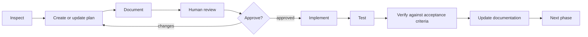
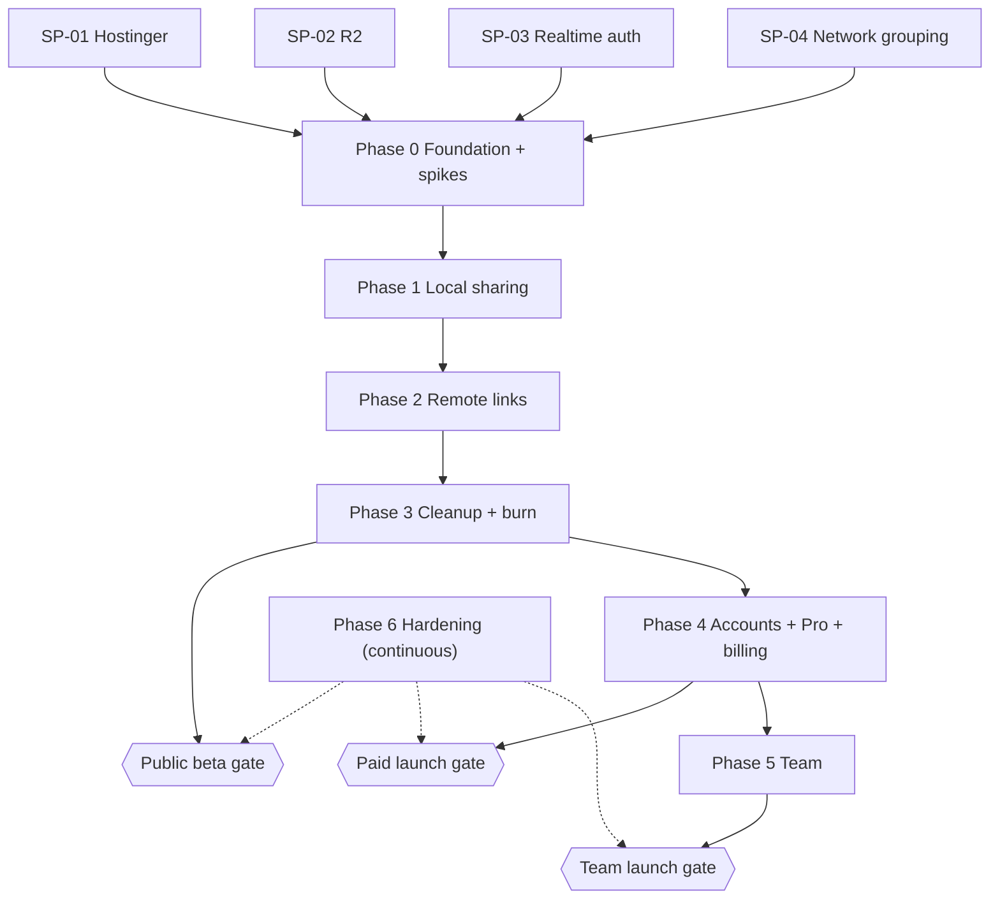

# 05 — Implementation Roadmap

| Field | Value |
|---|---|
| Document status | PROPOSED — awaiting owner review |
| Last updated | 2026-09-29 (shadcn/ui installed, database baseline executed locally). Earlier: 2026-09-23 (CR-001) |
| Implementation authorized | **Phase 0 only** (owner, 2026-09-23). Phase 1 is not authorized. |

---

## 1. Phase workflow

Every phase follows the workflow agreed with the owner:

Rules:

- **No phase starts** until the previous phase is `VERIFIED` (or the owner explicitly accepts a documented exception) **and** the phase plan is approved.
- Before implementation starts, each phase document gets a **detailed task plan** (task-by-task, test-first, exact files and commands). The phase documents in [`phases/`](phases/) currently hold the scope-level plan.
- A phase becomes `COMPLETED` when all tasks are merged. It becomes `VERIFIED` only when **every acceptance criterion** has recorded evidence (test run IDs, screenshots or logs, spike reports) in the phase document's verification record.
- Architectural changes follow the change procedure in [06 §1](06-decisions-and-risks.md#1-how-this-log-works). No silent changes.

Status vocabulary: `NOT STARTED` · `PLANNED` · `IN PROGRESS` · `BLOCKED` · `COMPLETED` · `VERIFIED`.

---

## 2. Phase overview

| Phase | Goal | Key deliverables | Depends on | Relative size | Status |
|---|---|---|---|---|---|
| [0 — Foundation](phases/phase-0-foundation.md) | De-risk the platform and establish tooling, infrastructure and security skeleton | Repo hygiene, CI, test harnesses, Supabase/R2/Cloudflare environments, `proxy.ts` headers and origin lock, baseline schema, shadcn/ui, **spikes SP-01…SP-04**, accepted decisions | Owner review of this plan | M | **BLOCKED on owner items** (all in-repo work done and verified locally, 2026-09-29; see phase 0 §18) |
| [1 — Anonymous local sharing](phases/phase-1-local-sharing.md) | Devices on the same network automatically see each other's text and files (≤ 100 MB) in realtime, with no join step. Other networks see nothing. | Anonymous devices, network keys, presence, fail-closed guards, local feed, "My uploads", text items, direct-to-R2 upload, downloads, realtime, **frontend state layers** (Zustand, TanStack Query, Realtime bridge; DEC-034), request-time expiry + basic jobs, quotas and rate limits | Phase 0 VERIFIED, Q-029/Q-030 answered | L | PLANNED (detailed scope) |
| [2 — Remote secure sharing](phases/phase-2-remote-sharing.md) | Explicit, secure sharing across networks | Share links (fragment secret, creator only), link grants, share page, QR, short codes, link-only posting, abuse reporting and takedown, executable policy | Phase 1 VERIFIED, Q-010/Q-027/Q-028 answered | L | PLANNED (detailed scope) |
| [3 — Expiry, cleanup, one-time download](phases/phase-3-expiry-one-time-download.md) | Reliable storage lifecycle and burn-after-download | Deletion outbox + storage janitor, full job catalogue, reconciliation, tombstones, anonymous user cleanup, burn claim/grace, **public beta launch gate** | Phase 2 VERIFIED | L | PLANNED (detailed scope) |
| [4 — Accounts, entitlements, Pro, billing](phases/phase-4-pro-accounts.md) | Paid Pro plan with server-enforced limits | Accounts and anonymous upgrade/merge, entitlements engine, billing (merchant of record), multipart 5 GB uploads, 30/90-day expiry, passwords, private rooms (with members, invites and QR pairing), room links, history, device management | Phase 3 VERIFIED, Q-005/006/007/014/015 answered | XL | PLANNED (outline) |
| [5 — Team workspaces](phases/phase-5-team.md) | Paid Team plan | Workspaces, members, invitations, roles, pooled quota, retention policies, admin controls, audit and history, branded share pages, seat billing | Phase 4 VERIFIED, Q-017/018 answered | L | PLANNED (outline) |
| [6 — Production hardening](phases/phase-6-production-hardening.md) | Scale, safety and operational maturity | Malware scanning, advanced abuse tooling, network classification, load and chaos tests, restore drills, pen test, compliance, observability, cost controls | Runs partly in parallel with 4–5. Launch-gate items are pulled forward (§4). | L (ongoing) | PLANNED (outline) |

### 2.1 Changes from the owner's proposed phasing

| Change | Reason |
|---|---|
| Phase 0 includes four spikes with written results (SP-05 withdrawn by CR-001) | Hosting, R2 semantics, Realtime authorization and IP grouping are unproven assumptions that everything else depends on. Under automatic visibility, SP-04 decides who sees whose local content. |
| Rooms, members and invites/QR pairing start in Phase 4 (CR-001) | Free local mode has no rooms. Pairing devices into a room only makes sense for Pro private rooms. |
| Basic expiry enforcement moved into Phase 1 | The Free plan's 7-day expiry must hold from the first shared file. Only the janitor, reconciliation and burn semantics wait until Phase 3. |
| Abuse reporting, takedown and executable policy moved into Phase 2 | Remote links turn the product into a public file host |
| Billing moved from Phase 6 into Phase 4 | Pro cannot launch without real subscription state, and entitlements must read it |
| Public beta gate defined after Phase 3 | Phases 1–2 are internal alpha and invite-only beta |

---

## 3. Dependency graph

---

## 4. Release gates

| Gate | After | Audience | Must be true |
|---|---|---|---|
| Internal alpha | Phase 1 VERIFIED | Team devices only (Cloudflare Access-protected staging) | Isolation tests G1–G7 pass. Origin lock verified. |
| Invite-only beta | Phase 2 VERIFIED | Invited testers | Abuse reporting and takedown work end to end. Rate limits on. |
| **Public beta** | Phase 3 VERIFIED + checklist below | Public, Free plan only | Everything in §4.1 |
| Paid launch | Phase 4 VERIFIED | Public, Free + Pro | Billing lifecycle tested in sandbox and production. Every entitlement enforcement point tested. Account deletion works. |
| Team launch | Phase 5 VERIFIED | Public, all plans | Workspace isolation and admin controls tested. DPA template available. |

### 4.1 Public beta gate checklist

- [ ] Phase 3 `VERIFIED`.
- [ ] Terms of Service, Privacy Policy and Acceptable Use Policy published after legal review (RISK-005, Q-022).
- [ ] Abuse and legal contact monitored. Takedown runbook rehearsed: an operator can block a share and delete its objects quickly, with an audit trail.
- [ ] Jurisdiction-specific obligations reviewed (for example DMCA agent designation, illegal-content reporting, EU notice-and-action).
- [ ] Quotas, rate limits, Turnstile and the executable policy active in production, with limits load-tested on staging.
- [ ] Security headers and CSP verified. Origin lock verified from outside Cloudflare (it is the access boundary for local content). No `X-Powered-By`.
- [ ] Local-mode guards active: Private Relay and Tor lists current, large-network cap set (Q-029), audience line and one-time notice live, Terms explain that everyone on the same network sees local posts.
- [ ] Error monitoring with redaction. Alerts for janitor backlog, cron heartbeat, 5xx rate, failure spikes (codes, passwords), network status flips, abuse report volume.
- [ ] Supabase paid plan (no pausing). Backups verified by a restore drill on staging.
- [ ] Production secrets generated fresh and stored only in the host and provider secret stores. Secret scanning enabled.
- [ ] No known high or critical dependency vulnerabilities.
- [ ] Independent review (or documented self-assessment with test evidence) of isolation, link, burn and quota logic.
- [ ] Cost alerts for Supabase, R2 and Cloudflare.
- [ ] Kill switches tested in production.
- [ ] Incident response runbook and a named on-call owner.

---

## 5. Cross-phase workstreams

| Workstream | Every phase must… |
|---|---|
| Security | Add threat notes for new endpoints. Extend the authorization matrix ([03 §9](03-security-and-network-design.md#9-authorization-matrix)) and IDOR tests. Keep redaction rules current. |
| Testing | Ship unit, database and integration tests with the code (test-first for services and SQL functions). Add e2e tests for the new user flows. See [09](09-testing-strategy.md). |
| Documentation | Update the phase document's status and verification record, the decision log, the risk register and this roadmap |
| Operations | Add jobs, alerts and runbook entries for new moving parts |
| Privacy | Update the data inventory and retention table ([03 §13](03-security-and-network-design.md#13-privacy-and-data-minimization)) for any new data |
| Frontend state | New server data gets a `queryOptions` factory in `lib/client/queries/` and a realtime-to-query mapping where relevant. New client-only state goes in a Zustand store. Nothing server-derived goes into Zustand ([02 §3.3](02-system-architecture.md#33-frontend-state-management-dec-034), DEC-034). |

---

## 6. Files and modules likely to be created or changed

Paths follow the target layout in [02 §7](02-system-architecture.md#7-application-module-layout-target).

### Phase 0

| Action | Path |
|---|---|
| Modify | `package.json` (scripts `typecheck`, `test`, `test:e2e`, `db:*`, `engines`, dev dependencies), `pnpm-lock.yaml`, `pnpm-workspace.yaml` (verify `allowBuilds`) |
| Modify | `.gitignore` (`!.env.example`), `next.config.ts` (`poweredByHeader: false`, images policy), `tsconfig.json` (strictness additions), `eslint.config.mjs` (restricted imports: `lib/server/**` only from server files) |
| Modify | `app/layout.tsx` (metadata, providers placeholder), `app/page.tsx` (placeholder shell), `app/globals.css` (shadcn theme tokens), `README.md` |
| Create | `.env.example`, `.node-version`, `proxy.ts`, `instrumentation.ts`, `components.json`, `components/ui/button.tsx`, `lib/utils.ts` (shadcn/ui, DEC-035) |
| Create | `lib/server/{env.ts,boot.ts,log.ts}`, `lib/server/http/{handler.ts,errors.ts,origin.ts,body.ts}`, `lib/server/network/{client-ip.ts,normalize.ts}`, `lib/server/security/{crypto.ts,ids.ts,origin-lock.ts,headers.ts}`, `lib/server/config/integrations.ts`, `lib/server/db/{client.ts,health.ts,types.gen.ts}` |
| Create | `lib/client/{providers.tsx,query-client.ts,api-error.ts}`, `lib/client/stores/ui-store.ts` (DV-1) |
| Create | `app/api/v1/health/route.ts`, `app/robots.ts` |
| Create | `vitest.config.mts`, `playwright.config.ts`, `tests/stubs/server-only.ts`, `tests/unit/**` (incl. `db-types.test.ts`), `tests/component/**` (incl. `ui-button.test.tsx`), `tests/e2e/{smoke,origin-lock}.spec.ts` |
| Create | `infra/r2/{cors.staging.json,cors.production.json,lifecycle.json}`, `infra/cloudflare/README.md` |
| Delete | `public/{file,globe,next,vercel,window}.svg` (unused template assets) |
| Create | `supabase/config.toml`, `supabase/.gitignore`, `supabase/migrations/20260923132452_baseline.sql`, `supabase/tests/baseline.test.sql` |
| Create | `.github/workflows/ci.yml` |
| Create | `project-docs-workthrough/spikes/SP-01…SP-04-*.md` (spike reports) |

### Phase 1

| Action | Path |
|---|---|
| Modify | `app/page.tsx` ("This network" home), `app/layout.tsx` (Supabase and Turnstile providers), `proxy.ts` (Supabase session refresh) |
| Create | `app/(app)/uploads/page.tsx` (My uploads) |
| Create | `app/api/v1/devices/route.ts`, `app/api/v1/devices/[deviceId]/route.ts`, `app/api/v1/network/observe/route.ts`, `app/api/v1/network/probe/route.ts` (only if the dual-stack probe is adopted) |
| Create | `app/api/v1/local/shares/route.ts`, `app/api/v1/me/shares/route.ts`, `app/api/v1/shares/route.ts`, `app/api/v1/texts/route.ts` |
| Create | `app/api/v1/shares/[shareId]/route.ts`, `…/text/route.ts`, `…/files/[fileId]/complete/route.ts`, `app/api/v1/files/[fileId]/download-url/route.ts`, `…/preview-url/route.ts` |
| Create | `components/{local,upload,common}/**` |
| Create | `lib/client/{supabase.ts,realtime.ts,uploader.ts,api-client.ts,device.ts,network.ts,turnstile.tsx}` |
| Create | `lib/client/providers.tsx` (QueryClientProvider + Zustand store providers), `lib/client/queries/{network.ts,local.ts,shares.ts,me.ts}` (TanStack Query key and `queryOptions` contracts), `lib/client/stores/{uploads.ts,ui.ts,presence.ts}` (Zustand) |
| Create | `lib/shared/api/{devices,network,local,shares,files}.ts` (zod schemas), `lib/shared/constants.ts` |
| Create | `lib/server/db/{client.ts,types.gen.ts}`, `lib/server/auth/session.ts`, `lib/server/policy/*.ts`, `lib/server/entitlements/{plans.ts,resolve.ts}` (Free only), `lib/server/quota/*.ts`, `lib/server/ratelimit/*.ts` |
| Create | `lib/server/network/{key.ts,classify.ts,presence.ts,probe.ts}`, `lib/server/local/{feed.ts,visibility.ts}`, `lib/server/shares/{create.ts,complete.ts,text.ts,download.ts,end.ts}` |
| Create | `lib/server/storage/{r2.ts,keys.ts,presign.ts,verify.ts,sniff.ts}`, `lib/server/security/{filenames.ts,content-disposition.ts,turnstile.ts}`, `lib/server/audit/log.ts` |
| Create | `supabase/migrations/<ts>_phase1_*.sql`, `supabase/tests/phase1_*.test.sql`, `tests/integration/**`, `tests/e2e/local-*.spec.ts` |

### Phase 2

| Action | Path |
|---|---|
| Create | `app/(share)/s/[linkId]/page.tsx`, `app/(share)/c/page.tsx`, `app/(legal)/{terms,privacy,acceptable-use,report}/page.tsx` |
| Create | `app/api/v1/shares/[shareId]/links/route.ts`, `app/api/v1/links/[linkId]/route.ts`, `…/unlock/route.ts`, `…/content/route.ts`, `…/files/[fileId]/download-url/route.ts`, `…/files/[fileId]/preview-url/route.ts` |
| Create | `app/api/v1/codes/resolve/route.ts`, `app/api/v1/reports/route.ts` |
| Create | Takedown SQL functions `app.admin_block_share()` / `app.admin_block_link()` (in Phase 2 migrations) and `project-docs-workthrough/runbooks/takedown.md`. Operator web endpoints wait for accounts and MFA (Phase 4). |
| Create | `components/{share,qr,report}/**`, `lib/server/links/{create.ts,unlock.ts,codes.ts,grants.ts,sessions.ts}`, `lib/server/abuse/{reports.ts,takedown.ts}`, `lib/server/security/file-policy.ts` |
| Create | `lib/client/queries/links.ts` (link-viewer content with a 30 s refetch interval; share-link lists) |
| Modify | `proxy.ts` (share-route headers: `no-referrer`, `noindex`), `app/robots.ts` |
| Create | `supabase/migrations/<ts>_phase2_*.sql`, tests |

### Phase 3

| Action | Path |
|---|---|
| Create | `supabase/functions/storage-janitor/index.ts` (+ `deno.json`), `supabase/migrations/<ts>_phase3_*.sql` (jobs, burn functions) |
| Create | `lib/server/shares/burn.ts`, `app/api/v1/shares/[shareId]/confirm-received/route.ts`, `app/api/v1/health/cron/route.ts` |
| Modify | `lib/server/shares/{download.ts,end.ts,create.ts}`, `components/upload/**`, `components/share/**`, `components/room/**` (burn UI) |
| Create | `project-docs-workthrough/runbooks/{janitor.md,takedown.md,incident.md}`, tests |

### Phase 4

| Action | Path |
|---|---|
| Create | `app/(app)/rooms/[roomId]/page.tsx`, `app/(share)/j/[inviteId]/page.tsx`, `app/api/v1/rooms/**` (rooms, members, invites, room shares, room links), `app/api/v1/invites/[inviteId]/accept/route.ts`, `lib/server/rooms/{rooms.ts,members.ts,invites.ts}`, `components/room/**` |
| Create | `app/(auth)/login/page.tsx`, `app/auth/callback/route.ts`, `app/(app)/settings/{account,devices,billing}/page.tsx`, `app/(app)/history/page.tsx`, `app/(marketing)/pricing/page.tsx` |
| Create | `app/api/v1/me/**`, `app/api/v1/account/merge-anonymous/route.ts`, `app/api/v1/history/**`, `app/api/v1/billing/{checkout,portal,webhook}/route.ts`, `app/api/v1/shares/[shareId]/extend/route.ts`, multipart routes |
| Create | `lib/server/entitlements/{enforce.ts,overrides.ts}`, `lib/server/billing/{provider.ts,webhook.ts,sync.ts}`, `lib/server/accounts/{merge.ts,delete.ts}`, `lib/server/links/password.ts`, `lib/server/storage/multipart.ts`, `lib/client/uploader-multipart.ts` |
| Create | `lib/client/queries/{account.ts,entitlements.ts,history.ts,billing.ts,rooms.ts}`. The Zustand uploads store is extended for multipart parts and resume status (resume data itself stays in IndexedDB). |
| Modify | Every service that writes content or links (entitlement checks), `proxy.ts` (auth pages) |

### Phase 5

| Action | Path |
|---|---|
| Create | `app/(team)/w/[slug]/{page,members,settings,audit,usage}/page.tsx`, `app/api/v1/workspaces/**`, `lib/server/workspaces/{create.ts,members.ts,invitations.ts,policies.ts,branding.ts,audit.ts}` |
| Modify | `lib/server/policy/*`, `lib/server/entitlements/*`, `lib/server/quota/*`, share page (branding), realtime helper (workspace topic) |

### Phase 6

| Action | Path |
|---|---|
| Create | `instrumentation.ts`, `instrumentation-client.ts` (error monitoring), `infra/**` (VPS: Docker, Caddy, cloudflared if chosen; scanner container), `tests/load/*.js` (k6), `.github/workflows/security.yml` (dependency audit, DAST baseline), `project-docs-workthrough/runbooks/**` |

---

## 7. Proposed dependencies by phase

**Phase 0 packages are installed** (2026-09-23, versions below). Later phases' packages are not; each is justified and approved in its phase.

| Phase | Packages | Purpose |
|---|---|---|
| 0 ✅ | `zod` 4.6, `server-only` 0.0.1 | Validation, server-only import guard |
| 0 ✅ | `vitest` 5.0, `@vitest/coverage-v8` 5.0, `@vitejs/plugin-react` 6.1, `jsdom` 30.1, `@testing-library/react` 16.3, `@testing-library/dom` 10.4, `@playwright/test` 1.63 | Tests |
| 0 ✅ | `supabase` 2.117 (CLI, dev), `kysely` 0.29, `pg` 8.23, `@types/pg` (dev), `kysely-codegen` 0.20 (dev) | Database tooling and typed queries |
| 0 ✅ | `ipaddr.js` 2.5 | IP parsing and normalization |
| 0 ✅ | `@tanstack/react-query` 5.103, `zustand` 5.0 | Server state and client-only state (DEC-034). **Moved from Phase 1 at the owner's request (DV-1).** Providers only in Phase 0. |
| 0 ✅ | `@types/node` 20 → 22 (dev) | Matches the Node 22 runtime; required by Vitest 5 |
| 0 ✅ | shadcn/ui (2026-09-29, DEC-035): `radix-ui` 1.6, `class-variance-authority` 0.7, `cn` 0.4, `lucide-react` 1.48, `tw-animate-css` 1.4; `shadcn` 4.21 (dev: CLI plus its build-time CSS) | UI component system. Current shadcn installs `cn` instead of `clsx` + `tailwind-merge`, and the unified `radix-ui` package instead of per-primitive `@radix-ui/*` packages. `shadcn` was moved from `dependencies` to `devDependencies`. |
| 1 | `@supabase/supabase-js`, `@supabase/ssr` | Auth sessions, Realtime |
| 1 | `@tanstack/react-query-devtools` (dev only, kept out of production bundles) | Query debugging |
| 1 | `@aws-sdk/client-s3`, `@aws-sdk/s3-request-presigner` | R2 presign, head, delete |
| 1 | `file-type` | Magic-byte sniffing |
| 1 | `pino` | Structured logs with redaction |
| 1 | Turnstile integration (small wrapper or `@marsidev/react-turnstile`) | CAPTCHA |
| 1 | A permissively licensed user-agent parser (for example `bowser`), or a tiny internal parser | Device platform labels. **Avoid AGPL-licensed parsers.** |
| 2 | `qrcode` (or equivalent MIT library) | Client-side QR |
| 3 | Deno `npm:` imports in the Edge Function: `aws4fetch` or `@aws-sdk/client-s3`, `postgres` | Janitor |
| 4 | `@node-rs/argon2` | Link passwords |
| 4 | Billing provider SDK (per Q-005), `idb-keyval` | Billing, multipart resume state |
| 6 | `@sentry/nextjs` (or equivalent), k6 (tool), OWASP ZAP (CI container), ClamAV (container) | Monitoring, load, DAST, malware scanning |

---

## 8. Change control for this roadmap

- A change of phase scope that affects an accepted decision requires a DEC entry update (previous decision, reason, new decision, impact).
- Moving work between phases requires updating both phase documents and §2 and §6 of this file, with a changelog line below.

### Changelog

| Date | Change |
|---|---|
| 2026-09-17 | Initial roadmap drafted from repository audit and architecture proposal |
| 2026-09-23 | CR-001 (owner kept automatic same-network visibility): Phase 1 rewritten as automatic local sharing with fail-closed guards, and resized from XL to L (no admission or rooms). Room invites / QR pairing moved from Phase 2 to Phase 4. SP-05 withdrawn. Public-beta checklist gained the local-mode guard items. |
| 2026-09-23 | Owner decisions: Next.js confirmed (DEC-001). Frontend state management accepted (DEC-034): Zustand for client-only state, TanStack Query for server state, Supabase Realtime for live signals only. Phase 1 deliverables, file lists (Phases 1, 2, 4), dependencies and a cross-phase "Frontend state" workstream added. |
| 2026-09-23 | Phase 0 implementation: dependency table marks installed Phase 0 packages with versions (TanStack Query and Zustand moved to Phase 0, DV-1; shadcn/ui waits for approval, DV-2); Phase 0 file list updated to what was created. |
| 2026-09-29 | Owner approved the Phase 0 review and shadcn/ui (DEC-035). shadcn/ui packages installed and the Phase 0 file list updated. Database baseline executed locally. Phase 0 remains blocked on owner-side items (phase 0 §18.3). |
