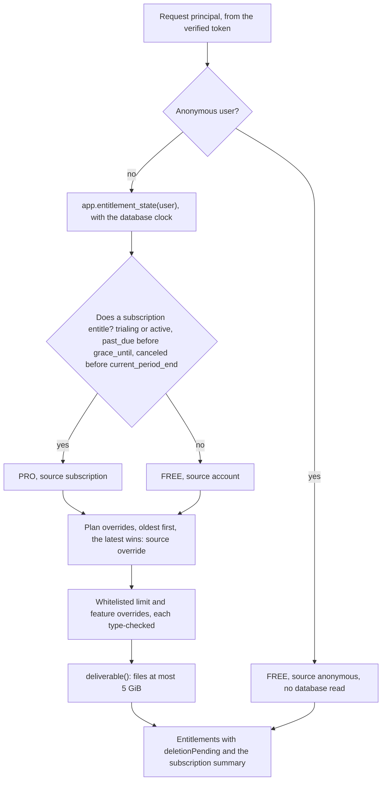
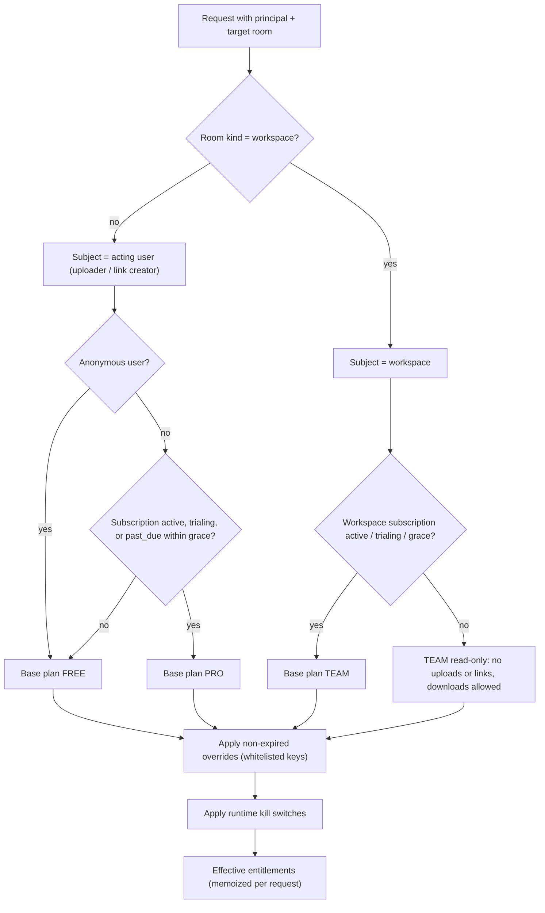
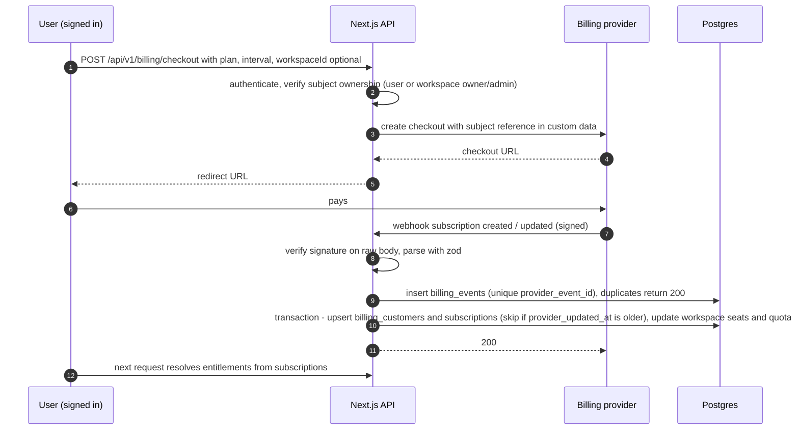

# 07 — Plans, Entitlements and Billing

| Field | Value |
|---|---|
| Document status | PROPOSED — Free and Pro are built locally (Phase 4, uncommitted, not verified, not deployed); their numeric limits stay proposals pending Q-006, Q-007, Q-009, Q-015 and Q-030. Team (Q-017) is the Phase 5 target. |
| Last updated | 2026-10-18 (Phase 4, P4-25: the as-built shape. §1 shows the Free and Pro values the code enforces, with status per row; §2.1 shape, §2.2 resolution and §2.3 snapshots as built; §3 the E1…E31 status; §4 the error codes as built; §5 the transitions as built; §6.4 the deletion cancellation, the reconciliation retry and the two-checkouts limitation; Team marked Phase 5 throughout). 2026-10-17 (Phase 4C: the provider-neutral billing core as built, §6.4; no provider chosen, Q-005). 2026-10-16 (Phase 4B: Free and Pro resolved and enforced, [phase 4 §19](phases/phase-4-pro-accounts.md#19-phase-4b-implementation-2026-10-16); §1 and §2.1 notes). 2026-10-16 (owner decisions for Phase 2: Q-010 and Q-027 answered, Q-011 answered for Phase 2, link lifetime = share expiry; §8 note). 2026-10-15 (Phase 2 enforces the Free link rows; Phase 1 the upload rows; values still pending Q-007, Q-027 and Q-030) |
| Key decisions | DEC-018, DEC-019, DEC-023, DEC-024 |

---

## 1. Plan matrix (Free and Pro as built; Team proposed)

Values in *italics* are proposals that need owner confirmation. The code enforces them meanwhile.

**Phase 1 (2026-10-15):** the Free column is enforced on the server from `lib/shared/plans.ts` (`lib/server/entitlements/plans.ts` resolves it; the UI uses the same numbers as hints): 100 MB per file, 20 files per share, 100 KB text, 2 GB active storage per user (reservation ledger), 2 GB/day per user and 10 GB/day per network (counted per network space), local expiry 1 h / 24 h / 7 days with 24 h default. The italic values are **assumed** until the owner answers Q-007 and Q-030; each is a one-line change.

**Phase 2 (2026-10-15):** also enforced for Free from the same files: links for every user ("Link only" posting, share links, QR codes, short codes); short codes 10 minutes, 1 hour (default) or 24 hours; link expiry until the share expires (default) or 1 h / 24 h / 7 days, never past the share (DV2-13; **accepted by the owner on 2026-10-16**: the share's expiry is a link's maximum lifetime, in place of the "7 days default" above); **500 download and preview URL issuances per link per day** (both count, DV2-15; Q-027 answered 2026-10-16: kept as implemented, all Phase 2 limits in [phase 2 §19.2](phases/phase-2-remote-sharing.md#192-accepted-limits-as-implemented-q-027)), read from the link's entitlement snapshot; executables, scripts, installers and disk images blocked in remote links (`executablesInRemoteLinks: false`; Q-010 answered 2026-10-16: blocked, archives allowed with a warning, local sharing unchanged). No advertising anywhere (Q-011, answered for Phase 2). The error contract below gained `422 REMOTE_FILE_BLOCKED` and `429 LINK_DAILY_LIMIT`.

**Phase 4 (4B 2026-10-16 … P4-22 2026-10-18; IMPLEMENTED / NEEDS REVIEW, not verified, not deployed):** the Pro column is enforced too, from `PRO_LIMITS` and `PRO_FEATURES` in `lib/shared/plans.ts` ([phase 4 §19](phases/phase-4-pro-accounts.md#19-phase-4b-implementation-2026-10-16)). The values are phase 4's recommendations, built while the owner decides: binary units (D4-9: 5 GiB, 100 GiB, 200 GiB, 100 files, 1 MiB), Pro uploads not counted per network (D4-10), **executables still blocked in Pro links** until malware scanning (D4-11), codes up to 7 days, 10,000 URLs per link a day, 300 shares and links an hour (D4-29), history and tombstones 365 days (Q-015), 20 rooms of up to 50 members (D4-14), room links 1 h to 30 days (D4-17). Every Pro feature in the table below is built: multipart up to 5 GiB (P4-14, [§21](phases/phase-4-pro-accounts.md#21-phase-4d-first-task-p4-14-multipart-uploads-2026-10-17)), 30/90-day expiry and extend (P4-15, [§22](phases/phase-4-pro-accounts.md#22-phase-4d-second-task-p4-15-expiry-3090-days-and-extend-2026-10-17)), link passwords (P4-16, [§23](phases/phase-4-pro-accounts.md#23-phase-4d-third-task-p4-16-link-passwords-2026-10-17)), private rooms and invite links (P4-17, [§24](phases/phase-4-pro-accounts.md#24-phase-4d-fourth-task-p4-17-private-rooms-2026-10-18)), QR pairing (P4-18, [§25](phases/phase-4-pro-accounts.md#25-phase-4d-fifth-task-p4-18-qr-pairing-2026-10-18)), room links (P4-19, [§26](phases/phase-4-pro-accounts.md#26-phase-4d-sixth-task-p4-19-read-only-room-links-2026-10-18)) and transfer history (P4-20, [§27](phases/phase-4-pro-accounts.md#27-phase-4d-seventh-task-p4-20-transfer-history-2026-10-18)). **Who gets Pro:** a subscription confirmed by the billing provider (§6.4; only the fake provider exists, refused in production, so no real customer can pay yet) or an operator override (§2.2). **Prices:** none. `PRICING` is null and `/pricing` and `/settings/billing` show `[OWNER: price]` (Q-006).

The FREE and PRO columns show what the code enforces today. The TEAM column is the Phase 5 target: none of it is built.

| Capability | FREE (anonymous, or an account without Pro) | PRO | TEAM (Phase 5, not built) | As built |
|---|---|---|---|---|
| Price | Free | `[OWNER]` (Q-006; recommendation in §7.3) | `[OWNER]` (Q-006) | No price in the code |
| Account required | No | Yes | Yes, for every member | Checkout needs an account (`403 ACCOUNT_REQUIRED`, E31) |
| Max file size | 100 MiB (one PUT, DEC-026) | 5 GiB, above 100 MiB by multipart | *5 GB* | E1, E25. 5 GiB is also the most an override can give (`MAX_DELIVERABLE_FILE_BYTES`) |
| Files per share | *20* | *100* | *100* | E2 |
| Text item size | *100 KiB* | *1 MiB* (the database's cap) | *1 MB* | E3; an edit follows the share's snapshot (E4) |
| Share expiry choices | *1 h, 24 h (default), 7 days* (Q-030) | 1 h, 24 h (default), 7 d, **30 d, 90 d** | Workspace policy: *up to 365 d, or no expiry within quota* (Q-017) | E5; 30 d and 90 d use the `d30/` and `d90/` keys |
| Link expiry choices | Until the share expires (default), or 1 h, 24 h, 7 d; never past the share (DV2-13, accepted 2026-10-16) | The same, plus 30 d and 90 d | Policy | E13. The design's "7 days default for links" was replaced by the share's expiry |
| Active storage quota | *2 GiB per user* | *100 GiB* | *250 GB pooled, plus add-ons* | E7 |
| Daily upload volume | *2 GiB per user; 10 GiB per network key* | *200 GiB per user*, not counted per network (D4-10) | *500 GB per workspace* | E8, E9 |
| Shares and links created per hour | 30 each | *300 each* (D4-29) | — | E28 (03 §10) |
| Local mode: automatic visibility to everyone on the same network (DEC-031) | ✅ | ✅ | ✅ (workspace rooms themselves are membership-only) | Phase 1 |
| "Link only" posting (not visible on the network) | ✅ (safety, never paywalled) | ✅ | ✅ | Phase 2 |
| Share links + QR + short codes | ✅ (codes 10 min, 1 h default, 24 h) | ✅ (codes also 7 d) | ✅ (policy) | Phase 2; E14 |
| Download-URL issuances per link per day | 500 (Q-027 answered) | *10,000* | *10,000* | E15, from the link's snapshot |
| Inline preview size | 20 MiB | 20 MiB | — | E27, from the snapshot |
| Executables/scripts in remote links | Blocked until scanning exists (Q-010) | **Blocked** until scanning exists (D4-11; the design said "allowed, with a warning") | Per policy | E16 |
| Password-protected links | ❌ | ✅ | ✅ (can be required by policy) | E11, E12 (P4-16) |
| One-time download (burn) | ❌ at paid launch; during beta and testing only while the runtime flag `free_burn_after_download` is on (Q-008, owner 2026-10-16; default off) | ✅ | ✅ | E10 (Phase 3) |
| Private rooms | ❌ | ✅ *20 rooms, up to 50 members each* (D4-14) | ✅ (workspace rooms) | E17, E19 (P4-17) |
| Custom room names | ❌ | ✅ | ✅ | E18 (P4-17) |
| QR pairing into a room | Only the owner of an existing room (a downgraded Pro owner, D4-16) | ✅ single use, 10 minutes | — | E20 (P4-18) |
| Read-only room links | ❌ | ✅ (Q-009 open), 1 h, 24 h, 7 d or 30 d (D4-17) | ✅ (policy) | E22 (P4-19) |
| Multi-use invite links (≤ 7 days) | ❌ | ✅ 1 h, 24 h or 7 d | ✅ | E21 (P4-17) |
| Extend expiry | ❌ | ✅ to one of the plan's options from now (≤ 90 days); not burn shares | ✅ within policy | E6 (P4-15) |
| Transfer history | ❌ (tombstones and download logs kept 30 days, for abuse handling only) | ✅ *365 days* (Q-015) | ✅ *configurable, up to 2 years* (Q-015) | E24 (P4-20) |
| Signed-in devices | Anonymous: one browser each, no cap. An account: *10* (D4-5) | *10* | *10 per member* | E26 (4A) |
| Members / seats | — | 1 | *3 included, then per seat* | Not built |
| Admin controls, audit log | ❌ | ❌ | ✅ | Not built; the flag is false on both plans |
| Branded share pages | ❌ | ❌ | ✅ (logo, colours, name; custom domains later, Q-018) | Not built; the flag is false on both plans |
| Third-party ads | **None on content pages** (DEC-024, Q-011) | None | None | No ad system exists |

The E numbers are the enforcement points of §3.1. [ARCHITECTURE §7.1](ARCHITECTURE.md#71-limits) lists the upload limits with the same values.

---

## 2. Entitlements model

### 2.1 Shape

**As built (Phase 4).** The proposal kept below was the target. The code keeps every key name of Phases 1–3, because stored snapshots use them (C4-4):

```ts
// lib/shared/plans.ts (as built): isomorphic, so the UI hints and /pricing read the same keys
export type PlanId = "free" | "pro";                    // "team" is Phase 5

export type Limits = {
  maxFileBytes: number;
  maxFilesPerShare: number;
  maxTextBytes: number;
  activeStorageBytes: number;
  dailyUploadBytes: number;
  dailyUploadBytesPerNetwork: number | null;            // null: not counted per network (Pro, D4-10)
  localExpiryOptionsSeconds: readonly number[];         // every share's options (the Phase 1 name)
  localDefaultExpirySeconds: number;
  maxPreviewBytes: number;
  historyRetentionDays: number;
  linkExpiryOptionsSeconds: readonly number[];          // a link never outlives its share
  shortCodeExpiryOptionsSeconds: readonly number[];
  shortCodeDefaultExpirySeconds: number;
  shortCodeMaxTtlSeconds: number;
  linkDailyUrlIssuances: number;
  maxSignedInDevices: number;
  maxRooms: number;
  maxRoomMembers: number;
  inviteLinkMaxSeconds: number;
  pairingInviteSeconds: number;
  roomLinkExpiryOptionsSeconds: readonly number[];
  rateLimits: { createShare: number; createLink: number }; // per user per hour (D4-29)
};

export type Features = {
  burnAfterDownload: boolean;
  linkPasswords: boolean;
  privateRooms: boolean;
  customRoomNames: boolean;
  roomLinks: boolean;
  multiUseInvites: boolean;
  executablesInRemoteLinks: boolean;                    // false on both plans (D4-11)
  transferHistory: boolean;
  extendExpiry: boolean;
  adminControls: boolean;                               // Team: false on both plans
  brandedPages: boolean;                                // Team: false on both plans
};

// lib/server/entitlements/types.ts (as built)
export type Plan = { plan: PlanId; limits: Limits; features: Features };
export type EntitlementSource = "anonymous" | "account" | "subscription" | "override";
export type Entitlements = Plan & {
  source: EntitlementSource;
  historyRetentionDays: number;                         // also at the top level: the database reads it from snapshots
  deletionPending: boolean;                             // in the account-deletion grace: read-only (E30)
  subscription: { status: string; currentPeriodEnd: string | null; cancelAtPeriodEnd: boolean; graceUntil: string | null } | null;
};
```

- **Plan constants:** `FREE_LIMITS`, `FREE_FEATURES`, `PRO_LIMITS`, `PRO_FEATURES` in `lib/shared/plans.ts`; `FREE_PLAN`, `PRO_PLAN` and `deliverable()` in `lib/server/entitlements/plans.ts`. Unit-tested. `AVAILABLE_FEATURES` lists the features this build has screens for; `/pricing` and the upgrade hints name only those.
- **Overrides** (`app.entitlement_overrides`): only these keys, enforced by the table's check, by `app.admin_grant_override` and again by resolution: `plan`; `limits.activeStorageBytes`, `limits.dailyUploadBytes`, `limits.maxFileBytes`, `limits.historyRetentionDays`; `features.*`.
- **`GET /api/v1/me/entitlements`** (`lib/server/entitlements/me.ts`) returns `plan`, `source`, a subset of the limits (`expiryOptionsSeconds` is `localExpiryOptionsSeconds`), the eight features a user can see (burn with its kill switch and beta flag applied), the caller's storage `usage` and the `subscription` summary. The UI uses it for hints only.
- **Still the Phase 5 target, not built:** `PlanId` `team`, a `subject` that can be a workspace, `allowNoExpiry` and `seats`.

The original proposal (the target design; Team parts are Phase 5):

```ts
// lib/server/entitlements/types.ts (proposed)
export type PlanId = 'free' | 'pro' | 'team';

export interface Entitlements {
  plan: PlanId;
  subject: { type: 'user' | 'workspace'; id: string; anonymous: boolean };
  limits: {
    maxFileBytes: number;
    maxFilesPerShare: number;
    maxTextBytes: number;
    activeStorageBytes: number;
    dailyUploadBytes: number;
    expiryOptionsSeconds: readonly number[];
    defaultExpirySeconds: number;
    allowNoExpiry: boolean;
    shortCodeMaxTtlSeconds: number;
    linkDailyUrlIssuances: number;
    maxSignedInDevices: number | null;
    historyRetentionDays: number;
    seats: number | null;
  };
  features: {
    burnAfterDownload: boolean;
    linkPasswords: boolean;
    privateRooms: boolean;
    customRoomNames: boolean;
    roomLinks: boolean;
    multiUseInvites: boolean;
    executablesInRemoteLinks: boolean;
    transferHistory: boolean;
    extendExpiry: boolean;
    adminControls: boolean;
    brandedPages: boolean;
  };
}
```

### 2.2 Resolution

**As built (Phase 4B, `lib/server/entitlements/resolve.ts`;** [ARCHITECTURE §5.9](ARCHITECTURE.md#59-plans-and-entitlements-phase-4b)**).** There is no workspace branch yet (Phase 5):



- **Asynchronous, once per request:** `resolveEntitlements(principal)` returns a promise memoized on the principal object, which each request creates once. Every check in one request sees the same plan. A failure isn't cached.
- **The plan's inputs:** only `app.subscriptions` (written by billing, §6.4) and `app.entitlement_overrides` (written by operators through `app.admin_grant_override` / `app.admin_revoke_override`, SQL, audited, granted to no role). The app can only read both tables. Nothing the client sends counts: body fields, `x-plan` headers, `?plan=pro&success=true` and token claims (`user_metadata`, `app_metadata`) are ignored (T4-EN5).
- **Time-based states** use the database's `now()`, with a strict `>` at `grace_until` and `current_period_end`. A period or grace that ends needs no job.
- **Overrides** apply to accounts only. A plan override of `"free"` forces Free even over a subscription. `deletionPending` comes from the profile's deletion request (E30).
- **Kill switches** are applied where the feature is used, after resolution. Burn is the only plan-related one: `burn_after_download_enabled` off answers `503`, and `free_burn_after_download` lets Free create burn shares (`lib/server/shares/burn.ts`).
- **Grace** for `past_due` is set by billing (§6.4).
- **No cache to invalidate:** the next request reads the new state. Billing's change also sends `account.changed` on the user's Realtime topic, so open browsers refetch `GET /me/entitlements`.

The design below stays the target for Phase 5 (workspaces, TEAM read-only):



- Resolution runs **on the server for every request that needs it**, memoized for that request.
- It is never read from the client, a JWT claim or a redirect parameter.
- Billing webhooks update `app.subscriptions`. The next request sees the new plan, with no long-lived cache to invalidate.

### 2.3 Snapshots

When a share or link is created, the relevant entitlements are stored in `entitlement_snapshot` (JSONB). Later decisions use the snapshot:

- Tombstone and history retention (`historyRetentionDays`).
- Whether an existing password or burn setting stays enforced after a downgrade (it does).
- Audit of which limits applied at creation time.

**As built (Phase 4B, snapshot v2;** [phase 4 §19.4](phases/phase-4-pro-accounts.md#194-snapshot-and-downgrade-rules-as-built-1716)**).** The rule: **what a share, link or room already is follows its snapshot; a new action follows the caller's current plan** (D4-12, D4-13).

- **Written once, never rewritten.** `snapshotFor()` (`lib/server/entitlements/snapshot.ts`) writes `{ v: 2, plan, source, limits, features, historyRetentionDays, resolvedAt }`:
  - a share stores its creator's plan, with the burn grant (from the plan or the beta flag);
  - a link stores its creator's current plan (a room link stores its owner's);
  - a room stores its owner's plan, for its member cap.
- **Reading.** `readSnapshot()` reads version 2 and version 1 (Phases 1–3, no `v`). A missing or wrong-typed key reads as Free, so a damaged snapshot never grants more than Free.
- **What follows the snapshot:**
  - tombstone and download-log retention (`historyRetentionDays`, which the database reads): 365 days for shares and links made on Pro;
  - text edits (`maxTextBytes`, E4);
  - a link's daily URL cap (E15);
  - preview size (E27);
  - the remote file policy (E16: the share's snapshot at upload completion, the link's in the viewer);
  - the burn grant: claims never check the plan again;
  - a room's member cap (E19).
- **What doesn't:** passwords are enforced whenever a link has one, whatever any plan says (E12), so no snapshot is needed for them. New codes, renames, new invites and links, extend and history follow the current plan.

---

## 3. Enforcement points

Rule: **the UI only hints. The service layer enforces. The database and storage layers are backstops.** Every row below has at least one negative test in [09](09-testing-strategy.md).

| Limit / feature | UI (hint only) | Service / API (authoritative) | Database backstop | Storage / edge backstop |
|---|---|---|---|---|
| **Max file size** | Picker rejects oversize files and shows an upgrade prompt | `createShare`: each declared size ≤ `maxFileBytes`. `completeFile`: `HeadObject` size **must equal** the declared size, otherwise delete and reject. Multipart: part URLs only for `ceil(size/partSize)` parts; `ListParts` total must equal the declared size. | `declared_size_bytes > 0`. Verified `size_bytes` equals declared. | R2 single PUT ≤ 5 GiB. Stale-upload sweep deletes abandoned objects. |
| **Expiry choices** | Only allowed options shown | `expiresIn ∈ expiryOptionsSeconds` (or no expiry if `allowNoExpiry`). Link expiry ≤ share expiry. `extend` re-validates. | `expires_at IS NOT NULL OR retention_class = 'ws'`. Retention class consistent with expiry. | Lifecycle rule per prefix (`d7`/`d30`/`d90`) |
| **Storage quota** | Usage meter | `app.reserve_storage(subject, bytes, activeStorageBytes)` at init. Commit or release later. | Non-negative ledger. Atomic conditional UPDATE. Daily reconciliation. | — |
| **Daily upload volume** | — | `rate_counters` keys `upload_bytes:user:{id}:{day}` and `upload_bytes:net:{networkKey}:{day}` | Atomic upsert | Cloudflare rate-limit rule |
| **Files per share / text size** | Picker and editor limits | `maxFilesPerShare`, `maxTextBytes` | `content_bytes <= 1048576` hard cap | — |
| **Burn after download** | Toggle hidden or disabled. As built: shown only when `GET /me/entitlements` says `burnAfterDownload`. | `features.burnAfterDownload` at share creation. As built (Phase 3): or the Free plan while `free_burn_after_download` is on. `403 FEATURE_NOT_IN_PLAN` (`requiredPlan: "pro"`); kill switch `burn_after_download_enabled` → `503`. The snapshot records the grant; claims never re-check the plan. | `status <> 'claimed' OR burn_after_download`; Phase 3 claim checks (04 §7.1) | — |
| **Passwords** | Option shown only when entitled | Link create/update require `features.linkPasswords`. Unlock **always** enforces an existing password, whatever the current plan. As built (P4-16): removal is allowed on any plan (D4-12); enforced on every viewer request, also for code-made grants. | `password_hash` written only by the service; scrypt PHC only; the version kept by a trigger | — |
| **Private rooms / custom names / room links / multi-use invites** | Options gated | Room create/update, link create and invite create check the features | `rooms.kind` checks. Rooms are never network-visible, and room links can't target a network feed. | — |
| **Transfer history** | Navigation hidden for Free | History endpoints require `features.transferHistory`. Query window ≤ `historyRetentionDays`. | `retention_until` set at insert from the snapshot. Purge job. | — |
| **Short-code validity** | Options gated | ≤ `shortCodeMaxTtlSeconds` and ≤ link expiry | `short_code_expires_at` | — |
| **Executables in remote links** | Warning or blocked message | File policy check at link creation (`risk_flags` × `executablesInRemoteLinks`) | `files.risk_flags` | Scan status (Phase 6) |
| **Link download volume** | — | `linkDailyUrlIssuances` counter per link | Atomic upsert | Cloudflare rule |
| **Signed-in devices** | Device list with a "manage devices" prompt | Device registration counts active devices for permanent users | — | — |
| **Team seats** | Invite dialog shows seats left | Invitation create and accept: active members + pending invites ≤ `seats`, checked in a transaction holding `SELECT … FOR UPDATE` on the workspace row | `workspaces.seat_limit` | — |
| **Team pooled quota** | Workspace usage dashboard | Reservations charged to the workspace subject for workspace rooms | Ledger per workspace | — |
| **Team retention policy** | Options limited to policy | Share creation in workspace rooms validates `retention_policy`. Policy changes apply to new shares unless an admin explicitly applies them to existing ones (audited). | — | `ws/` prefix: application-managed |
| **Team admin controls** | Admin pages visible to admins | Role checks (`owner`/`admin`) in workspace services. Non-admins get 404. | `workspace_members.role` | — |
| **Branded pages** | Branding settings | `features.brandedPages`. Branding snapshot referenced by the link (`branding_workspace_id`). | — | Logo stored as a verified PNG/JPEG only (**no SVG**) |

### 3.1 As built (Phase 4, 2026-10-18)

Phase 4 numbered every write path E1 … E31 ([phase 4 §17.6.4](phases/phase-4-pro-accounts.md#1764-enforcement-matrix-every-write-path), the plan; [§19.3](phases/phase-4-pro-accounts.md#193-the-enforcement-matrix-as-built), the 4B status). **Every row is now built and has automated tests locally**, with positive, negative and boundary cases where a number applies. Nothing is verified on staging (AC-4.2's spot checks wait for it). **Source:** C = the caller's current plan, S = the share's snapshot, L = the link's snapshot.

| E | Enforcement point | Source | Built in | Phase 4 section |
|---|---|---|---|---|
| E1, E25 | File size at creation; multipart above 100 MiB | C | 4B; Pro 5 GiB since P4-14 | [§21](phases/phase-4-pro-accounts.md#21-phase-4d-first-task-p4-14-multipart-uploads-2026-10-17) |
| E2 | Files per share | C | 4B | §19.3 |
| E3, E4 | Text size: at creation; at an edit | C; S | 4B | §19.3 |
| E5 | Share expiry options | C | 4B | §19.3 |
| E6 | Extend | C | P4-15 | [§22](phases/phase-4-pro-accounts.md#22-phase-4d-second-task-p4-15-expiry-3090-days-and-extend-2026-10-17) |
| E7 | Storage quota | C | 4B | §19.3 |
| E8, E9 | Daily upload volume: per user; per network | C | 4B (charged after the reservation, refunded for shares that never become active: C4-6) | §19.3 |
| E10 | Burn at creation | C, then S | Phase 3, 4B | §19.3 |
| E11, E12 | Passwords: set or change; enforced on every viewer request | C; whatever the plan | P4-16 | [§23](phases/phase-4-pro-accounts.md#23-phase-4d-third-task-p4-16-link-passwords-2026-10-17) |
| E13, E14 | Link expiry; short-code lifetime | C | 4B | §19.3 |
| E15 | Viewer URLs per link per day | L | Phase 2, 4B; room links P4-19 | §19.3 |
| E16 | Executables in remote links | C, S, L | Phase 2, 4B | §19.3 |
| E17, E18, E21, E23 | Create a room; custom name; invite links; posting into a room (membership; the uploader's plan and quota) | C | P4-17 | [§24](phases/phase-4-pro-accounts.md#24-phase-4d-fourth-task-p4-17-private-rooms-2026-10-18) |
| E19 | Room member cap, under the room's lock | The room's snapshot | P4-17, P4-18 | §24, §25 |
| E20 | QR pairing code: the room's owner, no plan feature (D4-16) | — | P4-18 | [§25](phases/phase-4-pro-accounts.md#25-phase-4d-fifth-task-p4-18-qr-pairing-2026-10-18) |
| E22 | Room links | C | P4-19 | [§26](phases/phase-4-pro-accounts.md#26-phase-4d-sixth-task-p4-19-read-only-room-links-2026-10-18) |
| E24 | Transfer history, within the current plan's days from creation (DV4-126) | C | P4-20 | [§27](phases/phase-4-pro-accounts.md#27-phase-4d-seventh-task-p4-20-transfer-history-2026-10-18) |
| E26 | Signed-in devices, every account | C | 4A, 4B | §19.3 |
| E27 | Preview size | S, L | 4B | §19.3 |
| E28 | Plan-dependent rate limits | C | 4B | §19.3 |
| E29 | Restrictions on every write | — | 4B; rooms, invites and room links P4-17 … P4-19 | §19.3 |
| E30 | Read-only during the deletion grace | The account | 4B; rooms, invites and room links P4-17 … P4-19; checkout 4C; the flow P4-22 | [§29](phases/phase-4-pro-accounts.md#29-phase-4d-ninth-task-p4-22-the-account-deletion-flow-2026-10-18) |
| E31 | Checkout: an account, not entitled by a subscription (Pro by override may subscribe, DV4-39) | — | 4C | [§20](phases/phase-4-pro-accounts.md#20-phase-4c-implementation-the-provider-neutral-billing-core-2026-10-17) |

Where the table above differs from what is built:
- **Max file size:** one presigned PUT carries at most 100 MiB, with a signed `Content-Length` (DEC-026); a larger file goes up in parts. The storage backstops are the signed part sizes, the server's own `ListParts` check and R2's one-day abort rule (`infra/r2/lifecycle.json`, not applied to any bucket yet), not "R2 single PUT ≤ 5 GiB".
- **Expiry choices:** there is no `allowNoExpiry` and no `ws` retention class in use (Team, Phase 5). The backstop check exists in the schema.
- **Daily upload volume:** counted in KiB in UTC-day windows, keys `upload_kib:user:{id}` and per network key, inside the creation transaction (`lib/server/ratelimit/limits.ts`). No Cloudflare rule is deployed (nothing is).
- **Private rooms:** `rooms.kind` allows only `private`; the member cap is the room's snapshot.
- **Signed-in devices:** the cap applies to every account, Free included (D4-5), not only Pro.
- **Team seats, pooled quota, retention policy, admin controls and branded pages:** the Phase 5 target. Nothing of them is built; `adminControls` and `brandedPages` are false on both plans.

---

## 4. Server-side error contract for plan limits

**As built (Phase 4).** Every error has the body `{ "error": { "code", "message", "requestId", "details"? } }` ([ARCHITECTURE §5.6](ARCHITECTURE.md#56-errors); `errorResponse` in `lib/shared/api/schemas.ts`). The fields named below are inside `details`. `lib/server/entitlements/enforce.ts` builds the plan errors the same way everywhere, and adds `requiredPlan: "pro"` **only when Pro, as this build delivers it, would allow the action**. The upgrade hint (`components/billing/upgrade-hint.tsx`) shows only then.

| HTTP | `error.code` | When | `details` |
|---|---|---|---|
| 403 | `FEATURE_NOT_IN_PLAN` | The current plan lacks the feature (E6, E10, E11, E17, E18, E21, E22, E24) | `feature`, `requiredPlan`? |
| 413 | `FILE_TOO_LARGE` | Declared size above `maxFileBytes` (E1) | `maxFileBytes`, `requiredPlan`? |
| 413 | `TOO_MANY_FILES` | More files than `maxFilesPerShare` (E2) | `maxFiles`, `requiredPlan`? |
| 413 | `TEXT_TOO_LARGE` | Text above `maxTextBytes`: the current plan at creation (E3), the share's snapshot at an edit (E4, never a hint) | `maxBytes`, `requiredPlan`? |
| 422 | `EXPIRY_NOT_ALLOWED` | Not one of the plan's options for a share, link, code, room link or invite link (E5, E13, E14, E21, E22); a link longer than its share; an extension not later than the current expiry | `allowed`, `requiredPlan`?; or `reason`: `after_share_expiry`, or `not_later` with `allowed` |
| 422 | `EXTEND_NOT_ALLOWED` | A burn share, or a share that isn't active (E6) | `reason` (`burn`, `not_active`) |
| 409 | `EXTENSION_PENDING` | The share is already being extended by copy (E6) | — |
| 409 | `STORAGE_QUOTA_EXCEEDED` | The reservation failed (E7) | `usedBytes`, `quotaBytes`, `requiredPlan`? |
| 429 | `DAILY_UPLOAD_LIMIT` / `RATE_LIMITED` | Daily volume per user or network (E8, E9) / any rate limit, the plan-dependent ones included (E28); with `Retry-After` | — |
| 429 | `LINK_DAILY_LIMIT` | The link's daily URL cap, from its snapshot (E15); with `Retry-After` | — |
| 422 | `REMOTE_FILE_BLOCKED` | An executable, script, installer or disk image in a remote link (E16) | `blockedFlags` (not on a viewer's URL request) |
| 409 | `ROOM_LIMIT` | The owner already has `maxRooms` rooms (E17) | `maxRooms` |
| 409 | `ROOM_MEMBER_LIMIT` | The room's member cap, from its snapshot (E19) | — |
| 409 | `DEVICE_LIMIT` | The account has `maxSignedInDevices` active devices (E26) | `maxDevices`, `activeDevices` |
| 503 | `BURN_AFTER_DOWNLOAD_DISABLED` | The burn kill switch is off (E10) | — |
| 403 | `UPLOADS_RESTRICTED` | A restricted account (E29; also set by a second lost dispute, §6.4) | — |
| 403 | `ACCOUNT_DELETION_PENDING` | The account is in its deletion grace (E30) | — |
| 403 | `ACCOUNT_REQUIRED` | Checkout from an anonymous browser (E31) | — |
| 409 | `ALREADY_SUBSCRIBED` | Checkout while a subscription already entitles the account (E31) | — |
| 409 | `CHECKOUT_IN_PROGRESS` | A checkout with the same `Idempotency-Key` is still running | — |
| 503 / 502 | `BILLING_NOT_CONFIGURED` / `BILLING_PROVIDER_ERROR` | No billing provider configured / the provider failed | — |
| 409 | `SEAT_LIMIT_REACHED` | Team invitations. **Phase 5, not built.** | — |
| 423 | `WORKSPACE_READ_ONLY` | Team subscription lapsed. **Phase 5, not built.** | — |

---

## 5. Upgrades, downgrades and over-quota behaviour

| Transition | Behaviour |
|---|---|
| Anonymous Free → Pro | The account is created by linking the anonymous identity (same user ID), then checkout. Pro entitlements apply after the **webhook** confirms `active`, never from the checkout redirect. Existing shares keep their expiry and can be extended within Pro limits. |
| Pro cancelled (at period end) | Pro until `current_period_end`, then Free |
| Payment failure (`past_due`) | Pro during the provider's retry or grace window (`grace_until`), with a banner. Free afterwards. |
| Pro → Free | **No retroactive changes.** Existing shares and links keep their expiry, passwords and burn settings (snapshots). New actions obey Free limits. **Over quota:** uploads are blocked until usage falls below the Free quota (content expires naturally within ≤ 90 days). Private rooms stay usable by existing members, but new ones can't be created. History older than Free visibility is hidden and purged per snapshot retention. |
| Team subscription lapses | Workspace becomes `read_only` for **30 days**: downloads allowed, no uploads or links, admins notified at days 0, 7, 21 and 28. Then `suspended`, and content is ended per the retention policy **with prior notice**. **Never silent deletion of paid content.** |
| Team seat reduction below active members | Blocked until an admin removes members |
| Team storage add-on removed while over quota | Uploads blocked until under quota. Nothing is deleted automatically. |

**As built (Phase 4).** The four Free and Pro rows above are built, with a rule per field: [phase 4 §19.4](phases/phase-4-pro-accounts.md#194-snapshot-and-downgrade-rules-as-built-1716), and the rows of [§17.16](phases/phase-4-pro-accounts.md#1716-entitlement-snapshots-and-downgrades) for multipart, extend, passwords, rooms and history, which P4-14 … P4-20 built. The three Team rows are Phase 5, not built. Where the build adds to or differs from the design:

| Transition | As built |
|---|---|
| Anonymous Free → Pro | First the browser becomes an account: the same user ID (the upgrade), or a merge into an existing account (4A). Checkout needs an account (`403 ACCOUNT_REQUIRED`). Pro comes only from subscription state confirmed by the provider, written after a webhook or by reconciliation (§6.4); the return page only polls (B11). Only the fake provider exists, so outside tests and local development Pro comes from an operator override. |
| Pro cancelled at period end | `canceled` with `cancel_at_period_end`: Pro until `current_period_end`, compared with the database's clock, with no job (B8). An immediate cancellation is Free at once. |
| Payment failure (`past_due`) | Pro until `grace_until`: the provider's dunning end, else 7 days from the failure the provider recorded (D4-21), never moved later within one period (DV4-40). `/settings/billing` shows the date. There is no banner elsewhere in the app. |
| Refund or lost dispute | A full refund with revocation ends Pro at once; a partial refund changes nothing. A lost dispute is confirmed with the provider and cancelled there (Free at once), and counted once; the second sets `upload_restricted` (D4-21, DV4-32). |
| Pro → Free | As designed: nothing retroactive, nothing deleted. Per field: new shares, links, rooms and invite links follow Free. Existing shares keep their expiry, retention class and burn setting, and their links keep their daily URL cap. New codes on an existing link follow the current plan (D4-12). A Pro text stays editable up to its snapshot's 1 MiB (D4-12). Over quota: uploads refused until usage is below Free's quota. An upload in progress, multipart included, may finish (D4-27). Passwords stay enforced; changing one is refused, removing one is allowed (D4-12). Rooms stay usable, with their snapshot's member cap (D4-14); new rooms and renames are refused, existing invites and room links work until they expire, new invite links and room links are refused, and the owner may still make QR pairing codes (D4-16). History is hidden, and the same rows come back after an upgrade; the data is kept and purged by the snapshot dates. Extend is refused, and a pending extension finishes (D4-13). The device cap is unchanged (D4-5). |
| Free → Pro | New limits from the next request. Existing shares and links keep their snapshots (a Free text stays at 100 KiB), and the owner can extend them within Pro's options. |
| Account deletion requested | Read-only for the 7-day grace (E30, D4-6). Renewing subscriptions are cancelled at the end of their period at the provider when the request is stored; if that fails, reconciliation retries (§6.4). Cancelling the deletion doesn't resume a subscription. Billing records are kept after the account is deleted. |

All of D4-5, D4-6, D4-12 … D4-16, D4-21 and D4-27 are built as recommended and wait for the owner.

---

## 6. Billing architecture (Phase 4)

### 6.1 Provider choice

A **merchant of record** (Paddle, Lemon Squeezy or Polar) handles global VAT/GST for low-priced consumer subscriptions. Stripe Billing plus Stripe Tax is an option if the business is in a Stripe-supported country and prefers to handle tax registration itself. **Blocked on Q-005.**

**Still open (2026-10-18).** No provider is chosen. The code is provider-neutral, and its only adapter is a fake one, refused in production builds and deployments (§6.4). What a candidate must support is in [phase 4 §20.9](phases/phase-4-pro-accounts.md#209-the-q-005-dependency-owner-decisions-and-next-steps).

### 6.2 Flows



Rules:

- **Entitlements come only from webhook-updated `subscriptions`.** Never from `?success=true` redirects.
- Webhook processing is idempotent (unique event ID), order-safe (`provider_updated_at`) and transactional. Unexpected errors return 5xx so the provider retries.
- A daily reconciliation pulls active subscriptions from the provider API to repair missed webhooks.
- The provider-hosted customer portal handles plan changes, cancellation, payment methods and invoices (`POST /api/v1/billing/portal`).
- Separate sandbox credentials and webhook secrets for staging.
- Refunds, chargebacks and disputes arrive as webhooks and update status. Repeated chargebacks set `user_flags`.

### 6.3 Status mapping

| Internal status | Entitlement effect | Typical provider states |
|---|---|---|
| `trialing` | Paid plan | trial |
| `active` | Paid plan | active |
| `past_due` | Paid plan until `grace_until` | past due, payment retrying |
| `paused` | Free (or read-only for Team) | paused |
| `canceled` | Paid until `current_period_end`, then Free | cancelled (scheduled or immediate) |
| `expired` | Free / Team read-only | expired, ended |

As built (4C): every status is mapped as above for Pro (Team read-only is Phase 5). `app.entitlement_state` decides with the database's clock ([phase 4 §20.3](phases/phase-4-pro-accounts.md#203-the-billing-state-machine-as-built)).

---

### 6.4 As built: the provider-neutral core (Phase 4C, 2026-10-17; updated 2026-10-18)

**No provider is chosen (Q-005)**, so only the provider-neutral core exists, tested against a fake provider ([phase 4 §20](phases/phase-4-pro-accounts.md#20-phase-4c-implementation-the-provider-neutral-billing-core-2026-10-17); [ARCHITECTURE §5.10](ARCHITECTURE.md#510-billing-phase-4c-provider-neutral-core)). Operating it: [`runbooks/billing.md`](runbooks/billing.md). Where it differs from §6.2:

- The webhook applies the state **fetched from the provider**, never the payload's own (fetch-on-event), and orders it by `provider_updated_at` in `app.apply_subscription_state`, the only writer of `subscriptions`.
- The subject comes from the app's own checkout row (the `checkoutRef` in the provider's custom data) or customer mapping, never from the custom data alone. `workspaceId` and seats wait for Phase 5.
- **Checkout** (`POST /api/v1/billing/checkout`, body `{ plan: "pro", interval: "month" | "year" }`): an account, not in its deletion grace, not already entitled by a subscription (Pro by override may subscribe, DV4-39). An `Idempotency-Key` is required; a concurrent request with the same key gets `409 CHECKOUT_IN_PROGRESS`. **Portal** (`POST /api/v1/billing/portal`): the caller's own billing customer only.
- Every status in §6.3 is mapped. Grace (`past_due`) is the provider's dunning end, else 7 days from the failure (D4-21), and never extended within one period. A full refund with revocation ends Pro at once; a partial refund changes nothing. A lost dispute is confirmed with the provider, cancels the subscription there, and counts once; a second one restricts uploads (`user_flags`).
- Daily reconciliation runs through pg_net to an internal route in the web app (D4-22). It is off until billing is live in an environment (the `billing_reconcile` flag). Each run:
  1. applies every subscription the provider changed since the last successful run, minus a day;
  2. fetches again every entitled subscription the provider hasn't confirmed for 36 hours;
  3. cancels at period end, at the provider, any subscription that still renews for an account in its deletion grace.
- **Account deletion (P4-22,** [phase 4 §29](phases/phase-4-pro-accounts.md#29-phase-4d-ninth-task-p4-22-the-account-deletion-flow-2026-10-18)**).** Once the request is stored, every renewing subscription of the account is cancelled at the end of its period at the provider and synced. This is best effort: a provider failure is logged and doesn't fail the request, and reconciliation step 3 retries it every day for every account in its grace. Whatever its plan, the account is read-only during the grace (E30). Cancelling the deletion doesn't resume the subscription. Billing records (subscriptions, customers, checkouts, events, disputes) have no foreign key to the user and are kept after the account is deleted.
- **Known limitation** ([phase 4 §20.9](phases/phase-4-pro-accounts.md#209-the-q-005-dependency-owner-decisions-and-next-steps)): two checkouts paid before either webhook arrives give one account two subscriptions. The "already subscribed" check sees neither yet, and nothing at the provider prevents it. The portal can cancel one.
- **Not built:** the real adapter (P4-13, waits for Q-005), the provider's sandbox on staging and one real transaction (AC-4.3), the webhook path through Cloudflare (B17). Separate staging credentials (§6.2) wait for staging. D4-21 and D4-22 are built as recommended and wait for the owner. Q-006 (prices) and Q-026 (billing in Phase 4) are open.

---

## 7. Cost model and pricing sanity check

### 7.1 Fixed platform baseline (MVP, verify current prices)

| Item | Indicative monthly cost |
|---|---|
| Supabase Pro | from $25 (includes $10 compute credit, 100k MAU, 500 concurrent Realtime connections, 8 GB disk, 250 GB egress) |
| Web hosting | Hostinger Cloud Startup is advertised at $7.99 promo, renewing at $25.99. A VPS varies. |
| Cloudflare | Free, or Pro (≈ $20–25) |
| R2 | First 10 GB-month free, then $0.015/GB-month |
| Email, error monitoring, uptime monitor | Free tiers initially |
| **Total** | **≈ $35–80 before usage** |

### 7.2 Merchant-of-record fees on subscription prices (≈ 5% + $0.50 per transaction; some providers add international or subscription surcharges)

| Price | Fee | Net | Fee share |
|---|---|---|---|
| $3.00 / month | $0.65 | $2.35 | **21.7%** |
| $4.00 / month | $0.70 | $3.30 | 17.5% |
| $5.00 / month | $0.75 | $4.25 | 15.0% |
| $48 / year | $2.90 | $45.10 | 6.0% |
| $15 / month (Team) | $1.25 | $13.75 | 8.3% |

### 7.3 Worst case at quota

| Plan | Storage at quota | R2 cost/month | Net after fees | Margin at quota (before shared costs) |
|---|---|---|---|---|
| Pro at $3 | 100 GB | $1.50 | $2.35 | $0.85 (too thin) |
| Pro at $5 | 100 GB | $1.50 | $4.25 | $2.75 |
| Team at $15 (3 seats) | 250 GB | $3.75 | $13.75 | $10.00 |

**Recommendation:** Pro at **$5/month or $48/year**, with a total storage quota. Pro at $3/month only makes sense annually.

### 7.4 Free-plan exposure

- 50,000 anonymous users averaging 300 MB active storage is 15 TB, or **≈ $225/month** in R2 storage.
- Anonymous users probably count toward Supabase MAU (Pro includes 100k).
- The Free plan is funded by conversion. Keep quotas conservative and set cost alerts from day one (RISK-006).

---

## 8. Advertising position

The brief implies ads on Free ("No ads" is a Pro feature). Recommendation (DEC-024, Q-011):

- **No third-party ad or analytics scripts** on pages that display user content or secrets (rooms, shares, invites, codes). They can read shared text, file names and presigned URLs, and ad-network policies commonly exclude file-hosting user content.
- If advertising revenue matters, restrict it to marketing pages or first-party promotions (for example "Upgrade to Pro for 5 GB files").
- Pro's value proposition should be capacity, retention, passwords, privacy and history, not the absence of ads.

**Owner decision (2026-10-16, Q-011):** advertising stays out of Phase 2. Remote sharing is ad-free, and no ad system is built. Whether Free gets ads after Phase 2 is not decided.
