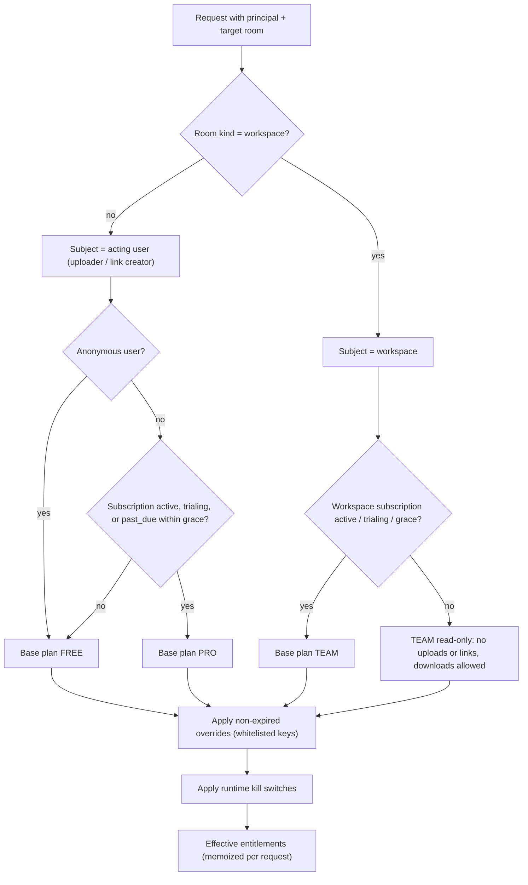
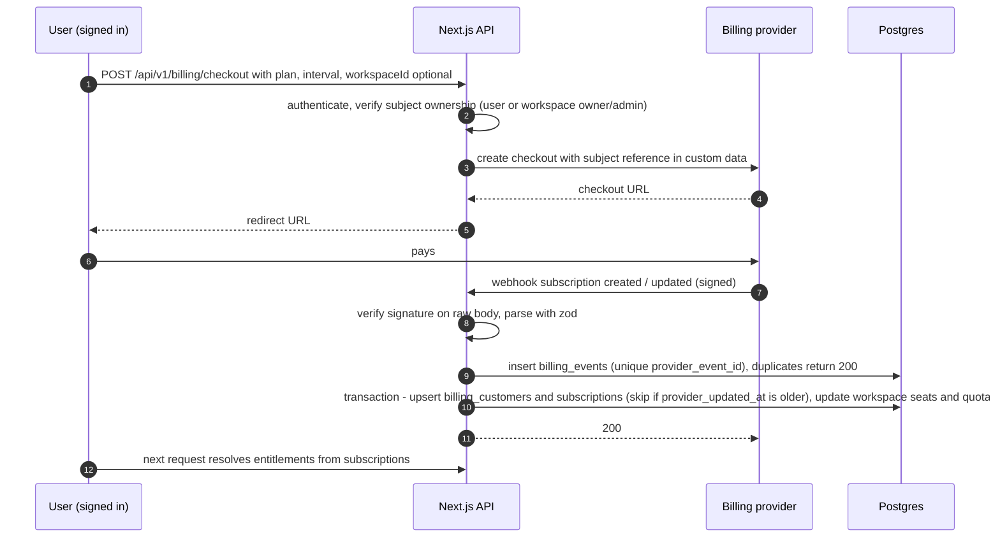

# 07 — Plans, Entitlements and Billing

| Field | Value |
|---|---|
| Document status | PROPOSED — numeric limits are proposals pending Q-006, Q-007, Q-008, Q-009, Q-015, Q-017 |
| Last updated | 2026-10-16 (owner decisions for Phase 2: Q-010 and Q-027 answered, Q-011 answered for Phase 2, link lifetime = share expiry; §8 note). 2026-10-15 (Phase 2 enforces the Free link rows; Phase 1 the upload rows; values still pending Q-007, Q-027 and Q-030) |
| Key decisions | DEC-018, DEC-019, DEC-023, DEC-024 |

---

## 1. Plan matrix (proposed)

Values in *italics* are proposals that need owner confirmation.

**Phase 1 (2026-10-15):** the Free column is enforced on the server from `lib/shared/plans.ts` (`lib/server/entitlements/plans.ts` resolves it; the UI uses the same numbers as hints): 100 MB per file, 20 files per share, 100 KB text, 2 GB active storage per user (reservation ledger), 2 GB/day per user and 10 GB/day per network (counted per network space), local expiry 1 h / 24 h / 7 days with 24 h default. The italic values are **assumed** until the owner answers Q-007 and Q-030; each is a one-line change.

**Phase 2 (2026-10-15):** also enforced for Free from the same files: links for every user ("Link only" posting, share links, QR codes, short codes); short codes 10 minutes, 1 hour (default) or 24 hours; link expiry until the share expires (default) or 1 h / 24 h / 7 days, never past the share (DV2-13; **accepted by the owner on 2026-10-16**: the share's expiry is a link's maximum lifetime, in place of the "7 days default" above); **500 download and preview URL issuances per link per day** (both count, DV2-15; Q-027 answered 2026-10-16: kept as implemented, all Phase 2 limits in [phase 2 §19.2](phases/phase-2-remote-sharing.md#192-accepted-limits-as-implemented-q-027)), read from the link's entitlement snapshot; executables, scripts, installers and disk images blocked in remote links (`executablesInRemoteLinks: false`; Q-010 answered 2026-10-16: blocked, archives allowed with a warning, local sharing unchanged). No advertising anywhere (Q-011, answered for Phase 2). The error contract below gained `422 REMOTE_FILE_BLOCKED` and `429 LINK_DAILY_LIMIT`.

| Capability | FREE (anonymous, or signed in without subscription) | PRO | TEAM |
|---|---|---|---|
| Account required | No | Yes | Yes, for every member |
| Max file size | 100 MB | 5 GB | *5 GB* |
| Files per share | *20* | *100* | *100* |
| Text item size | *100 KB* | *1 MB* | *1 MB* |
| Expiry choices | *1 h, 1 day,* 7 days (max). Default **7 days** for links; *24 h* proposed for local shares (Q-030). | 1 h, 1 d, 7 d, **30 d, 90 d** | Workspace policy: *up to 365 d, or no expiry within quota* (Q-017) |
| Active storage quota | *2 GB per user* | *100 GB* | *250 GB pooled, plus add-ons* |
| Daily upload volume | *2 GB/user; 10 GB per network key* | *200 GB* | *500 GB per workspace* |
| Local mode: automatic visibility to everyone on the same network (DEC-031) | ✅ | ✅ | ✅ (workspace rooms themselves are membership-only) |
| "Link only" posting (not visible on the network) | ✅ (safety, never paywalled) | ✅ | ✅ |
| Share links + QR + short codes | ✅ (codes ≤ 24 h) | ✅ (codes ≤ 7 d) | ✅ (policy) |
| Download-URL issuances per link per day | *500* | *10,000* | *10,000* |
| Executables/scripts in remote links | Blocked until scanning exists (Q-010) | Allowed, with a warning | Per policy |
| Password-protected links | ❌ | ✅ | ✅ (can be required by policy) |
| One-time download (burn) | ❌ (Q-008) | ✅ | ✅ |
| Private rooms | ❌ | ✅ | ✅ (workspace rooms) |
| Custom room names | ❌ | ✅ | ✅ |
| Read-only room links | ❌ | ✅ (Q-009) | ✅ (policy) |
| Multi-use invite links (≤ 7 days) | ❌ | ✅ | ✅ |
| Extend expiry | ❌ | ✅ within plan maximum | ✅ within policy |
| Transfer history | ❌ (data kept 30 days for abuse handling only) | ✅ *1 year* | ✅ *configurable, up to 2 years* (Q-015) |
| Signed-in devices | n/a (each browser is its own anonymous user) | *10* | *10 per member* |
| Members / seats | — | 1 | *3 included, then per seat* |
| Admin controls, audit log | ❌ | ❌ | ✅ |
| Branded share pages | ❌ | ❌ | ✅ (logo, colours, name; custom domains later, Q-018) |
| Third-party ads | **None on content pages** (DEC-024, Q-011) | None | None |

---

## 2. Entitlements model

### 2.1 Shape

```ts
// lib/server/entitlements/types.ts (proposed)
export type PlanId = 'free' | 'pro' | 'team';

export interface Entitlements {
  plan: PlanId;
  subject: { type: 'user' | 'workspace'; id: string; anonymous: boolean };
  limits: {
    maxFileBytes: number;
    maxFilesPerShare: number;
    maxTextBytes: number;
    activeStorageBytes: number;
    dailyUploadBytes: number;
    expiryOptionsSeconds: readonly number[];
    defaultExpirySeconds: number;
    allowNoExpiry: boolean;
    shortCodeMaxTtlSeconds: number;
    linkDailyUrlIssuances: number;
    maxSignedInDevices: number | null;
    historyRetentionDays: number;
    seats: number | null;
  };
  features: {
    burnAfterDownload: boolean;
    linkPasswords: boolean;
    privateRooms: boolean;
    customRoomNames: boolean;
    roomLinks: boolean;
    multiUseInvites: boolean;
    executablesInRemoteLinks: boolean;
    transferHistory: boolean;
    extendExpiry: boolean;
    adminControls: boolean;
    brandedPages: boolean;
  };
}
```

Plan constants live in `lib/server/entitlements/plans.ts` (typed, unit-tested). Only a whitelisted set of keys can be overridden from `app.entitlement_overrides`.

### 2.2 Resolution



- Resolution runs **on the server for every request that needs it**, memoized for that request.
- It is never read from the client, a JWT claim or a redirect parameter.
- Billing webhooks update `app.subscriptions`. The next request sees the new plan, with no long-lived cache to invalidate.

### 2.3 Snapshots

When a share or link is created, the relevant entitlements are stored in `entitlement_snapshot` (JSONB). Later decisions use the snapshot:

- Tombstone and history retention (`historyRetentionDays`).
- Whether an existing password or burn setting stays enforced after a downgrade (it does).
- Audit of which limits applied at creation time.

---

## 3. Enforcement points

Rule: **the UI only hints. The service layer enforces. The database and storage layers are backstops.** Every row below has at least one negative test in [09](09-testing-strategy.md).

| Limit / feature | UI (hint only) | Service / API (authoritative) | Database backstop | Storage / edge backstop |
|---|---|---|---|---|
| **Max file size** | Picker rejects oversize files and shows an upgrade prompt | `createShare`: each declared size ≤ `maxFileBytes`. `completeFile`: `HeadObject` size **must equal** the declared size, otherwise delete and reject. Multipart: part URLs only for `ceil(size/partSize)` parts; `ListParts` total must equal the declared size. | `declared_size_bytes > 0`. Verified `size_bytes` equals declared. | R2 single PUT ≤ 5 GiB. Stale-upload sweep deletes abandoned objects. |
| **Expiry choices** | Only allowed options shown | `expiresIn ∈ expiryOptionsSeconds` (or no expiry if `allowNoExpiry`). Link expiry ≤ share expiry. `extend` re-validates. | `expires_at IS NOT NULL OR retention_class = 'ws'`. Retention class consistent with expiry. | Lifecycle rule per prefix (`d7`/`d30`/`d90`) |
| **Storage quota** | Usage meter | `app.reserve_storage(subject, bytes, activeStorageBytes)` at init. Commit or release later. | Non-negative ledger. Atomic conditional UPDATE. Daily reconciliation. | — |
| **Daily upload volume** | — | `rate_counters` keys `upload_bytes:user:{id}:{day}` and `upload_bytes:net:{networkKey}:{day}` | Atomic upsert | Cloudflare rate-limit rule |
| **Files per share / text size** | Picker and editor limits | `maxFilesPerShare`, `maxTextBytes` | `content_bytes <= 1048576` hard cap | — |
| **Burn after download** | Toggle hidden or disabled | `features.burnAfterDownload` at share creation | `status <> 'claimed' OR burn_after_download` | — |
| **Passwords** | Option shown only when entitled | Link create/update require `features.linkPasswords`. Unlock **always** enforces an existing password, whatever the current plan. | `password_hash` written only by the service | — |
| **Private rooms / custom names / room links / multi-use invites** | Options gated | Room create/update, link create and invite create check the features | `rooms.kind` checks. Rooms are never network-visible, and room links can't target a network feed. | — |
| **Transfer history** | Navigation hidden for Free | History endpoints require `features.transferHistory`. Query window ≤ `historyRetentionDays`. | `retention_until` set at insert from the snapshot. Purge job. | — |
| **Short-code validity** | Options gated | ≤ `shortCodeMaxTtlSeconds` and ≤ link expiry | `short_code_expires_at` | — |
| **Executables in remote links** | Warning or blocked message | File policy check at link creation (`risk_flags` × `executablesInRemoteLinks`) | `files.risk_flags` | Scan status (Phase 6) |
| **Link download volume** | — | `linkDailyUrlIssuances` counter per link | Atomic upsert | Cloudflare rule |
| **Signed-in devices** | Device list with a "manage devices" prompt | Device registration counts active devices for permanent users | — | — |
| **Team seats** | Invite dialog shows seats left | Invitation create and accept: active members + pending invites ≤ `seats`, checked in a transaction holding `SELECT … FOR UPDATE` on the workspace row | `workspaces.seat_limit` | — |
| **Team pooled quota** | Workspace usage dashboard | Reservations charged to the workspace subject for workspace rooms | Ledger per workspace | — |
| **Team retention policy** | Options limited to policy | Share creation in workspace rooms validates `retention_policy`. Policy changes apply to new shares unless an admin explicitly applies them to existing ones (audited). | — | `ws/` prefix: application-managed |
| **Team admin controls** | Admin pages visible to admins | Role checks (`owner`/`admin`) in workspace services. Non-admins get 404. | `workspace_members.role` | — |
| **Branded pages** | Branding settings | `features.brandedPages`. Branding snapshot referenced by the link (`branding_workspace_id`). | — | Logo stored as a verified PNG/JPEG only (**no SVG**) |

---

## 4. Server-side error contract for plan limits

| HTTP | `error.code` | When |
|---|---|---|
| 403 | `FEATURE_NOT_IN_PLAN` | Feature not available to the resolved plan (response includes `requiredPlan`) |
| 413 | `FILE_TOO_LARGE` | Declared size above `maxFileBytes` |
| 422 | `EXPIRY_NOT_ALLOWED` | Expiry option not permitted |
| 409 | `STORAGE_QUOTA_EXCEEDED` | Reservation failed (response includes `usedBytes`, `quotaBytes`) |
| 429 | `DAILY_UPLOAD_LIMIT` / `RATE_LIMITED` | Volume or rate limit (with `Retry-After`) |
| 409 | `SEAT_LIMIT_REACHED` | Team invitations |
| 423 | `WORKSPACE_READ_ONLY` | Team subscription lapsed |

---

## 5. Upgrades, downgrades and over-quota behaviour

| Transition | Behaviour |
|---|---|
| Anonymous Free → Pro | The account is created by linking the anonymous identity (same user ID), then checkout. Pro entitlements apply after the **webhook** confirms `active`, never from the checkout redirect. Existing shares keep their expiry and can be extended within Pro limits. |
| Pro cancelled (at period end) | Pro until `current_period_end`, then Free |
| Payment failure (`past_due`) | Pro during the provider's retry or grace window (`grace_until`), with a banner. Free afterwards. |
| Pro → Free | **No retroactive changes.** Existing shares and links keep their expiry, passwords and burn settings (snapshots). New actions obey Free limits. **Over quota:** uploads are blocked until usage falls below the Free quota (content expires naturally within ≤ 90 days). Private rooms stay usable by existing members, but new ones can't be created. History older than Free visibility is hidden and purged per snapshot retention. |
| Team subscription lapses | Workspace becomes `read_only` for **30 days**: downloads allowed, no uploads or links, admins notified at days 0, 7, 21 and 28. Then `suspended`, and content is ended per the retention policy **with prior notice**. **Never silent deletion of paid content.** |
| Team seat reduction below active members | Blocked until an admin removes members |
| Team storage add-on removed while over quota | Uploads blocked until under quota. Nothing is deleted automatically. |

---

## 6. Billing architecture (Phase 4)

### 6.1 Provider choice

A **merchant of record** (Paddle, Lemon Squeezy or Polar) handles global VAT/GST for low-priced consumer subscriptions. Stripe Billing plus Stripe Tax is an option if the business is in a Stripe-supported country and prefers to handle tax registration itself. **Blocked on Q-005.**

### 6.2 Flows



Rules:

- **Entitlements come only from webhook-updated `subscriptions`.** Never from `?success=true` redirects.
- Webhook processing is idempotent (unique event ID), order-safe (`provider_updated_at`) and transactional. Unexpected errors return 5xx so the provider retries.
- A daily reconciliation pulls active subscriptions from the provider API to repair missed webhooks.
- The provider-hosted customer portal handles plan changes, cancellation, payment methods and invoices (`POST /api/v1/billing/portal`).
- Separate sandbox credentials and webhook secrets for staging.
- Refunds, chargebacks and disputes arrive as webhooks and update status. Repeated chargebacks set `user_flags`.

### 6.3 Status mapping

| Internal status | Entitlement effect | Typical provider states |
|---|---|---|
| `trialing` | Paid plan | trial |
| `active` | Paid plan | active |
| `past_due` | Paid plan until `grace_until` | past due, payment retrying |
| `paused` | Free (or read-only for Team) | paused |
| `canceled` | Paid until `current_period_end`, then Free | cancelled (scheduled or immediate) |
| `expired` | Free / Team read-only | expired, ended |

---

## 7. Cost model and pricing sanity check

### 7.1 Fixed platform baseline (MVP, verify current prices)

| Item | Indicative monthly cost |
|---|---|
| Supabase Pro | from $25 (includes $10 compute credit, 100k MAU, 500 concurrent Realtime connections, 8 GB disk, 250 GB egress) |
| Web hosting | Hostinger Cloud Startup is advertised at $7.99 promo, renewing at $25.99. A VPS varies. |
| Cloudflare | Free, or Pro (≈ $20–25) |
| R2 | First 10 GB-month free, then $0.015/GB-month |
| Email, error monitoring, uptime monitor | Free tiers initially |
| **Total** | **≈ $35–80 before usage** |

### 7.2 Merchant-of-record fees on subscription prices (≈ 5% + $0.50 per transaction; some providers add international or subscription surcharges)

| Price | Fee | Net | Fee share |
|---|---|---|---|
| $3.00 / month | $0.65 | $2.35 | **21.7%** |
| $4.00 / month | $0.70 | $3.30 | 17.5% |
| $5.00 / month | $0.75 | $4.25 | 15.0% |
| $48 / year | $2.90 | $45.10 | 6.0% |
| $15 / month (Team) | $1.25 | $13.75 | 8.3% |

### 7.3 Worst case at quota

| Plan | Storage at quota | R2 cost/month | Net after fees | Margin at quota (before shared costs) |
|---|---|---|---|---|
| Pro at $3 | 100 GB | $1.50 | $2.35 | $0.85 (too thin) |
| Pro at $5 | 100 GB | $1.50 | $4.25 | $2.75 |
| Team at $15 (3 seats) | 250 GB | $3.75 | $13.75 | $10.00 |

**Recommendation:** Pro at **$5/month or $48/year**, with a total storage quota. Pro at $3/month only makes sense annually.

### 7.4 Free-plan exposure

- 50,000 anonymous users averaging 300 MB active storage is 15 TB, or **≈ $225/month** in R2 storage.
- Anonymous users probably count toward Supabase MAU (Pro includes 100k).
- The Free plan is funded by conversion. Keep quotas conservative and set cost alerts from day one (RISK-006).

---

## 8. Advertising position

The brief implies ads on Free ("No ads" is a Pro feature). Recommendation (DEC-024, Q-011):

- **No third-party ad or analytics scripts** on pages that display user content or secrets (rooms, shares, invites, codes). They can read shared text, file names and presigned URLs, and ad-network policies commonly exclude file-hosting user content.
- If advertising revenue matters, restrict it to marketing pages or first-party promotions (for example "Upgrade to Pro for 5 GB files").
- Pro's value proposition should be capacity, retention, passwords, privacy and history, not the absence of ads.

**Owner decision (2026-10-16, Q-011):** advertising stays out of Phase 2. Remote sharing is ad-free, and no ad system is built. Whether Free gets ads after Phase 2 is not decided.
