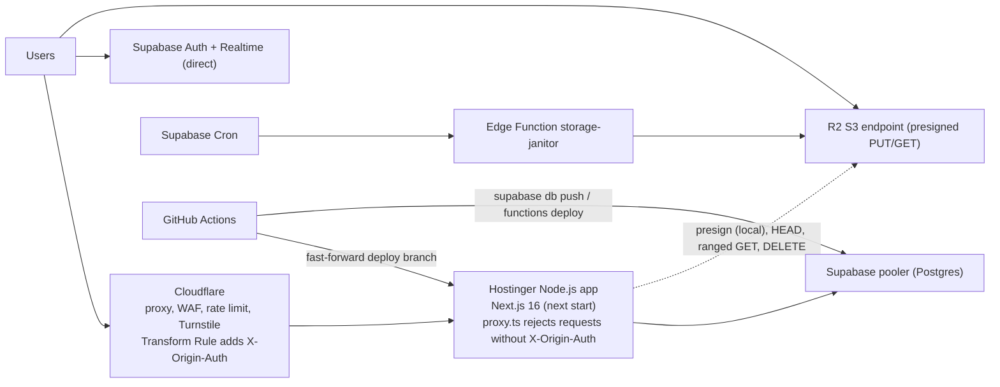
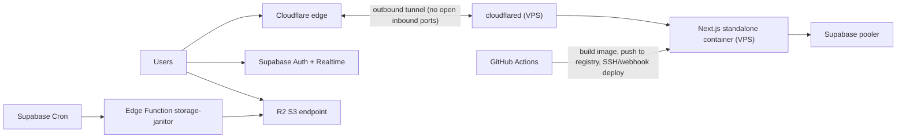

# 08 — Deployment and Operations

| Field | Value |
|---|---|
| Document status | PROPOSED — hosting choice is CONDITIONAL on SP-01 (DEC-022) |
| Last updated | 2026-10-16 (Phase 2 owner decisions: no abuse alert is delivered in Phase 2, §8). 2026-10-15 (Phase 2: peppers and the Turnstile secret in the configuration inventory, Phase 2 alert events, takedown and kill-switch runbooks). Earlier the same day: (Phase 1: local stack with RustFS, configuration inventory, CI stack job, Turnstile secret in Supabase; security review: Pseudo IPv4, query-parameter logging, egress-list loading and alert, `if-none-match` in CORS, egress runbook; second review pass: no client address in database parameters, `auto_explain`, Supabase Auth IP storage, access logs, WebKit in CI, manual verification procedure). Earlier: 2026-09-29; 2026-09-23. |
| Key decisions | DEC-004, DEC-017, DEC-022, DEC-028, DEC-029, DEC-030 |

---

## 1. Hosting evaluation

| Option | Advantages | Disadvantages / unknowns | Verdict |
|---|---|---|---|
| **A. Hostinger managed Node.js web app** (Business / Cloud plans) | Owner preference. Low cost. GitHub auto-deploy. Node 18/20/22/24 and npm/yarn/pnpm (auto-detected from lockfile). Environment variables. Restart control. | **Undocumented:** request timeout, response buffering/streaming, headers added or stripped by its front proxy, memory limits (build and runtime), graceful shutdown, outbound TCP ports, log retention. No firewall control, so the origin lock relies on a secret header. It builds on push, so gating needs a deploy branch. pnpm 12 support unverified. | **Conditional** on SP-01 |
| **B. Hostinger VPS** (Docker + Next.js `standalone` + **Cloudflare Tunnel**) | Full control. **No public ingress** (the tunnel dials out). Predictable resources. Can later host a malware-scanner container. Low cost. | You operate OS patching, Docker, monitoring and restarts. A single machine is a single point of failure (acceptable for an MVP with a stateless app). | **Recommended fallback.** Arguably the primary choice if someone can own basic operations. |
| **C. Vercel** | Best Next.js fidelity, preview deployments per PR, trustworthy client-IP headers, integrated cron and logs | Commercial use requires a paid plan. Usage-based pricing. Vendor-specific features. | Fallback if you prefer fully managed hosting over operations |
| **D. Cloudflare Workers via OpenNext** | Same platform as R2 (bindings), native `CF-Connecting-IP`, Cron Triggers, Queues | Next.js 16 adapter maturity must be verified. Runtime and bundle limits. | Re-evaluate in Phase 6 |

### 1.1 SP-01 pass/fail criteria (Hostinger managed Node.js)

| # | Check | Pass condition | If it fails |
|---|---|---|---|
| 1 | Build | `pnpm install --frozen-lockfile` (pinned pnpm) and `next build` succeed on the host. Image optimization works (sharp). | Pin another pnpm version (Q-024). Else B or C. |
| 2 | Runtime | Node 24 (or 22) selectable. App stable for 24 h under light synthetic traffic. | B or C |
| 3 | **Client IP** | Behind Cloudflare, the app receives `CF-Connecting-IP` equal to the real client IP (tested from ≥ 3 networks, IPv4 and IPv6). Client-supplied `CF-Connecting-IP`/`X-Origin-Auth` are overwritten. **Direct requests to the Hostinger origin are rejected by `proxy.ts`.** | **B (Tunnel) or C. Mandatory.** |
| 4 | TLS | Cloudflare **Full (strict)** works with a valid origin certificate | **B or C. Mandatory.** |
| 5 | Streaming | A streamed page shows time-to-first-byte well below total render time (no buffering) | Tolerable for an MVP. Document it. Prefer B. |
| 6 | Request duration | A 30 s route handler completes. Record the maximum. | Acceptable if ≥ 30 s (the API has no long requests) |
| 7 | **Outbound connectivity** | TCP to the Supabase pooler (5432/6543) and HTTPS to the R2 S3 endpoint | Use the DEC-007 RPC fallback, or B |
| 8 | Deploys and restarts | A deploy causes < 10 s of errors. SIGTERM behaviour observed. | Prefer B |
| 9 | Memory | Build fits the plan's limits. RSS stays stable under 50 concurrent requests for 10 min. | Upgrade the plan, or B |
| 10 | Logs | stdout logs accessible, retention known | Ship logs to an external collector |
| 11 | Runtime env | Server-only environment variables are read at runtime, not only at build | Prefer B or C |

The spike result is recorded in `project-docs-workthrough/spikes/SP-01-hostinger.md` and closes DEC-022.

---

## 2. Target topology

### 2.1 Option A — Hostinger managed Node.js

### 2.2 Option B — Hostinger VPS with Cloudflare Tunnel

---

## 3. Environments

| Aspect | Local | Staging | Production |
|---|---|---|---|
| Web | `next dev` (or `next start` with `NODE_ENV=test` for tests) | Separate app or container at `staging.{domain}`, **behind Cloudflare Access** | `app.{domain}` (or apex) |
| Supabase | CLI local stack (Docker): `pnpm stack:start` runs Postgres, Auth, Realtime, the API gateway and PostgREST (Studio, Storage, Edge Runtime, logging, pooler and Mailpit excluded until needed) | Separate project. Free plan is acceptable but pauses after 1 week inactive, so keep it active or use Pro. | **Pro** plan project in the region chosen by Q-016 |
| R2 | **RustFS 1.0.1** (S3-compatible, container `local-saver-s3`, started by `pnpm stack:start`; phase 1 DV1-4) or a real dev bucket | `{product}-files-staging` | `{product}-files-prod` |
| Cloudflare | Not used. Test client-IP override allowed (non-production only). | Proxied + Access + Turnstile (staging keys) | Proxied + WAF + rate limiting + Turnstile (production keys) |
| Billing (Phase 4) | Provider sandbox | Sandbox | Live |
| Data | `supabase/seed.sql` (local `app_server` login); tests create their own data on random networks | Synthetic only | Real |

---

## 4. Cloudflare configuration checklist

- [ ] DNS records for app hostnames are **proxied**.
- [ ] SSL/TLS **Full (strict)**, Always Use HTTPS, minimum TLS 1.2. HSTS once the domain is final.
- [ ] **Request Header Transform Rule:** set static `X-Origin-Auth: <secret>` on all requests to app hostnames. Rotation procedure documented (two accepted values). Under DEC-031 this rule protects who sees local content: changes to it need review.
- [ ] (If SP-04 adopts them) `v4.` and `v6.` probe hostnames that each answer in only one address family, configured as the SP-04 report specifies.
- [ ] (If SP-04 confirms it works on the chosen plan) a Transform Rule forwarding the client ASN to the origin in a header that `proxy.ts` accepts only together with a valid `X-Origin-Auth`.
- [ ] **Access logs:** know what the host and Cloudflare log about clients (`CF-Connecting-IP`), and set the shortest retention that still serves security investigations (phase 1 §18.5.2).
- [ ] **Pseudo IPv4 off** (or "Add header" only, never "Overwrite headers"). Overwriting replaces the visitor's IPv6 address in `CF-Connecting-IP` with a reserved IPv4 address, which the app treats as non-global, so local sharing would be `unavailable` for every IPv6 visitor (Phase 1 security review).
- [ ] Cache rules: cache only `/_next/static/*` and hashed public assets. **Bypass** `/api/*`, `/s/*`, `/j/*`, `/c*`, `/rooms/*` and all HTML.
- [ ] Rate limiting rule on `/api/` with a **generous per-IP threshold**, because many users share IPs behind CGNAT. Application limits are the precise layer.
- [ ] Custom WAF rules: allow only expected methods per path prefix. Exempt the billing webhook path from bot challenges.
- [ ] Bot protections: verify they don't challenge API or webhook calls. Tune or disable per path where the plan allows.
- [ ] Turnstile widgets per environment, restricted to that environment's hostnames.
- [ ] Cloudflare Access protects staging (service token for CI smoke tests).
- [ ] Notifications: origin error rate, DDoS alerts, R2 usage.
- [ ] (Option B) Cloudflare Tunnel configured with the ingress rule to the Next.js container.

---

## 5. Supabase configuration checklist

- [ ] Region chosen (Q-016). **Pro** plan for production. Spend and usage alerts configured.
- [ ] API keys: create **publishable** and **secret** keys. Disable legacy `anon`/`service_role` keys once nothing uses them.
- [ ] Data API: exposed schemas exclude `app`. Consider disabling the Data API if nothing uses it (verify Auth and Realtime are unaffected in SP-03).
- [ ] Auth:
  - [ ] Anonymous sign-ins enabled.
  - [ ] **CAPTCHA (Turnstile) enabled**, with the Turnstile **secret** key set here (Supabase verifies the token at anonymous sign-in; the app only has the site key).
  - [ ] JWT expiry reviewed (consider 30 min).
  - [ ] Site URL and redirect allow-list set.
  - [ ] Rate limits reviewed (anonymous sign-ins default 30/h per IP).
  - [ ] Custom SMTP (Phase 4). TOTP MFA enabled (Phase 4).
- [ ] Realtime: **"Allow public access" disabled.** Private channels only.
- [ ] Database:
  - [ ] `app_owner` and `app_server` roles created with strong credentials. SSL enforced.
  - [ ] After enabling login for `app_server`, confirm as that role: `show search_path` includes `extensions`, and `select 'A'::citext = 'a'` returns true (phase 0 F-9).
  - [ ] Network restrictions to the host's egress IPs where static (VPS).
  - [ ] Extensions: `pg_cron`, `pg_net`, `citext`. Vault secret for the janitor trigger.
  - [ ] **Query logging.** Since phase 1 F1-13 the app sends no client address to the database (only a keyed hash and, for the egress lookup, an IPv4 /24 or IPv6 /48), verified with full statement logging locally. Still confirm the hosted settings, because parameters of logged statements are recorded in full by default: `log_statement` (`none` or `ddl`), `log_min_duration_statement` (off unless needed), `auto_explain.log_min_duration` (the Supabase image loads `auto_explain` at 10 s with `log_parameter_max_length = -1`), pgaudit (`pgaudit.log_parameter = off`), and the Log Explorer retention.
  - [ ] **Supabase Auth IP storage (Q-031, RISK-029).** Auth records the client IP of each session (`auth.sessions.ip`) and in its audit log. Apply the owner's decision: privacy notice wording, session time-boxing, or a retention job.
- [ ] **Egress lists loaded before the environment opens**, then at least weekly: `pnpm egress:load` ([runbook](runbooks/egress-lists.md)). Without a load in the last 14 days, local sharing is off everywhere (03 §3.5).
- [ ] Edge Function `storage-janitor`: `verify_jwt` disabled **only** because the function checks its own trigger secret. Separate R2 token and database role. Secrets set per environment.
- [ ] Backups: daily backups (7 days on Pro). **Point-in-time recovery evaluated before paid launch.** Restore drill on staging before public beta.

---

## 6. R2 configuration checklist

- [ ] One bucket per environment. Location hint per Q-016.
- [ ] Public access **off**. `r2.dev` **off**. No custom domain.
- [ ] CORS per environment: exact app origins; `PUT`, `GET`, `HEAD`; headers `content-type`, `content-disposition`, `cache-control`, `if-none-match` (write-once uploads, DV1-18); expose `ETag`; max age 3600 s.
- [ ] Lifecycle rules: `d7/` 8 days, `d30/` 31 days, `d90/` 91 days, abort incomplete multipart uploads after 1 day, no rule for `ws/`.
- [ ] API tokens: `web-app` and `janitor` (Object Read & Write, scoped to the bucket). No admin tokens in runtime environments.
- [ ] Usage notifications (storage growth, operations).
- [ ] CORS and lifecycle JSON stored in `infra/r2/` and applied from it, so the configuration is reproducible.

---

## 7. CI/CD pipeline

### 7.1 Branches

| Branch | Purpose | Deploys |
|---|---|---|
| `main` | Integration branch, protected (reviews, status checks) | Nothing directly |
| `deploy/staging` | Fast-forwarded by CI after `main` passes and staging migrations apply | Host auto-deploys staging |
| `deploy/production` | Fast-forwarded by the release workflow after approval and production migrations | Host auto-deploys production |

### 7.2 Workflows

| Workflow | Trigger | Steps |
|---|---|---|
| `ci.yml` | PRs and pushes to `main` | 1. Checkout. Node from `.node-version`. pnpm via corepack. `pnpm install --frozen-lockfile`. 2. `pnpm typecheck` and `pnpm lint`. 3. `pnpm test` (unit, coverage). 4. `supabase start`, `supabase db reset`, `supabase test db` (pgTAP). 5. `pnpm test:integration` (local Supabase + MinIO). 6. `pnpm build`. 7. `pnpm test:e2e` (Playwright on `next start` + local stack; the full suite may run nightly). 8. Dependency audit (fail on high/critical). Secret scanning is enabled in the repository. |
| `deploy-staging.yml` | CI success on `main` | `supabase db push` (staging) → `supabase functions deploy` (staging) → fast-forward `deploy/staging` → wait for the host → smoke tests through Cloudflare Access |
| `release.yml` | Manual dispatch or `v*` tag, **environment approval required** | `supabase db push` (production) → functions deploy → fast-forward `deploy/production` → production smoke tests |
| `nightly.yml` | Schedule | Full e2e, real-R2 contract tests against the staging bucket, dependency update PRs (Renovate/Dependabot) |

**As implemented (`.github/workflows/ci.yml`, Phase 1 update 2026-10-15):** two jobs.

- `checks`: install (frozen lockfile, which pnpm checks against its supply-chain policy), typecheck (with Next.js route type generation), lint, Vitest unit and component tests with coverage, `pnpm audit --audit-level high` (one reviewed exception, phase 1 F1-6).
- `stack`: `pnpm stack:start` (Supabase and RustFS; applies migrations and seed), `supabase test db` (pgTAP), generated-types drift check, `pnpm build`, `pnpm test:integration` (Vitest against `next start` on port 3200), `pnpm test:e2e` (open, origin-locked and full-stack servers).

Every command of both jobs passes locally (2026-10-15). The GitHub remote exists. CI's only run, on the push of the Phase 0 commit to `main` (2026-09-29), failed at `pnpm typecheck` (`Cannot find name 'LayoutProps'`); the Phase 1 branch has no pull request, so the current workflow has not run (AC-0.1). Actions are referenced by major version tag; pin them to commit SHAs when the repository goes public.

**Migrations are forward-only.** Expand/contract discipline keeps the previous app version working with the new schema, so rolling back the app means re-pointing the deploy branch to the previous commit.

---

## 8. Observability and alerting

| Signal | Source | Alert when |
|---|---|---|
| Uptime | External monitor on `/api/v1/health` | 2 consecutive failures |
| Cron heartbeat | `/api/v1/health/cron` | Stale > 10 min |
| Server errors | Error monitoring and logs | 5xx rate > 1% over 5 min |
| Janitor backlog | `object_deletions` due rows / oldest age | > 1,000 rows or oldest > 1 h |
| Janitor failures | `attempts ≥ 5` | Any |
| Storage drift | `reconcile-storage-usage` output | Any correction > 1 GB |
| Brute-force signals | Aggregated code, password and unlock failures | 10× baseline |
| Origin-lock rejections | Logs | > 100 per 5 min |
| Network `unavailable` rate | Logs | > 5% of observations (proxy misconfiguration) |
| Network status flips | `network.status_changed` audit events | Spike in spaces becoming `shared_egress` or `too_large` (classification drift or abuse) |
| Egress lists stale | `network.egress_list_stale` error log (local sharing is off everywhere) | Any; reload per the [runbook](runbooks/egress-lists.md) |
| Abuse reports | `abuse_reports`; the warn log event `abuse.report_received` (Phase 2, IDs and category only; `urgent: true` for child safety) | Every new report. **Not built:** Phase 2 delivers no alert to anyone (owner decision 2026-10-16); the channel and the operator are future requirements (Q-022). |
| Code guessing (Phase 2) | Log events `code.resolve_failures`, `code.resolve_blocked`, `code.resolve_failure_spike` (1,000 failures in 10 minutes) | Any spike; consider `short_codes_enabled` off ([runbook](runbooks/kill-switches.md)) |
| Link unlock attempts (Phase 2) | Log event `link.unlock_rate_limited` | 10× baseline |
| Supabase usage | Supabase dashboard alerts | 80% of MAU, Realtime connections, disk |
| R2 storage | Cloudflare notifications / daily job | > 20% week-over-week growth |
| Billing | `billing_events.status = 'failed'` | Any |

**Redaction is mandatory** in logs and error monitoring (see [03 §14](03-security-and-network-design.md#14-logging-audit-and-security-monitoring)).

---

## 9. Configuration inventory

### 9.1 Public (safe in the browser bundle)

| Variable | Purpose |
|---|---|
| `NEXT_PUBLIC_APP_ORIGIN` | Canonical origin |
| `NEXT_PUBLIC_SUPABASE_URL` | Supabase project URL |
| `NEXT_PUBLIC_SUPABASE_PUBLISHABLE_KEY` | Publishable key |
| `NEXT_PUBLIC_TURNSTILE_SITE_KEY` | Turnstile widget |

Phase 1 reads these on the server at request time and the root layout passes them to the client (DV1-8), so one build serves every environment.

### 9.2 Server-only

| Variable | Purpose |
|---|---|
| `APP_ENV` | `local` · `test` · `staging` · `production`. Added in Phase 0 (DV-6): staging and production require HTTPS origins, `TRUST_PROXY_MODE=cloudflare` and an origin secret, and turn on HSTS and `upgrade-insecure-requests`. `NODE_ENV` alone can't tell staging from production. |
| `APP_ALLOWED_ORIGINS` | Origin allow-list for CSRF checks |
| `TRUST_PROXY_MODE` | `cloudflare` in staging and production, `none` locally |
| `ORIGIN_SHARED_SECRET`, `ORIGIN_SHARED_SECRET_PREVIOUS` | Origin lock |
| `ALLOW_TEST_CLIENT_IP` | Tests only. **The production boot refuses to start if set**, and also refuses it with `TRUST_PROXY_MODE=cloudflare`. It takes effect only when `APP_ENV` is set explicitly to `local` or `test`. |
| `DATABASE_URL` | `app_server` through the Supavisor pooler |
| `SUPABASE_SECRET_KEY` | Optional. Validated when set, but unused (Phases 1 and 2); reserved for planned Auth admin operations. |
| `R2_ACCOUNT_ID`, `R2_BUCKET`, `R2_S3_ENDPOINT`, `R2_ACCESS_KEY_ID`, `R2_SECRET_ACCESS_KEY` | Storage |
| `NETWORK_KEY_SECRET_CURRENT`, `NETWORK_KEY_SECRET_PREVIOUS`, `NETWORK_KEY_VERSION` | Network keys (DEC-032) |
| `NETWORK_IPV6_PREFIX_LEN` (default 64) | Local-mode tuning. The large-network cap moved to the runtime flag `network_large_cap` (DV1-5); `NETWORK_PROBE_HOSTS` is not used (no dual-stack probe). |
| `LINK_PEPPER`, `CODE_PEPPER`, `PEPPER_VERSION`, `LINK_PEPPER_PREVIOUS`, `CODE_PEPPER_PREVIOUS` | Secret hashing for link secrets and short codes (Phase 2): ≥ 32 random characters each, different from each other, **required in staging and production**; `*_PREVIOUS` only during a rotation, with `PEPPER_VERSION` raised by one. `INVITE_PEPPER` arrives in Phase 4. |
| `TURNSTILE_SECRET_KEY` | **Used by the app since Phase 2** (code-guessing escalation, abuse reports; required in staging and production, with the site key). The same secret is also set in the Supabase project's Auth captcha settings, which verify the anonymous sign-in token. |
| `TURNSTILE_VERIFY_URL` | Tests and local development only: a stand-in for Cloudflare's siteverify. Refused in production builds and deployments. |
| `TEST_CLIENT_IP_DEFAULT` | Tests and local development only (with `ALLOW_TEST_CLIENT_IP=1`): client IP assumed without `X-Test-Client-IP`. Refused like the override. |
| `RUNTIME_FLAGS_CACHE_SECONDS` | Kill-switch cache, default 30, at most 300 (tests use 0) |
| `LOG_LEVEL` | Logging |
| `SENTRY_DSN` (Phase 6) | Error monitoring |
| `BILLING_*` (Phase 4) | Billing provider credentials and webhook secret |
| `NEXT_SERVER_ACTIONS_ENCRYPTION_KEY` | Only for multi-instance deployments |

Edge Function secrets: `JANITOR_TRIGGER_SECRET`, janitor R2 credentials, janitor database URL.

All variables are validated with zod at boot (`lib/server/env.ts`, called from `instrumentation.ts`). `.env.example` lists names only, never values. Empty values count as unset.

**Implemented in Phase 0:** a misconfigured process **exits with code 1 before serving any request**. An error thrown from `register()` alone does not stop Next.js 16 (it keeps running and answers 500), so `lib/server/boot.ts` exits explicitly. Verified on 2026-09-23 with `next start` and `ALLOW_TEST_CLIENT_IP=1`.

---

## 10. Backups and disaster recovery

| Asset | Protection | Target (proposal) |
|---|---|---|
| Postgres | Supabase daily backups (Pro: 7 days). Point-in-time recovery evaluated before paid launch. **Quarterly restore drill** into staging. | RPO ≤ 24 h (≤ minutes with PITR). RTO ≤ 4 h. |
| R2 objects | Ephemeral by design for Free and Pro, so no backups. Team long-retention content relies on R2 durability. Evaluate replication in Phase 6. | — |
| Configuration | Cloudflare rules, R2 CORS and lifecycle, Supabase config, cron definitions (in migrations) documented and versioned in the repo | Rebuild an environment ≤ 1 day |
| Secrets | Stored in provider secret stores. Rotation runbook. | Rotate any secret ≤ 1 h |
| Web tier | Stateless. Redeploy from the Git deploy branch. | RTO ≤ 1 h |

---

## 11. Runbooks to write

| Runbook | Phase |
|---|---|
| [Shared-egress lists](runbooks/egress-lists.md) (written) | 1 |
| [Abuse report triage and takedown](runbooks/takedown.md) (written; not rehearsed) | 2 |
| [Kill switch usage](runbooks/kill-switches.md) (written) | 2 |
| Janitor backlog / failed deletions | 3 |
| Cron failure / heartbeat stale | 3 |
| Incident response (security and availability) | 3 (before public beta) |
| Secret rotation (each secret in [03 §12](03-security-and-network-design.md#12-secrets-and-key-management)) | 3 |
| Database restore drill | 3 |
| Billing webhook replay and reconciliation | 4 |
| Account and data deletion requests | 4 |
| Workspace suspension and data retention notices | 5 |
