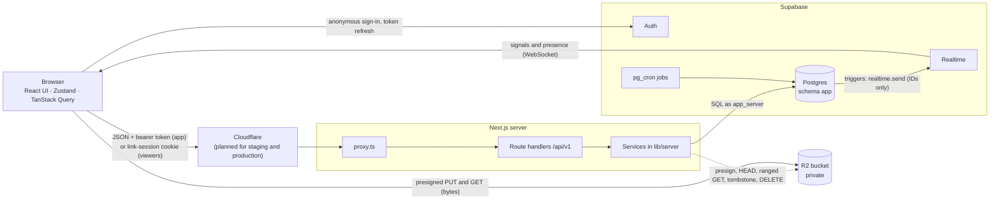
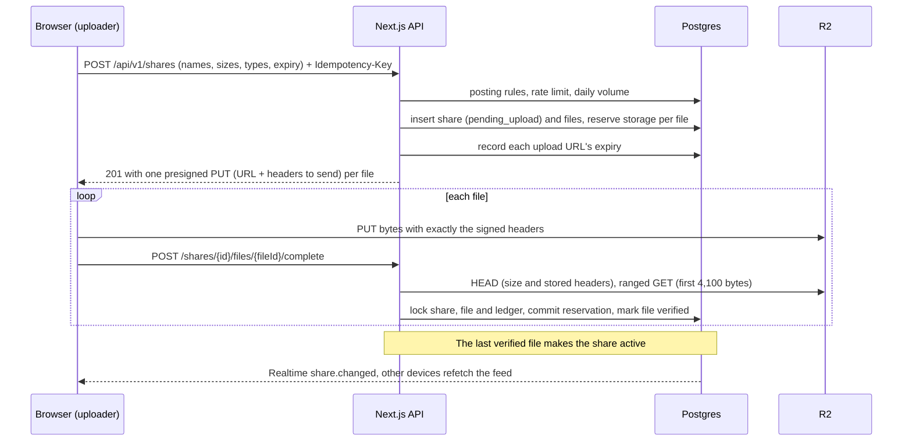
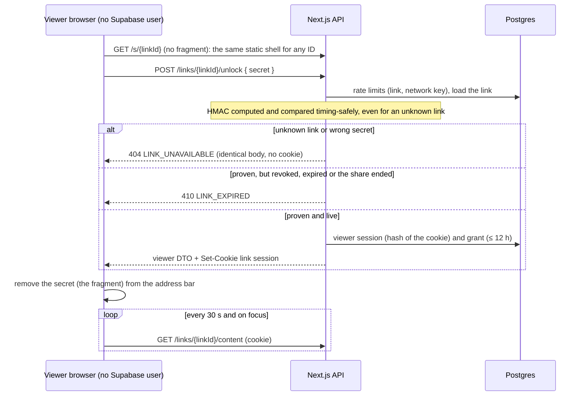
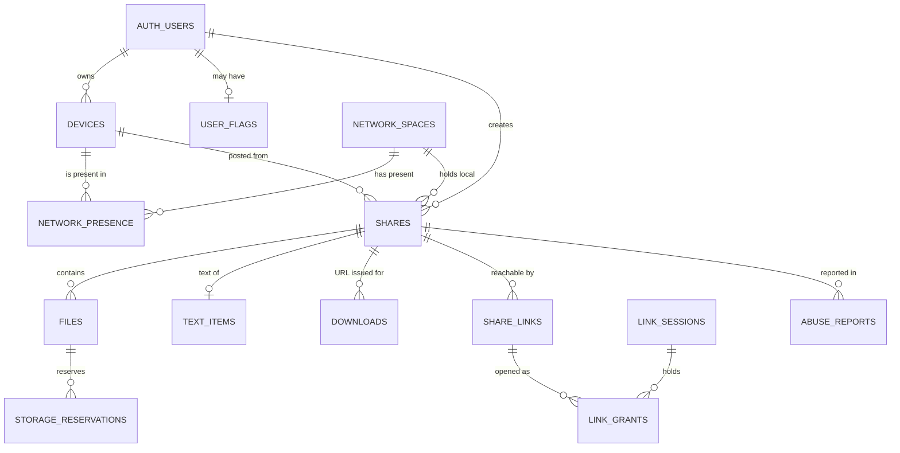
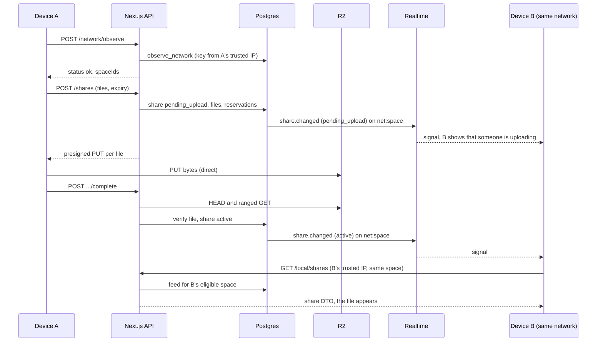
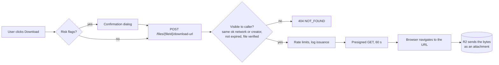
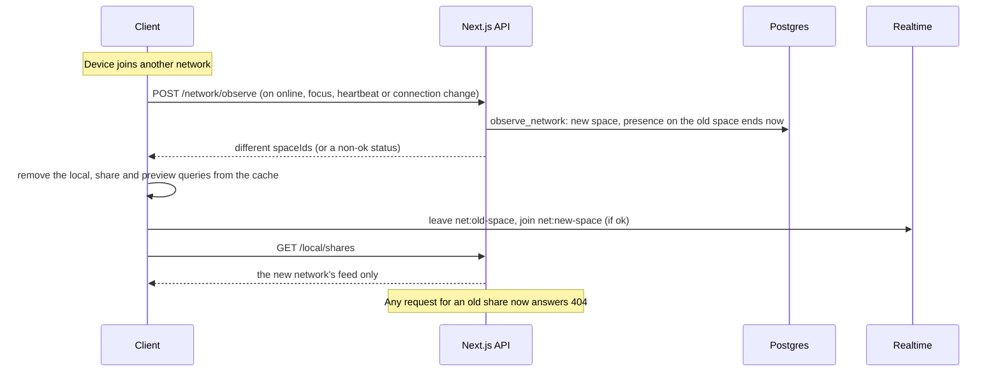
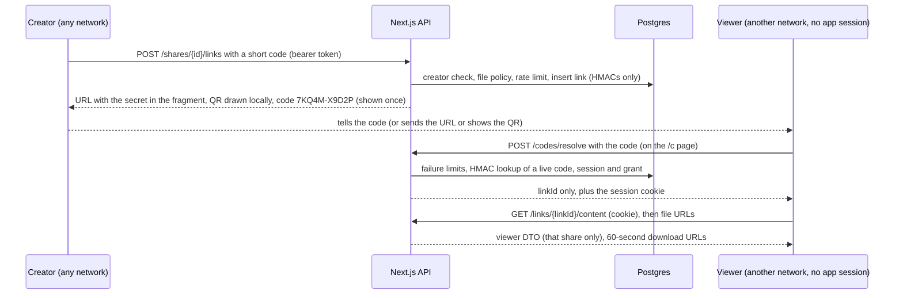

# Architecture — current system

| Field | Value |
|---|---|
| Status | **Living document.** It describes the architecture that is implemented now, not the target design. |
| Covers | Phase 0 (foundation), Phase 1 (anonymous local sharing) and Phase 2 (remote secure sharing), as built |
| Checked against | The code on branch `phase-2-remote-sharing` (uncommitted changes on top of `538334d`), 2026-10-16, after the review against the owner's Phase 2 decisions. Phase 1 alone: commit `1cd8ee3` on `phase-1-local-sharing`. |
| Production state | **Nothing is deployed.** Everything below runs and is tested on the local stack only. What has been verified at which level (local tests, CI, staging, real devices, production) is in [§18](#verification-levels); the gaps are in §17. |
| Last updated | 2026-10-16 (owner decisions for Phase 2 recorded; verification levels added to §18) |
| Change rule | A phase that changes the architecture updates this file in the same change (§19) |

This is the one document to read to understand how the system works today. It stays high-level and links to the detailed documents instead of repeating them.

| Document | Answers |
|---|---|
| **`ARCHITECTURE.md`** (this file) | What the system looks like now |
| [`phases/phase-N-*.md`](phases/) | What was planned, implemented and tested in phase N, with its deviations and evidence |
| [`06-decisions-and-risks.md`](06-decisions-and-risks.md) | Why decisions were made; which risks and open questions remain |
| [`00`](00-project-overview.md) – [`10`](10-requirements-and-diagram-review.md) | The original plan and the target design for all phases. Parts of it are not built yet. |

**If this document and the code disagree, the code is right.** Fix this document.

"Local Saver" is a working name (Q-020).

---

## Contents

1. [System overview](#1-system-overview)
2. [Technology stack](#2-technology-stack)
3. [High-level architecture](#3-high-level-architecture)
4. [Frontend architecture](#4-frontend-architecture)
5. [Backend and API architecture](#5-backend-and-api-architecture)
6. [Local network sharing](#6-local-network-sharing)
7. [File upload architecture](#7-file-upload-architecture)
8. [Text sharing](#8-text-sharing)
9. [Remote sharing](#9-remote-sharing)
10. [Database architecture](#10-database-architecture)
11. [Storage architecture](#11-storage-architecture)
12. [Realtime architecture](#12-realtime-architecture)
13. [Security architecture](#13-security-architecture)
14. [Data flow examples](#14-data-flow-examples)
15. [Current project structure](#15-current-project-structure)
16. [Testing architecture](#16-testing-architecture)
17. [Current limitations and open items](#17-current-limitations-and-open-items)
18. [Phase status](#18-phase-status)
19. [Architecture change rule](#19-architecture-change-rule)
- [Appendix: where the implementation differs from the plan](#appendix-where-the-implementation-differs-from-the-plan)

---

## 1. System overview

Local Saver lets devices on the same network share text and files without any setup. Opening the app on a Wi-Fi network shows everything that was posted from that network and has not expired. There is no join step, approval, PIN, QR code or link for that (DEC-031). Devices on other networks see nothing, not even that local content exists. **To reach someone on another network**, a share's creator sends a link, its QR code or a short code, which opens that one share and nothing else (Phase 2).

**What a user can do today:**

- Open the app. The browser signs in anonymously and registers as a **device** with a generated name such as "Blue Fox", which the user can rename.
- See the **"This network"** feed and how many devices are here now. New posts appear on other devices within about two seconds (measured locally).
- Post **text** (up to 100 KB) or **files** (up to 20 per post, 100 MB each), with an expiry of 1 hour, 24 hours (the default) or 7 days, to **this network** or as **Link only** (never visible on any network).
- Copy text, download files and preview images posted by anyone on the network. Risky files (programs, scripts, archives, disk images, misleading names) carry a warning badge and need a confirmation before download.
- Edit or delete their own posts. **"My uploads"** lists them from any network.
- **Share their own post by link**, with a QR code and optionally a short code, from any network; see and turn off those links (§9).
- **Open a link or a code** on any device and network, without the app or a sign-in; **report** a share they can see.

**What does not exist yet:** accounts, Pro and Team plans, payments, password-protected links, rooms and room links, burn-after-download, a web admin console and malware scanning. They are planned for Phases 3–6, and **none of their behaviour exists**. The schema and the plan object only reserve values for some of them (for example the share statuses `claimed` and `consumed`, the `ws` retention class, `link_grants.password_version`, and feature flags that are all off).

### Main components

| Component | What it is | Runs on |
|---|---|---|
| Web app | Next.js 16 App Router with React 19 client components: the app (`/`, `/uploads`), share and code pages (`/s/…`, `/c`) for link viewers, legal drafts | Browser |
| API | Route handlers under `/api/v1`, behind `proxy.ts` | Next.js server (Node.js) |
| Database | PostgreSQL with a private `app` schema and pg_cron jobs | Supabase |
| Auth | One anonymous Supabase user per browser | Supabase |
| Realtime | Private Broadcast channels and Presence | Supabase |
| File storage | Cloudflare R2 through the S3 API (RustFS locally) | Cloudflare (local: Docker) |
| Edge | Cloudflare proxy, origin lock, Turnstile | Cloudflare (supported in code, not set up yet) |

### Key terms

| Term | Meaning |
|---|---|
| **Network key** | HMAC of the requester's normalized IP address (IPv4 address or IPv6 /64). The address itself is never stored. |
| **Network space** | A row in `app.network_spaces`, one per network key. Shares posted locally belong to a space. |
| **Observe** | `POST /api/v1/network/observe`: the call that derives the caller's network, records presence and classifies the space |
| **Eligible spaces** | The spaces whose shares a request may see: the caller's current space if its status is `ok`, otherwise none |
| **Fail closed** | When the server can't be sure a network is a real local network, local sharing is off there |
| **Share** | One post: a text, or a set of files. Scope `network` (everyone on its network sees it) or `link_only` (only through its links). |
| **Creator** | The anonymous user (in practice, the browser) that posted a share |
| **Share link** | `/s/{linkId}#k={secret}`: opens one share from anywhere. The secret lives in the URL fragment and is stored only as a keyed hash. |
| **Short code** | A 10-character code (`7KQ4M-X9D2P`) that opens a link's share for a while without the link itself |
| **Link viewer** | A browser that opened a link or a code. It has no Supabase user, only a viewer session cookie. |
| **Grant** | A viewer session's permission to open one link, for at most 12 hours |
| **Takedown** | An operator blocking a share or a link with a SQL function from the Supabase dashboard |
| **Outbox** | `app.object_deletions`: storage deletions waiting to run |
| **Tombstone** | An empty object written over deleted content while an upload URL for it may still be live |
| **Kill switch** | A row in `app.runtime_flags` that turns local sharing, uploads, anonymous posting, remote links or short codes off |

---

## 2. Technology stack

Everything in this table exists in the code. Versions are those in `package.json` and the lockfile.

| Area | Technology | Used for |
|---|---|---|
| Framework | **Next.js 16.3.8**, App Router | Pages, the JSON API (route handlers), `proxy.ts`, `instrumentation.ts`, `after()`. Next.js 16 differs from older versions: read `node_modules/next/dist/docs/` first ([AGENTS.md](../AGENTS.md)). |
| UI runtime | **React 19.2.8** | Client components |
| Language | **TypeScript 5** (`strict`) | Everything |
| Styling | **Tailwind CSS 4.3.3** (`@tailwindcss/postcss`), `tw-animate-css` | Styles; theme tokens in `app/globals.css` |
| Components | **shadcn/ui** (style `radix-nova`, Radix primitives through `radix-ui`, Lucide icons, Geist font) | Ten primitives copied into `components/ui/` (DEC-035) |
| QR codes | **`qr` 0.7.2** (no dependencies) | Share-link QR codes, generated in the browser (§9.5); its decoder is used by the tests |
| Client state | **Zustand 5** | Client-only state (§4.5) |
| Server state | **TanStack Query 5** | Data fetched from `/api/v1` (§4.5) |
| Validation | **zod 4** | API contracts shared by server and client, environment validation |
| Auth | **Supabase Auth** via `@supabase/supabase-js` 2 | Anonymous sign-in in the browser. The server only verifies access tokens. `@supabase/ssr` is not used. |
| Realtime | **Supabase Realtime** via `@supabase/supabase-js` | Private Broadcast signals and Presence |
| Database | **PostgreSQL** (Supabase); **Kysely 0.29** + `pg` 8 | SQL query builder (no ORM). Types generated by `kysely-codegen`. Extensions: `pg_cron` (jobs), `citext`; `pg_net` is installed but unused until Phase 3. |
| File storage | **Cloudflare R2** via `@aws-sdk/client-s3` and `@aws-sdk/s3-request-presigner` | Presigned uploads and downloads, HEAD, ranged reads, deletes. **RustFS 1.0.1** stands in for R2 locally and in CI. |
| IP handling | `ipaddr.js` | Parsing and normalizing client addresses |
| Edge | **Cloudflare** | Origin lock, trusted client IP (`CF-Connecting-IP`), Turnstile bot check (verified by Supabase Auth at sign-in, and by the server itself for code guessing and reports). The code supports it; no zone is configured yet. |
| Logging | Internal JSON logger with redaction (`lib/server/log.ts`) | No pino and no error monitoring yet |
| Testing | **Vitest 5** (unit, component with jsdom and Testing Library, API integration), **Playwright 1.63** (Chromium, WebKit), **pgTAP** (`supabase test db`) | §16 |
| Tooling | pnpm 12.4.2, Node 22 (`.node-version`; `engines` ≥ 22.12), ESLint 9 (`eslint-config-next`), Supabase CLI 2.117 (local stack), GitHub Actions (`.github/workflows/ci.yml`) | Build, lint, local stack, CI |
| Hosting | **Not decided** (DEC-022, conditional on SP-01) | No deploy workflow exists |

**Browser support:** Chrome/Edge 111+, Firefox 128+, Safari 16.4+ (Q-019, assumed; Tailwind CSS 4 sets the Firefox floor).

**Planned at some point but not used:** `@supabase/ssr` (bearer tokens instead, DV1-14), `pino`, `file-type`, a Turnstile wrapper package and TanStack Query devtools (small internal modules instead, DV1-7), Supabase Storage (R2 instead), Supabase Edge Functions (Phase 3), Postgres Changes (Broadcast instead), `next/image` for user content (never).

---

## 3. High-level architecture



The main path, step by step:

1. **Browser.** Renders the UI, keeps client state in Zustand and server data in the TanStack Query cache. It talks to Supabase only for Auth and Realtime, never to application tables.
2. **Next.js.** `proxy.ts` runs first on every request (origin lock, request ID, CSP, security headers). Route handlers under `/api/v1` are thin: authenticate, validate, call one service, return a DTO.
3. **API/server services** (`lib/server`). Derive the caller's network from the trusted IP on every request that touches local content, apply authorization, limits and quotas, run transactions, presign storage URLs and write audit events.
4. **Supabase Postgres.** The source of truth: shares, files, texts, network spaces, presence, quotas, the deletion outbox. Atomic functions handle races; pg_cron jobs expire shares and clean up.
5. **R2.** Holds file bytes only. The browser uploads and downloads directly with short-lived presigned URLs. The server reads only the first 4,100 bytes of each upload to check its type.
6. **Supabase Realtime.** Database triggers send ID-only signals ("share X changed") to private channels.
7. **Browser again.** A signal makes the client refetch through the API, which re-checks the network before returning anything.

A **link viewer** takes a shorter path: its browser loads a share or code page, proves the link's secret (or a code) to the API, and from then on sends only an httpOnly link-session cookie. It never talks to Supabase and polls instead of receiving Realtime signals (§9.3).

| Component | Responsible for | Never does |
|---|---|---|
| Browser | UI, upload progress, refetching on signals | Decide who sees what. Hold service credentials. Read `app` tables. |
| `proxy.ts` | Origin lock, request ID, CSP nonce, security headers | Authorize access. Query the database. |
| Route handlers | Parse and validate input, call one service, map to a DTO and status. A few also apply a rate limit (feed, My uploads, share detail). | Contain business rules or SQL |
| Services (`lib/server`) | Network derivation, authorization, limits, quotas, state changes, presigning, audit | Return raw rows. Log secrets or IP addresses. |
| Postgres | Data, constraints, atomic functions, Realtime triggers, scheduled jobs | Store file bytes or plaintext secrets. The app's tables never hold raw IPs; Supabase Auth's own tables do (Q-031). |
| R2 | File bytes, with headers fixed at upload | Be publicly readable. Decide expiry. |
| Realtime | Deliver ID-only signals and Presence to authorized subscribers | Carry content, file names or URLs. Act as a data source. |
| Cloudflare | TLS, the only path to the origin, a trustworthy client IP, bot checks | Cache API responses or HTML |

**Locally** there is no Cloudflare. The local stack is Supabase (CLI) plus RustFS in Docker, and the client IP is simulated (§6.1, §16).

---

## 4. Frontend architecture

### 4.1 Routes and layout

| Route | File | Shows |
|---|---|---|
| `/` | `app/(app)/page.tsx` | "This network": status line, first-visit notice, composer (This network or Link only), upload queue, local feed |
| `/uploads` | `app/(app)/uploads/page.tsx` | My uploads |
| `/s/{linkId}` | `app/(share)/s/[linkId]/page.tsx` | The share page for link viewers (§9.6) |
| `/c` | `app/(share)/c/page.tsx` | Enter a share code |
| `/terms`, `/privacy`, `/acceptable-use`, `/report` | `app/(legal)/**/page.tsx` | Legal drafts, marked as unreviewed drafts |
| `/robots.txt` | `app/robots.ts` | Disallows `/api/` and the share, code, invite and room routes |
| `/api/v1/*` | `app/api/v1/**/route.ts` | JSON API (§5) |

The root layout (`app/layout.tsx`) awaits `connection()`, so every page renders per request (the CSP nonce changes per request; nothing is prerendered). It reads the nonce and passes the **public config** (Supabase URL, publishable key, Turnstile site key) to the client at request time, so one build serves every environment (DV1-8). Each route group adds its own providers (§4.4).

### 4.2 Client and server boundary

- Pages are server components that render only the shell. `AppShell` and all feature components are client components.
- **No user or network data is rendered or cached on the server.** It is all fetched in the browser after hydration, because the answer depends on the requester's IP: a shared cache would show one network's content to another.
- `lib/server/**` imports `server-only`, so the build fails if client code imports it. `lib/shared/**` is isomorphic (zod contracts, plan numbers). `lib/client/**` is browser code.
- The browser uses Supabase only for Auth and Realtime (DEC-006).

### 4.3 Code organization

| Folder | Contents |
|---|---|
| `components/ui/` | shadcn/ui primitives: alert, badge, button, card, dialog, input, progress, select, tabs, textarea |
| `components/local/` | The app's feature UI: `app-shell`, `local-home`, `my-uploads`, `composer`, `share-list`, `share-card`, `file-preview`, `upload-queue`, `network-status`, `first-visit-notice`, `boot-state`. The audience line, first-visit notice, network-status and risky-download texts are in `copy.ts`; other strings are inline. |
| `components/share/` | Phase 2: `share-link-dialog` (the creator's links, QR code and codes), `shared-view` (the share page), `code-entry`, `viewer-shell`; remote-sharing copy in `copy.ts` |
| `components/qr/`, `components/report/`, `components/legal/` | The QR code; the report dialog and the paste-a-link form; the legal page frame |
| `lib/client/` | Browser runtime and bootstrap, API clients (app and viewer), query keys and options, Zustand stores, Realtime bridge, network hook, uploader, Turnstile loader, link detection |
| `lib/shared/` | `api/schemas.ts` (zod API contracts), `plans.ts` (Free limits: the UI shows them as hints, the server enforces the same numbers), `short-code.ts` (code normalization, used on both sides) |

Presentational components receive data and actions as props (for example `ShareCard` and its `ShareActions`); small hooks wire them to the API (`useShareActions`).

### 4.4 Providers and bootstrap

`lib/client/providers.tsx` has three layers, one per route group (Phase 2, DV2-12):

| Where | Providers |
|---|---|
| Root layout (every page) | `RootProviders`: public config and the CSP nonce for runtime `<style>` tags |
| `(app)`: `/`, `/uploads` | `AppProviders`: `QueryClientProvider` → `UiStoreProvider` → `SessionStore` → `UploadsStore` → `PresenceStore` → `RuntimeProvider` |
| `(share)`: `/s/…`, `/c` | `ViewerProviders`: `QueryClientProvider` only. **No Supabase client, no sign-in, no Realtime.** |
| `(legal)` | None (server-rendered text; the report page has one small client form) |

Bootstrap runs once per page load of the app, in the browser only (`lib/client/runtime.tsx`):

1. Create the Supabase browser client and the API client.
2. Reuse the stored Supabase session, or sign in anonymously (with a Turnstile token when a site key is configured).
3. `POST /api/v1/devices` registers this browser as a device, or refreshes it.
4. The session store becomes `ready`; `BootState` renders the page. On failure it shows an error with a Reload button; without public config it shows "Sharing isn't set up on this server yet".

### 4.5 Who owns which state (DEC-034)

| Layer | Owns | In this codebase |
|---|---|---|
| **Zustand = client state** | State that exists only in this browser | `ui` (open dialog, text draft, selected files), `session` (bootstrap phase, this browser's user ID and its own device record), `uploads` (upload queue and per-file progress), `presence` (Presence roster, Realtime connection, "someone is uploading") |
| **TanStack Query = server state** | Data fetched through `/api/v1` | The observe result, the local feed, share details, preview URLs, My uploads, the creator's links, link-viewer content |
| **Supabase Realtime = live event notification** | Nothing. It only says "something changed". | `lib/client/realtime.ts` invalidates query keys and updates the presence store |

Rules the code follows:

- Zustand stores are created per provider, never at module level. They never hold secrets, presigned URLs or shared content. The one server record they keep is this browser's own device (label, platform), returned by registration and rename.
- **Link secrets and codes** never enter Zustand or the query cache: a new link's URL and code live only in the share-link dialog's component state, the share page sends the fragment's secret with a direct API call, and the secret leaves memory with them.
- Nothing is persisted: neither the query cache nor the stores.
- Realtime never writes payload data into the cache. Every change is refetched from the API.
- **Leaving a network removes its data.** When observe reports different space IDs or a status other than `ok`, every network-scoped query (`['local', …]`, `['share', …]`, `['preview', …]`) is removed from the cache, not hidden (`lib/client/network.ts`). My uploads stays.

**Query keys** (`lib/client/queries/keys.ts`; options in `queries/shares.ts` and `queries/links.ts`):

| Key | Data | Refreshed |
|---|---|---|
| `['network', 'current']` | Observe result: status, reason, space IDs, devices here | Only on the "This network" page: every 5 minutes while the tab is in the foreground, on focus, on reconnect, on `online`, on connection change (Chromium only), when the tab becomes visible |
| `['local', 'feed', spaceIds]` | Local feed | On `share.changed` from `net:`, on (re)subscribe, on focus. Removed on network change. |
| `['share', shareId]` | Share detail (`GET /shares/{id}`). The query is defined, but the current UI renders shares from the feed and My uploads lists, so it is only invalidated and removed. | On `share.changed` for that ID. Removed on network change and after a delete. |
| `['preview', fileId]` | 300-second preview URL | After 4 minutes. Removed on network change. |
| `['me', 'shares']` | My uploads | On `share.changed` from `user:` and on (re)subscribe |
| `['me', 'links', shareId]` | The creator's links to one share (no secrets) | While the share-link dialog is open; after creating, revoking or a new code |
| `['link', linkId, 'content']` | Link-viewer content (§9.3) | Every 30 seconds and on focus. A `404` or `410` replaces the content and stops polling (DEC-034 rule 4). |
| `['link', linkId, 'preview', fileId]` | 300-second preview URL for a viewer | After 4 minutes; removed when the link ends |

Defaults (`lib/client/query-client.ts`): `staleTime` 30 s, refetch on window focus, no automatic retry for `4xx`, up to three retries for network errors and `5xx`, no retries for mutations. In the browser, one query client is reused; each server render gets a new one.

### 4.6 How the UI talks to the API

- Every call goes through `createApiClient` (`lib/client/api-client.ts`): same-origin `fetch` with `cache: "no-store"`, `Authorization: Bearer <access token>`, `X-Device-Id`, and a JSON body. On `401 UNAUTHENTICATED` it refreshes the Supabase session once and retries. Share and code pages use the same client without a token or device ID (`lib/client/viewer-api.ts`); the browser adds the link-session cookie itself.
- Responses are parsed with the shared zod schemas before they reach the cache. Non-2xx responses become `ApiRequestError` (status, code, request ID, details, `Retry-After`).
- **Reads** use `queryOptions` factories. **Writes** call the API directly from components (composer, share actions) and then invalidate the affected keys. Device rename instead stores the returned device in the session store. There are no optimistic updates.
- **File bytes** go from the uploader to R2 with `XMLHttpRequest` (for progress), never through Next.js (§7). If a PUT fails, the batch is marked failed in the uploads store; the share stays uploading until the creator deletes it or the stale-upload job fails it (§7.2).
- **Downloads** navigate to the presigned URL; the signed `Content-Disposition: attachment` makes the browser download the file.
- **Browser storage** holds only the Supabase session (`local-saver.auth`), the device ID (`local-saver.device-id`) and whether the first-visit notice was seen (`local-saver.notice-v1`). A browser that opened a link or code also holds the httpOnly link-session cookie, which scripts can't read.

---

## 5. Backend and API architecture

### 5.1 Request pipeline

1. **`proxy.ts`** runs before every request (no matcher, so it covers every path):
   - origin lock: with `TRUST_PROXY_MODE=cloudflare`, a request without the right `X-Origin-Auth` gets `403` on every path;
   - a new request ID (UUID) on the request and the response;
   - removes `X-Test-Client-IP` unless the test override is allowed;
   - a nonce CSP for pages and a locked-down CSP for the API;
   - baseline security headers.

   It never authorizes and never queries the database.
2. **`withApi`** (`lib/server/http/handler.ts`) wraps every route handler:
   - Mutations need an exact `Origin` match against `APP_ALLOWED_ORIGINS` (`403 FORBIDDEN_ORIGIN`). They also need `Content-Type: application/json` (`415`); a body-less `DELETE` is exempt (DV1-13).
   - It maps errors to the standard body and adds `Cache-Control: no-store` and `X-Request-Id` to every response.
3. **The route handler:**
   - authenticates the caller (`requireCaller`). Link-viewer endpoints instead pass the request to a service that checks the link-session cookie and its grant (§9.3);
   - reads and validates the body (`readJson` with a zod schema);
   - derives the network (`currentNetwork`);
   - calls one service and returns a DTO.

   The feed, My uploads and share-detail handlers also apply their rate limit here.
4. **The service** (`lib/server/*`) applies authorization, entitlements, the remaining rate limits and quotas. It runs transactions, presigns storage URLs and writes audit events.
5. **Postgres functions** do the race-sensitive work atomically: presence, quota reservation, ending a share, claiming deletions, rate counters.

### 5.2 API surface

24 handlers in 22 route files (14 from Phase 1, 10 from Phase 2). Request and response contracts: [`lib/shared/api/schemas.ts`](../lib/shared/api/schemas.ts). The full catalogue, including later phases, is in [02 §6.2](02-system-architecture.md#62-endpoint-catalogue-by-phase).

| Area | Endpoints | Caller |
|---|---|---|
| Health | `GET /api/v1/health` (liveness), `?ready=1` (also checks the database) | Anyone |
| Devices | `POST /devices` (register or refresh), `PATCH /devices/{deviceId}` (rename) | Any session · device owner |
| Network | `POST /network/observe` | Device |
| Feeds | `GET /local/shares` (this network), `GET /me/shares` (My uploads); cursor pagination, `limit` 1–100, default 50 | Device on an `ok` network · creator |
| Shares | `POST /shares` (file share and upload URLs; `Idempotency-Key`), `POST /shares/{id}/files/{fileId}/complete`, `POST /texts`, `GET /shares/{id}`, `PATCH /shares/{id}/text`, `DELETE /shares/{id}`. `destination` is `network` or `link_only`. | Device (`network`: on an `ok` network) · creator · device on the share's network or creator |
| Files | `POST /files/{fileId}/download-url`, `POST /files/{fileId}/preview-url` | Device on the share's network, or creator |
| Links (creator) | `POST /shares/{id}/links` (create, optionally with a code), `GET /shares/{id}/links`, `DELETE /links/{linkId}` (revoke), `POST /links/{linkId}/code` (new code) | The share's creator, any network |
| Link viewers | `POST /links/{linkId}/unlock`, `GET /links/{linkId}/content`, `POST /links/{linkId}/files/{fileId}/download-url` and `…/preview-url`, `POST /codes/resolve` | Anyone with the secret or code; then the grant holder (cookie) |
| Reports | `POST /reports` | A device that can see the share, or a grant holder of its link |

### 5.3 Authentication and sessions

- **Identity.** Each browser is a Supabase **anonymous user** (DEC-005). There are no accounts in Phase 1.
- **Transport.** The browser sends its access token as `Authorization: Bearer …` (DV1-14). The server verifies it with `auth.getClaims` (JWKS for asymmetric keys, otherwise the Auth server). It requires role `authenticated` and a UUID `sub`. **The server never refreshes sessions**; the browser does (DV1-6).
- **Device binding.** `X-Device-Id` must name a non-revoked `app.devices` row of that user, otherwise `401 DEVICE_REQUIRED` or `DEVICE_UNKNOWN`. A suspended user (`app.user_flags.suspended_at`) gets `403 USER_SUSPENDED`.
- `requireCaller` (user + device) guards every endpoint except health and device registration. Registration needs only a valid session.
- **Ownership belongs to the anonymous user, so in practice to one browser.** Clearing site data creates a new user. Posts made before can then no longer be edited or deleted from that browser and leave its My uploads; they still expire normally.
- **Link viewers** (Phase 2) have no Supabase user and no device. They hold a viewer session: an httpOnly cookie (`__Host-link_session` on HTTPS) whose SHA-256 is stored, created by unlocking a link or resolving a code, 12 hours from the last one (§9.3).

### 5.4 Authorization

- All authorization happens in server services. It never happens in `proxy.ts` or the browser.
- The network is derived from the trusted IP on every request that touches the feed, shares or files (§6). My uploads, device and health requests don't need it. **No endpoint accepts a network or space identifier**: strict zod schemas reject unknown fields (T-010).
- Reads apply the visibility rule (§6.4). Creator-only actions (edit, delete, complete an upload) use `requireOwnShare`. A share the caller can't see answers `404 NOT_FOUND`, exactly like a share that doesn't exist; a visible share whose creator is someone else answers `403 NOT_CREATOR`.
- Posting goes through `postingTarget` (`policy/posting.ts`): kill switches, the per-user upload restriction, and an `ok` network for the network destination; for Link only, remote links must be on instead.
- **Links:** only the share's creator creates, lists, revokes and re-codes them (`requireOwnShare`; 404 or 403 like the other creator actions). **Viewers:** every viewer request re-checks the session, the grant for that exact link, the link and the share; files are served only from the link's share (§9.3). An unknown link, a wrong secret and a missing grant all answer the same `404 LINK_UNAVAILABLE`.
- The IDOR matrix test fails if any route or method is missing from it ([09 §5](09-testing-strategy.md#5-idor-matrix-as-code)). Since Phase 2 its actors include a viewer of this share's link and a viewer of another share's link.

### 5.5 Validation

- Request bodies use strict zod schemas shared with the client.
- Body size limits are 64 KB by default, 256 KB for file-share creation and 1 MB for text (room for JSON escaping). Bytes are counted while streaming (`413 PAYLOAD_TOO_LARGE`).
- IDs in paths must be UUIDs (otherwise `404`); link IDs must be 16 base64url characters (otherwise the uniform `404 LINK_UNAVAILABLE`). Cursors are validated (`400 INVALID_CURSOR`).
- Validation errors list paths and rule codes, never the submitted values.
- The environment is validated with zod at boot (§5.7).

### 5.6 Errors

Every error has the body `{ "error": { "code", "message", "requestId", "details"? } }`. The one exception is a failed readiness check, `GET /health?ready=1`, which answers `503` with `{ "status": "degraded", "checks" }`.

| Status | Codes |
|---|---|
| 400 | `INVALID_JSON`, `VALIDATION_FAILED`, `INVALID_CURSOR`, `INVALID_LIMIT`, `INVALID_IDEMPOTENCY_KEY` |
| 401 | `UNAUTHENTICATED`, `DEVICE_REQUIRED`, `DEVICE_UNKNOWN` |
| 403 | `FORBIDDEN_ORIGIN`, `NOT_CREATOR`, `USER_SUSPENDED`, `UPLOADS_RESTRICTED`, `TURNSTILE_REQUIRED`; `FORBIDDEN` from the origin lock |
| 404 | `NOT_FOUND`: doesn't exist, or not visible to the caller. `LINK_UNAVAILABLE`: unknown link, wrong secret or no grant. `CODE_UNAVAILABLE`. |
| 409 | `LOCAL_SHARING_UNAVAILABLE`, `VERSION_CONFLICT`, `UPLOAD_INCOMPLETE`, `UPLOAD_EXPIRED`, `STORAGE_QUOTA_EXCEEDED`, `LINK_NOT_ACTIVE` |
| 410 | `LINK_EXPIRED`: revoked, expired or its share ended (only after the secret or a grant is proven) |
| 413 / 415 | `PAYLOAD_TOO_LARGE`, `FILE_TOO_LARGE`, `TOO_MANY_FILES`, `TEXT_TOO_LARGE` / `UNSUPPORTED_MEDIA_TYPE` |
| 422 | `EXPIRY_NOT_ALLOWED`, `UPLOAD_REJECTED`, `PREVIEW_UNAVAILABLE`, `REMOTE_FILE_BLOCKED` |
| 429 | `RATE_LIMITED`, `DAILY_UPLOAD_LIMIT`, `LINK_DAILY_LIMIT`, with `Retry-After` |
| 500 / 503 | `INTERNAL_ERROR` (logged with the request ID, no details returned) / `UPLOADS_DISABLED`, `REMOTE_LINKS_DISABLED`, `SHORT_CODES_DISABLED`, `SERVICE_NOT_CONFIGURED` |

### 5.7 Server-only modules and configuration

| Module (`lib/server/`) | Responsibility |
|---|---|
| `env.ts`, `boot.ts` | zod environment validation. `instrumentation.ts` calls `boot.ts`, which exits the process on invalid configuration. |
| `log.ts` | One JSON line per event, with redaction |
| `flags.ts` | Kill switches and other runtime flags, cached up to `RUNTIME_FLAGS_CACHE_SECONDS` (default 30 s) |
| `http/` | `withApi`, the error model, the streaming body reader, Origin and content-type checks |
| `auth/` | Token verification (`session.ts`), user and device check (`device.ts`) |
| `devices/` | Registration, rename, generated labels, coarse platform from the user agent |
| `network/` | Trusted client IP, normalization, network key, egress lists, current network, observe; `requester.ts`: a rate-limit key for the requester's network that doesn't depend on local-mode flags |
| `local/visibility.ts` | The visibility rule |
| `policy/posting.ts` | Who may post, to which destination |
| `entitlements/plans.ts` | Plan resolution (only Free exists) |
| `ratelimit/limits.ts` | Postgres fixed-window rate limits, daily upload volume, failure counters and blocks (codes), the per-link daily URL cap |
| `shares/` | Create, complete, read (feed, My uploads, detail), text, download and preview URLs, end (delete and storage executor), expiry, DTOs |
| `links/` | Phase 2: `secrets.ts` (IDs, secrets, HMACs, timing-safe check), `cookies.ts`, `sessions.ts`, `grants.ts` (viewer access checks), `create.ts` (creator side), `unlock.ts`, `codes.ts`, `viewer.ts` (viewer DTO and file URLs) |
| `abuse/reports.ts` | Phase 2: report intake; writes the report, the audit event and the structured log event `abuse.report_received` (no alert is delivered, §9.7) |
| `storage/` | S3 client (presign, HEAD, ranged read, tombstone, delete), object keys, magic-byte sniffing |
| `security/` | Crypto helpers, IDs, origin lock, headers and CSP, filenames, `Content-Disposition`, file risk flags, `file-policy.ts` (what may go into a link), `turnstile.ts` (server-side verification) |
| `audit/log.ts` | Audit events |
| `db/` | Kysely client (pool of 5, connecting as `app_server`), health check, generated types |
| `config/integrations.ts` | Typed access to database, Supabase and R2 settings. A missing setting gives `503 SERVICE_NOT_CONFIGURED`. |

**Configuration rules** (`lib/server/env.ts`, listed in `.env.example`):

- Validation errors name variables, never values.
- In staging and production, these are required: HTTPS origins, `NODE_ENV=production`, `TRUST_PROXY_MODE=cloudflare` with `ORIGIN_SHARED_SECRET`, `DATABASE_URL`, the Supabase URL and publishable key, all five R2 variables, `NETWORK_KEY_SECRET_CURRENT`, the Turnstile site key and secret key, `LINK_PEPPER` and `CODE_PEPPER`.
- Secrets that must be random (the origin secret, network key secrets and peppers) need at least 32 characters; the two peppers must differ. Peppers are versioned (`PEPPER_VERSION`, with `*_PREVIOUS` during a rotation). Deployed environments also reject values that look like placeholders.
- The test client-IP override and `TURNSTILE_VERIFY_URL` (a stand-in for Cloudflare's siteverify in tests) are refused in production builds and deployments; the override also with `TRUST_PROXY_MODE=cloudflare`.
- `SUPABASE_SECRET_KEY` is accepted and validated, but nothing uses it yet.
- `pnpm stack:env` prints working values for the local stack.

### 5.8 Rate limits

Fixed windows in Postgres (`app.rate_limit_hit`), defined in [`lib/server/ratelimit/limits.ts`](../lib/server/ratelimit/limits.ts). Going over a limit answers `429` with `Retry-After`.

| Action | Limit | Counted per |
|---|---|---|
| Register a device | 10 per hour | User |
| Rename a device | 20 per hour | User |
| Observe | 30 per minute | Device |
| Local feed | 60 per minute | Device |
| My uploads | 60 per minute | Device |
| Share detail | 120 per minute | Device |
| Create a file share | 30 per hour | User |
| Complete an upload | 120 per minute | User |
| Create or edit text | 60 per minute, and 300 per minute | User, and network space |
| Delete a share | 60 per minute | User |
| Download and preview URLs (one counter) | 120 per minute, and 600 per minute for non-creators | Device, and network space |
| Daily upload volume | 2 GB, and 10 GB (windows start at 00:00 UTC) | User, and network space (link-only posts: the network key when the network was never observed) |
| Create a link | 30 per hour | User |
| List links, revoke a link | 60 per minute | Device, user |
| New short code | 30 per hour | User |
| Unlock a link | 30 per 10 minutes, and 60 per 10 minutes | Link, and network key |
| Viewer content | 60 per minute | Link session |
| Viewer download and preview URLs | 120 per minute, and 500 per day (Free) | Link session, and link |
| Wrong short codes | 5 per 10 minutes → Turnstile required; 20 per day → blocked for 24 hours | Network key or link session; network key |
| Abuse reports | 10 per hour, and 10 per hour | Network key, and reporter (device or link session) |

The owner accepted the Phase 2 limits as implemented (Q-027, 2026-10-16). Two consequences: the unlock limit counts every attempt, so at most 30 new browsers can open one link in 10 minutes (RISK-033); and only failed codes are counted, so successful resolutions have no limit of their own (RISK-032).

---

## 6. Local network sharing

The rule (DEC-031): **same network → automatic visibility; different network → nothing.** The server decides which network a request comes from, from the trusted client IP, on every request that touches local content. The client never says which network it is on. Design and threat analysis: [03 §3](03-security-and-network-design.md#3-local-mode-automatic-same-network-visibility-dec-031-dec-032-dec-033).

### 6.1 How the network is identified

1. **Trusted client IP** (`lib/server/network/client-ip.ts`).
   - With `TRUST_PROXY_MODE=cloudflare`, `CF-Connecting-IP` is read **only after** `X-Origin-Auth` matches the origin secret (current or previous).
   - `X-Forwarded-For` and `X-Real-IP` are never read.
   - Without Cloudflare mode there is no trusted IP, so local sharing is `unavailable`. The exception is the test override, in local development and tests only: `X-Test-Client-IP`, or `TEST_CLIENT_IP_DEFAULT` so that local browsers share one simulated network.
2. **Normalization** (`normalize.ts`).
   - **IPv4:** the full address. IPv4-mapped IPv6 and NAT64 (`64:ff9b::/96`) addresses become the embedded IPv4 address.
   - **IPv6:** the /64 prefix (`NETWORK_IPV6_PREFIX_LEN`, default 64).
   - Only globally routable unicast addresses count. A private or loopback address from the proxy means a misconfiguration: the network is `unavailable` (reason `non_global_ip`) and a warning is logged.
3. **Network key** (`key.ts`). `HMAC-SHA256(NETWORK_KEY_SECRET, "<family>|<prefix>")` gives 32 bytes, stored with a key version. It is keyed because the IPv4 space is small enough to brute-force a plain hash. The app stores and logs only the key, never the address.
4. **Network space.** One `app.network_spaces` row per `(key_version, network_key)`. Only observe creates spaces.
5. **Key rotation.** With `NETWORK_KEY_SECRET_PREVIOUS` set and `NETWORK_KEY_VERSION` raised by one, observe moves a space found under the old key to the new key (`app.rekey_network_space`). Its ID and content stay put.

### 6.2 IPv4 and IPv6

An IPv4 network and an IPv6 network are **separate spaces, and nothing links them.** SP-04 has not run, so the dual-stack probe and binding tables from the plan ([03 §3.4](03-security-and-network-design.md#34-dual-stack-binding-conditional-on-sp-04)) were not built (DV1-3). Only the current request's key counts.

As a result, two devices in the same home see each other only when both reach the app over the same address family (and, for IPv6, the same /64). A phone on IPv6 and a laptop on IPv4 on the same Wi-Fi don't see each other. How often this happens on real networks has not been measured (AC-1.11). The test for linked IPv4/IPv6 networks (T-009) is blocked on SP-04; the current behaviour ("never merge") is tested.

### 6.3 Observe and presence

The "This network" page calls `POST /api/v1/network/observe` (rate limit: 30 per minute per device). The My uploads page never observes.

- after bootstrap;
- every 5 minutes while the tab is in the foreground;
- on focus and when the tab becomes visible;
- on `online`, and on connection change (Chromium only).

Observe does the following:

1. Rotates the key if needed.
2. Runs the egress-list lookup (§6.7).
3. Calls `app.observe_network`, which:
   - creates or updates the space;
   - **ends this device's presence on any other space immediately**;
   - records presence on this space for 10 minutes;
   - recounts the distinct devices seen in the last 24 hours;
   - classifies the space (§6.5).
4. Returns the status, the reason, the space IDs and the number of devices present now. Space IDs and the device count are only given when the status is `ok`.

When the network is `unavailable` for a per-request reason (kill switch, stale egress lists, no trusted or a non-global IP), observe answers right away without calling `app.observe_network`, so it neither records nor ends presence.

Every other request only *reads* the network (`currentNetwork`). A network that was never observed has no content: its feed is empty, and posting is refused (`409 LOCAL_SHARING_UNAVAILABLE`, reason `network_not_observed`) until observe runs. The client always observes first.

### 6.4 The visibility rule

```text
visible(share) = scope in ('network', 'link_only')
             and expires_at > now()                      -- database clock
             and status = 'active'                       -- 'pending_upload': creator only
             and (caller is the creator
                  or (scope = 'network' and share.space in eligible_spaces))

eligible_spaces = [the caller's current space]  if its status is 'ok'
                = []                            otherwise
```

A **link-only** share is never visible on a network, not even its creator's: through this API only its creator sees it, and everyone else needs a link grant (§9). This is evaluated on every request: in [`lib/server/local/visibility.ts`](../lib/server/local/visibility.ts) for details, downloads and previews. The feed ([`lib/server/shares/read.ts`](../lib/server/shares/read.ts)) applies the network part in SQL (eligible space, `active`, not expired); the creator's shares from other networks are served by My uploads instead. A device that leaves the network derives a different space on its next request, so the old content answers `404`. The isolation guarantees G1–G7 are in [03 §3.8](03-security-and-network-design.md#38-isolation-guarantees).

Share DTOs (`lib/server/shares/dto.ts`) say nothing about the network. They do carry `isMine` and `fromLabel`, the posting device's name, which its owner can choose and everyone who can see the share receives.

### 6.5 Network statuses (fail closed)

Every status other than `ok` hides the network's content and refuses posting.

| Status | Set when (reason) | Lifted |
|---|---|---|
| `ok` | Default | — |
| `shared_egress` | The address is on the Private Relay or Tor list (`egress_list:<source>`) | After 7 days, and only by an observe that finds the address no longer listed |
| `too_large` | More distinct devices in 24 hours than the cap (`devices_24h_over_cap`), found by an observe or the `refresh-network-status` job | After 7 days, by the `refresh-network-status` job, if the count is back under the cap |
| `blocked` | An operator sets it with SQL, through `app.set_space_status` (no tooling yet) | By an operator, the same way |
| `unavailable` | Per request, nothing stored: the kill switch is off (`disabled`); the egress lists are missing or stale in staging or production (`classification_unavailable`); no trusted IP (`no_trusted_ip`); a non-global IP (`non_global_ip`) | When the cause goes away |

Every change of the stored status sends a Realtime signal (`network.changed`, from a trigger). The audit event (`network.status_changed`) is written by `app.set_space_status`, so operators must use that function rather than a plain `UPDATE`.

### 6.6 Large-network protection

One public IP can cover a campus, an office building or carrier-grade NAT, so a "network" with many devices is not treated as local.

- The cap is the runtime flag `network_large_cap`: default 50 (Q-029, assumed), tunable without a redeploy (DV1-5).
- `devices_24h` counts the distinct devices with presence last seen in the last 24 hours.
- It is checked at every observe and every 5 minutes by `refresh-network-status`.
- Over the cap, the space becomes `too_large` for at least 7 days.

### 6.7 Private Relay and Tor

- **Lists.** Apple iCloud Private Relay egress ranges and the Tor exit list live in `app.network_egress_ranges`. They are loaded **manually** with `pnpm egress:load`, at least weekly ([runbook](runbooks/egress-lists.md)). Adjacent ranges are merged: on 2026-10-15, 285,091 Private Relay ranges became 14,068 rows and 1,210 Tor exits became 642. The schema also allows `vpn` and `hosting` sources, but no such list is loaded, and there is no ASN classification (SP-04).
- **Lookup without the address** (DV1-23):
  - The app sends only the IPv4 /24 or IPv6 /48 around the address to `app.egress_ranges_overlapping`, which refuses longer prefixes.
  - The app checks exact containment itself.
  - Postgres never receives the client address; a test with full statement logging confirms it.
- **Fail closed.** If the lists were never loaded or are older than 14 days, staging and production report `unavailable` (`classification_unavailable`) for every network and log `network.egress_list_stale`. Locally the lists are optional.

### 6.8 When local sharing is unavailable

- **Server:**
  - the feed returns no shares (`networkStatus` says why);
  - posting answers `409 LOCAL_SHARING_UNAVAILABLE` with the status and reason;
  - other people's local shares answer `404`;
  - the client gets no space ID, so it doesn't join a `net:` Realtime topic.

  Realtime itself denies `net:` access for a stored non-`ok` status and for the kill switch. For the per-request causes (stale lists, no trusted IP, a non-global IP) it doesn't know about the problem: a device keeps access to its last space's ID-only signals until its presence lapses, within 10 minutes (§12.4).

  Creators keep access to their own shares.
- **Client:** an alert explains why local sharing is off (copy in `components/local/copy.ts`) and points to the fallback: the composer stays, with **Link only** as its one destination, and there is no feed. (Phase 1 had no fallback.)
- **Content is not deleted.** If the network becomes `ok` again before a share expires, the share is visible again.
- The kill switch `local_sharing_enabled = false` makes every network `unavailable` (`disabled`) and also denies `net:` topics immediately.

### 6.9 My uploads

`GET /api/v1/me/shares` lists the caller's own shares that are uploading or active and not expired, from **any** network, newest first. Creator access never depends on the network: the creator can view, download, edit and delete from anywhere. The page subscribes only to the `user:{userId}` topic. Its cache key is not network-scoped, so a network change doesn't clear it.

---

## 7. File upload architecture



### 7.1 Limits

The numbers are in `lib/shared/plans.ts` (Free plan) and in the upload code. Values marked "assumed" wait for Q-007 and Q-030.

| Limit | Value |
|---|---|
| File size | 100 MB (one single PUT, DEC-026; no multipart) |
| Files per share | 20 (assumed) |
| Active storage per user | 2 GB, committed plus reserved (assumed) |
| Daily upload volume | 2 GB per user and 10 GB per network, charged when the upload starts (assumed) |
| Share creation | 30 per hour per user; completion calls 120 per minute per user |
| Upload deadline | 2 hours after the upload starts. Each URL lives at most 15 minutes, and never past the deadline or the share's expiry. |
| Expiry | 1 hour, 24 hours (default) or 7 days (assumed) |

### 7.2 Upload authorization

- **Starting an upload:**
  1. `requireCaller`.
  2. `assertCanPost`: the kill switches `uploads_enabled` and `anonymous_uploads_enabled`, the per-user `upload_restricted` flag, and an `ok` network.
  3. Size and count limits, the expiry option, the rate limit and the daily volume.
- **Completing an upload:** creator only (`requireOwnShare`).
- **A failed browser upload.** If a PUT fails, the uploader marks the batch failed but does not delete the share. It stays `pending_upload` in My uploads, with its reservation held, until the creator deletes it or `fail-stale-uploads` ends it after the 2-hour deadline (checked every 5 minutes).
- **Idempotency.** The same `Idempotency-Key` within 24 hours returns the same share, with fresh URLs for the files still pending. The posting rules are checked before the replay.

### 7.3 Write-once signed uploads

**The signature.** The presigned PUT signs:

- `Content-Type`;
- `Content-Disposition: attachment` with the sanitized filename;
- `Cache-Control: private, no-cache`;
- `If-None-Match: *` (write-once);
- `Content-Length` (the exact declared size).

So storage refuses a body of any other size and refuses a second write to the same key (DV1-15, DV1-18).

**URL bookkeeping.** Each URL's expiry is written to `files.upload_url_expires_at` **before** the URL is handed out. Storage deletion uses it (§7.6).

**Re-checks at completion.** Under row locks, completion confirms the share is still uploading and not expired (otherwise `422 UPLOAD_REJECTED`, reason `share_ended`) and that the deadline hasn't passed (otherwise `409 UPLOAD_EXPIRED`).

### 7.4 Type validation and risk flags

- **Stored type.** The declared type is kept as `Content-Type` only for preview-safe raster images (JPEG, PNG, GIF, WebP, AVIF). Everything else is stored as `application/octet-stream`, and every download is an attachment.
- **Completion checks:**
  - The stored size must equal the declared size (otherwise rejected: `size_mismatch`).
  - The stored headers must equal the signed ones, with no `Content-Encoding` (otherwise `metadata_mismatch`).
- **Magic bytes.** The first 4,100 bytes go through an internal sniffer. It recognizes raster images, executables (PE, ELF, Mach-O), archives (zip, gzip, 7z, rar), PDF and scripts (`#!`).
- **Previews** exist only when the sniffed bytes are a raster image and the stored type is preview-safe.
- **Risk flags.** `executable` (programs and installers, including Java and Android packages detected by content), `script`, `archive`, `double_extension` and `disk_image` come from the extension and the content. Flagged files are allowed on local shares, with a badge and a download confirmation. **Nothing is scanned for malware** (Phase 6).
- **Link-only shares** follow the remote file policy instead (§9.1): executables, scripts, installers and disk images are refused by name at upload start (`422 REMOTE_FILE_BLOCKED`) and by content at completion (the upload is rejected, `remote_file_blocked`).
- **Filenames.** Normalized to NFC. Control, invisible and bidirectional characters are removed, reserved characters replaced, Windows device names prefixed, and the length capped at 255 bytes. Names live only in Postgres, never in object keys or Realtime payloads.
- **All or nothing** (DV1-10). A rejected file fails the whole share: its object is queued for deletion, its reservation released, the share ended as `failed`.

### 7.5 Quota reservation

| Step | When | What happens |
|---|---|---|
| Reserve | Upload starts | `app.reserve_storage` reserves each file atomically and never goes over the quota. If it would, the API answers `409 STORAGE_QUOTA_EXCEEDED` with `usedBytes` and `quotaBytes`. |
| Commit | Completion | `app.commit_reservation` moves the exact size from reserved to committed |
| Release | Rejection, share end, or after 3 hours | `app.release_reservation` (the `release-stale-reservations` job handles stale ones) |
| Free | Share ends | `end_share` gives back the committed bytes |

There is no reconciliation job yet (Phase 3).

### 7.6 Deletion and tombstones

- **One way to end a share.** `app.end_share(share, reason)` is the only path that ends a share, whether the creator deletes it, it expires, or its upload failed (DEC-016). In one transaction it:
  - sets the status and reason;
  - erases text content;
  - releases bytes and reservations;
  - marks the file rows;
  - queues each object in the `app.object_deletions` outbox;
  - writes an audit event.

  It is idempotent.
- **Access ends immediately,** because every request checks status and expiry. Storage cleanup is not the security boundary.
- **The storage executor** (`lib/server/shares/end.ts`) runs the share's deletions right after a creator delete or an upload rejection. It then sweeps up to 10 more due deletions after the response (Next.js `after()`). For each claimed row (`app.claim_object_deletions`):
  - **If an upload URL for the object may still be live** (its recorded expiry plus 5 minutes), the object is overwritten with an **empty tombstone** and the row is retried after that time. The key stays taken, so the write-once URL gets `412` and can't put bytes back (F1-12).
  - **Otherwise** the object is deleted.
  - **Failures** stay queued.
- **Leftovers.** There is no dedicated storage janitor yet (Phase 3). Objects of shares ended by the expiry or stale-upload jobs are deleted by later sweeps, and sweeps run only when someone deletes a share or an upload is rejected. The R2 lifecycle rule is meant to be the backstop once a bucket exists (§11); today only RustFS exists, without lifecycle rules.

Detail: [03 §7.7](03-security-and-network-design.md#77-deleting-objects-while-upload-urls-are-live-phase-1-as-built), [04 §9.2](04-database-and-storage-design.md#92-job-catalogue).

### 7.7 Download and preview URLs

- **`POST /files/{fileId}/download-url`:**
  1. Applies the visibility rule (same network, or the creator).
  2. Requires a verified file in an active share (a file still uploading answers `409 UPLOAD_INCOMPLETE`).
  3. Applies rate limits: 120 per minute per device, plus 600 per minute per network space for non-creators.
  4. Returns a **presigned GET valid for 60 seconds**.
  5. Records the issuance in `app.downloads`, with the browser family and no IP.
- **Preview URLs** pass the same checks, but only for verified raster images up to 20 MB, and last 300 seconds. They render in a plain ``, never through `next/image`, and are refetched after 4 minutes.
- **No storage of URLs.** They are never stored, cached on the server or sent over Realtime. Completed downloads are not observable, because the bytes come straight from R2.

---

## 8. Text sharing

| Aspect | Behaviour |
|---|---|
| Create | `POST /api/v1/texts` with `destination: "network"`. Same posting rules as files (`assertCanPost`), except the `uploads_enabled` switch, which applies to files only. Up to 100 KB of UTF-8 (`413 TEXT_TOO_LARGE`), expiry from the same options. Rate limits: 60 per minute per user and 300 per minute per network space. The share is `active` immediately. |
| View | The text is part of the share DTO, in the feed and in share details. It is shown as plain text: only `http(s)` URLs become links (`rel="noopener noreferrer nofollow ugc"`); nothing is rendered as HTML or Markdown. Everyone who can see it may copy it. |
| Edit | **Creator only** (Q-021, assumed): `PATCH /api/v1/shares/{id}/text` with the content and the version the editor started from. |
| Conflicts | Optimistic concurrency: the update succeeds only if the stored version still matches, then increments it. Otherwise `409 VERSION_CONFLICT` with `currentVersion`. The UI says the text changed on another device and offers to load the latest version. No merging. |
| Delete | `DELETE /api/v1/shares/{id}` (creator only), the same endpoint as for files. `end_share` sets the content to `null`, so the text is erased. |
| Expiry | The `expire-shares` job calls `end_share`, which erases the content. Access already ended at `expires_at`. |
| Live updates | Creating or deleting a text changes the share status, and editing changes its version; each sends `share.changed` (§12) |

---

## 9. Remote sharing

A device on **another** network reaches a share only through a **link**, its **QR code** or a **short code**, and only that one share (DEC-031, DEC-033). Built in Phase 2. Design and threat analysis: [03 §4](03-security-and-network-design.md#4-remote-sharing-design).

### 9.1 What can be shared, and by whom

- **Only a share's creator** makes links to it, from any network (also from My uploads). A link targets **one share** and exposes nothing else: no network feed or space, no other local shares, no presence, devices or network identifiers (Q-028, owner decision 2026-10-16).
- **Link-only shares** (`scope = 'link_only'`): the composer's "Link only" destination. They never appear in any feed or `net:` topic, the share API shows them only to their creator, and they can be posted where local sharing is off (that is the fallback the status copy points to).
- **File policy for links** (`lib/server/security/file-policy.ts`; Q-010, owner decision 2026-10-16): on Free, executables, scripts, installers and disk images can't get a link (`422 REMOTE_FILE_BLOCKED`) and can't go into a link-only share (checked by name at upload start and by content at completion). Archives are allowed; viewers confirm before downloading them. Local shares are unchanged.

### 9.2 Links

| Aspect | As built |
|---|---|
| URL | `/s/{linkId}#k={secret}`, built from `NEXT_PUBLIC_APP_ORIGIN`. Browsers never send the fragment, so the secret reaches no server log, proxy or `Referer`. |
| Identifiers | Link ID: 96 random bits (16 base64url characters), may appear in logs and reports. Secret: 256 random bits. |
| Storage | `HMAC-SHA256(LINK_PEPPER[version], linkId \| secret)` and the pepper version. The secret and URL are returned once, to the creator's dialog, and kept only in that dialog's component state. |
| Expiry | Until the share expires (default), or 1 h / 24 h / 7 days; never past the share (service check and a database trigger). The share's expiry is a link's maximum lifetime; there is no separate 7-day limit (owner decision 2026-10-16, DV2-13). |
| Ending | The creator revokes a link (`DELETE /links/{id}`); `end_share` revokes every link of a share it ends (`share_ended`, or `blocked` for a takedown) and clears their codes |
| Creator view | `GET /shares/{id}/links`: state, expiry, how often it was opened, whether a code is live. Never a secret, URL or code. |

### 9.3 Viewers: unlock, session and grant



- **Session cookie:** `__Host-link_session` (Secure) on HTTPS origins, which every deployment is; `link_session` on the plain-HTTP origins of local development and tests (DV2-3). httpOnly, SameSite=Lax, Path=/, 12 hours, refreshed by each unlock. Stored only as SHA-256 in `link_sessions`. A cookie value the server doesn't already know is never adopted (no session fixation).
- **Grant:** one per (session, link), until the earliest of 12 hours, the link's expiry and the share's expiry. **Every viewer request** re-checks the session, the grant, the link and the share (`lib/server/links/grants.ts`), so revocation, expiry and takedown apply on the next request. A grant that only timed out answers 404 (the viewer needs the link again).
- **Viewer DTO** (G4): the link's ID and expiry, when this browser's access ends, and the share's kind, expiry, text and files (ID, name, size, type, previewable, risk flags). Never network or space IDs, presence, devices, the uploader or other shares.
- **Files:** `POST /links/{id}/files/{fileId}/download-url` (60 s) and `…/preview-url` (300 s), only for files of the link's share; together capped at 500 a day per link on Free (`429 LINK_DAILY_LIMIT`); logged in `downloads` with `actor_kind = 'link_viewer'` and the link ID, no viewer identity.
- Viewers have **no Supabase user and no Realtime connection** (RISK-006); the page polls.

### 9.4 Short codes

- Ten Crockford Base32 characters (50 bits), shown as `7KQ4M-X9D2P`; stored as `HMAC-SHA256(CODE_PEPPER[version], code)`, unique among live codes; the plaintext is shown once. Validity 10 minutes, 1 hour (default) or 24 hours on Free, never past the link. "New code" replaces the old one (`POST /links/{id}/code`); the purge job clears expired codes.
- `/c` → `POST /codes/resolve { code }` → a grant for this browser and **only the link ID** in return; the page then opens `/s/{linkId}` without a fragment. The link secret is never revealed by a code. Input is normalized (case, spaces, dashes, O→0, I/L→1) in the browser and again on the server (`lib/shared/short-code.ts`).
- **Guessing limits** (failures only, `lib/server/links/codes.ts`): after 5 failures in 10 minutes for the network key or the link session, every attempt needs Turnstile (`403 TURNSTILE_REQUIRED`; without Turnstile configured, a wait instead); 20 failures in a day block the network key for 24 hours (`429`); 1,000 failures in 10 minutes across everyone log `code.resolve_failure_spike` for alerting.

### 9.5 QR codes

Generated in the browser (`components/qr/share-qr.tsx`, library `qr`) from the full URL, fragment included: error correction M, the standard 4-module quiet zone, drawn as one SVG path. Shown with the link's expiry and *"Anyone who scans this can open the share."* No third-party QR service sees the URL.

### 9.6 Share and code pages

- The `(share)` route group renders with `ViewerProviders` (a query client only): no Supabase client, no app shell, no device or network view. `/s/[linkId]` never touches the database on GET, and returns the same shell for any link ID, existing or not (unfurlers learn nothing and change nothing).
- Metadata is generic ("Something was shared with you"); `robots noindex`, `referrer no-referrer`; `proxy.ts` adds `Referrer-Policy: no-referrer`, `X-Robots-Tag: noindex, nofollow` and `Cache-Control: no-store` on `/s` and `/c`.
- The only third-party script is Turnstile, loaded on demand when a check is actually needed (after failed codes, when sending a report) and only where it is configured.

### 9.7 Abuse reports and takedown

- `POST /reports`: a link viewer reports the link's share (needs its grant); a device reports a share it can see. Category from a fixed list, optional details (≤ 2,000 characters, required for "other") and email; Turnstile wherever it is configured; 10 an hour per network key and per reporter.
- Stored in `abuse_reports`, audited (`report.created`) and logged as the structured event **`abuse.report_received`** (IDs and category only; `urgent: true` for child safety).
- **Nobody is notified.** There is no email, chat, SMS or pager alert (owner decision 2026-10-16). Operators find reports with the runbook's triage query. The alert on that log event, its channel and the named operator are future operational requirements (Q-022).
- **Takedown** runs in SQL from the MFA-protected Supabase dashboard, never through the app: `app.admin_block_share` (ends the share as `blocked`, revokes its links, queues its files) and `app.admin_block_link`. Both are audited (`admin.block`) and resolve the related reports ([runbook](runbooks/takedown.md)). Bytes are deleted by the next storage sweep or by hand; there is no janitor before Phase 3 and no evidence preservation (RISK-031).

### 9.8 Kill switches

| Flag | Off means |
|---|---|
| `remote_links_enabled` | No link creation or link-only posting; unlock, viewer content and file URLs, and code resolution answer `503 REMOTE_LINKS_DISABLED`. Creators can still list and revoke links. |
| `short_codes_enabled` | No new codes; resolution answers `503 SHORT_CODES_DISABLED`. Links still work. |

[Runbook](runbooks/kill-switches.md).

---

## 10. Database architecture

### 10.1 Schemas and roles

- **`app`**: all application tables and functions, owned by **`app_owner`** (no login). It is not exposed through the Supabase Data API, which exposes only `public` and `graphql_public` (`supabase/config.toml`), and client roles have no grants on it.
- **`app_realtime`**: one `SECURITY DEFINER` helper used by the Realtime policies. `authenticated` may use the schema and execute that helper, nothing else.
- **`app_server`**: the role the Next.js server logs in as, through a `pg` pool of 5 connections. Locally it connects directly (port 54322); hosted environments are meant to use the Supavisor pooler. Its password is set per environment and never appears in migrations; `supabase/seed.sql` sets a local-only one.

### 10.2 Major tables

| Group | Table | Holds |
|---|---|---|
| Identity | `devices` | One row per browser: user, label, coarse platform, last seen, revoked |
| | `user_flags` | Suspension and upload restriction per user (set by an operator) |
| Network | `network_spaces` | Network key, key version, family, status, reason, sticky-until, devices in 24 h |
| | `network_presence` | Device present on a space until `present_until` (10 minutes after the last observe) |
| | `network_egress_ranges` | Private Relay and Tor ranges (`cidr`, `source`) |
| Content | `shares` | One post: scope (`network`), space, kind (`files`/`text`), creator, status, expiry, retention class, entitlement snapshot, end reason |
| | `files` | One stored object: object key, original name, declared and detected type, sizes, upload status, deadline, URL expiry, risk flags, preview kind |
| | `text_items` | Text content (erased when the share ends) and its version |
| | `downloads` | Download and preview URL issuances (by devices or, with the link ID, link viewers), with a retention date |
| Remote sharing (Phase 2) | `share_links` | One link to one share: secret HMAC and pepper version, optional live code HMAC and its expiry, expiry, revocation and its reason, unlock count, entitlement snapshot |
| | `link_sessions` | Viewer sessions: SHA-256 of the cookie, expiry |
| | `link_grants` | (session, link): which links a session may open, until when (≤ 12 hours) |
| | `abuse_reports` | Reports: target share and link, the share's network, category, details, optional email, reporter kind, review status |
| Storage | `storage_usage`, `storage_reservations` | Quota ledger: committed and reserved bytes per user |
| | `object_deletions` | Deletion outbox: due time, attempts, lock, tombstone time, completion |
| Operations | `runtime_flags` | Kill switches, the large-network cap, the egress-list load time |
| | `rate_counters` | Fixed-window counters for rate limits, daily volume and code failures; 24-hour code blocks |
| | `idempotency_keys` | Share-creation replay records (24 hours) |
| | `audit_events` | Share and link lifecycle, reports, takedowns and network status changes. No IP data, secrets or content. 90-day retention date. |

### 10.3 Relationships



Notes:

- Devices, user flags and idempotency keys are deleted with their `auth.users` row. A share keeps existing when its creator user or device is deleted; the reference becomes `null`.
- Files, text items, download records and links are deleted with their share; grants with their link or session. Abuse reports outlive both (the references become `null`). A space can't be deleted while shares reference it.
- `object_deletions.source_file_id` has no foreign key, so a deletion request outlives its file row.
- Checks enforce consistency: a network-scoped share must have a space and a link-only share must not; a verified file's size must equal the declared size; open shares have no end time or reason and ended shares have both; object keys must match the key pattern; link IDs, HMACs and session hashes have fixed lengths; a code comes with its expiry and pepper version; a grant lasts at most 12 hours; a trigger refuses a link that outlives its share.

### 10.4 RLS strategy

- **Every `app` table has RLS enabled, with one policy: `app_server` may do everything.** Client roles (`anon`, `authenticated`) have no grants and no policies, so they can't reach the data even if the schema were ever exposed.
- **RLS is a deny-by-default backstop, not the access model.** Who may see or change what is decided in the server code and the functions it calls (DEC-006).
- Execute on functions is revoked from `PUBLIC` and granted to `app_server` one function at a time. pgTAP asserts that no client role can execute any `app` function (F1-1).
- Functions are `SECURITY INVOKER` with `search_path = ''`: called by the server they run as `app_server`, and called by pg_cron as the role that scheduled the job (the migration role). The exceptions are the Realtime trigger functions (`SECURITY DEFINER`, owned by the migration role so that `realtime.send` can write, F1-3) and `app_realtime.can_access_topic` (`SECURITY DEFINER`, owned by `app_owner`).
- The takedown functions are granted to **no** role: only the database owner (an operator in the Supabase dashboard) can run them; pgTAP asserts that `app_server` can't.

### 10.5 Important functions

| Function | Purpose |
|---|---|
| `observe_network` | Create or update the space, move presence, count devices, classify (§6.3) |
| `egress_ranges_overlapping` | Egress ranges overlapping a /24 or /48. It refuses longer prefixes. |
| `rekey_network_space` | Move a space to the current key version |
| `set_space_status`, `large_network_cap` | Change a space's status (with a 7-day sticky period and an audit event); read the cap flag |
| `reserve_storage`, `commit_reservation`, `release_reservation` | Atomic quota ledger |
| `end_share` | The single path that ends a share (§7.6); since Phase 2 it also revokes the share's links and clears their codes |
| `admin_block_share`, `admin_block_link` | Takedown (§9.7): block a share (through `end_share`) or one link, resolve the related reports, write `admin.block` |
| `check_link_expiry` | Trigger: a link can't outlive its share |
| `claim_object_deletions` | Claim due deletions for 2 minutes with `SKIP LOCKED`, and say whether to tombstone |
| `rate_limit_hit` | One atomic fixed-window counter upsert |
| `app_realtime.can_access_topic` | Realtime topic authorization (§12.4) |
| `emit_share_changed`, `emit_text_changed`, `emit_network_changed` | Triggers that send Realtime signals |

### 10.6 Scheduled jobs (pg_cron)

| Job | Schedule | Does |
|---|---|---|
| `expire-shares` | Every minute | `end_share(…, 'expired')` for shares past `expires_at` |
| `fail-stale-uploads` | Every 5 minutes | Rejects files past the upload deadline and fails their share |
| `refresh-network-status` | Every 5 minutes | Recounts devices, applies the cap, ends `too_large` periods |
| `purge-ephemeral` | Every 10 minutes | Deletes presence older than 24 hours, expired rate counters and idempotency keys; since Phase 2 also expired grants, link sessions 24 hours after they expire, and expired short codes (cleared; the link stays) |
| `release-stale-reservations` | Every 10 minutes | Releases reservations past their expiry |
| `purge-idle-spaces` | Daily, 03:17 | Deletes spaces not seen for 30 days that have no share rows (in any state) and no presence rows; never `blocked` ones. Ended shares aren't purged yet, so a space that ever had a share is kept. |

Not scheduled yet (Phase 3): purging ended shares (and with them their links), download records and audit events past their retention dates; deleting inactive anonymous users; reconciling storage usage; the storage janitor; refreshing the egress lists. Abuse reports have no retention job (legal advice, Q-022).

### 10.7 Migrations and types

- Schema changes are SQL-first in `supabase/migrations/`: the Phase 0 baseline, the Phase 1 migration and the Phase 2 migration (`20261015180000_phase2_remote_sharing.sql`).
- pgTAP tests are in `supabase/tests/`.
- `pnpm db:types` regenerates `lib/server/db/types.gen.ts` with `kysely-codegen`. CI fails if the committed types differ.
- `pnpm stack:start` applies migrations and the seed to the local stack.

---

## 11. Storage architecture

| Aspect | Current design |
|---|---|
| Metadata | Postgres: `files` (names, sizes, types, status, risk flags, object key, URL expiry), `shares`, `object_deletions`, `storage_usage`, `storage_reservations` |
| File bytes | **One private R2 bucket per environment** (planned; none exists yet), one object per file. File bytes are never stored in Postgres. Uploads and downloads bypass Next.js; the server reads only the first 4,100 bytes of each upload. |
| Object keys | `{retentionClass}/{yyyy}/{mm}/{dd}/{fileId}`. Local shares use `d7` (expiry up to 7 days); `d30` and `d90` exist for later phases, and `ws` is reserved for Team. No file names, users or networks appear in keys. Every key is checked against this pattern before any storage call. |
| Object headers | Fixed and signed at upload: `Content-Type` (a raster image type or `application/octet-stream`), `Content-Disposition: attachment; filename…`, `Cache-Control: private, no-cache` |
| Signed URLs | Upload PUT: at most 15 minutes, capped at the upload deadline and the share's expiry. Download GET: 60 seconds. Preview GET: 300 seconds. SigV4 is computed on the server; storage credentials never leave it. |
| Server-side storage calls | HEAD, a ranged GET of the first 4,100 bytes, a tombstone PUT, DELETE |
| CORS | `infra/r2/cors.staging.json` and `cors.production.json`: the app origin only (placeholder `example.invalid` origins until the domain is chosen, Q-020); `PUT`, `GET`, `HEAD`; exactly the signed upload headers; `ETag` exposed; 1-hour max age |
| Lifecycle backstop | Written, not applied yet. `infra/r2/lifecycle.json`: `d7/` objects expire after 8 days, `d30/` after 31, `d90/` after 91; incomplete multipart uploads are aborted after 1 day; no rule for `ws/` |
| Cleanup | The deletion outbox, executed best effort from the API, with tombstones while an upload URL may be live (§7.6). There is no janitor yet. |

**Security boundaries:**

- The planned R2 buckets are private: no public access, no `r2.dev`, no custom domain ([`infra/cloudflare/README.md`](../infra/cloudflare/README.md) §8). Presigned URLs work only on the S3 endpoint.
- The browser gets URLs scoped to one object, one method and a short lifetime.
- The CSP allows exactly the configured storage endpoint in `connect-src` (uploads) and `img-src` (previews).
- Downloads are always attachments, and previews exist only for verified raster images.

**Local development versus production:**

| | Local development and CI | Staging and production |
|---|---|---|
| Storage | **RustFS 1.0.1** in Docker on port 9000, bucket `local-saver-dev`, created by `pnpm stack:start` with the same CORS rules for local origins | **Cloudflare R2**, one bucket per environment (`{product}-files-staging`, `{product}-files-prod`) |
| Exists today | Yes; the integration tests and the Phase 1 E2E tests use it (the Phase 0 smoke tests need no storage) | **No.** No bucket exists, and the CORS and lifecycle files are not applied. That needs the owner's Cloudflare account and the domain (Q-020). |
| Credentials | Fixed local-only keys in `scripts/local-stack.cjs` | A scoped R2 API token in the host's secret store |
| Behaviour verified | Signed `Content-Length` (±1 byte → `403`), write-once (`412`), how unsigned headers are stored | Must be confirmed on R2 in SP-02 (RISK-011) |

Supabase Storage is not used and is disabled in the local configuration.

---

## 12. Realtime architecture

### 12.1 What is sent

| Event | Sent when | Topics | Payload |
|---|---|---|---|
| `share.changed` | A share is created or its status changes (uploading, active, deleted, expired, failed, blocked) | `net:{spaceId}` (network shares only) and `user:{creatorUserId}` | `{ v: 1, type, shareId, status }` |
| `share.changed` | A text's version changes (edit) | Same | `{ v: 1, type, shareId, version }` |
| `network.changed` | A space's status changes | `net:{spaceId}` | `{ v: 1, type, spaceId, status }` |
| Presence | A client joins `net:{spaceId}` | `net:{spaceId}` | `{ deviceId, label, platform }`, keyed by device ID |

Database triggers send the events with `realtime.send` on private channels. **Clients can't send broadcasts**; they may only track Presence on `net:` topics.

### 12.2 What Realtime does

- It tells subscribed clients that something changed, within about two seconds (AC-1.1, measured locally).
- It keeps the Presence roster that, together with the server's count, drives "N devices here now". The UI shows the larger of the two.
- The `pending_upload` signal lets other devices show "Someone is uploading a file…" before the content is available.

### 12.3 What Realtime does not do

- Its Broadcast signals carry **no content, file names, text or URLs**, only IDs and statuses (DEC-011), because Realtime keeps messages for replay. Presence carries each device's label and platform, which clients report themselves (review L3).
- It is **not a data source** and never grants access to data. Every piece of data comes from the API, which re-derives the network on each request.
- It **doesn't guarantee delivery**; it is treated as at-most-once. Clients catch up by refetching whenever they (re)subscribe.
- It doesn't use Postgres Changes, doesn't report upload progress, and doesn't serve link viewers: they have no Supabase user and poll (§9.3).
- **Link-only shares never reach a `net:` topic.** The trigger signals only their creator's `user:` topic.

### 12.4 Channel authorization

Every channel is private. Policies on `realtime.messages` call `app_realtime.can_access_topic(topic)` with the JWT's `sub`:

| Topic | Who may receive | Who may track Presence |
|---|---|---|
| `user:{userId}` | That user only | Nobody |
| `net:{spaceId}` | A user with a device present on that space (observed within the last 10 minutes), while the space is `ok` and the `local_sharing_enabled` kill switch is on | The same users |
| Anything else | Nobody | Nobody |

**Revocation lag** (RISK-007). Realtime caches the authorization of a connection until the client sends a new token. A client that ignores leaving a network could keep receiving **ID-only** signals until its token refreshes or it reconnects. It can't fetch anything with them, because the API re-checks the network. The same lag applies when a network turns `unavailable` for a per-request reason (stale egress lists, no trusted IP): Realtime only sees stored statuses, so access lasts until the device's presence lapses, within 10 minutes (§6.8).

**Hosted setting.** Realtime's "Allow public access" must be off in the Supabase project ([08 §5](08-deployment-and-operations.md#5-supabase-configuration-checklist)). This can't be verified until the project exists.

### 12.5 How clients refresh TanStack Query data

`useRealtimeBridge` (`lib/client/realtime.ts`) handles the channels:

| Signal | Client action |
|---|---|
| `share.changed` on `net:` | Invalidate `['local', …]` and `['share', id]`; mark or clear "uploading" in the presence store |
| `share.changed` on `user:` | Invalidate `['me', 'shares']` and `['share', id]` |
| `network.changed` | Invalidate `['network', 'current']`, which re-observes; a non-`ok` status then removes the network's data |
| Presence `sync` | Replace the roster in the presence store |
| Channel subscribed | Invalidate the feed or My uploads (catch-up) |
| Space IDs change | Remove the old channels, reset presence, join the new `net:` channel |
| Tab hidden for 5 minutes | Disconnect; reconnect and re-observe when the tab is visible again |

---

## 13. Security architecture

| Protection | How it works | Verified |
|---|---|---|
| **Cloudflare origin protection** | A Cloudflare Transform Rule adds `X-Origin-Auth` with a secret. With `TRUST_PROXY_MODE=cloudflare`, `proxy.ts` rejects every request without it (`403`, timing-safe comparison, current and previous secret for rotation). Cloudflare Tunnel is recommended on a VPS. | Locally against `next start` (T-008 E2E). The Cloudflare zone is not set up. |
| **Trusted client IP** | `CF-Connecting-IP` only after the origin secret checks out. Forwarding headers are ignored. The test override is refused in production builds, in deployments and in Cloudflare mode, and `proxy.ts` strips its header unless it is allowed. | Unit, integration and E2E tests |
| **Network isolation** | The network is derived per request and never accepted from the client. Visibility is checked on every request for local content; non-`ok` networks fail closed; presence on the old network ends when a device observes from a new one; Realtime topics are gated on presence (with up to 10 minutes of lag for per-request causes, §6.8). | T-001 … T-010 (T-009 blocked), the IDOR matrix. Not on real networks. |
| **Authorization** | In server services: visibility rule, creator-only actions (including links), `404` for anything not visible, posting rules; viewer grants scoped to one link and its share's files | IDOR matrix over every route and method, with link-viewer actors |
| **Link secrets** (Phase 2) | 256-bit secrets in the URL fragment only; stored as peppered, link-bound HMACs; compared timing-safely, with the HMAC computed even for unknown links; identical `404` before proof, `410` only after; never logged, stored in clear, returned twice or sent over Realtime | Integration (identical bodies, timing, database statement and server log scans), pgTAP, mutation check (phase 2 F2-6) |
| **Viewer sessions** (Phase 2) | httpOnly, SameSite=Lax `__Host-` cookie (HTTPS), stored as SHA-256; a client-chosen value is never adopted; grants ≤ 12 hours, re-checked with the link and share on every request | Integration (fixation, expiry, revocation, IDOR) |
| **Short codes** (Phase 2) | 50-bit codes stored as HMACs; failure-only counters per network key and session, Turnstile after 5 failures in 10 minutes, a 24-hour block after 20 a day, a global failure alert; a code never reveals the link secret | Integration (with a siteverify stand-in) |
| **Unfurlers** (Phase 2) | Share pages are static shells with generic metadata, identical for any link ID; a GET never reads or changes link state; unlocking is a POST with the Origin check | Integration and E2E |
| **Abuse handling** (Phase 2) | Remote file policy, per-link daily URL cap, reports with Turnstile, operator takedown in SQL (not callable by the app), kill switches | Integration, pgTAP, E2E. Takedown not rehearsed on staging. |
| **RLS** | RLS on every `app` table with only an `app_server` policy; the schema is not exposed; no client grants; function execute granted explicitly | pgTAP |
| **CSRF and Origin checks** | Mutations need an exact `Origin` match and JSON. The bearer token is a header another site can't send; the link-session cookie is SameSite=Lax. `GET` never changes anything. | T-046 |
| **CSP** | Pages: `script-src` with a per-request nonce and `strict-dynamic` (only scripts carrying the nonce run, including Next.js's own inline scripts); `style-src` with the nonce; `style-src-attr 'unsafe-inline'`, which allows all inline style attributes and is needed for Radix; `object-src 'none'`, `base-uri 'none'`, `frame-ancestors 'none'`. `connect-src` adds the Supabase origin (HTTPS and WebSocket) and the storage origin; `img-src` adds the storage origin; Turnstile is added to `script-src` and `frame-src` only when configured. Development builds also allow `unsafe-eval` and inline styles. API: `default-src 'none'`. | T-048, and zero violations in the multi-device E2E |
| **Security headers** | `X-Content-Type-Options: nosniff`, `X-Frame-Options: DENY`, `Referrer-Policy` (`no-referrer` on share and code pages), `Permissions-Policy`, COOP and CORP `same-origin`, HSTS over HTTPS, `X-Robots-Tag` on the API and share and code pages, `Cache-Control: no-store` on the API and share and code pages, no `X-Powered-By` | Unit, integration (T-047) and E2E |
| **Signed URLs** | Short-lived, one object and one method. Uploads are write-once with signed size and headers; downloads are attachments; previews are verified raster images only (§7). | Integration (on RustFS) |
| **Rate limiting** | Fixed windows in Postgres per device, user, network space, network key, link or link session (`429` with `Retry-After`; table in §5.8). A coarse Cloudflare rule is planned. | T-049 locally. The Cloudflare rule is not set up. |
| **Quota protection** | Atomic reservation at upload start, an exact-size commit, daily volume per user and per network, a signed `Content-Length` | T-026 (quota race) locally |
| **Bot protection** | A Turnstile token for anonymous sign-in, verified by Supabase Auth. Since Phase 2 the server verifies Turnstile itself for repeated wrong codes and for reports (`lib/server/security/turnstile.ts`: fails closed, checks the hostname, never sends the client IP). The site key and secret key are required in deployments. | Integration against a siteverify stand-in; real Turnstile not testable until it exists |
| **Request IDs and logging** | One UUID per request in the `X-Request-Id` header, in error bodies and in logs. JSON logs redact keys that look like secrets, tokens, cookies or signatures, plus `X-Amz-Signature` values and URL fragments. The app never logs IP addresses. | Unit tests, and a database-log test for IP leaks |
| **Secret handling** | All secrets come from environment variables validated at boot (minimum lengths, placeholder detection when deployed). They never use `NEXT_PUBLIC_`. The browser gets only the Supabase publishable key and the Turnstile site key. The database password is never in migrations. Link and code peppers are versioned for rotation. | Unit tests |
| **Browser cache rules** | Every API response is `Cache-Control: no-store`, and the API client fetches with `no-store`. Pages render per request, and no network-dependent data is rendered or cached on the server. Stored objects are `private, no-cache`. The planned Cloudflare cache rules bypass the API and HTML. | T-047. Cloudflare rules not applied. |
| **Privacy** | No raw IPs in the app's tables, database query parameters or logs; network keys are keyed hashes. Link viewers get no account; viewer DTOs carry no uploader or network data. **Supabase Auth stores each session's IP** (`auth.sessions.ip` and its audit log): Q-031, not solved. | Database-log tests (F1-13, phase 2 secrets) |

Two strict-CSP workarounds must be kept when changing the frontend: zod runs `jitless` in the browser (`lib/shared/api/schemas.ts`), and the layout passes the nonce to `get-nonce` so Radix's scroll lock can add its `<style>` tag (`lib/client/providers.tsx`; F1-5).

The threat model, the authorization matrix and the planned rate-limit table are in [03](03-security-and-network-design.md) ([§9](03-security-and-network-design.md#9-authorization-matrix), [§10](03-security-and-network-design.md#10-rate-limiting-and-abuse-protection), [§11](03-security-and-network-design.md#11-web-security-headers-and-content-security-policy)).

---

## 14. Data flow examples

### 14.1 Local upload: A posts a file, B sees it



### 14.2 Local download



### 14.3 Network change: same Wi-Fi → different network



On iOS Safari there is no connection-change event, so the switch is noticed on focus, on `online` or at the next 5-minute heartbeat. Until then, old posts can stay on screen, but every request for them is refused (F1-18).

### 14.4 Remote: a creator shares by code, a viewer elsewhere opens it



The link variant (unlock with the secret from the fragment) is in §9.3. A revoked or expired link, an ended share or a takedown stops the viewer on its next request.

---

## 15. Current project structure

```text
app/                          Next.js App Router
  layout.tsx                  root layout: per-request rendering, CSP nonce, public config
  (app)/layout.tsx            the app's providers (Supabase runtime, stores, query client)
  (app)/page.tsx              "This network" (/)
  (app)/uploads/page.tsx      My uploads (/uploads)
  (share)/layout.tsx          share and code pages: query client only, generic metadata, noindex, no-referrer
  (share)/s/[linkId]/page.tsx the share page; (share)/c/page.tsx the code page
  (legal)/**/page.tsx         Terms, Privacy, Acceptable use, Report (drafts)
  robots.ts, globals.css      robots rules; Tailwind theme tokens
  api/v1/**/route.ts          JSON API route handlers (thin)
proxy.ts                      runs before every request: origin lock, request ID, CSP, headers
instrumentation.ts            boot-time environment check (exits on invalid configuration)
components/ui/                shadcn/ui primitives (Radix)
components/local/             the app's feature UI; its copy (notice, audience, status, risk) in copy.ts
components/share/, qr/, report/, legal/   remote sharing: link dialog, share page, code entry, QR code, reports, legal frame
lib/client/                   browser runtime: Supabase, app and viewer API clients, queries, Zustand stores, Realtime, uploader
lib/shared/                   isomorphic: zod API contracts, Free plan numbers, short-code normalization
lib/server/                   server-only services (import "server-only"), see §5.7
supabase/
  migrations/                 SQL-first schema: baseline (Phase 0), Phase 1 and Phase 2; the source of truth
  tests/                      pgTAP tests
  config.toml, seed.sql       local Supabase stack; local-only app_server password
infra/
  cloudflare/README.md        Cloudflare zone, origin lock, Turnstile and R2 bucket setup (not applied yet)
  r2/*.json                   bucket CORS (staging, production) and lifecycle backstop
scripts/
  local-stack.cjs             RustFS (the local R2 stand-in) and the .env.local generator
  load-egress-ranges.cjs      loads the Private Relay and Tor lists (runbook)
tests/
  unit/, component/           Vitest (Node / jsdom)
  integration/                Vitest against `next start` and the local stack
  e2e/                        Playwright
  stubs/                      `server-only` stub for tests
.github/workflows/ci.yml      CI: a checks job and a local-stack job
project-docs-workthrough/     this documentation
```

---

## 16. Testing architecture

| Layer | Tool | Location | Size (2026-10-16) | Verifies |
|---|---|---|---|---|
| Unit | Vitest (Node) | `tests/unit/` | 35 files | Environment rules (peppers, Turnstile), IP normalization and trusted-IP rules, network keys, egress matching and the list loader, headers and CSP, `proxy.ts`, the API wrapper, crypto, filenames, sniffing, object keys, visibility rule (link-only), entitlements, device labels, client API and upload errors, network-change cache removal, R2 CORS and lifecycle files; Phase 2: link secrets and timing-safe checks, short codes, cookies, the remote file policy, Turnstile verification, the viewer client |
| Component | Vitest + jsdom + Testing Library | `tests/component/` | 5 files | Providers, UI primitives, status and audience copy, composer; Phase 2: composer destinations, card actions, report dialog and report page (no promise of a review), code entry, the share page (unlock, fragment removal, ended links), the QR code (decoded) |
| Unit + component total | | | **307 tests** | |
| Database | pgTAP (`supabase test db`) | `supabase/tests/` | **189 assertions** | Grants and RLS, no client access to `app` functions, presence and classification, quota functions, `end_share`, the deletion claim rule, egress prefix limits, Realtime topic authorization and triggers; Phase 2: link tables and constraints, link-only shares and their signals, link revocation by `end_share`, purge clauses, takedown functions and their grants |
| API integration | Vitest against a real `next start` (port 3200) with local Supabase and RustFS | `tests/integration/` | **140 tests** in 11 files | Local isolation (T-001 … T-010), the IDOR matrix (with link viewers), uploads and lying clients, tombstones, quota and rate limits, kill switches, Realtime delivery and topic access, API hygiene, no client IP in database logs; Phase 2: links, unlock, grants, codes, reports, takedown, file policy, share-page headers and unfurlers, no secrets in logs or database statements |
| End-to-end | Playwright on the production build | `tests/e2e/` | **39 runs** | Phase 0 smoke and the origin lock (13); two simulated devices (5); phone-width layout (8); emulated iPhone and Pixel (2 + 2); Phase 2 remote sharing (9) |

**How networks are simulated.**

- The integration server and the Phase 1 and 2 E2E server run with `ALLOW_TEST_CLIENT_IP=1`, `APP_ENV=test` and `NODE_ENV=test`. Each request carries `X-Test-Client-IP`, with documentation address ranges accepted only in this mode. The Phase 0 E2E servers (smoke and origin lock) run without the override and without storage.
- In E2E, each browser context is one device, and request interception adds the header. A link viewer is a browser context that only opens share and code pages.
- The integration server verifies Turnstile against a local stand-in for Cloudflare's siteverify (`TURNSTILE_VERIFY_URL`, test-only) and writes its log to a file the secret-leak test reads.
- A production build with `NODE_ENV=production` refuses the override.

**CI** (`.github/workflows/ci.yml`, on pull requests and pushes to `main`):

- The **checks** job runs typecheck, lint, unit and component tests with coverage, and `pnpm audit --audit-level high`.
- The **stack** job starts the local stack, runs pgTAP, checks generated types for drift, builds, and runs the integration and E2E tests (Chromium and WebKit).

**What these tests cannot prove:** real Cloudflare behaviour, real R2, real devices and networks (IPv4/IPv6 grouping, carrier NAT, Private Relay, switching networks, iOS Safari), hosted Supabase settings, and performance under load. These are the open items in §17.1. Emulated phones are a layout pre-check, not device evidence.

Commands:

- `pnpm check`: typecheck, lint, unit and component tests.
- `pnpm stack:start`, then `pnpm build`.
- `pnpm test:integration`, `pnpm test:e2e`, `pnpm db:test`.

Test maps: [09 §4.11](09-testing-strategy.md#411-phase-1-test-map-as-built-2026-10-15) (Phase 1) and [09 §4.12](09-testing-strategy.md#412-phase-2-test-map-as-built-2026-10-15) (Phase 2).

---

## 17. Current limitations and open items

### 17.1 Not production-verified (local evidence only)

- **No staging or production environment exists.** Hosting is not chosen (DEC-022, SP-01), and there is no deploy workflow.
- **Cloudflare.** The zone, origin-lock Transform Rule, WAF, rate-limit rule, cache rules, Turnstile widgets and Access for staging are written down in [`infra/cloudflare/README.md`](../infra/cloudflare/README.md). None of it is applied, because the domain is not chosen (Q-020).
- **R2.** No bucket exists; the CORS and lifecycle files are not applied. Signed `Content-Length`, write-once uploads and stored-header behaviour are verified on RustFS only (SP-02, RISK-011).
- **Supabase.** The hosted projects don't exist yet; their region waits for Q-016. Unverified: Realtime "Allow public access" off, Auth captcha with the Turnstile secret, anonymous sign-in rate limits behind carrier NAT, database logging settings.
- **Real devices.** Only emulated phones have run (AC-1.6). QR codes have been decoded from the rendered page, never scanned by a phone camera (AC-2.6, [phase 2 manual procedure](phases/phase-2-manual-verification.md)).
- **Turnstile.** The server's own Turnstile checks are tested only against a local siteverify stand-in.
- **IPv4/IPv6 and real networks.** Same-network grouping, different-network isolation, network switching, Private Relay and carrier NAT have never been tested on real networks (AC-1.11). Dual-stack linking (T-009) waits for SP-04. Steps: [manual and staging procedure](phases/phase-1-manual-verification.md).
- **Jobs and backstop.** The jobs have been seen running locally only. The R2 lifecycle backstop is unconfirmed (AC-1.8), and the quota, rate-limit and kill-switch checks haven't run on staging (AC-1.9).
- **CI** ran once: a push to `main` with the Phase 0 commit on 2026-09-29, which **failed** at typecheck. The current workflow has never run: the Phase 1 branch is pushed but has no pull request, the Phase 2 work isn't committed, and CI runs only on pull requests and pushes to `main`.
- **Takedown** has not been rehearsed on staging (AC-2.8), and the legal drafts aren't published anywhere (AC-2.10).
- **Performance** and load targets have not been measured.

### 17.2 Not built (planned for later phases)

- **Phase 3:** the storage janitor; purging ended shares (and their links), download records and audit events; cleanup of inactive anonymous users; storage reconciliation; scheduled egress-list refresh; burn-after-download; a cron heartbeat.
- **Phases 4–6:** accounts, Pro, password-protected links, private rooms with invites, QR pairing and room links, multipart uploads over 100 MB, billing, an optional web admin console (Phase 4); Team workspaces (Phase 5); malware scanning, ASN classification (Phase 6). Error monitoring with redaction is required by the public-beta gate ([05](05-implementation-roadmap.md)).
- **Conditional on SP-04:** the dual-stack probe and binding.
- **Operator tooling.** Takedowns, blocking a network, suspending a user and switching kill switches are SQL from the Supabase dashboard ([takedown](runbooks/takedown.md), [kill switches](runbooks/kill-switches.md)); there is no admin UI or endpoint.

### 17.3 Known gaps and accepted risks in the current code

- **Local sharing misses some devices** (R5, RISK-013). The fallback is Link only plus a link, QR code or code (§9); it isn't automatic.
- **Links are bearer secrets.** Anyone who gets a link can open its share until it expires or the creator turns it off; a download URL already handed out works for 60 seconds more (RISK-009).
- **Takedown leaves the bytes** in storage until the next sweep, a manual delete, or the lifecycle rule (once applied); evidence preservation is not built (RISK-031). Nothing alerts a person to new reports (Q-022).
- **Code guessing across many networks** is limited only per network key and session, by Turnstile and by a global failure log event (RISK-030).
- **Successful code resolutions are not limited** (only failures count): a valid code can create link sessions and grants without a limit of its own while it lives (RISK-032).
- **Popular links wait.** The unlock limit counts every attempt, so the 31st new browser to open a link within 10 minutes gets `429` and waits (RISK-033).
- **Split networks.** A household's IPv4 and IPv6 networks are separate (§6.2).
- **One public IP is not always one network** (RISK-001). Separate networks can share a public IP; the egress lists and the device cap reduce this but cannot rule it out.
- **Everyone on the same Wi-Fi sees local posts, guests included** (RISK-025). This is by design; the first-visit notice and the audience line say so.
- **Storage cleanup is opportunistic** until the Phase 3 janitor (§7.6). Once applied to a bucket, the R2 lifecycle backstop will remove `d7/` objects after 8 days.
- **Data accumulates.** Ended-share metadata, download records, audit events and anonymous Supabase users are not purged yet; their retention dates are set.
- **Daily volume** is charged when an upload starts, before the storage quota is checked, and is not refunded if the upload fails or the quota refuses it (review L7).
- **The Presence roster is reported by clients** (review L3, accepted). Only the count is shown.
- **Realtime revocation lag** for ID-only signals (RISK-007).
- **iOS Safari network switches** are noticed late (F1-18).
- **Ownership lives in browser storage.** Clearing site data loses edit and delete rights (§5.3).
- **Device rows accumulate.** `POST /devices` creates a new row whenever the browser has no known device ID, and nothing revokes devices yet.
- **Supabase Auth stores session IP addresses** (Q-031, RISK-029). This is **not solved**: the privacy draft states it, but there is no retention job or session time-box.
- **Logging and monitoring.** The logger is a minimal JSON writer, and there is no error monitoring.

### 17.4 Open owner decisions

- **Assumed answers to confirm** ([phase 1 §17.2](phases/phase-1-local-sharing.md#172-assumed-answers-pending-owner-confirmation)):
  - Q-007: Free quotas.
  - Q-019: browsers, including Firefox 128+.
  - Q-021: creator-only text edits.
  - Q-023: internal release first.
  - Q-029: the cap of 50 devices.
  - Q-030: the expiry options.
- **Answered by the owner for Phase 2 on 2026-10-16** ([phase 2 §19.1](phases/phase-2-remote-sharing.md#191-decisions-applied)): Q-010 (executables, scripts, installers and disk images blocked in Free links), Q-011 (no ads in Phase 2), Q-027 (the limits as implemented), Q-028 (a link exposes only its share), the link lifetime (never past the share) and abuse handling without alert delivery.
- **Q-022:** the named operator for abuse reports, the alert channel (none exists), and the legal contact on the legal pages.
- **Q-031:** what to do about Supabase Auth storing session IPs.
- **Copy sign-off (AC-1.12):** the first-visit notice, the risky-download and network-off texts, and the screenshots; for Phase 2, the share-page, dialog and legal-draft texts.
- **Infrastructure and setup questions:**
  - Q-020: product name and domains.
  - Q-016: markets and regions.
  - Q-024: the pnpm version.
  - DEC-022 / SP-01: hosting.
  - The other spikes: SP-02 … SP-04.
- **Decision review.** Most decisions in [06](06-decisions-and-risks.md#2-decision-log) are still PROPOSED.

---

## 18. Phase status

From the phase documents and the [README](README.md) status board, 2026-10-16:

| Phase | Status | Notes |
|---|---|---|
| 0 — Architecture and foundation | **BLOCKED on owner items** | In-repo work done and verified locally (2026-09-29). Waiting on: branch protection and a first green CI run, hosting (SP-01), Supabase and R2 accounts, spikes SP-01 … SP-04, the decision review ([phase 0 §18.3](phases/phase-0-foundation.md#183-acceptance-criteria-status)). |
| 1 — Anonymous local sharing | **NEEDS REVIEW** | Implemented and tested on the local stack (2026-10-15). Not VERIFIED: AC-1.3 (T-009), 1.6, 1.8, 1.9, 1.11 and 1.12 are blocked on staging, real devices or the owner ([phase 1 §18.3](phases/phase-1-local-sharing.md#183-acceptance-criteria-status)). The code is committed on branch `phase-1-local-sharing` and not merged into `main`. |
| 2 — Remote secure sharing | **CODE COMPLETE / NEEDS REVIEW** | Implemented and tested on the local stack (2026-10-15; owner decisions applied and re-tested 2026-10-16), on branch `phase-2-remote-sharing`, **not committed**. Not VERIFIED: real-device QR scans (AC-2.6), the takedown rehearsal (AC-2.8) and legal pages on staging (AC-2.10) need staging, phones or the owner ([phase 2 §18.3](phases/phase-2-remote-sharing.md#183-acceptance-criteria-status)). Started before Phase 1 was VERIFIED, on the owner's instruction. |
| 3 — Expiry, cleanup, one-time download | PLANNED — not started | |
| 4 — Accounts, Pro, billing | PLANNED — not started | |
| 5 — Team workspaces | PLANNED — not started | |
| 6 — Production hardening | PLANNED — not started | |

### Verification levels

A phase is VERIFIED only when every acceptance criterion is met at the level it names (CI, staging, a real device, the owner). Passing tests on a developer machine is the lowest level, not the goal. **No phase is VERIFIED.**

| Level | Meaning | Phase 0 | Phase 1 | Phase 2 |
|---|---|---|---|---|
| Implemented locally | The code exists and runs against the local stack | ✅ | ✅ committed on `phase-1-local-sharing` | ✅ uncommitted on `phase-2-remote-sharing` |
| Automated-test verified | Typecheck, lint, unit, component, pgTAP, API integration and E2E pass on the local stack (Supabase, RustFS, `next start`) | ✅ 2026-09-29 | ✅ 2026-10-15, and again on the Phase 2 branch 2026-10-16 | ✅ 2026-10-16 |
| CI verified | The GitHub Actions workflow passes on a pull request | ❌ its one run (2026-09-29) failed | ❌ never run | ❌ never run |
| Staging verified | Checked on a deployed staging environment behind Cloudflare, with real R2 and Turnstile | ❌ no staging exists | ❌ | ❌ |
| Real-device verified | Checked on physical phones and real networks | — | ❌ emulated phones only | ❌ QR codes decoded in tests, never scanned by a phone |
| Production verified | Running and checked in production | ❌ nothing deployed | ❌ | ❌ |

Phase 2's open items at each level: [phase 2 §19.5](phases/phase-2-remote-sharing.md#195-verification-levels-and-what-blocks-verified).

---

## 19. Architecture change rule

**Any future phase that changes the architecture must update `ARCHITECTURE.md`**, in the same change as the code. This document must always describe the **current implemented** architecture: not the plan, and not a future phase.

A change is architectural when it changes any of these:

- a component or an external service;
- a trust boundary;
- the data model in a way other parts depend on;
- an API convention;
- how state is owned (Zustand, TanStack Query, Realtime);
- the network or visibility rules;
- the storage model;
- a security control.

For every significant architectural change, add an entry to the log below with:

| Field | Content |
|---|---|
| Previous architecture | What the system did before |
| New architecture | What it does now |
| Reason | Why (link the decision, deviation or finding) |
| Affected components | Code areas, tables, endpoints, infrastructure |
| Migration / compatibility impact | Database migrations, data moves, client or API compatibility, rollout order |

Then update the affected sections above and the "Checked against" line at the top. A decision that changes an accepted decision also needs a change record in [06 §5](06-decisions-and-risks.md#5-change-records). The phase document keeps the detailed plan, deviations and evidence.

### Architecture change log

| Date | Change | Previous → new | Reason | Affected | Migration / compatibility |
|---|---|---|---|---|---|
| 2026-10-15 | Document created | — → the architecture as built in Phases 0 and 1 | A single current-state reference | — | — |
| 2026-10-15 | Remote sharing (Phase 2) | Only devices on a share's network (and its creator) could reach it → also link viewers on any network, through a link, its QR code or a short code, for that one share (§9) | DEC-013, DEC-014, DEC-031, DEC-033; phase 2 | New: `lib/server/links/*`, `abuse/reports.ts`, `security/{file-policy,turnstile}.ts`, `network/requester.ts`; 10 API handlers; tables `share_links`, `link_sessions`, `link_grants`, `abuse_reports`; takedown functions; `components/{share,qr,report,legal}`; routes `/s/[linkId]`, `/c`, legal pages | Migration `20261015180000_phase2_remote_sharing.sql` (additive). Share DTOs gain `scope`; `destination` accepts `link_only`. |
| 2026-10-15 | A second trust boundary: link viewers | Every API caller was a Supabase user with a device → link viewers are browsers with only an httpOnly session cookie and grants, never a Supabase user or Realtime connection (§5.3, §9.3) | RISK-006; 03 §4.2 | `links/{cookies,sessions,grants}.ts`, viewer endpoints | New environment variables `LINK_PEPPER`, `CODE_PEPPER` (required in deployments) |
| 2026-10-15 | Providers per route group | One root layout with the app's providers → root (config, nonce), `(app)` (Supabase runtime), `(share)` (query client only), `(legal)` (none) (§4.4) | Share pages must never start a Supabase session (phase 2 DV2-12) | `app/layout.tsx`, `app/(app)/layout.tsx`, `app/(share)/layout.tsx`, `lib/client/providers.tsx`; `app/page.tsx` moved to `app/(app)/page.tsx` | URLs unchanged |
| 2026-10-15 | Server-side Turnstile | Only Supabase Auth verified Turnstile → the server also verifies it for code guessing and reports (§13) | Phase 2 escalation and report intake (DV2-6) | `security/turnstile.ts`, `links/codes.ts`, `abuse/reports.ts` | `TURNSTILE_SECRET_KEY` required in deployments |

---

## Appendix: where the implementation differs from the plan

The planning documents (00–10) describe the target design. These are the important places where the code does something different. Each is recorded in its phase document, most as a numbered deviation ([phase 1 §17.3](phases/phase-1-local-sharing.md#173-deviations-from-the-scope-plan), §18.4, §18.5.8; [phase 2 §17.3](phases/phase-2-remote-sharing.md#173-deviations-planned-from-the-scope-plan)).

| Area | Plan | Implemented | Reference |
|---|---|---|---|
| API authentication | `@supabase/ssr` session cookies, refreshed in `proxy.ts` | Access token as a bearer header; the server only verifies it; the browser refreshes its own session | DV1-6, DV1-14 |
| Dual-stack networks | IPv4/IPv6 probe and binding tables "if SP-04 adopts them" | Not built; IPv4 and IPv6 networks are separate spaces | DV1-3 |
| Network classification | Egress lookup in SQL with the client address; daily list refresh from Phase 3 | Prefix-only lookup (/24 or /48) with the exact match in the app; manual weekly loading; deployments fail closed when the lists are stale | DV1-19, DV1-23 |
| Large-network cap | `NETWORK_LARGE_CAP` environment variable | Runtime flag `network_large_cap` | DV1-5 |
| Upload signing | Type, disposition and cache headers signed; size checked after upload | Also signs `Content-Length` and `If-None-Match: *` (write-once); completion compares stored headers | DV1-15, DV1-18 |
| Deleting objects | Outbox executed by the Phase 3 janitor; Phase 1 relies on the lifecycle backstop | Executed from the API after deletes and rejections, with a small `after()` sweep and tombstones while upload URLs may be live | DV1-21, DV1-22 |
| Multi-file shares | Not specified | All or nothing: one failed file fails the share | DV1-10 |
| Local object storage | MinIO | RustFS (MinIO no longer publishes images) | DV1-4 |
| Public configuration | `NEXT_PUBLIC_*` inlined at build time | Passed from the root layout at request time | DV1-8 |
| Dependencies | `pino`, `file-type`, a Turnstile wrapper, devtools | Small internal modules; the Phase 0 logger kept | DV-7, DV1-7 |
| Turnstile | Before anonymous sign-in everywhere | Required in staging and production; off locally and in tests | DV1-9 |
| Module layout | Names planned in [05 §6](05-implementation-roadmap.md#phase-1) (`classify.ts`, `presence.ts`, `feed.ts`, `r2.ts`, `presign.ts`, `verify.ts`, `quota/`); [phase 1 §7](phases/phase-1-local-sharing.md#7-files--modules-involved) lists them and the as-built modules | As in §5.7 and §15; the as-built layout is also in [02 §7](02-system-architecture.md#7-application-module-layout-target) | — |
| Frontend libraries | TanStack Query and Zustand from Phase 1 | Installed in Phase 0, used from Phase 1 | DV-1 |
| Link-session cookie | `__Host-link_session` | `__Host-` and Secure on HTTPS (every deployment); plain `link_session` on local plain-HTTP origins | DV2-3 |
| Link creation | `Idempotency-Key` supported | Not supported: a replay would need the stored secret | DV2-4 |
| Link expiry | Default 7 days | Until the share expires by default; never past it (accepted by the owner, 2026-10-16) | DV2-13 |
| QR library | `qrcode` | `qr` (no dependencies; ships a decoder) | DV2-8 |
| Operator notification | "Operator notification" | A structured log event and an audit event; no alert is delivered to anyone (accepted for Phase 2 by the owner, 2026-10-16) | DV2-11 |
| Takedown module | `lib/server/abuse/takedown.ts` | SQL functions only | DV2-7 |
| Stored data | `link_sessions.network_key`; `abuse_reports.reporter_network_key`, `evidence_retained_until` | Not stored (rate limits use the network key per request) | DV2-10 |
