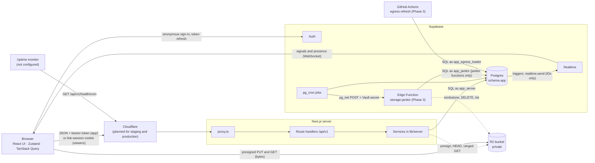
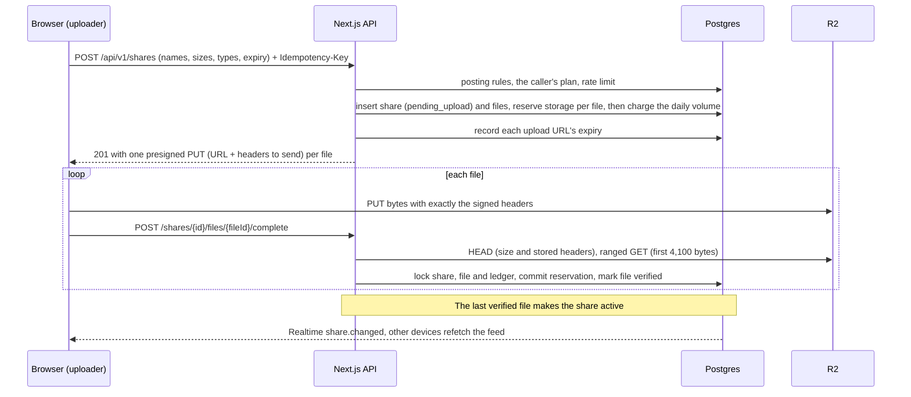
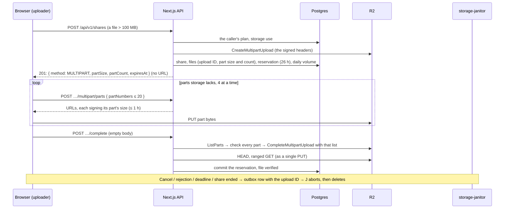
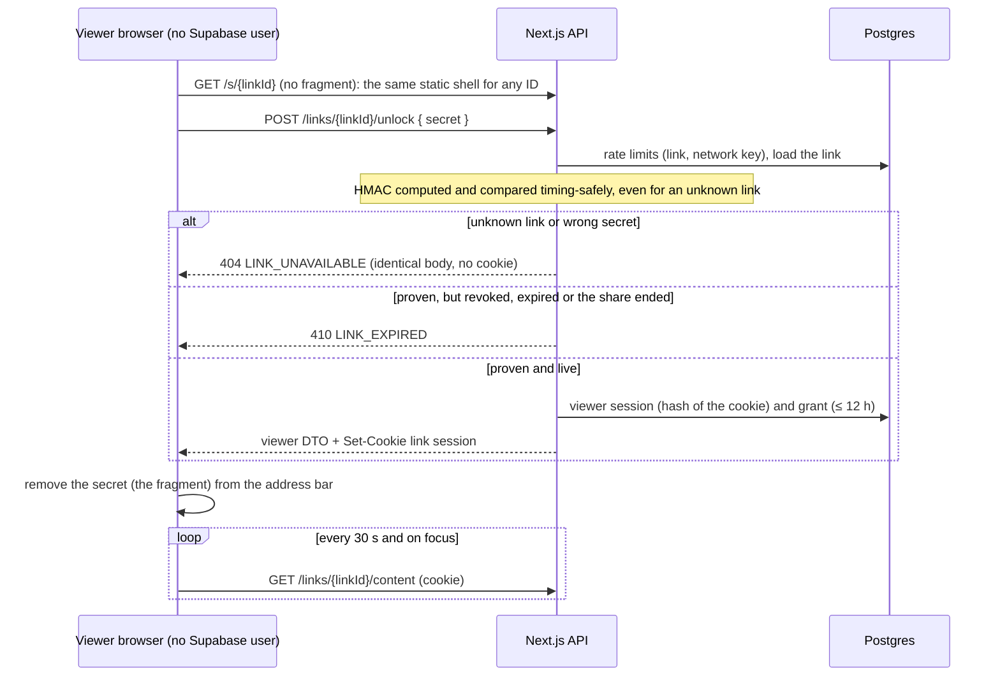
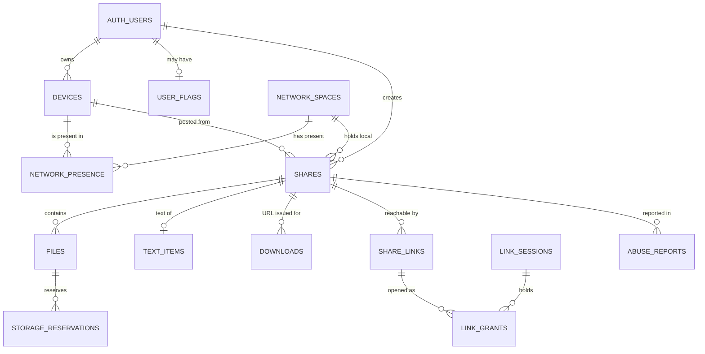
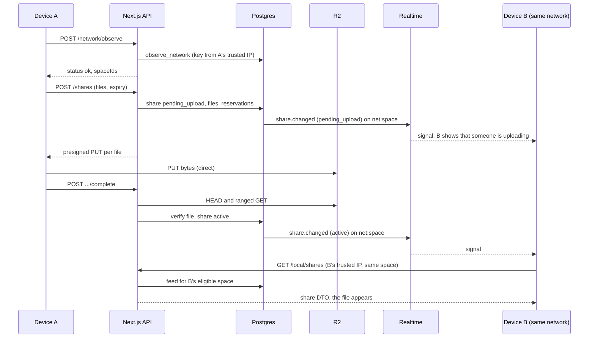
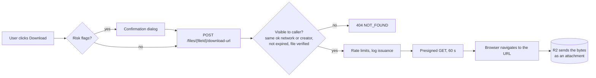
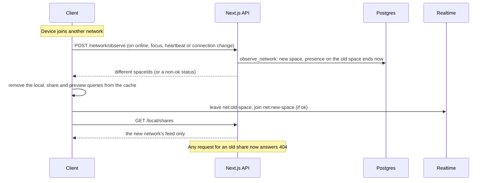
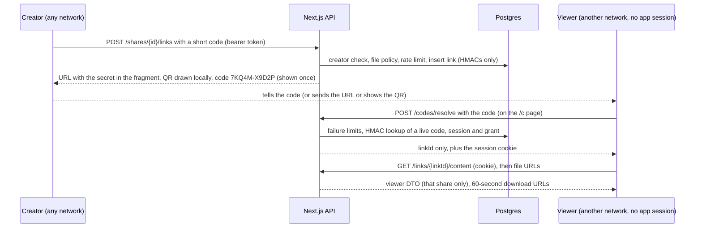

# Architecture — current system

| Field | Value |
|---|---|
| Status | **Living document.** It describes the architecture that is implemented now, not the target design. |
| Covers | Phase 0 (foundation), Phase 1 (anonymous local sharing), Phase 2 (remote secure sharing), Phase 3 (expiry, cleanup and one-time download), Phase 4A (accounts), Phase 4B (entitlements), the Phase 4C provider-neutral billing core and Phase 4D's first eleven tasks (P4-14 multipart uploads, P4-15 expiry and extend, P4-16 link passwords, P4-17 private rooms with invite links, P4-18 QR pairing, P4-19 read-only room links, P4-20 transfer history, P4-21 merge and deletion coverage, P4-22 the account-deletion flow, P4-23 email: its local part, P4-24 MFA), as built; P4-25 (docs and runbooks) changed no code; P4-26 (final verification) fixed the device routes. All of Phase 4 except P4-13 (the billing provider's adapter, Q-005) |
| Checked against | The code on branch `phase-3-expiry-one-time-download`: Phase 3 committed and pushed as `cc2ac40`, plus the **uncommitted** Phase 4A, 4B, 4C-core and P4-14 … P4-26 work on top, 2026-10-18. Phase 1 alone: commit `1cd8ee3` on `phase-1-local-sharing`. |
| Production state | **Nothing is deployed.** Everything below runs and is tested on the local stack only. What has been verified at which level (local tests, CI, staging, real devices, production) is in [§18](#verification-levels); the gaps are in §17. |
| Last updated | 2026-10-18 (Phase 4, P4-26: final verification. §5.3 the device list and revoke routes refuse a revoked or signed-out browser's token (`requireLiveSession`, `app.auth_session_state`); the MFA rule's guards; §10.5 the function; §10.7 and §15 19 migrations; §13 accounts; §16 the final run's sizes; §17.3 the device gap fixed and a residual recorded (a session Auth ends by itself keeps its device); §18 Phase 4's status; the change log). 2026-10-18 (Phase 4, P4-25: docs and runbooks. No behaviour change. Corrected against the code: §1 auth row, §2 `pg_net` and Edge Functions in use since Phase 3, §4.5 the room-link and history keys, §5.2 the route count (66 handlers in 57 files), §5.3 revocation (the device list and revoke routes accept a revoked browser's token until it expires: §17.3), §10.1 the janitor's 12 functions, §10.5 and §12.1 `account.changed` on deletion changes too, §10.7 and §15 every migration, §12.4 what a `user:` topic needs, §17.3 RISK-044 proposed, not accepted. New [billing runbook](runbooks/billing.md); the accounts, account-deletion, secret-rotation, cron and monitoring runbooks extended; the design documents 02–09 and the legal drafts brought up to date). 2026-10-18 (Phase 4D, P4-24: MFA: an optional authenticator app (Supabase Auth's TOTP) set up and removed in account settings; once it is on, the API answers `403 MFA_REQUIRED` to an `aal1` session of the account on every route and Realtime refuses its topics, so the app shows the authenticator step before it loads; a session Auth ended at enrolment signs out; a merge waits for the step; [`runbooks/accounts.md`](runbooks/accounts.md) for a lost authenticator). 2026-10-18 (Phase 4D, P4-23: email, the local part: the email's link opens `/auth/callback#confirm=…` and is followed only on **Continue** (mail scanners used up the code); a password-reset email with nothing to sign in with; the templates as plain documents without internal notes; the 60-second resend timer; Mailpit tests of every email; SMTP, DNS and the staging checks written down in [`infra/email/README.md`](../infra/email/README.md), not applied). 2026-10-18 (Phase 4D, P4-22: the account-deletion flow: `DELETE /me` with a sign-in from the last 10 minutes (and `aal2` with an authenticator) schedules the deletion 7 days ahead and stops the subscription renewing; read-only meanwhile, with a banner and **Cancel deletion** on every page until the date; then the hourly `delete-due-accounts` job, which only pg_cron runs; a deleted account's browsers start again without it; `account.changed` when the deletion state changes; the account-deletion runbook). 2026-10-18 (Phase 4D, P4-21: merge and deletion coverage for rooms, history and links: every column holding a user or device ID has a merge rule and a deletion rule, checked by name and foreign key; the merge moves every reservation row; account deletion finishes the account's burn claims and clears it from other people's records, which stay as their history; a write whose own user is merged away or deleted mid-request answers `401 DEVICE_UNKNOWN`, not a 500). 2026-10-18 (Phase 4D, P4-20: transfer history: a Pro account sees its own shares in every state within its plan's window (365 days) and what happened to them, by actor kind only, never who; two read-only routes over the rows the app already keeps, no migration; `/history`, reached from My uploads). 2026-10-18 (Phase 4D, P4-19: read-only room links: a Pro room owner makes a link that shows the room's current and future posts to people outside it, through the share links' unlock, grant, password and viewer machinery; viewers never see the room's name, members, settings or who posted; files, burn actions and reports resolve inside the link's room; deleting the room revokes its links; room links have no short code). 2026-10-18 (Phase 4D, P4-18: QR pairing: a room's owner shows a QR code that one person scans with their phone's camera to join; the code is an invite of kind `pairing`, one use and 10 minutes, its secret only in the URL's fragment and stored as an HMAC; scanning previews the room and joins nobody until *Join*; closing the dialog turns an unused code off; a downgraded owner may still pair people in; the database now refuses a pairing invite without a maximum; a test that restored an old burn-claim function fixed). 2026-10-18 (Phase 4D, P4-17: private rooms reachable from any network and never from a network: Pro owners create them, invite people by an invite link whose secret is stored only as an HMAC, remove members, change settings and delete them; members post, download and leave; a room is found only through the caller's own membership, so a room, member or invite ID alone opens nothing; the `room:{id}` Realtime topic is for members only and has no presence; the merge moves memberships). 2026-10-17 (Phase 4D, P4-16: Pro creators protect a link with a password, hashed with scrypt; the password is checked on the grant, in `accessFor`, on every viewer route, whether a secret or a code made the grant; every set, change or removal invalidates the link's grants; 10 failures in 15 minutes lock new attempts, then Turnstile; the prompt on the share page). 2026-10-17 (Phase 4D, P4-15: Pro shares of 30 and 90 days; extend in place, or by copy through the storage janitor into a longer-lived key swapped in one transaction, the old key deleted through the outbox; links made until the share expires follow it; the extend dialog). 2026-10-17 (Phase 4D, P4-14: files above 100 MB go up in parts, each part URL signed for its size; completion from storage's own part list after checking every part; cancel, rejection, the deadline and a share ending mid-upload abort through the outbox and the janitor; resume after a reload; Pro's 5 GB delivered, DV4-17 closed). 2026-10-17 (Phase 4C core: billing behind a provider-neutral interface with a fake provider only, the signed webhook pipeline with fetch-on-event, `apply_subscription_state`, checkout and portal, grace, daily reconciliation, `/settings/billing`; no real provider until Q-005). 2026-10-16 (Phase 4B: the entitlement engine with Free and Pro, operator overrides, snapshot v2, every existing write path plan-aware, the daily-volume refund, the pricing page. Earlier the same day, Phase 4A: accounts, device-session binding, device revocation and cap, the anonymous → account merge, no passwords; earlier the same day, Phase 3) |
| Change rule | A phase that changes the architecture updates this file in the same change (§19) |

This is the one document to read to understand how the system works today. It stays high-level and links to the detailed documents instead of repeating them.

| Document | Answers |
|---|---|
| **`ARCHITECTURE.md`** (this file) | What the system looks like now |
| [`phases/phase-N-*.md`](phases/) | What was planned, implemented and tested in phase N, with its deviations and evidence |
| [`06-decisions-and-risks.md`](06-decisions-and-risks.md) | Why decisions were made; which risks and open questions remain |
| [`00`](00-project-overview.md) – [`10`](10-requirements-and-diagram-review.md) | The original plan and the target design for all phases. Parts of it are not built yet. |

**If this document and the code disagree, the code is right.** Fix this document.

"Local Saver" is a working name (Q-020).

---

## Contents

1. [System overview](#1-system-overview)
2. [Technology stack](#2-technology-stack)
3. [High-level architecture](#3-high-level-architecture)
4. [Frontend architecture](#4-frontend-architecture)
5. [Backend and API architecture](#5-backend-and-api-architecture)
6. [Local network sharing](#6-local-network-sharing)
7. [File upload architecture](#7-file-upload-architecture)
8. [Text sharing](#8-text-sharing)
9. [Remote sharing](#9-remote-sharing)
10. [Database architecture](#10-database-architecture)
11. [Storage architecture](#11-storage-architecture)
12. [Realtime architecture](#12-realtime-architecture)
13. [Security architecture](#13-security-architecture)
14. [Data flow examples](#14-data-flow-examples)
15. [Current project structure](#15-current-project-structure)
16. [Testing architecture](#16-testing-architecture)
17. [Current limitations and open items](#17-current-limitations-and-open-items)
18. [Phase status](#18-phase-status)
19. [Architecture change rule](#19-architecture-change-rule)
- [Appendix: where the implementation differs from the plan](#appendix-where-the-implementation-differs-from-the-plan)

---

## 1. System overview

Local Saver lets devices on the same network share text and files without any setup. Opening the app on a Wi-Fi network shows everything that was posted from that network and has not expired. There is no join step, approval, PIN, QR code or link for that (DEC-031). Devices on other networks see nothing, not even that local content exists. **To reach someone on another network**, a share's creator sends a link, its QR code or a short code, which opens that one share and nothing else (Phase 2).

**What a user can do today:**

- Open the app. The browser signs in anonymously and registers as a **device** with a generated name such as "Blue Fox", which the user can rename.
- See the **"This network"** feed and how many devices are here now. New posts appear on other devices within about two seconds (measured locally).
- Post **text** (up to 100 KB) or **files** (up to 20 per post, 100 MB each), with an expiry of 1 hour, 24 hours (the default) or 7 days, to **this network** or as **Link only** (never visible on any network).
- Copy text, download files and preview images posted by anyone on the network. Risky files (programs, scripts, archives, disk images, misleading names) carry a warning badge and need a confirmation before download.
- Edit or delete their own posts. **"My uploads"** lists them from any network.
- **Share their own post by link**, with a QR code and optionally a short code, from any network; see and turn off those links (§9).
- **Open a link or a code** on any device and network, without the app or a sign-in; **report** a share they can see.

**Phase 4 so far (uncommitted):** accounts (4A, §5.3), Free and Pro plans (4B, §5.9), a provider-neutral billing core with a fake provider only (4C, §5.10), multipart uploads up to Pro's 5 GB (§7.9), 30- and 90-day shares and extend (§7.10), password-protected links (§9.9) and private rooms with invite links, QR pairing and read-only room links (§9.10) and transfer history (§9.11). **What does not exist yet:** a real billing provider, Team plans, a web admin console and malware scanning. They are planned for Phases 4–6, and **none of their behaviour exists**. The schema and the plan object only reserve values for some of them (for example the `ws` retention class and Team's feature flags). Burn after download exists since Phase 3, available to the Free plan only while the beta flag `free_burn_after_download` is on (Q-008; off by default).

### Main components

| Component | What it is | Runs on |
|---|---|---|
| Web app | Next.js 16 App Router with React 19 client components: the app (`/`, `/uploads`; Phase 4D: `/rooms`, `/j/…`), share and code pages (`/s/…`, `/c`) for link viewers, legal drafts | Browser |
| API | Route handlers under `/api/v1`, behind `proxy.ts` | Next.js server (Node.js) |
| Database | PostgreSQL with a private `app` schema and pg_cron jobs | Supabase |
| Auth | One anonymous Supabase user per browser; since Phase 4A it can become an account (email code, Google once configured, optional TOTP) that spans up to 10 browsers | Supabase |
| Realtime | Private Broadcast channels and Presence | Supabase |
| File storage | Cloudflare R2 through the S3 API (RustFS locally) | Cloudflare (local: Docker) |
| Edge | Cloudflare proxy, origin lock, Turnstile | Cloudflare (supported in code, not set up yet) |
| Storage janitor (Phase 3) | The `storage-janitor` Edge Function: the one executor of the deletion outbox and the weekly storage reconciliation, triggered by pg_cron through pg_net (§11) | Supabase Edge Functions (Deno; locally the CLI's edge runtime) |
| Egress-list refresh (Phase 3) | A daily GitHub Actions workflow running `scripts/load-egress-ranges.cjs` (§6.7) | GitHub Actions (off until an environment exists) |
| Job health (Phase 3) | `GET /api/v1/health/cron`, polled by an external uptime monitor (none configured yet) | Next.js server |

### Key terms

| Term | Meaning |
|---|---|
| **Network key** | HMAC of the requester's normalized IP address (IPv4 address or IPv6 /64). The address itself is never stored. |
| **Network space** | A row in `app.network_spaces`, one per network key. Shares posted locally belong to a space. |
| **Observe** | `POST /api/v1/network/observe`: the call that derives the caller's network, records presence and classifies the space |
| **Eligible spaces** | The spaces whose shares a request may see: the caller's current space if its status is `ok`, otherwise none |
| **Fail closed** | When the server can't be sure a network is a real local network, local sharing is off there |
| **Share** | One post: a text, or a set of files. Scope `network` (everyone on its network sees it) or `link_only` (only through its links). |
| **Creator** | The anonymous user (in practice, the browser) that posted a share |
| **Share link** | `/s/{linkId}#k={secret}`: opens one share from anywhere. The secret lives in the URL fragment and is stored only as a keyed hash. Phase 4D (P4-19): a **room link** has the same form and opens a private room's posts, read-only. |
| **Short code** | A 10-character code (`7KQ4M-X9D2P`) that opens a link's share for a while without the link itself |
| **Link viewer** | A browser that opened a link or a code. It has no Supabase user, only a viewer session cookie. |
| **Grant** | A viewer session's permission to open one link, for at most 12 hours |
| **Takedown** | An operator blocking a share or a link with a SQL function from the Supabase dashboard |
| **Outbox** | `app.object_deletions`: storage deletions waiting to run |
| **Tombstone** | An empty object written over deleted content while an upload URL for it may still be live |
| **Kill switch** | A row in `app.runtime_flags` that turns local sharing, uploads, anonymous posting, remote links or short codes off |
| **Room** (Phase 4D) | A private membership space, reachable from any network and never visible on one. Its owner (a Pro account) invites people by invite link. Shares posted to it have scope `room`. |
| **Member** | A user in a room: its owner or a member, shown to the others by an opaque member ID and a label |
| **Invite link** | `/j/{inviteId}#k={secret}`: joins one room. Like a share link, its secret lives in the fragment and is stored only as an HMAC. |

---

## 2. Technology stack

Everything in this table exists in the code. Versions are those in `package.json` and the lockfile.

| Area | Technology | Used for |
|---|---|---|
| Framework | **Next.js 16.3.8**, App Router | Pages, the JSON API (route handlers), `proxy.ts`, `instrumentation.ts`, `after()`. Next.js 16 differs from older versions: read `node_modules/next/dist/docs/` first ([AGENTS.md](../AGENTS.md)). |
| UI runtime | **React 19.2.8** | Client components |
| Language | **TypeScript 5** (`strict`) | Everything |
| Styling | **Tailwind CSS 4.3.3** (`@tailwindcss/postcss`), `tw-animate-css` | Styles; theme tokens in `app/globals.css` |
| Components | **shadcn/ui** (style `radix-nova`, Radix primitives through `radix-ui`, Lucide icons, Geist font) | Ten primitives copied into `components/ui/` (DEC-035) |
| QR codes | **`qr` 0.7.2** (no dependencies) | Share-link QR codes, generated in the browser (§9.5); its decoder is used by the tests |
| Client state | **Zustand 5** | Client-only state (§4.5) |
| Server state | **TanStack Query 5** | Data fetched from `/api/v1` (§4.5) |
| Validation | **zod 4** | API contracts shared by server and client, environment validation |
| Auth | **Supabase Auth** via `@supabase/supabase-js` 2 | Anonymous sign-in in the browser. The server only verifies access tokens. `@supabase/ssr` is not used. |
| Realtime | **Supabase Realtime** via `@supabase/supabase-js` | Private Broadcast signals and Presence |
| Database | **PostgreSQL** (Supabase); **Kysely 0.29** + `pg` 8 | SQL query builder (no ORM). Types generated by `kysely-codegen`. Extensions: `pg_cron` (jobs), `citext`; `pg_net` since Phase 3 (the janitor trigger) and Phase 4C (billing reconciliation). |
| File storage | **Cloudflare R2** via `@aws-sdk/client-s3` and `@aws-sdk/s3-request-presigner` | Presigned uploads and downloads, HEAD, ranged reads, deletes. **RustFS 1.0.1** stands in for R2 locally and in CI. |
| IP handling | `ipaddr.js` | Parsing and normalizing client addresses |
| Edge | **Cloudflare** | Origin lock, trusted client IP (`CF-Connecting-IP`), Turnstile bot check (verified by Supabase Auth at sign-in, and by the server itself for code guessing and reports). The code supports it; no zone is configured yet. |
| Logging | Internal JSON logger with redaction (`lib/server/log.ts`) | No pino and no error monitoring yet |
| Testing | **Vitest 5** (unit, component with jsdom and Testing Library, API integration), **Playwright 1.63** (Chromium, WebKit), **pgTAP** (`supabase test db`) | §16 |
| Tooling | pnpm 12.4.2, Node 22 (`.node-version`; `engines` ≥ 22.12), ESLint 9 (`eslint-config-next`), Supabase CLI 2.117 (local stack), GitHub Actions (`.github/workflows/ci.yml`) | Build, lint, local stack, CI |
| Hosting | **Not decided** (DEC-022, conditional on SP-01) | No deploy workflow exists |

**Browser support:** Chrome/Edge 111+, Firefox 128+, Safari 16.4+ (Q-019, assumed; Tailwind CSS 4 sets the Firefox floor).

**Planned at some point but not used:** `@supabase/ssr` (bearer tokens instead, DV1-14), `pino`, `file-type`, a Turnstile wrapper package and TanStack Query devtools (small internal modules instead, DV1-7), Supabase Storage (R2 instead), Postgres Changes (Broadcast instead), `next/image` for user content (never).

---

## 3. High-level architecture



The main path, step by step:

1. **Browser.** Renders the UI, keeps client state in Zustand and server data in the TanStack Query cache. It talks to Supabase only for Auth and Realtime, never to application tables.
2. **Next.js.** `proxy.ts` runs first on every request (origin lock, request ID, CSP, security headers). Route handlers under `/api/v1` are thin: authenticate, validate, call one service, return a DTO.
3. **API/server services** (`lib/server`). Derive the caller's network from the trusted IP on every request that touches local content, apply authorization, limits and quotas, run transactions, presign storage URLs and write audit events.
4. **Supabase Postgres.** The source of truth: shares, files, texts, network spaces, presence, quotas, the deletion outbox. Atomic functions handle races (burn claims included); pg_cron jobs expire shares, finalize burn claims, purge and reconcile, and trigger the storage janitor.
5. **Storage janitor** (Phase 3). An Edge Function that deletes or tombstones the objects of ended shares, the only code that does (D-1), and reconciles the bucket weekly.
6. **R2.** Holds file bytes only. The browser uploads and downloads directly with short-lived presigned URLs. The server reads only the first 4,100 bytes of each upload to check its type.
7. **Supabase Realtime.** Database triggers send ID-only signals ("share X changed") to private channels.
8. **Browser again.** A signal makes the client refetch through the API, which re-checks the network before returning anything.

A **link viewer** takes a shorter path: its browser loads a share or code page, proves the link's secret (or a code) to the API, and from then on sends only an httpOnly link-session cookie. It never talks to Supabase and polls instead of receiving Realtime signals (§9.3).

| Component | Responsible for | Never does |
|---|---|---|
| Browser | UI, upload progress, refetching on signals | Decide who sees what. Hold service credentials. Read `app` tables. |
| `proxy.ts` | Origin lock, request ID, CSP nonce, security headers | Authorize access. Query the database. |
| Route handlers | Parse and validate input, call one service, map to a DTO and status. A few also apply a rate limit (feed, My uploads, share detail). | Contain business rules or SQL |
| Services (`lib/server`) | Network derivation, authorization, limits, quotas, state changes, presigning, audit | Return raw rows. Log secrets or IP addresses. |
| Postgres | Data, constraints, atomic functions, Realtime triggers, scheduled jobs | Store file bytes or plaintext secrets. The app's tables never hold raw IPs; Supabase Auth's own tables do (Q-031). |
| Storage janitor (Phase 3) | Executing the deletion outbox under SQL guard rails; weekly reconciliation | Decide what to delete (the database does), touch tables directly, read the platform's service secrets |
| R2 | File bytes, with headers fixed at upload | Be publicly readable. Decide expiry. |
| Realtime | Deliver ID-only signals and Presence to authorized subscribers | Carry content, file names or URLs. Act as a data source. |
| Cloudflare | TLS, the only path to the origin, a trustworthy client IP, bot checks | Cache API responses or HTML |

**Locally** there is no Cloudflare. The local stack is Supabase (CLI) plus RustFS in Docker, and the client IP is simulated (§6.1, §16).

---

## 4. Frontend architecture

### 4.1 Routes and layout

| Route | File | Shows |
|---|---|---|
| `/` | `app/(app)/page.tsx` | "This network": status line, first-visit notice, composer (This network or Link only), upload queue, local feed |
| `/uploads` | `app/(app)/uploads/page.tsx` | My uploads |
| `/s/{linkId}` | `app/(share)/s/[linkId]/page.tsx` | The share page for link viewers (§9.6); for a room link (P4-19), the room's posts (`components/share/room-view.tsx`) |
| `/c` | `app/(share)/c/page.tsx` | Enter a share code |
| `/history` | `app/(app)/history/page.tsx` | Phase 4D (P4-20): transfer history, shares or downloads, filters in the URL (§9.11); linked from My uploads |
| `/rooms`, `/rooms/{roomId}` | `app/(app)/rooms/**/page.tsx` | Phase 4D (P4-17): the caller's rooms and *Create a room* (Pro); one room: its feed and composer, members, the owner's invite, QR (P4-18) and settings dialogs, *Leave room*. The same shell for every room ID; the API answers members only (§9.10). |
| `/j/{inviteId}` | `app/(app)/j/[inviteId]/page.tsx` | Phase 4D (P4-17): joining a room by invite link, and (P4-18) by a scanned QR pairing code. Reads the fragment's secret once and strips it, previews the room's name and size (for a pairing code also: it works once, join only if you can see its screen), joins only on *Join room* |
| `/login`, `/auth/callback` | `app/(auth)/**/page.tsx` | Phase 4A: sign in or create an account by email code (Google when the Supabase project offers it); on an anonymous browser, the upgrade or the merge offer; the PKCE callback for email links and Google (§5.3). P4-23: an email's link arrives as `/auth/callback#confirm=<Supabase's verify URL>` and is followed only when the person presses **Continue**; **Send a new code** waits 60 s after each code |
| `/settings/account`, `/settings/devices` | `app/(app)/settings/**/page.tsx` | Phase 4A: email (masked) and email change, display name, sign-in methods, sign-out; the account's devices and signing them out. P4-22: **Delete account** (what happens, a typed confirmation, an emailed code when the sign-in is older than 10 minutes) |
| `/settings/billing` | `app/(app)/settings/billing/page.tsx` | Phase 4C: the current plan and subscription state, hosted checkout (monthly, yearly) for a Free account, the provider's portal for a subscriber. After a checkout, `?checkout=<ref>` only switches it to "Confirming your payment…", which polls `GET /me/entitlements` for up to 2 minutes (§5.10). Linked from the account page. |
| `/pricing` | `app/(marketing)/pricing/page.tsx` | Phase 4B: the Free and Pro comparison, generated from `lib/shared/plans.ts` as this build delivers it; prices are `[OWNER: price]` until Q-006. Linked from upgrade hints only. |
| `/terms`, `/privacy`, `/acceptable-use`, `/report` | `app/(legal)/**/page.tsx` | Legal drafts, marked as unreviewed drafts |
| `/robots.txt` | `app/robots.ts` | Disallows `/api/` and the share, code, invite and room routes |
| `/api/v1/*` | `app/api/v1/**/route.ts` | JSON API (§5) |

The root layout (`app/layout.tsx`) awaits `connection()`, so every page renders per request (the CSP nonce changes per request; nothing is prerendered). It reads the nonce and passes the **public config** (Supabase URL, publishable key, Turnstile site key) to the client at request time, so one build serves every environment (DV1-8). Each route group adds its own providers (§4.4).

### 4.2 Client and server boundary

- Pages are server components that render only the shell. `AppShell` and all feature components are client components.
- **No user or network data is rendered or cached on the server.** It is all fetched in the browser after hydration, because the answer depends on the requester's IP: a shared cache would show one network's content to another.
- `lib/server/**` imports `server-only`, so the build fails if client code imports it. `lib/shared/**` is isomorphic (zod contracts, plan numbers). `lib/client/**` is browser code.
- The browser uses Supabase only for Auth and Realtime (DEC-006).

### 4.3 Code organization

| Folder | Contents |
|---|---|
| `components/ui/` | shadcn/ui primitives: alert, badge, button, card, dialog, input, progress, select, tabs, textarea |
| `components/local/` | The app's feature UI: `app-shell`, `local-home`, `my-uploads`, `composer`, `share-list`, `share-card`, `file-preview`, `upload-queue`, `network-status`, `first-visit-notice`, `boot-state`. The audience line, first-visit notice, network-status and risky-download texts are in `copy.ts`; other strings are inline. |
| `components/share/` | Phase 2: `share-link-dialog` (the creator's links, QR code and codes), `shared-view` (the share page), `code-entry`, `viewer-shell`; remote-sharing copy in `copy.ts` |
| `components/qr/`, `components/report/`, `components/legal/` | The QR code; the report dialog and the paste-a-link form; the legal page frame |
| `components/account/` | Phase 4A: `login-form`, `auth-callback`, `account-panel`, `device-list`; copy in `copy.ts` (OWNER REVIEW). P4-22: `delete-account`. P4-23: `resend-button`. P4-24: `mfa-panel` (settings), `mfa-challenge` (the step before the app) |
| `components/billing/` | Phase 4B: `pricing-table`, `upgrade-hint`; Phase 4C: `billing-panel` (plan card, checkout and portal buttons, the confirming view); copy in `copy.ts` (OWNER REVIEW) |
| `components/room/` | Phase 4D (P4-17): `room-list`, `create-room-dialog`, `room-view`, `member-list`, `room-settings`, `invite-dialog`, `invite-accept`; P4-18: `pairing-qr` (the owner's QR dialog, drawn with `components/qr/share-qr.tsx`); copy in `copy.ts` (OWNER REVIEW) |
| `lib/client/` | Browser runtime and bootstrap, API clients (app and viewer), query keys and options, Zustand stores, Realtime bridge, network hook, uploader, Turnstile loader, link detection |
| `lib/shared/` | `api/schemas.ts` (zod API contracts), `plans.ts` (Free limits: the UI shows them as hints, the server enforces the same numbers), `short-code.ts` (code normalization, used on both sides) |

Presentational components receive data and actions as props (for example `ShareCard` and its `ShareActions`); small hooks wire them to the API (`useShareActions`).

### 4.4 Providers and bootstrap

`lib/client/providers.tsx` has three layers, one per route group (Phase 2, DV2-12):

| Where | Providers |
|---|---|
| Root layout (every page) | `RootProviders`: public config and the CSP nonce for runtime `<style>` tags |
| `(app)`: `/`, `/uploads`, the settings pages; Phase 4D `/rooms`, `/rooms/{roomId}`, `/j/{inviteId}` | `AppProviders`: `QueryClientProvider` → `UiStoreProvider` → `SessionStore` → `UploadsStore` → `PresenceStore` → `RuntimeProvider` |
| `(share)`: `/s/…`, `/c` | `ViewerProviders`: `QueryClientProvider` only. **No Supabase client, no sign-in, no Realtime.** |
| `(auth)`: `/login`, `/auth/callback` (Phase 4A) | `AuthProviders`: the same Supabase client and storage as the app, and an API client, but **no bootstrap**: these pages never create an anonymous user (C4-1) |
| `(legal)` | None (server-rendered text; the report page has one small client form) |
| `(marketing)`: `/pricing` (Phase 4B) | None (server-rendered, no third-party scripts) |

Bootstrap runs once per Auth session, in the browser only (`lib/client/runtime.tsx`; per page load before Phase 4A):

1. Create the Supabase browser client (PKCE flow since Phase 4A) and the API client.
2. Reuse the stored Supabase session, or sign in anonymously (with a Turnstile token when a site key is configured).
3. **Phase 4A:** if the user changed since the last bootstrap in this page, clear the whole query cache. For an account, redeem a merge still pending from the sign-in (§5.3).
4. `POST /api/v1/devices` registers this browser's device for this session, or refreshes or rebinds it.
5. The session store becomes `ready` (with `anonymous` true or false); `BootState` renders the page. An account at its device cap gets `device_limit` (only the device list works). P4-24: an account session that must confirm with its authenticator (registration answers `MFA_REQUIRED`) gets `mfa`: `BootState` shows the authenticator step, then `restartApp`; one whose Auth session is gone is signed out instead. A revoked device is signed out locally and starts again as a new anonymous user, with the notice "This device was signed out". On other failures it shows an error with a Reload button; without public config, "Sharing isn't set up on this server yet".

**Auth-state listener (Phase 4A).** `RuntimeProvider` listens to `onAuthStateChange`. A sign-in or sign-out that changes the **user** resets the session and presence stores and runs the bootstrap again. A new session of the **same** user (an upgrade or an email change issues one) only registers again, which rebinds the device, without resetting the page. Token refreshes keep the session and change nothing. Sign-out first revokes this browser's device (which ends its Auth session on the server), then signs out locally.

### 4.5 Who owns which state (DEC-034)

| Layer | Owns | In this codebase |
|---|---|---|
| **Zustand = client state** | State that exists only in this browser | `ui` (open dialog, text draft, selected files), `session` (bootstrap phase, this browser's user ID and its own device record), `uploads` (upload queue and per-file progress), `presence` (Presence roster, Realtime connection, "someone is uploading") |
| **TanStack Query = server state** | Data fetched through `/api/v1` | The observe result, the local feed, share details, preview URLs, My uploads, the creator's links, link-viewer content |
| **Supabase Realtime = live event notification** | Nothing. It only says "something changed". | `lib/client/realtime.ts` invalidates query keys and updates the presence store |

Rules the code follows:

- Zustand stores are created per provider, never at module level. They never hold secrets, presigned URLs or shared content. The one server record they keep is this browser's own device (label, platform), returned by registration and rename.
- **Link secrets and codes** never enter Zustand or the query cache: a new link's URL and code live only in the share-link dialog's component state, the share page sends the fragment's secret with a direct API call, and the secret leaves memory with them.
- Nothing is persisted: neither the query cache nor the stores.
- Realtime never writes payload data into the cache. Every change is refetched from the API.
- **Leaving a network removes its data.** When observe reports different space IDs or a status other than `ok`, every network-scoped query (`['local', …]`, `['share', …]`, `['preview', …]`) is removed from the cache, not hidden (`lib/client/network.ts`). My uploads stays.

**Query keys** (`lib/client/queries/keys.ts`; options in `queries/shares.ts` and `queries/links.ts`):

| Key | Data | Refreshed |
|---|---|---|
| `['network', 'current']` | Observe result: status, reason, space IDs, devices here | Only on the "This network" page: every 5 minutes while the tab is in the foreground, on focus, on reconnect, on `online`, on connection change (Chromium only), when the tab becomes visible |
| `['local', 'feed', spaceIds]` | Local feed | On `share.changed` from `net:`, on (re)subscribe, on focus. Removed on network change. |
| `['share', shareId]` | Share detail (`GET /shares/{id}`). The query is defined, but the current UI renders shares from the feed and My uploads lists, so it is only invalidated and removed. | On `share.changed` for that ID. Removed on network change and after a delete. |
| `['preview', fileId]` | 300-second preview URL | After 4 minutes. Removed on network change. |
| `['me', 'shares']` | My uploads | On `share.changed` from `user:` and on (re)subscribe |
| `['me', 'links', shareId]` | The creator's links to one share (no secrets) | While the share-link dialog is open; after creating, revoking or a new code |
| `['me', 'account']`, `['me', 'devices']` | Phase 4A: `GET /me` and the account's devices | On the settings pages, and `['me', 'account']` on every page for an account (P4-22's deletion banner); after a profile change, an email change, a revocation, a deletion request or cancel, and on `account.changed`. The whole cache is cleared when the user changes (§4.4). |
| `['me', 'entitlements']` | Phase 3, extended in 4B: `GET /me/entitlements` | Stale after a minute; on `account.changed` (Phase 4C); every 2.5 seconds on the billing page while it confirms a checkout (at most 2 minutes) |
| `['link', linkId, 'content']` | Link-viewer content (§9.3) | Every 30 seconds and on focus. A `404` or `410` replaces the content and stops polling (DEC-034 rule 4). |
| `['link', linkId, 'preview', fileId]` | 300-second preview URL for a viewer | After 4 minutes; removed when the link ends |
| `['rooms']` | Phase 4D (P4-17): the caller's rooms | On `membership.changed` (user topic), after creating, joining or leaving |
| `['room', roomId]`, `[…, 'shares']`, `[…, 'members']`, `[…, 'invites']` | One room, its feed, its members, the owner's open invite links (never their secrets) | On `room:{id}` signals (§12.5) and (re)subscribe. Not network-scoped, so a network change keeps them. A `404` for the room (no longer a member, or deleted) removes its feed, members and invites. |
| `['room', roomId, 'links']` | P4-19: the owner's read-only links to the room (state and expiry, never a secret or URL) | While the room-link dialog is open; after creating or revoking one |
| `['history', 'shares', filters]`, `['history', 'downloads', filters]` | P4-20: transfer history pages (infinite, by cursor), keyed by the page's URL filters | TanStack Query's defaults on `/history`; not network-scoped |

Defaults (`lib/client/query-client.ts`): `staleTime` 30 s, refetch on window focus, no automatic retry for `4xx`, up to three retries for network errors and `5xx`, no retries for mutations. In the browser, one query client is reused; each server render gets a new one.

### 4.6 How the UI talks to the API

- Every call goes through `createApiClient` (`lib/client/api-client.ts`): same-origin `fetch` with `cache: "no-store"`, `Authorization: Bearer <access token>`, `X-Device-Id`, and a JSON body. On `401 UNAUTHENTICATED` it refreshes the Supabase session once and retries; on `401 DEVICE_REVOKED` (Phase 4A) it tells the runtime, which signs this browser out; on `401 DEVICE_UNKNOWN` it asks the runtime to register again (which rebinds the device to the current session) and retries once. Share and code pages use the same client without a token or device ID (`lib/client/viewer-api.ts`); the browser adds the link-session cookie itself.
- Responses are parsed with the shared zod schemas before they reach the cache. Non-2xx responses become `ApiRequestError` (status, code, request ID, details, `Retry-After`).
- **Reads** use `queryOptions` factories. **Writes** call the API directly from components (composer, share actions) and then invalidate the affected keys. Device rename instead stores the returned device in the session store. There are no optimistic updates.
- **File bytes** go from the uploader to R2 with `XMLHttpRequest` (for progress), never through Next.js (§7). If a PUT fails, the batch is marked failed in the uploads store; the share stays uploading until the creator deletes it or the stale-upload job fails it (§7.2).
- **Downloads** navigate to the presigned URL; the signed `Content-Disposition: attachment` makes the browser download the file.
- **Browser storage** holds only the Supabase session (`local-saver.auth`, which also keeps the PKCE verifier during a sign-in), the device ID (`local-saver.device-id`), whether the first-visit notice was seen (`local-saver.notice-v1`) and, between creating and redeeming a merge, the merge intent with its one-time secret (`local-saver.merge-intent`, at most 24 hours; Phase 4A). A browser that opened a link or code also holds the httpOnly link-session cookie, which scripts can't read.

---

## 5. Backend and API architecture

### 5.1 Request pipeline

1. **`proxy.ts`** runs before every request (no matcher, so it covers every path):
   - origin lock: with `TRUST_PROXY_MODE=cloudflare`, a request without the right `X-Origin-Auth` gets `403` on every path;
   - a new request ID (UUID) on the request and the response;
   - removes `X-Test-Client-IP` unless the test override is allowed;
   - a nonce CSP for pages and a locked-down CSP for the API;
   - baseline security headers.

   It never authorizes and never queries the database.
2. **`withApi`** (`lib/server/http/handler.ts`) wraps every route handler:
   - Mutations need an exact `Origin` match against `APP_ALLOWED_ORIGINS` (`403 FORBIDDEN_ORIGIN`). They also need `Content-Type: application/json` (`415`); a body-less `DELETE` is exempt (DV1-13).
   - It maps errors to the standard body and adds `Cache-Control: no-store` and `X-Request-Id` to every response.

   **Phase 4C: `withWebhook`** (`lib/server/http/webhook.ts`) is a second pipeline, for callers that aren't browsers: the billing provider's webhook and the internal reconcile route. It checks no Origin and needs no JSON content type (those callers send neither); each of the two routes authenticates its caller itself (a signature over the raw body, or a bearer secret) before doing anything. Same headers and error body. A unit test fails if any other route uses it, or if any route uses neither wrapper.
3. **The route handler:**
   - authenticates the caller (`requireCaller`). Link-viewer endpoints instead pass the request to a service that checks the link-session cookie and its grant (§9.3);
   - reads and validates the body (`readJson` with a zod schema);
   - derives the network (`currentNetwork`);
   - calls one service and returns a DTO.

   The feed, My uploads and share-detail handlers also apply their rate limit here.
4. **The service** (`lib/server/*`) applies authorization, entitlements, the remaining rate limits and quotas. It runs transactions, presigns storage URLs and writes audit events.
5. **Postgres functions** do the race-sensitive work atomically: presence, quota reservation, ending a share, claiming deletions, rate counters.

### 5.2 API surface

66 handlers in 57 route files (14 from Phase 1, 10 from Phase 2, 6 from Phase 3, 6 from Phase 4A, 4 from Phase 4C, 26 from Phase 4D: 13 of them P4-17's, 2 P4-19's, 2 P4-20's, 2 P4-22's; corrected in P4-25, which counted the files). Request and response contracts: [`lib/shared/api/schemas.ts`](../lib/shared/api/schemas.ts). The full catalogue, including later phases, is in [02 §6.2](02-system-architecture.md#62-endpoint-catalogue-by-phase).

| Area | Endpoints | Caller |
|---|---|---|
| Health | `GET /api/v1/health` (liveness), `?ready=1` (also checks the database); `GET /api/v1/health/cron` (job health, 503 when degraded; Phase 3) | Anyone |
| Entitlements (Phase 3, extended in 4B) | `GET /me/entitlements`: plan and its source, limits and expiry options, features (burn with its flags applied), the caller's storage usage, the subscription (status, period end, cancel at period end, grace). The UI only uses it to offer what the server will accept. | Device |
| Billing (Phase 4C) | `POST /billing/checkout` (`{ plan: "pro", interval }`, `Idempotency-Key` required → `201 { url }`), `POST /billing/portal` (`{}` → `{ url }`) | Account (anonymous: `403 ACCOUNT_REQUIRED`); without billing settings `503 BILLING_NOT_CONFIGURED` |
| Billing provider (Phase 4C) | `POST /billing/webhook` (`withWebhook`): `400 WEBHOOK_SIGNATURE_INVALID`; `200` once stored; `500` to be retried | The provider (signature only; sessions mean nothing) |
| Internal (Phase 4C) | `POST /internal/billing/reconcile` (`withWebhook`): `202`, reconciles after the response | pg_net, with the bearer secret only |
| Burn after download (Phase 3) | `POST /shares/{id}/reveal`, `POST /shares/{id}/confirm-received`; `POST /links/{linkId}/reveal`, `POST /links/{linkId}/confirm-received`; download-url bodies take `{ confirm: true }` | Device that can see the share · the claimant · grant holders · the viewer claimant |
| Devices | `POST /devices` (register, refresh or rebind for this session; Phase 4A adds `401 DEVICE_REVOKED`, `403 USER_SUSPENDED`, `409 DEVICE_LIMIT`), `PATCH /devices/{deviceId}` (rename) | Any session · device owner |
| Accounts (Phase 4A) | `GET /me` (anonymous or account, masked email, methods, MFA state, plan), `PATCH /me/profile` (display name), `GET /me/devices` and `DELETE /me/devices/{deviceId}` (list and revoke), `POST /account/merge-intents`, `POST /account/merge-anonymous`; P4-22: `DELETE /me` (`202 { scheduledFor }`: the account's deletion after 7 days; `403 REAUTH_REQUIRED`, `MFA_REQUIRED`; `409 DELETION_PENDING`) and `POST /me/deletion/cancel` (`204`; `404`; `409 DELETION_DUE` after the date) | Device · account · **session only** (a browser at the device cap has no device) · anonymous device · account session plus the anonymous device's ID; deletion: an account's device, never an ID |
| Network | `POST /network/observe` | Device |
| Feeds | `GET /local/shares` (this network), `GET /me/shares` (My uploads); cursor pagination, `limit` 1–100, default 50 | Device on an `ok` network · creator |
| Shares | `POST /shares` (file share and upload URLs; `Idempotency-Key`), `POST /shares/{id}/files/{fileId}/complete`, `POST /texts`, `GET /shares/{id}`, `PATCH /shares/{id}/text`, `DELETE /shares/{id}`. `destination` is `network`, `link_only` or (Phase 4D, P4-17) `{ room: roomId }`. | Device (`network`: on an `ok` network; a room: its active members) · creator (P4-17: a room share's owner may also delete it) · device on the share's network, the room's members, or creator |
| Uploads (Phase 4D, P4-14) | `POST /shares/{id}/files/{fileId}/upload-url` (a fresh PUT URL), `POST …/multipart/parts` (`{ partNumbers: [≤ 20] }` → part URLs), `GET …/multipart` (what storage holds), `POST …/multipart/abort` (cancel → `204`); `complete` branches on the upload mode (§7.9) | The share's creator, any network; a pending file only (`404` otherwise) |
| Extend (Phase 4D, P4-15) | `POST /shares/{id}/extend` (`{ expiresIn }`, one of the plan's options → `200 { share }` in place, or `202 { extension: { status: "pending" } }` while the janitor copies; `409 EXTENSION_PENDING`, `422 EXPIRY_NOT_ALLOWED` or `EXTEND_NOT_ALLOWED`) (§7.10) | The share's creator, any network, with `extendExpiry` on the current plan |
| Files | `POST /files/{fileId}/download-url`, `POST /files/{fileId}/preview-url` | Device on the share's network, or creator |
| Links (creator) | `POST /shares/{id}/links` (create, optionally with a code; Phase 4D: and a password), `GET /shares/{id}/links` (Phase 4D: each says whether it follows the share's expiry and whether it has a password), `DELETE /links/{linkId}` (revoke), `POST /links/{linkId}/code` (new code), `PATCH /links/{linkId}` (Phase 4D, P4-16: `{ password }` sets or changes it, `null` removes it; §9.9) | The share's creator, any network (setting a password: `linkPasswords` on the current plan) |
| Room links (Phase 4D, P4-19) | `GET`/`POST /rooms/{roomId}/links` (`{ expiresIn, password? }` → `201 { link }` with the URL once); revoke and password through `DELETE`/`PATCH /links/{linkId}` | The room's owner (creating: `roomLinks`; a password: `linkPasswords`); members `403` on create and list, everyone else `404`; a room link's own routes: the owner only |
| Link viewers | `POST /links/{linkId}/unlock` (P4-16: may carry the password), `GET /links/{linkId}/content` (P4-19: a room link's shares by `?cursor&limit`), `POST /links/{linkId}/files/{fileId}/download-url` and `…/preview-url`, `POST /codes/resolve`, `POST /links/{linkId}/password` (P4-16: `{ password, turnstileToken? }` → `204`) | Anyone with the secret or code; then the grant holder (cookie), which on a password link must also prove the password (§9.9) |
| Transfer history (Phase 4D, P4-20) | `GET /history/shares?cursor&limit&status&kind`, `GET /history/downloads?cursor&limit&shareId` | The caller's own (any device of a Pro account, `transferHistory`; others `403`, link viewers `401`); another user's `shareId` `404` |
| Reports | `POST /reports` | A device that can see the share, or a grant holder of its link |
| Rooms (Phase 4D, P4-17) | `GET /rooms` (the caller's rooms, cursor), `POST /rooms` (`{ name? }` → `201 { room }`), `GET`/`PATCH`/`DELETE /rooms/{roomId}` (settings: `{ name?, membersCanCreateLinks?, defaultExpirySeconds? }`), `GET /rooms/{roomId}/members`, `DELETE /rooms/{roomId}/members/{memberId}` (`me` to leave), `GET /rooms/{roomId}/shares` (the feed, cursor) | Device. Creating: `privateRooms` (Pro); a custom name `customRoomNames`. Reading: an active member; settings, removing others and deleting: the owner (members `403 NOT_OWNER`); everyone else `404` (§9.10) |
| Invites (Phase 4D, P4-17; P4-18) | `GET`/`POST /rooms/{roomId}/invites` (`{ kind: "invite_link", expiresIn, maxUses? }` or, P4-18, `{ kind: "pairing" }` → `201 { invite }` with the URL once; the list shows open links and pairing codes, no secrets), `DELETE /invites/{inviteId}`, `POST /invites/{inviteId}/preview` and `…/accept` (`{ secret }`) | The owner (invite links: `multiUseInvites`; pairing codes: any plan, D4-16) · the owner of the invite's room (everyone else `404`) · any session holding the secret, anonymous included (unknown, wrong or malformed: one `404 INVITE_UNAVAILABLE`) |

### 5.3 Authentication and sessions

- **Identity.** Each browser starts as a Supabase **anonymous user** (DEC-005). **Since Phase 4A it can become an account**: an email confirmed by code or link (Google once an OAuth client exists). Either the same user becomes permanent (the upgrade: `updateUser({ email })` and the code, so nothing moves), or, when the email already has an account, the browser signs in to it and its anonymous data is **merged** into the account (below). An account spans up to 10 browsers (D4-5).
- **Transport.** The browser sends its access token as `Authorization: Bearer …` (DV1-14). The server verifies it with `auth.getClaims` (JWKS for asymmetric keys, otherwise the Auth server). It requires role `authenticated`, a UUID `sub` and, since Phase 4A, a `session_id`; the principal also carries `aal`, `amr`, an account's email and its providers (`lib/server/auth/session.ts`). **The server never refreshes sessions**; the browser does (DV1-6).
- **No passwords (Phase 4A, D4-2).** The app offers none, but Supabase's email provider accepts them. **Tokens of a password session are refused** by the API and by Realtime. Registering an account removes any password on it and ends password sessions (`app.end_password_sign_in`). This defeats a pre-hijack: someone signing an address up with a password before its owner does (P4-00 finding).
- **Email (P4-23).** Supabase Auth sends every email; the app sends none (D4-7).
  - **Codes:** 6 digits, valid 1 hour, single use, bound to the address; a newer code replaces an older one.
  - **The link** opens `/auth/callback#confirm=<Supabase's verify URL>`. The page follows it only when the person presses **Continue**, and only to this project's `/auth/v1/verify` (`readEmailLink`). Mail scanners open links, and following Supabase's link uses up its token and the code with it. The fragment never reaches the server.
  - **A password-reset email** carries nothing to sign in with.
  - **Rate:** one email per address per 60 s on hosted projects, and the UI's resend button waits that long.
  - **Templates, environments, SMTP and DNS:** [`infra/email/README.md`](../infra/email/README.md).
- **MFA (P4-24, §17.5.9, D4-30).** Optional TOTP through Supabase Auth's own calls (`lib/client/mfa.ts`): the app's server never sees the key or a code.
  - **The rule:** an account with a verified factor uses the app only at `aal2`. `requirePrincipal` and `requireLiveSession` (the endpoints without a device) and `requireCaller` (after the device checks, before the suspension check) answer `403 MFA_REQUIRED` to an `aal1` session; `can_access_topic` refuses it too. The level comes from the verified token, the factor from Auth's table (`app.mfa_enrolled`). Nothing the request says counts.
  - **Auth's own rules:** removing a verified factor, or adding a second, needs `aal2`; anonymous users can't enrol; **confirming the first factor deletes the account's other `aal1` sessions**, whose access tokens the rule refuses until they expire.
  - **The browser:** the bootstrap's `mfa` phase shows the authenticator step before the app; a session Auth ended signs out; a pending merge keeps its intent until the step. Settings: set up (a QR code drawn in the browser, the key, the first code) and remove (a fresh code).
  - **Recovery:** no recovery codes (Supabase); operators follow [`runbooks/accounts.md`](runbooks/accounts.md) (RISK-045).
- **Device binding.** `X-Device-Id` must name a non-revoked `app.devices` row of that user **bound to the token's Auth session** (Phase 4A, C4-2), otherwise `401 DEVICE_REQUIRED` or `DEVICE_UNKNOWN`; a revoked device gets `401 DEVICE_REVOKED`. A suspended user (`app.user_flags.suspended_at`) gets `403 USER_SUSPENDED`.
- **Registration** (`app.register_device`, under the user's row lock). One session has one device. An own device named by a new session is rebound to it and **its presence ends**, so the new session must observe from the network itself. Another user's device ID never binds. A revoked device or its session is refused, as are suspended users and sessions that no longer exist. An account at the cap gets `409 DEVICE_LIMIT`; anonymous users have no cap.
- **Revocation** (`app.revoke_device`) records why, deletes the device's Auth session (its refresh token dies) and ends its presence. The access token stays valid until it expires (at most 1 hour). Meanwhile every route that needs a device, device registration, the merge redemption and Realtime refuse it. The token-only `GET /me/devices` and `DELETE /me/devices/{id}` refuse it too since P4-26 (`requireLiveSession` in `lib/server/auth/device.ts`, asking `app.auth_session_state`): `401 DEVICE_REVOKED` when a revoked device is bound to the token's session, `401 UNAUTHENTICATED` when the session was signed out or deleted. A browser refused at the cap has a live session and no device yet, so it still lists and revokes. (Found in P4-25; until P4-26 a revoked or signed-out browser could list the devices and revoke the others until its token expired.) From a session without a device of its own, an account with a verified TOTP factor must be at `aal2` (D4-30).
- **Merge** (threat model: [phase 4 §17.9](phases/phase-4-pro-accounts.md#179-account-merge-security-review-risk-024)). Before signing in, the anonymous session creates a **merge intent** (`POST /account/merge-intents`): a 256-bit secret shown once, stored as an HMAC under the link pepper, bound to that device, valid 24 hours, one open per user. After signing in, the same browser redeems it (`POST /account/merge-anonymous`) with the account's token, the secret and the anonymous device's ID. `app.merge_anonymous_user` moves every owned row, the ledger and today's upload volume in one transaction, binds the device to the account session and deletes the anonymous user. Any failure rolls everything back and leaves the intent open; the browser retries at its next start.
- `requireCaller` (user + bound device) guards every endpoint except health, device registration, the device list and revoke, and the merge redemption, which need only a valid session.
- **Ownership belongs to the user.** For an anonymous user that is in practice one browser: clearing site data creates a new user, whose My uploads no longer shows earlier posts (they still expire normally). An account's posts belong to the account on every browser it signs in on.
- **Link viewers** (Phase 2) have no Supabase user and no device. They hold a viewer session: an httpOnly cookie (`__Host-link_session` on HTTPS) whose SHA-256 is stored, created by unlocking a link or resolving a code, 12 hours from the last one (§9.3).

### 5.4 Authorization

- All authorization happens in server services. It never happens in `proxy.ts` or the browser.
- The network is derived from the trusted IP on every request that touches the feed, shares or files (§6). My uploads, device and health requests don't need it. **No endpoint accepts a network or space identifier**: strict zod schemas reject unknown fields (T-010).
- Reads apply the visibility rule (§6.4). Creator-only actions (edit, delete, complete an upload) use `requireOwnShare`. A share the caller can't see answers `404 NOT_FOUND`, exactly like a share that doesn't exist; a visible share whose creator is someone else answers `403 NOT_CREATOR`.
- Posting goes through `postingTarget` (`policy/posting.ts`): kill switches, the per-user upload restriction, and an `ok` network for the network destination; for Link only, remote links must be on instead.
- **Links:** only the share's creator creates, lists, revokes and re-codes them (`requireOwnShare`; 404 or 403 like the other creator actions). **Viewers:** every viewer request re-checks the session, the grant for that exact link, the link and the share; files are served only from the link's share (§9.3). An unknown link, a wrong secret and a missing grant all answer the same `404 LINK_UNAVAILABLE`.
- **Rooms (Phase 4D, P4-17):** a room is found only through the caller's own active membership (`lib/server/rooms/access.ts`); a member only inside that room; an invite only with its secret, or through the caller's ownership of its room. Non-members, removed members and other rooms' members get the unknown room's `404`; members asking for an owner's action `403 NOT_OWNER`. Room shares follow the visibility rule's room branch (§6.4); posting into a room checks membership twice, the second time under row locks in the share's transaction (§9.10).
- **Plans (Phase 4B)** raise limits, never access: the plan is resolved on the server for the caller (§5.9), and no endpoint takes a user ID or a plan.
- The IDOR matrix test fails if any route or method is missing from it ([09 §5](09-testing-strategy.md#5-idor-matrix-as-code)). Since Phase 2 its actors include a viewer of this share's link and a viewer of another share's link; since Phase 4B a Pro account on another network, which gets exactly what a Free stranger gets.

### 5.5 Validation

- Request bodies use strict zod schemas shared with the client.
- Body size limits are 64 KB by default, 256 KB for file-share creation and 1 MB for text (room for JSON escaping). Bytes are counted while streaming (`413 PAYLOAD_TOO_LARGE`).
- IDs in paths must be UUIDs (otherwise `404`); link IDs must be 16 base64url characters (otherwise the uniform `404 LINK_UNAVAILABLE`). Cursors are validated (`400 INVALID_CURSOR`).
- Validation errors list paths and rule codes, never the submitted values.
- The environment is validated with zod at boot (§5.7).

### 5.6 Errors

Every error has the body `{ "error": { "code", "message", "requestId", "details"? } }`. The one exception is a failed readiness check, `GET /health?ready=1`, which answers `503` with `{ "status": "degraded", "checks" }`.

| Status | Codes |
|---|---|
| 400 | `INVALID_JSON`, `VALIDATION_FAILED`, `INVALID_CURSOR`, `INVALID_LIMIT`, `INVALID_IDEMPOTENCY_KEY` |
| 401 | `UNAUTHENTICATED`, `DEVICE_REQUIRED`, `DEVICE_UNKNOWN`, `DEVICE_REVOKED` (Phase 4A) |
| 403 | `FORBIDDEN_ORIGIN`, `NOT_CREATOR`, `USER_SUSPENDED`, `UPLOADS_RESTRICTED`, `TURNSTILE_REQUIRED`; `FORBIDDEN` from the origin lock; Phase 4A: `ACCOUNT_REQUIRED`, `NOT_ANONYMOUS`, `MFA_REQUIRED`; Phase 4D: `PASSWORD_INCORRECT`; P4-17: `NOT_OWNER` (a member asked for an owner's action), `NOT_ROOM_MEMBER` (a removed creator writing into the room), `ROOM_LINKS_DISABLED` |
| 404 | `NOT_FOUND`: doesn't exist, or not visible to the caller. `LINK_UNAVAILABLE`: unknown link, wrong secret or no grant. `CODE_UNAVAILABLE`. `MERGE_UNAVAILABLE` (Phase 4A): unknown intent, wrong secret, wrong device, expired or revoked. `INVITE_UNAVAILABLE` (P4-17): unknown invite, wrong or malformed secret. A room, member or invite outside the caller's reach is `NOT_FOUND`. |
| 409 | `LOCAL_SHARING_UNAVAILABLE`, `VERSION_CONFLICT`, `UPLOAD_INCOMPLETE`, `UPLOAD_EXPIRED`, `STORAGE_QUOTA_EXCEEDED`, `LINK_NOT_ACTIVE`; Phase 4A: `DEVICE_LIMIT` (`maxDevices`, `activeDevices`), `MERGE_CONFLICT`; Phase 4D: `PASSWORD_REQUIRED` (`linkId`; only after the secret, a code or a grant is proven); P4-17: `ROOM_LIMIT` (`maxRooms`), `ROOM_MEMBER_LIMIT`, `OWNER_CANNOT_LEAVE` |
| 410 | `LINK_EXPIRED`: revoked, expired or its share ended (only after the secret or a grant is proven, and whatever the password); P4-17: `INVITE_EXPIRED` (expired, used up, revoked or its room deleted; only after the secret) |
| 423 | Phase 4D: `LINK_LOCKED`, with `Retry-After` (too many wrong passwords for the link) |
| 413 / 415 | `PAYLOAD_TOO_LARGE`, `FILE_TOO_LARGE`, `TOO_MANY_FILES`, `TEXT_TOO_LARGE` / `UNSUPPORTED_MEDIA_TYPE` |
| 422 | `EXPIRY_NOT_ALLOWED`, `UPLOAD_REJECTED`, `PREVIEW_UNAVAILABLE`, `REMOTE_FILE_BLOCKED`; Phase 4D: `PASSWORD_INVALID` (`minLength`, `maxLength`) |
| 429 | `RATE_LIMITED`, `DAILY_UPLOAD_LIMIT`, `LINK_DAILY_LIMIT`, with `Retry-After` |
| 500 / 503 | `INTERNAL_ERROR` (logged with the request ID, no details returned) / `UPLOADS_DISABLED`, `REMOTE_LINKS_DISABLED`, `SHORT_CODES_DISABLED`, `SERVICE_NOT_CONFIGURED`; Phase 4D: `SERVER_BUSY` (`Retry-After: 1`; the password hashes of this process are all busy) |

### 5.7 Server-only modules and configuration

| Module (`lib/server/`) | Responsibility |
|---|---|
| `env.ts`, `boot.ts` | zod environment validation. `instrumentation.ts` calls `boot.ts`, which exits the process on invalid configuration. |
| `log.ts` | One JSON line per event, with redaction |
| `flags.ts` | Kill switches and other runtime flags, cached up to `RUNTIME_FLAGS_CACHE_SECONDS` (default 30 s) |
| `http/` | `withApi`, `withWebhook` (Phase 4C), the error model, the streaming body reader, Origin and content-type checks |
| `auth/` | Token verification and the principal (`session.ts`: session ID, `aal`, `amr`; password sessions refused), user and bound-device check (`device.ts`) |
| `accounts/` | Phase 4A: `profile.ts` (`GET /me`, display name), `merge.ts` (intent and redemption), `secrets.ts` (merge secrets and their HMACs); P4-22: `delete.ts` (the deletion request and cancel, the recent-sign-in rule, stopping the subscription's renewal) |
| `devices/` | Registration (through `app.register_device`), rename, list and revoke (Phase 4A), the device cap, generated labels, coarse platform from the user agent |
| `network/` | Trusted client IP, normalization, network key, egress lists, current network, observe; `requester.ts`: a rate-limit key for the requester's network that doesn't depend on local-mode flags |
| `local/visibility.ts` | The visibility rule (Phase 4D: its room branch) |
| `history/` | Phase 4D (P4-20, §9.11): `history.ts` (share and download history: queries only) |
| `rooms/` | Phase 4D (P4-17, §9.10): `access.ts` (a room through the caller's membership; the posting lock), `rooms.ts` (create, list, read, settings, delete, the feed), `members.ts`, `invites.ts` (invite links and QR pairing codes, their HMACs and the uniform `404`), `labels.ts` |
| `policy/posting.ts` | Who may post, to which destination |
| `entitlements/` | Phase 4B (§5.9): `plans.ts` (Free, Pro, what this build delivers), `resolve.ts` (per-request resolution), `snapshot.ts` (v2 snapshots and the reader for v1), `enforce.ts` (the 07 §4 errors with `requiredPlan`), `me.ts` (`GET /me/entitlements`) |
| `billing/` | Phase 4C (§5.10): `types.ts` (the provider interface, normalized events, subscriptions and disputes, errors), `provider.ts` (this deployment's provider, or `503`), `providers/fake.ts` (the only adapter until P4-13), `signature.ts` (HMAC and timestamp helpers for adapters), `webhook.ts` (the pipeline), `sync.ts` (subject resolution and `apply_subscription_state`, its only caller), `checkout.ts` (checkout and portal), `reconcile.ts` |
| `ratelimit/limits.ts` | Postgres fixed-window rate limits, daily upload volume, failure counters and blocks (codes), the per-link daily URL cap; Phase 4D: failure slots reserved before a password hash and given back after a right one |
| `shares/` | Create, complete, read (feed, My uploads, detail), text, download and preview URLs, end (delete and storage executor), expiry, DTOs; Phase 4D: multipart uploads, extend |
| `links/` | Phase 2: `secrets.ts` (IDs, secrets, HMACs, timing-safe check), `cookies.ts`, `sessions.ts`, `grants.ts` (viewer access checks; Phase 4D: the password check), `create.ts` (creator side; Phase 4D: setting and removing a password), `unlock.ts`, `codes.ts`, `viewer.ts` (viewer DTO and file URLs); Phase 4D: `password.ts` (scrypt hashing, the per-process cap, the attempt order and limits); P4-19: room links (`create.ts` makes and lists them; `grants.ts` opens a room link's grant and checks each share against its room; `unlock.ts` and `viewer.ts` have room branches) |
| `abuse/reports.ts` | Phase 2: report intake; writes the report, the audit event and the structured log event `abuse.report_received` (no alert is delivered, §9.7) |
| `storage/` | S3 client (presign, HEAD, ranged read, tombstone, delete), object keys, magic-byte sniffing |
| `security/` | Crypto helpers, IDs, origin lock, headers and CSP, filenames, `Content-Disposition`, file risk flags, `file-policy.ts` (what may go into a link), `turnstile.ts` (server-side verification) |
| `audit/log.ts` | Audit events |
| `db/` | Kysely client (pool of 5, connecting as `app_server`), health check, generated types |
| `config/integrations.ts` | Typed access to database, Supabase and R2 settings. A missing setting gives `503 SERVICE_NOT_CONFIGURED`. |

**Configuration rules** (`lib/server/env.ts`, listed in `.env.example`):

- Validation errors name variables, never values.
- In staging and production, these are required: HTTPS origins, `NODE_ENV=production`, `TRUST_PROXY_MODE=cloudflare` with `ORIGIN_SHARED_SECRET`, `DATABASE_URL`, the Supabase URL and publishable key, all five R2 variables, `NETWORK_KEY_SECRET_CURRENT`, the Turnstile site key and secret key, `LINK_PEPPER` and `CODE_PEPPER`.
- Secrets that must be random (the origin secret, network key secrets and peppers) need at least 32 characters; the two peppers must differ. Peppers are versioned (`PEPPER_VERSION`, with `*_PREVIOUS` during a rotation). Deployed environments also reject values that look like placeholders.
- The test client-IP override and `TURNSTILE_VERIFY_URL` (a stand-in for Cloudflare's siteverify in tests) are refused in production builds and deployments; the override also with `TRUST_PROXY_MODE=cloudflare`.
- `SUPABASE_SECRET_KEY` is accepted and validated, but nothing uses it yet (the merge and revocation work in SQL, not through the Auth admin API).
- Phase 4A adds no environment variable: merge-intent secrets are hashed under `LINK_PEPPER`, domain-separated (`merge|…`).
- **Phase 4C billing** is optional everywhere until a provider is chosen (Q-005): `BILLING_PROVIDER` (only `fake` exists), `BILLING_API_KEY`, `BILLING_WEBHOOK_SECRET` (`_PREVIOUS` during a rotation; at least 32 characters), `BILLING_PRICE_PRO_MONTH` and `BILLING_PRICE_PRO_YEAR`: all or none. `BILLING_FAKE_API_URL` and the fake provider are refused in production builds and deployments. `BILLING_RECONCILE_SECRET` (`_PREVIOUS`; at least 32) is the reconcile route's bearer secret. Without billing settings the billing routes answer `503 BILLING_NOT_CONFIGURED`.
- `pnpm stack:env` prints working values for the local stack.

### 5.8 Rate limits

Fixed windows in Postgres (`app.rate_limit_hit`), defined in [`lib/server/ratelimit/limits.ts`](../lib/server/ratelimit/limits.ts). Going over a limit answers `429` with `Retry-After`.

| Action | Limit | Counted per |
|---|---|---|
| Register a device | 10 per hour | Auth session, so per browser (per user before Phase 4A, DV4-3) |
| Rename a device | 20 per hour | User |
| Observe | 30 per minute | Device |
| Local feed | 60 per minute | Device |
| My uploads | 60 per minute | Device |
| Share detail | 120 per minute | Device |
| Create a file share | 30 per hour on Free, 300 on Pro (Phase 4B, D4-29) | User |
| Complete an upload | 120 per minute | User |
| Create or edit text | 60 per minute, and 300 per minute | User, and network space |
| Delete a share | 60 per minute | User |
| Download and preview URLs (one counter) | 120 per minute, and 600 per minute for non-creators | Device, and network space |
| Daily upload volume | 2 GB on Free, 200 GB on Pro; and 10 GB per network for Free uploads only (Pro isn't counted per network, D4-10). Windows start at 00:00 UTC. Since Phase 4B charged after the storage reservation, in the same transaction, and refunded for a share that never becomes active (§7.5). | User, and network space (link-only posts: the network key when the network was never observed) |
| Create a link | 30 per hour on Free, 300 on Pro (Phase 4B) | User |
| List links, revoke a link | 60 per minute | Device, user |
| New short code | 30 per hour | User |
| Unlock a link | 30 per 10 minutes, and 60 per 10 minutes | Link, and network key |
| Viewer content | 60 per minute | Link session |
| Viewer download and preview URLs | 120 per minute, and 500 per day for a link created on Free, 10,000 on Pro (the link's snapshot) | Link session, and link |
| Wrong short codes | 5 per 10 minutes → Turnstile required; 20 per day → blocked for 24 hours | Network key or link session; network key |
| Abuse reports | 10 per hour, and 10 per hour | Network key, and reporter (device or link session) |
| Phase 4A: `GET /me` | 60 per minute | Device |
| Phase 4A: display name | 20 per hour | User |
| Phase 4A: device list; revoke | 60 per minute; 20 per hour | User |
| Phase 4A: merge intent; merge redemption | 5 per hour; 10 per 10 minutes, and 10 per 10 minutes | User; user, and device |
| Phase 4C: checkout; portal | 10 per hour; 20 per hour | User |
| Phase 4C: reconcile route | 6 per hour (after the bearer check) | The whole deployment |
| P4-22: deletion request; cancel | 3 per day; 10 per day | User |
| Phase 4C: billing webhook | None of its own (the provider retries; a coarse Cloudflare rule only) | — |
| Phase 4D: fresh PUT URL; part URLs; upload status; cancel | 120 per minute; 600 per minute (a 5 GB file needs 16 requests); 60 per minute; 60 per minute | User |
| Phase 4D: extend a share | 30 per hour | User |
| Phase 4D: set, change or remove a link's password | 30 per hour | User |
| Phase 4D: password attempts (right or wrong, before the hash) | 20 per 10 minutes, and 60 per 10 minutes | Link session, and network key |
| Phase 4D (P4-17): create a room; settings; delete a room; remove a member | 10 per hour; 30 per hour; 10 per hour; 30 per hour | User |
| Phase 4D (P4-17): list rooms; read a room; members; a room's feed | 60 per minute; 120 per minute; 60 per minute; 60 per minute | Device |
| Phase 4D (P4-17): room texts; other people's download and preview URLs in a room | 300 per minute; 600 per minute | Room |
| Phase 4D (P4-17): create invite links; list invites; revoke one | 30 per hour; 60 per minute; 60 per minute | User |
| Phase 4D (P4-18): create QR pairing codes | 30 per hour | User |
| Phase 4D (P4-17): invite previews; invite accepts (each counted separately) | 10 per 10 minutes, and 30 per hour | Invite, and network key (before any lookup) |
| Phase 4D: wrong passwords | 10 per 15 minutes → the link locked for 15 minutes (`423`; its count starts again), then Turnstile for every attempt until an hour after the lock; 20 per hour → `429` on every link. Counted over the current and the previous window, so failures either side of a boundary count together. Each attempt reserves its slot before the hash, so concurrent attempts can't exceed these. | Link; network key |

The owner accepted the Phase 2 limits as implemented (Q-027, 2026-10-16). Two consequences: the unlock limit counts every attempt, so at most 30 new browsers can open one link in 10 minutes (RISK-033); and only failed codes are counted, so successful resolutions have no limit of their own (RISK-032).

### 5.9 Plans and entitlements (Phase 4B)

Free and Pro are defined in [`lib/shared/plans.ts`](../lib/shared/plans.ts) (07 §1; Pro's values are proposals until Q-006, Q-007 and Q-015). The server resolves them; the UI reads them only as hints.

- **Resolution** (`lib/server/entitlements/resolve.ts`), once per request, memoized on the principal:
  - anonymous users are Free, without a database read;
  - for an account, `app.entitlement_state` returns, with the database's clock, whether a subscription entitles it (trialing or active; past_due before `grace_until`; canceled before `current_period_end`), its live operator overrides, and whether it is in its deletion grace;
  - an entitling subscription gives Pro; a plan override gives that plan; then whitelisted limit and feature overrides apply;
  - `deliverable()` caps a file at 5 GB, the largest this build delivers (multipart above 100 MB, §7.9); an override can't go beyond it. DV4-17's 100 MB cap was lifted with P4-14.
- **Who can change a plan:** nothing the client sends (bodies are strict; token claims, headers, query parameters and redirect parameters are ignored). Subscriptions are written only by billing (`app.apply_subscription_state`, with state fetched from the provider, §5.10); overrides are written by operators through `app.admin_grant_override` / `app.admin_revoke_override` (SQL, audited, granted to no role). The app can only read both tables.
- **Snapshots** (`snapshot.ts`): a share and a link store `{ v: 2, plan, source, limits, features, historyRetentionDays, resolvedAt }` when created. What a share or link already is follows its snapshot (text edits, its retention, its viewers' daily URL cap, preview size, remote file policy); a new action follows the caller's current plan (D4-12; extending a share too, D4-13). Phase 1–3 snapshots (no `v`) read missing keys as Free.
- **Errors** (`enforce.ts`, 07 §4): `403 FEATURE_NOT_IN_PLAN`, `413 FILE_TOO_LARGE` / `TOO_MANY_FILES` / `TEXT_TOO_LARGE`, `422 EXPIRY_NOT_ALLOWED`, `409 STORAGE_QUOTA_EXCEEDED`, `403 ACCOUNT_DELETION_PENDING`. They carry `requiredPlan: "pro"` exactly when Pro, as delivered, would allow the action; the UI's upgrade hint shows only then.
- **Built:** every Pro feature of 4D; `/pricing` and the hints mention only built features (burn after download, extend, link passwords, private rooms, custom room names, invite links, room links and transfer history). **Not built yet:** a real billing provider (P4-13, Q-005). With the fake provider only, Pro comes from the billing core in tests and local development, and from operator overrides elsewhere.

### 5.10 Billing (Phase 4C, provider-neutral core)

**No provider is chosen (Q-005).** Everything provider-specific sits behind `BillingProvider` (`lib/server/billing/types.ts`): create a checkout or a portal session, verify and normalize a webhook, fetch a subscription or a dispute, list subscriptions, cancel. The only adapter is the fake one. It talks over HTTP to a separate local fake provider (`tests/support/fake-billing.ts`: hosted checkout and portal pages, signed webhooks, a control API for tests). The real adapter is P4-13.

- **The only path to Pro** is provider-confirmed state written by `app.apply_subscription_state`, which only `lib/server/billing/sync.ts` calls (a unit test checks this). A webhook's payload is a hint that something changed: the state applied is always **fetched from the provider** (fetch-on-event), so a forged, replayed or reordered event can at most make the app look again. No checkout, redirect, query parameter, header, body field or token claim grants anything.
- **Webhook pipeline** (`POST /billing/webhook`, `lib/server/billing/webhook.ts`):
  - the raw body, at most 256 KB;
  - the adapter verifies an HMAC over the exact bytes against the current and previous secret (timing-safe), and a signed timestamp within 300 s; a failure answers `400` and stores nothing;
  - a verified body that doesn't parse is stored as `rejected` and answered `200`;
  - `app.record_billing_event` stores the event once per (provider, event ID): `new`, `retry` (it failed before, or its holder crashed) or `duplicate` (`200`, nothing done);
  - processing fetches the subscription (for a lost dispute, the dispute) from the provider and applies it, in one transaction with the event's final status (`processed`, `ignored_stale`, `ignored_unknown`);
  - an unexpected error marks the event `failed` (an error code only) and answers `500`, so the provider retries.

  Logs and the stored payload carry IDs, types, statuses, amounts and currency only.
- **Whose subscription:** the subject of our existing row (never moved); else the subject of **our** checkout named by the custom data's `checkoutRef` (the custom data's own subject must agree); else our customer mapping. Otherwise the event is `ignored_unknown` and nothing is applied. A price other than our Pro prices is never Pro.
- **`apply_subscription_state`** (definer, granted to `app_server`): locks the row, refuses an older `provider_updated_at` (`stale`), never re-points a subject, maps the customer (first come, never moved), sets grace, and audits `billing.subscription_changed {from, to}`. A trigger sends `account.changed` on `user:{id}`.
- **Statuses** (07 §6.3): `trialing` and `active` are Pro; `past_due` is Pro until `grace_until`; `canceled` until `current_period_end`; `paused` and `expired` are Free. Resolution compares with the database's clock, so a period or grace that ends needs no job. **Grace** is the provider's dunning end, else 7 days from the failure the provider recorded; within one period it never moves later (B9).
- **Refunds and disputes** arrive as provider state. A full refund with revocation ends the subscription at the provider (Free at once); a partial one doesn't. A lost dispute is confirmed with the provider (`fetchDispute`); the app cancels the subscription at the provider, applies its state, and counts the dispute once per provider dispute (`billing_disputes`). A second one sets `upload_restricted`.
- **Checkout** (`lib/server/billing/checkout.ts`): for an account, not in its deletion grace, not already entitled by a subscription. `Idempotency-Key` is required: it is claimed before the provider is called, a concurrent duplicate gets `409 CHECKOUT_IN_PROGRESS`, and it is released if the provider fails. The checkout row's ID is the `checkoutRef` in the provider's custom data; the success and cancel URLs go back to `/settings/billing`. **Portal:** the caller's own billing customer only, else `404`.
- **Reconciliation** (D4-22): pg_cron → `run_job('trigger-billing-reconcile')` → `app.trigger_billing_reconcile()` → pg_net with the Vault secret → `POST /internal/billing/reconcile` (bearer secret, constant time; `202`; then, after the response, one run at a time). It applies everything the provider changed since the last success minus a day, refetches entitled subscriptions the provider hasn't confirmed for 36 hours, and cancels at period end the subscription of an account in its deletion grace. The provider's API key stays in the web tier. **The job posts nothing until the `billing_reconcile` runtime flag is on**, and it is off by default (no provider yet).

---

## 6. Local network sharing

The rule (DEC-031): **same network → automatic visibility; different network → nothing.** The server decides which network a request comes from, from the trusted client IP, on every request that touches local content. The client never says which network it is on. Design and threat analysis: [03 §3](03-security-and-network-design.md#3-local-mode-automatic-same-network-visibility-dec-031-dec-032-dec-033).

### 6.1 How the network is identified

1. **Trusted client IP** (`lib/server/network/client-ip.ts`).
   - With `TRUST_PROXY_MODE=cloudflare`, `CF-Connecting-IP` is read **only after** `X-Origin-Auth` matches the origin secret (current or previous).
   - `X-Forwarded-For` and `X-Real-IP` are never read.
   - Without Cloudflare mode there is no trusted IP, so local sharing is `unavailable`. The exception is the test override, in local development and tests only: `X-Test-Client-IP`, or `TEST_CLIENT_IP_DEFAULT` so that local browsers share one simulated network.
2. **Normalization** (`normalize.ts`).
   - **IPv4:** the full address. IPv4-mapped IPv6 and NAT64 (`64:ff9b::/96`) addresses become the embedded IPv4 address.
   - **IPv6:** the /64 prefix (`NETWORK_IPV6_PREFIX_LEN`, default 64).
   - Only globally routable unicast addresses count. A private or loopback address from the proxy means a misconfiguration: the network is `unavailable` (reason `non_global_ip`) and a warning is logged.
3. **Network key** (`key.ts`). `HMAC-SHA256(NETWORK_KEY_SECRET, "<family>|<prefix>")` gives 32 bytes, stored with a key version. It is keyed because the IPv4 space is small enough to brute-force a plain hash. The app stores and logs only the key, never the address.
4. **Network space.** One `app.network_spaces` row per `(key_version, network_key)`. Only observe creates spaces.
5. **Key rotation.** With `NETWORK_KEY_SECRET_PREVIOUS` set and `NETWORK_KEY_VERSION` raised by one, observe moves a space found under the old key to the new key (`app.rekey_network_space`). Its ID and content stay put.

### 6.2 IPv4 and IPv6

An IPv4 network and an IPv6 network are **separate spaces, and nothing links them.** SP-04 has not run, so the dual-stack probe and binding tables from the plan ([03 §3.4](03-security-and-network-design.md#34-dual-stack-binding-conditional-on-sp-04)) were not built (DV1-3). Only the current request's key counts.

As a result, two devices in the same home see each other only when both reach the app over the same address family (and, for IPv6, the same /64). A phone on IPv6 and a laptop on IPv4 on the same Wi-Fi don't see each other. How often this happens on real networks has not been measured (AC-1.11). The test for linked IPv4/IPv6 networks (T-009) is blocked on SP-04; the current behaviour ("never merge") is tested.

### 6.3 Observe and presence

The "This network" page calls `POST /api/v1/network/observe` (rate limit: 30 per minute per device). The My uploads page never observes.

- after bootstrap;
- every 5 minutes while the tab is in the foreground;
- on focus and when the tab becomes visible;
- on `online`, and on connection change (Chromium only).

Observe does the following:

1. Rotates the key if needed.
2. Runs the egress-list lookup (§6.7).
3. Calls `app.observe_network`, which:
   - creates or updates the space;
   - **ends this device's presence on any other space immediately**;
   - records presence on this space for 10 minutes;
   - recounts the distinct devices seen in the last 24 hours;
   - classifies the space (§6.5).
4. Returns the status, the reason, the space IDs and the number of devices present now. Space IDs and the device count are only given when the status is `ok`.

When the network is `unavailable` for a per-request reason (kill switch, stale egress lists, no trusted or a non-global IP), observe answers right away without calling `app.observe_network`, so it neither records nor ends presence.

Every other request only *reads* the network (`currentNetwork`). A network that was never observed has no content: its feed is empty, and posting is refused (`409 LOCAL_SHARING_UNAVAILABLE`, reason `network_not_observed`) until observe runs. The client always observes first.

### 6.4 The visibility rule

```text
visible(share) = scope in ('network', 'link_only', 'room')
             and expires_at > now()                      -- database clock
             and status = 'active'                       -- 'pending_upload': creator only
             and (caller is the creator
                  or (scope = 'network' and share.space in eligible_spaces)
                  or (scope = 'room' and caller is an active member of share.room))   -- Phase 4D

eligible_spaces = [the caller's current space]  if its status is 'ok'
                = []                            otherwise
```

A **room** share (Phase 4D, P4-17) is its room's members', from any network, and never a network's: it has no space, and the local feed reads `scope = 'network'` only (G-R1 … G-R4, §9.10). A **link-only** share is never visible on a network, not even its creator's: through this API only its creator sees it, and everyone else needs a link grant (§9). This is evaluated on every request: in [`lib/server/local/visibility.ts`](../lib/server/local/visibility.ts) for details, downloads and previews. The feed ([`lib/server/shares/read.ts`](../lib/server/shares/read.ts)) applies the network part in SQL (eligible space, `active`, not expired); the creator's shares from other networks are served by My uploads instead. A device that leaves the network derives a different space on its next request, so the old content answers `404`. The isolation guarantees G1–G7 are in [03 §3.8](03-security-and-network-design.md#38-isolation-guarantees).

Share DTOs (`lib/server/shares/dto.ts`) say nothing about the network. They do carry `isMine` and `fromLabel`, the posting device's name, which its owner can choose and everyone who can see the share receives.

### 6.5 Network statuses (fail closed)

Every status other than `ok` hides the network's content and refuses posting.

| Status | Set when (reason) | Lifted |
|---|---|---|
| `ok` | Default | — |
| `shared_egress` | The address is on the Private Relay or Tor list (`egress_list:<source>`) | After 7 days, and only by an observe that finds the address no longer listed |
| `too_large` | More distinct devices in 24 hours than the cap (`devices_24h_over_cap`), found by an observe or the `refresh-network-status` job | After 7 days, by the `refresh-network-status` job, if the count is back under the cap |
| `blocked` | An operator sets it with SQL, through `app.set_space_status` (no tooling yet) | By an operator, the same way |
| `unavailable` | Per request, nothing stored: the kill switch is off (`disabled`); the egress lists are missing or stale in staging or production (`classification_unavailable`); no trusted IP (`no_trusted_ip`); a non-global IP (`non_global_ip`) | When the cause goes away |

Every change of the stored status sends a Realtime signal (`network.changed`, from a trigger). The audit event (`network.status_changed`) is written by `app.set_space_status`, so operators must use that function rather than a plain `UPDATE`.

### 6.6 Large-network protection

One public IP can cover a campus, an office building or carrier-grade NAT, so a "network" with many devices is not treated as local.

- The cap is the runtime flag `network_large_cap`: default 50 (Q-029, assumed), tunable without a redeploy (DV1-5).
- `devices_24h` counts the distinct devices with presence last seen in the last 24 hours.
- It is checked at every observe and every 5 minutes by `refresh-network-status`.
- Over the cap, the space becomes `too_large` for at least 7 days.

### 6.7 Private Relay and Tor

- **Lists.** Apple iCloud Private Relay egress ranges and the Tor exit list live in `app.network_egress_ranges`. Since Phase 3 a daily GitHub Actions workflow loads them, running `scripts/load-egress-ranges.cjs` as the least-privilege `app_egress_loader` through `app.replace_egress_ranges` (D-4). It is off until environments exist; until then they are loaded by hand with `pnpm egress:load` ([runbook](runbooks/egress-lists.md)). Adjacent ranges are merged: on 2026-10-15, 285,091 Private Relay ranges became 14,068 rows and 1,210 Tor exits became 642. The schema also allows `vpn` and `hosting` sources, but no such list is loaded, and there is no ASN classification (SP-04).
- **Lookup without the address** (DV1-23):
  - The app sends only the IPv4 /24 or IPv6 /48 around the address to `app.egress_ranges_overlapping`, which refuses longer prefixes.
  - The app checks exact containment itself.
  - Postgres never receives the client address; a test with full statement logging confirms it.
- **Fail closed.** If the lists were never loaded or are older than 14 days, staging and production report `unavailable` (`classification_unavailable`) for every network and log `network.egress_list_stale`. `/health/cron` reports `egressLists: stale` after 3 days, well before that. Locally the lists are optional.

### 6.8 When local sharing is unavailable

- **Server:**
  - the feed returns no shares (`networkStatus` says why);
  - posting answers `409 LOCAL_SHARING_UNAVAILABLE` with the status and reason;
  - other people's local shares answer `404`;
  - the client gets no space ID, so it doesn't join a `net:` Realtime topic.

  Realtime itself denies `net:` access for a stored non-`ok` status and for the kill switch. For the per-request causes (stale lists, no trusted IP, a non-global IP) it doesn't know about the problem: a device keeps access to its last space's ID-only signals until its presence lapses, within 10 minutes (§12.4).

  Creators keep access to their own shares.
- **Client:** an alert explains why local sharing is off (copy in `components/local/copy.ts`) and points to the fallback: the composer stays, with **Link only** as its one destination, and there is no feed. (Phase 1 had no fallback.)
- **Content is not deleted.** If the network becomes `ok` again before a share expires, the share is visible again.
- The kill switch `local_sharing_enabled = false` makes every network `unavailable` (`disabled`) and also denies `net:` topics immediately.

### 6.9 My uploads

`GET /api/v1/me/shares` lists the caller's own shares that are uploading or active and not expired, from **any** network, newest first. Creator access never depends on the network: the creator can view, download, edit and delete from anywhere. The page subscribes only to the `user:{userId}` topic. Its cache key is not network-scoped, so a network change doesn't clear it.

---

## 7. File upload architecture



### 7.1 Limits

The numbers are in `lib/shared/plans.ts` and come from the caller's plan (§5.9). Free values marked "assumed" wait for Q-007 and Q-030; Pro values are proposals (D4-9).

| Limit | Free | Pro |
|---|---|---|
| File size | 100 MB (one single PUT, DEC-026) | 5 GB; above 100 MB in parts (multipart, §7.9) |
| Files per share | 20 (assumed) | 100 |
| Active storage per user | 2 GB, committed plus reserved (assumed) | 100 GB |
| Daily upload volume | 2 GB per user and 10 GB per network (assumed) | 200 GB per user, not counted per network |
| Share creation | 30 per hour per user | 300 per hour |
| Upload deadline | 2 hours after the upload starts. Each URL lives at most 15 minutes, and never past the deadline or the share's expiry. | the same; 24 hours for every file of a share with a multipart file, whose part URLs live at most 1 hour |
| Completion calls | 120 per minute per user | the same |
| Expiry | 1 hour, 24 hours (default) or 7 days (assumed) | also 30 days (`d30/` keys) and 90 days (`d90/`) |

### 7.2 Upload authorization

- **Starting an upload:**
  1. `requireCaller`.
  2. `assertCanPost`: the kill switches `uploads_enabled` and `anonymous_uploads_enabled`, the per-user `upload_restricted` flag, and an `ok` network.
  3. Phase 4B: the caller's plan (an account in its deletion grace is refused, E30); size and count limits, the expiry option and the rate limit from it.
  4. In the creation transaction: the storage reservation per file, then the daily volume (a refusal rolls everything back, so it costs nothing).
- **Completing an upload:** creator only (`requireOwnShare`); since Phase 4B also the kill switches and the upload restriction (E29). An upload begun before a downgrade may finish (D4-27, multipart included). Phase 4D: a multipart file is first assembled from storage's own part list (§7.9). The same creator-only rule, the kill switches and the restriction apply to fresh PUT URLs and part URLs.
- **A failed browser upload.** If a PUT fails, the uploader marks the batch failed but does not delete the share (a share with a multipart file pauses and resumes instead, §7.9). It stays `pending_upload` in My uploads, with its reservation held, until the creator deletes it or `fail-stale-uploads` ends it after the 2-hour deadline (checked every 5 minutes).
- **Idempotency.** The same `Idempotency-Key` within 24 hours returns the same share, with fresh URLs for the files still pending. The posting rules are checked before the replay.

### 7.3 Write-once signed uploads

**The signature.** The presigned PUT signs:

- `Content-Type`;
- `Content-Disposition: attachment` with the sanitized filename;
- `Cache-Control: private, no-cache`;
- `If-None-Match: *` (write-once);
- `Content-Length` (the exact declared size).

So storage refuses a body of any other size and refuses a second write to the same key (DV1-15, DV1-18).

**URL bookkeeping.** Each URL's expiry is written to `files.upload_url_expires_at` **before** the URL is handed out. Storage deletion uses it (§7.6).

**Multipart parts (Phase 4D).** Each presigned `UploadPart` signs that part's exact `Content-Length`, so storage refuses a part of another size and a URL edited for another part number (`403`, P4-00). No PUT URL is ever issued for a multipart file's key, and only the server can complete the upload, so the object stays write-once without `If-None-Match`.

**Re-checks at completion.** Under row locks, completion confirms the share is still uploading and not expired (otherwise `422 UPLOAD_REJECTED`, reason `share_ended`) and that the deadline hasn't passed (otherwise `409 UPLOAD_EXPIRED`).

### 7.4 Type validation and risk flags

- **Stored type.** The declared type is kept as `Content-Type` only for preview-safe raster images (JPEG, PNG, GIF, WebP, AVIF). Everything else is stored as `application/octet-stream`, and every download is an attachment.
- **Completion checks:**
  - The stored size must equal the declared size (otherwise rejected: `size_mismatch`).
  - The stored headers must equal the signed ones, with no `Content-Encoding` (otherwise `metadata_mismatch`).
- **Magic bytes.** The first 4,100 bytes go through an internal sniffer. It recognizes raster images, executables (PE, ELF, Mach-O), archives (zip, gzip, 7z, rar), PDF and scripts (`#!`).
- **Previews** exist only when the sniffed bytes are a raster image and the stored type is preview-safe.
- **Risk flags.** `executable` (programs and installers, including Java and Android packages detected by content), `script`, `archive`, `double_extension` and `disk_image` come from the extension and the content. Flagged files are allowed on local shares, with a badge and a download confirmation. **Nothing is scanned for malware** (Phase 6).
- **Link-only shares** follow the remote file policy instead (§9.1): executables, scripts, installers and disk images are refused by name at upload start (`422 REMOTE_FILE_BLOCKED`) and by content at completion (the upload is rejected, `remote_file_blocked`).
- **Filenames.** Normalized to NFC. Control, invisible and bidirectional characters are removed, reserved characters replaced, Windows device names prefixed, and the length capped at 255 bytes. Names live only in Postgres, never in object keys or Realtime payloads.
- **All or nothing** (DV1-10). A rejected file fails the whole share: its object is queued for deletion, its reservation released, the share ended as `failed`.

### 7.5 Quota reservation

| Step | When | What happens |
|---|---|---|
| Reserve | Upload starts | `app.reserve_storage` reserves each file atomically and never goes over the caller's plan's quota. If it would, the API answers `409 STORAGE_QUOTA_EXCEEDED` with `usedBytes`, `quotaBytes` and, when Pro's quota would fit it, `requiredPlan`. Above the quota after a downgrade, uploads are refused and nothing is deleted. |
| Commit | Completion | `app.commit_reservation` moves the exact size from reserved to committed |
| Release | Rejection, cancel, share end, or after 3 hours (26 for a share with a multipart file) | `app.release_reservation` (the `release-stale-reservations` job handles stale ones) |
| Free | Share ends | `end_share` gives back the committed bytes |

There is no reconciliation job yet (Phase 3).

**Daily volume (Phase 4B, C4-6).** Charged in KiB on `upload_kib:user:{id}` (and `upload_kib:net:{key}` for Free) inside the creation transaction after the reservations; each charge is recorded in `upload_volume_charges`. `end_share` refunds a share that ends while still `pending_upload` (rejected, cancelled by its creator, past its upload deadline or expiry), in the charge's own day; a takedown is never refunded.

### 7.6 Deletion and tombstones

- **One way to end a share.** `app.end_share(share, reason)` is the only path that ends a share, whether the creator deletes it, it expires, or its upload failed (DEC-016). In one transaction it:
  - sets the status and reason;
  - erases text content;
  - releases bytes and reservations;
  - marks the file rows;
  - queues each object in the `app.object_deletions` outbox;
  - writes an audit event.

  It is idempotent.
- **Access ends immediately,** because every request checks status and expiry. Storage cleanup is not the security boundary.
- **One deletion executor: the storage janitor** (Phase 3, owner decision D-1; §11). The web tier no longer deletes or tombstones anything: `lib/server/shares/end.ts` only calls `end_share`. Every minute pg_cron's `trigger-storage-janitor` posts to the `storage-janitor` Edge Function when outbox rows are due. The function claims them through `app.janitor_claim_deletions`, under SQL guard rails:
  - the key has the generated format;
  - no file of an open share uses it;
  - it isn't on legal hold.

  Then, for each row:
  - **If an upload URL for the object may still be live** (its recorded expiry plus 5 minutes), the object is overwritten with an **empty tombstone** and the row comes back after that time. The key stays taken, so the write-once URL gets `412` and can't put bytes back (F1-12).
  - **Otherwise** the object is deleted.
  - **Failures** back off: 1 min, 5 min, 30 min, 2 h, then every 12 h. From the fifth failure they are reported.
- **The cost of one executor (RISK-034, accepted).** Bytes stay in storage until the janitor's next run, about a minute, while access has already ended. In that window a cancelled upload's still-valid URL can store bytes: they are never reachable, and the janitor then tombstones the key.
- **Multipart uploads (Phase 4D).** An outbox row for a multipart file that was never verified carries its upload ID, whichever path queued it (a trigger: cancel, a rejection, the deadline, `end_share` for any reason). The janitor aborts the upload, then deletes the key. Such a row never gets a tombstone: no PUT URL exists for the key, and an aborted upload accepts no part. A held row (a takedown) isn't claimed, so its upload is aborted only by the weekly reconciliation or R2's 1-day rule; parts can't be copied to `hold/`.
- **Extensions (Phase 4D, P4-15).** After a swap, an extended share's old keys are queued as `superseded`; the new keys of a cancelled or failed extension as `extension_cancelled`. Neither has a source file, so `key_mismatch` doesn't apply (§7.10). A guard rail, `extension_pending`, refuses to delete either key of an extension still pending or copied. Holds, releases and the purge reach these rows through the share's extension rows.
- **Consumed burn shares** wait 5 minutes before deletion, so a download from a URL issued just before the end can finish.
- **Takedowns** put the objects on legal hold instead (D-2, §9.7). Each run first copies held objects to `hold/<key>`, a prefix no lifecycle rule covers. After an operator's release, the janitor deletes the original and the copy together.
- **Backstop.** The R2 lifecycle rule is the backstop once a bucket exists (§11); today only RustFS exists, without lifecycle rules. It never reaches `hold/`.

Detail: [03 §7.7](03-security-and-network-design.md#77-deleting-objects-while-upload-urls-are-live-phase-1-as-built), [04 §9.2](04-database-and-storage-design.md#92-job-catalogue), [janitor runbook](runbooks/janitor.md).

### 7.7 Download and preview URLs

- **`POST /files/{fileId}/download-url`:**
  1. Applies the visibility rule (same network, or the creator).
  2. Requires a verified file in an active share (a file still uploading answers `409 UPLOAD_INCOMPLETE`).
  3. Applies rate limits: 120 per minute per device, plus 600 per minute per network space for non-creators.
  4. Returns a **presigned GET valid for 60 seconds**.
  5. Records the issuance in `app.downloads`, with the browser family and no IP.
- **Preview URLs** pass the same checks, but only for verified raster images up to 20 MB, and last 300 seconds. They render in a plain ``, never through `next/image`, and are refetched after 4 minutes.
- **No storage of URLs.** They are never stored, cached on the server or sent over Realtime. Completed downloads are not observable, because the bytes come straight from R2.

### 7.8 Burn after download (Phase 3)

A share posted with `burnAfterDownload` (files or text, to a network or Link only) goes to the first person who opens it (DEC-015, [phase 3 §18](phases/phase-3-expiry-one-time-download.md#18-implementation-2026-10-16)).

- **Who may post one (Q-008).** `features.burnAfterDownload`, or the Free plan while the runtime flag `free_burn_after_download` is on (default off). This is checked at creation only, and the share's entitlement snapshot records the grant. The kill switch `burn_after_download_enabled` stops new burn shares. The UI asks `GET /me/entitlements` before offering the toggle.
- **The claim.** The first download URL (or the first **Reveal** of a text) by anyone but the creator calls `app.claim_burn_share` in the request's transaction:
  - It is one conditional UPDATE (`status = 'active'`) under the share's row lock.
  - The losers wait for the lock, then update nothing.
  - It runs at READ COMMITTED; stricter levels are refused.
  - The URL is presigned before commit.

  The claimant is the verified user and device, or the link session's hash. 50 simultaneous claims give exactly one winner (T-037).
- **Grace.** `least(15 min + 1 s per MiB, 6 h)`, never past the share's expiry (D-6). The claimant gets at most 3 download URLs per file, or 3 reveals, and can end it early with **confirm-received** ("I've got it"). The `finalize-burn-claims` job consumes shares whose grace is over; request-time checks stop access at the grace end first.
- **What others see.** Anyone else who could have seen the share gets `410 ALREADY_DOWNLOADED` (`byYou` tells the claimant it was them). Everyone else still gets `404`. The claimant keeps the card in their feed; the creator sees it in My uploads, and may download until it is consumed (D-7). A creator who opens their own link in a browser is a link viewer and claims it.
- **Restrictions.**
  - No previews.
  - The text is never in a DTO for anyone but the creator: only Reveal returns it, and the client keeps it in component state, never in the query cache.
  - Every claim is a POST with `confirm: true`; without it the server answers `409 CONFIRMATION_REQUIRED`.
  - GETs (feeds, detail, viewer content, share pages, unfurlers) never claim.
- **The end.** A consumed share ends through `end_share('consumed')`: text erased, links revoked, quota released, objects deleted 5 minutes later.

---

### 7.9 Multipart uploads (Phase 4D, P4-14)

A file above 100 MB (Pro only: Free stops at 100 MB) goes to storage in parts ([phase 4 §21](phases/phase-4-pro-accounts.md#21-phase-4d-first-task-p4-14-multipart-uploads-2026-10-17)).



- **The plan** is the server's: parts of `max(16 MiB, ceil(size / 9,000))` rounded up to a MiB, all equal but the last; the file row records the upload ID, part size and count, and a check ties the count to the declared size.
- **Completion** lists the parts and checks every number 1…N once and each part's planned size. Missing parts answer `409 MULTIPART_INCOMPLETE` and the upload goes on; an extra part or a wrong size rejects the file (`422 MULTIPART_INVALID`). The client sends no ETags or part list. Two tabs completing at once converge: storage completes once and the file row lock publishes once.
- **Init** checks storage use, starts the uploads, then reserves and charges in the creation transaction. A refusal inside it leaves an empty upload (no parts, its ID never handed out) for the janitor's reconciliation and R2's rule.
- **Deadlines:** 24 hours for every file of a share with a multipart file (all or nothing), 26-hour reservations. Single files of such a share ask `upload-url` for a fresh PUT URL just before their turn (C4-13).
- **The browser** (`lib/client/uploader-multipart.ts`, `uploader.ts`): part URLs 20 at a time, replaced 2 minutes before expiry; a part that fails for a network reason is retried after 1, 2, 4, 8 and 16 s, then the upload pauses and resumes when the browser is online again or on Resume; Cancel ends it on the server. Storage's part list decides what is left on every round.
- **After a reload** the share's pending files are remembered in localStorage (IDs, name, size, date; never URLs or upload IDs; per user, until the deadline). The upload queue asks for the files again, checks size and name (another name or date needs a confirmation) and sends only the missing parts.
- **Leftovers:** cancel, rejection, the deadline and a share ending for any reason all reach the janitor's abort (§7.6); the weekly reconciliation aborts uploads older than 24 hours; R2's 1-day lifecycle rule is the backstop (RISK-050).
- **Not verified on R2** (SP-02): signed part sizes, the equal-part rule, a 5 GB upload, the janitor's abort.

### 7.10 Extending a share (Phase 4D, P4-15)

A Pro creator may keep a share longer: one of the plan's expiry options, counted from now, later than the share's expiry, never beyond now + 90 days; not for burn shares or shares still uploading ([phase 4 §22](phases/phase-4-pro-accounts.md#22-phase-4d-second-task-p4-15-expiry-3090-days-and-extend-2026-10-17)). Shares of 30 and 90 days at creation (Pro) get `d30` and `d90` keys (since 4B).

```mermaid
sequenceDiagram
  participant B as Browser (creator)
  participant A as Next.js API
  participant D as Postgres
  participant J as storage-janitor
  participant S as R2
  B->>A: POST /api/v1/shares/{id}/extend { expiresIn }
  A->>D: creator, plan (extendExpiry), option → request_share_extension (share locked)
  alt every object outlives the new expiry by a day (from its key's date)
    D-->>A: extended (the expiry and the following links moved)
    A-->>B: 200 { share }
  else a longer-lived class is needed
    D-->>A: pending (one row per file; new key = class / today / fresh UUID)
    A-->>B: 202 { extension: pending } (downloads keep the old keys)
    J->>D: janitor_claim_extension_copies (guard rails, 10-minute lock)
    J->>S: CopyObject old → new key, then HEAD (the file's size)
    J->>D: janitor_finish_extension_copy (the last copy swaps)
    D->>D: keys swapped, expiry and class set, links moved, old keys to the outbox (superseded, +5 min)
    J->>S: later, as for any deletion: DeleteObject of the old keys
  end
```

- **In place or by copy.** R2 deletes a `dN/` object N + 1 days after it was written. The database takes the upload date from the key (never later than the object's creation) and extends in place when *new expiry ≤ key date + N days* for every file; a text always. Otherwise every file is copied to the next class that holds the new expiry from now (`d7` → `d30` or `d90`, `d30` → `d90`, `d90` → a fresh `d90`).
- **Keys.** A copy's key is the class, the request's date and a fresh UUID: unique, never reused (DV4-55).
- **Access during the copy.** Downloads and link viewers use the old key until the swap, which is one transaction; the old key is deleted 5 minutes later (URLs live 60 or 300 seconds). A copy waits until a single PUT's upload URL is dead, so no URL can re-create the old key (DV4-58); a completed multipart file is copied at once.
- **Deletion stays the janitor's** (§7.6): old keys as `superseded`, the new keys of a cancelled or failed extension as `extension_cancelled`, both under the guard rails; `extension_pending` protects both keys while the extension runs; reconciliation never calls them orphans.
- **The share ends mid-copy** (expiry, deletion, takedown, account deletion): `end_share` cancels the extension and queues its new keys once the copy in flight has finished (its lock); a takedown holds the old and the new keys.
- **Failures** back off as for deletions; the fifth fails the extension. The share keeps its expiry and keys, the copies made are deleted, and the creator sees that it failed and may retry. `janitorFailures` is `failing` for 24 hours; `extensions` is `stuck` after 6 hours pending.
- **Links** made "until the share expires" (`follows_share_expiry`, backfilled where a link's expiry was its share's) move with it; links with their own expiry stay.
- **Plans.** Extend follows the creator's current plan (D4-13): refused after a downgrade, while an extension already pending finishes. The share's snapshot is unchanged; the quota counts one copy (the temporary duplicate is an operator cost, RISK-049).
- **The UI** (`components/local/extend-dialog.tsx`): *Extend* on the creator's share card when the share may be extended and the plan has it; the plan's options that end later; *Extending…* while copying. TanStack Query holds the share; Realtime invalidates it.
- **Not verified on R2** (SP-02): `CopyObject` at 5 GB, the lifecycle rules for copies, the janitor's token.

## 8. Text sharing

| Aspect | Behaviour |
|---|---|
| Create | `POST /api/v1/texts` with `destination: "network"`. Same posting rules as files (`assertCanPost`), except the `uploads_enabled` switch, which applies to files only. Up to 100 KB of UTF-8 on Free, 1 MB on Pro (`413 TEXT_TOO_LARGE`; the body may be up to 2 MB + 64 KB of JSON), expiry from the same options. Rate limits: 60 per minute per user and 300 per minute per network space. The share is `active` immediately. |
| View | The text is part of the share DTO, in the feed and in share details. It is shown as plain text: only `http(s)` URLs become links (`rel="noopener noreferrer nofollow ugc"`); nothing is rendered as HTML or Markdown. Everyone who can see it may copy it. |
| Edit | **Creator only** (Q-021, assumed): `PATCH /api/v1/shares/{id}/text` with the content and the version the editor started from. Since Phase 4B: up to the size the share was created with (its snapshot), whatever the plan is now; the kill switches and the upload restriction apply. |
| Conflicts | Optimistic concurrency: the update succeeds only if the stored version still matches, then increments it. Otherwise `409 VERSION_CONFLICT` with `currentVersion`. The UI says the text changed on another device and offers to load the latest version. No merging. |
| Delete | `DELETE /api/v1/shares/{id}` (creator only), the same endpoint as for files. `end_share` sets the content to `null`, so the text is erased. |
| Expiry | The `expire-shares` job calls `end_share`, which erases the content. Access already ended at `expires_at`. |
| Live updates | Creating or deleting a text changes the share status, and editing changes its version; each sends `share.changed` (§12) |

---

## 9. Remote sharing

A device on **another** network reaches a share only through a **link**, its **QR code** or a **short code**, and only that one share (DEC-031, DEC-033). Built in Phase 2. Since Phase 4D a **private room** also reaches across networks, for its members only (§9.10). Design and threat analysis: [03 §4](03-security-and-network-design.md#4-remote-sharing-design).

### 9.1 What can be shared, and by whom

- **Only a share's creator** makes links to it, from any network (also from My uploads). A link targets **one share** and exposes nothing else: no network feed or space, no other local shares, no presence, devices or network identifiers (Q-028, owner decision 2026-10-16).
- **Link-only shares** (`scope = 'link_only'`): the composer's "Link only" destination. They never appear in any feed or `net:` topic, the share API shows them only to their creator, and they can be posted where local sharing is off (that is the fallback the status copy points to).
- **File policy for links** (`lib/server/security/file-policy.ts`; Q-010, owner decision 2026-10-16): on Free, and on Pro until malware scanning (D4-11), executables, scripts, installers and disk images can't get a link (`422 REMOTE_FILE_BLOCKED`) and can't go into a link-only share (checked by name at upload start and by content at completion). Archives are allowed; viewers confirm before downloading them. Local shares are unchanged.
- **Suspended creators** (Phase 4B, C4-15): their links grant no new access (unlock `410`, codes `404`); grants already issued run out.

### 9.2 Links

| Aspect | As built |
|---|---|
| URL | `/s/{linkId}#k={secret}`, built from `NEXT_PUBLIC_APP_ORIGIN`. Browsers never send the fragment, so the secret reaches no server log, proxy or `Referer`. |
| Identifiers | Link ID: 96 random bits (16 base64url characters), may appear in logs and reports. Secret: 256 random bits. |
| Storage | `HMAC-SHA256(LINK_PEPPER[version], linkId \| secret)` and the pepper version. The secret and URL are returned once, to the creator's dialog, and kept only in that dialog's component state. |
| Expiry | Until the share expires (default), or 1 h / 24 h / 7 days, and on Pro 30 / 90 days (the caller's current plan); never past the share (service check and a database trigger). The share's expiry is a link's maximum lifetime; there is no separate 7-day limit (owner decision 2026-10-16, DV2-13). |
| Ending | The creator revokes a link (`DELETE /links/{id}`); `end_share` revokes every link of a share it ends (`share_ended`, or `blocked` for a takedown) and clears their codes |
| Creator view | `GET /shares/{id}/links`: state, expiry, how often it was opened, whether a code is live; Phase 4D: whether it follows the share's expiry, whether it has a password. Never a secret, URL, code, password or hash. |
| Password (Phase 4D, P4-16) | Optional, Pro. Set with the link or later (`PATCH /links/{id}`), changed, removed (always allowed). §9.9. |

### 9.3 Viewers: unlock, session and grant



- **Session cookie:** `__Host-link_session` (Secure) on HTTPS origins, which every deployment is; `link_session` on the plain-HTTP origins of local development and tests (DV2-3). httpOnly, SameSite=Lax, Path=/, 12 hours, refreshed by each unlock. Stored only as SHA-256 in `link_sessions`. A cookie value the server doesn't already know is never adopted (no session fixation).
- **Grant:** one per (session, link), until the earliest of 12 hours, the link's expiry and the share's expiry. **Every viewer request** re-checks the session, the grant, the link and the share (`lib/server/links/grants.ts`), so revocation, expiry and takedown apply on the next request. A grant that only timed out answers 404 (the viewer needs the link again). Phase 4D: the same check also requires the link's current password version and, on a password link, the grant's proof of the password (§9.9).
- **Viewer DTO** (G4): the link's ID and expiry, when this browser's access ends, and the share's kind, expiry, text and files (ID, name, size, type, previewable, risk flags). Never network or space IDs, presence, devices, the uploader or other shares.
- **Files:** `POST /links/{id}/files/{fileId}/download-url` (60 s) and `…/preview-url` (300 s), only for files of the link's share; together capped at 500 a day per link on Free (`429 LINK_DAILY_LIMIT`); logged in `downloads` with `actor_kind = 'link_viewer'` and the link ID, no viewer identity.
- Viewers have **no Supabase user and no Realtime connection** (RISK-006); the page polls.

### 9.4 Short codes

- Ten Crockford Base32 characters (50 bits), shown as `7KQ4M-X9D2P`; stored as `HMAC-SHA256(CODE_PEPPER[version], code)`, unique among live codes; the plaintext is shown once. Validity 10 minutes, 1 hour (default) or 24 hours on Free, also 7 days on Pro (the current plan, for new codes on old links too), never past the link. Upload-restricted accounts can't make new codes. "New code" replaces the old one (`POST /links/{id}/code`); the purge job clears expired codes.
- `/c` → `POST /codes/resolve { code }` → a grant for this browser and **only the link ID** in return; the page then opens `/s/{linkId}` without a fragment. The link secret is never revealed by a code. Input is normalized (case, spaces, dashes, O→0, I/L→1) in the browser and again on the server (`lib/shared/short-code.ts`).
- **Password links** (Phase 4D): a valid code makes the grant but answers `409 PASSWORD_REQUIRED { linkId }`; the share page then asks for the password (§9.9).
- **Guessing limits** (failures only, `lib/server/links/codes.ts`): after 5 failures in 10 minutes for the network key or the link session, every attempt needs Turnstile (`403 TURNSTILE_REQUIRED`; without Turnstile configured, a wait instead); 20 failures in a day block the network key for 24 hours (`429`); 1,000 failures in 10 minutes across everyone log `code.resolve_failure_spike` for alerting.

### 9.5 QR codes

Generated in the browser (`components/qr/share-qr.tsx`, library `qr`) from the full URL, fragment included: error correction M, the standard 4-module quiet zone, drawn as one SVG path. Shown with the link's expiry and *"Anyone who scans this can open the share."* No third-party QR service sees the URL.

### 9.6 Share and code pages

- The `(share)` route group renders with `ViewerProviders` (a query client only): no Supabase client, no app shell, no device or network view. `/s/[linkId]` never touches the database on GET, and returns the same shell for any link ID, existing or not (unfurlers learn nothing and change nothing).
- Metadata is generic ("Something was shared with you"); `robots noindex`, `referrer no-referrer`; `proxy.ts` adds `Referrer-Policy: no-referrer`, `X-Robots-Tag: noindex, nofollow` and `Cache-Control: no-store` on `/s` and `/c`.
- The only third-party script is Turnstile, loaded on demand when a check is actually needed (after failed codes, when sending a report, after a password lock) and only where it is configured.

### 9.7 Abuse reports and takedown

- `POST /reports`: a link viewer reports the link's share (needs its grant); a device reports a share it can see. Category from a fixed list, optional details (≤ 2,000 characters, required for "other") and email; Turnstile wherever it is configured; 10 an hour per network key and per reporter.
- Stored in `abuse_reports`, audited (`report.created`) and logged as the structured event **`abuse.report_received`** (IDs and category only; `urgent: true` for child safety).
- **Nobody is notified.** There is no email, chat, SMS or pager alert (owner decision 2026-10-16). Operators find reports with the runbook's triage query. The alert on that log event, its channel and the named operator are future operational requirements (Q-022).
- **Takedown** runs in SQL from the MFA-protected Supabase dashboard, never through the app: `app.admin_block_share` (ends the share as `blocked`, revokes its links, **holds** its files) and `app.admin_block_link`. Both are audited (`admin.block`) and resolve the related reports ([runbook](runbooks/takedown.md)).
- **Evidence (Phase 3, D-2 and D-3).**
  - A blocked share's objects are on legal hold. The janitor and the purge skip them, and an operator releases them with `app.admin_release_hold` (audited). Shares with reports are never purged automatically.
  - **R2's lifecycle rules ignore holds.** They delete `d7/`, `d30/` and `d90/` objects at their class period + 1 day after upload. So the janitor copies each held object to `hold/<key>`, which no rule covers, and the copy stays until the release ([security review](phases/phase-3-expiry-one-time-download.md#1813-security-review-2026-10-16)). On real R2 this is still pending (RISK-031). How long to keep evidence is a legal decision (Q-022).

### 9.8 Kill switches

| Flag | Off means |
|---|---|
| `remote_links_enabled` | No link creation or link-only posting; unlock, viewer content and file URLs, and code resolution answer `503 REMOTE_LINKS_DISABLED`. Creators can still list and revoke links. |
| `short_codes_enabled` | No new codes; resolution answers `503 SHORT_CODES_DISABLED`. Links still work. |
| `burn_after_download_enabled` (Phase 3) | No new burn shares (`503 BURN_AFTER_DOWNLOAD_DISABLED`); existing ones keep working |
| `storage_janitor_enabled` (Phase 3) | The janitor claims nothing and pg_cron posts nothing; access is unaffected |

`free_burn_after_download` (Q-008) is the other way round: Free may create burn shares only while it is on (default off). [Runbook](runbooks/kill-switches.md).

### 9.9 Password-protected links (Phase 4D, P4-16)

A viewer of a password link needs the link's secret (or a short code) **and** the password (03 §4.7, DEC-021). Details and deviations: [phase 4 §23](phases/phase-4-pro-accounts.md#23-phase-4d-third-task-p4-16-link-passwords-2026-10-17).

| Aspect | As built |
|---|---|
| Who sets it | The link's creator, from any of their devices: with a new link (`password`) or `PATCH /links/{id} { password }`; `null` removes it. Setting or changing needs `linkPasswords` on the current plan (Pro), remote links on, no upload restriction or deletion grace, and an active link. Removing is always allowed (D4-12), also after a downgrade. `PATCH` takes nothing else (a link's expiry can't be changed yet, DV4-77). |
| Storage | `share_links.password_hash`: scrypt, N = 2¹⁷, r = 8, p = 1, 16-byte salt, 32-byte key, as a PHC string; the database refuses any other format. 8–128 characters after NFC normalization. scrypt rather than Argon2id because no package was approved (DV4-70). The password is never logged, stored or returned; the hash never leaves the database except into the verifier. |
| Versions | `password_version` +1 on every set, change or removal, by a database trigger (writes to it are ignored). A grant records the version it was made under. |
| The check | In `accessFor`, so on **every viewer route** (content, download and preview URLs, Reveal, confirm-received, link reports), whatever made the grant: a grant from another version opens nothing (`409 PASSWORD_REQUIRED` on a password link; `404` once the password was removed); a password link also needs the grant's `password_verified_at`. Link state comes first: an ended link answers `410` whatever the password. |
| Proving it | The unlock and a code make the grant **unverified** (a new unlock or code also resets a verified one, DV4-72) and answer `409 PASSWORD_REQUIRED { linkId }` with the session cookie; `POST /links/{id}/password { password, turnstileToken? }` → `204` marks the grant for the version whose hash was checked. The unlock may carry the password itself. |
| Limits | Before the hash, in this order: the link's lock (`423 LINK_LOCKED`, `Retry-After`); 20 failures in an hour from the network key (`429`); Turnstile if the link was locked within the last hour after its lock (`403 TURNSTILE_REQUIRED`); 20 attempts per 10 minutes per link session and 60 per network key; then a **reserved** failure slot per link and per network key, counted over the current and the previous window (so failing either side of a boundary doesn't double a limit). 10 failures in 15 minutes lock the link for 15 minutes and clear its count; verified grants keep working (RISK-044). At most 4 hashes at once per process (32 waiting, then `503 SERVER_BUSY`). One hash costs about 0.4 s of CPU and 128 MiB. |
| Audit and logs | `link.password_set { shareId, changed }`, `link.password_removed`, `link.password_failed` at the lock and at the network limit; each failure logged by link ID; a global spike log at 1,000 failures in 10 minutes |
| UI | The share-link dialog: *Protect with a password* and *Set / Change password* only when the plan has `linkPasswords`, *Remove password* whenever a link has one, a *Password* badge. The share page shows a prompt instead of anything of the share until the grant proves the password; the password lives only in component state and is cleared on submit; Turnstile only when the server asks. A `409 PASSWORD_REQUIRED` replaces the cached content, like a `404` or `410`. The code page leads to the same prompt. |

### 9.10 Private rooms (Phase 4D, P4-17, P4-18, P4-19)

A room is a membership space reachable from any network and never visible on one (§17.8.4 of phase 4). Details, the authorization, invitation and Realtime models, and deviations: [phase 4 §24](phases/phase-4-pro-accounts.md#24-phase-4d-fourth-task-p4-17-private-rooms-2026-10-18); QR pairing: [§25](phases/phase-4-pro-accounts.md#25-phase-4d-fifth-task-p4-18-qr-pairing-2026-10-18); read-only room links: [§26](phases/phase-4-pro-accounts.md#26-phase-4d-sixth-task-p4-19-read-only-room-links-2026-10-18).

| Aspect | As built |
|---|---|
| Who | **Owner:** a Pro account creates a room (`privateRooms`; at most 20 open rooms, D4-14), with a generated name or a custom one (`customRoomNames`); changes its settings; invites; removes members; deletes any room share; deletes the room (no transfer: the owner can't leave, D4-18). **Members:** anyone who accepted an invite, anonymous browsers included (D4-19): see the room, its members and feed; post; download; edit and delete their own posts; leave. The member cap is the room's snapshot (50, D4-14). After a downgrade the room stays usable; new rooms, custom renames and new invite links are refused. |
| Finding a room | Only through the caller's own active membership (`app.room_role`, `lib/server/rooms/access.ts`). A non-member, a removed member, another room's member and an unknown or malformed ID all get the same `404`. A member ID is opaque (C4-18) and only means something inside the caller's room. |
| Room shares | Scope `room`, its room, no network space (two database checks). The visibility rule's room branch serves members on any network (§6.4); the local feed never lists them. Posting needs membership, checked in `postingTarget` and again under the room's and the membership's row locks in the share's transaction; the uploader's plan and quota apply; the room's default expiry applies when the poster's plan offers it. Members download and preview; the first member other than the creator to download a burn share claims it. Links to a room share: its creator, while still in the room, and a member only while the room allows it (`membersCanCreateLinks`). A removed creator keeps delete and their existing links but can't edit, extend, finish an upload or make a new link (`403 NOT_ROOM_MEMBER`). |
| Invite links | `/j/{inviteId}#k={secret}`: a 96-bit ID and a 256-bit secret, stored as `HMAC(LINK_PEPPER[v], "invite\|{id}\|{secret}")`; returned once; 1 hour, 24 hours or 7 days; optionally a number of uses. Preview (the room's name and size) and accept prove the secret timing-safely (a dummy for unknown IDs: one `404 INVITE_UNAVAILABLE`); state only after the proof (`410 INVITE_EXPIRED`); `app.accept_room_invite` re-checks everything under the room and invite locks, so uses and the member cap hold under concurrency. The join page asks for a click; unfurlers can't join. |
| QR pairing (P4-18) | The same invite row, URL, secret, HMAC, preview and accept, of kind `pairing`: the owner's only (members `403 NOT_OWNER`, everyone else `404`), any plan (D4-16), one use (the database also refuses a pairing invite without a maximum), 10 minutes from creation (the database's cap), 30 an hour per owner. The owner's *Show QR code* dialog draws the URL, secret included, in the browser (no QR service), with a countdown; the URL is never shown as text, cached or stored. It notices a use when the code leaves the owner's open invites (Realtime refetches them), and closing it revokes an unused code. A phone's camera opens `/j/{inviteId}`, which previews (the room's name and size, and that the code works once) and joins only on *Join*. No in-app scanner (`camera=()` in the Permissions-Policy). |
| Read-only room links (P4-19) | The owner (Pro, `roomLinks`) makes a `share_links` row with `target_type = 'room'` and the room's ID (1 hour … 30 days, D4-17; an optional password; no short code). The same unlock, grant, password and viewer path as share links, with a room branch: the link lives while it isn't revoked or expired and the room is open. A viewer sees the room's active shares newest first (by cursor) and nothing else of the room: no name, members, invites, settings, who posted, networks or presence. Files, previews, Reveal, "Got it" and reports resolve their share **inside the link's room**; files the link's snapshot blocks (E16) are listed as blocked and refused. Deleting the room revokes its links (`room_deleted`); purging it removes them. Details: [phase 4 §26](phases/phase-4-pro-accounts.md#26-phase-4d-sixth-task-p4-19-read-only-room-links-2026-10-18). |
| Leaving, removal, deletion | Effective at the next request (every room route and room share re-reads the membership). Deleting a room (`app.delete_room`) ends its shares (objects to the outbox, their links revoked), revokes its invites, removes everyone and soft-deletes the room; the purge removes it once no share row refers to it. |
| Realtime | `room:{id}`, members only, no presence; `share.changed`, `member.changed`, `room.updated`, `room.deleted`; `membership.changed` on the person's `user:` topic (§12) |
| UI | `/rooms`, `/rooms/{roomId}`, `/j/{inviteId}`, the Rooms tab; the composer posts to the room it is shown in (§4.1) |

### 9.11 Transfer history (Phase 4D, P4-20)

Pro's record of the caller's own shares and what happened to them (§17.8.6 of phase 4). Details and deviations: [phase 4 §27](phases/phase-4-pro-accounts.md#27-phase-4d-seventh-task-p4-20-transfer-history-2026-10-18).

| Aspect | As built |
|---|---|
| Who | Any device of an account whose current plan has `transferHistory` (Pro); Free accounts and anonymous browsers `403 FEATURE_NOT_IN_PLAN` with the Pro hint; link viewers `401`. After a downgrade it is hidden; the rows stay until their snapshot dates and show again after an upgrade (07 §5). |
| Shares | `GET /history/shares`: the caller's shares (`created_by_user_id`) made within the plan's window (Pro 365 days), every state, newest first by cursor; `status=active\|ended`, `kind=files\|text`. Each: the title or first file's name (never a text's content), scope and room, state, when and why it ended, burn, files and size. An open share past its time reads as the job will leave it. |
| Downloads | `GET /history/downloads`: records of the caller's shares only (URLs issued, previews, burn claims, retries, reveals), newest first by cursor; `shareId` narrows to one of the caller's shares (anything else `404`). Each: the share, the file, the event, the **actor kind** (creator, network device, room member, link viewer), the link's kind and, only for the caller's own links, its ID; the browser family. Never a user, device or network ID, IP, name or secret (D4-20). |
| Storage | No new table or migration: `shares` (tombstones until `metadata_purge_after`) and `downloads` (until `retention_until`), dated from their snapshots and purged by Phase 3's job; a share's tombstone outlives its downloads (C4-12). |
| UI | `/history` (`components/history/`), reached from My uploads; the view and filters live in the URL; TanStack Query only (`['history', …]`), no Realtime |

---

## 10. Database architecture

### 10.1 Schemas and roles

- **`app`**: all application tables and functions, owned by **`app_owner`** (no login). It is not exposed through the Supabase Data API, which exposes only `public` and `graphql_public` (`supabase/config.toml`), and client roles have no grants on it.
- **`app_realtime`**: one `SECURITY DEFINER` helper used by the Realtime policies. `authenticated` may use the schema and execute that helper, nothing else.
- **`app_server`**: the role the Next.js server logs in as, through a `pg` pool of 5 connections. Locally it connects directly (port 54322); hosted environments are meant to use the Supavisor pooler. Its password is set per environment and never appears in migrations; `supabase/seed.sql` sets a local-only one.
- **`app_janitor`** (Phase 3): the storage janitor's role. It has no table privileges, only EXECUTE on the `janitor_*` SECURITY DEFINER functions (owned by `app_owner`): ten from Phase 3, two more for extension copies since P4-15.
- **`app_egress_loader`** (Phase 3): the egress-list loader's role. It has no table privileges, only EXECUTE on `replace_egress_ranges`.

Both are NOLOGIN in migrations; logins are set per environment, locally by `seed.sql`.

### 10.2 Major tables

| Group | Table | Holds |
|---|---|---|
| Identity | `devices` | One row per browser: user, label, coarse platform, last seen; since Phase 4A the Auth session it is bound to, and the revocation time, reason and revoking device |
| | `profiles` | Phase 4A: one per account: display name, deletion request and schedule |
| | `merge_intents` | Phase 4A: merge proofs: anonymous user and device, secret HMAC and pepper version, status, target, 24-hour expiry, counts. Kept 30 days after they end. |
| | `user_flags` | Suspension and upload restriction per user (set by an operator, or by a second lost billing dispute); Phase 4C adds `billing_dispute_count` |
| Network | `network_spaces` | Network key, key version, family, status, reason, sticky-until, devices in 24 h |
| | `network_presence` | Device present on a space until `present_until` (10 minutes after the last observe) |
| | `network_egress_ranges` | Private Relay and Tor ranges (`cidr`, `source`) |
| Content | `shares` | One post: scope, space, kind (`files`/`text`), creator, status, expiry, retention class, entitlement snapshot, end reason; Phase 3: burn flag and the claim (claimant user and device, or link-session hash, link, grace end); Phase 4D: `extension_pending`, `extension_failed_at`, `room_id` (P4-17; scope `room` ⇔ a room, and never a space) |
| | `files` | One stored object: object key, original name, declared and detected type, sizes, upload status, deadline, URL expiry, risk flags, preview kind; Phase 4D: upload mode (`single` or `multipart`), the multipart upload ID, part size and part count |
| | `share_links` (Phase 4D, P4-16) | Gains `password_hash` (scrypt PHC only), `password_version`, `password_set_at`, `password_locked_until`; `link_grants` gains `password_verified_at` (never before its grant or after it) |
| | `rooms` | Phase 4D (P4-17): owner, label (custom or generated), settings (`members_can_create_links`, `default_expiry_seconds`), the owner's entitlement snapshot (the member cap), soft deletion; an open room always has an owner |
| | `room_members` | (room, user): the opaque member ID, role `owner`/`member`, how and from which device they joined, `joined_at`, removal (time, by whom, why). The owner's membership ends only with the room. |
| | `room_invites` | Invite links and QR pairing codes (P4-18): kind, secret HMAC and pepper version, expiry (≤ 7 days; pairing ≤ 10 minutes), uses and their maximum (pairing exactly 1, a missing maximum refused), revocation |
| | `share_extension_files` | Phase 4D (P4-15): one row per file and extension: old and new key, class, new expiry, status (`pending`, `copied`, `swapped`, `cancelled`, `failed`), attempts, lock, last error. The app inserts pending rows and reads them; only definer functions change them. |
| | `text_items` | Text content (erased when the share ends) and its version |
| | `downloads` | Download and preview URL issuances (by devices or, with the link ID, link viewers; since P4-17 room members, with the room), with a retention date |
| Remote sharing (Phase 2) | `share_links` | One link to one share: secret HMAC and pepper version, optional live code HMAC and its expiry, expiry, revocation and its reason, unlock count, entitlement snapshot; Phase 4D: `follows_share_expiry`; P4-19: `target_type` `share` or `room`, `room_id` (a room link: no share, no short code, ≤ 30 days, revoked with its room as `room_deleted`) |
| | `link_sessions` | Viewer sessions: SHA-256 of the cookie, expiry |
| | `link_grants` | (session, link): which links a session may open, until when (≤ 12 hours) |
| | `abuse_reports` | Reports: target share and link, the share's network, category, details, optional email, reporter kind, review status |
| Storage | `storage_usage`, `storage_reservations` | Quota ledger: committed and reserved bytes per user |
| | `object_deletions` | Deletion outbox: reason (including `orphan`; Phase 4D `multipart_abort`, `superseded`, `extension_cancelled`), due time, attempts, last error and attempt, lock, tombstone time, completion, legal hold and its reason; Phase 4D: the multipart upload ID to abort, filled by a trigger |
| Jobs (Phase 3) | `job_heartbeats` | Last start, success, failure, error and result (counts only) per job; `app_server` may only read it |
| | `storage_reconcile_runs` | Weekly reconciliation runs: cursor (last key), lock, counts, status; no app access |
| Plans (Phase 4B) | `subscriptions` | Billing's subscription state per user (status, period, cancel flag, grace, the provider's update time); written only by `apply_subscription_state` (Phase 4C), read-only for the app. Phase 4C adds `synced_at` (when the provider last confirmed it). |
| | `entitlement_overrides` | Operator grants: plan, four limits or a feature, value, reason, operator, expiry, revocation |
| | `upload_volume_charges` | What each file share charged against the daily volume (window, KiB, network key), for refunds |
| Billing (Phase 4C) | `billing_customers` | Subject ↔ provider customer (one per subject and provider; a customer never moves to another subject); read-only for the app |
| | `billing_checkouts` | Checkouts the app started: subject, provider, plan, interval, the provider's checkout ID, `created` / `completed` / `expired`, 24-hour expiry. Its ID is the `checkoutRef`. |
| | `billing_events` | The webhook log: one row per (provider, event ID), type, status, attempts, hold, error code, subject, minimized payload, 400-day retention date; read-only for the app |
| | `billing_disputes` | Lost disputes, one per provider dispute (counted once); read-only for the app |
| Operations | `runtime_flags` | Kill switches, the large-network cap, the egress-list load time |
| | `rate_counters` | Fixed-window counters for rate limits, daily volume and code failures; 24-hour code blocks |
| | `idempotency_keys` | Share-creation replay records (24 hours) |
| | `audit_events` | Share and link lifecycle, reports, takedowns and network status changes. No IP data, secrets or content. 90-day retention date. |

### 10.3 Relationships



Notes:

- Devices, user flags and idempotency keys are deleted with their `auth.users` row. A share keeps existing when its creator user or device is deleted; the reference becomes `null`.
- Files, text items, download records and links are deleted with their share; grants with their link or session. Abuse reports outlive both (the references become `null`). A space can't be deleted while shares reference it.
- `object_deletions.source_file_id` has no foreign key, so a deletion request outlives its file row.
- Phase 4D (P4-17): members and invites are deleted with their room; a room can't be hard-deleted while share rows refer to it (`RESTRICT`), so the purge waits for the share tombstones. Memberships are deleted with their user; a room keeps its owner while open (account deletion deletes the owner's rooms first).
- `merge_intents` has no foreign keys: a completed intent outlives the anonymous user it describes (audit context). `profiles` is deleted with its `auth.users` row.
- The billing tables (`subscriptions`, `billing_customers`, `billing_checkouts`, `billing_events`, `billing_disputes`) keep the user's ID **without a foreign key**: billing records outlive account deletion (accounting).
- Checks enforce consistency: a network-scoped share must have a space and a link-only share must not; a verified file's size must equal the declared size; open shares have no end time or reason and ended shares have both; object keys must match the key pattern; link IDs, HMACs and session hashes have fixed lengths; a code comes with its expiry and pepper version; a grant lasts at most 12 hours; a trigger refuses a link that outlives its share.

### 10.4 RLS strategy

- **Every `app` table has RLS enabled, with one policy: `app_server` may do everything.** Client roles (`anon`, `authenticated`) have no grants and no policies, so they can't reach the data even if the schema were ever exposed.
- **RLS is a deny-by-default backstop, not the access model.** Who may see or change what is decided in the server code and the functions it calls (DEC-006).
- Execute on functions is revoked from `PUBLIC` and granted to `app_server` one function at a time. pgTAP asserts that no client role can execute any `app` function (F1-1).
- Functions are `SECURITY INVOKER` with `search_path = ''`: called by the server they run as `app_server`, and called by pg_cron as the role that scheduled the job (the migration role). The exceptions are the Realtime trigger functions (`SECURITY DEFINER`, owned by the migration role so that `realtime.send` can write, F1-3) and `app_realtime.can_access_topic` (`SECURITY DEFINER`, owned by `app_owner`).
- The takedown functions are granted to **no** role: only the database owner (an operator in the Supabase dashboard) can run them; pgTAP asserts that `app_server` can't.
- **Phase 4A:** `merge_intents` is read-only for `app_server`; only definer functions write it. The account functions that read or change the `auth` schema (`register_device`, `revoke_device`, `ensure_profile`, `mfa_enrolled`, `create_merge_intent`, `merge_anonymous_user`, `end_password_sign_in`) are `SECURITY DEFINER` and owned by the migration role, because `app_owner` can't reach `auth`. Each is granted to `app_server` explicitly, except `end_password_sign_in` and `delete_due_accounts`, which nobody may call.
- **Phase 4B:** `subscriptions` and `entitlement_overrides` are **read-only** for `app_server` (pgTAP asserts it): no app path can raise a plan. The override functions are granted to nobody, like the takedown functions.
- **Phase 4D (P4-17):** `rooms`, `room_members` and `room_invites` have the usual `app_server` policy and DML; client roles and the janitor have nothing. Authorization is the services' (§9.10).
- **Phase 4C:** `billing_customers`, `billing_events` and `billing_disputes` are read-only for `app_server` too; the billing functions that write them and `subscriptions` are `SECURITY DEFINER` (owned by `app_owner`) and granted to `app_server`. `billing_checkouts` is the app's own (DML). The reconcile trigger and the `account.changed` trigger are granted to nobody.

### 10.5 Important functions

| Function | Purpose |
|---|---|
| `observe_network` | Create or update the space, move presence, count devices, classify (§6.3) |
| `egress_ranges_overlapping` | Egress ranges overlapping a /24 or /48. It refuses longer prefixes. |
| `rekey_network_space` | Move a space to the current key version |
| `set_space_status`, `large_network_cap` | Change a space's status (with a 7-day sticky period and an audit event); read the cap flag |
| `reserve_storage`, `commit_reservation`, `release_reservation` | Atomic quota ledger |
| `end_share` | The single path that ends a share (§7.6); since Phase 2 it also revokes the share's links and clears their codes; since Phase 4A it accepts `room_deleted` and `account_deleted`; since Phase 4B it refunds the daily volume of a share that never became active (`refund_upload_volume`); since Phase 4D it cancels a pending extension |
| `admin_block_share`, `admin_block_link` | Takedown (§9.7): block a share (through `end_share`) or one link, resolve the related reports, write `admin.block` |
| `check_link_expiry` | Trigger: a link can't outlive its share |
| `share_links_password_state` | Phase 4D (P4-16) trigger: the password version follows the hash (+1 on every set, change or removal; direct writes ignored) |
| `claim_object_deletions` | Phase 1's claim of due deletions. Since Phase 3 it is granted to nobody (D-1), and the janitor uses `janitor_claim_deletions`. |
| `claim_burn_share`, `confirm_burn_received`, `burn_grace` | Burn after download (§7.8); since P4-17 a room member's claim is logged as `room_member` with the room |
| `janitor_*` | The janitor's only access: claim with guard rails, finish (deleted, tombstoned, failed with backoff, dry run), heartbeats, reconcile pages and cursor |
| `admin_release_hold` | Release a takedown's legal hold (operators only) |
| `request_share_extension` | Phase 4D: extend in place or queue copies, under the share's lock (§7.10) |
| `janitor_claim_extension_copies`, `janitor_finish_extension_copy`, `finish_share_extension`, `stop_share_extension`, `cancel_share_extension` | Phase 4D: the janitor's copies with their guard rails, the swap, a failed or cancelled extension (§7.10) |
| `purge_tombstones`, `cleanup_anonymous_users`, `reconcile_storage_usage`, `finalize_claims` | Phase 3 jobs (§10.6) |
| `run_job`, `record_job_run`, `cron_health` | Job runner with heartbeats; job health for `/health/cron` (`cron_health` is the only one `app_server` may call) |
| `trigger_storage_janitor`, `start_storage_reconcile` | Post to the janitor through pg_net with the Vault secret (owned by the migration role) |
| `replace_egress_ranges` | Replace one egress source and record the load (for `app_egress_loader`) |
| `rate_limit_hit` | One atomic fixed-window counter upsert |
| `app_realtime.can_access_topic` | Realtime topic authorization (§12.4) |
| `register_device`, `revoke_device` | Phase 4A: registration with session binding, hygiene and the cap; revocation (§5.3) |
| `auth_session_state` | P4-26: whether a token's Auth session is `live`, `ended` or bound to a `revoked` device, for the token-only device list and revoke routes (§5.3) |
| `ensure_profile`, `mfa_enrolled` | Phase 4A: an account's profile on first sight; whether it has a verified TOTP factor. P4-24: the API's MFA rule and `can_access_topic` (granted to `app_owner`, its owner) call it |
| `create_merge_intent`, `merge_anonymous_user` | Phase 4A: the merge (§5.3); since P4-17 room memberships move with it; since P4-21 every reservation row |
| `end_password_sign_in` | Phase 4A: removes an account's password and ends its password sessions (internal; audited when a password session existed) |
| `request_account_deletion`, `cancel_account_deletion`, `delete_due_accounts` | Phase 4A database functions for account deletion, wired by P4-22: `DELETE /me` calls the request (7 days' grace, set by the server), `POST /me/deletion/cancel` the cancel (refused after the date, by the function too), and pg_cron runs the job hourly through `run_job('delete-due-accounts')` (100 accounts a run; the job is invoker, owned by the migration role, granted to nobody). The job deletes the account's open rooms, ends its open shares, finishes the burn claims it holds, clears it from other people's records (download log, claims, room removals, text edits; P4-21), and deletes its reservations, merge intents, devices, profile, ledger row and Auth user. Kept: audit events, billing records, operator overrides, abuse reports and the payer on tombstones until their dates. It leaves suspended accounts for an operator while D4-6 is open. |
| `entitlement_state` | Phase 4B: the resolution input for one account (§5.9) |
| `admin_grant_override`, `admin_revoke_override` | Phase 4B: operator overrides (validated, audited; granted to nobody) |
| `apply_subscription_state` | Phase 4C: the only writer of subscriptions (§5.10): lock, order by `provider_updated_at`, never re-point, grace, customer mapping, audit |
| `record_billing_event`, `lock_billing_event`, `finish_billing_event` | Phase 4C: the idempotent webhook log (`new` / `retry` / `duplicate`), its lock while processing, its final status |
| `record_billing_dispute` | Phase 4C: a lost dispute, once per provider dispute; the second restricts uploads |
| `begin_billing_reconcile`, `finish_billing_reconcile` | Phase 4C: one reconcile run at a time; the `billing-reconcile` heartbeat |
| `trigger_billing_reconcile` | Phase 4C: the pg_net post to the reconcile route with the Vault secret, while the `billing_reconcile` flag is on (owned by the migration role, granted to nobody) |
| `emit_share_changed`, `emit_text_changed`, `emit_network_changed`, `emit_account_changed` | Triggers that send Realtime signals (`emit_account_changed`: Phase 4C, on subscription changes, and since P4-22 also when a profile's deletion fields change (`profiles_emit_deletion_changed`); since P4-17 room shares go to `room:{id}`) |
| `room_role`, `create_room`, `accept_room_invite`, `delete_room` | Phase 4D (P4-17): the caller's role in an open room; a room and its owner's membership under the owner's room cap (an advisory lock); joining by invite under the room and invite locks (the secret again, expiry, revocation, uses, the member cap); deleting a room (its shares end, invites revoked, members removed, audit) |
| `emit_member_changed`, `emit_room_updated` | Phase 4D (P4-17): `member.changed` on `room:{id}` and `membership.changed` on the person's `user:` topic; `room.updated` / `room.deleted` |

### 10.6 Scheduled jobs (pg_cron)

| Job | Schedule | Does |
|---|---|---|
| `expire-shares` | Every minute | `end_share(…, 'expired')` for shares past `expires_at` |
| `fail-stale-uploads` | Every 5 minutes | Rejects files past the upload deadline and fails their share |
| `refresh-network-status` | Every 5 minutes | Recounts devices, applies the cap, ends `too_large` periods |
| `purge-ephemeral` | Every 10 minutes | Deletes presence older than 24 hours, expired rate counters and idempotency keys; since Phase 2 also expired grants, link sessions 24 hours after they expire, and expired short codes (cleared; the link stays); since Phase 4A it also marks open merge intents past expiry as expired, and deletes intents 30 days after they end and devices 30 days after revocation; since Phase 4C it expires unfinished checkouts after 24 hours, deletes checkouts after 30 days and webhook log rows at their retention date; since P4-17 it deletes invites 7 days after they end, removed memberships after 30 days and deleted rooms once no share row refers to them |
| `release-stale-reservations` | Every 10 minutes | Releases reservations past their expiry |
| `purge-idle-spaces` | Daily, 03:17 | Deletes spaces not seen for 30 days that have no share rows (in any state) and no presence rows; never `blocked` ones. Ended shares aren't purged yet, so a space that ever had a share is kept. |

Phase 3 jobs run through `app.run_job`, which records a heartbeat on success and on failure ([cron runbook](runbooks/cron.md)):

| Job | Schedule | Does |
|---|---|---|
| `trigger-storage-janitor` | Every minute | Posts `delete` (rows due) or `reconcile` (a run open) to the janitor through pg_net, with the URL and secret from Vault |
| `finalize-burn-claims` | Every minute | Consumes claimed shares past grace |
| `cron-heartbeat` | Every 5 minutes (`2-59/5`) | Proves pg_cron runs |
| `purge-tombstones` | Daily, 03:03 | Deletes ended shares 30 days after they end (with files, text, downloads, links and grants), downloads and audit events past their dates, and completed outbox rows after 30 days. Never: open, held or reported shares, their downloads, audit events about them, or `admin.*` and `report.*` events (D-3). |
| `cleanup-anonymous-users` | Daily, 03:33 | Deletes anonymous users 30 days inactive with nothing open; never suspended ones (D-9), and since Phase 4A never one with an open merge intent |
| `reconcile-storage-usage` | Daily, 04:04 | Recounts the quota ledger and audits drift |
| `reconcile-r2-orphans` | Sundays, 05:06 | Opens the weekly bucket reconciliation |
| `delete-due-accounts` | Hourly, :23 | P4-22: deletes the accounts whose 7-day deletion grace has ended (`delete_due_accounts`, 100 a run); never suspended ones (D4-6 open) |
| `trigger-billing-reconcile` | Daily, 05:16 | Phase 4C: posts to the web app's reconcile route through pg_net (§5.10), only while the `billing_reconcile` flag is on; the route itself records the `billing-reconcile` heartbeat |

The egress lists are refreshed by a GitHub Actions schedule, not pg_cron (D-4). Abuse reports have no retention job (legal advice, Q-022).

### 10.7 Migrations and types

- Schema changes are SQL-first in `supabase/migrations/`: the Phase 0 baseline, the Phase 1 migration, the Phase 2 migration (`20261015180000_phase2_remote_sharing.sql`), three Phase 3 migrations (`20261016120000_phase3_janitor.sql`, `…120100_phase3_burn.sql`, `…120200_phase3_retention.sql`), the Phase 4A migration (`20261016140000_phase4_accounts.sql`), the Phase 4B migration (`20261016160000_phase4_entitlements.sql`), the Phase 4C migration (`20261017120000_phase4_billing.sql`) and the Phase 4D migrations (`20261017140000_phase4_multipart.sql`, `…160000_phase4_extend.sql`, `…180000_phase4_link_passwords.sql`, `…200000_phase4_rooms.sql`, `20261018100000_phase4_pairing.sql`, `…120000_phase4_room_links.sql`, `…140000_phase4_account_coverage.sql`, `…160000_phase4_account_deletion.sql`, `…180000_phase4_mfa.sql`), and P4-26's `…200000_phase4_device_routes.sql`: 19 in all.
- pgTAP tests are in `supabase/tests/`.
- `pnpm db:types` regenerates `lib/server/db/types.gen.ts` with `kysely-codegen`. CI fails if the committed types differ.
- `pnpm stack:start` applies migrations and the seed to the local stack, and since Phase 3 also serves the Edge Functions.

---

## 11. Storage architecture

| Aspect | Current design |
|---|---|
| Metadata | Postgres: `files` (names, sizes, types, status, risk flags, object key, URL expiry), `shares`, `object_deletions`, `storage_usage`, `storage_reservations` |
| File bytes | **One private R2 bucket per environment** (planned; none exists yet), one object per file. File bytes are never stored in Postgres. Uploads and downloads bypass Next.js; the server reads only the first 4,100 bytes of each upload. |
| Object keys | `{retentionClass}/{yyyy}/{mm}/{dd}/{fileId}`. Shares of up to 7 days use `d7`, Pro's 30 and 90 days `d30` and `d90` (Phase 4B); `ws` is reserved for Team. An extended share's copy (Phase 4D) gets the class, the request's date and a fresh UUID (§7.10). No file names, users or networks appear in keys. Every key is checked against this pattern before any storage call. |
| Object headers | Fixed and signed at upload: `Content-Type` (a raster image type or `application/octet-stream`), `Content-Disposition: attachment; filename…`, `Cache-Control: private, no-cache` |
| Signed URLs | Upload PUT: at most 15 minutes, capped at the upload deadline and the share's expiry. Upload part (Phase 4D): at most 1 hour, with the same caps. Download GET: 60 seconds. Preview GET: 300 seconds. SigV4 is computed on the server; storage credentials never leave it. |
| Server-side storage calls | Web tier: HEAD and a ranged GET of the first 4,100 bytes; Phase 4D: CreateMultipartUpload, ListParts and CompleteMultipartUpload (nothing destructive). Storage janitor (Phase 3): tombstone PUT, DELETE (single objects; no DeleteObjects, RISK-011), ListObjectsV2, multipart listing and abort (Phase 4D: also the abort of an outbox row's upload, and CopyObject plus HEAD for an extended share's copy), with its own R2 token. |
| CORS | `infra/r2/cors.staging.json` and `cors.production.json`: the app origin only (placeholder `example.invalid` origins until the domain is chosen, Q-020); `PUT`, `GET`, `HEAD`; exactly the signed upload headers; `ETag` exposed; 1-hour max age |
| Lifecycle backstop | Written, not applied yet. `infra/r2/lifecycle.json`: `d7/` objects expire after 8 days, `d30/` after 31, `d90/` after 91; incomplete multipart uploads are aborted after 1 day; no rule for `ws/` |
| Cleanup | The deletion outbox, executed only by the storage janitor (Phase 3, §7.6), with tombstones while an upload URL may be live and legal holds for takedowns. Weekly reconciliation queues orphans older than 48 hours (never a pending extension's keys), marks verified files whose object is missing, counts unknown keys, and aborts stale multipart uploads. An extension's leftover keys go through the same outbox. |

**Security boundaries:**

- The planned R2 buckets are private: no public access, no `r2.dev`, no custom domain ([`infra/cloudflare/README.md`](../infra/cloudflare/README.md) §8). Presigned URLs work only on the S3 endpoint.
- The browser gets URLs scoped to one object, one method and a short lifetime.
- The CSP allows exactly the configured storage endpoint in `connect-src` (uploads) and `img-src` (previews).
- Downloads are always attachments, and previews exist only for verified raster images.

**Local development versus production:**

| | Local development and CI | Staging and production |
|---|---|---|
| Storage | **RustFS 1.0.1** in Docker on port 9000, bucket `local-saver-dev`, created by `pnpm stack:start` with the same CORS rules for local origins | **Cloudflare R2**, one bucket per environment (`{product}-files-staging`, `{product}-files-prod`) |
| Exists today | Yes; the integration tests and the Phase 1 E2E tests use it (the Phase 0 smoke tests need no storage) | **No.** No bucket exists, and the CORS and lifecycle files are not applied. That needs the owner's Cloudflare account and the domain (Q-020). |
| Credentials | Fixed local-only keys in `scripts/local-stack.cjs` | A scoped R2 API token in the host's secret store |
| Behaviour verified | Signed `Content-Length` (±1 byte → `403`), write-once (`412`), how unsigned headers are stored; Phase 3: ListObjectsV2, DeleteObject of a missing key (`204`), multipart listing and abort, and a 64 MB download completing after its object is deleted mid-stream; Phase 4D (P4-00): signed part sizes and part numbers (`403`), `ListParts` pagination, headers kept by completion, an idempotent repeated completion, `NoSuchUpload` after completion or abort. RustFS accepts unequal parts (R2 doesn't; the server checks). Phase 4D (P4-15): `CopyObject` keeps the stored headers, a copy is a new object, a 5 GB object copies in one request (24 s). | Must be confirmed on R2 in SP-02 (RISK-011) |
| Janitor access | The edge runtime reaches RustFS on the Supabase Docker network as `local-saver-s3`; local-only secrets in `supabase/functions/.env` | The R2 S3 endpoint with a separate janitor token (function secrets) |

Supabase Storage is not used and is disabled in the local configuration.

---

## 12. Realtime architecture

### 12.1 What is sent

| Event | Sent when | Topics | Payload |
|---|---|---|---|
| `share.changed` | A share is created, its status changes (uploading, active, deleted, expired, failed, blocked), or (Phase 4D) its expiry changes | `net:{spaceId}` (network shares only) and `user:{creatorUserId}` | `{ v: 1, type, shareId, status }` |
| `share.changed` | Phase 4D: an extension starts, fails or is cancelled | `user:{creatorUserId}` only | `{ v: 1, type, shareId, status }` |
| `share.changed` | A text's version changes (edit) | Same | `{ v: 1, type, shareId, version }` |
| `network.changed` | A space's status changes | `net:{spaceId}` | `{ v: 1, type, spaceId, status }` |
| `account.changed` | Phase 4C: the user's subscription is created, or its status, period, cancel flag, grace or interval changes; P4-22: the account's deletion is requested or cancelled | `user:{subjectId}` | `{ v: 1, type }` (no IDs: the topic names the user) |
| `share.changed` | Phase 4D (P4-17): a room share is created, changes status or expiry, or its text is edited | `room:{roomId}` (never `net:`) and `user:{creatorUserId}` | `{ v: 1, type, shareId, status }` or `{ …, version }` |
| `member.changed` | P4-17: someone joins, leaves or is removed, or the room is deleted | `room:{roomId}` | `{ v: 1, type, change }` |
| `membership.changed` | P4-17: the user's own membership changes (joined, left, removed, the room deleted) | `user:{userId}` | `{ v: 1, type, roomId, change }` |
| `room.updated`, `room.deleted` | P4-17: the name or settings change; the room is deleted | `room:{roomId}` | `{ v: 1, type }` |
| Presence | A client joins `net:{spaceId}` | `net:{spaceId}` | `{ deviceId, label, platform }`, keyed by device ID |

Database triggers send the events with `realtime.send` on private channels. **Clients can't send broadcasts**; they may only track Presence on `net:` topics.

### 12.2 What Realtime does

- It tells subscribed clients that something changed, within about two seconds (AC-1.1, measured locally).
- It keeps the Presence roster that, together with the server's count, drives "N devices here now". The UI shows the larger of the two.
- The `pending_upload` signal lets other devices show "Someone is uploading a file…" before the content is available.

### 12.3 What Realtime does not do

- Its Broadcast signals carry **no content, file names, text or URLs**, only IDs and statuses (DEC-011), because Realtime keeps messages for replay. Presence carries each device's label and platform, which clients report themselves (review L3).
- It is **not a data source** and never grants access to data. Every piece of data comes from the API, which re-derives the network on each request.
- It **doesn't guarantee delivery**; it is treated as at-most-once. Clients catch up by refetching whenever they (re)subscribe.
- It doesn't use Postgres Changes, doesn't report upload progress, and doesn't serve link viewers: they have no Supabase user and poll (§9.3).
- **Link-only shares never reach a `net:` topic.** The trigger signals only their creator's `user:` topic. **Room shares never reach one either** (Phase 4D): only their room's topic and their creator's.

### 12.4 Channel authorization

Every channel is private. Policies on `realtime.messages` call `app_realtime.can_access_topic(topic)` with the JWT's `sub` and, since Phase 4A, its `session_id` and `amr`:

| Topic | Who may receive | Who may track Presence |
|---|---|---|
| `user:{userId}` | That user only (every browser of an account) | Nobody |
| `net:{spaceId}` | **The session whose bound device is present on that space** (observed within the last 10 minutes), the device not revoked, the user not suspended, while the space is `ok` and the `local_sharing_enabled` kill switch is on. Before Phase 4A any present device of the user counted, which would have let an account's second browser elsewhere join the network of its first (C4-2). | The same sessions |
| `room:{roomId}` (Phase 4D, P4-17) | An active member of the open room, whose session is bound to a non-revoked device of theirs, not suspended | **Nobody** (a room never shows who is online or where) |
| Anything else | Nobody | Nobody |

Refused on every topic since Phase 4A: a token without a `sub` or a malformed topic, a password session (D4-2), and the session of a revoked device (its token is valid until it expires). `net:` and `room:` also need a `session_id` bound to a live device; a `user:` topic needs only the user's own `sub`. Since P4-24: a token below `aal2` (no `aal` claim counts as `aal1`) of an account with a verified authenticator.

**Revocation lag** (RISK-007). Realtime caches the authorization of a connection until the client sends a new token. That includes a revoked device's live channel, until its token expires (at most 1 hour, ID-only signals). A client that ignores leaving a network, or being removed from a room (Phase 4D), could keep receiving **ID-only** signals until its token refreshes or it reconnects. It can't fetch anything with them, because the API re-checks the network. The same lag applies when a network turns `unavailable` for a per-request reason (stale egress lists, no trusted IP): Realtime only sees stored statuses, so access lasts until the device's presence lapses, within 10 minutes (§6.8).

**Hosted setting.** Realtime's "Allow public access" must be off in the Supabase project ([08 §5](08-deployment-and-operations.md#5-supabase-configuration-checklist)). This can't be verified until the project exists.

### 12.5 How clients refresh TanStack Query data

`useRealtimeBridge` (`lib/client/realtime.ts`) handles the channels:

| Signal | Client action |
|---|---|
| `share.changed` on `net:` | Invalidate `['local', …]` and `['share', id]`; mark or clear "uploading" in the presence store |
| `share.changed` on `user:` | Invalidate `['me', 'shares']` and `['share', id]` |
| `network.changed` | Invalidate `['network', 'current']`, which re-observes; a non-`ok` status then removes the network's data |
| `account.changed` (Phase 4C) | Invalidate `['me', 'account']` and `['me', 'entitlements']`: the plan is always read back from the server |
| `membership.changed` (P4-17) | Invalidate `['rooms']` and `['room', id]`; a `404` then makes the room's page drop the room and its channel |
| On `room:{id}` (P4-17, `useRoomRealtime`) | `share.changed` invalidates `['room', id, 'shares']` and `['share', shareId]`; `member.changed` the members and the room; `room.updated` and `room.deleted` the room and `['rooms']`; (re)subscribe catches up on the feed |
| Presence `sync` | Replace the roster in the presence store |
| Channel subscribed | Invalidate the feed or My uploads (catch-up) |
| Space IDs change | Remove the old channels, reset presence, join the new `net:` channel |
| Tab hidden for 5 minutes | Disconnect; reconnect and re-observe when the tab is visible again |

---

## 13. Security architecture

| Protection | How it works | Verified |
|---|---|---|
| **Cloudflare origin protection** | A Cloudflare Transform Rule adds `X-Origin-Auth` with a secret. With `TRUST_PROXY_MODE=cloudflare`, `proxy.ts` rejects every request without it (`403`, timing-safe comparison, current and previous secret for rotation). Cloudflare Tunnel is recommended on a VPS. | Locally against `next start` (T-008 E2E). The Cloudflare zone is not set up. |
| **Trusted client IP** | `CF-Connecting-IP` only after the origin secret checks out. Forwarding headers are ignored. The test override is refused in production builds, in deployments and in Cloudflare mode, and `proxy.ts` strips its header unless it is allowed. | Unit, integration and E2E tests |
| **Network isolation** | The network is derived per request and never accepted from the client. Visibility is checked on every request for local content; non-`ok` networks fail closed; presence on the old network ends when a device observes from a new one; Realtime topics are gated on presence (with up to 10 minutes of lag for per-request causes, §6.8). | T-001 … T-010 (T-009 blocked), the IDOR matrix. Not on real networks. |
| **Authorization** | In server services: visibility rule, creator-only actions (including links), `404` for anything not visible, posting rules; viewer grants scoped to one link and its share's files | IDOR matrix over every route and method, with link-viewer actors; since Phase 4A the creator is an account and its second device a real second sign-in |
| **Accounts and sessions** (Phase 4A) | Each device is bound to one Auth session; requests and Realtime use the binding. Registration hygiene and a 10-device cap under the user's row lock. Revocation deletes the Auth session; since P4-26 the device list and revoke routes also refuse a revoked or signed-out browser's still-valid token (found in P4-25). Revoking from a device-less session needs `aal2` when MFA is enrolled. **Email confirmations must stay on** in Supabase Auth: with them off, an anonymous user's `updateUser({ email })` made it permanent with an unproven address (P4-00). | pgTAP (binding, cap, revocation, topics), integration (cap under concurrency, revocation, T4-A10 on Realtime), E2E; mutation checks |
| **Merge** (Phase 4A, RISK-024) | A pre-created, device-bound, one-time intent secret (HMAC, timing-safe, uniform `404`). One transaction under locks in a fixed order; every refusal before the first write. Suspended sources refused; upload restriction and daily volume carried over. A coverage test fails when a new column holds a user ID the merge doesn't handle; since P4-21 a second one covers device IDs and foreign keys, with the account deletion's rule for each, and checks that nothing names the merged or deleted user afterwards except what is kept on purpose. A write whose own user goes away mid-request answers `401 DEVICE_UNKNOWN`. | pgTAP (fault injection at 12 points, coverage), integration (the §17.9 rows, concurrency), E2E; mutation checks |
| **No account passwords** (Phase 4A) | Password sessions refused by the API and Realtime; passwords removed and password sessions ended at an account's registration (pre-hijack defence) | Unit, pgTAP, integration (a real pre-hijack attempt); mutation checks |
| **Entitlements** (Phase 4B) | Resolved on the server per request from rows the app can only read (§5.9); anonymous users never read them; strict `>` at the subscription time boundaries with the database's clock; overrides whitelisted three times (table, operator function, resolver). | pgTAP (grants, whitelist, every status at its boundary), integration (the matrix rows, spoofed bodies, headers, query strings and token claims, a Pro actor in the IDOR matrix), mutation checks |
| **Billing** (Phase 4C) | A new inbound trust boundary (the provider) behind `withWebhook`: an HMAC over the raw body with the current or previous secret (timing-safe) and a signed timestamp within 300 s; idempotency per event ID; **fetch-on-event**, so only provider-confirmed state is applied (a leaked secret can make the app look again, not grant Pro); ordering by `provider_updated_at`; subjects only from our own checkouts, rows and customers; strict checkout bodies (the subject is the caller); the return page ignores its parameters; the reconcile route takes only its bearer secret. Secrets and the provider key stay in the web tier. | Unit (signatures, tolerance, mapping, the wrapper and caller guards), pgTAP (ordering, grace, idempotency, disputes, grants), integration (B1 … B16 with the fake provider, concurrency), E2E (redirect spoofing), mutation checks. **No real provider yet** (Q-005). |
| **Transfer history** (Phase 4D, P4-20) | The caller's own shares and their records only, found by `created_by_user_id`, never by an ID alone (another user's `shareId` is the unknown share's `404`); `transferHistory` on the current plan; actor kinds only (D4-20): no user, device or network IDs, IP, names, secrets or text content; someone else's link by kind only; the plan's window, rows kept by their snapshot dates |
| **Account deletion** (Phase 4D, P4-22) | The account is the token's, never an ID; a sign-in within 10 minutes, and `aal2` with a TOTP factor (D4-30); the grace (7 days) and the date are the server's; cancelling only before the date (API and database); the deletion itself only by pg_cron (`delete_due_accounts`, `run_job` granted to nobody); request and cancel serialized on the profile row; a deleted account's browsers start again without it | Integration (aged and MFA tokens, IDOR, repeats, the job against sign-in, merge and room activity), pgTAP, component, E2E; mutation checks |
| **Email** (Phase 4D, P4-23) | Only Supabase Auth sends; codes of 6 digits, 1 hour, single use and bound to the address; an email's link followed only on **Continue** and only to this project's verify URL (scanners use nothing; never an open redirect); its token in the fragment, never at the app's server; no remote content or internal notes in emails; the password-reset email carries no credential; one email per address per 60 s, with the UI's timer | Unit (templates), integration (Mailpit: a scanner, replay, expiry, another address, enumeration, the server log), component, E2E; mutation checks |
| **MFA** (Phase 4D, P4-24) | An account with a verified authenticator uses the API and Realtime only at `aal2` (`403 MFA_REQUIRED`), the level from the verified token, never from the request; Auth refuses removal below `aal2`, other users' factors and anonymous enrolment, and ends the account's other sessions at enrolment (their tokens refused); the key never reaches the app; a lost authenticator is an operator procedure (RISK-045) | Integration (real TOTP: every route, old and new sessions, forged claims, codes, revoked, suspended, deletion, merge), pgTAP, component, E2E; mutation checks |
| **Private rooms** (Phase 4D, P4-17) | A room, member or invite found only through the caller's own membership or the invite's secret; one `404` for "doesn't exist" and "not yours"; opaque member IDs; posting checked twice, the second time under row locks; room shares never on a network (two checks, the feed's scope, the trigger); invite secrets as HMACs under the link pepper, timing-safe with a dummy, uses and the member cap under the room's lock; `room:` topics for members only, no presence; removed members out at the next request (Realtime lag accepted, RISK-007). P4-18: QR pairing codes, the owner's only, one use and 10 minutes (both also held by the database), drawn locally, revoked when the dialog closes; a scan only previews. P4-19: read-only room links through the link-viewer path, every share checked against the link's room, no short codes, revoked with the room | pgTAP (100 + 31 assertions), integration (T4-R1 … R14, T-034, concurrency, the secret in no log; the same for pairing codes), the IDOR matrix's room actors, its pairing pass and its room-link viewers, E2E; mutation checks |
| **Link secrets** (Phase 2) | 256-bit secrets in the URL fragment only; stored as peppered, link-bound HMACs; compared timing-safely, with the HMAC computed even for unknown links; identical `404` before proof, `410` only after; never logged, stored in clear, returned twice or sent over Realtime | Integration (identical bodies, timing, database statement and server log scans), pgTAP, mutation check (phase 2 F2-6) |
| **Viewer sessions** (Phase 2) | httpOnly, SameSite=Lax `__Host-` cookie (HTTPS), stored as SHA-256; a client-chosen value is never adopted; grants ≤ 12 hours, re-checked with the link and share on every request | Integration (fixation, expiry, revocation, IDOR) |
| **Link passwords** (Phase 4D, P4-16) | scrypt (N = 2¹⁷, r = 8, p = 1) PHC hashes only; checked on the grant in `accessFor`, so on every viewer route and for code-made grants; versions invalidate grants on every set, change or removal (a trigger); a proof lasts at most one grant; the lock, the network limit, Turnstile after a lock and atomically reserved failure slots before every hash; a per-process cap on hashes; never logged or returned | Integration (T4-P1 … P7, P9: the matrix of viewer routes, concurrency, a change racing a verification, server and database log scans), unit (T4-P8), pgTAP, mutation checks |
| **Short codes** (Phase 2) | 50-bit codes stored as HMACs; failure-only counters per network key and session, Turnstile after 5 failures in 10 minutes, a 24-hour block after 20 a day, a global failure alert; a code never reveals the link secret | Integration (with a siteverify stand-in) |
| **Unfurlers** (Phase 2) | Share pages are static shells with generic metadata, identical for any link ID; a GET never reads or changes link state; unlocking is a POST with the Origin check | Integration and E2E |
| **Abuse handling** (Phase 2) | Remote file policy, per-link daily URL cap, reports with Turnstile, operator takedown in SQL (not callable by the app), kill switches | Integration, pgTAP, E2E. Takedown not rehearsed on staging. |
| **RLS** | RLS on every `app` table with only an `app_server` policy; the schema is not exposed; no client grants; function execute granted explicitly | pgTAP |
| **CSRF and Origin checks** | Mutations need an exact `Origin` match and JSON. The bearer token is a header another site can't send; the link-session cookie is SameSite=Lax. `GET` never changes anything. | T-046 |
| **CSP** | Pages: `script-src` with a per-request nonce and `strict-dynamic` (only scripts carrying the nonce run, including Next.js's own inline scripts); `style-src` with the nonce; `style-src-attr 'unsafe-inline'`, which allows all inline style attributes and is needed for Radix; `object-src 'none'`, `base-uri 'none'`, `frame-ancestors 'none'`. `connect-src` adds the Supabase origin (HTTPS and WebSocket) and the storage origin; `img-src` adds the storage origin; Turnstile is added to `script-src` and `frame-src` only when configured. Development builds also allow `unsafe-eval` and inline styles. API: `default-src 'none'`. | T-048, and zero violations in the multi-device E2E |
| **Security headers** | `X-Content-Type-Options: nosniff`, `X-Frame-Options: DENY`, `Referrer-Policy` (`no-referrer` on share and code pages, and since Phase 4A on `/login` and `/auth/*`, whose callback URL carries a one-time code), `Permissions-Policy`, COOP and CORP `same-origin`, HSTS over HTTPS, `X-Robots-Tag` on the API and share and code pages, `Cache-Control: no-store` on the API and share and code pages, no `X-Powered-By` | Unit, integration (T-047) and E2E |
| **Signed URLs** | Short-lived, one object and one method. Uploads are write-once with signed size and headers; downloads are attachments; previews are verified raster images only (§7). | Integration (on RustFS) |
| **Rate limiting** | Fixed windows in Postgres per device, user, network space, network key, link or link session (`429` with `Retry-After`; table in §5.8). A coarse Cloudflare rule is planned. | T-049 locally. The Cloudflare rule is not set up. |
| **Quota protection** | Atomic reservation at upload start, an exact-size commit, daily volume per user and per network (charged after the reservation in the same transaction since Phase 4B), a signed `Content-Length` | T-026 (quota race); Phase 4B: parallel requests at the Pro quota and the daily limit |
| **Bot protection** | A Turnstile token for anonymous sign-in, verified by Supabase Auth. Since Phase 2 the server verifies Turnstile itself for repeated wrong codes and for reports (`lib/server/security/turnstile.ts`: fails closed, checks the hostname, never sends the client IP). The site key and secret key are required in deployments. | Integration against a siteverify stand-in; real Turnstile not testable until it exists |
| **Request IDs and logging** | One UUID per request in the `X-Request-Id` header, in error bodies and in logs. JSON logs redact keys that look like secrets, tokens, cookies or signatures, plus `X-Amz-Signature` values and URL fragments. The app never logs IP addresses. | Unit tests, and a database-log test for IP leaks |
| **Secret handling** | All secrets come from environment variables validated at boot (minimum lengths, placeholder detection when deployed). They never use `NEXT_PUBLIC_`. The browser gets only the Supabase publishable key and the Turnstile site key. The database password is never in migrations. Link and code peppers are versioned for rotation. | Unit tests |
| **Browser cache rules** | Every API response is `Cache-Control: no-store`, and the API client fetches with `no-store`. Pages render per request, and no network-dependent data is rendered or cached on the server. Stored objects are `private, no-cache`. The planned Cloudflare cache rules bypass the API and HTML. | T-047. Cloudflare rules not applied. |
| **Privacy** | No raw IPs in the app's tables, database query parameters or logs; network keys are keyed hashes. Link viewers get no account; viewer DTOs carry no uploader or network data. **Supabase Auth stores each session's IP** (`auth.sessions.ip` and its audit log): Q-031, not solved; since Phase 3, deleting inactive anonymous users removes their sessions. | Database-log tests (F1-13, phase 2 secrets) |
| **Storage janitor** (Phase 3) | Its own trust boundary. pg_cron → pg_net → the function with a Vault-held bearer secret, compared in constant time; `verify_jwt` off for this function only; an exact body. It connects as `app_janitor` (ten definer functions, no tables) and never reads the injected `SUPABASE_*` secrets. SQL guard rails, a kill switch, dry run, backoff, health checks. **Residual (security review):**<br>• Supabase injects `SUPABASE_DB_URL` (user `postgres`) and the service-role and secret keys into the function. The runtime can't remove them (`Deno.env.delete` does nothing), so a compromised function could bypass the role (RISK-036).<br>• Its R2 token can read, overwrite and delete everything in the bucket, the narrowest R2 offers (RISK-037). | pgTAP (grants, guard rails, backoff), unit (auth, body, config, a static scan for injected-variable use), integration through the real function (including a blocked `app_janitor`), a fault proxy, mutation checks |
| **Burn claims** (Phase 3) | One conditional UPDATE under the row lock, READ COMMITTED enforced; POST with `confirm: true`; claimant identity from the verified token and device or the server-issued session hash; the grace capped at expiry; text only through Reveal | T-037 (50 claims at SQL and API level, mutation check), integration and E2E |
| **Evidence** (Phase 3) | Takedown objects are on legal hold and copied to `hold/`, which no lifecycle rule covers. Reported shares and their records are never purged automatically (D-2, D-3). Not yet proven on real R2 (RISK-031). | pgTAP, unit (the lifecycle config) and integration (the original deleted as R2 would; the copy survives until release) |

Two strict-CSP workarounds must be kept when changing the frontend: zod runs `jitless` in the browser (`lib/shared/api/schemas.ts`), and the layout passes the nonce to `get-nonce` so Radix's scroll lock can add its `<style>` tag (`lib/client/providers.tsx`; F1-5). Since Phase 4B the Select wrapper (`components/ui/select.tsx`) also passes it to Radix's Select viewport, which renders its own `<style>` element: without it every opened Select produced a `style-src-elem` violation (a Phase 1–2 bug found by the 4B E2E tests).

The threat model, the authorization matrix and the planned rate-limit table are in [03](03-security-and-network-design.md) ([§9](03-security-and-network-design.md#9-authorization-matrix), [§10](03-security-and-network-design.md#10-rate-limiting-and-abuse-protection), [§11](03-security-and-network-design.md#11-web-security-headers-and-content-security-policy)).

---

## 14. Data flow examples

### 14.1 Local upload: A posts a file, B sees it



### 14.2 Local download



### 14.3 Network change: same Wi-Fi → different network



On iOS Safari there is no connection-change event, so the switch is noticed on focus, on `online` or at the next 5-minute heartbeat. Until then, old posts can stay on screen, but every request for them is refused (F1-18).

### 14.4 Remote: a creator shares by code, a viewer elsewhere opens it



The link variant (unlock with the secret from the fragment) is in §9.3. A revoked or expired link, an ended share or a takedown stops the viewer on its next request.

---

## 15. Current project structure

```text
app/                          Next.js App Router
  layout.tsx                  root layout: per-request rendering, CSP nonce, public config
  (app)/layout.tsx            the app's providers (Supabase runtime, stores, query client)
  (app)/page.tsx              "This network" (/)
  (app)/uploads/page.tsx      My uploads (/uploads)
  (app)/rooms/**, (app)/j/[inviteId]   Phase 4D: rooms and the invite page
  (share)/layout.tsx          share and code pages: query client only, generic metadata, noindex, no-referrer
  (share)/s/[linkId]/page.tsx the share page; (share)/c/page.tsx the code page
  (legal)/**/page.tsx         Terms, Privacy, Acceptable use, Report (drafts)
  robots.ts, globals.css      robots rules; Tailwind theme tokens
  api/v1/**/route.ts          JSON API route handlers (thin)
proxy.ts                      runs before every request: origin lock, request ID, CSP, headers
instrumentation.ts            boot-time environment check (exits on invalid configuration)
components/ui/                shadcn/ui primitives (Radix)
components/local/             the app's feature UI (Phase 4D: extend-dialog.tsx); its copy (notice, audience, status, risk, extend) in copy.ts
components/share/, qr/, report/, legal/   remote sharing: link dialog, share page, code entry, QR code, reports, legal frame (Phase 4D: password-field.tsx, password-prompt.tsx; P4-19: viewer-share.tsx, room-view.tsx)
lib/client/                   browser runtime: Supabase, app and viewer API clients, queries, Zustand stores, Realtime, uploader (Phase 4D: uploader-multipart.ts, upload-resume.ts)
lib/shared/                   isomorphic: zod API contracts, plan numbers, short-code normalization; Phase 4D: link-password.ts (the password rules)
lib/server/                   server-only services (import "server-only"), see §5.7; Phase 3 adds shares/burn.ts and jobs/health.ts; Phase 4D storage/multipart.ts, shares/{multipart,uploads,extend}.ts and links/password.ts
components/burn/              Phase 3: the burn confirmation dialog and all burn copy (defined vs owner-review strings)
components/history/           Phase 4D (P4-20): the history page's view, share and download lists; copy in copy.ts
components/room/              Phase 4D (P4-17): rooms, members, settings, invite links, the join page; P4-18: the QR pairing dialog; P4-19: the room-link dialog; copy in copy.ts
lib/server/rooms/             Phase 4D (P4-17): room access, rooms, members, invites, names
supabase/
  migrations/                 SQL-first schema: baseline (Phase 0), Phases 1, 2 and 3, and Phase 4's thirteen (§10.7); the source of truth
  tests/                      pgTAP tests
  functions/storage-janitor/  Phase 3: the janitor Edge Function (Deno; deno.json pins aws4fetch and postgres)
  functions/_shared/          runtime-agnostic janitor core and S3 adapter, shared with the Node tests
  config.toml, seed.sql       local Supabase stack (edge runtime on; verify_jwt off for the janitor); local-only role passwords and Vault secrets
infra/
  cloudflare/README.md        Cloudflare zone, origin lock, Turnstile and R2 bucket setup (not applied yet)
  r2/*.json                   bucket CORS (staging, production) and lifecycle backstop
scripts/
  local-stack.cjs             RustFS (the local R2 stand-in), the functions env file, the .env.local generator
  load-egress-ranges.cjs      loads the Private Relay and Tor lists (runbook; scheduled from Phase 3)
tests/
  unit/, component/           Vitest (Node / jsdom)
  integration/                Vitest against `next start` and the local stack
  e2e/                        Playwright
  stubs/                      `server-only` stub for tests
  support/fake-billing.ts     Phase 4C: the fake billing provider (a local HTTP server), started by the integration and E2E setups
.github/workflows/ci.yml      CI: a checks job and a local-stack job
.github/workflows/refresh-egress-ranges.yml   Phase 3: the daily egress refresh (off until environments exist)
project-docs-workthrough/     this documentation
```

---

## 16. Testing architecture

| Layer | Tool | Location | Size (2026-10-16) | Verifies |
|---|---|---|---|---|
| Unit | Vitest (Node) | `tests/unit/` | 39 files | Environment rules (peppers, Turnstile), IP normalization and trusted-IP rules, network keys, egress matching and the list loader, headers and CSP, `proxy.ts`, the API wrapper, crypto, filenames, sniffing, object keys, visibility rule (link-only), entitlements, device labels, client API and upload errors, network-change cache removal, R2 CORS and lifecycle files; Phase 2: link secrets and timing-safe checks, short codes, cookies, the remote file policy, Turnstile verification, the viewer client |
| Component | Vitest + jsdom + Testing Library | `tests/component/` | 6 files | Providers, UI primitives, status and audience copy, composer; Phase 2: composer destinations, card actions, report dialog and report page (no promise of a review), code entry, the share page (unlock, fragment removal, ended links), the QR code (decoded) |
| Unit + component total | | | **376 tests** | Phase 3 adds the janitor core (legal-hold copies included), the S3 fetch adapter, the burn visibility rule, the burn UI, a scan for injected-secret use in the functions, and the `hold/` lifecycle check |
| Database | pgTAP (`supabase test db`) | `supabase/tests/` | **421 assertions** (Phase 3: 232) | Grants and RLS, no client access to `app` functions, presence and classification, quota functions, `end_share`, the deletion claim rule, egress prefix limits, Realtime topic authorization and triggers; Phase 2: link tables and constraints, link-only shares and their signals, link revocation by `end_share`, purge clauses, takedown functions and their grants |
| API integration | Vitest against a real `next start` (port 3200) with local Supabase, RustFS and (Phase 3) the real `storage-janitor` Edge Function | `tests/integration/` | **195 tests** in 16 files (Phase 3: burn, the 50-claim race at SQL and API level, janitor with a fault proxy, legal-hold copies and the blocked-role check, retention, cron health) | Local isolation (T-001 … T-010), the IDOR matrix (with link viewers), uploads and lying clients, tombstones, quota and rate limits, kill switches, Realtime delivery and topic access, API hygiene, no client IP in database logs; Phase 2: links, unlock, grants, codes, reports, takedown, file policy, share-page headers and unfurlers, no secrets in logs or database statements |
| End-to-end | Playwright on the production build | `tests/e2e/` | **45 runs** (shared runtime flags such as Free burn are set once in Playwright's global setup, `tests/e2e/support/global-setup.ts`, so parallel files can't race over them: phase 3 §18.11) | Phase 0 smoke and the origin lock (13); two simulated devices (5); phone-width layout (8); emulated iPhone and Pixel (3 + 3, including the burn confirmation); Phase 2 remote sharing (9); Phase 3 burn flows (4) |

**Sizes after Phase 4B (2026-10-16, on a reset database):** unit and component 49 files, 439 tests; pgTAP 8 files, 617 assertions; API integration 21 files, 289 tests; E2E 55 runs. Phase 4B adds `phase4_entitlements.test.sql`, `tests/integration/entitlements.test.ts` (the enforcement matrix rows with positive, negative and boundary cases, spoofing, downgrades, concurrency), `tests/component/billing-ui.test.tsx`, `tests/e2e/local-entitlements.spec.ts`, and a Pro actor in the IDOR matrix ([phase 4 §19](phases/phase-4-pro-accounts.md#19-phase-4b-implementation-2026-10-16)).

**Sizes after Phase 4C (2026-10-17, on a reset database):** unit and component 53 files, 477 tests; pgTAP 9 files, 716 assertions; API integration 22 files, 336 tests; E2E 57 runs. Phase 4C adds `phase4_billing.test.sql`, `tests/unit/billing-{env,fake-adapter,boundaries}.test.ts`, `tests/component/billing-settings.test.tsx`, `tests/integration/billing.test.ts` (the threat rows B1 … B16 with the fake provider, the lifecycle, reconciliation, concurrency), four IDOR-matrix rows and `tests/e2e/local-billing.spec.ts` (redirect spoofing, the hosted checkout and portal). The fake billing provider (`tests/support/fake-billing.ts`) runs beside the integration server (port 3298) and the E2E stack server (port 3197) ([phase 4 §20](phases/phase-4-pro-accounts.md#20-phase-4c-implementation-the-provider-neutral-billing-core-2026-10-17)).

**Sizes after P4-14 (2026-10-17, on a reset database):** unit and component 56 files, 513 tests; pgTAP 10 files, 746 assertions; API integration 23 files, 361 tests; E2E 59 runs. P4-14 adds `phase4_multipart.test.sql`, `tests/unit/{multipart,client-multipart}.test.ts` (with the scan that the web tier has no destructive storage call), multipart janitor-core tests, `tests/component/upload-resume.test.tsx`, `tests/integration/multipart.test.ts` (T4-M0 … M13 against RustFS and the real janitor Edge Function), four IDOR-matrix rows and `tests/e2e/local-multipart.spec.ts` (an interrupted, reloaded and resumed upload checked byte for byte; `E2E_MULTIPART_LONG=1` runs it at 5 GB) ([phase 4 §21](phases/phase-4-pro-accounts.md#21-phase-4d-first-task-p4-14-multipart-uploads-2026-10-17)).

**Sizes after P4-15 (2026-10-17, on a reset database):** unit and component 57 files, 529 tests; pgTAP 11 files, 830 assertions; API integration 24 files, 382 tests; E2E 61 runs. P4-15 adds `phase4_extend.test.sql` (in place and by copy, the copy claim's guard rails, the swap, a failed and a late copy, a share ended or blocked mid-copy, reconciliation, purge, health, the trigger and the realtime signal), extension-copy tests for the janitor core and its S3 client, `tests/component/extend-ui.test.tsx`, `tests/integration/extend.test.ts` (T4-X1 … X6 against RustFS and the real janitor Edge Function, with faults through the proxy), an IDOR-matrix row and `tests/e2e/local-extend.spec.ts`. The final run's E2E needed three attempts and fewer workers while other projects' test suites were running on the same machine ([phase 4 §22](phases/phase-4-pro-accounts.md#22-phase-4d-second-task-p4-15-expiry-3090-days-and-extend-2026-10-17)).

**Sizes after P4-16 (2026-10-17, on a reset database, one uninterrupted run):** unit and component 59 files, 555 tests; pgTAP 12 files, 864 assertions; API integration 25 files, 413 tests; E2E 63 runs. P4-16 adds `tests/unit/password.test.ts` (T4-P8: the hash recomputed independently, the attempt order, the cap), `phase4_link_passwords.test.sql` (the stored format, the version trigger, the grant proof's bounds), `tests/component/password-ui.test.tsx`, `tests/integration/passwords.test.ts` (T4-P1 … P7 and P9, IDOR, failures across a window boundary, concurrency, a change racing a verification), two IDOR-matrix rows and `tests/e2e/local-passwords.spec.ts`; 28 mutation checks, all caught ([phase 4 §23.6](phases/phase-4-pro-accounts.md#236-tests)).

**Sizes at the end of Phase 4 (P4-26, 2026-10-18, one run on a reset database):** unit and component 69 files, 647 tests; pgTAP 18 files, 1,078 assertions; API integration 33 files, **522 of 522** (P4-26 adds two device-route tests to `devices.test.ts`); E2E 75 runs: **72 passed in the full run, and the 3 that failed on timing under load passed when rerun alone** ([phase 4 §33.5](phases/phase-4-pro-accounts.md#335-the-final-run)). This completes the full E2E run P4-24 left unfinished.

**Sizes after P4-24 (2026-10-18, one run on a reset database):** unit and component 69 files, 647 tests; pgTAP 18 files, 1,078 assertions; API integration 33 files, 520 tests (all passed); E2E 75 runs. **The final E2E run didn't complete:** the system drive filled up and Postgres couldn't write its log; 46 passed, P4-24's MFA journey among them, 3 failed with it and 26 never ran ([phase 4 §31.7](phases/phase-4-pro-accounts.md#317-tests)). P4-24 adds:
- `phase4_mfa.test.sql` (16: Realtime and the authenticator);
- `mfa.test.ts` (10, real TOTP: every route for old and new sessions, forged claims, removal, codes, the key never at the app, revoked, suspended, deletion, the merge);
- `mfa-ui.test.tsx` (8);
- three runtime cases, one merge case, one API-client case;
- `local-mfa.spec.ts` (1).

13 mutation checks, all caught.

**Sizes after P4-23 (2026-10-18, one uninterrupted run, no database reset; no migration):** unit and component 68 files, 634 tests; pgTAP 17 files, 1,062 assertions; API integration 32 files, 510 tests (509 passed in the final run: P4-16's T4-P6 builds a "wrong" secret that equals the real one about one run in 16, and passed alone on rerun, [phase 4 §30.7](phases/phase-4-pro-accounts.md#307-tests)); E2E 74 runs. P4-23 adds `email-templates.test.ts` (7: every Auth email is ours, codes in the body only, links only through the callback, the password reset carries nothing, plain HTML without notes, the stated lifetime, the local sender), `email.test.ts` (5, through Mailpit: every email, the password reset and enumeration, a scanner, replay and expiry), nine component cases (the callback's **Continue**, seven refused links, the resend timer) and one E2E journey (a scanner that runs the page, then **Continue**). 10 mutation checks, all caught.

**Sizes after P4-22 (2026-10-18, on a reset database, one uninterrupted run):** unit and component 67 files, 618 tests; pgTAP 17 files, 1,062 assertions; API integration 31 files, 505 tests; E2E 73 runs. P4-22 adds `phase4_account_deletion.test.sql` (14: who may run the job, the schedule, request and cancel with their signal, a due deletion refused, the job through `run_job`), `account-deletion.test.ts` (10: the request, who may ask with real aged and TOTP tokens, the read-only grace and the cancel, the subscription, after the date, and the races with repeats, cancels, sign-in, a merge and room activity), `account-deletion-ui.test.tsx` (3), four runtime cases, two unit cases, two matrix rows and `local-account-deletion.spec.ts` (2). 16 mutation checks, all caught ([phase 4 §29.7](phases/phase-4-pro-accounts.md#297-tests)).

**Sizes after P4-21 (2026-10-18, on a reset database):** unit and component 66 files, 609 tests; pgTAP 16 files, 1,048 assertions; API integration 30 files, 493 tests; E2E 71 runs (the record of the final run, including a slow 4A component test and the computer sleeping during one E2E run, is in [phase 4 §28.7](phases/phase-4-pro-accounts.md#287-tests)). P4-21 adds `supabase/tests/phase4_account_coverage.test.sql` (25: the coverage list by name and foreign key, the merge and deletion generic checks, T4-A5's execution), `tests/integration/account-coverage.test.ts` (T-053.3, .12 with rooms, history and links; races with the merge; what a deletion leaves) and a handler unit case; 10 mutation checks, all caught.

**Sizes after P4-20 (2026-10-18, integration and E2E on a reset database):** unit and component 66 files, 608 tests; pgTAP 15 files, 1,023 assertions; API integration 29 files, 487 tests; E2E 71 runs (the record of the final run, including two unrelated timing failures, a test race fixed in P4-20's own test and Docker stopping mid-run, is in [phase 4 §27.6](phases/phase-4-pro-accounts.md#276-tests)). P4-20 adds `tests/integration/history.test.ts` (T4-H1, H2, H3, E24), `tests/component/history-ui.test.tsx`, the IDOR matrix's two history rows and `tests/e2e/local-history.spec.ts`; no pgTAP (no migration); 9 mutation checks, all caught.

**Sizes after P4-19 (2026-10-18, on a reset database):** unit and component 65 files, 603 tests; pgTAP 15 files, 1,023 assertions; API integration 28 files, 478 tests; E2E 69 runs (all passed on the third E2E run; the first two each had one load-related failure, P4-19's 320 px sign-in and P4-14's T4-M1 part count, recorded in [phase 4 §26.6](phases/phase-4-pro-accounts.md#266-tests)). P4-19 adds `phase4_room_links.test.sql` (28), `tests/unit/room-link-schemas.test.ts`, `tests/component/room-link-ui.test.tsx`, `tests/integration/room-links.test.ts` (T4-R5, R6, R12, E15, E16, E22, the creation-versus-deletion race, the secret in no log), the IDOR matrix's two room-link viewers and two new rows, and `tests/e2e/local-room-links.spec.ts`; 32 mutation checks, 31 caught and one masked by a second room check, caught when both are removed (ML-1c).

**Sizes after P4-18 (2026-10-18, on a reset database, one uninterrupted run):** unit and component 63 files, 593 tests; pgTAP 14 files, 995 assertions; API integration 27 files, 462 tests; E2E 67 runs. P4-18 adds `phase4_pairing.test.sql` (31), `tests/unit/invite-schemas.test.ts`, `tests/component/pairing-ui.test.tsx` (T4-R15's render and decode), `tests/integration/pairing.test.ts` (E20, T-034, T4-R3, R8, R9 for pairing codes, brute force, devices and accounts, Realtime), the IDOR matrix's pairing pass and `tests/e2e/local-pairing.spec.ts`; 28 mutation checks, all caught ([phase 4 §25.6](phases/phase-4-pro-accounts.md#256-tests)).

**Sizes after P4-17 (2026-10-18, on a reset database, one uninterrupted run):** unit and component 61 files, 581 tests; pgTAP 13 files, 964 assertions; API integration 26 files, 451 tests; E2E 65 runs. P4-17 adds `phase4_rooms.test.sql` (100: tables, keys, indexes, grants, every check, `create_room`, `accept_room_invite`, `delete_room`, the `room:` topic for ten callers, the signals and their payload keys, a member's burn claim, the merge's memberships, account deletion, purging), `tests/unit/room-labels.test.ts` and room cases in the visibility tests, `tests/component/room-ui.test.tsx`, `tests/integration/rooms.test.ts` (T4-R1 … R4, R7 … R11, R13, R14, T-034, E17 … E23, the downgrade, Realtime, concurrency, the invite secret in no log), the IDOR matrix's room owner, member and removed member with 13 rows, and `tests/e2e/local-rooms.spec.ts`; 39 mutation checks, 38 caught and one redundant signal reported as surviving ([phase 4 §24.8](phases/phase-4-pro-accounts.md#248-tests)).

**How networks are simulated.**

- The integration server and the Phase 1 and 2 E2E server run with `ALLOW_TEST_CLIENT_IP=1`, `APP_ENV=test` and `NODE_ENV=test`. Each request carries `X-Test-Client-IP`, with documentation address ranges accepted only in this mode. The Phase 0 E2E servers (smoke and origin lock) run without the override and without storage.
- In E2E, each browser context is one device, and request interception adds the header. A link viewer is a browser context that only opens share and code pages.
- The integration server verifies Turnstile against a local stand-in for Cloudflare's siteverify (`TURNSTILE_VERIFY_URL`, test-only) and writes its log to a file the secret-leak test reads.
- A production build with `NODE_ENV=production` refuses the override.

**CI** (`.github/workflows/ci.yml`, on pull requests and pushes to `main`):

- The **checks** job runs typecheck, lint, unit and component tests with coverage, and `pnpm audit --audit-level high`.
- The **stack** job starts the local stack, runs pgTAP, checks generated types for drift, builds, and runs the integration and E2E tests (Chromium and WebKit).

**What these tests cannot prove:** real Cloudflare behaviour, real R2, real devices and networks (IPv4/IPv6 grouping, carrier NAT, Private Relay, switching networks, iOS Safari), hosted Supabase settings, and performance under load. These are the open items in §17.1. Emulated phones are a layout pre-check, not device evidence.

Commands:

- `pnpm check`: typecheck, lint, unit and component tests.
- `pnpm stack:start`, then `pnpm build`.
- `pnpm test:integration`, `pnpm test:e2e`, `pnpm db:test`.

Test maps: [09 §4.11](09-testing-strategy.md#411-phase-1-test-map-as-built-2026-10-15) (Phase 1), [09 §4.12](09-testing-strategy.md#412-phase-2-test-map-as-built-2026-10-15) (Phase 2), [phase 3 §18](phases/phase-3-expiry-one-time-download.md#18-implementation-2026-10-16) and [09 §4.13](09-testing-strategy.md#413-phase-3-test-map-as-built-2026-10-16) (Phase 3), and [09 §4.14](09-testing-strategy.md#414-phase-4-test-map-as-built-2026-10-18) (Phase 4, written in P4-25).

---

## 17. Current limitations and open items

### 17.1 Not production-verified (local evidence only)

- **No staging or production environment exists.** Hosting is not chosen (DEC-022, SP-01), and there is no deploy workflow.
- **Cloudflare.** The zone, origin-lock Transform Rule, WAF, rate-limit rule, cache rules, Turnstile widgets and Access for staging are written down in [`infra/cloudflare/README.md`](../infra/cloudflare/README.md). None of it is applied, because the domain is not chosen (Q-020).
- **R2.** No bucket exists; the CORS and lifecycle files are not applied. Signed `Content-Length`, write-once uploads and stored-header behaviour are verified on RustFS only (SP-02, RISK-011). So are multipart uploads (Phase 4D): a 5 GB upload, R2's equal-part rule and the janitor's abort on R2 wait for staging; and extend by copy (P4-15): `CopyObject` at 5 GB and the lifecycle rules for copies.
- **Supabase.** The hosted projects don't exist yet; their region waits for Q-016. Unverified: Realtime "Allow public access" off, Auth captcha with the Turnstile secret, anonymous sign-in rate limits behind carrier NAT, database logging settings. **Phase 4A, unverified on hosted Supabase:** "Confirm email" on, manual linking on, TOTP on, the redirect allow-list, the migration role's DML on `auth.users` and `auth.sessions` (the merge and revocation; confirmed locally only), captcha on `signInWithOtp`, custom SMTP with SPF, DKIM and DMARC (written down in [`infra/email/README.md`](../infra/email/README.md) by P4-23; none exists), and Google sign-in (no OAuth client exists; stubbed in tests).
- **Real devices.** Only emulated phones have run (AC-1.6). QR codes have been decoded from the rendered page, never scanned by a phone camera (AC-2.6, [phase 2 manual procedure](phases/phase-2-manual-verification.md)).
- **Rooms (P4-17).** A room across Wi-Fi and mobile data on real phones, Realtime room channels on hosted Supabase, and the invite page behind Cloudflare have not been tested (AC-4.6).
- **QR pairing (P4-18).** No real phone's camera has scanned a pairing code (T4-R15's manual half); the drawn code is only decoded by the tests. Safari, Firefox and Edge have not run it.
- **Turnstile.** The server's own Turnstile checks (codes, reports, and since P4-16 password attempts after a lock) are tested only against a local siteverify stand-in.
- **IPv4/IPv6 and real networks.** Same-network grouping, different-network isolation, network switching, Private Relay and carrier NAT have never been tested on real networks (AC-1.11). Dual-stack linking (T-009) waits for SP-04. Steps: [manual and staging procedure](phases/phase-1-manual-verification.md).
- **Jobs and backstop.** The jobs have been seen running locally only. The R2 lifecycle backstop is unconfirmed (AC-1.8), and the quota, rate-limit and kill-switch checks haven't run on staging (AC-1.9).
- **Storage janitor and Edge Functions (Phase 3).** Measured and tested on the local edge runtime only (P3-00). Hosted limits, the 24-hour dry run, deletion latency (AC-3.2) and the 7-day soak (AC-3.5) need staging. **No uptime monitor is configured and no alert recipient is named, so nothing alerts anyone yet** (D-5).
- **CI** ran once: a push to `main` with the Phase 0 commit on 2026-09-29, which **failed** at typecheck. The current workflow has never run: the Phase 1 branch is pushed but has no pull request, the Phase 2 work isn't committed, and CI runs only on pull requests and pushes to `main`.
- **Takedown** has not been rehearsed on staging (AC-2.8), and the legal drafts aren't published anywhere (AC-2.10).
- **Billing (Phase 4C).** Only the fake provider exists. No sandbox or real transaction (AC-4.3), no provider-signed test vectors, no webhook path through Cloudflare (Access bypass, WAF), no Vault secrets or `billing_reconcile` flag on a hosted project: all wait for Q-005, P4-13 and staging.
- **Performance** and load targets have not been measured.

### 17.2 Not built (planned for later phases)

- **Phase 4A, not built yet:** real email delivery (P4-23 built the local part, and the provider D4-8, the domain Q-020 and staging are needed for the rest); deleting suspended accounts (D4-6 open, DV4-13).
- **Phase 4B, not built yet:** prices (Q-006).
- **Phase 4C, not built yet:** the real provider adapter and its sandbox (P4-13, needs Q-005). The billing runbook exists since P4-25 ([`runbooks/billing.md`](runbooks/billing.md)); its provider steps wait for the provider. The upgrade hints still link to `/pricing` (DV4-23) until a real provider exists.
- **Phase 4D, not built yet:** short codes for room links (not offered, DV4-108); an in-app QR scanner (not planned: a phone's camera opens the code, DV4-106); changing a link's expiry after creation (`PATCH`'s `expiresIn`, DV4-77); per-account isolation in the deletion job (one failing account rolls back its run; the runbook handles it).
- **Phases 4–6:** billing, an optional web admin console (Phase 4); Team workspaces (Phase 5); malware scanning, ASN classification (Phase 6). Error monitoring with redaction is required by the public-beta gate ([05](05-implementation-roadmap.md)).
- **Conditional on SP-04:** the dual-stack probe and binding.
- **Operator tooling.** Takedowns, blocking a network, suspending a user and switching kill switches are SQL from the Supabase dashboard ([takedown](runbooks/takedown.md), [kill switches](runbooks/kill-switches.md)); there is no admin UI or endpoint.

### 17.3 Known gaps and accepted risks in the current code

- **Local sharing misses some devices** (R5, RISK-013). The fallback is Link only plus a link, QR code or code (§9); it isn't automatic.
- **Links are bearer secrets.** Anyone who gets a link can open its share until it expires or the creator turns it off; a download URL already handed out works for 60 seconds more (RISK-009).
- **Takedown holds the bytes** (D-2) until an operator releases the hold. R2's lifecycle rule (once applied) still deletes the original at class period + 1 day, so the janitor keeps a copy under `hold/`, which no rule covers. That is tested on RustFS only, and the legal procedure is open (RISK-031, Q-022). Nothing alerts a person to new reports (Q-022).
- **One deletion executor** (RISK-034): bytes outlive access by about a minute, and a cancelled upload's URL can store unreachable bytes until the janitor tombstones the key.
- **Code guessing across many networks** is limited only per network key and session, by Turnstile and by a global failure log event (RISK-030).
- **Successful code resolutions are not limited** (only failures count): a valid code can create link sessions and grants without a limit of its own while it lives (RISK-032).
- **Revoked browsers managing devices: fixed in P4-26.** Found in P4-25: `GET /me/devices` and `DELETE /me/devices/{id}` took the token alone and checked neither that its session still existed nor that its device was revoked, so for up to an hour a revoked or signed-out browser could list the account's devices and revoke its other browsers. They now refuse such a token (§5.3), with integration tests ([phase 4 §33.2](phases/phase-4-pro-accounts.md#332-the-device-routes-fix)).
- **A session Supabase Auth ends by itself keeps its device** (residual, P4-26). `requireCaller` checks that the device is bound to the token's session and not revoked, not that the session still exists. Every session end the app or an operator starts revokes the device first (sign-out, revocation, the runbooks' procedures), a deleted account's devices are gone, and an authenticator's enrolment is covered by `MFA_REQUIRED`. But a session Auth ends on its own (its admin sign-out, a hosted session time-box, the client calling Auth directly) leaves its access token usable on the routes that need a device, and on its Realtime topics (ID-only signals), until it expires (at most an hour, the JWT expiry of 08 §5). Checking the session on every request would cost a query per request; not done.
- **Password lockout griefing** (RISK-044, proposed; 03 §4.7 designs it, the owner hasn't accepted it): anyone holding a password link's secret can lock it for 15 minutes at a time with wrong passwords; browsers that already proved the password keep access, new viewers wait, and Turnstile slows scripts after a lock.
- **Room removal and Realtime** (P4-17, RISK-007): a removed member's channel already joined keeps receiving ID-only signals until its token refreshes; every request is refused at once.
- **One invite link admits at most 10 people in 10 minutes** (P4-17, the planned per-invite limit); a second link spreads the load.
- **A QR code's dialog learns of a use from the room channel** (P4-18): if that signal is lost, it shows the spent code until it expires; the code admits nobody else either way.
- **A removed creator's posts stay in the room** until they expire or someone deletes them; their existing links to them keep working until revoked or the room is deleted (D4-15, DV4-93).
- **Opening the full link in a tab already showing that link's page** changes only the fragment, so the page doesn't unlock again (Phase 2 behaviour; a new tab or a reload works).
- **Popular links wait.** The unlock limit counts every attempt, so the 31st new browser to open a link within 10 minutes gets `429` and waits (RISK-033).
- **Split networks.** A household's IPv4 and IPv6 networks are separate (§6.2).
- **One public IP is not always one network** (RISK-001). Separate networks can share a public IP; the egress lists and the device cap reduce this but cannot rule it out.
- **Everyone on the same Wi-Fi sees local posts, guests included** (RISK-025). This is by design; the first-visit notice and the audience line say so.
- **Retention keeps evidence.** Reported shares and their records, and operator and report audit events, are never purged automatically (D-3), until the evidence policy (Q-022) says otherwise.
- **Daily volume** (review L7) is charged after the storage reservation since Phase 4B and refunded for shares that never become active, in the same day only. A share that fails the next day keeps the earlier day's charge (that day's budget is spent).
- **Multipart leftovers** (Phase 4D): a refused upload start can leave an empty multipart upload (no parts, its ID never handed out; DV4-47), and abandoned parts stay up to the 24-hour deadline (RISK-050); the janitor, the weekly reconciliation and R2's 1-day rule clean them. A takedown during an upload holds the outbox row, so its parts go only by the reconciliation or R2's rule, and there is no object to copy to `hold/`.
- **No checksum per part** (Phase 4D, DV4-48): browsers have no MD5, so `Content-MD5` isn't used; integrity rests on TLS and the per-part size check.
- **Two subscriptions for one account** are possible if two checkouts are paid before either webhook arrives (the "already subscribed" check sees neither yet). The portal can cancel one; nothing prevents it at the provider (Phase 4C, noted for the owner).
- **Realtime `account.changed` is at-most-once**, like every broadcast: the client refetches on every (re)subscribe and the billing page polls while it confirms a checkout (§12.3).
- **Pro tombstones and download logs are kept 365 days** for shares and links created on Pro (Q-015 recommendation, C4-17; 03 §13).
- **The Presence roster is reported by clients** (review L3, accepted). Only the count is shown.
- **Realtime revocation lag** for ID-only signals (RISK-007).
- **iOS Safari network switches** are noticed late (F1-18).
- **Ownership lives in browser storage for anonymous users.** Clearing site data loses edit and delete rights (§5.3); an account keeps them.
- **Anonymous users' device rows accumulate** until the user is cleaned up: a browser that lost its storage gets a new user and device. Accounts have a cap, revocation and sign-out (Phase 4A).
- **Ten app starts per hour per browser.** Device registration runs at every start of the app and is limited to 10 per hour per browser (per user before Phase 4A). The 11th start in an hour fails until the window ends (Phase 1 behaviour, unchanged).
- **Account enumeration** through Supabase's own answers ("email exists", `otp_disabled`) is inherent to its flows (RISK-042, proposed).
- **Supabase Auth stores session IP addresses** (Q-031, RISK-029). This is **not solved**: the privacy draft states it, but there is no retention job or session time-box.
- **Logging and monitoring.** The logger is a minimal JSON writer, and there is no error monitoring. Job health is exposed on `/health/cron` for an external monitor (D-5).
- **Ledger reconciliation** covers at most 1,000 subjects per daily run (rotating) in one transaction (DV3-11).

### 17.4 Open owner decisions

- **Assumed answers to confirm** ([phase 1 §17.2](phases/phase-1-local-sharing.md#172-assumed-answers-pending-owner-confirmation)):
  - Q-007: Free quotas.
  - Q-019: browsers, including Firefox 128+.
  - Q-021: creator-only text edits.
  - Q-023: internal release first.
  - Q-029: the cap of 50 devices.
  - Q-030: the expiry options.
- **Answered by the owner for Phase 2 on 2026-10-16** ([phase 2 §19.1](phases/phase-2-remote-sharing.md#191-decisions-applied)): Q-010 (executables, scripts, installers and disk images blocked in Free links), Q-011 (no ads in Phase 2), Q-027 (the limits as implemented), Q-028 (a link exposes only its share), the link lifetime (never past the share) and abuse handling without alert delivery.
- **Answered for Phase 3 on 2026-10-16** ([phase 3 §18](phases/phase-3-expiry-one-time-download.md#18-implementation-2026-10-16)): Q-008 (burn after download: Pro at paid launch, Free through the `free_burn_after_download` flag during beta) and D-1 … D-9.
- **Q-022:** the named operator for abuse reports, the alert channel and recipient (none exists; Phase 3's uptime-monitor design needs one), the evidence-retention policy for held and reported content, and the legal contact on the legal pages.
- **Q-031:** what to do about Supabase Auth storing session IPs.
- **Copy sign-off (AC-1.12):** the first-visit notice, the risky-download and network-off texts, and the screenshots; for Phase 2, the share-page, dialog and legal-draft texts; for Phase 3, every OWNER REVIEW string in `components/burn/copy.ts` (AC-3.8).
- **Infrastructure and setup questions:**
  - Q-020: product name and domains.
  - Q-016: markets and regions.
  - Q-024: the pnpm version.
  - DEC-022 / SP-01: hosting.
  - The other spikes: SP-02 … SP-04.
- **Phase 4:** Q-005, Q-006, Q-007, Q-009, Q-014, Q-015, Q-026 and D4-1 … D4-30 ([phase 4 §17.17](phases/phase-4-pro-accounts.md#1717-open-questions-and-decisions)). Phase 4A applied the recommended D4-2, D4-3, D4-4 and D4-5, and D4-30 for device revocation only; D4-6 (account deletion) stays open. P4-22 applied D4-6's 7-day, read-only, cancellable grace and D4-30 for deletion, as recommended; D4-6's suspended accounts stay open ([phase 4 §29](phases/phase-4-pro-accounts.md#29-phase-4d-ninth-task-p4-22-the-account-deletion-flow-2026-10-18)). P4-24 applied D4-30's MFA part, wider than recommended: `aal2` on every route for an account with an authenticator (DV4-146, [phase 4 §31](phases/phase-4-pro-accounts.md#31-phase-4d-eleventh-task-p4-24-mfa-2026-10-18)) ([phase 4 §18](phases/phase-4-pro-accounts.md#18-phase-4a-implementation-2026-10-16)). Phase 4B applied the recommended D4-9, D4-10, D4-11, D4-12, D4-14 and D4-17 (values only), D4-26, D4-29, Q-009 and Q-015, and E30 from D4-6's "read-only" ([phase 4 §19](phases/phase-4-pro-accounts.md#19-phase-4b-implementation-2026-10-16)). P4-17 applied the recommended D4-14, D4-15, D4-18 and D4-19, and asks the owner to confirm DV4-82 (invite links in P4-17), DV4-83 (`LINK_PEPPER` for invites), DV4-93 and DV4-97 ([phase 4 §24](phases/phase-4-pro-accounts.md#24-phase-4d-fourth-task-p4-17-private-rooms-2026-10-18)). Phase 4C applied the recommended D4-21 (hosted checkout, 7-day grace, a full refund ends Pro, a second lost dispute restricts uploads) and D4-22 (pg_net → internal route); **Q-005 (the provider) stays open** ([phase 4 §20](phases/phase-4-pro-accounts.md#20-phase-4c-implementation-the-provider-neutral-billing-core-2026-10-17)).
- **Decision review.** Most decisions in [06](06-decisions-and-risks.md#2-decision-log) are still PROPOSED.

---

## 18. Phase status

From the phase documents and the [README](README.md) status board, 2026-10-16:

| Phase | Status | Notes |
|---|---|---|
| 0 — Architecture and foundation | **BLOCKED on owner items** | In-repo work done and verified locally (2026-09-29). Waiting on: branch protection and a first green CI run, hosting (SP-01), Supabase and R2 accounts, spikes SP-01 … SP-04, the decision review ([phase 0 §18.3](phases/phase-0-foundation.md#183-acceptance-criteria-status)). |
| 1 — Anonymous local sharing | **NEEDS REVIEW** | Implemented and tested on the local stack (2026-10-15). Not VERIFIED: AC-1.3 (T-009), 1.6, 1.8, 1.9, 1.11 and 1.12 are blocked on staging, real devices or the owner ([phase 1 §18.3](phases/phase-1-local-sharing.md#183-acceptance-criteria-status)). The code is committed on branch `phase-1-local-sharing` and not merged into `main`. |
| 2 — Remote secure sharing | **CODE COMPLETE / NEEDS REVIEW** | Implemented and tested on the local stack (2026-10-15; owner decisions applied and re-tested 2026-10-16), committed and pushed by the owner on branch `phase-2-remote-sharing` (`3e03120`), not merged. Not VERIFIED: real-device QR scans (AC-2.6), the takedown rehearsal (AC-2.8) and legal pages on staging (AC-2.10) need staging, phones or the owner ([phase 2 §18.3](phases/phase-2-remote-sharing.md#183-acceptance-criteria-status)). Started before Phase 1 was VERIFIED, on the owner's instruction. |
| 3 — Expiry, cleanup, one-time download | **CODE COMPLETE / NEEDS REVIEW** | Implemented and tested on the local stack (2026-10-16) on branch `phase-3-expiry-one-time-download`, committed and pushed by the owner (`cc2ac40`). Not VERIFIED: staging (janitor go-live, latency, soak, chaos with alerts, restore drill), real phones (burn flow), the owner (copy review, alert recipient, evidence policy) ([phase 3 §18](phases/phase-3-expiry-one-time-download.md#18-implementation-2026-10-16)). Started before Phase 2 was VERIFIED, on the owner's instruction. |
| 4 — Accounts, Pro, billing | **IMPLEMENTED AND VERIFIED LOCALLY, except P4-13 / NEEDS REVIEW** (P4-00 … P4-26; not VERIFIED) | 4A (accounts) and 4B (entitlements) implemented and tested on the local stack (2026-10-16), the provider-neutral billing core of 4C (P4-12) and 4D's first three tasks, multipart uploads (P4-14, [§21](phases/phase-4-pro-accounts.md#21-phase-4d-first-task-p4-14-multipart-uploads-2026-10-17)), expiry and extend (P4-15, [§22](phases/phase-4-pro-accounts.md#22-phase-4d-second-task-p4-15-expiry-3090-days-and-extend-2026-10-17)) link passwords (P4-16, [§23](phases/phase-4-pro-accounts.md#23-phase-4d-third-task-p4-16-link-passwords-2026-10-17)), 2026-10-17, private rooms with invite links (P4-17, [§24](phases/phase-4-pro-accounts.md#24-phase-4d-fourth-task-p4-17-private-rooms-2026-10-18)) QR pairing (P4-18, [§25](phases/phase-4-pro-accounts.md#25-phase-4d-fifth-task-p4-18-qr-pairing-2026-10-18)) read-only room links (P4-19, [§26](phases/phase-4-pro-accounts.md#26-phase-4d-sixth-task-p4-19-read-only-room-links-2026-10-18)) transfer history (P4-20, [§27](phases/phase-4-pro-accounts.md#27-phase-4d-seventh-task-p4-20-transfer-history-2026-10-18)), merge and deletion coverage (P4-21, [§28](phases/phase-4-pro-accounts.md#28-phase-4d-eighth-task-p4-21-merge-and-deletion-coverage-for-rooms-history-and-links-2026-10-18)) the account-deletion flow (P4-22, [§29](phases/phase-4-pro-accounts.md#29-phase-4d-ninth-task-p4-22-the-account-deletion-flow-2026-10-18)) email's local part (P4-23, [§30](phases/phase-4-pro-accounts.md#30-phase-4d-tenth-task-p4-23-email-2026-10-18)) and MFA (P4-24, [§31](phases/phase-4-pro-accounts.md#31-phase-4d-eleventh-task-p4-24-mfa-2026-10-18)), 2026-10-18, **uncommitted**, on the owner's instruction before Phase 3 is VERIFIED ([phase 4 §18](phases/phase-4-pro-accounts.md#18-phase-4a-implementation-2026-10-16), [§19](phases/phase-4-pro-accounts.md#19-phase-4b-implementation-2026-10-16), [§20](phases/phase-4-pro-accounts.md#20-phase-4c-implementation-the-provider-neutral-billing-core-2026-10-17)). Not VERIFIED: hosted Supabase, real email, Google, real devices, staging spot checks, a real billing provider (Q-005, P4-13), multipart and copies on R2, real Turnstile after a password lock, rooms on real phones across networks, a real phone's camera scanning a pairing code, room links and `/history` behind Cloudflare, the merge and account deletion on hosted Supabase (with real email and Google), and P4-23's staging half (custom SMTP, SPF, DKIM and DMARC, the delivery checks; needs D4-8, Q-020 and staging). MFA on hosted Supabase (TOTP settings, the limit on wrong codes, organisation dashboard MFA). P4-25, docs and runbooks, done on 2026-10-18 without code changes, apart from the legal drafts' text and one line of `.env.example` ([§32](phases/phase-4-pro-accounts.md#32-phase-4d-twelfth-task-p4-25-docs-and-runbooks-2026-10-18)); its runbooks are written, not rehearsed. P4-26 (final verification, [§33](phases/phase-4-pro-accounts.md#33-phase-4-final-task-p4-26-final-verification-2026-10-18)) fixed the device routes, audited Phase 4 against its plan and ran every suite once on a reset database; the staging, real-device and production steps are in [phase-4-manual-verification.md](phases/phase-4-manual-verification.md), none run. P4-13 (the provider adapter) waits for Q-005. |
| 5 — Team workspaces | PLANNED — not started | |
| 6 — Production hardening | PLANNED — not started | |

### Verification levels

A phase is VERIFIED only when every acceptance criterion is met at the level it names (CI, staging, a real device, the owner). Passing tests on a developer machine is the lowest level, not the goal. **No phase is VERIFIED.**

| Level | Meaning | Phase 0 | Phase 1 | Phase 2 | Phase 3 | Phase 4A | Phase 4B | Phase 4C core | P4-14 … P4-24 |
|---|---|---|---|---|---|---|---|---|---|
| Implemented locally | The code exists and runs against the local stack | ✅ | ✅ committed on `phase-1-local-sharing` | ✅ committed on `phase-2-remote-sharing` (`3e03120`) | ✅ committed and pushed (`cc2ac40`) | ✅ uncommitted, on top of `cc2ac40` | ✅ uncommitted, on top of 4A | ✅ uncommitted, on top of 4B; fake provider only | ✅ uncommitted, on top of the 4C core; RustFS only; passwords hashed with scrypt (no package); rooms with invite links, QR pairing and read-only room links |
| Automated-test verified | Typecheck, lint, unit, component, pgTAP, API integration and E2E pass on the local stack (Supabase, RustFS, `next start`; Phase 3 also the edge runtime) | ✅ 2026-09-29 | ✅ 2026-10-15, and again on the Phase 2 and 3 branches 2026-10-16 | ✅ 2026-10-16, and again on the Phase 3 branch | ✅ 2026-10-16, and again with Phase 4A | ✅ 2026-10-16 (with mailpit) | ✅ 2026-10-16, and again with 4C | ✅ 2026-10-17, and again with P4-14 and P4-15 | ✅ 2026-10-17 (P4-14 … P4-16), 2026-10-18 (P4-17 … P4-24) |
| CI verified | The GitHub Actions workflow passes on a pull request | ❌ its one run (2026-09-29) failed | ❌ never run | ❌ never run | ❌ never run | ❌ never run | ❌ never run | ❌ never run | ❌ never run |
| Staging verified | Checked on a deployed staging environment behind Cloudflare, with real R2 and Turnstile | ❌ no staging exists | ❌ | ❌ | ❌ (janitor, latency, soak, chaos, restore drill) | ❌ (hosted Auth settings, SMTP, Google, captcha) | ❌ (limit spot checks) | ❌ (provider sandbox, webhook through Cloudflare; needs Q-005) | ❌ (multipart and `CopyObject` on R2, 5 GB, the janitor's abort and copies, SP-02; real Turnstile after a password lock; the scrypt cost on the host; room channels on hosted Realtime, `/j/*` behind Cloudflare; a real phone's camera on a pairing code; room links behind Cloudflare; real SMTP, SPF, DKIM and DMARC, inbox placement and real link scanners, P4-23; hosted TOTP settings, its limit on wrong codes and organisation MFA, P4-24) |
| Real-device verified | Checked on physical phones and real networks | — | ❌ emulated phones only | ❌ QR codes decoded in tests, never scanned by a phone | ❌ burn flow on emulated phones only | ❌ desktop Chromium only | — | — | ❌ desktop Chromium only (Safari, Firefox, Edge: manual); a room across Wi-Fi and mobile data on real phones |
| Production verified | Running and checked in production | ❌ nothing deployed | ❌ | ❌ | ❌ (kill switches, backups, monitoring) | ❌ | ❌ | ❌ (one real transaction, AC-4.3) | ❌ |

Phase 2's open items at each level: [phase 2 §19.5](phases/phase-2-remote-sharing.md#195-verification-levels-and-what-blocks-verified). Phase 3's: [phase 3 §18](phases/phase-3-expiry-one-time-download.md#18-implementation-2026-10-16) (§18.9–§18.10).

---

## 19. Architecture change rule

**Any future phase that changes the architecture must update `ARCHITECTURE.md`**, in the same change as the code. This document must always describe the **current implemented** architecture: not the plan, and not a future phase.

A change is architectural when it changes any of these:

- a component or an external service;
- a trust boundary;
- the data model in a way other parts depend on;
- an API convention;
- how state is owned (Zustand, TanStack Query, Realtime);
- the network or visibility rules;
- the storage model;
- a security control.

For every significant architectural change, add an entry to the log below with:

| Field | Content |
|---|---|
| Previous architecture | What the system did before |
| New architecture | What it does now |
| Reason | Why (link the decision, deviation or finding) |
| Affected components | Code areas, tables, endpoints, infrastructure |
| Migration / compatibility impact | Database migrations, data moves, client or API compatibility, rollout order |

Then update the affected sections above and the "Checked against" line at the top. A decision that changes an accepted decision also needs a change record in [06 §5](06-decisions-and-risks.md#5-change-records). The phase document keeps the detailed plan, deviations and evidence.

### Architecture change log

| Date | Change | Previous → new | Reason | Affected | Migration / compatibility |
|---|---|---|---|---|---|
| 2026-10-15 | Document created | — → the architecture as built in Phases 0 and 1 | A single current-state reference | — | — |
| 2026-10-15 | Remote sharing (Phase 2) | Only devices on a share's network (and its creator) could reach it → also link viewers on any network, through a link, its QR code or a short code, for that one share (§9) | DEC-013, DEC-014, DEC-031, DEC-033; phase 2 | New: `lib/server/links/*`, `abuse/reports.ts`, `security/{file-policy,turnstile}.ts`, `network/requester.ts`; 10 API handlers; tables `share_links`, `link_sessions`, `link_grants`, `abuse_reports`; takedown functions; `components/{share,qr,report,legal}`; routes `/s/[linkId]`, `/c`, legal pages | Migration `20261015180000_phase2_remote_sharing.sql` (additive). Share DTOs gain `scope`; `destination` accepts `link_only`. |
| 2026-10-15 | A second trust boundary: link viewers | Every API caller was a Supabase user with a device → link viewers are browsers with only an httpOnly session cookie and grants, never a Supabase user or Realtime connection (§5.3, §9.3) | RISK-006; 03 §4.2 | `links/{cookies,sessions,grants}.ts`, viewer endpoints | New environment variables `LINK_PEPPER`, `CODE_PEPPER` (required in deployments) |
| 2026-10-15 | Providers per route group | One root layout with the app's providers → root (config, nonce), `(app)` (Supabase runtime), `(share)` (query client only), `(legal)` (none) (§4.4) | Share pages must never start a Supabase session (phase 2 DV2-12) | `app/layout.tsx`, `app/(app)/layout.tsx`, `app/(share)/layout.tsx`, `lib/client/providers.tsx`; `app/page.tsx` moved to `app/(app)/page.tsx` | URLs unchanged |
| 2026-10-15 | Server-side Turnstile | Only Supabase Auth verified Turnstile → the server also verifies it for code guessing and reports (§13) | Phase 2 escalation and report intake (DV2-6) | `security/turnstile.ts`, `links/codes.ts`, `abuse/reports.ts` | `TURNSTILE_SECRET_KEY` required in deployments |
| 2026-10-16 | Server code outside Next.js; deletion moves to the janitor (Phase 3) | The web tier deleted and tombstoned objects in request paths (plus an `after()` sweep) → a Supabase Edge Function, `storage-janitor`, is the one deletion executor, triggered by pg_cron through pg_net with a Vault secret; new roles `app_janitor` and `app_egress_loader`; a new trust boundary pg_cron → function (§7.6, §11, §13) | DEC-016, DEC-017; owner decisions D-1, D-2, D-8; C-2, C-4; [phase 3 §18](phases/phase-3-expiry-one-time-download.md#18-implementation-2026-10-16) | `supabase/functions/*`, `lib/server/shares/{end,complete}.ts`, `lib/server/storage/s3.ts`, `scripts/local-stack.cjs`, `supabase/{config.toml,seed.sql}`; tables `job_heartbeats`, `storage_reconcile_runs`; outbox columns | Migration `20261016120000_phase3_janitor.sql`. Deployments must deploy the function, set its secrets, enable `app_janitor` and create the Vault secrets **before** or with the app release, or deletions wait (access is unaffected). `claim_object_deletions` revoked from `app_server`. |
| 2026-10-16 | Burn after download (Phase 3) | `claimed` and `consumed` were reserved statuses → burn shares, claims, grace, Reveal and confirm-received; visibility and link-viewer access gain claimant rules; DTOs gain optional `burn` and `downloadsLeft` (§7.8) | DEC-015, DEC-018, Q-008, D-6, D-7 | `lib/server/shares/{burn,download,read,dto,create,text}.ts`, `lib/server/links/{grants,viewer,unlock,create}.ts`, `lib/server/local/visibility.ts`, `components/burn/*`, six new routes | Migration `20261016120100_phase3_burn.sql` (additive). Non-burn DTOs are unchanged; `free_burn_after_download` defaults off. |
| 2026-10-16 | Retention, reconciliation and job health (Phase 3) | Nothing purged ended data or users; no job health → purge, cleanup and reconciliation jobs with heartbeats, `/health/cron` for an external monitor, the egress refresh on GitHub Actions (§10.6) | DEC-016, DEC-019, DEC-029; D-3, D-4, D-5, D-9 | `app.run_job` and the job functions, `lib/server/jobs/health.ts`, `.github/workflows/refresh-egress-ranges.yml`, `scripts/load-egress-ranges.cjs` | Migration `20261016120200_phase3_retention.sql`. The egress workflow is off until `EGRESS_REFRESH_ENABLED` and its environment secrets exist. |
| 2026-10-16 | Accounts (Phase 4A) | Every user was anonymous, one browser each → anonymous users can become accounts (same user ID) or merge into an existing one; an account spans up to 10 browsers; an `(auth)` route group without bootstrap; the runtime bootstraps per Auth session and clears cached data when the user changes (§4.4, §5.3) | DEC-005; phase 4 §17.5; D4-2, D4-3, D4-5 | `lib/server/accounts/*`, `lib/server/auth/*`, `lib/server/devices/service.ts`, six routes, `lib/client/{runtime,sign-in,merge,auth-runtime,account-storage,supabase}`, `components/account/*`, `app/(auth)/**`, `app/(app)/settings/**`, `supabase/config.toml`, `supabase/templates/*` | Migration `20261016140000_phase4_accounts.sql` (additive). Hosted Supabase needs "Confirm email" and manual linking on, and the callback in the redirect allow-list, before sign-in is offered (08 §5). |
| 2026-10-16 | Device-session binding and the `net:` fix (Phase 4A) | A device belonged to a user, and any token of the user could act as it; `net:` access counted any present device of the user → each device is bound to one Auth session; requests, registration, revocation and `net:` access use the binding (§5.3, §12.4) | C4-2, C4-3; phase 4 §17.5.1 | `app.devices` (`auth_session_id`, revocation reason), `app.register_device`, `app.revoke_device`, `app_realtime.can_access_topic`, `requireCaller` | Phase 1–3 device rows are unbound until their browser's next start, which binds them. A tab opened before the release gets `DEVICE_UNKNOWN` until it reloads. |
| 2026-10-16 | No passwords (Phase 4A) | Supabase Auth's password sign-in was open to any client → password sessions are refused by the API and Realtime, and passwords removed at an account's registration | D4-2; the P4-00 pre-hijack finding (phase 4 §18) | `lib/server/auth/session.ts`, `app.end_password_sign_in`, `can_access_topic` | None |
| 2026-10-16 | The entitlement engine (Phase 4B) | Free only, resolved synchronously from a constant → Free and Pro, resolved per request from subscriptions (billing, 4C) and operator overrides that the app can only read; snapshot v2; every existing write path takes its limits from the caller's plan or the share's or link's snapshot (§5.9) | Phase 4 §17.6, P4-01, P4-09, P4-10 | `lib/server/entitlements/*`, `lib/shared/plans.ts`, the share, text, link, device and rate-limit services, `GET /me/entitlements` | Migration `20261016160000_phase4_entitlements.sql` (additive). The entitlements response gains optional fields; old snapshots read as Free for missing keys. |
| 2026-10-16 | Daily volume after the reservation (Phase 4B) | Charged at upload start, before the quota check, never refunded → charged inside the creation transaction after the reservation, recorded per share, refunded by `end_share` for shares that never become active; Pro isn't counted per network | C4-6, D4-26, D4-10 | `ratelimit/limits.ts`, `shares/create.ts`, `end_share`, `upload_volume_charges` | Shares created before the migration have no charge row, so they aren't refunded |
| 2026-10-16 | Marketing route group (Phase 4B) | `(app)`, `(share)`, `(auth)`, `(legal)` → also `(marketing)`: `/pricing`, without providers or third-party scripts | §17.6.5, P4-11 | `app/(marketing)/*`, `components/billing/*` | — |
| 2026-10-17 | The billing trust boundary (Phase 4C) | No billing; subscriptions only read → a provider-neutral `BillingProvider` with a fake adapter; a new inbound boundary (the provider's signed webhooks) behind a second pipeline, `withWebhook`; fetch-on-event and `apply_subscription_state` as the only writer of subscriptions; checkout and portal; reconciliation through pg_net to an internal route with a bearer secret (§5.10) | Phase 4 §17.7, §17.10, P4-12; D4-21, D4-22 | `lib/server/billing/*`, `lib/server/http/webhook.ts`, four routes, `components/billing/billing-panel.tsx`, `app/(app)/settings/billing/page.tsx`, `lib/client/{realtime,navigate}.ts`, `tests/support/fake-billing.ts` | Migration `20261017120000_phase4_billing.sql` (additive). Billing is off unless all `BILLING_*` settings are present; the reconcile job posts nothing until the `billing_reconcile` flag is on. Deployments with billing need the Vault secrets `billing_reconcile_url` and `billing_reconcile_secret`. |
| 2026-10-17 | Multipart uploads (Phase 4D, P4-14) | One presigned PUT per file, ≤ 100 MB → above 100 MB the server plans parts, signs each part's size, and completes from storage's own part list after checking every part; four upload routes; resume after a reload from storage's part list (§7.9) | DEC-026, phase 4 §17.8.1, P4-14 | `lib/server/storage/multipart.ts`, `lib/server/shares/{create,complete,multipart,uploads}.ts`, four routes, `lib/client/{uploader,uploader-multipart,upload-resume}.ts`, `components/local/upload-queue.tsx`, `lib/shared/{plans,multipart}.ts` | Migration `20261017140000_phase4_multipart.sql` (additive). The upload target becomes a union (`PUT` or `MULTIPART`); `PUT` targets are unchanged, so existing clients keep working for files ≤ 100 MB. |
| 2026-10-17 | The janitor aborts multipart uploads (Phase 4D) | The janitor deleted keys → an outbox row may carry an upload ID, filled by a trigger whichever path queued it; the janitor aborts the upload, then deletes, with no tombstone for such rows (§7.6) | D-1 (the one destructive executor), DV4-45 | `app.object_deletions_multipart_upload`, `app.janitor_claim_deletions`, `app.fail_stale_uploads`, `supabase/functions/_shared/janitor-core.ts` | Deploy the migration before the janitor function (it reads the new column); the deploy workflows already run `db push` before `functions deploy`. |
| 2026-10-17 | Extend (Phase 4D, P4-15) | A share's expiry was fixed at creation → its Pro creator may extend it: in place when every object outlives the new expiry, or by copy through the janitor (§7.10) | DEC-010, D4-13, phase 4 §17.8.2, P4-15 | `lib/server/shares/extend.ts`, the extend route, `lib/server/{links/create,shares/dto}.ts`, `components/local/{extend-dialog,share-card,share-list}.tsx` | Migration `20261017160000_phase4_extend.sql` (additive). `shareDto` gains optional `expiry`; `linkSummary` gains `followsShareExpiry`. |
| 2026-10-17 | The janitor copies for extensions (Phase 4D) | The janitor copied only for legal holds → also an extended share's objects to their new keys; the database swaps the keys and queues the old ones; a new guard rail, `extension_pending`; `share.changed` also on expiry changes (§7.6, §7.10, §12) | D-1, DV4-55 … DV4-66 | `app.janitor_claim_extension_copies`, `app.janitor_finish_extension_copy`, `app.finish_share_extension`, `janitor-core.ts`, `s3-fetch.ts`, `app.emit_share_changed` | Deploy the migration before the janitor function (it calls the new functions); the deploy workflows run `db push` first. |
| 2026-10-17 | Link passwords (Phase 4D, P4-16) | A grant opened its link for 12 hours whoever made it → on a password link a grant also needs its own proof of the link's current password, checked in `accessFor` on every viewer route; every set, change or removal invalidates the link's grants; a viewer route for the password; a lock, Turnstile after it and reserved failure slots before every hash (§9.9) | DEC-021, D4-24 (scrypt, DV4-70), C4-8, phase 4 §17.8.3, P4-16 | `lib/server/links/{password,grants,unlock,codes,create}.ts`, `ratelimit/limits.ts`, `PATCH /links/{id}`, `POST /links/{id}/password`, `components/share/{password-field,password-prompt,share-link-dialog,shared-view,code-entry}.tsx` | Additive migration `20261017180000_phase4_link_passwords.sql`; existing grants and links are at version 0 and keep working; `linkSummary.hasPassword` is new |
| 2026-10-18 | Private rooms (Phase 4D, P4-17) | Content reached people by network or by a link to one share → also by membership of a private room, from any network and never on one; a new authorization dimension (membership) beside networks and grants; invite links with HMAC secrets; the visibility rule's room branch; posting checked twice, under row locks the second time (§9.10) | Phase 4 §17.8.4, §17.11; D4-14, D4-15, D4-18, D4-19; DV4-82 … DV4-100 | `lib/server/rooms/*`, `lib/server/{local/visibility,policy/posting}.ts`, `lib/server/shares/{read,create,text,download,end,dto,uploads,complete,multipart,extend}.ts`, `lib/server/links/create.ts`, 13 handlers, `lib/client/{realtime,uploader}.ts`, `lib/client/queries/{keys,rooms}.ts`, `components/room/*`, `components/local/{composer,share-card,share-list,use-share-actions,app-shell}.tsx`, `app/(app)/{rooms,j}/**` | Migration `20261017200000_phase4_rooms.sql` (additive). `shareDto` gains optional `room`; `destination` accepts `{ room }`; older clients are unaffected. |
| 2026-10-18 | Room topics in Realtime (Phase 4D, P4-17) | `net:` and `user:` → also `room:{id}`, members only and without presence; `member.changed`, `room.updated`, `room.deleted` on it and `membership.changed` on `user:` (§12) | §17.8.4; RISK-007 | `app_realtime.can_access_topic`, `app.emit_{share,text,member}_changed`, `app.emit_room_updated`, `lib/client/realtime.ts` | None: older clients ignore the events |
| 2026-10-18 | QR pairing (Phase 4D, P4-18) | A room was joined by an invite link only → also by a QR code on the owner's screen: an invite of kind `pairing` (one use, 10 minutes, the owner's, any plan), drawn in the browser, revoked when its dialog closes; the database's single-use check also refuses a missing maximum (§9.10) | Phase 4 §17.8.4.1; E20; D4-16; DV4-101 … DV4-107 | `lib/server/rooms/invites.ts`, `lib/shared/api/schemas.ts` (`createInviteBody` a strict union), `lib/server/ratelimit/limits.ts`, `components/room/{pairing-qr,room-view,invite-accept,invite-dialog,copy}.tsx` | Migration `20261018100000_phase4_pairing.sql` (a tightened check). Older clients send `invite_link` bodies, unchanged; `kind` in the list and preview may now be `pairing`. |
| 2026-10-18 | Read-only room links (Phase 4D, P4-19) | A link opened one share → a link may also open a private room's current and future posts, read-only; the link-viewer boundary now covers a room's stream, and viewer requests resolve their share inside the link's room (§9.10) | Phase 4 §17.8.5; Q-009; D4-16; D4-17; DV4-108 … DV4-121 | `lib/server/links/{create,grants,unlock,viewer}.ts`, `lib/server/abuse/reports.ts`, `app/api/v1/rooms/[roomId]/links/route.ts`, `components/room/room-link-dialog.tsx`, `components/share/{room-view,viewer-share,shared-view}.tsx` | Migration `20261018120000_phase4_room_links.sql` (widened checks, `share_links.room_id`, `delete_room`). The viewer content is now a union; share links' shape is unchanged. |
| 2026-10-18 | Transfer history (Phase 4D, P4-20) | Tombstones and download records were kept for retention only → a Pro account reads its own, by actor kind only (§9.11) | Phase 4 §17.8.6; Q-015; D4-20; RISK-048; DV4-122 … DV4-128 | `lib/server/history/history.ts`, `app/api/v1/history/{shares,downloads}/route.ts`, `components/history/*`, `app/(app)/history/page.tsx` | No migration. `pageParams` takes an ID check (download records page by bigint IDs). |
| 2026-10-18 | Merge and deletion coverage (Phase 4D, P4-21) | The merge's coverage list checked user columns by name, and account deletion had none → every column holding a user or device ID, by name or foreign key, has both flows' rules; deletion clears the account from other people's records; in-flight writes of a vanished user answer `401` | Phase 4 §17.5.4, §17.5.7, §17.9; DV4-129 … DV4-135 | `merge_anonymous_user`, `delete_due_accounts`, `lib/server/http/handler.ts`, `supabase/tests/phase4_account_coverage.test.sql` | Migration `20261018140000_phase4_account_coverage.sql` (functions only). |
| 2026-10-18 | The account-deletion flow (Phase 4D, P4-22) | The deletion functions existed but nothing called them → `DELETE /me` and `POST /me/deletion/cancel`, a recent sign-in for the request, 7 days' read-only grace with a banner, the hourly `delete-due-accounts` job, `account.changed` on deletion-state changes, and browsers of a deleted account starting again without it | Phase 4 §17.5.7, D4-6, D4-30; DV4-136 … DV4-142 | `lib/server/accounts/delete.ts`, `app/api/v1/me/**`, `components/account/delete-account.tsx`, `lib/client/runtime.tsx`, `runbooks/account-deletion.md` | Migration `20261018160000_phase4_account_deletion.sql` (functions, a trigger, the schedule). |
| 2026-10-18 | Email, the local part (Phase 4D, P4-23) | The email's link was Supabase's verify URL (a scanner opening it used up the code) → it opens `/auth/callback#confirm=…`, followed on **Continue**; a password-reset template with nothing to sign in with; templates as plain documents with template comments; the 60 s resend timer; local sender `Local Saver` | Phase 4 §17.5.8, D4-7; DV4-143 … DV4-145 | `supabase/templates/*`, `supabase/config.toml`, `lib/client/sign-in.ts`, `components/account/{auth-callback,resend-button,login-form,delete-account}.tsx`, `infra/email/README.md` | No migration; the local stack restarts once for `config.toml`. |
| 2026-10-18 | The device routes check the session (Phase 4, P4-26) | `GET /me/devices` and `DELETE /me/devices/{id}` verified the token only, so a revoked or signed-out browser could list the devices and revoke the others until its token expired → they ask `app.auth_session_state`: `401 DEVICE_REVOKED` for a revoked device's session, `401 UNAUTHENTICATED` for an ended one; a browser at the cap still manages its devices (§5.3) | P4-25's finding 1; the owner's instruction for P4-26 | `supabase/migrations/20261018200000_phase4_device_routes.sql`, `lib/server/auth/device.ts` (`requireLiveSession`), the two routes, `tests/integration/devices.test.ts` | Additive migration (a function, no table change). Clients unchanged: they already sign out on `DEVICE_REVOKED` and refresh once on `UNAUTHENTICATED`. |
| 2026-10-18 | Docs and runbooks (Phase 4, P4-25) | No architecture change. This file corrected where it no longer matched the code (see Last updated); a known gap recorded (§17.3: revoked browsers can still list and revoke devices) | Phase 4 §17.21 (P4-25) | Docs only; the legal drafts' text (`app/(legal)/*`), `.env.example` (no `INVITE_PEPPER`, DV4-83) | None |
| 2026-10-18 | MFA (Phase 4D, P4-24) | `aal2` was required only for deletion and device-less revocation, and there was no MFA UI → an account with a verified authenticator uses the API and Realtime only at `aal2`; settings set it up and remove it; the bootstrap's `mfa` phase shows the step before the app; a session Auth ended signs out; a merge waits for the step | Phase 4 §17.5.9, D4-30, RISK-045; DV4-146 … DV4-148 | `lib/server/auth/{session,device}.ts`, `lib/client/{mfa,runtime,merge,api-client}.ts(x)`, `components/account/{mfa-panel,mfa-challenge}.tsx`, `runbooks/accounts.md` | Migration `20261018180000_phase4_mfa.sql` (`can_access_topic`, a grant). |
| 2026-10-18 | The merge moves room memberships; account deletion deletes rooms (Phase 4D) | — → memberships re-pointed by `merge_anonymous_user`; `delete_due_accounts` deletes an owner's open rooms first | P4-21 brought forward by the M10 coverage test (DV4-88, DV4-92) | The two functions | None |
| 2026-10-17 | `account.changed` on the user topic (Phase 4C) | `user:` carried `share.changed` only → also `account.changed` (ID-free) when the subscription changes; the client refetches entitlements (§12) | §17.14 | `app.emit_account_changed`, `lib/client/realtime.ts` | None: older clients ignore the event |
| 2026-10-16 | Security review of the Phase 3 janitor | R2's lifecycle rules would delete legally held objects at their class period + 1 day → the janitor copies held objects to `hold/<key>` (no rule) and deletes both after the release. The token and injected-key findings are documented as residual risks. | D-2; RISK-031, RISK-036, RISK-037 | `supabase/migrations/20261016120000_phase3_janitor.sql`, `…120200_phase3_retention.sql`, `supabase/functions/_shared/{janitor-core,s3-fetch}.ts` | [Phase 3 §18.13](phases/phase-3-expiry-one-time-download.md#1813-security-review-2026-10-16). Not verified on real R2. |

---

## Appendix: where the implementation differs from the plan

The planning documents (00–10) describe the target design. These are the important places where the code does something different. Each is recorded in its phase document, most as a numbered deviation ([phase 1 §17.3](phases/phase-1-local-sharing.md#173-deviations-from-the-scope-plan), §18.4, §18.5.8; [phase 2 §17.3](phases/phase-2-remote-sharing.md#173-deviations-planned-from-the-scope-plan)).

| Area | Plan | Implemented | Reference |
|---|---|---|---|
| API authentication | `@supabase/ssr` session cookies, refreshed in `proxy.ts` | Access token as a bearer header; the server only verifies it; the browser refreshes its own session | DV1-6, DV1-14 |
| Dual-stack networks | IPv4/IPv6 probe and binding tables "if SP-04 adopts them" | Not built; IPv4 and IPv6 networks are separate spaces | DV1-3 |
| Network classification | Egress lookup in SQL with the client address; daily list refresh from Phase 3 | Prefix-only lookup (/24 or /48) with the exact match in the app; manual weekly loading; deployments fail closed when the lists are stale | DV1-19, DV1-23 |
| Large-network cap | `NETWORK_LARGE_CAP` environment variable | Runtime flag `network_large_cap` | DV1-5 |
| Upload signing | Type, disposition and cache headers signed; size checked after upload | Also signs `Content-Length` and `If-None-Match: *` (write-once); completion compares stored headers | DV1-15, DV1-18 |
| Deleting objects | Outbox executed by the Phase 3 janitor; Phase 1 relies on the lifecycle backstop | Phase 1–2: executed from the API after deletes and rejections. **Since Phase 3: the storage janitor only (as planned, D-1).** | DV1-21, DV1-22 |
| Egress refresh | Phase 3: an Edge Function or a fallback | GitHub Actions running the existing script (P3-00: the merge needs about 4 s of CPU) | DV3-1 |
| Claim link column | `claimed_link_session_id`, `claimed_link_id` with a foreign key | `claimed_link_session_hash`; `claimed_link_id` as a checked plain column | C-8, DV3-2 |
| Multi-file shares | Not specified | All or nothing: one failed file fails the share | DV1-10 |
| Local object storage | MinIO | RustFS (MinIO no longer publishes images) | DV1-4 |
| Public configuration | `NEXT_PUBLIC_*` inlined at build time | Passed from the root layout at request time | DV1-8 |
| Dependencies | `pino`, `file-type`, a Turnstile wrapper, devtools | Small internal modules; the Phase 0 logger kept | DV-7, DV1-7 |
| Turnstile | Before anonymous sign-in everywhere | Required in staging and production; off locally and in tests | DV1-9 |
| Module layout | Names planned in [05 §6](05-implementation-roadmap.md#phase-1) (`classify.ts`, `presence.ts`, `feed.ts`, `r2.ts`, `presign.ts`, `verify.ts`, `quota/`); [phase 1 §7](phases/phase-1-local-sharing.md#7-files--modules-involved) lists them and the as-built modules | As in §5.7 and §15; the as-built layout is also in [02 §7](02-system-architecture.md#7-application-module-layout-target) | — |
| Frontend libraries | TanStack Query and Zustand from Phase 1 | Installed in Phase 0, used from Phase 1 | DV-1 |
| Link-session cookie | `__Host-link_session` | `__Host-` and Secure on HTTPS (every deployment); plain `link_session` on local plain-HTTP origins | DV2-3 |
| Link creation | `Idempotency-Key` supported | Not supported: a replay would need the stored secret | DV2-4 |
| Link expiry | Default 7 days | Until the share expires by default; never past it (accepted by the owner, 2026-10-16) | DV2-13 |
| QR library | `qrcode` | `qr` (no dependencies; ships a decoder) | DV2-8 |
| Operator notification | "Operator notification" | A structured log event and an audit event; no alert is delivered to anyone (accepted for Phase 2 by the owner, 2026-10-16) | DV2-11 |
| Takedown module | `lib/server/abuse/takedown.ts` | SQL functions only | DV2-7 |
| Stored data | `link_sessions.network_key`; `abuse_reports.reporter_network_key`, `evidence_retained_until` | Not stored (rate limits use the network key per request) | DV2-10 |
| Device registration | `app.bind_device_session` (invoker) plus service logic; 10 per hour per user | One definer function, `app.register_device`, which also reads `auth.sessions`; 10 per hour per Auth session | DV4-1, DV4-3 |
| Merge intents | Foreign keys to `auth.users` and `devices`; `app_server` inserts | No foreign keys (the completed row outlives the anonymous user); secrets hashed under `LINK_PEPPER`; written only by definer functions | DV4-4, DV4-5 |
| Purging revoked devices and intents | `purge_tombstones` | `purge_ephemeral` (Phase 3 pins `purge_tombstones`' result) | DV4-6 |
| Pro file size | 5 GiB, multipart above 100 MiB | 100 MiB until multipart (P4-14); the plan's 5 GiB stays in `PRO_LIMITS`. **Closed by P4-14 (2026-10-17):** 5 GiB delivered. | DV4-17 |
| Copied object keys | `{class}/{date}/{fileId}` | A copy's key ends with a fresh UUID, never reused | DV4-55 |
| A `d90` share extended past its window | Only longer classes listed | Copied into a fresh `d90` key | DV4-56 |
| The upload date for an in-place extension | Not specified | The date in the key (never later than the object's creation) | DV4-57 |
| Copies and live upload URLs | Not mentioned | A copy waits until a single PUT's URL is dead + 5 minutes | DV4-58 |
| A failing extension | `janitorFailures: failing`; the user may retry | Failed after 5 copy failures, shown to the creator; `extensions: stuck` after 6 hours | DV4-61 |
| Expiry changes in Realtime | — | `share.changed` on an expiry change, and to the creator on an extension's state | DV4-66 |
| Link password hashing | Argon2id (`@node-rs/argon2`) | scrypt from `node:crypto` (D4-24's fallback; no package approved) | DV4-70 |
| Grants after a password is removed | Valid (the grant rule's literal reading) | Invalid, as for a change; a new unlock needs no password | DV4-71 |
| A new unlock of a verified browser | Not specified | Restarts the grant unverified: the password is asked again | DV4-72 |
| Turnstile after a password lock | No duration | Until an hour after the lock ended | DV4-74 |
| Changing a link's expiry | `PATCH /links/{id} { expiresIn }` | Not built; `PATCH` takes only the password | DV4-77 |
| Invite links | P4-18, with QR pairing | Built with P4-17 on the owner's instruction; QR pairing built in P4-18 | DV4-82 |
| The pairing single-use check | `max_uses = 1` | Also refuses a missing maximum (a new migration) | DV4-101 |
| A downgraded owner's pairing codes | D4-16 (allow or refuse) | Allowed, as recommended; invite links refused | DV4-102 |
| Closing the QR dialog | Not specified | Revokes an unused code | DV4-105 |
| QR scanning | "If supported" | A phone's camera app; no in-app scanner | DV4-106 |
| Short codes for room links | "The same code machinery" | None (a database check; the code route 404s) | DV4-108 |
| Burn actions and reports through a room link | On "the link's share" | Name the share (`shareId`), checked against the room | DV4-111 |
| Files a room link may not hand out | Refused at link creation (share links) | Listed as `blocked`, refused at download | DV4-112 |
| Invite secrets | `HMAC(INVITE_PEPPER[v], …)` | Under `LINK_PEPPER`, domain-separated (`invite\|…`), as merge intents | DV4-83 |
| The room cap | "rooms < maxRooms" | `app.create_room` under a per-owner advisory lock | DV4-85 |
| Room list and feed shapes | `{ items }` | `{ rooms, nextCursor }`, `{ shares, nextCursor }` (the feeds' shape) | DV4-86 |
| Merge and account deletion for rooms | P4-21 | Done with P4-17: memberships move; owned rooms deleted first | DV4-88, DV4-92 |
| A removed creator's rights | "Delete, and links if their creator" | Delete and their existing links; no edits, extensions, uploads or new links | DV4-93 |
| Missing parts at completion | `422 MULTIPART_INVALID`, the file rejected | `409 MULTIPART_INCOMPLETE`, the upload goes on; an extra part or a wrong size still rejects | DV4-44 |
| Multipart outbox rows | The abort route and the stale-upload job carry the upload ID | Every row for a never-verified multipart file, through a trigger (`end_share` included) | DV4-45 |
| Deadline of a share with a large file | 24 hours for the multipart file | 24 hours for every file of the share | DV4-46 |
| Starting a multipart upload | Reserve and charge, then `CreateMultipartUpload` | Storage check, `CreateMultipartUpload`, then the transaction; a refused start leaves an empty upload for the janitor and R2 | DV4-47 |
| Part checksums | `Content-MD5` if supported | Not used (no MD5 in browsers) | DV4-48 |
| PUT URLs for large batches | Not all at init | All at init, as before; refreshed per file when close to expiry | DV4-49 |
| The billing migration | `<ts>_phase4_billing.sql` with the tables | `20261016160000_phase4_entitlements.sql`: `subscriptions`, `entitlement_overrides`, the resolution input, the operator functions and the volume accounting; the other billing tables come with P4-12 | DV4-21 |
| Pricing page and hints | Generated from `FREE_PLAN` and `PRO_PLAN`; hints link to `/settings/billing` for accounts | From the plans as delivered, built features only; hints always link to `/pricing` | DV4-23, DV4-24 |
| Account deletion grace (E30) | Every create action refused | New shares, texts and links refused; edits, new codes and completions allowed | DV4-26 |
| The account-deletion job | Daily | Hourly at :23, 100 accounts a run | DV4-136 |
| Cancelling a deletion | During the grace (after it, silent) | Only before the date: the API and the database function refuse after it | DV4-137 |
| `delete_due_accounts` | SECURITY DEFINER | INVOKER, granted to nobody; pg_cron runs it as its owner | DV4-138 |
| Re-authentication for deletion | A recent `amr` entry, or `aal2` with MFA | Both: `aal2` with a TOTP factor, and an `amr` entry at most 10 minutes old; by an emailed code | DV4-139, DV4-140 |
| The link in Auth's emails | Supabase's confirmation URL | `/auth/callback#confirm=<that URL>`, followed only on **Continue** (mail scanners used up the code) | DV4-143 |
| Auth's email templates | Sign-in code, email change, reauthentication | Also the password reset, which carries nothing to sign in with | DV4-144 |
| P4-23 | SMTP, templates, DNS, staging configured; staging delivery checks | The local part (templates, Mailpit tests, the resend timer); SMTP, DNS and the staging checks written down, not applied | DV4-145 |
| MFA's reach | `aal2` for deletion, removing MFA and revoking from a new browser; the step-up at sign-in | `aal2` on every route and Realtime topic for an account with a verified factor; the step before the app, on the server's `MFA_REQUIRED` | DV4-146, DV4-147 |
| Removing MFA | `aal2` | `aal2` (Auth) and a fresh code in the UI | DV4-148 |
| Fake billing provider | `providers/fake.ts` signs, verifies and exposes a test control API | A separate local HTTP server (`tests/support/fake-billing.ts`) plays the provider; the adapter only talks to it over HTTP, like a real one | DV4-31 |
| Lost disputes | Lost → `expired` and `billing_dispute_count + 1` | Confirmed with the provider (`fetchDispute`, added to the interface), the subscription cancelled at the provider and its state applied; counted once per provider dispute (`billing_disputes`) | DV4-32 |
| Webhook retries | Insert on conflict do nothing; a duplicate → 200 | `record_billing_event` returns `new`, `retry` (a failed event, or a crashed holder) or `duplicate`; a hold (`locked_until`) for concurrent deliveries | DV4-33 |
| Reconcile job | `billing-reconcile` via `run_job` | `trigger-billing-reconcile` (the route records `billing-reconcile`), gated by the `billing_reconcile` flag | DV4-36 |
