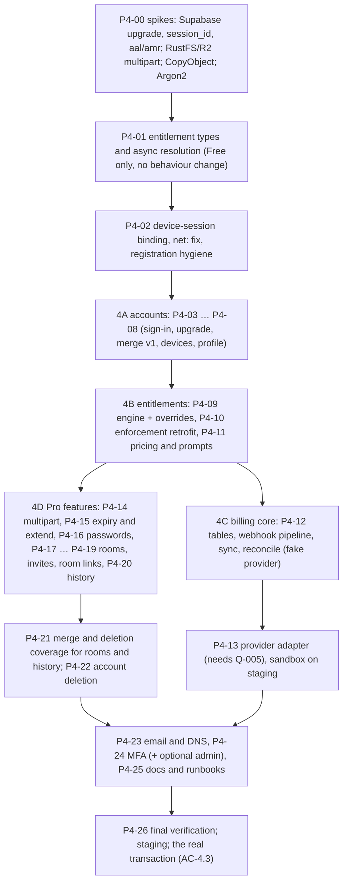
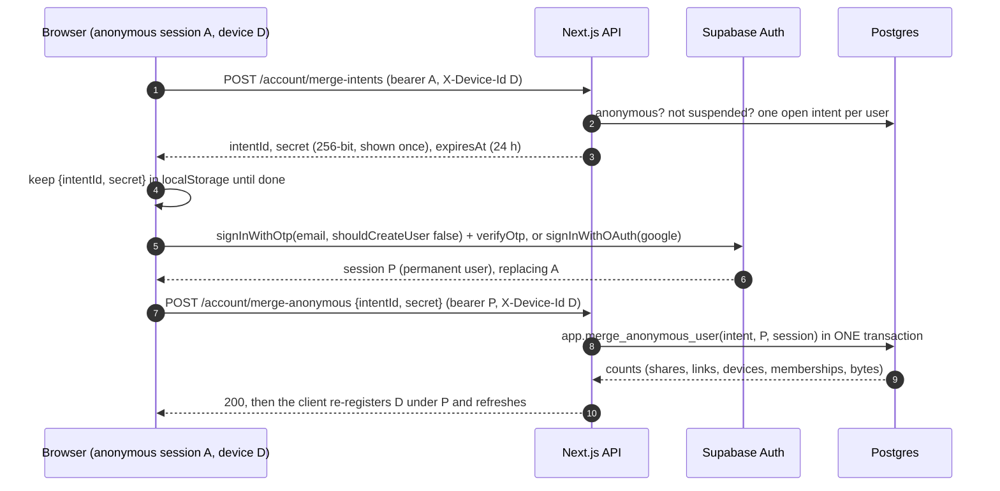
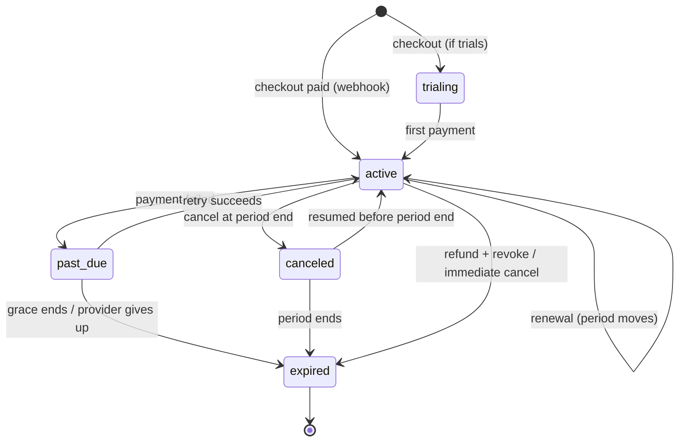

# Phase 4 — Accounts, Entitlements, Pro and Billing

| Field | Value |
|---|---|
| **Status** | **4A, 4B, the 4C billing core and the first eleven 4D tasks (P4-14 multipart uploads, P4-15 expiry and extend, P4-16 link passwords, P4-17 private rooms with invite links, P4-18 QR pairing, P4-19 read-only room links, P4-20 transfer history, P4-21 merge and deletion coverage, P4-22 the account-deletion flow, P4-23 email: its local part, P4-24 MFA) IMPLEMENTED / NEEDS REVIEW; P4-25 docs and runbooks DONE / NEEDS REVIEW; P4-26 final verification DONE / NEEDS REVIEW. Phase 4 is implemented and verified locally, except P4-13; it is not VERIFIED** (uncommitted; §18 accounts and §19 entitlements, 2026-10-16; §20 the provider-neutral billing core, §21 P4-14, §22 P4-15 and §23 P4-16, 2026-10-17; §24 P4-17, §25 P4-18, §26 P4-19, §27 P4-20, §28 P4-21, §29 P4-22, §30 P4-23, §31 P4-24, §32 P4-25 and §33 P4-26, 2026-10-18). Not VERIFIED. No billing provider yet (Q-005, P4-13); P4-23's staging half (SMTP, DNS, delivery checks) waits for D4-8, Q-020 and staging; P4-24's hosted checks wait for hosted Supabase. P4-26's final run: §33.5; the staging, real-device and production steps, none run yet: [`phase-4-manual-verification.md`](phase-4-manual-verification.md). Detailed plan: §17. |
| Plan depth | Scope outline (§1–§15) and a detailed task plan (§17, 2026-10-16). The task plan was written on the owner's instruction before Phase 3 is VERIFIED and before the pricing and billing questions are answered. |
| Depends on | Phase 3 VERIFIED. Q-005, Q-006, Q-007, Q-009, Q-014, Q-015, Q-026 answered. State on 2026-10-16: §17.1. |
| Unblocks | Phase 5, and the **paid launch gate** |
| Last updated | 2026-10-18 (§33: P4-26 final verification, the device-routes fix and the audit; [`phase-4-manual-verification.md`](phase-4-manual-verification.md) new; §16; §31.2, §32.3 and §32.7 annotated). 2026-10-18 (§32: P4-25 docs and runbooks; §16, §19.3, §20.1, §20.9, §31.9 and S4-11 annotated). 2026-10-18 (§27 … §31: P4-20 … P4-24). 2026-10-18 (§26: Phase 4D's sixth task, P4-19 read-only room links). 2026-10-18 (§25: Phase 4D's fifth task, P4-18 QR pairing). 2026-10-18 (§24: Phase 4D's fourth task, P4-17 private rooms, with invite links brought forward from P4-18 on the owner's instruction). 2026-10-17 (§23: Phase 4D's third task, P4-16 link passwords; §22: Phase 4D's second task, P4-15 expiry 30/90 days and extend; §21: Phase 4D's first task, P4-14 multipart uploads; §20: the Phase 4C provider-neutral billing core). 2026-10-16 (§19: Phase 4B implementation; §18: Phase 4A) |

---

## 1. Goal

Launch a **paid Pro plan** whose every limit is enforced server-side:

- permanent accounts, with a safe upgrade path from anonymous devices,
- a complete entitlements engine,
- merchant-of-record billing,
- the Pro feature set (5 GB files, 30/90-day expiry, passwords, private rooms, room links, history, device management).

**Rooms start here.** Free local mode has no rooms (CR-001). Pro private rooms are membership-based, joined by invite or QR pairing, reachable from any network, and never visible on a network. They are a separate feature from local mode, not an approval step for it.

## 2. Scope (by milestone)

| Milestone | Contents |
|---|---|
| **4A — Accounts** | Sign-in methods per Q-014 (proposed: email magic link + Google). Anonymous → permanent upgrade keeping the user ID (`linkIdentity`/`updateUser`). **Merge flow** when signing into an existing account from an anonymous device (proof via the still-valid anonymous token; transactional move of shares, storage usage, devices and any private-room memberships; anonymous user deleted). A signed-in user's "My uploads" covers shares from all their devices. `profiles`. Device list and revoke (10-device cap). Account deletion (grace, then cascade and end of content). Custom SMTP (SPF/DKIM/DMARC). Optional TOTP MFA (required for operators). |
| **4B — Entitlements** | `plans.ts`, `resolve.ts`, overrides, snapshots, the error contract ([07 §4](../07-plans-and-entitlements.md#4-server-side-error-contract-for-plan-limits)). **Retrofit enforcement into every existing write path.** `GET /me/entitlements`. UI gating and upgrade prompts. Pricing page. |
| **4C — Billing** | Provider integration (Q-005): checkout, customer portal, signed webhooks, idempotent `billing_events`, order-safe `subscriptions`, grace handling, daily reconciliation. Downgrade behaviour ([07 §5](../07-plans-and-entitlements.md#5-upgrades-downgrades-and-over-quota-behaviour)). Sandbox in staging. |
| **4D — Pro features** | Multipart uploads up to 5 GB with resume (IndexedDB state, part presign batches, `ListParts` verification). Expiry options 30/90 days and **extend** (copy between retention prefixes). **Link passwords** (Argon2id, versioned grants, lockouts). **Private rooms**: the `rooms`, `room_members` and `room_invites` tables, the `room:` realtime topic, QR pairing invites (single use, 10 min) and **multi-use invite links** (≤ 7 days). Never visible on any network. **Custom room names**. **Read-only room links** (private rooms only; never a network feed). **Transfer history** UI (shares and download events, ≤ plan retention). Burn after download enabled for Pro. Optional web admin for operators (MFA required). |

### Out of scope

Workspaces and seat billing (Phase 5). Malware scanning (Phase 6). Custom domains.

## 3. Existing system state (expected at start)

Phases 1–3: anonymous devices, automatic local visibility with network spaces and guards, links, codes, link-only shares, burn, janitor, retention. No rooms yet. Entitlements resolve to Free only.

## 4. What will be changed

Auth pages and callbacks. Settings (account, devices, billing), history and pricing pages. Entitlement checks in all services. Multipart uploader. Link password flows. Room-link and private-room support. Billing routes and webhook processing.

## 5. What will NOT be changed

- The local visibility model (DEC-031, DEC-032), link format and burn semantics (no change record expected). Pro adds private rooms beside local mode; it does not add an approval step to local mode.
- **Existing shares and links keep their snapshot behaviour.** No retroactive changes when plans change.

## 6. Architecture decisions involved

DEC-005 (upgrade and merge), DEC-018, DEC-019, DEC-021, DEC-023, DEC-026 (multipart), DEC-010 (extend by copy).

## 7. Files / modules involved

See [05 §6 — Phase 4](../05-implementation-roadmap.md#phase-4). Key modules:

- `lib/server/entitlements/*`, `lib/server/billing/*`, `lib/server/accounts/{merge.ts, delete.ts}`
- `lib/server/links/password.ts`, `lib/server/storage/multipart.ts`, `lib/client/uploader-multipart.ts`
- `app/(auth)/**`, `app/(app)/settings/**`, `app/(app)/history/page.tsx`, `app/(marketing)/pricing/page.tsx`

## 8. Database changes

- New tables: `rooms`, `room_members`, `room_invites`, `profiles`, `subscriptions`, `billing_customers`, `billing_events`, `entitlement_overrides`.
- New columns: `shares.room_id` and scope `room`, multipart columns on `files`, password columns on `share_links` (if not already present), room-link support (`target_type = 'room'`).
- The `room` branch of `app_realtime.can_access_topic`.
- Merge and account-deletion functions.

## 9. API changes

Phase 4 rows in [02 §6.2](../02-system-architecture.md#62-endpoint-catalogue-by-phase): private rooms (CRUD, members, invites and accept, room shares), `me`, `merge-anonymous`, history, billing (checkout, portal, webhook), link PATCH (password, expiry), room links, multipart (init, parts, complete, abort), extend, optional admin.

## 10. Security considerations

- Entitlements are **only** derived from webhook-updated subscriptions, never from client redirects.
- Webhooks: signature on the raw body, idempotency, ordering, 5xx on failure for retries.
- The merge flow cannot take over another user's anonymous data (proof required) (RISK-024).
- Passwords: Argon2id, attempt limits, lockouts, no logging.
- Multipart: server-controlled part count and size, verification before completion.
- Account deletion honours legal retention (billing records) and ends content.
- Operator web tools require MFA and an allow-list, and every action is audited.

## 11. Dependencies

- **Phase:** Phase 3 VERIFIED.
- **Business:** registered entity, payment provider account, tax setup (Q-005), final prices (Q-006).
- **Packages (to be approved):** `@node-rs/argon2`, the billing provider SDK, `idb-keyval`, an email template library (optional).

## 12. Testing requirements

- T-050 … T-053, T-034 (private-room invites).
- IDOR matrix extended with private-room actors (member, owner, removed member, non-member).
- Multipart: extra or undersized parts rejected, resume after reload, abort cleanup.
- Password lockouts.
- Room-link isolation (viewers see the room's shares but not members or requests).
- Billing lifecycle in sandbox: new subscription, renewal, failed payment → grace → downgrade, cancel at period end, refund, duplicate and out-of-order webhooks.

## 13. Acceptance criteria (outline, refined before start)

| ID | Criterion |
|---|---|
| AC-4.1 | Anonymous → account upgrade keeps all shares and private-room memberships. The merge into an existing account is proof-based and transactional (T-053). |
| AC-4.2 | Every row of [07 §3](../07-plans-and-entitlements.md#3-enforcement-points) has passing negative tests (T-050) |
| AC-4.3 | Billing lifecycle verified in sandbox and with one real production transaction. Redirects never grant Pro (T-052). |
| AC-4.4 | Downgrade behaviour matches [07 §5](../07-plans-and-entitlements.md#5-upgrades-downgrades-and-over-quota-behaviour) (T-051) |
| AC-4.5 | A 5 GB upload succeeds with resume on desktop. Lying-client multipart attempts are rejected. |
| AC-4.6 | Password links, private rooms, invite links, room links, custom names and history work, and are denied for Free |
| AC-4.7 | Account deletion and data-deletion runbook verified |
| AC-4.8 | Paid launch gate ([05 §4](../05-implementation-roadmap.md#4-release-gates)) complete |

## 14. Known risks

RISK-015 (pricing), RISK-019 (email), RISK-024 (merge), RISK-020 (scope: this is the largest phase, so milestones 4A–4D can be verified separately if the owner prefers).

## 15. Open questions

Q-005, Q-006, Q-007, Q-009, Q-014, Q-015, Q-026.

## 16. Implementation status

| Date | Status | Note |
|---|---|---|
| 2026-09-17 | PLANNED | Outline drafted |
| 2026-09-23 | PLANNED | CR-001: rooms, members, invites and QR pairing now start here with private rooms |
| 2026-10-18 | P4-26 DONE / NEEDS REVIEW | Phase 4's final task, final verification (P4-26), on the owner's instruction on top of P4-25, **uncommitted** (§33). First the device-route gap P4-25 found, fixed: the token-only device list and revoke routes now refuse a revoked or signed-out browser's token (a migration with `app.auth_session_state`, two integration tests). Then an audit of Phase 4 against this plan (§33.3, §33.4) and every suite once on a reset database: unit and component 647 of 647, pgTAP 1,078, integration 522 of 522, E2E 72 of 75 in the full run, the 3 timing failures passing alone (§33.5). The manual, staging and production procedure is written with evidence slots, none of it run. **Phase 4 is implemented and verified locally, except P4-13 (Q-005); not VERIFIED.** DV4-152 … DV4-154. |
| 2026-10-18 | P4-25 DONE / NEEDS REVIEW | Phase 4D's twelfth task, docs and runbooks (P4-25), on the owner's instruction on top of P4-24, **uncommitted** (§32). The design documents 02, 03, 04, 06, 07, 08 and 09 brought up to Phase 4 as built; ARCHITECTURE.md corrected where it had drifted; the legal drafts rewritten from the code with `[OWNER]` items; `runbooks/billing.md` new; the account-deletion, accounts (merges, devices), secret-rotation, cron and monitoring runbooks extended, their SQL run against the local database. No behaviour changed. Found: revoked browsers can still list and revoke devices until their token expires (not fixed, §32.3 finding 1; *fixed in P4-26*); the old pepper-removal rule and a broken audit query in the runbooks (fixed). DV4-149 … DV4-151. |
| 2026-10-18 | P4-24 IMPLEMENTED / NEEDS REVIEW | Phase 4D's eleventh task, MFA (P4-24), built on the owner's instruction on top of P4-23, **uncommitted** (§31). An optional authenticator app (Supabase Auth's TOTP) is set up (a QR code drawn in the browser, the key, the first code) and removed (a fresh code) in account settings. Once it is on, the API answers `403 MFA_REQUIRED` to an `aal1` session of the account on every route and Realtime refuses its topics (DV4-146), so the app shows the authenticator step before it loads. Auth ends the account's other sessions at enrolment and such a browser signs out; a merge waits for the step. `runbooks/accounts.md` (RISK-045). The operator admin isn't built (D4-23). DV4-146 … DV4-148. |
| 2026-10-18 | P4-23 (local part) IMPLEMENTED / NEEDS REVIEW | Phase 4D's tenth task, email (P4-23), built on the owner's instruction on top of P4-22, **uncommitted** (§30). The local part: the email's link opens the app's callback and is followed only on **Continue** (a mail scanner opening Supabase's link used up the code, finding 1); a password-reset template with nothing to sign in with; the templates as plain documents whose notes no longer reach recipients; the 60-second resend timer; every Auth email tested through Mailpit (sender, code, links, single use, expiry, enumeration). SMTP, DNS records, the hosted settings and the staging checks are written down in `infra/email/README.md`, **not applied** (no staging, D4-8, Q-020). DV4-143 … DV4-145. |
| 2026-10-18 | P4-22 IMPLEMENTED / NEEDS REVIEW | Phase 4D's ninth task, the account-deletion flow (P4-22), built on the owner's instruction on top of P4-21, **uncommitted** (§29). `DELETE /me` (a sign-in within 10 minutes, `aal2` with an authenticator; D4-30 as recommended) schedules the deletion 7 days ahead and stops the subscription renewing; the account is read-only meanwhile (E30) with a banner on every page and **Cancel deletion** until the date; then the hourly `delete-due-accounts` job runs P4-21's `delete_due_accounts`, the one deletion mechanism, which nothing the app or a browser can call. A deleted account's browsers start again without it. Suspended accounts still wait for an operator (D4-6 open). The runbook is new. Not VERIFIED: staging, hosted Supabase, real email and Google are pending. |
| 2026-10-18 | P4-21 IMPLEMENTED / NEEDS REVIEW | Phase 4D's eighth task, merge and deletion coverage for rooms, history and links (P4-21), built on the owner's instruction on top of P4-20, **uncommitted** (§28). Every column holding a user or device ID has a merge rule and a deletion rule, checked by name and foreign key; the merge moves every reservation row; account deletion finishes the account's burn claims and clears it from other people's records, which stay as their history (DV4-129 … DV4-131); a write whose own user is merged away or deleted mid-request answers `401 DEVICE_UNKNOWN` (DV4-133). 10 mutation checks, all caught. Not VERIFIED. |
| 2026-10-18 | P4-20 IMPLEMENTED / NEEDS REVIEW | Phase 4D's seventh task, transfer history (P4-20), built on the owner's instruction on top of P4-19, **uncommitted** (§27). A Pro account sees its own shares in every state within its plan's window (365 days) and what happened to them, by actor kind only (D4-20): two read-only routes over the rows the app already keeps, no migration; `/history`, reached from My uploads; someone else's link by kind only (DV4-124). 9 mutation checks, all caught. Not VERIFIED. |
| 2026-10-18 | P4-19 IMPLEMENTED / NEEDS REVIEW | Phase 4D's sixth task, read-only room links (P4-19), built on the owner's instruction on top of P4-18, **uncommitted** (§26). A Pro room owner makes a link that shows the room's current and future posts to people outside it, through the share links' unlock, grant, password and viewer path with a room branch; viewers never see the room's name, members, settings or who posted; every file, burn action and report resolves its share inside the link's room; deleting the room revokes its links. No short codes for room links (DV4-108). Members aren't told a link exists (DV4-121, owner decision). Not VERIFIED: no staging, no real devices. |
| 2026-10-18 | P4-18 IMPLEMENTED / NEEDS REVIEW | Phase 4D's fifth task, QR pairing (P4-18), built on the owner's instruction on top of P4-17, **uncommitted** (§25). The owner's *Show QR code* dialog makes a pairing invite (one use, 10 minutes, any plan: D4-16 as recommended) and draws its URL in the browser; a phone's camera opens the P4-17 join page, which previews and joins only on *Join*; closing the dialog revokes an unused code. A new migration makes the database refuse a pairing invite without a maximum (DV4-101). A P4-17-era test harness defect fixed: `burn-concurrency.test.ts` restored Phase 3's burn-claim function. Not VERIFIED: no real phone's camera has scanned a code. |
| 2026-10-18 | P4-17 IMPLEMENTED / NEEDS REVIEW | Phase 4D's fourth task, private rooms (P4-17), built on the owner's instruction on top of P4-16, **uncommitted** (§24). Rooms, members, room shares, the `room:` Realtime topic and the UI; **invite links too, brought forward from P4-18 on the owner's instruction**, with QR pairing left to P4-18 (DV4-82). A room, member or invite is found only through the caller's own membership or the invite's secret. The merge now moves memberships, and account deletion deletes an owner's rooms first (parts of P4-21 the coverage test required; DV4-88, DV4-92). Every Phase 1–4 suite still passes. P4-18 (QR pairing), P4-19 and P4-20 not started. |
| 2026-10-17 | P4-16 IMPLEMENTED / NEEDS REVIEW | Phase 4D's third task, link passwords (P4-16), built on the owner's instruction on top of P4-15, **uncommitted** (§23). scrypt from `node:crypto`, D4-24's built-in option (no package approved; DV4-70). The password is checked on the grant, in `accessFor`, on every viewer route, also for code-made grants; every set, change or removal invalidates the link's grants; a lock after 10 failures, then Turnstile; failure slots reserved before every hash. One imprecise plan rule (grants after a removal) settled by the owner's own requirement (DV4-71). Every Phase 1–4 suite still passes. P4-17 … P4-20 not started. |
| 2026-10-17 | P4-15 IMPLEMENTED / NEEDS REVIEW | Phase 4D's second task, expiry of 30 and 90 days and extend (P4-15) with its `CopyObject` spike (P4-00), built on the owner's instruction on top of P4-14, **uncommitted** (§22). Extend in place, or by copy through the storage janitor to a longer-lived key with the old key deleted through the outbox; links made "until the share expires" follow. No contradiction in the plan; its gaps are recorded as DV4-55 … DV4-69. Every Phase 1–4 suite still passes. P4-16 … P4-20 not started. |
| 2026-10-17 | P4-14 IMPLEMENTED / NEEDS REVIEW | Phase 4D's first task, multipart uploads (P4-14) with its RustFS spike (P4-00), built on the owner's instruction, on top of 4A, 4B and the 4C core, **uncommitted** (§21). Pro's 5 GiB files are delivered (DV4-17 closed). Two plan gaps fixed: a share ending mid-upload now aborts its upload, and a share with a large file gives all its files the 24-hour deadline. Every Phase 1–4C suite still passes. P4-15 … P4-20 not started. |
| 2026-10-17 | 4C CORE IMPLEMENTED / NEEDS REVIEW | The provider-neutral billing core (P4-12 only) built on the owner's instruction, on top of 4A and 4B, **uncommitted** (§20). No provider chosen (Q-005 open): a fake provider stands in for tests and local development; the real adapter (P4-13), the sandbox and the real transaction (AC-4.3) wait for it. Every Phase 1–4B suite still passes. 4D not started. |
| 2026-10-16 | 4B IMPLEMENTED / NEEDS REVIEW | Milestone 4B (entitlements: P4-01, P4-09, P4-10, P4-11) built on the owner's instruction, on top of 4A, **uncommitted** (§19). Pro exists by operator override only (billing is 4C). Every Phase 1–3 and 4A suite still passes. 4C and 4D not started. |
| 2026-10-16 | 4A IMPLEMENTED / NEEDS REVIEW | Milestone 4A (accounts) built on the owner's instruction, on top of `cc2ac40`, **uncommitted** (§18). Every Phase 1–3 suite still passes; staging, real email, Google and real devices are pending. 4B–4D not started. |
| 2026-10-16 | PLANNED | Detailed task plan written (§17). Planning only, on the owner's instruction, against `cc2ac40` (Phase 3, committed and pushed; NEEDS REVIEW, not VERIFIED). Not started: no code, migrations or packages. Open: Q-005, Q-006, Q-007, Q-009, Q-014, Q-015, Q-026, and decisions D4-1 … D4-30 (§17.17). |

### Verification record

*Empty until verified.*

---

## 17. Detailed task plan (2026-10-16)

**Planning only. Nothing in this section is implemented.**

- **Written against:**
  - the code at `cc2ac40` on branch `phase-3-expiry-one-time-download`: Phase 3, committed and pushed by the owner, CODE COMPLETE / NEEDS REVIEW, **not VERIFIED**;
  - [ARCHITECTURE.md](../ARCHITECTURE.md) and documents 00–09 as of 2026-10-16.
- **Relation to §1–§16:** they stay as the scope outline. Where this section differs from them, it says so and why (§17.3).
- **The owner's request:** *"Create the detailed implementation plan for Phase 4 … This is PLANNING ONLY … Work from the actual current codebase, not assumptions."*
- **How the current system was established:** by reading the migrations, services, routes, client code, configuration and tests, not from the planning documents. §17.2 gives the findings, with file references.

**Reading guide:**

| § | Contents |
|---|---|
| 17.1–17.4 | Readiness, today's system, conflicts with the outline, milestone order |
| 17.5–17.8 | The four milestones: 4A accounts, 4B entitlements, 4C billing, 4D Pro features |
| 17.9–17.11 | Security reviews: account merge, billing, private rooms |
| 17.12–17.16 | Database, API, frontend, storage, snapshots and downgrades |
| 17.17–17.18 | Open questions, new decisions, packages |
| 17.19–17.20 | Tests and acceptance gates |
| 17.21–17.25 | Rollout and tasks, architecture changes, risks, infrastructure, files |

### 17.1 Starting conditions and readiness

| Dependency | State on 2026-10-16 | Effect on Phase 4 |
|---|---|---|
| Phase 3 VERIFIED | CODE COMPLETE / NEEDS REVIEW, committed and pushed (`cc2ac40`). Staging, real-device and owner items are pending (phase 3 §18.10). Phases 1 and 2 are also NEEDS REVIEW. | Under 05 §1, Phase 4 starts only after Phase 3 is VERIFIED, unless the owner instructs otherwise, as for Phases 2 and 3 (D4-1). |
| Q-005 (business country, tax, merchant of record) | OPEN | **Blocks the provider adapter** (P4-13) and AC-4.3. The provider-neutral billing core can be built (§17.7). |
| Q-006 (prices) | OPEN | Blocks the pricing page's numbers and the provider's products. Not the code. |
| Q-007 (quotas) | OPEN; Phase 1 assumed the Free values | Pro values are proposals until answered (D4-9) |
| Q-009 (room links Pro-only) | OPEN | Planned as Pro-only, the recommendation |
| Q-014 (sign-in methods) | OPEN | Planned with the recommendation: email (code and link) plus Google (D4-2) |
| Q-015 (history retention) | OPEN | Planned with the recommendation: Pro 1 year |
| Q-026 (billing in Phase 4) | OPEN | Planned in Phase 4, the recommendation. If billing moves to Phase 6, 4C is skipped and Pro can only be granted by override (§17.6.2). |
| Staging, hosted Supabase, R2 bucket, CI (Phase 0 owner items) | None exist | Every staging, real-R2 and production criterion waits. Email delivery, Google sign-in, webhooks and the real transaction need them. |
| Email provider and a sending domain (Q-020) | None | Blocks real magic links and codes outside the local stack (mailpit) |
| Google OAuth client | None | Blocks Google sign-in outside unit tests with fakes |
| Billing provider account (registered entity) | None | Blocks sandbox testing (P4-13) |
| Packages | None approved for Phase 4 | `@node-rs/argon2` needs approval or the scrypt fallback (D4-24). The others are not needed (§17.18). |

**Readiness:**
- Planned and could start on the owner's instruction, in-repo and against the local stack:
  - 4A accounts, apart from email delivery and Google outside the local stack;
  - 4B entitlements;
  - 4D Pro features;
  - the provider-neutral part of 4C.
- Not possible yet:
  - the provider integration;
  - anything that needs staging, a real R2 bucket, a phone or a real payment.
- **Nothing in Phase 4 can be VERIFIED before staging exists.**

### 17.2 What exists today and what Phase 4 changes

| Area | As built (traced from the code) | Phase 4 |
|---|---|---|
| Identity | Every browser signs in anonymously on mount: `bootstrap()` in `lib/client/runtime.tsx`, then `POST /api/v1/devices`. Details:<br>• The session lives in localStorage (`lib/client/supabase.ts`: `storageKey "local-saver.auth"`, `detectSessionInUrl: false`).<br>• Nothing listens to `onAuthStateChange`. No code calls `updateUser`, `linkIdentity`, `signInWithOtp`, `signInWithOAuth`, `verifyOtp`, `exchangeCodeForSession` or `signOut`.<br>• No `(auth)` route group. | Sign-in, upgrade with the same user ID, merge, sign-out, auth-state handling |
| Server auth | `getPrincipal` (`lib/server/auth/session.ts`) verifies the bearer token with `auth.getClaims` and returns `{ userId, isAnonymous }`. It ignores `session_id`, `aal`, `amr` and `aud`.<br>`requireCaller` (`lib/server/auth/device.ts`) checks, in order: token, `X-Device-Id`, own non-revoked device, suspension. | Device bound to its Auth session; `aal`/`amr` for sensitive actions |
| Devices | `app.devices`: label, platform, `revoked_at`. `registerDevice` (`lib/server/devices/service.ts`):<br>• silently creates a new row when the header names an unknown, revoked or foreign device;<br>• skips the suspension check;<br>• has no cap.<br>**Nothing ever sets `revoked_at`.** Only the rename route exists (no list, no revoke). | List, revoke, 10-device cap, registration hygiene |
| Realtime | `app_realtime.can_access_topic`:<br>• `user:` requires topic id = `sub`;<br>• `net:` requires a **`network_presence` row with `user_id = sub`**, presence still current and space `ok`;<br>• `room:` and everything else are denied (pinned by a Phase 1 pgTAP test).<br>It ignores revoked devices and suspension. The client calls `realtime.setAuth()` once. | **A device-bound `net:` check** (C4-2), a `room:` branch, auth-state re-subscription |
| Ownership | Creator checks compare `created_by_user_id` with the principal (`findVisibleShare`, `requireOwnShare`, `requireOwnLink`, `loadShareDtos`). My uploads is already user-wide (`listMyShares`). The storage ledger and `billing_subject_*` are keyed by user. | Unchanged rule. Merge re-points them. |
| Entitlements | `lib/server/entitlements/plans.ts`, one file:<br>• `FREE_PLAN` is `as const`, so `Plan = typeof FREE_PLAN` is literal Free;<br>• `resolveEntitlements(_principal)` is synchronous and always returns Free, with 6 callers;<br>• `entitlementsResponse` in `lib/shared/api/schemas.ts` is `plan: z.literal("free")`.<br>The only Pro trace is `requiredPlan: "pro"` in the burn gate (`lib/server/shares/burn.ts`). | A typed engine with Pro, subscriptions, overrides and snapshot v2 |
| Snapshots | **Shares** store `burnSnapshot(resolveEntitlements(…))` (`shares/create.ts`, `shares/text.ts`). **Links** store the creator's *current* resolution (`links/create.ts`).<br>What reads them later:<br>• `historyRetentionDays`, in `end_share`, `claim_burn_share` and download inserts;<br>• `features.executablesInRemoteLinks`, at completion for link-only shares and in the viewer file policy;<br>• `limits.linkDailyUrlIssuances`, in the viewer.<br>`maxPreviewBytes` is read from `FREE_LIMITS` directly in four places. | Defined rules per field (§17.16) |
| Limits enforced | Files per share, file size, text size, expiry options, storage quota (`app.reserve_storage(…, p_quota)`), daily volume per user and per network (KiB counters, charged at init), rate limits, kill switches, the burn gate, the remote file policy, the per-link daily URL cap. Details in §17.6.4. | Every row made plan-aware (§17.6.4) |
| Uploads | Single presigned PUT ≤ 100 MiB, signing `Content-Length` and `If-None-Match: *` (`lib/server/storage/s3.ts`). URL lifetimes:<br>• 15 minutes, all issued at init;<br>• 2-hour completion deadline;<br>• 3-hour reservation.<br>`files.upload_mode` allows only `single`. The uploader (`lib/client/uploader.ts`) uploads sequentially, with no retry, resume or abort. | Multipart up to the Pro limit, with resume |
| Expiry | `resolveExpiry` (`lib/server/shares/expiry.ts`): options 1 h, 24 h, 7 d. `retentionClassFor` maps to `d7`/`d30`/`d90`, throwing above 90 days. There is no extend code. | 30 and 90 days, extend |
| Links | `share_links`:<br>• `target_type` allows `share` only, and `share_id` is NOT NULL;<br>• no password columns;<br>• `link_grants.password_version` exists but nothing writes or reads it.<br>Short codes grant access **without the link secret** (`links/codes.ts`). | Passwords on every grant path; room links |
| Rooms | None. The scope check allows `network` and `link_only`; Phase 1–2 tests assert `room` is refused. `shareVisibility` hides any other scope, a safe default. | Private rooms |
| Deletion and retention | One executor, the `storage-janitor` Edge Function (D-1). Also:<br>• outbox guard rails (`key_format`, `share_open`, `key_mismatch`);<br>• legal hold with `hold/` copies;<br>• tombstone purge (`metadata_purge_after` from the snapshot);<br>• reconciliation reports multipart uploads and aborts those older than 24 h (C-5).<br>`end_share` raises for the reasons `account_deleted` and `room_deleted`, although the share check allows them. | New end reasons, multipart aborts, extension copies |
| Anonymous cleanup | `cleanup_anonymous_users` deletes inactive anonymous users with nothing open, never suspended ones (D-9) | Must also skip users with an open merge intent |
| Auth configuration | `supabase/config.toml`:<br>• `enable_manual_linking = false`;<br>• TOTP enroll and verify `false`;<br>• no Google provider;<br>• SMTP commented out;<br>• captcha commented out;<br>• `site_url` `http://127.0.0.1:3000`, with no redirect URLs for the test ports 3102 and 3200.<br>`pnpm stack:start` excludes `mailpit`. | Local auth stack changes (P4-04) |
| HTTP pipeline | `withApi` (`lib/server/http/handler.ts`) requires an allowed `Origin` and a JSON content type on every mutation, and `readJson` consumes the body | A webhook wrapper that keeps the raw body (C4-9) |
| Tests | Suites: 39 unit and 6 component files (376 tests), 6 pgTAP files (421 assertions), 16 integration files (195 tests), 7 E2E specs (45 runs).<br>The IDOR matrix (`tests/integration/authz-matrix.test.ts`) fails if any route or method is missing. Its 9 actors include no account or room actors. | New actors and rows for every new route (§17.19) |

### 17.3 Conflicts between the plan and the code

None of these is resolved silently. Each gives the smallest approach that fits the current architecture. The ones that need the owner are in §17.17.

| # | Conflict | Impact | Smallest compatible approach |
|---|---|---|---|
| C4-1 | 05 §6 plans `app/auth/callback/route.ts`, a server route. The session is in localStorage and the server never sees it on document requests (DV1-14). `RuntimeProvider` signs in anonymously on every `(app)` mount. | A server callback can't complete a browser session. Auth pages inside `(app)` would mint anonymous users. | An `(auth)` route group with its own provider: a Supabase client, and no anonymous auto sign-in. The callback is a client page that exchanges the code (PKCE, same browser). `RuntimeProvider` gains an auth-state listener that re-registers the device and clears the query cache when the user changes (§17.14). |
| C4-2 | **Realtime `net:` access is checked per user, not per device.** Harmless while one anonymous user is one browser. With accounts, any of a user's devices could join `net:X`, and see its ID-only signals and presence labels, while *another* of their devices is present on X. | A cross-network presence leak once accounts exist. Private rooms "must never expose network presence". | Bind each device to its Auth session (`devices.auth_session_id`, from the JWT `session_id` claim). `can_access_topic('net:…')` then requires presence of the device whose session is the caller's, not revoked, user not suspended. **Must ship before sign-in (P4-02).** |
| C4-3 | Devices are never revoked. Registration silently creates a row for an unknown or revoked device ID, skips suspension and has no cap. | A revoke button would be cosmetic | Revocation sets `revoked_at` and deletes the device's Auth session (refresh tokens die). Requests with a revoked device answer `401 DEVICE_REVOKED`, and registration never re-creates it. Plus suspension and the cap at registration (P4-02, P4-07). |
| C4-4 | 07 §2.1's `Entitlements` shape differs from the code. The code has `localExpiryOptionsSeconds`, `linkExpiryOptionsSeconds`, `shortCode*`, `maxPreviewBytes` and `dailyUploadBytesPerNetwork`, and `historyRetentionDays` both in `limits` and at the top level. Types are literal Free. Resolution is synchronous. | Renaming keys would break stored snapshots | **Keep every existing key name**: snapshots in the database use them. Widen the types to an interface, add the new keys, and make resolution async and per-request memoized (P4-01). 07 §2.1 is updated to the as-built shape when built. |
| C4-5 | Snapshot use is inconsistent:<br>• link snapshot = the creator's current plan;<br>• text edits check the current plan's text size;<br>• link options, code TTLs and the remote file policy at link creation use the current plan;<br>• previews read `FREE_LIMITS`. | Downgrade behaviour would be accidental | A rule per field (§17.16): what a share or link already *is* follows its snapshot; a *new* action follows the current plan. The owner confirms the edge cases (D4-12). |
| C4-6 | Daily volume is charged at init, before the quota check, refused attempts are still counted, and nothing is refunded (review L7) | At 5 GB, one failed init burns the day's budget | Charge after the quota reservation succeeds, and refund on a server-side rejection or abort (D4-26) |
| C4-7 | Extend meets three Phase 3 facts:<br>• lifecycle rules count from the upload date;<br>• `janitor_claim_deletions` refuses a key whose `source_file_id` now points at a different key (`key_mismatch`);<br>• links created "until the share expires" hold a copied `expires_at`. | A naive extend loses objects at day 8, or never deletes the old key | Extend by copy, run by the janitor, with the old key queued as `superseded` (`source_file_id` null, 5-minute margin). A new `follows_share_expiry` flag on links. §17.8.2. |
| C4-8 | Short codes grant access without the link secret (`resolveCode`). `accessFor` checks no password. | A password could be bypassed by code | Passwords are checked on the **grant**, whatever created it. `accessFor` refuses a grant until its password is verified (§17.8.3). |
| C4-9 | `withApi` refuses requests without an allowed `Origin` and a JSON content type, and `readJson` consumes the stream. Providers send neither, and need the raw bytes. | Webhooks can't be received | A separate `withWebhook` wrapper: no Origin or CSRF check, raw text body with a size cap, signature first. The origin lock in `proxy.ts` still applies, so webhooks must come through Cloudflare (§17.7.5). |
| C4-10 | Database checks encode Phase 1–3:<br>• `shares.scope`, `share_links.target_type` (with `share_id NOT NULL`), `files.upload_mode`;<br>• `downloads.actor_kind`;<br>• `end_share`'s reason mapping.<br>Phase 1–2 pgTAP tests assert that `room`, `target_type = 'room'` and `granted_via = 'password'` are refused, and that `room:` topics are denied. | Phase 4 must change asserted behaviour | Widen the checks in Phase 4 migrations. Update those assertions deliberately, keeping their intent: a `room` share needs a `room_id`, for example. Record each as a deviation, as Phase 3's DV3-9 did (D4-28). |
| C4-11 | 05 §6's module names and 02 §7's target layout don't match the code. There is no `lib/server/quota/`, no `components/upload/`, and entitlements is only `plans.ts`. | Wrong file list | Plan against the real files (§17.25) |
| C4-12 | Phase 3's C-14: `downloads.share_id` is `ON DELETE CASCADE` | Pro history must not vanish before its date | Both the share's `metadata_purge_after` and `downloads.retention_until` come from the same `historyRetentionDays`. The share outlives its downloads, so no change is needed. Tested (§17.19). |
| C4-13 | The uploader requests every upload URL at init with a 15-minute life, and uploads files one after another | Large Pro batches (100 files) would hit expired URLs | Request URLs per file just before use: single PUT through a refresh endpoint, multipart through per-batch part URLs (§17.8.1) |
| C4-14 | 07 §3 counts daily volume per user and per network key. A Pro user on a busy network shares the 10 GB network cap with everyone there. | Pro uploads blocked by strangers | The owner decides whether Pro is exempt from the per-network cap (D4-10) |
| C4-15 | `regenerateCode` and `editText` don't check `UPLOADS_RESTRICTED`. `editText` and `completeFile` ignore kill switches. Viewers can still use a suspended creator's links. | Inconsistent restrictions | Close in the retrofit (P4-10). Whether suspension also cuts viewers is D4-4's companion question; the recommendation is yes for new grants. |
| C4-16 | ARCHITECTURE.md §18 still says Phase 3 is "not committed", but it is committed and pushed (`cc2ac40`) | A stale status | Corrected with Phase 4's first architecture change. Not edited now (this task changes no architecture). |
| C4-17 | 07 §3 plans `historyRetentionDays` 1 year for Pro. Pro tombstones (file names, sizes) would then live a year after a share ends, against Free's 30 days. | Privacy notice and data inventory | Record in 03 §13 when built; the owner confirms with Q-015 |
| C4-18 | 02 §6.2 lists `DELETE …/members/{userId}`. Exposing Auth user IDs to other members is unnecessary. | IDOR surface, and identity leakage | Opaque `room_members.id` as `memberId` (§17.8.4) |
| C4-19 | 04 §5.2 gives `room_members` the primary key `(room_id, user_id)`, with removal by `removed_at`. Rejoining then updates the old row, so its history is lost. | Audit of removal and rejoin | Keep the primary key; rejoining clears `removed_at` and writes an audit event (`member.joined{via}`, `member.removed`) |
| C4-20 | Per-device rate limits (feed 60/min per device, and others) multiply with up to 10 devices per account | Weaker limits per account | Acceptable at these values (each device is a real browser). Revisit with Pro rate limits (D4-29). |

### 17.4 Milestones and dependency order

The outline orders the milestones 4A → 4B → 4C → 4D. The real dependency graph differs in three places:

1. **Pro features don't need billing to be built or tested.** An `entitlement_overrides` row can grant Pro to a test account (07 §2.1, `app.entitlement_overrides`). Billing is the only milestone blocked on an owner answer (Q-005), so putting it last stops it from blocking 4D.
2. **The device and Realtime fix (C4-2) must come before any sign-in.** The moment an account has two devices, `net:` isolation depends on it.
3. **Merge and account deletion touch every owned table**, rooms included. They are built early for Phase 1–3 data, and extended when rooms and history exist. A coverage test fails if any column referencing a user isn't handled (§17.9).



- **Recommended order:** 4A, 4B, 4D, then 4C's provider adapter. The provider-neutral billing core can run alongside 4D.
- **Milestones are tested separately, as RISK-020 allows.** Phase 4 is complete only when AC-4.1 … AC-4.8 are met (§17.20).

### 17.5 Milestone 4A — Accounts

#### 17.5.1 Identity model

| Concept | Today | Phase 4 |
|---|---|---|
| User | An anonymous `auth.users` row per browser (DEC-005) | Anonymous or **permanent**: email or Google identity, `is_anonymous = false`. **The user ID never changes on upgrade.** |
| Profile | None | `app.profiles`, one per permanent user (§17.12) |
| Device | One `app.devices` row per browser installation, owned by a user | Also **bound to one Auth session** (`auth_session_id`, the JWT `session_id`). A permanent user has up to 10 active devices (D4-5). |
| Session | Supabase session in localStorage; the bearer access token is verified per request | Unchanged transport. The server also reads `session_id`, `aal` and `amr` (P4-00 confirms they are in the token). |
| Link viewer | Cookie session, no user | Unchanged. Viewers never become users. |

**Why the session binding matters:** a permanent account is several browsers.
- **Realtime:** `net:` authorization (C4-2) and revocation (C4-3) need to know *which* browser a token belongs to. The token carries only the user and the session.
- **Registration:** binding happens at `POST /devices`. The row records the token's `session_id`.
- **Every `requireCaller`:** checks `device.auth_session_id = claims.session_id` when the device is bound. An unbound device is a Phase 1–3 row; it is bound on its next registration call, which the client makes at boot.

#### 17.5.2 Sign-in methods and pages

Q-014 recommends email magic link plus Google. The plan (D4-2):

- **Email, one form for both the code and the link.** Supabase sends one email; its template carries both the link and the 6-digit code.
  - The UI asks for the **code**. Supabase's PKCE flow must finish in the browser that started it, and only that browser holds the anonymous data and the merge intent (§17.5.4).
  - The link also works, for a new sign-in on the same browser.
- **Google** through Supabase OAuth (`signInWithOAuth` / `linkIdentity`), PKCE, as a redirect.
- **Not planned:** passwords, Apple, SMS, passkeys (later if wanted).
- **Turnstile:** with Supabase captcha on, every Auth call that sends an email or creates a user needs a captcha token. This covers `signInWithOtp`, and `updateUser` with a new email if P4-00 confirms it. The login page renders the widget on demand.

| Page or route | Group and provider | Purpose |
|---|---|---|
| `app/(auth)/login/page.tsx` | `(auth)`, `AuthProviders`: a Supabase client with **no** anonymous auto sign-in | Email entry → code entry; "Continue with Google". Branches: upgrade (no account yet), sign-in, merge offer (§17.5.4). |
| `app/(auth)/auth/callback/page.tsx` | `(auth)` | Client page: `exchangeCodeForSession` (PKCE), then the pending action (upgrade or merge), then `router.replace("/")`. Handles `error_description`. `useSearchParams` sits inside `<Suspense>` (Next 16). |
| `app/(app)/settings/account/page.tsx` | `(app)` | Email, display name, linked sign-in methods, sign-out, MFA, delete account |
| `app/(app)/settings/devices/page.tsx` | `(app)` | Device list and revoke (§17.5.6) |

**The client runtime** (`lib/client/runtime.tsx`) gains an `onAuthStateChange` listener. When the user ID changes, or on sign-out, it:
1. calls `supabase.realtime.setAuth()` with the new token;
2. tears down channels and stores;
3. `queryClient.clear()`, so no cached data crosses accounts;
4. re-registers the device;
5. on sign-out, starts a new anonymous session as today.

#### 17.5.3 Upgrade keeping the same user ID (no existing account)

| Step | Email | Google |
|---|---|---|
| 1 | Anonymous browser on `/login`: `supabase.auth.updateUser({ email })` | `supabase.auth.linkIdentity({ provider: "google", options: { redirectTo: "/auth/callback?intent=upgrade" } })`. Needs **manual linking enabled** (`enable_manual_linking`, false today). |
| 2 | Supabase emails a confirmation code. The user enters it, then `verifyOtp({ email, token, type: "email_change" })`. | Google consent, back to the callback; exchange the code |
| 3 | The same user ID is now permanent. The client refreshes the session, and the new JWT has `is_anonymous: false`. | Same |
| 4 | `GET /api/v1/me` creates the profile on first sight (`app.ensure_profile`), registers the session binding, and returns the account | Same |

**Outcomes:**
- Shares, links, devices, burn claims and room memberships stay exactly where they are: same user ID, no data moves (AC-4.1).
- **P4-00 must confirm** three things on the local stack and on hosted Supabase:
  - the `email_change` OTP converts an anonymous user without changing its ID;
  - `linkIdentity` keeps the ID;
  - the error codes when the email or identity already exists (expected: `email_exists`, `identity_already_exists`).
- **Server code:**
  - `lib/server/accounts/profile.ts`: `ensureProfile` and `getMe`;
  - `app/api/v1/me/route.ts`: GET;
  - `app/api/v1/me/profile/route.ts`: PATCH.
- **Account enumeration (RISK-042, new):** Supabase reveals that an email or Google identity already has an account (step 1 fails). This is inherent to Supabase's flow. Limited by its email rate limit and Turnstile; documented.

#### 17.5.4 Merge into an existing account

Used when step 1 above fails because the email or Google identity already belongs to an account. Signing in replaces the anonymous session in the browser, so **the proof must be created before the sign-in**, while the anonymous session is still valid (03 §8, RISK-024). Design (D4-3):



**Why each element exists:**
- **The intent secret** is the proof. Only the anonymous session can create it, and it is useless without signing in to the target account.
- **`X-Device-Id` must equal the intent's device:** the merge must finish in the same browser. A stolen secret alone, from another browser, isn't enough.
- **24 hours:** the user may need time for the email or Google.
- **One open intent per anonymous user:** a new one revokes the old.
- **Anonymous cleanup skips users with an open intent.**

**`app.merge_anonymous_user(p_intent_id, p_secret_hmac, p_target_user_id, p_target_session_id, p_device_id)`:**
- SECURITY DEFINER, owned by the migration role (it reads and deletes `auth.users`), granted to `app_server`.
- One transaction, `READ COMMITTED`.

| # | Step | Failure → result |
|---|---|---|
| 1 | Lock the intent `FOR UPDATE`. Compare its HMAC timing-safely with every configured pepper version. | Unknown, wrong secret, expired or revoked → `unavailable` (the API answers a uniform `404 MERGE_UNAVAILABLE`) |
| 2 | Already `completed` | Same target → return the stored result (idempotent). Another target → `conflict` (409). |
| 3 | Lock both `auth.users` rows in UUID order (deadlock-safe). Check the source is still anonymous, the target is permanent, they differ, and the intent's device belongs to the source. | `invalid` (409) |
| 4 | Suspension (`user_flags.suspended_at`) on either side | `suspended` (403) |
| 5 | Lock both ledger rows (`storage_usage`) `FOR UPDATE`, which waits for in-flight reservations and commits | — |
| 6 | Device cap: the target's active devices plus the moving device ≤ the cap | `device_limit` (409). The intent stays open: the user revokes a device and retries. |
| 7 | Re-point ownership (table below) | Any error rolls everything back. The intent stays open. |
| 8 | Ledger: add the source's committed and reserved bytes and file count to the target's row, then delete the source row. Re-point active `storage_reservations`. | — |
| 9 | Daily volume: add the source's current-window counters (`upload_kib:user:{source}`) to the target's | — |
| 10 | `delete from auth.users where id = source and is_anonymous`. This cascades its sessions, identities, flags and idempotency keys. Devices, already moved, don't cascade. | — |
| 11 | Mark the intent `completed` with the target, counts and time. Audit `account.merged {anonUserId, counts}`. | — |

**What step 7 re-points** (from the database audit):

| Column | Rule |
|---|---|
| `shares.created_by_user_id`, `shares.billing_subject_id` (type `user`) | → target. Snapshots unchanged: Free snapshots stay Free. |
| `shares.claimed_by_user_id` | → target. `claimed_device_id` stays, because the device moves with it. |
| `share_links.created_by_user_id`, `revoked_by_user_id` | → target |
| `devices.user_id` | → target. The merging device is bound to the target's session. Any other active device of the source is revoked (`merge`); it can't hold a valid session once the source is deleted. |
| `network_presence.user_id` | → target (denormalized for Realtime) |
| `downloads.user_id` | → target (history) |
| `abuse_reports.reporter_user_id` | → target, so reports stay attributable |
| `user_flags` | `upload_restricted`: OR the two values onto the target. Suspension was already refused in step 4 (D4-4). |
| `idempotency_keys` | Deleted with the source (24 h keys) |
| `audit_events.actor_user_id` | **Unchanged**: history stays truthful. The `account.merged` event links the two IDs. |
| `room_members` (P4-21) | → target. If both are members of one room, keep the target's row and mark the source's `removed_reason = 'merged'`. The source can't own rooms (rooms need Pro, and Pro needs an account). |
| `merge_intents` | The completed row is kept for 30 days as audit context |

**The transaction boundary:**
- Everything above is one Postgres transaction. The Auth tables share the database, and object keys contain no user (DEC-010), so **no storage moves are needed**.
- **Not atomic, and how each is handled:**

| Outside the transaction | Failure | Compensation / recovery |
|---|---|---|
| The browser's sign-in, before the merge | The merge request fails (network, a 409) after the anonymous session is gone from the browser | The intent stays open for 24 hours, and the client retries automatically on the next load (`local-saver.merge-intent`). The anonymous user isn't deleted until the merge commits. If it never does, its data stays on the anonymous user. Cleanup won't touch it while the intent is open, and after that only once it is inactive and empty (Phase 3 rules). |
| The anonymous access token, still valid ≤ 1 h after the merge | Requests with it | `requireCaller` fails (`DEVICE_UNKNOWN`: the device moved). Registering with it fails (the user no longer exists → 401). |
| Realtime authorization cached on the old connection | ID-only signals until reconnect | The client tears its channels down on the auth change. Same lag as RISK-007. |
| The client keeps the old query cache | Stale data | Cleared on the auth change (§17.5.2) |

#### 17.5.5 Profile

- `app.profiles`: `display_name` (optional, 1–60, NFC, invisible characters stripped like device labels), timestamps, deletion fields.
- `GET /api/v1/me` returns:
  - the user: `id`, `anonymous`, `email` (masked for display), `displayName`;
  - sign-in methods: the providers, from the identities in the verified token;
  - MFA: enrolled or not, and the current `aal`;
  - the plan summary;
  - a pending deletion.
- `PATCH /api/v1/me/profile` (permanent only): `{ displayName }`.
- **Email changes go through Supabase** (`updateUser({ email })`, double-confirmed: `double_confirm_changes = true`). The app only reflects them.

#### 17.5.6 Devices: registration, list, revoke, cap

| Action | Behaviour |
|---|---|
| Register (`POST /devices`, changed) | Requires a valid token and checks suspension (missing today). Then:<br>• header names an active own device → refresh and bind its session;<br>• names a revoked own device → `401 DEVICE_REVOKED`, the client signs out (no silent re-create);<br>• missing, unknown or foreign → a new row, but for a **permanent** user only if the active-device count is under the cap; otherwise `409 DEVICE_LIMIT { maxDevices, devices }`.<br>The count is taken under a lock on the user's profile row, so two registrations can't both pass. Anonymous users have no cap (one browser each). |
| List (`GET /me/devices`) | Own devices: `id`, label, platform, `createdAt`, `lastSeenAt`, `current`, `revokedAt`. Revoked ones show for 30 days. **Principal-only** (no device header needed), so a new browser at the cap can see what to revoke. |
| Revoke (`DELETE /me/devices/{deviceId}`) | Own device only, otherwise `404`. `app.revoke_device`:<br>• sets `revoked_at`, `revoked_reason`, `revoked_by_device_id`;<br>• deletes the bound `auth.sessions` row, so its refresh token dies;<br>• ends its presence (`present_until = now()`).<br>Its next request answers `401 DEVICE_REVOKED`. Realtime: `can_access_topic` refuses the revoked device's session on (re)join; a live channel keeps its cached authorization until token expiry (≤ 1 h, RISK-007, ID-only). Revoking the current device signs out. Principal-only, like list. |
| Rename (`PATCH /devices/{id}`) | Unchanged |
| Effects on content | None. Shares belong to the user. A revoked device that was a burn claimant can no longer use its claim (accepted). |
| Rate limits | List 60/min per user; revoke 20/h per user |
| Purge | Revoked devices deleted 30 days after revocation (04 §3.2), in `purge_tombstones` |

#### 17.5.7 Account deletion

Plan, pending D4-6 (grace length) and D4-30 (re-authentication):

| Stage | What happens |
|---|---|
| Request (`DELETE /api/v1/me`) | Permanent account only, and a **recent sign-in**: an `amr` entry within 10 minutes, or `aal2` when MFA is enrolled. Otherwise `403 REAUTH_REQUIRED` (D4-30). Then:<br>• `app.request_account_deletion` sets `deletion_requested_at` and `deletion_scheduled_for = now() + grace`;<br>• a subscription is cancelled at period end through the provider (§17.7.7);<br>• answers `202 { scheduledFor }`. |
| Grace (recommended 7 days) | The account is **read-only**: no new shares, links, rooms or invites (`403 ACCOUNT_DELETION_PENDING`). Existing content works. Signing in shows a banner with **Cancel deletion** (`POST /api/v1/me/deletion/cancel`). |
| Execution | Daily job `delete-due-accounts`, `app.delete_due_accounts(p_batch)`: SECURITY DEFINER, owned by the migration role, run through `app.run_job`. For each due account:<br>1. end every open share (`end_share(…, 'account_deleted')`, which queues object deletions);<br>2. delete owned rooms (`room_deleted`);<br>3. remove memberships (`account_deleted`);<br>4. revoke links (done by `end_share`) and invites;<br>5. delete devices, the profile and the ledger row;<br>6. **delete the Auth user**, which cascades sessions, identities and flags. |
| Kept after deletion | **Billing records**: `subscriptions`, `billing_customers` and `billing_events` keep the user's UUID with no foreign key, for accounting law. The provider keeps invoices. **Evidence:** reported and held shares stay under D-2 and D-3. Tombstones are purged on their snapshot dates; `created_by_user_id` becomes null when the Auth user goes. |
| Suspended accounts | Deletion is allowed, but suspended users' evidence rules still apply (D-3, D-9). The owner confirms (D4-6). |
| Audit | `account.deletion_requested`, `account.deletion_cancelled`, `account.deleted` (actor `system`; counts only) |
| Runbook | `runbooks/account-deletion.md` (new): the user flow, the job, a manual run, legal holds, data-subject requests (AC-4.7) |

**`end_share` must accept `account_deleted` and `room_deleted`.** Today it raises 22023 for both; P4-03 maps both to status `deleted`.

#### 17.5.8 Email delivery

| Item | Plan |
|---|---|
| What sends email | **Supabase Auth only**: sign-in code or link, email change, reauthentication. Billing receipts and dunning come from the merchant of record. **The app itself sends nothing in Phase 4** (D4-7), so no email SDK or template library is needed. |
| SMTP | Custom SMTP on Supabase Auth: Resend, Postmark or SES (D4-8). The built-in sender is for development only. |
| Domain (Q-020) | **SPF:** the provider's include. **DKIM:** the provider's keys. **DMARC:** `p=none` with reports while warming up, then `quarantine`. Return path aligned. Records live in `infra/email/README.md` (new). |
| Templates | Magic link / OTP email (link and `{{ .Token }}`), email change, reauthentication. Plain and short, no tracking pixels, no third-party images. Kept in the repo (`supabase/templates/*.html`) and referenced from `config.toml` for local and staging. |
| Rate limits | Supabase's email limit, raised with custom SMTP, and per-user resend every 60 s (Supabase default). The UI shows a resend timer. |
| Local | Include `mailpit` in `pnpm stack:start` (excluded today). Tests read codes from mailpit's API. |
| Monitoring | Provider bounce and complaint dashboards. Deliverability is RISK-019. |

#### 17.5.9 MFA (optional TOTP; required for operators)

- **Users:** optional TOTP in account settings.
  - Calls: `mfa.enroll` → show the QR → `mfa.challenge` + `mfa.verify`.
  - The QR is drawn locally from the `otpauth://` URI with the existing `qr` package; Supabase's own data-URI QR also passes the CSP (`img-src data:`).
  - At sign-in, a user with a verified factor is stepped up to `aal2` before the app loads.
  - Unenrolling needs `aal2`.
- **Server checks:**
  - `getPrincipal` exposes `aal` and `amr`;
  - account deletion, unenrolling MFA and revoking devices from a new browser require `aal2` when the user has a factor (D4-30).
- **Recovery:** Supabase TOTP has no recovery codes. A user who loses the authenticator needs an operator procedure in the account runbook: verify by email, then unenroll the factor with the admin API. Documented as RISK-045.
- **Operators:**
  - the Supabase dashboard requires MFA for every team member (organisation setting, an owner item);
  - the optional web admin (§17.8.9) requires `aal2` on every request plus an allow-list.
- **Config:** `[auth.mfa.totp] enroll_enabled = true, verify_enabled = true` (false today).

### 17.6 Milestone 4B — Entitlements

#### 17.6.1 From today's module to the engine

| | Today (`lib/server/entitlements/plans.ts`) | Phase 4 |
|---|---|---|
| Types | `FREE_PLAN as const`, so `Plan = typeof FREE_PLAN` (literal) | `lib/server/entitlements/types.ts`: `PlanId = "free" \| "pro"`, `Limits` and `Features` interfaces with **every existing key name kept** (C4-4). New keys: `maxSignedInDevices`, `maxRooms`, `maxRoomMembers`, `inviteLinkMaxSeconds`, `pairingInviteSeconds`, `roomLinkExpiryOptionsSeconds`, `rateLimits` (the plan-dependent ones, D4-29). |
| Plans | Free only | `lib/server/entitlements/plans.ts`: `FREE_PLAN` (values unchanged) and `PRO_PLAN` (§17.6.4; proposals until Q-006 and Q-007, D4-9). `lib/shared/plans.ts` exports both for UI hints. |
| Resolution | `resolveEntitlements(_principal)`, synchronous, always Free | `lib/server/entitlements/resolve.ts`: `resolveEntitlements(principal, { db, flags, now })`, **async**, memoized per request (§17.6.2). The 6 callers are changed first, with no behaviour change (P4-01). |
| Overrides | None | `lib/server/entitlements/overrides.ts` reads `app.entitlement_overrides` (whitelisted keys, unexpired, unrevoked) |
| Snapshot | The whole resolution as JSON; no version | `snapshot.ts`: `snapshotFor(entitlements)` → `{ v: 2, plan, source, limits, features, historyRetentionDays, resolvedAt }`. Readers accept v1 (no `v`) by defaulting missing keys to Free values (§17.16). |
| Enforcement helpers | Inline checks per service | `enforce.ts`, small typed helpers. **Each helper throws the 07 §4 error contract with `requiredPlan` when Pro would allow the action.** The checks stay in the services; the helpers don't hide them.<br>• `assertFeature(ent, "linkPasswords")`;<br>• `assertExpiry(ent, kind, seconds)`;<br>• `assertFileSize(ent, size)`. |
| Kill switches | `lib/server/flags.ts` | Unchanged, applied after plan and overrides |

#### 17.6.2 Resolution

```text
resolveEntitlements(principal):
  if principal.isAnonymous                       → FREE   (source "anonymous")
  sub = app.subscriptions where subject = ('user', userId)
        and (status in ('trialing','active')
             or (status = 'past_due' and grace_until > now())
             or (status = 'canceled' and current_period_end > now()))
  base = sub ? PRO (source "subscription") : FREE (source "account")
  apply overrides (permanent users only; whitelisted keys; unexpired; unrevoked)
        an override of "plan" = "pro" grants Pro (source "override"): support, beta testers,
        the 4D tests before billing exists
  apply runtime flags: burn_after_download_enabled; free_burn_after_download (Free only, as today)
  memoize on the request (a per-request context object)
```

- **The rule in 07 §2.2 still holds:** never from the client, a JWT claim or a redirect parameter. The database's `now()` decides the time-based states.
- **Override whitelist:**
  - `plan`;
  - `limits.activeStorageBytes`, `limits.dailyUploadBytes`, `limits.maxFileBytes`;
  - `limits.historyRetentionDays`;
  - `features.*`.
- **Who writes overrides:** operators only, by SQL from the dashboard through `app.admin_grant_override` and `app.admin_revoke_override`. Audited, never granted to `app_server`.
- **Who has a subscription:** only a permanent user. Anonymous users can't check out (`403 ACCOUNT_REQUIRED`).

#### 17.6.3 `GET /api/v1/me/entitlements` (extended)

- **Response:**
  ```json
  { "plan": "pro", "source": "subscription",
    "limits": { "maxFileBytes", "maxFilesPerShare", "maxTextBytes", "activeStorageBytes",
                "dailyUploadBytes", "expiryOptionsSeconds", "linkExpiryOptionsSeconds",
                "shortCodeExpiryOptionsSeconds", "maxSignedInDevices", "maxRooms", "maxRoomMembers",
                "historyRetentionDays" },
    "features": { "burnAfterDownload", "linkPasswords", "privateRooms", "customRoomNames",
                  "roomLinks", "multiUseInvites", "transferHistory", "extendExpiry" },
    "usage": { "storageUsedBytes", "storageReservedBytes", "storageQuotaBytes" },
    "subscription": { "status", "currentPeriodEnd", "cancelAtPeriodEnd", "graceUntil" } }
  ```
  `subscription` is null when there is none. Device-scoped, 60/min, as today.
- **Schema change:** `plan` becomes `z.enum(["free","pro"])` and the new fields are optional. This keeps the Phase 3 client parsing old responses during a rolling deploy.
- **UI use:** the toggles, options and prompts. It is never authority: the server re-checks on every write.

#### 17.6.4 Enforcement matrix (every write path)

**Legend:** **S** = the share's snapshot · **L** = the link's snapshot · **C** = the caller's current entitlements.

- **Errors** follow 07 §4: `403 FEATURE_NOT_IN_PLAN { feature, requiredPlan }`, `413`/`422` with `{ allowed or max…, requiredPlan? }`, `409 STORAGE_QUOTA_EXCEEDED { usedBytes, quotaBytes }`, `429` with `Retry-After`.
- **Free values** are as built (Q-007, Q-027, Q-030 assumptions).
- **Pro values** are proposals until Q-006, Q-007 and Q-015 are answered (D4-9). Byte limits are binary, as the code counts them (1 GB = 1 GiB).
- **Test IDs** extend T-050 (§17.19).

| # | Enforcement point (service) | Current behaviour | New behaviour | Free | Pro | Error / response | Test |
|---|---|---|---|---|---|---|---|
| E1 | File size at init (`createFileShare`) | `size > FREE maxFileBytes` → 413 | `C.maxFileBytes`. Files > 100 MiB get multipart targets (§17.8.1). | 100 MiB | 5 GiB (D4-9) | `413 FILE_TOO_LARGE { maxFileBytes, requiredPlan? }` | T4-E1 (+, −, = limit, limit + 1) |
| E2 | Files per share (`createFileShare`) | > 20 → 413 | `C.maxFilesPerShare` | 20 | 100 | `413 TOO_MANY_FILES { maxFiles, requiredPlan? }` | T4-E2 |
| E3 | Text size at create (`createText`) | > 100 KiB → 413 | `C.maxTextBytes` (the database cap of 1 MiB stays) | 100 KiB | 1 MiB | `413 TEXT_TOO_LARGE { maxBytes, requiredPlan? }` | T4-E3 |
| E4 | Text size at edit (`editText`) | Current plan | **S** (D4-12): a Pro text stays editable at 1 MiB after a downgrade | S | S | `413 TEXT_TOO_LARGE` | T4-E4 |
| E5 | Share expiry at create (`resolveExpiry`) | Options 1 h / 24 h / 7 d | `C.localExpiryOptionsSeconds` (the name kept, used for every share). Retention class from the expiry (30 d → `d30`, 90 d → `d90`). | 1 h, 24 h, 7 d | + 30 d, 90 d | `422 EXPIRY_NOT_ALLOWED { allowed, requiredPlan? }` | T4-E5 (each option; 29 d refused) |
| E6 | Extend (`extendShare`, new) | — | `C.features.extendExpiry`. Creator only; share `active`, not burn (D4-13); the new expiry is later than now, an allowed option and ≤ now + `C`'s maximum. | ✗ | ✓ | `403 FEATURE_NOT_IN_PLAN`; `422 EXPIRY_NOT_ALLOWED`; `409 EXTENSION_PENDING` | T4-E6 |
| E7 | Storage quota (`reserve_storage`) | `p_quota` = 2 GiB | `p_quota = C.activeStorageBytes`. **Over quota after a downgrade:** usage is above quota, so reservations fail and nothing is deleted. | 2 GiB | 100 GiB | `409 STORAGE_QUOTA_EXCEEDED { usedBytes, quotaBytes }` | T4-E7 (+, −, exactly full, concurrent) |
| E8 | Daily upload per user (`enforceDailyVolume`) | 2 GiB, charged at init, before the quota check | `C.dailyUploadBytes`. Charged **after** the reservation succeeds, refunded on a server-side rejection or abort (C4-6, D4-26). | 2 GiB | 200 GiB | `429 DAILY_UPLOAD_LIMIT` + `Retry-After` | T4-E8 |
| E9 | Daily upload per network | 10 GiB per space or requester key | Unchanged for Free. Pro is exempt or has its own value (D4-10). | 10 GiB | D4-10 | `429 DAILY_UPLOAD_LIMIT` | T4-E9 |
| E10 | Burn at create (`burnSnapshot`) | `features.burnAfterDownload`, or Free with `free_burn_after_download` | `C.features.burnAfterDownload` (Pro true). The Free beta flag is kept. Claims never re-check (snapshot). | flag | ✓ | `403 FEATURE_NOT_IN_PLAN`; `503 BURN_AFTER_DOWNLOAD_DISABLED` | T4-E10 (Pro on; Free off; Free with flag; kill switch) |
| E11 | Set or change a link password (`createLink`, `updateLink`) | — | `C.features.linkPasswords`. **Removing** is always allowed (D4-12). | ✗ | ✓ | `403 FEATURE_NOT_IN_PLAN` | T4-E11 |
| E12 | Password at unlock, code and every viewer request (`accessFor`) | — | **Always enforced when set, whatever the plan** (07 §3) | — | — | `409 PASSWORD_REQUIRED`; `403 PASSWORD_INCORRECT`; `423 LINK_LOCKED` | T4-E12 |
| E13 | Link expiry options (`createLink`, `updateLink`) | Free options, ≤ share expiry | `C.linkExpiryOptionsSeconds`, always ≤ the target's expiry | 1 h, 24 h, 7 d, or the share's | + 30 d, 90 d | `422 EXPIRY_NOT_ALLOWED` | T4-E13 |
| E14 | Short-code TTL (`createLink`, `regenerateCode`) | 10 min, 1 h, 24 h | `C` options (D4-12), always ≤ the link's expiry | ≤ 24 h | + 7 d (DEC-014) | `422 EXPIRY_NOT_ALLOWED` | T4-E14 |
| E15 | Viewer URL issuances per link per day (`enforceLinkDailyUrls`) | **L**, 500 | **L** (unchanged); room links too | 500 | 10,000 | `429 LINK_DAILY_LIMIT` | T4-E15 |
| E16 | Executables in remote links (`assertRemoteAllowed`, `remoteFilePolicy`) | Free blocked; **C** at link creation, **S** at completion, **L** in the viewer | Same sources. Pro value pending D4-11: 07 says "allowed, with a warning". | blocked | D4-11 | `422 REMOTE_FILE_BLOCKED { blockedFlags }` | T4-E16 |
| E17 | Create a private room (`createRoom`) | — | `C.features.privateRooms` and the owner's rooms < `C.maxRooms` | ✗ | ✓, D4-14 | `403 FEATURE_NOT_IN_PLAN`; `409 ROOM_LIMIT` | T4-E17 |
| E18 | Custom room name (`createRoom`, `updateRoom`) | — | `C.features.customRoomNames`; otherwise a generated label | ✗ | ✓ | `403 FEATURE_NOT_IN_PLAN` | T4-E18 |
| E19 | Room members (`acceptInvite`) | — | Active members + 1 ≤ the room's snapshot `maxRoomMembers`, checked under the room's row lock | — | D4-14 | `409 ROOM_MEMBER_LIMIT` | T4-E19 (+, at limit, concurrent accepts) |
| E20 | Pairing invite (QR) (`createInvite kind=pairing`) | — | Owner of an existing room. A downgraded owner: D4-16. | — | ✓ | `403 FEATURE_NOT_IN_PLAN` (if D4-16 says so) | T4-E20 |
| E21 | Multi-use invite link (`createInvite kind=link`) | — | `C.features.multiUseInvites`, expiry ≤ `inviteLinkMaxSeconds` (7 d) | ✗ | ✓ | `403 FEATURE_NOT_IN_PLAN`; `422 EXPIRY_NOT_ALLOWED` | T4-E21 |
| E22 | Room links (`createRoomLink`) | — | `C.features.roomLinks` (Q-009); expiry from `roomLinkExpiryOptionsSeconds` (D4-17) | ✗ | ✓ | `403 FEATURE_NOT_IN_PLAN`; `422 EXPIRY_NOT_ALLOWED` | T4-E22 |
| E23 | Posting into a room (`postingTarget` room branch) | — | **Membership**, not plan. Limits from the **uploader's** `C` (DEC-018), quota charged to the uploader. | member | member | `404 NOT_FOUND` (non-member) | T4-E23 |
| E24 | Transfer history (`history/*`) | — | `C.features.transferHistory`; window ≤ `C.historyRetentionDays` | ✗ | ✓, 365 d (Q-015) | `403 FEATURE_NOT_IN_PLAN` | T4-E24 |
| E25 | Multipart init and parts (`multipart.ts`) | — | Only for files the share's **S** allowed (size ≤ `S.maxFileBytes`). Part URLs only for parts 1…N (§17.8.1). | ✗ (≤ 100 MiB is single PUT) | ✓ | `404` for a non-multipart file; `422 MULTIPART_INVALID` | T4-E25 |
| E26 | Signed-in devices (`registerDevice`) | No cap | `C.maxSignedInDevices` for **every permanent** account (D4-5) | 10 (accounts) | 10 | `409 DEVICE_LIMIT { maxDevices }` | T4-E26 (10th ok, 11th refused, concurrent) |
| E27 | Preview size (`dto.ts`, `download.ts`, `viewer.ts`) | `FREE_LIMITS.maxPreviewBytes` read directly | **S** / **L** `maxPreviewBytes` (same value) | 20 MiB | 20 MiB | `422 PREVIEW_UNAVAILABLE` | T4-E27 |
| E28 | Plan-dependent rate limits (`limits.ts`) | Fixed: create share 30/h, create link 30/h | From `C.rateLimits` (03 §10: Pro 300/h each; D4-29) | 30/h | 300/h | `429 RATE_LIMITED` | T4-E28 |
| E29 | Restrictions on every write (`assertNotRestricted`) | Missing on `editText` and `regenerateCode` | Added there (C4-15), and to room, invite and room-link creation | — | — | `403 UPLOADS_RESTRICTED` | T4-E29 |
| E30 | Account read-only during deletion grace | — | Every create action (shares, texts, links, rooms, invites, checkout) refused | — | — | `403 ACCOUNT_DELETION_PENDING` | T4-E30 |
| E31 | Checkout (`billing/checkout`) | — | Permanent account; not already entitled through a subscription | — | — | `403 ACCOUNT_REQUIRED`; `409 ALREADY_SUBSCRIBED` | T4-E31 |

**Backstops (unchanged unless noted):**
- **Database:**
  - `declared_size_bytes > 0`; `files_verified_size`; `content_bytes ≤ 1 MiB`;
  - the non-negative ledger and atomic reservation;
  - `shares_expiry`; the link-expiry trigger;
  - **new** checks for room scope, room links and multipart columns (§17.12).
- **Storage:**
  - R2's 5 GiB single-PUT limit;
  - signed `Content-Length` on every PUT and part;
  - the lifecycle rules per prefix.

#### 17.6.5 UI gating, upgrade prompts and the pricing page

- **Gating, from `GET /me/entitlements`:**
  - options are shown only when allowed: expiry options, the password field, room creation, room links, invite links, extend;
  - over-limit files are rejected in the picker with the limit.
- **Upgrade prompts:** one component, `components/billing/upgrade-hint.tsx`.
  - Shown on every `403 FEATURE_NOT_IN_PLAN`, and on a `413`, `422` or `409` that carries `requiredPlan: "pro"`.
  - Text: what Pro would allow (from `PRO_PLAN`) and a link to `/pricing`, or to `/settings/billing` for signed-in users.
  - **Never shown on content pages for link viewers** (DEC-024).
- **Pricing page:** `app/(marketing)/pricing/page.tsx`, a new `(marketing)` group with no app providers.
  - A static comparison generated from `FREE_PLAN` and `PRO_PLAN`, so the page can't drift from enforcement.
  - Prices come from configuration once Q-006 is answered (`PRICING` in `lib/shared/plans.ts`, until then "[OWNER: price]").
  - No third-party scripts. Every string is OWNER REVIEW.

### 17.7 Milestone 4C — Billing

#### 17.7.1 The provider decision (Q-005, not made here)

**No provider is chosen.** DEC-023 recommends a merchant of record unless the business is in a Stripe-supported country and handles VAT itself. The facts that bear on the integration, checked 2026-10-16 and to be re-verified before integration:

| Provider (examples) | Model | Webhook signature | Replay protection in the signature | Notes for this design |
|---|---|---|---|---|
| Paddle Billing | Merchant of record | `Paddle-Signature: ts=…;h1=…`, HMAC-SHA256 of `ts:rawBody`; several `h1` values during rotation | Yes: the timestamp (the SDK's default tolerance is 5 s) | Hosted checkout, or the overlay (Paddle.js, which needs CSP changes) |
| Lemon Squeezy | Merchant of record | `X-Signature`: hex HMAC-SHA256 of the raw body | **No** timestamp | Replay defence = event-ID idempotency + fetch-on-event (§17.7.5) |
| Polar | Merchant of record | Standard Webhooks: `webhook-id`, `webhook-timestamp`, `webhook-signature` over `id.timestamp.body` | Yes | Check the secret encoding (`whsec_` prefix) |
| Stripe Billing + Stripe Tax | Not a merchant of record (Stripe's own MoR offering was in beta) | `Stripe-Signature: t=…, v1=…`, 5-minute default tolerance | Yes | The business registers for VAT/GST itself |

**What the owner must decide (Q-005, Q-006, Q-026):**
- the provider;
- the business entity and country;
- prices and intervals;
- trial or not;
- the refund policy;
- whether billing is in Phase 4 at all.

**Recommendation:** a merchant of record with **hosted (redirect) checkout and a hosted customer portal**. That keeps the CSP unchanged (D4-21).

#### 17.7.2 The integration boundary

Everything provider-specific sits behind one interface, `lib/server/billing/provider.ts`. Nothing outside `lib/server/billing/providers/*` imports a provider SDK or names a provider field.

```ts
interface BillingProvider {
  id: string;                                         // "fake" | "<provider>"
  createCheckout(input: { subject: Subject; plan: "pro"; interval: "month" | "year";
                          customerId: string | null; checkoutRef: string;
                          successUrl: string; cancelUrl: string }): Promise<{ url: string; providerCheckoutId: string }>;
  createPortalSession(input: { customerId: string; returnUrl: string }): Promise<{ url: string }>;
  verifyWebhook(rawBody: string, headers: Headers, now: Date): VerifiedWebhook;   // throws WebhookSignatureError
  normalize(event: VerifiedWebhook): NormalizedEvent;  // {providerEventId, type, occurredAt, subscriptionId?, customerId?, checkoutRef?}
  fetchSubscription(id: string): Promise<NormalizedSubscription>;                  // the authoritative state
  listSubscriptions(input: { updatedSince: Date; cursor?: string }): Promise<{ items: NormalizedSubscription[]; next?: string }>;
  cancelSubscription(id: string, input: { atPeriodEnd: boolean }): Promise<void>;
}
```

- **Adapters:**
  - `providers/fake.ts`, for tests and local: signs and verifies like a real provider and exposes a test control API;
  - `providers/<chosen>.ts`, after Q-005 (P4-13).
- **Configuration:** `BILLING_PROVIDER`, `BILLING_API_KEY`, `BILLING_WEBHOOK_SECRET` (`_PREVIOUS` during rotation), and `BILLING_PRICE_PRO_MONTH` / `_YEAR` (provider price IDs).
  - Validated at boot like the other secrets.
  - Missing in an environment means billing routes answer `503 BILLING_NOT_CONFIGURED`.
- **Subject reference:** the checkout carries `checkoutRef` (our `billing_checkouts.id`) and `{ subjectType, subjectId }` in the provider's custom data.
  - The webhook trusts custom data only because the payload is signed.
  - It also matches `checkoutRef` to a row we created. An unknown reference is stored as `ignored_unknown` and logged, never applied.

#### 17.7.3 Internal model

Tables in §17.12:
- `billing_customers`: subject ↔ provider customer;
- `billing_checkouts`: our checkout attempts;
- `subscriptions`: provider-neutral state;
- `billing_events`: the idempotent webhook log;
- `entitlement_overrides`.

`subscriptions` and `billing_events` keep the user's UUID **without a foreign key**, so billing records outlive account deletion (accounting law).

**Internal statuses (07 §6.3):**

| Status | Entitles Pro | From (typical provider states) |
|---|---|---|
| `trialing` | Yes | Trial |
| `active` | Yes | Active, renewed |
| `past_due` | Until `grace_until` | Payment failed, retrying |
| `paused` | No | Paused |
| `canceled` | Until `current_period_end` | Cancelled (at period end, or immediately with `current_period_end = now`) |
| `expired` | No | Ended, or refunded and revoked |

#### 17.7.4 Lifecycle



| Event | Effect on Pro | Notes |
|---|---|---|
| Checkout completed | **None by itself.** Pro starts when a subscription webhook (or fetch-on-event) shows `active`/`trialing`. | The success redirect shows "Confirming your payment…" and polls `/me/entitlements` (§17.14). **Never grants.** |
| Renewal | Still Pro; `current_period_end` moves | — |
| Payment failed | Pro until `grace_until`, with a banner | `grace_until` from the provider's dunning window; if it gives none, `now + 7 days` (D4-21) |
| Grace ends | Free | §17.16 |
| Cancelled at period end | Pro until `current_period_end` | Portal action |
| Immediate cancel | Free at once | Provider or support |
| Refund | Full refund with revocation → `expired`, Free at once. Partial refund → no change. | D4-21 |
| Chargeback / dispute | Opened: no change, logged. Lost: `expired`, and `user_flags.billing_dispute_count + 1`. At 2: `upload_restricted` set for review (07 §6.2). | D4-21 |
| Plan change | Only `pro` exists in Phase 4. Interval changes (month ↔ year) update `billing_interval`. | — |
| Downgrade to Free | No retroactive changes (§17.16) | — |

#### 17.7.5 Webhook pipeline

`POST /api/v1/billing/webhook`, wrapped by `withWebhook` (new, `lib/server/http/webhook.ts`, C4-9):

1. **No Origin or CSRF check, and no JSON content-type requirement.** The origin lock in `proxy.ts` stays: providers must call the public hostname through Cloudflare. In staging, Cloudflare Access needs a bypass rule for this one path (§17.24).
2. **Read the raw body** with a streaming cap of 256 KB: `await request.text()`, counted as it streams (Next 16 route handlers need no body-parser config).
3. **`provider.verifyWebhook(rawBody, headers, now)`:**
   - HMAC over the exact bytes, compared timing-safely against the current and previous secret;
   - the timestamp tolerance where the provider signs one (300 s);
   - failure → **`400 WEBHOOK_SIGNATURE_INVALID`**, logged as `billing.webhook_rejected` (no body).
4. **Parse with zod** after verification. A schema failure on a verified event → stored as `rejected` with the error code, **200** (a poison event must not retry forever), error log.
5. **Idempotency:** `insert into app.billing_events (provider, provider_event_id, …) on conflict do nothing`. A duplicate → **200** at once.
6. **Fetch-on-event** for subscription events: call `provider.fetchSubscription(id)` and apply **that** state, not the payload's.
   - This makes ordering irrelevant: an out-of-order or replayed event refetches the current truth.
   - Where fetching isn't possible, use the ordering rule below.
7. **Apply** in one transaction, `app.apply_subscription_state(…)`:
   - lock the subscription row (`FOR UPDATE`, upsert);
   - **skip if `provider_updated_at` is older than the stored one** (`ignored_stale`);
   - otherwise write the status, period, `cancel_at_period_end` and `grace_until`;
   - upsert `billing_customers`;
   - write audit `billing.subscription_changed {from, to}`;
   - send `account.changed` on `user:{id}` (ID-only).
8. **Mark the event** `processed`, `ignored_stale` or `ignored_unknown`, then **200**.
9. **Any unexpected error:** mark `failed` (attempts + 1, an error code only) and answer **500**, so the provider retries. Backoff is the provider's.
   - `cron_health` gains `billingWebhooks: failing` when an event has been `failed` for more than 1 hour.
   - It gains `billingReconcile: stale` when reconciliation hasn't succeeded for 2 days.

**Logging:** event IDs, types, statuses and subject IDs only. Never the raw body, emails, addresses or card data. The `payload` column keeps a **minimized** copy (IDs, status, period, amounts, currency) for support.

#### 17.7.6 Checkout, customer and portal

| Endpoint | Rules |
|---|---|
| `POST /api/v1/billing/checkout { plan: "pro", interval }` | `requireCaller` with a permanent account (`403 ACCOUNT_REQUIRED`), not deletion-pending, not already entitled (`409 ALREADY_SUBSCRIBED`). `Idempotency-Key` required (24 h, existing table). Rate limit 10/h per user.<br>Creates `billing_checkouts` (subject, plan, interval, expiry 24 h) and the provider customer if missing (`billing_customers`), then `provider.createCheckout`. Answers `{ url }`. The client navigates there (redirect). |
| Return URLs | `successUrl = /settings/billing?checkout={checkoutRef}`, `cancelUrl = /settings/billing`. The page **ignores every query parameter** for entitlement: it polls `/me/entitlements` for up to 2 minutes, then says "still confirming" with a support hint. |
| `POST /api/v1/billing/portal` | Permanent account with a `billing_customers` row (otherwise `404`). `provider.createPortalSession`, answers `{ url }`. 20/h per user. |
| Account deletion | `provider.cancelSubscription(id, { atPeriodEnd: true })` at request. A failure is retried by reconciliation and flagged in health. |

#### 17.7.7 Reconciliation

- **Daily job `billing-reconcile`:** pg_cron → `app.run_job` → `trigger_billing_reconcile()` (pg_net, Vault secret) → `POST /api/v1/internal/billing/reconcile` on the web app.
  - This mirrors the janitor trigger. The provider SDK and secret stay in the web tier and are never put in an Edge Function (RISK-036).
  - The alternative is GitHub Actions (D4-22).
- **The route:**
  - checks a bearer secret (`BILLING_RECONCILE_SECRET`, constant time, current and previous);
  - answers 202;
  - in the background: `listSubscriptions(updatedSince = last success − 1 day)` → `apply_subscription_state` for each;
  - also: every local subscription in an entitled state not seen for 36 hours → `fetchSubscription`;
  - records a heartbeat (`billing-reconcile`).
- **Repairs:** missed webhooks, a cancellation that never arrived, a stale grace period.
- **Alert:** `cron_health.billingReconcile` (above).

#### 17.7.8 Sandbox and the real transaction (AC-4.3)

| Stage | What | Evidence |
|---|---|---|
| Local | The fake provider runs the full lifecycle in integration tests (§17.19.3) | CI |
| Staging (provider sandbox) | Real sandbox checkout, renewal (simulated or a short interval), a failed payment and its retry, grace end, cancel at period end, refund, a dispute if the sandbox can simulate it, portal, reconciliation after deliberately dropped webhooks (endpoint disabled for an hour) | `evidence/phase-4/billing-sandbox.md` with event IDs (no personal data) |
| Production | **One real transaction** by the owner: buy Pro, confirm the webhook path and the entitlement, open the portal, cancel, refund. | `evidence/phase-4/billing-production.md` |

**Production also needs:**
- live credentials;
- the webhook endpoint registered;
- the tax setup confirmed with the provider (Q-005);
- Terms and Privacy updated for payments and refunds (legal review).

### 17.8 Milestone 4D — Pro features

#### 17.8.1 Multipart uploads (up to the Pro limit)

**When:** files above 100 MiB (the single-PUT size used today). Up to `maxFileBytes` (Pro 5 GiB, D4-9).

R2 facts (Cloudflare docs, 2026-10-16):
- parts 5 MiB – 5 GiB, **all equal except the last**, ≤ 10,000 parts;
- a single PUT is ≤ 5 GiB;
- incomplete uploads are aborted after 7 days by default (our rule: 1 day);
- part ETags are the MD5 of the part;
- the completed object's ETag is `md5-of-md5s-N`.

| Step | Server (`lib/server/storage/multipart.ts`, `lib/server/shares/create.ts`, `complete.ts`) | Client (`lib/client/uploader-multipart.ts`) |
|---|---|---|
| Init | In `createFileShare`, for each file > 100 MiB:<br>1. reserve storage for the full declared size (TTL 26 h), then charge daily volume (C4-6);<br>2. `CreateMultipartUpload` with the **same signed headers** as single PUT (`Content-Type`, `Content-Disposition`, `Cache-Control`); completion checks them as today;<br>3. part size = `max(16 MiB, ceil(size / 9,000))` rounded up to a MiB (04 §8.5), and `partCount = ceil(size / partSize)`;<br>4. store `upload_mode = 'multipart'`, `multipart_upload_id`, `part_size_bytes`, `part_count`, and `upload_expires_at = now() + 24 h`.<br>The upload target is `{ method: "MULTIPART", fileId, partSize, partCount, expiresAt }` with no URL. | Shows the file queued |
| Parts | `POST …/files/{fileId}/multipart/parts { partNumbers: [≤ 20] }` (creator, file pending, numbers ⊆ 1…`partCount`).<br>Presigned `UploadPart` URLs, TTL 1 h (capped by the upload deadline and the share's expiry). Each **signs `Content-Length`**: `partSize`, or the remainder for the last part. `upload_url_expires_at` is raised as for single PUT. Answers `{ parts: [{ partNumber, url, size, expiresAt }] }`. | Requests a batch, then uploads 3–4 parts in parallel (XHR progress). Records each finished part number in the resume state. Requests the next batch before the current one runs out. |
| Resume | `GET …/files/{fileId}/multipart` runs `ListParts` (paginated) and answers `{ partSize, partCount, uploaded: [{ partNumber, size }], expiresAt }`. **The server's list is authoritative.** | After a reload: the resume state names the pending upload (share ID, file ID, name, size, `lastModified`). The browser no longer has the `File` (D4-25), so the UI asks the user to **pick the same file again** and checks name, size and `lastModified` (warning on mismatch). Then it uploads only the missing parts. |
| Complete | `POST …/files/{fileId}/complete` (the existing route, branching on `upload_mode`):<br>1. `ListParts` → every number 1…N exactly once; non-final parts = `partSize`; the final part = `size − partSize × (N − 1)`; the sum equals the declared size. Otherwise `422 MULTIPART_INVALID` and the file is rejected.<br>2. `CompleteMultipartUpload` with **the server's own part list** (ETags from `ListParts`; the client sends no ETags).<br>3. Then as single PUT: `HeadObject` (size, headers), sniff, commit the reservation, verify. | Calls complete after the last part |
| Abort | `POST …/files/{fileId}/multipart/abort` (creator): marks the file rejected, releases the reservation, refunds daily volume, ends the share (`upload_failed`, all-or-nothing, DV1-10). Queues an outbox row **with `multipart_upload_id`**. **The janitor aborts** (D-1: the one destructive executor). | "Cancel" in the upload queue |
| Abandoned | `fail_stale_uploads` after the 24 h deadline (the reservation TTL is 26 h) queues the same outbox row. The janitor runs `AbortMultipartUpload` (404 is fine), then `DeleteObject` on the key. The weekly reconciliation already aborts uploads > 24 h old (C-5), and R2's 1-day rule is the backstop. | The resume state expires with the deadline |

**What multipart changes in Phase 3's janitor (P4-14):**
- `object_deletions.multipart_upload_id text null`, and the new reason `multipart_abort`.
- `janitor_claim_deletions` returns it. `janitor-core.ts` calls `storage.abortMultipartUpload` before `deleteObject`. `s3-fetch.ts` already has `abortMultipartUpload` (404 allowed).
- Guard rails unchanged:
  - the key format;
  - `share_open` (an aborted upload's share has ended);
  - `key_mismatch`.
- **No tombstone for multipart rows.** Once the upload ID is aborted, a live part URL can't create the object (`NoSuchUpload`), and only the server can complete. The tombstone rule stays for single PUT.
- Reconciliation: no change. Uploads younger than 24 h are left alone, as today.

**Lying-client defences:**

| Attack | Defence |
|---|---|
| A part of the wrong size | `Content-Length` is signed per part. The storage refuses another size (`SignatureDoesNotMatch`). |
| Extra parts (number > N) | No URL is issued for them. `ListParts` count check. |
| A missing part | Completion refuses (`422`); the client resumes |
| Client-supplied ETags or part list | Ignored: the server completes with `ListParts` |
| Declaring 5 GiB, uploading less | The sum check, and `HeadObject` size = declared |
| A bigger file than the plan | E1 / E25 at init, from the snapshot |
| Corrupted data in transit | Optional `Content-MD5` per part, signed if the client sends the part's MD5 when requesting URLs. **P4-00 checks R2 and RustFS support.** Without it, integrity rests on TLS. "Wrong checksum" tests run only if supported. |
| Racing two tabs on the same upload | Both upload parts to the same upload ID. `ListParts` is the truth; complete is idempotent under the file row lock. |

**Local vs R2:**
- **P4-00** checks RustFS for:
  - presigned `UploadPart` with a signed `Content-Length`;
  - `ListParts` pagination;
  - `CompleteMultipartUpload`;
  - `AbortMultipartUpload`;
  - the equal-part rule (RustFS may be laxer than R2: the server enforces it anyway).
- R2 behaviour: SP-02 on staging.
- CORS already exposes `ETag` (`infra/r2/cors.*.json`). `Content-MD5` joins the allowed headers only if adopted.

**Single PUT for Pro batches (C4-13):** large batches no longer get every URL at init. `POST …/files/{fileId}/upload-url` (new) issues the PUT URL just before the file's turn.

#### 17.8.2 Expiry 30 and 90 days, and extend

- **At creation:** Pro options add 30 d and 90 d (E5). `retentionClassFor` maps them to `d30` and `d90`, which the lifecycle rules (31 and 91 days from upload) outlive.
- **Extend:** `POST /api/v1/shares/{shareId}/extend { expiresIn }`. The rules (D4-13):
  - creator only, Pro (E6);
  - share `active`;
  - **not a burn share**;
  - new expiry > current, an allowed option, ≤ now + 90 days.

| Case | Behaviour |
|---|---|
| The new expiry still fits the current class, measured from the **upload date** (lifecycle counts from upload: a `d7` object dies at upload + 8 days) | One transaction: update `expires_at`, and the links that follow the share (below). `200` with the share. |
| A longer class is needed (`d7` → `d30`/`d90`, or `d30` → `d90`) | **Extend by copy (DEC-010)**, run by the janitor, which already copies objects for legal holds (P4-15):<br>1. `app.request_share_extension(share, new_expires_at, new_class)` writes `share_extension_files` rows (file, old key, new key, status `pending`) and marks the share `extension_pending`. Answers `202 { extension: { status: "pending" } }`.<br>2. The janitor's delete-mode run gains a third claim, `janitor_claim_extension_copies` (like the hold copies). `CopyObject` old → new key (metadata copied; ≤ 5 GiB in one request). Failures back off.<br>3. When every file is copied, `app.finish_share_extension(share)`, in one transaction:<br>  • swaps `files.object_key` to the new keys;<br>  • sets `retention_class` and `expires_at`;<br>  • extends the links that follow the share;<br>  • queues every old key as `superseded` (`source_file_id` null, so `key_mismatch` doesn't apply; `not_before = now() + 5 min` for downloads in flight);<br>  • audits `share.extended`. |
| The share ends during a pending extension (expiry, delete, block, consumed) | `end_share` also queues the **new** keys of the pending copies (held too, for a takedown). The extension is cancelled. Reconciliation skips keys listed in pending extension rows. |
| A copy fails 5 times | `janitorFailures: failing`. The share keeps its old expiry; the user sees "Extension failed" and may retry. |
| Quota | Unchanged: one set of bytes is charged. The temporary duplicate is an operator cost (RISK-049). |
| Legal hold | Blocked shares have ended, so they can't be extended. A hold during a pending extension holds the old **and** the new keys. |
| Snapshot | Unchanged. The extension is recorded in audit (`share.extended {from, to}`). History retention still follows the snapshot. |

**Links and extension (C4-7, DV2-13):**
- New column `share_links.follows_share_expiry`. It is true when the link was created without its own expiry ("until the share expires").
- Extensions move those links with the share. Links with their own expiry stay.
- **Existing links** (created before Phase 4) have no flag. The recommendation is to backfill `true` where `expires_at = shares.expires_at` at migration time (D4-13).

#### 17.8.3 Password-protected links (Pro)

| Topic | Design (03 §4.7, DEC-021) |
|---|---|
| Storage | `share_links.password_hash` (PHC string, Argon2id, m = 19 MiB, t = 2, p = 1), `password_version` (int, starts at 0, +1 on every set, change or removal), `password_set_at`, `password_locked_until`. **Never plaintext**, never logged, never returned. |
| Input rules | Length 8–128 (bounded input to the hash). A warning (not a refusal) for very common passwords, from a short bundled list. NFC-normalized before hashing. |
| Set, change, remove | `PATCH /api/v1/links/{linkId} { password?: string \| null, expiresIn? }`, creator (room owner for room links). Setting or changing needs `linkPasswords` (E11); **removing is always allowed** (D4-12). Each change bumps `password_version`, which **invalidates every grant** of the link. Audit `link.password_set` / `link.password_removed` (no value). |
| Grants (C4-8) | `link_grants.password_version` (exists, unused) and `password_verified_at` (new). A grant gives access only if `link.password_hash is null`, or `grant.password_version = link.password_version` and `password_verified_at is not null`. **Checked in `accessFor`, so on every viewer request**, whether the grant came from the secret or from a code. |
| Flow | `unlock` and `codes/resolve` prove the secret or code, create the grant, and on a password link answer `409 PASSWORD_REQUIRED { linkId }`. The page asks for the password: `POST /api/v1/links/{linkId}/password { password, turnstileToken? }` → `204`. Unlock may also carry `password` inline. |
| Limits | • 10 failures in 15 minutes per link → `password_locked_until = now() + 15 min` and `423 LINK_LOCKED` with `Retry-After`. After a lock, Turnstile is required.<br>• 20 failures an hour per network key → `429`.<br>• The rate limit is checked **before** hashing: Argon2 costs about 50–100 ms of CPU.<br>• A per-process concurrency cap of 4 hashes at once.<br>Audit `link.password_failed`, aggregated. Alert on spikes (03 §14). |
| Lockout griefing | Someone who knows the link ID and secret can lock the link for 15 minutes at a time (RISK-044). Sessions that already verified keep access; new viewers wait. Accepted (03 §4.7); Turnstile slows scripts. |
| Expiry, revocation, downgrade | Independent of the password: link expiry and revocation work as today. After a downgrade the password **stays enforced**. It can't be changed (Pro), but it can be removed. |
| Viewer sessions | The password state is per grant, not per session. A session holding grants for two links proves each password separately. |

#### 17.8.4 Private rooms (Pro)

**Private rooms are not local network feeds.** They are membership-based and reachable from any network. They never appear in local visibility, never carry a network space, and never expose presence or membership to non-members.

| Topic | Design |
|---|---|
| Tables | `rooms`, `room_members`, `room_invites` (§17.12). `rooms.kind` is `private` only in Phase 4 (`workspace` is Phase 5). |
| Create | `POST /api/v1/rooms { name? }` (Pro, E17, E18). The owner row is `role owner, joined_via creator`. Without a custom name, the label is generated (like device labels). The room's `entitlement_snapshot` records the owner's limits (member cap). |
| Read | `GET /api/v1/rooms` (my active memberships), `GET /api/v1/rooms/{roomId}` (member). **Non-members get 404**, the same as a room that doesn't exist. |
| Settings | `PATCH /api/v1/rooms/{roomId}` (owner): name (E18), `membersCanCreateLinks`, `defaultExpirySeconds` (within the poster's options) |
| Delete | `DELETE /api/v1/rooms/{roomId}` (owner). `app.delete_room`:<br>• end every open share in the room (`room_deleted`);<br>• revoke its room links and invites;<br>• mark members removed (`room_deleted`);<br>• soft-delete the room (`deleted_at`);<br>• emit `room.deleted`.<br>Shares keep `room_id` (`ON DELETE RESTRICT`), so a room row can't be hard-deleted while tombstones exist; the purge removes them first. |
| Membership lifecycle | **Join:** by invite (§17.8.4.1). **Leave:** `DELETE …/members/me`. **Remove:** owner, `DELETE …/members/{memberId}`.<br>**The owner can't leave** (`409 OWNER_CANNOT_LEAVE`); delete the room instead, since transfer is out of scope (D4-18).<br>Removal takes effect at the next API request. Realtime: `member.changed` on the room and `membership.changed` on the removed user's `user:` topic; the client drops the channel. A malicious client keeps ID-only signals until its token refreshes (RISK-007). |
| Who can be a member | Any user, **anonymous included** (D4-19; AC-4.1 speaks of upgrades keeping memberships). Anonymous members are one browser each; upgrade and merge keep their memberships. |
| What members see of each other | `GET …/members`: `memberId` (opaque, C4-18), role, `joinedAt`, and a label. The label is the profile display name, or for anonymous members the device label of the device that joined (D4-15). **Never** email, user ID, network or presence. |
| Room content | `GET /api/v1/rooms/{roomId}/shares` (member, cursor). Posting: `POST /shares` and `POST /texts` with `destination: { room: roomId }` (E23); `scope = 'room'`, `room_id`, no network space. The uploader's plan and quota apply (DEC-018). |
| Share actions in rooms | Detail, download and preview URLs: members, through a new room branch in `shareVisibility` (`lib/server/local/visibility.ts`); the module keeps its name. Delete: creator or owner (`deleted_by_owner`). Text edit: creator only (Q-021, as built). Share links on room shares: their creator, if `membersCanCreateLinks` (03 §9). |
| Burn in rooms | The first member, other than the creator, to download claims it (DEC-015, unchanged). The UI line: *"The first person in this room to open it gets it"* (OWNER REVIEW). |
| Realtime | `room:{roomId}`, private: active members only, and the device's session must not be revoked. `app_realtime.can_access_topic` gains the branch. Triggers send `share.changed` for room shares to `room:{roomId}` and the creator's `user:` topic, plus `member.changed` and `room.updated`. ID-only payloads; the Phase 1 payload-key whitelist test is extended. |
| Never on a network | `scope = 'room'` shares have `network_space_id` null (a check). The local feed selects `scope = 'network'` only, and `shareVisibility` already hides other scopes. Isolation tests G-R1 … G-R4 (§17.19). |
| Rate limits | Create room 10/h per user; text writes 300/min per room (03 §10); invite accept 10/10 min per invite and 30/h per network key; member list 60/min per device |
| Audit | `room.created`, `room.updated`, `room.deleted`, `member.joined{via}`, `member.removed{by}`, `invite.created`, `invite.accepted`, `invite.revoked` |

##### 17.8.4.1 Invites and QR pairing

| Kind | Lifetime | Uses | Who | Shown as |
|---|---|---|---|---|
| `pairing` | 10 minutes | 1 (single use) | Owner | A QR code on the owner's screen: *"Scan to join this room"* |
| `link` | ≤ 7 days (owner chooses: 1 h, 24 h, 7 d) | Unlimited, or a chosen maximum | Owner, `multiUseInvites` (E21) | A copyable link |

- **URL:** `https://{domain}/j/{inviteId}#k={secret}`.
  - `inviteId`: 96-bit, 16 base64url characters.
  - Secret: 256-bit, stored as `HMAC(INVITE_PEPPER[v], "invite|{id}|{secret}")`.
  - Same rules as link secrets: fragment only, timing-safe, a dummy HMAC for unknown IDs.
- **Accept:** `/j/[inviteId]`, in the `(app)` group, because joining needs a Supabase user. An anonymous user is created as on any app page.
  - The page shows a **confirmation** before calling `POST /api/v1/invites/{inviteId}/accept { secret }`. Unfurlers, which have no fragment and don't click, can't join.
  - `app.accept_room_invite` checks, under the invite and room row locks:
    - the secret, the expiry, revocation and uses (`use_count < max_uses`);
    - the room is active;
    - the member cap (E19);
    - the caller is not already a member (idempotent `200`).
  - It then increments `use_count` and inserts or reactivates the membership.
- **Errors:**
  - unknown, wrong secret or malformed → uniform `404 INVITE_UNAVAILABLE`;
  - after proof: `410 INVITE_EXPIRED` (expired, used up, revoked, room deleted), `409 ROOM_MEMBER_LIMIT`.
- **Revoke:** `DELETE /api/v1/invites/{inviteId}` (owner). Expired rows are purged 7 days after expiry (`purge_ephemeral`).
- **Preview before joining:** `POST /api/v1/invites/{inviteId}/preview { secret }` → room label and member count, only after proof. Is that acceptable (D4-15)?

#### 17.8.5 Read-only room links (Pro, Q-009)

| Topic | Design |
|---|---|
| Create | `POST /api/v1/rooms/{roomId}/links { expiresIn, password? }`, owner, `roomLinks` (E22). A `share_links` row with `target_type = 'room'`, `room_id` and `share_id` null. Expiry from `roomLinkExpiryOptionsSeconds` (D4-17). Optional password (Pro). The UI warns, as in 03 §4.6: *"Anyone with this link can see everything posted to this room until it expires."* |
| Access | The same unlock, code and grant machinery as share links. `accessFor` gains the room branch: the room is active, the link is active, and the password is verified if set. **Viewers see the room's current and future active shares, never members, invites, settings, network or presence.** No uploader identity (03 §4.2). |
| Endpoints | • `GET /links/{linkId}/content`: for a room link, the list of active room shares (files and texts), cursor.<br>• `POST /links/{linkId}/files/{fileId}/download-url` and `…/preview-url`: the file must belong to an active share **of that room**.<br>• `reveal` and `confirm-received` for burn shares (the claimant is the link session). |
| Never a network feed | A database check: `target_type = 'room'` ⇒ `room_id` is not null, and the room is `private`. There is still no network target (DEC-033, Q-028). |
| Limits | The link's snapshot `linkDailyUrlIssuances` (10,000 for Pro), viewer rate limits as today, the unlock limits |
| Revoke | `DELETE /links/{linkId}` (the owner, or the link creator, who is the owner). Deleting the room revokes them. |

#### 17.8.6 Transfer history (Pro)

| Topic | Design |
|---|---|
| Endpoints | • `GET /api/v1/history/shares?cursor&limit&status&kind`: my shares in every state, ended ones too, within `C.historyRetentionDays`.<br>• `GET /api/v1/history/downloads?cursor&limit&shareId`: issuances and burn events on **my** shares. |
| Contents | **Shares:** title or first file name, kind, scope (`network` / `link_only` / `room` and the room label), created, expires, ended and why, size, file count. **Downloads:** time, file, event, actor kind (network device, room member, link viewer, creator), link ID (no secret), browser family. **Never IP, network key or another user's identity** (D4-20). |
| Retention | Data lives by snapshot: `metadata_purge_after` for shares, `downloads.retention_until` for downloads. The query window is the current plan's. After a downgrade, history is hidden (feature off) and purged on the snapshot dates (07 §5). Pro snapshots keep 365 days (Q-015). C4-12: share tombstones outlive their downloads. |
| Authorization | Own data only (`created_by_user_id`, or the share's creator for downloads). Cursor and limit as today. IDOR rows for both routes. |
| Deletion | Account deletion removes it all (§17.5.7). Deleting single history entries isn't in scope (D4-20). |
| Index | `downloads (share_id, created_at)` exists. History by user: a join through `shares (created_by_user_id, created_at desc)`, which exists. |

#### 17.8.7 Device management

Covered in §17.5.6. Rules:
- the cap is 10 per permanent account;
- revocation is immediate at the API and kills the refresh token;
- Realtime follows on the next join.

#### 17.8.8 Burn after download for Pro

- `PRO_PLAN.features.burnAfterDownload = true`.
- The beta flag `free_burn_after_download` keeps working for Free (Q-008).
- Nothing in the claim path changes.

#### 17.8.9 Optional operator web admin (D4-23)

The outline lists it as optional.

**If built:**
- **Pages:** `app/(admin)/admin/**`, a separate route group with no third-party scripts.
- **API:** `POST /api/v1/admin/shares/{shareId}/block`, `…/links/{linkId}/block`, `…/shares/{shareId}/release-hold`, `GET /api/v1/admin/reports`.
- **Calls:** each calls the existing SQL functions (`admin_block_share`, `admin_block_link`, `admin_release_hold`) through a new `app_admin` path.
- **Access:**
  - an allow-list in `app.operators (user_id, name, added_by, added_at)`, managed by SQL;
  - **`aal2` on every request**;
  - every action audited with the operator's name.

**Recommendation:** defer to Phase 6. The SQL runbooks work, and the console is a new privileged surface.

### 17.9 Account merge: security review (RISK-024)

The merge moves ownership between users. It is the highest-risk flow in Phase 4: a mistake either hands one person's data to another, or loses it. The design is §17.5.4; this is its threat model. Every row has a test (T-053.x, §17.19.1).

| # | Threat | Mitigation | Test |
|---|---|---|---|
| M1 | **Stolen anonymous token** used to merge the victim's data into the attacker's account | The token alone isn't enough:<br>• the intent must be created with the token **and** the victim's device ID;<br>• the redemption must come from the same device ID;<br>• the redemption needs the one-time secret.<br>Residual: whoever holds the token *and* device ID already controls that anonymous user's data, and could download or delete it today. Merging adds persistence, not access. RISK-024 stays MITIGATING. | T-053.4 (a token without the device ID → 401; an intent from another device → 404) |
| M2 | **Merging another user's anonymous data:** guessing or reusing an intent ID | 128-bit intent ID, 256-bit secret, HMAC with a pepper, timing-safe comparison. A uniform `404 MERGE_UNAVAILABLE` for unknown, wrong, expired and revoked intents. An intent is bound to its anonymous user and device. | T-053.5 |
| M3 | **CSRF** | Bearer tokens can't be sent cross-site; the exact-Origin check on mutations; JSON only (02 §6.1). No cookie authorizes a merge. | T-053.6 (another Origin → 403) |
| M4 | **Replay** of a redemption | One-time: the intent is `completed` inside the merge transaction. A replay with the same target returns the stored result; with another target → `409 MERGE_CONFLICT`. | T-053.7 |
| M5 | **Partial failure** halfway through | A single transaction (§17.5.4). Any error rolls back every re-point, the ledger change and the user deletion; the intent stays open. Fault injection: an error raised after each step in a test build of the function. | T-053.8 (step by step: no partial state) |
| M6 | **Duplicate merge** (a double click, a client retry) | The intent row lock serializes; the second call returns the first's result | T-053.9 |
| M7 | **Concurrent merges:** two anonymous users into one account at the same time, or one anonymous user into two accounts | • Both `auth.users` rows locked in UUID order.<br>• Ledger rows locked; the target's ledger row lock serializes two sources.<br>• One open intent per anonymous user, so one source can't be redeemed twice. | T-053.10 (20 parallel redemptions: one effect; ledger exact) |
| M8 | **Storage usage corruption** | • In-flight reservations finish or wait (row locks).<br>• Bytes and file counts are added, then the source row is deleted.<br>• The daily `reconcile_storage_usage` recount must find zero drift after merges.<br>• A merge during an upload: the upload's completion commits against a reservation already re-pointed. | T-053.11 (merge during an upload; then reconcile: drift 0) |
| M9 | **Membership corruption** | A duplicate membership keeps the target's row, and the source's is closed as `merged`. A source owner row can't exist (rooms need Pro). Unique active-owner index. | T-053.12 |
| M10 | **Share ownership corruption** | Every column referencing the source is re-pointed, or deliberately kept (audit). **A coverage test fails when a new column holds a user ID that the merge doesn't handle.** It lists every `app` column of type uuid named `*user_id*`, `billing_subject_id` or `subject_id` against an allow-list in the merge function's test. | T-053.13 (coverage) and T-053.1 (every Phase 1–4 object kept) |
| M11 | **Laundering a restriction** (suspended or upload-restricted anonymous user merges into a clean account) | A suspended source → refused (403). `upload_restricted` is ORed onto the target. Daily volume counters are summed. | T-053.14 |
| M12 | **Device-cap bypass** by merging many anonymous browsers | The cap is checked in the merge (§17.5.4 step 6) | T-053.15 |
| M13 | **Taking over an account by merging into it** (an attacker merges their anonymous data into a victim's account) | Redemption needs a session **of the target account**, so the attacker must already be signed in as the victim. Nothing is gained: the target only *receives* data. | T-053.16 |
| M14 | **Data loss when the merge never completes** | The anonymous user is deleted only by the committing transaction. The intent lasts 24 h, with an automatic retry. Cleanup skips users with an open intent. After that the data stays on the anonymous user until the normal 30-day cleanup (RISK-043, new). | T-053.17 |
| M15 | **Burn claims across the merge** | `claimed_by_user_id` is re-pointed and the device moves. The claimant keeps grace and issuances. If the target is the share's creator, the claim stays valid; the creator rules apply to new claims only. | T-053.18 |
| M16 | **Audit gaps** | `account.merged {anonUserId, targetUserId, counts}`. Audit rows of the source keep its ID. The intent row is kept 30 days. | T-053.19 |

### 17.10 Billing: security review

| # | Threat | Mitigation | Test (T-052.x) |
|---|---|---|---|
| B1 | **Forged webhook** | HMAC over the raw body with the endpoint secret, compared timing-safely. A failure → 400, nothing stored. The secret is separate per environment. | T-052.1 (wrong key, changed byte, missing header → 400) |
| B2 | **Replayed webhook** | The signed timestamp with 300 s tolerance where the provider signs one. Event-ID idempotency always. Fetch-on-event makes a replayed old event apply the *current* state. | T-052.2 |
| B3 | **Duplicate webhook** | Unique `(provider, provider_event_id)`; a duplicate → 200 with no effect | T-052.3 |
| B4 | **Out-of-order webhook** | Fetch-on-event, plus `provider_updated_at` ordering: older states are `ignored_stale` | T-052.4 (cancelled delivered before active → final state correct) |
| B5 | **Failed webhook processing** | → 500 and the provider retries. Events stay `failed` with an error code. Health check after 1 h. The daily reconciliation repairs whatever retries miss. | T-052.5 |
| B6 | **Refund** | Full refund with revocation → `expired` → Free at once. Partial → none (D4-21). | T-052.6 |
| B7 | **Chargeback** | Dispute lost → `expired` + `billing_dispute_count` (D4-21) | T-052.7 (if the provider sends disputes) |
| B8 | **Cancellation** | Pro until `current_period_end`, then Free. No job is needed: resolution compares with `now()`. | T-052.8 |
| B9 | **Grace-period abuse** (fail payments, keep Pro) | Grace comes from the provider, or is a fixed 7 days. After it, `expired`. Repeated failures don't extend grace: `grace_until` only moves when a payment succeeds and fails again in a later period. | T-052.9 |
| B10 | **Client-side Pro spoofing** | Entitlements are resolved on the server for every write. The client's view (`/me/entitlements`) is only a hint. **No request field, header, cookie or JWT claim can raise the plan.** | T-052.10 (patched client claims Pro → every Pro action 403) |
| B11 | **Manipulated return URL** (`?success=true`, a forged `checkout` parameter) | Return pages ignore parameters for entitlement and only poll. `checkoutRef` in the URL is used only to show progress for the caller's own checkout. | T-052.11 (T-052 "redirect parameters never grant Pro") |
| B12 | **Stale subscription state** (missed webhooks) | Daily reconciliation. Every entitled subscription unseen for 36 h is refetched. Health check. | T-052.12 |
| B13 | **Webhook for an unknown subject or checkout** | Stored `ignored_unknown`, logged, never applied. Reconciliation can attach it later only through `billing_customers`. | T-052.13 |
| B14 | **Leaked webhook secret** | Rotation with the current and previous secret (runbook). Impact: forged subscription states, so fetch-on-event also limits a forger to states the provider confirms. | T-052.14 (a forged event for a subscription the provider doesn't know → not applied) |
| B15 | **Leaked billing API key** | Server-only, never in an Edge Function. Rotation. Provider dashboard MFA. | Runbook |
| B16 | **Checkout for someone else's account** | The subject is the caller, always. No request field can name another subject (strict zod). | T-052.15 |
| B17 | **Webhook path blocked by the origin lock or Cloudflare Access** | The provider calls the public hostname. Cloudflare Access bypass for the path in staging. WAF exceptions documented. | Staging check |

### 17.11 Private rooms: security model

#### 17.11.1 Authorization matrix

**Legend:** ✅ allowed · ⚙️ allowed if a setting or entitlement permits · ❌ 404 (existence not revealed) · ❌⁴⁰³ 403 where the caller can already see the object · — not applicable.

| Action | Owner | Active member | Removed member | Invited (holds a valid invite, not yet joined) | Expired or revoked invite holder | Non-member (signed in or anonymous) | Link viewer (room link) | Link viewer (share link of a room share) | Operator |
|---|---|---|---|---|---|---|---|---|---|
| See the room (name, settings) | ✅ | ✅ | ❌ | ⚙️ preview after the secret (D4-15) | ❌ `410` after the secret | ❌ | ❌ | ❌ | ❌ (SQL only) |
| List members | ✅ | ✅ | ❌ | ❌ | ❌ | ❌ | ❌ | ❌ | ❌ |
| List room shares | ✅ | ✅ | ❌ | ❌ | ❌ | ❌ | ✅ through `/links/{id}/content` only | ❌ (that share only) | ❌ (reports only) |
| Post to the room | ✅ | ✅ | ❌ | ❌ | ❌ | ❌ | ❌ | ❌ | ❌ |
| Download or preview a room file | ✅ | ✅ | ❌ | ❌ | ❌ | ❌ | ✅ files of active room shares | ✅ that share's files | ❌ |
| Edit a room text | creator only | creator only | ❌ | ❌ | ❌ | ❌ | ❌ | ❌ | ❌ |
| Delete a room share | ✅ | own shares | ❌ | ❌ | ❌ | ❌ | ❌ | ❌ | ✅ block (SQL) |
| Create a share link for a room share | ✅ | ⚙️ own shares if `membersCanCreateLinks` | ❌ | ❌ | ❌ | ❌ | ❌ | ❌ | ❌ |
| Create a room link | ⚙️ `roomLinks` | ❌⁴⁰³ | ❌ | ❌ | ❌ | ❌ | ❌ | ❌ | ❌ |
| Create or revoke invites | ⚙️ (`multiUseInvites` for links) | ❌⁴⁰³ | ❌ | ❌ | ❌ | ❌ | ❌ | ❌ | ❌ |
| Accept an invite | — (already a member: 200) | — (200, idempotent) | ✅ rejoin with a valid invite | ✅ | ❌ `410` | ✅ with a valid invite | ❌ (no Supabase user on `/s`) | ❌ | ❌ |
| Remove a member | ✅ (not self) | self only (leave) | ❌ | ❌ | ❌ | ❌ | ❌ | ❌ | ❌ |
| Change settings or delete the room | ✅ | ❌⁴⁰³ | ❌ | ❌ | ❌ | ❌ | ❌ | ❌ | ❌ |
| Subscribe to `room:{id}` | ✅ | ✅ | ❌ (refused at next join) | ❌ | ❌ | ❌ | ❌ | ❌ | ❌ |
| See network or presence of members | ❌ never | ❌ never | ❌ | ❌ | ❌ | ❌ | ❌ | ❌ | ❌ |

- **Room shares in other places:**
  - They never appear in the local feed.
  - They appear in **My uploads** for their creator.
  - The creator keeps creator rights on them after leaving the room: delete, and links if their creator. **Is that acceptable (D4-15)?**
- **Removed members** lose access at the next request. Their uploads stay in the room unless they delete them.

#### 17.11.2 IDOR: no identifier alone grants access

**Every object is found through the caller's relationship to it, never through the ID in the path:**
- rooms by `room_members (room_id, user_id = caller, removed_at is null)`;
- members by `room_members.id` **within** a room the caller belongs to;
- invites by `room_invites.id` **plus the secret** (accept and preview), or by the owner's room (list and revoke);
- shares by the visibility rule (room membership for `scope = 'room'`);
- room links by the creator's room ownership (manage), or by a grant (view).

| Identifier | Probe | Expected | Test |
|---|---|---|---|
| `roomId` | A non-member, a removed member, another room's member, a link viewer, using a valid room ID on every room route | `404` (identical to an unknown ID) | T4-R1 |
| `memberId` | A member of room A sends room B's member ID on room A's path, and on room B's path | `404` | T4-R2 |
| `inviteId` | Without the secret, with a wrong secret, an expired invite, another room's invite on accept, preview and revoke | `404 INVITE_UNAVAILABLE` (state only after proof; revoke by non-owner `404`) | T4-R3 |
| `shareId` | A room share's ID from a non-member, through the share detail, download, preview, delete, links and reveal routes | `404` | T4-R4 |
| `linkId` (room link) | A grant for room link A used on room B's files; a share-link grant used to list a room | `404 LINK_UNAVAILABLE` | T4-R5 |
| `fileId` | A file of another room's share through a room link's download route | `404` | T4-R6 |

**The IDOR matrix gains actors:** room owner, member, removed member, non-member account, anonymous non-member, room-link viewer, other room's link viewer, account second device, deletion-pending account, Pro and Free variants where the answer differs. It fails when any new route lacks a row (§17.19.8).

### 17.12 Database plan

**Four additive migrations,** in the order of §17.21:
- `<ts>_phase4_accounts.sql`;
- `<ts>_phase4_billing.sql`;
- `<ts>_phase4_rooms_links.sql`;
- `<ts>_phase4_uploads.sql`.

**Conventions as built:**
- tables that reference `auth.users` are created by the migration role, then `owner to app_owner`;
- `search_path = ''` on every function;
- RLS enabled on every table, with an `app_server` policy unless stated;
- `revoke execute on all functions … from public` at the end;
- regenerated `types.gen.ts`.

**No Phase 3 function is duplicated:** `end_share`, the outbox, the janitor claims, `purge_tombstones`, `run_job` and `cron_health` are extended in place, with `create or replace` and the same signatures where possible.

#### 17.12.1 New tables

**`app.profiles`** (accounts)

| Column | Type | Null | Default | Constraint / FK |
|---|---|---|---|---|
| `user_id` | uuid | no | — | PK, → `auth.users(id)` ON DELETE CASCADE |
| `display_name` | text | yes | — | `char_length between 1 and 60` |
| `created_at`, `updated_at` | timestamptz | no | `now()` | — |
| `deletion_requested_at`, `deletion_scheduled_for` | timestamptz | yes | — | `(deletion_requested_at is null) = (deletion_scheduled_for is null)` |

- Index: `(deletion_scheduled_for) where deletion_scheduled_for is not null`.
- RLS: an `app_server` policy, DML.

**`app.merge_intents`** (accounts)

| Column | Type | Null | Default | Constraint / FK |
|---|---|---|---|---|
| `id` | uuid | no | `gen_random_uuid()` | PK |
| `anon_user_id` | uuid | no | — | → `auth.users` ON DELETE CASCADE |
| `anon_device_id` | uuid | no | — | → `app.devices` ON DELETE CASCADE |
| `secret_hmac` | bytea | no | — | `octet_length = 32` |
| `pepper_version` | smallint | no | — | `> 0` |
| `status` | text | no | `'open'` | `in ('open','completed','revoked','expired')` |
| `target_user_id` | uuid | yes | — | no FK (kept after either user is deleted); required when `completed` |
| `created_at` | timestamptz | no | `now()` | — |
| `expires_at` | timestamptz | no | — | `<= created_at + interval '24 hours'` |
| `completed_at` | timestamptz | yes | — | `(status = 'completed') = (completed_at is not null)` |
| `result` | jsonb | yes | — | Counts only |

- Indexes:
  - unique `(anon_user_id) where status = 'open'`;
  - `(expires_at) where status = 'open'`.
- Purged 30 days after completion or expiry (`purge_ephemeral`).
- RLS: `app_server` may insert and select. Redemption only through `app.merge_anonymous_user`.

**`app.entitlement_overrides`** (billing)

| Column | Type | Null | Default | Constraint |
|---|---|---|---|---|
| `id` | uuid | no | `gen_random_uuid()` | PK |
| `subject_type` | text | no | — | `in ('user')` (Phase 5 adds `workspace`) |
| `subject_id` | uuid | no | — | no FK |
| `key` | text | no | — | in the whitelist (§17.6.2), as a check |
| `value` | jsonb | no | — | Validated by type in the admin function |
| `reason` | text | no | — | 1–500 |
| `created_by` | text | no | — | Operator name, 1–100 |
| `created_at` | timestamptz | no | `now()` | — |
| `expires_at` | timestamptz | yes | — | `> created_at` |
| `revoked_at` | timestamptz | yes | — | — |

- Index: `(subject_type, subject_id) where revoked_at is null`.
- RLS: `app_server` **SELECT only**. Written through `app.admin_grant_override` and `app.admin_revoke_override` (granted to nobody; operators by SQL; audited).

**`app.billing_customers`**

| Column | Type | Null | Default | Constraint |
|---|---|---|---|---|
| `subject_type`, `subject_id`, `provider` | text, uuid, text | no | — | PK `(subject_type, subject_id, provider)`; `provider ~ '^[a-z0-9_]{2,32}$'` |
| `provider_customer_id` | text | no | — | unique `(provider, provider_customer_id)`, ≤ 255 |
| `created_at` | timestamptz | no | `now()` | — |

**`app.billing_checkouts`**

| Column | Type | Null | Default | Constraint |
|---|---|---|---|---|
| `id` | uuid | no | `gen_random_uuid()` | PK (the `checkoutRef`) |
| `subject_type`, `subject_id` | text, uuid | no | — | `in ('user')` |
| `provider` | text | no | — | — |
| `plan`, `billing_interval` | text | no | — | `plan in ('pro')`, `billing_interval in ('month','year')` |
| `provider_checkout_id` | text | yes | — | unique when present |
| `status` | text | no | `'created'` | `in ('created','completed','expired')` |
| `created_at`, `expires_at` | timestamptz | no | `now()`, `now() + 24 h` | — |

- Purged after 30 days.

**`app.subscriptions`**

| Column | Type | Null | Default | Constraint |
|---|---|---|---|---|
| `id` | uuid | no | `gen_random_uuid()` | PK |
| `provider`, `provider_subscription_id` | text | no | — | unique `(provider, provider_subscription_id)` |
| `provider_customer_id` | text | no | — | — |
| `subject_type`, `subject_id` | text, uuid | no | — | `subject_type in ('user')`; **no FK** (kept for accounting) |
| `plan` | text | no | — | `in ('pro')` (Phase 5: `team`) |
| `billing_interval` | text | no | — | `in ('month','year')` |
| `status` | text | no | — | `in ('trialing','active','past_due','paused','canceled','expired')` |
| `seats` | int | yes | — | `> 0` |
| `current_period_start`, `current_period_end` | timestamptz | yes | — | — |
| `cancel_at_period_end` | boolean | no | `false` | — |
| `canceled_at`, `grace_until` | timestamptz | yes | — | `status <> 'past_due' or grace_until is not null` |
| `provider_updated_at` | timestamptz | no | — | The ordering key |
| `created_at`, `updated_at` | timestamptz | no | `now()` | — |

- Indexes:
  - `(subject_type, subject_id)`;
  - partial `(subject_type, subject_id) where status in ('trialing','active','past_due','canceled')`.
- RLS: `app_server` **SELECT only**. Written by `app.apply_subscription_state`.

**`app.billing_events`**

| Column | Type | Null | Default | Constraint |
|---|---|---|---|---|
| `id` | bigint identity | no | — | PK |
| `provider`, `provider_event_id` | text | no | — | unique `(provider, provider_event_id)` |
| `event_type` | text | no | — | ≤ 100 |
| `occurred_at` | timestamptz | yes | — | — |
| `received_at` | timestamptz | no | `now()` | — |
| `processed_at` | timestamptz | yes | — | — |
| `status` | text | no | `'received'` | `in ('received','processed','ignored_stale','ignored_unknown','rejected','failed')` |
| `attempts` | int | no | `0` | `>= 0` |
| `error` | text | yes | — | ≤ 200, a code only |
| `subject_type`, `subject_id` | text, uuid | yes | — | — |
| `payload` | jsonb | no | `'{}'` | **Minimized** (IDs, status, period, amount, currency) |
| `retention_until` | timestamptz | no | `now() + interval '400 days'` | — |

- Indexes:
  - `(status, received_at) where status in ('received','failed')`;
  - `(retention_until)`.
- RLS: `app_server` insert and select; status updates through `app.finish_billing_event`.

**`app.rooms`**

| Column | Type | Null | Default | Constraint / FK |
|---|---|---|---|---|
| `id` | uuid | no | `gen_random_uuid()` | PK |
| `kind` | text | no | `'private'` | `in ('private')` (Phase 5 widens) |
| `owner_user_id` | uuid | yes | — | → `auth.users` ON DELETE SET NULL (account deletion deletes rooms first) |
| `label` | text | no | — | 1–60, NFC |
| `label_is_custom` | boolean | no | `false` | — |
| `members_can_create_links` | boolean | no | `true` | — |
| `default_expiry_seconds` | int | yes | — | `> 0` |
| `entitlement_snapshot` | jsonb | no | — | The owner's limits at creation (member cap) |
| `created_at`, `last_activity_at` | timestamptz | no | `now()` | — |
| `deleted_at` | timestamptz | yes | — | — |

- Index: `(owner_user_id) where deleted_at is null`.
- Soft-deleted rooms are purged once no share references them, 30 days after deletion (`purge_tombstones`).

**`app.room_members`**

| Column | Type | Null | Default | Constraint / FK |
|---|---|---|---|---|
| `room_id` | uuid | no | — | → `rooms` ON DELETE CASCADE; PK with `user_id` |
| `user_id` | uuid | no | — | → `auth.users` ON DELETE CASCADE |
| `id` | uuid | no | `gen_random_uuid()` | **unique** (the opaque `memberId`, C4-18) |
| `role` | text | no | — | `in ('owner','member')` |
| `joined_via` | text | no | — | `in ('creator','pairing','invite_link')` |
| `invite_id` | text | yes | — | — |
| `joined_device_id` | uuid | yes | — | → `devices` ON DELETE SET NULL (its label is shown for anonymous members) |
| `created_at`, `last_active_at` | timestamptz | no | `now()` | — |
| `removed_at` | timestamptz | yes | — | — |
| `removed_by_user_id` | uuid | yes | — | — |
| `removed_reason` | text | yes | — | `in ('left','removed','room_deleted','account_deleted','merged')`; `(removed_at is null) = (removed_reason is null)` |

- Indexes:
  - unique `(room_id) where role = 'owner' and removed_at is null`;
  - `(user_id) where removed_at is null`.
- Removed rows purged after 30 days.
- **Differences from 04 §5.2:**
  - `joined_via` splits 04's `invite` into `pairing` and `invite_link`, for audit;
  - `workspace` waits for Phase 5;
  - the opaque `id` is new (C4-18).

**`app.room_invites`**

| Column | Type | Null | Default | Constraint / FK |
|---|---|---|---|---|
| `id` | text | no | — | PK, `~ '^[A-Za-z0-9_-]{16}$'` |
| `room_id` | uuid | no | — | → `rooms` ON DELETE CASCADE |
| `kind` | text | no | — | `in ('pairing','invite_link')` |
| `secret_hmac` | bytea | no | — | 32 bytes |
| `pepper_version` | smallint | no | — | `> 0` |
| `created_by_user_id` | uuid | yes | — | → `auth.users` ON DELETE SET NULL |
| `created_at` | timestamptz | no | `now()` | — |
| `expires_at` | timestamptz | no | — | pairing ≤ `created_at + 10 min`; invite_link ≤ `created_at + 7 days` |
| `max_uses` | int | yes | — | pairing: `= 1`; otherwise null or `> 0` |
| `use_count` | int | no | `0` | `use_count <= coalesce(max_uses, use_count)` |
| `revoked_at` | timestamptz | yes | — | — |

- Index: `(room_id, created_at desc)`.
- Purged 7 days after expiry or revocation.

**`app.share_extension_files`** (extend by copy)

| Column | Type | Null | Default | Constraint / FK |
|---|---|---|---|---|
| `id` | bigint identity | no | — | PK |
| `share_id` | uuid | no | — | → `shares` ON DELETE CASCADE |
| `file_id` | uuid | no | — | → `files` ON DELETE CASCADE; unique `(file_id) where status in ('pending','copied')` |
| `old_key`, `new_key` | text | no | — | The generated-key format |
| `new_retention_class` | text | no | — | `in ('d30','d90')` |
| `new_expires_at` | timestamptz | no | — | — |
| `status` | text | no | `'pending'` | `in ('pending','copied','swapped','cancelled','failed')` |
| `attempts` | int | no | `0` | — |
| `locked_until`, `not_before`, `last_error` | | yes | — | As the outbox |

- RLS: `app_server` insert and select. The janitor claims through definer functions only.

#### 17.12.2 Columns added to existing tables

| Table | Column | Type | Null | Default | Constraint / index / FK | RLS impact |
|---|---|---|---|---|---|---|
| `shares` | `room_id` | uuid | yes | — | → `rooms` ON DELETE RESTRICT; check `(scope = 'room') = (room_id is not null)`; scope check widened to `('network','link_only','room')`; index `(room_id, created_at desc) where status in ('pending_upload','active','claimed')` | None: covered by the existing policy |
| `shares` | — | — | — | — | **New indexes:** `(billing_subject_id)` (merge, reconcile) and `(claimed_by_user_id) where claimed_by_user_id is not null` (merge) | — |
| `shares` | `extension_pending` | boolean | no | `false` | — | — |
| `files` | `upload_mode` | text | no | `'single'` | check widened to `('single','multipart')` | — |
| `files` | `multipart_upload_id` | text | yes | — | ≤ 1024 | — |
| `files` | `part_size_bytes` | bigint | yes | — | `>= 5242880` | — |
| `files` | `part_count` | int | yes | — | `between 1 and 10000`; check `(upload_mode = 'multipart') = (multipart_upload_id is not null and part_size_bytes is not null and part_count is not null)` | — |
| `share_links` | `target_type` | text | no | `'share'` | check widened to `('share','room')` | — |
| `share_links` | `share_id` | uuid | **yes** (was NOT NULL) | — | check `(target_type = 'share') = (share_id is not null)` | — |
| `share_links` | `room_id` | uuid | yes | — | → `rooms` ON DELETE CASCADE; check `(target_type = 'room') = (room_id is not null)`; index `(room_id) where target_type = 'room'`. The link-expiry trigger extended: a room link ≤ its option maximum. | — |
| `share_links` | `password_hash` | text | yes | — | ≤ 512, `~ '^\$argon2id\$'` (or the scrypt PHC prefix if D4-24 chooses scrypt) | Never in a DTO |
| `share_links` | `password_version` | int | no | `0` | `>= 0` | — |
| `share_links` | `password_set_at`, `password_locked_until` | timestamptz | yes | — | — | — |
| `share_links` | `follows_share_expiry` | boolean | no | `false` | Backfill `expires_at = share.expires_at` (D4-13) | — |
| `link_grants` | `password_verified_at` | timestamptz | yes | — | — (`password_version` exists) | — |
| `devices` | `auth_session_id` | uuid | yes | — | unique `(auth_session_id) where revoked_at is null and auth_session_id is not null` | — |
| `devices` | `revoked_reason` | text | yes | — | `in ('user','merge','account_deleted','operator')`; `(revoked_at is null) = (revoked_reason is null)` (backfill none: nothing is revoked today) | — |
| `devices` | `revoked_by_device_id` | uuid | yes | — | no FK | — |
| `downloads` | `actor_kind` | text | no | — | check widened with `'room_member'` | — |
| `downloads` | `room_id` | uuid | yes | — | no FK (history context) | — |
| `object_deletions` | `reason` | text | no | — | check widened with `'multipart_abort'`, `'superseded'`, `'extension_cancelled'` | — |
| `object_deletions` | `multipart_upload_id` | text | yes | — | ≤ 1024 | — |
| `user_flags` | `billing_dispute_count` | int | no | `0` | `>= 0` | — |
| `audit_events` | `actor_kind` | text | no | — | unchanged (account actions are `device`; jobs `system`; operators `operator`) | — |

#### 17.12.3 Functions

**Security:** INV = invoker, DEF = definer. **Owner** is `app_owner` unless marked *(mig)*, the migration role, which is needed for `auth.*`, Vault or pg_net.

| Function | Sec | Grant | Purpose | Reuses |
|---|---|---|---|---|
| `app.ensure_profile(p_user_id uuid) → app.profiles` | DEF *(mig)* | app_server | Insert if missing; checks `auth.users.is_anonymous = false` | — |
| `app.merge_anonymous_user(p_intent_id uuid, p_secret_hmacs bytea[], p_target_user_id uuid, p_target_session_id uuid, p_device_id uuid, p_device_cap int) → jsonb` | DEF *(mig)* | app_server | §17.5.4: outcome and counts | Ledger functions' locking order |
| `app.revoke_device(p_user_id uuid, p_device_id uuid, p_reason text, p_by_device_id uuid) → boolean` | DEF *(mig)* | app_server | Revoke, delete the bound `auth.sessions` row, end presence | — |
| `app.bind_device_session(p_device_id uuid, p_user_id uuid, p_session_id uuid) → void` | INV | app_server | Set `auth_session_id` at registration | — |
| `app.request_account_deletion(p_user_id uuid, p_grace interval) → timestamptz`, `app.cancel_account_deletion(p_user_id uuid) → boolean` | INV | app_server | §17.5.7 | — |
| `app.delete_due_accounts(p_batch int) → int` | INV *(mig)* | none (cron) | End shares and rooms, remove memberships, delete devices, profile, ledger row and Auth user | `end_share`, `app.delete_room` |
| `app.end_share(…)` | (existing) | (existing) | **Changed:**<br>• maps `account_deleted` and `room_deleted` to status `deleted`;<br>• queues the new keys of pending extensions;<br>• cancels them. | Itself |
| `app.cleanup_anonymous_users(…)` | (existing) | none | **Changed:** skip users with an open merge intent | Itself |
| `app_realtime.can_access_topic(text)` | (existing) | authenticated | **Changed:**<br>• `net:` requires presence of the device bound to the claim's `session_id` (not revoked; user not suspended);<br>• new `room:` branch: an active member whose session's device isn't revoked. | Itself |
| `app.emit_share_changed()`, `app.emit_text_changed()` | (existing) | trigger | **Changed:** also send to `room:{room_id}` for room shares | Themselves |
| `app.emit_member_changed()`, `app.emit_room_updated()` | DEF *(mig)* | trigger | `member.changed` on `room:`, `membership.changed` on `user:` (ID-only) | The realtime send helper |
| `app.apply_subscription_state(p_provider text, p_provider_subscription_id text, p_customer_id text, p_subject_type text, p_subject_id uuid, p_plan text, p_interval text, p_status text, p_period_start timestamptz, p_period_end timestamptz, p_cancel_at_period_end boolean, p_canceled_at timestamptz, p_grace_until timestamptz, p_provider_updated_at timestamptz) → text` | DEF | app_server | Lock and upsert. `stale` if older; otherwise `applied`. Audit; `account.changed`. | — |
| `app.record_billing_event(…) → text`, `app.finish_billing_event(p_id bigint, p_status text, p_error text) → void` | DEF | app_server | Idempotent insert (`duplicate` / `new`); final status | — |
| `app.admin_grant_override(…)`, `app.admin_revoke_override(…)` | INV | none (operators) | Audited | `admin_*` pattern |
| `app.trigger_billing_reconcile() → jsonb` | INV *(mig)* | none (cron) | pg_net post with the Vault secret | `trigger_storage_janitor` pattern |
| `app.room_role(p_room_id uuid, p_user_id uuid) → text` | INV | app_server | `owner` / `member` / null (active, room not deleted) | — |
| `app.accept_room_invite(p_invite_id text, p_secret_hmacs bytea[], p_user_id uuid, p_device_id uuid) → table(outcome text, room_id uuid)` | INV | app_server | §17.8.4.1, atomic under the invite and room locks. Outcomes: `joined`, `already_member`, `unavailable`, `expired`, `member_limit`. | — |
| `app.delete_room(p_room_id uuid, p_by_user_id uuid, p_reason text) → int` | INV | app_server | End the room's shares, revoke links and invites, remove members, soft-delete | `end_share` |
| `app.request_share_extension(p_share_id uuid, p_new_expires_at timestamptz, p_new_class text) → text` | INV | app_server | `extended` (in place) or `pending` (copies queued) | — |
| `app.janitor_claim_extension_copies(p_limit int)`, `app.janitor_finish_extension_copy(p_id bigint, p_outcome text, p_error text)` | DEF | app_janitor | Like the hold copies; guard rails: key format, the share is still open, the row is pending | The `janitor_claim_hold_copies` pattern |
| `app.finish_share_extension(p_share_id uuid) → boolean` | DEF | app_janitor | Swap keys, queue `superseded`, update the share and its following links | The outbox |
| `app.janitor_claim_deletions(…)` | (existing) | app_janitor | **Changed:** returns `multipart_upload_id` | Itself |
| `app.fail_stale_uploads(…)` | (existing) | none | **Changed:** multipart rows carry the upload ID; reasons `multipart_abort` | Itself |
| `app.janitor_reconcile_page(…)` | (existing) | app_janitor | **Changed:** keys in pending or copied extension rows are not orphans | Itself |
| `app.run_job(text)` | (existing) | none | **Changed:** allow `delete-due-accounts`, `billing-reconcile` | Itself |
| `app.cron_health(boolean)` | (existing) | app_server | **Changed:** `accountDeletion` (overdue), `billingWebhooks`, `billingReconcile`, `extensions` (stuck) | Itself |
| `app.purge_ephemeral()`, `app.purge_tombstones(…)` | (existing) | none | **Changed:** expired merge intents, checkouts and invites; removed members after 30 days; revoked devices after 30 days; deleted rooms with no shares | Themselves |

- **Passwords:** no SQL function. Failure counting reuses `app.rate_limit_hit`, and the lock is the `password_locked_until` column written by the service.
- **History:** queries only.
- **Multipart quotas:** the existing `reserve_storage` / `commit_reservation` (exact bytes) / `release_reservation`.

#### 17.12.4 Grants, RLS and tests that change

- **RLS:** every new table has RLS enabled.
  - `app_server_all` everywhere except:
    - `subscriptions`, `billing_customers`, `entitlement_overrides`: SELECT only;
    - `billing_events`: insert and select.
  - So Phase 1's assertion "app_server has DML on every table except …" gains these exceptions.
  - The janitor still has no table privileges.
- **Phase 1–3 tests whose assertions change on purpose (D4-28):**
  - P1: `room:` topics denied → allowed for active members only; the payload-key whitelist gains `roomId` and `change`; the app_server DML exclusion list.
  - P2: `scope = 'room'` refused → refused **without `room_id`**; `target_type = 'room'` refused → refused **without `room_id`**; `granted_via = 'password'` is still refused (password state lives in `password_verified_at`, not in `granted_via`).
  - Janitor: the exact function list gains the two extension functions.
  - Retention: the cron schedule list gains the new jobs.
  - Each is recorded as a deviation, as DV3-9 was.
- **Cron jobs:**
  - `delete-due-accounts` (daily `43 3 * * *`, `run_job`);
  - `billing-reconcile` (daily `16 5 * * *`, `run_job` → `trigger_billing_reconcile`).
  - Extension copies ride on `trigger-storage-janitor`: its "due" check adds pending extension rows.

### 17.13 API catalogue

**Conventions as built, unless a row says otherwise (02 §6.1, ARCHITECTURE §5):**
- **Wrapper:** `withApi`: the exact Origin on mutations, JSON only, `Cache-Control: no-store`, `X-Request-Id`, the standard error body.
- **Validation:** strict zod schemas in `lib/shared/api/schemas.ts`. Validation errors carry paths, never values.
- **Errors:** `404` for anything outside the caller's scope.
- **Rate limits:** `app.rate_limit_hit`, `429` with `Retry-After`.
- **Logging:** request ID, route, status. Never bodies, tokens, secrets, passwords or codes (the redaction list gains `intentSecret`, `inviteSecret` and `password`).
- **Auth abbreviations:**
  - **Caller** = `requireCaller` (token + bound device + not suspended);
  - **Principal** = token only;
  - **Account** = Caller with a permanent user;
  - **Pro** = Account + entitlement;
  - **Viewer** = a link-session grant.

**Every new route gets an IDOR matrix row (§17.19.8).**

#### Account, merge, profile, devices

| Endpoint | Auth → authorization | Request → response | Errors | Limits · idempotency | Logging · tests |
|---|---|---|---|---|---|
| `GET /api/v1/me` | Caller | — → `meResponse` (`user`, `methods`, `mfa`, `plan`, `deletion`) | 401 | 60/min per device | T4-A1 |
| `PATCH /api/v1/me/profile` | Account | `{ displayName }` → `meResponse` | 400, 403 `ACCOUNT_REQUIRED` | 20/h per user | Audit `profile.updated` (no value); T4-A2 |
| `POST /api/v1/account/merge-intents` | Caller, **anonymous only** | `{}` → `{ intentId, secret, expiresAt }` (secret once) | `403 NOT_ANONYMOUS` (already a permanent account); `403 USER_SUSPENDED` | 5/h per user; a new intent revokes the previous | Never log the secret; T-053.2 |
| `POST /api/v1/account/merge-anonymous` | **Principal**, permanent; `X-Device-Id` = the intent's device | `{ intentId, secret }` → `{ merged: { shares, links, devices, memberships, bytes } }` | `404 MERGE_UNAVAILABLE` (uniform); `409 MERGE_CONFLICT`; `409 DEVICE_LIMIT`; `403 USER_SUSPENDED`; `403 ACCOUNT_REQUIRED` | 10/10 min per user and per device. Idempotent by intent (same target → same result). | Audit `account.merged`; T-053.* |
| `DELETE /api/v1/me` | Account; recent sign-in or `aal2` (D4-30) | — → `202 { scheduledFor }` | `403 REAUTH_REQUIRED`; `403 MFA_REQUIRED`; `409 DELETION_PENDING` | 3/day per user | Audit; T4-A5 |
| `POST /api/v1/me/deletion/cancel` | Account | — → 204 | 404 when none is pending | 10/day | Audit; T4-A6 |
| `POST /api/v1/devices` (changed) | Principal | `{}` (+ `X-Device-Id`) → `deviceDto` | **New:** `401 DEVICE_REVOKED`, `403 USER_SUSPENDED`, `409 DEVICE_LIMIT { maxDevices }` | 10/h per user (as built) | T4-A7 |
| `GET /api/v1/me/devices` | **Principal** (works without a device, for cap recovery) | — → `{ devices: deviceListItem[] }` | 401 | 60/min per user | T4-A8 |
| `DELETE /api/v1/me/devices/{deviceId}` | Principal; own device; `aal2` when MFA is enrolled and the caller's own device isn't active | — → 204 | 404; 403 `MFA_REQUIRED` | 20/h per user | Audit `device.revoked`; T4-A9 |
| `PATCH /api/v1/devices/{deviceId}` | (as built) | (as built) | (as built) | (as built) | Matrix |

#### Entitlements, history, billing

| Endpoint | Auth → authorization | Request → response | Errors | Limits · idempotency | Logging · tests |
|---|---|---|---|---|---|
| `GET /api/v1/me/entitlements` (extended) | Caller | — → §17.6.3 | 401 | 60/min per device | T4-E* |
| `GET /api/v1/history/shares` | Pro (`transferHistory`) | `?cursor&limit≤100&status&kind` → `{ items: historyShare[], nextCursor }` | 403 `FEATURE_NOT_IN_PLAN`; 400 `INVALID_CURSOR` | 60/min per device | T4-H1 |
| `GET /api/v1/history/downloads` | Pro | `?cursor&limit&shareId` → `{ items: historyDownload[], nextCursor }` | 403; 404 (another user's `shareId`) | 60/min per device | T4-H2 |
| `POST /api/v1/billing/checkout` | Account; not entitled by subscription; not deletion-pending | `{ plan: "pro", interval }` + **`Idempotency-Key` (required)** → `{ url }` | 403 `ACCOUNT_REQUIRED`; 409 `ALREADY_SUBSCRIBED`; 403 `ACCOUNT_DELETION_PENDING`; 503 `BILLING_NOT_CONFIGURED` | 10/h per user | Audit `billing.checkout_created`; T-052.15 |
| `POST /api/v1/billing/portal` | Account with a billing customer | `{}` → `{ url }` | 404; 503 | 20/h per user | T4-B2 |
| `POST /api/v1/billing/webhook` | **The provider**: signature (`withWebhook`); no Origin or session | raw body → 200 / 400 / 500 | `400 WEBHOOK_SIGNATURE_INVALID` | None (the provider retries; Cloudflare's coarse rule only) | Event IDs only; T-052.1 … 14 |
| `POST /api/v1/internal/billing/reconcile` | Bearer `BILLING_RECONCILE_SECRET` (constant time, current and previous); `withWebhook`-style (no Origin) | `{}` → 202 | 401 | 6/h global | Heartbeat; T4-B4 |

#### Rooms, members, invites, room shares, room links

| Endpoint | Auth → authorization | Request → response | Errors | Limits · idempotency | Logging · tests |
|---|---|---|---|---|---|
| `POST /api/v1/rooms` | Pro (`privateRooms`) | `{ name? }` → `201 roomDto` | 403 `FEATURE_NOT_IN_PLAN`; 409 `ROOM_LIMIT`; 403 `UPLOADS_RESTRICTED`, `ACCOUNT_DELETION_PENDING` | 10/h per user; `Idempotency-Key` optional | Audit; T4-R* |
| `GET /api/v1/rooms` | Caller | `?cursor` → `{ items: roomDto[] }` (active memberships) | — | 60/min per device | Matrix |
| `GET /api/v1/rooms/{roomId}` | Member | → `roomDto` (`id`, `label`, `role`, `memberCount`, `settings`, `createdAt`) | 404 | 120/min per device | T4-R1 |
| `PATCH /api/v1/rooms/{roomId}` | Owner (name: `customRoomNames`) | `{ name?, membersCanCreateLinks?, defaultExpirySeconds? }` → `roomDto` | 404; 403 `NOT_OWNER`; 403 `FEATURE_NOT_IN_PLAN`; 422 `EXPIRY_NOT_ALLOWED` | 30/h per user | Audit |
| `DELETE /api/v1/rooms/{roomId}` | Owner | — → 204 | 404; 403 `NOT_OWNER` | 10/h per user | Audit `room.deleted` |
| `GET /api/v1/rooms/{roomId}/members` | Member | → `{ members: [{ memberId, role, label, joinedAt, isYou }] }` | 404 | 60/min per device | T4-R2 |
| `DELETE /api/v1/rooms/{roomId}/members/{memberId}` (`me` for self) | Owner (others), member (self) | — → 204 | 404; 409 `OWNER_CANNOT_LEAVE` | 30/h per user | Audit `member.removed` |
| `POST /api/v1/rooms/{roomId}/invites` | Owner (`invite_link`: `multiUseInvites`) | `{ kind, expiresIn?, maxUses? }` → `201 { inviteId, url, expiresAt, maxUses }` (the URL with its secret, once) | 404; 403 `NOT_OWNER`, `FEATURE_NOT_IN_PLAN`; 422 `EXPIRY_NOT_ALLOWED` | 30/h per user | Secret never logged; audit |
| `GET /api/v1/rooms/{roomId}/invites` | Owner | → `{ invites: [{ inviteId, kind, expiresAt, useCount, maxUses }] }` | 404; 403 | 60/min | — |
| `DELETE /api/v1/invites/{inviteId}` | The owner of the invite's room | — → 204 | 404 | 60/min per user | Audit |
| `POST /api/v1/invites/{inviteId}/preview` | Caller | `{ secret }` → `{ roomLabel, memberCount, kind, expiresAt }` | `404 INVITE_UNAVAILABLE`; `410 INVITE_EXPIRED` (after proof) | 10/10 min per invite, 30/h per network key | T4-R3 |
| `POST /api/v1/invites/{inviteId}/accept` | Caller (anonymous or account) | `{ secret }` → `roomDto` | `404 INVITE_UNAVAILABLE`; `410 INVITE_EXPIRED`; `409 ROOM_MEMBER_LIMIT`; `403 USER_SUSPENDED` | 10/10 min per invite, 30/h per network key (03 §10); idempotent for existing members | Audit `member.joined`; T-034 |
| `GET /api/v1/rooms/{roomId}/shares` | Member | `?cursor&limit` → `{ items: shareDto[], nextCursor }` | 404 | 60/min per device | G-R*, T4-R4 |
| `POST /api/v1/shares`, `POST /api/v1/texts` (changed) | Member, for `destination: { room }`; the uploader's entitlements | as built + the destination union | 404 (non-member); as built | as built, + 300/min per room for text | T4-E23 |
| `POST /api/v1/rooms/{roomId}/links` | Owner (`roomLinks`) | `{ expiresIn, password? }` → `201 linkCreated` (the URL with its secret, once) | 404; 403; 422 | 30/h per user (Pro: D4-29) | Secret never logged |
| `GET /api/v1/rooms/{roomId}/links` | Owner | → `{ links: linkSummary[] }` | 404; 403 | 60/min | — |

#### Links (passwords), multipart, extend, admin

| Endpoint | Auth → authorization | Request → response | Errors | Limits · idempotency | Logging · tests |
|---|---|---|---|---|---|
| `PATCH /api/v1/links/{linkId}` | Link creator (room owner for room links); set or change: `linkPasswords` | `{ password?: string \| null, expiresIn? }` → `linkSummary` | 404; 403 `NOT_CREATOR`, `FEATURE_NOT_IN_PLAN`; 422 `EXPIRY_NOT_ALLOWED`; 409 `LINK_NOT_ACTIVE` | 30/h per user | **Password never logged**; audit `link.password_set` / `removed`; T4-P* |
| `POST /api/v1/links/{linkId}/password` | Viewer (a grant for this link) | `{ password, turnstileToken? }` → 204 | 404 `LINK_UNAVAILABLE`; `403 PASSWORD_INCORRECT`; `423 LINK_LOCKED` + `Retry-After`; `403 TURNSTILE_REQUIRED`; 410 | 10 failures/15 min per link → lock; 20 failures/h per network key; checked **before** hashing | Audit `link.password_failed` (aggregated); T4-P* |
| `POST /api/v1/links/{linkId}/unlock`, `POST /api/v1/codes/resolve` (changed) | as built | as built; on a password link → `409 PASSWORD_REQUIRED { linkId }`, grant created unverified | + `PASSWORD_REQUIRED` | as built | T4-P3 |
| Viewer content and URL routes (changed) | Viewer; **the grant's password verified when set**; room-link branch | as built; a room link's content lists the room's active shares | as built | as built | T4-P4, T4-RL* |
| `POST /api/v1/shares/{shareId}/files/{fileId}/upload-url` | Creator; file pending, single PUT | `{}` → `uploadTarget` | 404; 409 `UPLOAD_EXPIRED`; 422 `UPLOAD_REJECTED` | 120/min per user | T4-M0 |
| `POST /api/v1/shares/{shareId}/files/{fileId}/multipart/parts` | Creator; file pending, multipart | `{ partNumbers: int[1..20] }` → `{ parts: [{ partNumber, url, size, expiresAt }] }` | 404; 422 `MULTIPART_INVALID` (a number out of range); 409 `UPLOAD_EXPIRED` | 600/min per user (a 5 GiB file needs 320 parts, 16 calls) | URLs never logged (`X-Amz-Signature` redacted); T4-M* |
| `GET /api/v1/shares/{shareId}/files/{fileId}/multipart` | Creator | → `{ partSize, partCount, uploaded: [{ partNumber, size }], expiresAt }` | 404 | 60/min per user | T4-M3 |
| `POST /api/v1/shares/{shareId}/files/{fileId}/complete` (changed) | Creator | as built (branches on `upload_mode`) | + `422 MULTIPART_INVALID`, `409 MULTIPART_INCOMPLETE` | as built | T4-M* |
| `POST /api/v1/shares/{shareId}/files/{fileId}/multipart/abort` | Creator | `{}` → 204 | 404 | 60/min per user | Audit; T4-M9 |
| `POST /api/v1/shares/{shareId}/extend` | Creator, Pro (`extendExpiry`) | `{ expiresIn }` → `200 shareDto`, or `202 { extension: { status: "pending" } }` | 404; 403; 422 `EXPIRY_NOT_ALLOWED`, `EXTEND_NOT_ALLOWED` (burn, not active); 409 `EXTENSION_PENDING` | 30/h per user | Audit `share.extended`; T4-X* |
| `/api/v1/admin/*` (optional, D4-23) | Operator allow-list + `aal2` on every request | Block share or link, release hold, list reports | 404 for everyone else (not 403) | 60/min per operator | Every action audited with the operator name |

**DTO changes:**
- **`shareDto`** gains, all optional so the Phase 1–3 shapes are unchanged for existing clients:
  - `room?: { id, label }` for room shares;
  - `expiry?: { extendable, extensionPending }` for the creator;
  - files gain `upload?: { mode, partCount }` while pending.
- **`linkSummary`** gains `hasPassword` and `followsShareExpiry`.
- **`uploadTarget`** becomes a union: `PUT` (as built) or `MULTIPART`.

### 17.14 Frontend plan

**Constraints from the current architecture:**
- **Next.js 16.3.8:** route handlers read raw bodies with `await request.text()`; `params` and `searchParams` are Promises; `useSearchParams` sits in `<Suspense>`; `redirect()` throws, so client handlers use the router.
- **One root layout**, so moving between groups is a normal client navigation.
- **The session lives in localStorage** (C4-1), so pages can't gate on the server. Gating is client-side for the UI, and always enforced by the API.
- **State ownership (DEC-034), unchanged:**
  - **TanStack Query** holds all server state;
  - **Zustand** holds client and UI state only;
  - **Supabase Realtime** only invalidates queries and is never authoritative.
- **No new state library.**

| Area | Route (group) | Components (new unless noted) | Server state (query keys) | Client state |
|---|---|---|---|---|
| Sign-in, upgrade, merge | `/login`, `/auth/callback` (`(auth)`, `AuthProviders`) | `components/account/{login-form,code-entry,google-button,merge-offer}.tsx` | — | Login step in component state. Merge intent in localStorage (`local-saver.merge-intent`, cleared on success). |
| Account settings | `/settings/account` (`(app)`) | `components/account/{account-panel,display-name-form,signin-methods,mfa-panel,delete-account}.tsx` | `['me']` | Dialog in the UI store |
| Devices | `/settings/devices` | `components/account/device-list.tsx` | `['me','devices']` | — |
| Billing | `/settings/billing` | `components/billing/{plan-card,checkout-button,portal-button,confirming-payment}.tsx` | `['me','entitlements']` (polled while confirming), `['me']` | — |
| Pricing | `/pricing` (`(marketing)`, no providers) | `components/billing/pricing-table.tsx` (static from `lib/shared/plans.ts`) | — | — |
| Upgrade prompts | Everywhere a gated action is | `components/billing/upgrade-hint.tsx` | `['me','entitlements']` | — |
| History | `/history` | `components/history/{share-history,download-history}.tsx` | `['history','shares',filters]`, `['history','downloads',filters]` | Filters in URL search params |
| Rooms | `/rooms`, `/rooms/[roomId]` | `components/room/{room-list,room-header,room-feed,member-list,room-settings,create-room-dialog}.tsx`; the composer gains a room destination (changed) | `['rooms']`, `['room',id]`, `['room',id,'shares']`, `['room',id,'members']` | — |
| Invites and QR pairing | `/j/[inviteId]` (`(app)`, Supabase needed); the owner's dialog in the room | `components/room/{invite-dialog,pairing-qr,invite-accept}.tsx` (QR with the existing `qr` package) | `['room',id,'invites']` | The secret only in component state; the fragment is stripped after reading |
| Room links | The room's settings | `components/room/room-link-dialog.tsx` (reuses the share-link dialog parts) | `['room',id,'links']` | Secret in component state only |
| Room-link viewer | `/s/[linkId]` (`(share)`, changed) | `components/share/room-view.tsx`; `shared-view.tsx` branches on the link kind | `['link',id,'content']` (polled, as built) | — |
| Password links | Creator: the share-link dialog (changed); viewer: `/s/[linkId]` | `components/share/{password-field,password-prompt}.tsx` | — | **The password is never stored**: component state, cleared on submit |
| Multipart uploader | The composer and upload queue (changed) | `lib/client/uploader-multipart.ts`, `lib/client/upload-resume.ts`; `components/local/upload-queue.tsx` gains resume, pick-again and cancel | — | The uploads store gains part progress and `status: "paused" \| "needs_file"`. Resume metadata in localStorage (D4-25), never Zustand. |
| Extend expiry | Share card (changed) | `components/local/extend-dialog.tsx` | `['share',id]`, `['me','shares']` | — |

**Runtime and realtime changes:**
- **`lib/client/runtime.tsx`:**
  - the auth-state listener (§17.5.2);
  - device re-registration;
  - `queryClient.clear()` on user change;
  - store resets;
  - handling of `401 DEVICE_REVOKED` (sign out, then "This device was signed out") and `409 DEVICE_LIMIT` (go to the device list).
- **`lib/client/api-client.ts`:** maps those codes; keeps the one refresh on `UNAUTHENTICATED`.
- **`lib/client/realtime.ts`:**
  - `room:{roomId}` channels on room pages: `share.changed` invalidates `['room',id,'shares']`; `member.changed` invalidates `['room',id,'members']`; `room.updated` invalidates `['room',id]`;
  - the `user:` channel gains `membership.changed` (invalidate `['rooms']` and drop the room channel) and `account.changed` (invalidate `['me']` and `['me','entitlements']`);
  - it calls `setAuth` on every token change.
- **Copy:** `components/{account,billing,room,history}/copy.ts`. Every string is OWNER REVIEW. The room-link and invite warnings are DEFINED (03 §4.6).
- **Phone layout:** every new page and dialog joins `expectPhoneLayout` at 320–430 px (E2E), with the same rules as today.
- **CSP:**
  - Google OAuth and hosted checkout are top-level navigations; the CSP doesn't restrict those.
  - `connect-src` is unchanged: no client call goes to the provider.
  - The MFA QR is drawn locally.
  - An overlay checkout would need CSP and `frame-src` changes (D4-21).

### 17.15 Storage architecture

```text
single PUT (≤ 100 MiB)  ─┐                      ┌─ HeadObject size + headers, sniff → verified
multipart (> 100 MiB)  ──┼─► R2 (d7/ d30/ d90/) ─┤   (multipart: ListParts → Complete with the server's list)
                         │                       │
web tier: presign PUT/UploadPart, Create/List/Complete multipart, HeadObject, ranged GET, presign GET (non-destructive)
                         │
                         ▼
          Postgres metadata (files, reservations, ledger, outbox, extension rows)
                         │
                         ▼
storage-janitor (the only destructive executor, D-1): DeleteObject, tombstones, AbortMultipartUpload,
hold copies (hold/), extension copies (CopyObject), reconciliation
                         │
                         ▼
R2 lifecycle backstop: d7 8 d · d30 31 d · d90 91 d · abort incomplete multipart 1 d · nothing on hold/ or ws/
```

| Concern | Plan |
|---|---|
| Phase 3 deletion ownership | Unchanged: request paths write outbox rows only. **Multipart abort is destructive, so the janitor does it** (a new outbox reason). **Extension copies are run by the janitor** (it already copies for holds); old keys are deleted through the outbox. |
| Multipart cleanup | Abort route and stale-upload sweep → outbox `multipart_abort` → janitor abort + delete. Weekly reconciliation aborts uploads > 24 h old (C-5, as built). The lifecycle rule aborts after 1 day. |
| Abandoned single PUTs | As built: `fail_stale_uploads`, tombstone while the URL may be live |
| Quota reservation | The full declared size at init (multipart TTL 26 h), committed on verification with exact bytes, released on abort, failure or end. The ledger is reconciled daily (DEC-019, as built). |
| Retention prefixes | Chosen from the expiry at creation. Extend by copy moves objects to a longer prefix (§17.8.2). No `ws/` in Phase 4. |
| Burn | Unchanged. Burn shares can't be extended (D4-13). Consumed shares' objects go 5 minutes after consumption, as built. |
| Legal holds | Unchanged (`hold/` copies). Pending extension copies of a blocked share are held too (§17.8.2). |
| Lifecycle interaction | Copies get a new object age, so the class's rule restarts. Multipart's 24-hour deadline sits inside the 1-day abort rule. Held objects stay protected by their `hold/` copy. |
| Reconciliation | Gains: keys in pending or copied extension rows are not orphans. `hold/` keys are counted (as built). |
| Real R2 vs RustFS | Multipart presigning, ListParts and CopyObject at 5 GiB are spike items for RustFS (P4-00) and R2 (SP-02 on staging) |

### 17.16 Entitlement snapshots and downgrades

**As built (verified in the code, §17.2):**
- A share's snapshot is written once, at creation: the creator's resolved plan plus the burn grant.
- A link's snapshot is written once, at link creation: the creator's current plan.
- Later reads use `historyRetentionDays`, `executablesInRemoteLinks` and `linkDailyUrlIssuances`; the database reads `historyRetentionDays`.
- Nothing rewrites a snapshot.

**The rule for Phase 4:**
- **what a share, link or room already *is* follows its snapshot;**
- **a *new* action follows the current plan.**
Where 07 §5 is silent, the row says **decision**.

| After Pro → Free | Behaviour | Source |
|---|---|---|
| New shares, links, rooms, invites | Free limits | 07 §5 |
| Existing shares' expiry (30 d, 90 d) and retention class | Kept until they expire | 07 §5 (snapshot) |
| Existing burn shares | Burn stays | 07 §2.3 |
| Existing link passwords | **Still enforced.** Change: refused (Pro). Remove: allowed. | 07 §5; removal is D4-12 |
| A Pro link's daily URL cap (10,000) | Kept (link snapshot) | As built |
| Short codes on an existing link | New codes use the current plan's options (≤ 24 h), ≤ the link's expiry | **Decision D4-12** (recommended) |
| Text edits on a Pro text over 100 KiB | Allowed up to the share snapshot's 1 MiB | **Decision D4-12** (recommended) |
| Over quota (usage > 2 GiB) | Nothing deleted. Uploads refused until usage falls below; content expires naturally (≤ 90 days). | 07 §5 |
| History | Hidden (feature off); purged on the snapshot dates | 07 §5 |
| Private rooms | Stay usable by existing members. New rooms refused. Rename refused (custom names are Pro). | 07 §5, 04 §5.1 |
| Invites in a downgraded owner's room | Existing invites work until they expire. New pairing invites: **decision D4-16** (recommended: allowed, as they add members to an existing room). New invite links: refused (Pro). | Partly silent |
| Existing room links | Work until expiry (link snapshot). New room links refused. | 07 §5 by analogy; D4-16 |
| Member cap of an existing room | The room's snapshot | **Decision D4-14** |
| Multipart uploads in progress at the downgrade | **May complete**: the share's snapshot allowed the size, and the reservation was made then | **Decision D4-27** (recommended) |
| Extend | Refused (Pro); pending extensions finish | **Decision D4-13** |
| Devices | The cap is 10 for every account (D4-5), so nothing changes | D4-5 |
| Anonymous → Pro | Upgrade keeps the user ID; Pro applies after the webhook; existing shares keep their snapshots and can be extended within Pro limits | 07 §5 |

### 17.17 Open questions and decisions

#### 17.17.1 The Phase 4 questions in 06

| Q | What the documents say | What the code supports today | Why it matters | Blocks | Recommendation |
|---|---|---|---|---|---|
| Q-005 Business country, tax, merchant of record | DEC-023: a merchant of record unless Stripe plus in-house tax is feasible | Nothing | Chooses the provider, its webhook semantics, tax handling, refunds | **The provider adapter (P4-13), sandbox, AC-4.3.** Not 4A, 4B, 4D or the billing core. | A merchant of record with hosted checkout (§17.7.1). The owner decides. |
| Q-006 Final prices | 07 §7: $5/month or $48/year; $3 is too thin | Nothing | The pricing page, provider products, fee economics (RISK-015) | The pricing page's numbers and provider setup only | As 06 |
| Q-007 Quotas | Free 2 GB active + 2 GB/day (enforced as assumed); Pro 100 GB | Free values enforced from `lib/shared/plans.ts` | Cost exposure (07 §7.3) | Pro numbers only (one-line changes) | As 06, in binary units (D4-9) |
| Q-009 Room links Pro-only? | Recommended Pro-only | Nothing | Abuse surface (a link to a whole room) | Not code; the gate's value | Pro-only (E22) |
| Q-014 Sign-in methods | Magic link + Google first | Anonymous only; `enable_manual_linking = false`, no Google provider | Auth scope, deliverability, the merge UX | P4-05's scope | Email (code and link) + Google (D4-2) |
| Q-015 History retention | Pro 1 year; Team configurable | `historyRetentionDays` in snapshots; purge jobs as built | Storage and privacy (C4-17) | The Pro value only | Pro 365 days |
| Q-026 Billing in Phase 4 or 6 | Phase 4 recommended | — | The paid launch gate | 4C as a whole | Phase 4. Without it, Pro is only grantable by override. |

#### 17.17.2 New decisions this plan needs

Each lists the recommendation; none is made here.

| # | Decision | Options | Recommendation | Needed by |
|---|---|---|---|---|
| D4-1 | Start Phase 4 before Phase 3 is VERIFIED | Wait / start in-repo work now | Owner's call, as for Phases 2 and 3 | Start |
| D4-2 | Sign-in methods (refines Q-014) | Magic link only; code only; both; + Google; + passwords | Both code and link in one email, plus Google; no passwords | P4-05 |
| D4-3 | Merge proof | The anonymous token re-sent after sign-in; a pre-created intent secret | The intent secret, bound to the device, 24 h (§17.5.4) | P4-06 |
| D4-4 | Merge with restrictions | Refuse, carry over, ignore | Refuse a suspended source; carry `upload_restricted`. Should suspension also stop a suspended creator's existing links working for viewers (C4-15)? Recommended: no new grants for them. | P4-06, P4-10 |
| D4-5 | Device cap | Pro only; every account; none | 10 for every permanent account | P4-07 |
| D4-6 | Account deletion grace and scope | 0, 7 or 30 days; content live or read-only during grace; suspended accounts | 7 days, read-only, cancellable; suspended accounts deletable, evidence kept (D-3) | P4-22 |
| D4-7 | App-sent email in Phase 4 | None; deletion and billing notices | None (Supabase and the provider send all email) | P4-23 |
| D4-8 | SMTP provider and sending domain | Resend, Postmark, SES… | Owner's choice, with Q-020 (domain) | P4-23 |
| D4-9 | Pro limits, units | GB vs GiB; values | Binary units as the code uses them: 5 GiB file, 100 GiB storage, 200 GiB/day, 100 files, 1 MiB text | P4-09 |
| D4-10 | Pro and the per-network daily cap (C4-14) | Same as Free; higher; exempt | Exempt: Pro volume is charged to the account | P4-10 |
| D4-11 | Executables in Pro remote links | Blocked like Free; allowed with a warning (07) | Keep blocked until malware scanning (Phase 6). It is the safer reading of Q-010, which was answered for Free only. | P4-10 |
| D4-12 | Snapshot vs current plan (C4-5) | Per field | Text edits by snapshot; short codes and link options by current plan; password removal always allowed | P4-10 |
| D4-13 | Extend rules | Maximum from now or from creation; burn shares; links that follow the share; existing links | ≤ now + 90 days; burn shares not extendable; `follows_share_expiry` with a backfill | P4-15 |
| D4-14 | Room limits | Rooms per owner; members per room | 20 rooms, 50 members, from the room's snapshot | P4-17 |
| D4-15 | What members and invitees see | Labels; display names; nothing | Display name or device label; a room preview only after the invite secret; creators keep rights on their room shares after leaving | P4-17 |
| D4-16 | A downgraded owner's invites and room links | Allow or refuse each | Existing ones work; new pairing invites allowed; new invite links and room links refused | P4-17 … 19 |
| D4-17 | Room-link lifetime | ≤ 7 d; ≤ 30 d; ≤ 90 d | 1 h, 24 h, 7 d, 30 d (no default "forever") | P4-19 |
| D4-18 | Owner leaving | Transfer ownership; delete only | Delete only in Phase 4 | P4-17 |
| D4-19 | Anonymous room members | Allowed; accounts only | Allowed (AC-4.1 implies it) | P4-17 |
| D4-20 | History contents | Actor identities shown; deletion by the user | Actor kind only, no identities; no per-entry deletion in Phase 4 | P4-20 |
| D4-21 | Billing behaviours | Checkout style; grace when the provider gives none; refund; chargeback | Hosted checkout; 7-day grace; full refund → Free at once; a lost dispute → Free and a flag, two → review | P4-12 |
| D4-22 | Billing reconciliation runtime | pg_net → internal route; GitHub Actions; Edge Function | pg_net → internal route (secrets stay in the web tier) | P4-12 |
| D4-23 | Operator web admin | Phase 4; Phase 6 | Phase 6 | — |
| D4-24 | Password hashing | `@node-rs/argon2` (Argon2id, native); `node:crypto` scrypt (no dependency) | Argon2id if the host runs the prebuilt binary (checked in P4-00); otherwise scrypt (N = 2¹⁷, r = 8, p = 1) | P4-16 |
| D4-25 | Resume state storage | IndexedDB (`idb-keyval` or native); localStorage | localStorage: small metadata, and `ListParts` is the truth | P4-14 |
| D4-26 | Daily volume for failed uploads (C4-6) | As built; charge after reservation and refund on rejection or abort | Charge after reservation; refund | P4-10 |
| D4-27 | Multipart in progress at a downgrade | Allow completion; abort | Allow (snapshot) | P4-14 |
| D4-28 | Phase 1–3 tests asserting Phase 4 features are refused | Rewrite deliberately (a deviation); leave failing | Rewrite with intent kept, recorded as deviations (§17.12.4) | Each task |
| D4-29 | Pro rate limits | Same as Free; 03 §10's proposals | 03 §10: create share 300/h, create link 300/h; others unchanged | P4-10 |
| D4-30 | Re-authentication and MFA for sensitive actions | None; recent sign-in; `aal2` | Recent sign-in (10 min) for deletion; `aal2` when enrolled for deletion, unenrolling MFA and revoking devices from a device-less session | P4-22, P4-24 |

### 17.18 Package review (nothing installed)

| Package | Purpose | Alternative | Security considerations | Required? |
|---|---|---|---|---|
| `@node-rs/argon2` | Argon2id link passwords (DEC-021) | `node:crypto.scrypt`: built in, memory-hard, OWASP-acceptable. Node 22 has no built-in Argon2. | A native (napi-rs) prebuilt binary: supply chain, and a glibc/musl match on the host (SP-01). Pin the exact version; check provenance; one maintained package. CPU per hash → rate limit first, cap concurrency. | **Only if Argon2id is chosen** (D4-24). Scrypt needs nothing. |
| Billing provider SDK | Checkout, portal, webhooks, reconciliation | The provider's REST API with `fetch`. HMAC verification with `node:crypto` (a few lines per provider). | An SDK brings transitive dependencies and its own HTTP stack. Webhook verification must use the raw body either way. | **No.** A thin `fetch` adapter suffices. Revisit only if the chosen provider's API needs the SDK (P4-13). |
| `idb-keyval` | Multipart resume state in IndexedDB | localStorage (small JSON), or native IndexedDB (~50 lines) | Tiny and dependency-free, but unnecessary: `ListParts` is authoritative, and the `File` can't be persisted reliably anyway | **No** (D4-25) |
| Email template library | App-sent email | Supabase's HTML templates (`supabase/templates/*.html`) | — | **No**: the app sends no email in Phase 4 (D4-7) |

**Nothing else is needed:**
- **QR:** `qr` is already installed (pairing QR, MFA QR).
- **Crypto:** `node:crypto` covers HMAC, randomness and timing-safe comparison.
- **Storage:** the AWS SDK v3 already in use has `CreateMultipartUpload`, `UploadPart` presigning, `ListParts`, `Complete`, `Abort` and `CopyObject`.

### 17.19 Test plan

**Layers as built:**
- **Unit:** Vitest, Node.
- **Component:** Vitest + jsdom.
- **pgTAP.**
- **API integration:** a real `next start` on :3200 with the local stack, files run one at a time.
- **E2E:** Playwright, files in parallel, with shared flags set once in global setup.

**New test infrastructure:**
- **mailpit** in `pnpm stack:start`: tests read sign-in codes from its API.
- **A fake billing provider:** signs webhooks, and exposes a control API to move subscriptions.
- **A fake OAuth flow for Google:** unit and component tests stub `signInWithOAuth` / `linkIdentity`. Real Google sign-in is staging-only.
- **Test helpers:**
  - `Account.create(email)`: a permanent user through the code flow;
  - `Account.upgrade(device)`;
  - `Pro.grant(account)`: an override row;
  - `Room.create(owner)`, `Room.invite`, `Room.join`.

**Every existing Phase 1–3 suite must keep passing, and no test is removed or weakened.** The few assertions that change on purpose are listed in §17.12.4 (D4-28).

#### 17.19.1 Accounts (T-053 and new)

| ID | Test | Layer |
|---|---|---|
| T4-A1 | Sign-up through the email code, on a new browser: the permanent user, profile and device are created | Integration (mailpit) |
| T4-A1b | Sign-in again on a second browser: the device limit counts it; `GET /me` shows both devices | Integration |
| T4-A1c | Magic link, the same browser | E2E |
| T4-A1d | Google: the `linkIdentity` and `signInWithOAuth` paths (stubbed); the callback page's exchange and errors | Component; staging for real Google |
| T-053.1 | **Upgrade keeps the user ID**, shares (My uploads), links, burn claims and room memberships, by email code and by Google (stubbed) | Integration |
| T-053.2 | Intent: only an anonymous caller; one open per user; the secret is returned once | Integration |
| T-053.3 | Merge happy path: every owned object moves (the coverage list); the ledger adds up; the source Auth user is gone | Integration + pgTAP |
| T-053.4 … T-053.19 | The threat rows M1 … M16 (§17.9): stolen token, another user's intent, CSRF, replay, partial failure (fault injection per step), duplicate, concurrent (20 parallel), ledger during an upload, memberships, the **coverage test**, restrictions, the device cap, account takeover, an expired intent, burn claims, audit | Integration, pgTAP, concurrency |
| T4-A5 | Account deletion: recent sign-in required; read-only grace; cancel; execution ends shares (objects queued), rooms and memberships; deletes devices, profile, Auth user; keeps billing records and held or reported evidence | Integration + pgTAP |
| T4-A6 | Deletion cancel restores normal writes | Integration |
| T4-A7 | Device registration: the cap at 10 (the 11th → 409; concurrent registrations can't exceed it); a revoked device ID → 401 `DEVICE_REVOKED`, never a new row; a suspended user → 403 | Integration + concurrency |
| T4-A8/9 | Device list and revoke: the revoked device's next request → 401; its refresh token fails; its presence ends; `net:` join refused; another user's device ID → 404 | Integration + Realtime |
| T4-A10 | **Realtime `net:` isolation for multi-device accounts (C4-2):** device 2 of an account on another network can't join `net:X` while device 1 is present on X | Integration (the Phase 1 Realtime harness) |
| T4-A11 | Auth-state change clears the query cache and re-subscribes (no data from account A visible after switching to B) | Component + E2E |
| T4-A12 | MFA: enroll, sign in with `aal2`, sensitive actions refused at `aal1` when enrolled | Integration (local Auth) |

#### 17.19.2 Entitlements (T-050, T-051)

**Every row E1 … E31 of §17.6.4 gets three tests:**
- **positive:** Pro, or the allowed value;
- **negative:** Free, or one over;
- **boundary:** exactly at the limit.

Named `T4-E{n}+`, `T4-E{n}−`, `T4-E{n}=`.

| ID | Test | Layer |
|---|---|---|
| T4-EN1 | Resolution: anonymous → Free; account → Free; each subscription status at its boundaries (`grace_until`, `current_period_end` ± 1 s) | Unit + pgTAP for `apply_subscription_state` |
| T4-EN2 | Overrides: whitelist, expiry, revocation; no override for anonymous users | Unit + integration |
| T4-EN3 | Snapshot v2 written on shares, links and rooms; v1 snapshots still read correctly | Unit + integration |
| T-051 | Downgrade: every row of §17.16 | Integration |
| T4-EN4 | `GET /me/entitlements` matches the server's enforcement for Free, Pro and override Pro (one fixture per plan) | Integration |
| T4-EN5 | No client field, header or claim raises the plan: a patched `is_pro` claim, a `plan` body field (strict schema), a `?success=true` URL | Integration |

#### 17.19.3 Billing (T-052)

| ID | Test | Layer |
|---|---|---|
| T-052.1 … 15 | The threat rows B1 … B16 (§17.10) | Integration (fake provider), unit (each adapter's `verifyWebhook` with the provider's published test vectors) |
| T4-B1 | Checkout: Idempotency-Key; anonymous refused; already subscribed refused; the subject comes from the caller | Integration |
| T4-B2 | Portal: own customer only | Integration |
| T4-B3 | Lifecycle with the fake provider: new → active → renewal → failed payment → grace → recovered; grace → expired; cancel at period end → Free after the period; refund; dispute; plan interval change | Integration |
| T4-B4 | Reconciliation: dropped webhooks repaired; an entitled subscription unseen for 36 h refetched; the heartbeat; health `stale` | Integration |
| T4-B5 | Redirect spoofing: the success page with forged parameters never changes entitlements | E2E |
| T4-B6 | Sandbox (staging): the same lifecycle with the real provider | Staging (evidence) |
| T4-B7 | Production: one real transaction (AC-4.3) | Production (evidence) |

#### 17.19.4 Multipart (AC-4.5)

| ID | Test | Layer |
|---|---|---|
| T4-M0 | Single-PUT URL refresh per file (no expired URLs in a 100-file batch) | Integration |
| T4-M1 | **5 GiB** upload on desktop with resume: interrupt the network mid-way, reload, pick the file again, finish; the object is verified | E2E (tagged long; local RustFS) + staging (R2) |
| T4-M2 | Resume after reload: `ListParts` drives the missing parts | Integration |
| T4-M3 | A missing part → complete refused (422); after uploading it → ok | Integration |
| T4-M4 | An extra part number (> N) → no URL; a client-made URL for N+1 refused by storage | Integration |
| T4-M5 | A wrong-size part → refused by storage (signed `Content-Length`) | Integration |
| T4-M6 | A wrong checksum → refused (only if `Content-MD5` is adopted after P4-00) | Integration |
| T4-M7 | Client-supplied ETags or part lists are ignored (the server's `ListParts` is used) | Integration |
| T4-M8 | Concurrent tabs uploading the same file: one completion, a consistent object | Integration |
| T4-M9 | Abort → outbox `multipart_abort` → the janitor aborts and deletes; reservation released; volume refunded | Integration (janitor) |
| T4-M10 | Quota exhaustion at init (reserve for the declared size); concurrent inits | Integration + concurrency |
| T4-M11 | Abandoned upload: deadline passes → `fail_stale_uploads` → janitor abort; reconcile leaves young uploads alone | Integration |
| T4-M12 | Lying client: declared 5 GiB, uploads 1 GiB and calls complete → refused, rejected, released | Integration |
| T4-M13 | A downgrade mid-upload: completion allowed (D4-27) | Integration |

#### 17.19.5 Passwords (AC-4.6)

| ID | Test | Layer |
|---|---|---|
| T4-P1 | Correct password → grant verified; content served | Integration |
| T4-P2 | Wrong password → 403; 10 in 15 min → `423 LINK_LOCKED` with `Retry-After`; Turnstile required after the lock; 20/h per network key → 429 | Integration |
| T4-P3 | A code-resolved grant also needs the password (C4-8) | Integration |
| T4-P4 | Every viewer route refuses an unverified grant | Integration (matrix) |
| T4-P5 | Change → existing grants invalid; removal → grants invalid, re-unlock without a password | Integration |
| T4-P6 | An expired or revoked password link → 410 after the secret, whatever the password | Integration |
| T4-P7 | **No password in logs, audit metadata, errors or DTOs** (server log capture, like the Phase 2 secrets test) | Integration |
| T4-P8 | Hash format and parameters; timing (the rate limit before hashing; the concurrency cap) | Unit |
| T4-P9 | After a downgrade: still enforced; change refused; removal allowed | Integration |

#### 17.19.6 Rooms, invites, room links (T-034, AC-4.6)

| ID | Test | Layer |
|---|---|---|
| T4-R1 … R6 | The IDOR probes of §17.11.2 | Integration |
| T-034 | Invite accept needs the secret; pairing is single use and expires at 10 minutes; no invite or link can target a network feed | Integration + pgTAP |
| T4-R7 | Owner, member, removed member, non-member, anonymous, link viewer: every cell of §17.11.1 | Integration (matrix) |
| T4-R8 | Multi-use invite: expiry ≤ 7 d; `max_uses`; revoke | Integration |
| T4-R9 | Member cap under 20 concurrent accepts: exactly the cap | Concurrency |
| T4-R10 | **Cross-network access:** members on different networks see the room | Integration |
| T4-R11 | **Local-feed isolation (G-R1 … G-R4):** a room share never appears in any local feed (G-R1); never carries a network space (G-R2); no room event on `net:` topics (G-R3); room DTOs carry no network or presence (G-R4) | Integration + pgTAP + Realtime |
| T4-R12 | Room links: the viewer sees the current and future active shares, never members or settings; files only of that room; burn claim by the link session | Integration |
| T4-R13 | Removal: the removed member's next request is 404; `membership.changed` sent; the client drops the channel | Integration + E2E |
| T4-R14 | Room deletion ends shares (objects queued), revokes links and invites | Integration |
| T4-R15 | QR pairing: render and decode the pairing QR (as Phase 2's QR test); a real phone scan is manual | Component + manual |

#### 17.19.7 Expiry, extend and history

| ID | Test | Layer |
|---|---|---|
| T4-X1 | 30 d and 90 d at creation map to `d30` / `d90` keys; Free refused | Integration |
| T4-X2 | Extend within the current class from the upload date: in place; links that follow the share move, others don't | Integration |
| T4-X3 | Extend needing a longer class: copies by the janitor, key swap, old keys `superseded` with the 5-minute margin, downloads during the copy keep working | Integration (janitor) |
| T4-X4 | The share ends or is blocked during a pending extension: new keys queued (held for a takedown); extension cancelled | Integration + pgTAP |
| T4-X5 | Reconciliation doesn't call pending extension keys orphans | pgTAP |
| T4-X6 | Refused: burn shares, Free, beyond 90 days, not the creator, a pending extension | Integration |
| T4-H1 | History of shares: own only, every state, window = the plan's days, cursor; Free refused | Integration |
| T4-H2 | History of downloads: own shares only; no identities, IPs or network keys in any field | Integration |
| T4-H3 | Retention: tombstones and download rows are purged on their snapshot dates; a share outlives its downloads (C4-12) | pgTAP |

#### 17.19.8 IDOR matrix and regression

- `tests/integration/authz-matrix.test.ts` gains the actors:
  - **accounts:** account device 1, account device 2 (another network), Pro account, deletion-pending account;
  - **rooms:** room owner, room member, removed member, non-member account, anonymous non-member, room-link viewer, other room's link viewer.
- It gains a row for every new route and method. It already fails when a route is missing.
- **Regression:** every Phase 1–3 suite (unit, component, pgTAP, integration, E2E) passes unchanged, except the deliberate assertion updates in §17.12.4.
- **Mutation checks, as Phase 3 did:**
  - remove the device-session condition from `can_access_topic`;
  - remove the grant password check;
  - remove the `provider_updated_at` ordering;
  - remove the merge's anonymous check.
  Each must fail its suite.

### 17.20 Acceptance gates

**Levels:** *Implemented* (in the code) · *Automated* (green locally and in CI) · *Staging* · *Real device* · *Production*. **None is met yet; nothing is VERIFIED.** *(Status at the end of Phase 4, P4-26: §33.4.)*

| AC | Implementation tasks | Automated tests | Staging | Real device | Production | Evidence |
|---|---|---|---|---|---|---|
| **AC-4.1** Upgrade keeps everything; merge is proof-based and transactional | P4-02, P4-03, P4-05, P4-06, P4-21 | T-053.1 … 19, T4-A10, mutation checks | Real email codes through the chosen SMTP; Google through a real OAuth client; merge on hosted Supabase (the direct `auth.users` delete works) | Upgrade and merge on an iPhone and an Android phone (manual §) | — | CI run; staging notes; the manual matrix |
| **AC-4.2** Every enforcement point has passing negative tests | P4-09, P4-10 | T4-E1 … E31 (+/−/=), T4-EN1 … 5 | Limits spot-checked on staging (quota, sizes, expiry) | — | — | CI run with the T-050 list |
| **AC-4.3** Billing lifecycle in sandbox and one real transaction; redirects never grant Pro | P4-12, P4-13 | T-052.1 … 15, T4-B1 … 5 | T4-B6 with the provider sandbox | — | **T4-B7: one real purchase, cancel, refund** | Sandbox and production evidence files (event IDs, no personal data) |
| **AC-4.4** Downgrade matches 07 §5 (and §17.16) | P4-09, P4-10, P4-12 | T-051 (every §17.16 row) | Downgrade through a real sandbox cancellation | — | — | CI run; staging notes |
| **AC-4.5** 5 GB upload with resume on desktop; lying-client multipart refused | P4-14 | T4-M1 … M13 | A 5 GiB upload to R2 with an interrupted network; janitor abort on R2 | (Desktop browsers: Chrome, Edge, Safari, Firefox) | — | Staging notes with times; CI run |
| **AC-4.6** Passwords, rooms, invite links, room links, custom names, history work, and are denied for Free | P4-15 … P4-20 | T4-P*, T4-R*, T-034, T4-H*, T4-X* | On staging, behind Cloudflare | QR pairing scanned by a real phone; a room across Wi-Fi and mobile data | — | Manual matrix; CI run |
| **AC-4.7** Account deletion and the data-deletion runbook verified | P4-22, P4-25 | T4-A5, T4-A6 | The full deletion on staging, including object deletion by the janitor and billing records kept | — | A rehearsal before the paid launch | Runbook rehearsal notes |
| **AC-4.8** Paid launch gate (05 §4) | All, plus P4-23 and P4-24 | Everything | Everything above | Everything above | Legal pages updated; tax setup; monitoring; alert recipient | 05 §4 checklist with links |

### 17.21 Rollout order and tasks

**Rules for rolling out:**
- Each task ships with its tests and leaves every suite green.
- Migrations are additive.
- A task that changes behaviour other parts depend on also updates ARCHITECTURE.md in the same change (§17.22).

| Task | Contents | Depends on | Main files | Tests |
|---|---|---|---|---|
| **P4-00** | **Spikes**, recorded in a spike report like Phase 3's P3-00:<br>• **Supabase:** `email_change` OTP converts an anonymous user with the same ID; `linkIdentity` keeps the ID; conflict error codes; `session_id`, `aal` and `amr` in access tokens; deleting from `auth.users` and `auth.sessions` as the migration role (local now; hosted on staging); captcha on `signInWithOtp` / `updateUser`; PKCE callback with `detectSessionInUrl: false`.<br>• **RustFS:** presigned `UploadPart` with a signed `Content-Length`; `ListParts` pagination; Complete and Abort; `CopyObject` of 5 GiB; `Content-MD5` per part.<br>• **Argon2:** `@node-rs/argon2` on the target host image (if approved). | — | Throwaway code, deleted afterwards; the report in this document | — |
| **P4-01** | Entitlement types widened, resolution async and memoized; the 6 callers changed; `entitlementsResponse` widened. **No behaviour change.** | — | `lib/server/entitlements/{types,plans,resolve}.ts`, the 6 callers, `lib/shared/api/schemas.ts` | Every existing suite; unit for the types |
| **P4-02** | Device–session binding; the `net:` Realtime fix (C4-2); registration hygiene (suspension, `DEVICE_REVOKED`, no silent re-create) | P4-00 | Accounts migration (devices columns, `can_access_topic`, `bind_device_session`), `lib/server/auth/{session,device}.ts`, `lib/server/devices/service.ts`, `lib/client/runtime.tsx` | T4-A7, T4-A10, Realtime pgTAP, mutation check |
| **P4-03** | Accounts schema: profiles, merge intents, revoke function, deletion functions, `end_share` reasons, cleanup skip | P4-02 | Accounts migration | pgTAP |
| **P4-04** | Local auth stack: `config.toml` (manual linking, TOTP, email templates, redirect URLs for 3102 and 3200), `stack:start` with mailpit, templates | P4-00 | `supabase/config.toml`, `supabase/templates/*`, `package.json` scripts, `scripts/local-stack.cjs` | Stack smoke |
| **P4-05** | Sign-in and upgrade: the `(auth)` group, login, callback, auth-state handling, `GET /me`, profile | P4-03, P4-04 | `app/(auth)/**`, `components/account/*`, `lib/client/{runtime,supabase,api-client}.ts`, `lib/server/accounts/profile.ts`, `app/api/v1/me/**` | T4-A1*, T-053.1, T4-A11 |
| **P4-06** | Merge v1 (Phase 1–3 data): intent, redemption, function, UI, retry | P4-05 | `lib/server/accounts/merge.ts`, `app/api/v1/account/**`, `components/account/merge-offer.tsx` | T-053.2 … 19 (coverage test included) |
| **P4-07** | Devices: list, revoke, cap; UI | P4-02, P4-05 | `lib/server/devices/service.ts`, `app/api/v1/me/devices/**`, `app/(app)/settings/devices/page.tsx` | T4-A7 … A9 |
| **P4-08** | Account settings page; email change through Supabase | P4-05 | `app/(app)/settings/account/page.tsx` | Component + E2E |
| **P4-09** | Entitlement engine: `PRO_PLAN`, subscriptions read, overrides, snapshot v2, extended `/me/entitlements`. The billing migration's tables are created here: `subscriptions` and `entitlement_overrides` are read by resolution. | P4-01, P4-03 | `lib/server/entitlements/*`, billing migration (tables only) | T4-EN1 … 5 |
| **P4-10** | **Enforcement retrofit E1 … E31** in every write path, plus the C4-6 and C4-15 fixes | P4-09 | `lib/server/shares/{create,text,complete,download,expiry}.ts`, `lib/server/links/{create,viewer,grants}.ts`, `lib/server/ratelimit/limits.ts`, `lib/server/policy/posting.ts`, `lib/server/devices/service.ts` | T-050 (T4-E*), T-051 |
| **P4-11** | Pricing page and upgrade prompts | P4-09 | `app/(marketing)/pricing/page.tsx`, `components/billing/{pricing-table,upgrade-hint}.tsx` | Component + E2E |
| **P4-12** | Billing core: the provider interface, the fake provider, `withWebhook`, the webhook route, `apply_subscription_state`, checkout and portal, grace, reconciliation route and job, health checks | P4-09 | `lib/server/billing/*`, `lib/server/http/webhook.ts`, `app/api/v1/billing/**`, `app/api/v1/internal/billing/reconcile/route.ts`, billing migration (functions, jobs), `app/(app)/settings/billing/page.tsx` | T-052.*, T4-B1 … B5 |
| **P4-13** | The provider adapter (**needs Q-005**) and the sandbox on staging | P4-12, Q-005, staging | `lib/server/billing/providers/<provider>.ts` | Adapter unit tests with the provider's vectors; T4-B6 |
| **P4-14** | Multipart: schema, `storage/multipart.ts`, routes, the janitor's multipart abort, per-file URL refresh, `uploader-multipart.ts`, resume UI | P4-10, P4-00 | Uploads migration, `lib/server/storage/{s3,multipart}.ts`, `lib/server/shares/{create,complete}.ts`, `supabase/functions/_shared/{janitor-core,s3-fetch}.ts`, `lib/client/{uploader,uploader-multipart,upload-resume}.ts`, `components/local/upload-queue.tsx` | T4-M0 … M13, janitor unit tests |
| **P4-15** | Expiry 30/90 and extend by copy (janitor), `follows_share_expiry` | P4-10, P4-14 (the uploads migration) | Uploads migration, `lib/server/shares/extend.ts`, `app/api/v1/shares/[shareId]/extend/route.ts`, janitor core, `components/local/extend-dialog.tsx` | T4-X1 … (expiry options, in-place, by copy, the share ending mid-copy, a hold mid-copy, links following, reconcile skip) |
| **P4-16** | Link passwords | P4-10, D4-24 | Rooms-and-links migration (password columns), `lib/server/links/{password,create,unlock,codes,grants,viewer}.ts`, `app/api/v1/links/[linkId]/{route,password/route}.ts`, `components/share/{password-field,password-prompt}.tsx` | T4-P1 … P9 |
| **P4-17** | Private rooms: schema, services, routes, Realtime branch and triggers, UI | P4-10 | Rooms-and-links migration, `lib/server/rooms/{rooms,members,access}.ts`, `lib/server/local/visibility.ts`, `lib/server/shares/{create,text,read}.ts`, `app/api/v1/rooms/**`, `app/(app)/rooms/**`, `components/room/*`, `lib/client/realtime.ts` | T4-R1, R2, R4, R7, R10, R11, R13, R14 |
| **P4-18** | Invites and QR pairing | P4-17 | `lib/server/rooms/invites.ts`, `app/api/v1/invites/**`, `app/(app)/j/[inviteId]/page.tsx`, `components/room/{invite-dialog,pairing-qr,invite-accept}.tsx` | T-034, T4-R3, R8, R9, R15 |
| **P4-19** | Room links | P4-16, P4-17 | `lib/server/links/{create,grants,viewer}.ts`, `app/api/v1/rooms/[roomId]/links/route.ts`, `components/share/room-view.tsx` | T4-R5, R6, R12 |
| **P4-20** | Transfer history | P4-10 | `lib/server/history/*`, `app/api/v1/history/**`, `app/(app)/history/page.tsx` | T4-H1, H2 |
| **P4-21** | Merge and deletion coverage for rooms, history and links (extend the coverage list) | P4-06, P4-17 … 20 | `merge_anonymous_user`, `delete_due_accounts` | T-053.3, .12, .13; T4-A5 |
| **P4-22** | Account deletion flow, job, UI, runbook | P4-21, P4-12 (cancel the subscription) | `lib/server/accounts/delete.ts`, `app/api/v1/me/route.ts`, `app/(app)/settings/account/*`, `runbooks/account-deletion.md` | T4-A5, A6 |
| **P4-23** | Email: SMTP, templates, DNS records written down; staging configured | Staging, D4-8, Q-020 | `infra/email/README.md`, `supabase/templates/*` | Staging delivery checks (SPF/DKIM/DMARC pass) |
| **P4-24** | MFA (optional TOTP); operator requirements; the optional admin (only if D4-23 says Phase 4) | P4-05 | `components/account/mfa-panel.tsx`, `lib/server/auth/session.ts` (`aal`), `runbooks/accounts.md` | T4-A12 |
| **P4-25** | Docs and runbooks:<br>• **docs:** ARCHITECTURE.md, 02, 03 (§4.5–4.7, §8, §9, §12, §13), 04, 06, 07 (as-built shape), 08, 09, legal drafts with `[OWNER]`;<br>• **runbooks:** `billing.md`, `account-deletion.md`, `accounts.md` (merge support, MFA recovery), secret-rotation additions. | All | `project-docs-workthrough/**` | Link check |
| **P4-26** | Final verification: every suite on a reset database; the manual procedure written (`phase-4-manual-verification.md`); staging, real device and production steps listed with evidence slots *(done, §33)* | All | — | All |

### 17.22 Architecture changes to record when built

ARCHITECTURE.md is **not** changed by this plan (C4-16 waits for the first Phase 4 change). Each row below is recorded in its change log when it is implemented.

| Change | Current architecture | New architecture | Trust boundary | Data flow | Security implications |
|---|---|---|---|---|---|
| Permanent accounts | Anonymous users only; one browser = one user | Anonymous and permanent users; an account spans up to 10 devices | Supabase Auth (email, Google) becomes an identity provider for the app | Browser ↔ Supabase Auth (sign-in, link, verify); app reads the claims | Enumeration (RISK-042); session theft affects all of an account's data; cache clearing on user change |
| Device–session binding | Devices owned by a user, any token of the user may use any device | Each device bound to one Auth session; revocation deletes the session | Realtime and API authorization become per device | `POST /devices` records `session_id`; `can_access_topic` joins it | Fixes C4-2; revocation becomes real |
| Account merge | — | A one-transaction ownership move with a pre-created proof | A new cross-user operation in a definer function owned by the migration role | Intent (anonymous) → sign-in → redemption (account) | §17.9; the coverage test guards new columns |
| Account deletion | — | Grace, then a job ends content and deletes the Auth user | A definer job touching `auth.users` | Request → grace → job → outbox → janitor | Evidence and billing records kept by design |
| Entitlement engine | Free only, synchronous | Async, per-request resolution from subscriptions and overrides; snapshot v2 | Plan state comes only from webhook- or reconciliation-written rows | Request → resolve (DB) → enforce | Client spoofing impossible by construction (B10) |
| Billing trust boundary | — | Provider → signed webhook → `withWebhook` → `apply_subscription_state`; reconciliation via pg_net → internal route | **New inbound boundary** (provider) and an internal endpoint with a bearer secret | §17.7.5 | B1 … B17; secrets in the web tier only |
| Private rooms | Local mode only (network spaces) | Membership spaces reachable from any network | Membership is a new authorization dimension beside networks | Room routes; `scope = 'room'` | Isolation from local mode (G-R1 … R4) |
| Room Realtime topic | `net:` and `user:` | + `room:{id}`; `member.changed`, `membership.changed`, `account.changed` | Membership-checked topics | Triggers → room topics | ID-only; revocation lag (RISK-007) |
| Room links and invites | Share links only | `target_type = 'room'`; invites with HMAC secrets (`INVITE_PEPPER`) | The link-viewer boundary now covers a room's stream | Viewer → grant → room shares | "Anyone with this link sees everything posted" |
| Password grants | Grants by secret or code | Grants carry a verified password version | Viewer access needs a second factor per link | Unlock/code → password → grant | Argon2 CPU; lockout griefing (RISK-044) |
| Multipart storage | Single PUT ≤ 100 MiB | Multipart up to 5 GiB; the janitor aborts | The web tier gains non-destructive multipart calls; the janitor gains abort | §17.15 | Lying-client defences (§17.8.1) |
| Extend by copy | — | The janitor copies to a longer prefix and swaps keys | The janitor gains a non-destructive copy job | Extension rows → copy → swap → outbox | Temporary double storage; the hold interaction |
| Webhook wrapper | Every route through `withApi` | `withWebhook` for provider and internal routes | A second request pipeline without Origin checks | Raw body → signature → handler | Must never be used for user routes (a lint rule or test) |
| Route groups | `(app)`, `(share)`, `(legal)` | + `(auth)`, `(marketing)` (and `(admin)` if built) | Auth pages don't auto-create anonymous users | — | No third-party scripts on any of them |

### 17.23 Risks

| Risk | Description | Mitigation | Status |
|---|---|---|---|
| RISK-015 | Pricing economics | 07 §7; Q-006 | OPEN |
| RISK-019 | Email deliverability | Custom SMTP, SPF/DKIM/DMARC, monitoring (§17.5.8) | OPEN |
| RISK-020 | Scope: the largest phase | Milestones tested separately; billing provider last; strict task order (§17.21) | OPEN |
| RISK-024 | Merge bugs | §17.9, the coverage test, mutation checks | OPEN → MITIGATING when built |
| **RISK-042 (new)** | Account enumeration through Supabase's "email exists" / "identity exists" errors | Inherent to Supabase. Rate limits and Turnstile; no app endpoint adds enumeration. | Proposed, ACCEPTED pending the owner |
| **RISK-043 (new)** | A merge that is never redeemed strands the anonymous data on a user the browser can no longer reach | 24-hour intent with automatic retry; cleanup skips open intents; the UI warns before sign-in | Proposed |
| **RISK-044 (new)** | Password lockout griefing (someone holding a link locks it for 15 minutes at a time) | Verified sessions keep access; Turnstile; per-link lock only | Proposed, accepted per 03 §4.7 |
| **RISK-045 (new)** | MFA recovery: TOTP without recovery codes | An operator procedure (email verification, admin unenroll), documented | Proposed |
| **RISK-046 (new)** | Billing trust boundary: a leaked webhook secret or a provider-side error grants or removes Pro | Fetch-on-event, reconciliation, rotation, audit | Proposed |
| **RISK-047 (new)** | Executables in Pro links before malware scanning (if D4-11 allows them) | Keep blocked (recommended) | Proposed |
| **RISK-048 (new)** | History privacy: a year of metadata, and download records of other people's actions | No identities, no IP; retention by snapshot; account deletion removes it | Proposed |
| **RISK-049 (new)** | Extension copies double storage until the swap, and copy failures | Bounded by share size; failures alert; quota unchanged | Proposed |
| **RISK-050 (new)** | Abandoned multipart parts cost storage until aborted (≤ 26 hours) | Deadline, janitor abort, weekly reconcile, lifecycle abort | Proposed |
| RISK-006 | Supabase costs: permanent users count toward MAU too | As built; cost alerts | MITIGATING |
| RISK-007 | Realtime revocation lag, now also for room removals and device revocations | ID-only payloads; client teardown | ACCEPTED |
| RISK-036 | Injected service keys in Edge Functions | Billing never runs in an Edge Function (D4-22) | OPEN |

New risks are added to 06 when the owner accepts the plan, not by this planning task.

### 17.24 Infrastructure and owner requirements

| Item | Needed for | Owner action |
|---|---|---|
| Staging (hosted Supabase, R2 bucket, host, Cloudflare), from the Phase 0 items | Every staging criterion | Create |
| **Email:** an SMTP provider account, a sending domain (Q-020) with SPF, DKIM and DMARC records | Real sign-in codes (AC-4.1, RISK-019) | Choose (D4-8), add DNS records |
| **Google OAuth client** per environment (consent screen, authorised redirect to Supabase's callback) | Google sign-in | Create in Google Cloud |
| **Supabase Auth settings** per environment: manual linking on; TOTP on; captcha (Turnstile) on, which applies to sign-in too; custom SMTP; email templates; site URL and redirect allow-list including `/auth/callback`; JWT expiry review | 4A | Configure (08 §5 checklist gains these) |
| **Billing:** a registered entity, the provider account (sandbox and live), tax setup (Q-005), products and prices (Q-006), the webhook endpoint registered, API keys | 4C, AC-4.3 | Decide and create |
| **Secrets:** `INVITE_PEPPER`; `BILLING_*`; `BILLING_RECONCILE_SECRET` (and its Vault twin) | 4C, 4D | Generate per environment (08 §8 inventory) |
| **Cloudflare:** an Access bypass for `/api/v1/billing/webhook` on staging; WAF and rate-limit exceptions for the webhook path; no caching of `/auth/*` or `/j/*` | Webhooks | Configure |
| **R2:** CORS `AllowedHeaders` plus `content-md5` only if adopted (P4-00); `ExposeHeaders: ETag` is already set | Multipart | Apply `infra/r2/cors.*.json` |
| **Supabase organisation:** MFA required for every dashboard member | Operator MFA (§17.5.9) | Configure |
| **Legal:** Terms, Privacy, refund policy and the subprocessor list (email, billing) updated; reviewed | AC-4.8 | Review |
| **Real devices:** iPhone and Android for upgrade, merge and QR pairing | AC-4.1, AC-4.6 | Provide |

### 17.25 Files and modules expected to change

**Create:**
- `app/(auth)/login/page.tsx`, `app/(auth)/auth/callback/page.tsx`, `app/(auth)/layout.tsx`
- `app/(marketing)/pricing/page.tsx`, `app/(marketing)/layout.tsx`
- `app/(app)/settings/{account,devices,billing}/page.tsx`, `app/(app)/history/page.tsx`, `app/(app)/rooms/page.tsx`, `app/(app)/rooms/[roomId]/page.tsx`, `app/(app)/j/[inviteId]/page.tsx`
- `app/api/v1/me/route.ts`, `me/profile`, `me/devices`, `me/devices/[deviceId]`, `me/deletion/cancel`
- `app/api/v1/account/{merge-intents,merge-anonymous}/route.ts`
- `app/api/v1/history/{shares,downloads}/route.ts`
- `app/api/v1/billing/{checkout,portal,webhook}/route.ts`, `app/api/v1/internal/billing/reconcile/route.ts`
- `app/api/v1/rooms/**`, `app/api/v1/invites/[inviteId]/{route,accept,preview}`
- `app/api/v1/links/[linkId]/password/route.ts`
- `app/api/v1/shares/[shareId]/extend/route.ts`, `…/files/[fileId]/{upload-url,multipart,multipart/parts,multipart/abort}/route.ts`
- `lib/server/accounts/{profile,merge,delete}.ts`
- `lib/server/entitlements/{types,resolve,overrides,snapshot,enforce}.ts`
- `lib/server/billing/{provider,webhook,sync,checkout,reconcile}.ts`, `lib/server/billing/providers/{fake,<provider>}.ts`
- `lib/server/http/webhook.ts`
- `lib/server/rooms/{rooms,members,invites,access}.ts`
- `lib/server/links/password.ts`
- `lib/server/storage/multipart.ts`
- `lib/server/shares/extend.ts`
- `lib/server/history/*`
- `lib/client/{uploader-multipart,upload-resume}.ts`, `lib/client/queries/{account,history,billing,rooms}.ts`
- `components/{account,billing,room,history}/*`, `components/share/{password-field,password-prompt,room-view}.tsx`, `components/local/extend-dialog.tsx`
- `supabase/migrations/<ts>_phase4_{accounts,billing,rooms_links,uploads}.sql`
- `supabase/tests/phase4_{accounts,billing,rooms,uploads}.test.sql`
- `supabase/templates/*.html`
- `tests/unit/{entitlements,billing-*,password,multipart,room-*}.test.ts`, `tests/component/{account,billing,room,upload-resume}.test.tsx`
- `tests/integration/{accounts,merge,merge-concurrency,devices,entitlements,billing,multipart,extend,passwords,rooms,invites,room-links,history,account-deletion}.test.ts`
- `tests/e2e/local-{accounts,rooms,multipart,billing}.spec.ts`
- `infra/email/README.md`
- `project-docs-workthrough/runbooks/{billing,account-deletion,accounts}.md`, `project-docs-workthrough/phases/phase-4-manual-verification.md`

**Modify:**
- **Auth and devices:** `lib/server/auth/{session,device}.ts`, `lib/server/devices/service.ts`
- **Entitlements and policy:** `lib/server/entitlements/plans.ts`, `lib/shared/plans.ts`, `lib/server/policy/posting.ts`, `lib/server/ratelimit/limits.ts`
- **Shares:** `lib/server/shares/{create,text,complete,download,read,dto,expiry,end,burn}.ts`, `lib/server/local/visibility.ts`
- **Links:** `lib/server/links/{create,unlock,codes,grants,viewer}.ts`
- **Storage and supporting server modules:** `lib/server/storage/{s3,keys}.ts`, `lib/server/audit/log.ts`, `lib/server/env.ts`, `lib/server/http/errors.ts` (helpers for the new codes), `lib/server/security/headers.ts` (`/auth`, `/j` headers)
- **Shared contracts:** `lib/shared/api/schemas.ts`
- **Client:** `lib/client/{runtime,supabase,api-client,realtime,uploader}.ts`, `lib/client/queries/{keys,entitlements}.ts`, `lib/client/stores/{session,uploads}.ts`
- **Components:** `components/local/{composer,share-card,upload-queue,app-shell}.tsx`, `components/share/{share-link-dialog,shared-view}.tsx`
- **Janitor:** `supabase/functions/_shared/{janitor-core,s3-fetch}.ts`
- **Configuration and stack:** `supabase/config.toml`, `supabase/seed.sql`, `scripts/local-stack.cjs`, `package.json` (scripts only), `.env.example`, `playwright.config.ts`, `tests/e2e/support/*`
- **Tests:** `tests/integration/{authz-matrix.test.ts,support/*}`, the Phase 1–3 pgTAP assertions listed in §17.12.4
- **Docs:** ARCHITECTURE.md, 02, 03, 04, 06, 07, 08, 09 (when built)

---

## 18. Phase 4A implementation (2026-10-16)

**Status: 4A IMPLEMENTED / NEEDS REVIEW. Not VERIFIED.** Built on the owner's instruction (*"Proceed with Phase 4A (Accounts) from §17"*), which also answers D4-1 for 4A: started before Phase 3 is VERIFIED. On branch `phase-3-expiry-one-time-download`, on top of `cc2ac40`, **uncommitted**. 4B, 4C and 4D are not started; no package was installed.

### 18.1 Tasks

| Task | State | What was done |
|---|---|---|
| P4-00 | **Done for 4A** | (P4-16, §23: the Argon2 spike was not needed; scrypt, DV4-70.) The Supabase spikes on the local stack (§18.2). The RustFS multipart and `CopyObject` spikes belong to 4D (P4-14, P4-15) and wait. The Argon2 spike needs a package approval (D4-24) and waits for P4-16. |
| P4-01 | **Not done (deliberately)** | Entitlement typing. No 4A task depends on it (§17.21: P4-02 depends on P4-00 only; P4-09 needs P4-01). The flowchart in §17.4 draws it before P4-02, but the task table's dependencies were followed, and entitlement work stays with 4B. `GET /me` returns the plan as resolved today (`free`). |
| P4-02 | **Done** | Device-session binding, the `net:` fix (C4-2), registration hygiene (suspension, `DEVICE_REVOKED`, no silent re-create), `requireCaller` checks the binding |
| P4-03 | **Done** | Profiles, merge intents, revocation, the deletion functions (not wired, see P4-22), `end_share`'s Phase 4 reasons, the cleanup skip |
| P4-04 | **Done (local)** | `config.toml`: confirmations on (F4-1), manual linking, TOTP, redirect URLs for 3000/3102/3200, local-only rate limits for tests, the four email templates; `pnpm stack:start` includes mailpit |
| P4-05 | **Done (email)** | The `(auth)` group, `/login`, `/auth/callback` (PKCE), the auth-state handling, `GET /me`, `PATCH /me/profile`. Google: the code paths exist and are tested with a stub; a real Google sign-in needs an OAuth client (owner item). |
| P4-06 | **Done** | Merge intents, the redemption, `app.merge_anonymous_user`, the merge offer, the automatic retry at the next start |
| P4-07 | **Done** | List, revoke, the 10-device cap (D4-5), the devices page, sign-out |
| P4-08 | **Done** | The account page; email change through Supabase with a code on each address |
| P4-21, P4-22 | Not started | Rooms and history don't exist yet; the deletion API, job and UI wait for P4-12 and P4-21 as planned *(done later: P4-21 §28, P4-22 §29)* |
| P4-23, P4-24 | Not started | SMTP and DNS are owner items; the MFA enrolment UI is P4-24 (only the server's `aal2` rule for revocation is in 4A) *(done later: P4-23's local part, §30; P4-24, §31)* |

### 18.2 P4-00 spike report (local stack: Supabase CLI 2.117.0, GoTrue v2.196.0)

| # | Question | Result |
|---|---|---|
| S4-1 | Do access tokens carry `session_id`, `aal`, `amr`? | **Yes**, for anonymous and permanent users. ES256, so `getClaims` verifies locally: deleting a session doesn't invalidate its access token (hence the binding checks). `session_id` is stable across refreshes. |
| S4-2 | May the migration role change `auth.users` and `auth.sessions`? | **Yes, locally**: update and delete on both; deleting a session cascades its refresh tokens. `app_owner` has no access to `auth`. **Hosted: to confirm on staging** (08 §5). |
| S4-3 | Does the `email_change` code upgrade an anonymous user and keep its ID? | **Yes**, but verifying it **issues a new session** (a new `session_id`). The device binding therefore follows the session at the next registration (rebind). |
| S4-4 | Error codes on conflicts | `updateUser({ email })` with an address that has an account: `422 email_exists`. `signInWithOtp` with `shouldCreateUser: false` and an unknown address: `422 otp_disabled` (an enumeration signal, RISK-042). A wrong or used code: `403 otp_expired`. |
| S4-5 | **Finding F4-1: confirmations off** | With `enable_confirmations = false` (Auth "autoconfirms"), an anonymous user's `updateUser({ email })` set the email and made the account permanent **at once, without any code**. Anyone could pre-claim someone else's address. **Fixed:** `enable_confirmations = true` locally; hosted projects must keep "Confirm email" on (08 §5). The upgrade test asserts the change stays pending until the code. |
| S4-6 | **Finding F4-2: password pre-hijack** | Supabase's email provider accepts passwords even though the app offers none. Someone who signs an address up with a password before its owner can still sign in with it after the owner confirms the address by code. Confirmed on the local stack. **Fixed (§18.4, DV4-9):** the API and Realtime refuse password sessions, and an account's registration removes its password and ends its password sessions. Residual: in the moment between the owner's confirmation and the app's registration call (immediate in the app's flow), a password session could call Supabase Auth directly (for example to enrol MFA). The registration then deletes that session, and Auth refuses its token from then on. **Recommended hardening (owner decision D4-31, new):** an Auth hook that refuses password sign-ins on hosted projects. The Custom Access Token hook is on every plan; the Password Verification hook needs a higher plan. |
| S4-7 | Passwordless accounts | Auth stores a random password hash for every account, whether created by code or by the admin API. Removing it is harmless; the clean-up is therefore audited only when a password **session** existed. |
| S4-8 | Test fixtures | The admin API's `generateLink` returns a code without sending mail. Two codes for one address replace each other, so tests sign in one after another. |
| S4-9 | Email change with double confirmation | A code goes to each address; the first verification returns no user, the second completes the change. |
| S4-10 | `linkIdentity` keeps the ID; captcha on `signInWithOtp` and `updateUser`; Google | **Not testable locally:** no OAuth client exists, and captcha is off locally. The client sends a Turnstile token with `signInWithOtp` when a site key is configured; `updateUser` takes none in supabase-js. **Pending staging.** |
| S4-11 | PKCE callback with `detectSessionInUrl: false` | Implemented (`flowType: "pkce"`; `/auth/callback` calls `exchangeCodeForSession`). Component tests use a stub; the E2E tests use the code, not the link. **A real email-link click is not automated yet.** *(P4-23 automated it: an E2E journey opens the emailed link through the callback's **Continue**, §30.7.)* |

### 18.3 What was built

**Database** (`supabase/migrations/20261016140000_phase4_accounts.sql`, additive):
- **`devices`** gains `auth_session_id` (unique among active devices), `revoked_reason`, `revoked_by_device_id`, and the check that a revocation has a reason.
- **New tables:** `profiles` (DML for `app_server`) and `merge_intents` (read-only for `app_server`), both with RLS.
- **New functions** (definer, owned by the migration role):
  - `register_device`, `revoke_device`, `ensure_profile`, `mfa_enrolled`, `create_merge_intent`, `merge_anonymous_user`;
  - `end_password_sign_in` (internal).
- **New functions** (invoker): `request_account_deletion` and `cancel_account_deletion`; `delete_due_accounts` (owned by the migration role, granted to nobody, not scheduled). *(Corrected in P4-22: this list had it among the definer functions; it has always been invoker, §29, DV4-138. P4-22 schedules it.)*
- **Changed:**
  - `end_share` accepts `room_deleted` and `account_deleted`;
  - `can_access_topic`: device-bound `net:`, revoked and password sessions refused;
  - `cleanup_anonymous_users` skips users with an open intent;
  - `purge_ephemeral` expires and purges intents and purges revoked devices.

**Server:**
- `lib/server/auth/{session,device}.ts`: the principal with session, `aal`, `amr`; password sessions refused; the binding check.
- `lib/server/devices/service.ts`: registration through the function, list, revoke, cap.
- `lib/server/accounts/{profile,merge,secrets}.ts`.
- Six routes: `GET /me`, `PATCH /me/profile`, `GET /me/devices`, `DELETE /me/devices/{deviceId}`, `POST /account/merge-intents`, `POST /account/merge-anonymous`.
- New rate limits; `no-referrer`, `no-store` and `noindex` on `/login` and `/auth/*`.

**Client:**
- `lib/client/{sign-in,merge,auth-runtime,account-storage}.ts(x)`.
- `runtime.tsx`: per-session bootstrap, cache clearing on a user change, the merge retry, revoked/limit/suspended handling, sign-out.
- `supabase.ts`: PKCE.
- `components/account/*`.
- The pages `/login`, `/auth/callback`, `/settings/account`, `/settings/devices`.
- The header's "Sign in" / "Account" link.

**Stack:**
- `supabase/config.toml` and `supabase/templates/*.html`;
- mailpit in `pnpm stack:start`;
- `scripts/local-stack.cjs` reports mailpit's URL.

### 18.4 Deviations from the plan

| # | Plan | Built | Why |
|---|---|---|---|
| DV4-1 | `bind_device_session` (invoker) plus service logic | One definer function, `register_device`, under the user's row lock (the same lock the merge takes). It also refuses sessions that no longer exist and **sessions bound to a revoked device**. | It must read `auth.sessions`. The plan's "never re-create a revoked device" covered only the header: without the session check, a revoked device's still-valid token could register a new device. |
| DV4-2 | — (D4-28) | **Deliberate Phase 1–3 test changes, intent kept:** <br>• phase 1 pgTAP: the fixture devices are bound to sessions and the claims carry `session_id` ("a present device may join `net:`" keeps its meaning); the DML exclusion list names `merge_intents`; <br>• the IDOR matrix: the creator is an account and `creatorOther` a real second sign-in (Phase 1–3 faked a second device with the creator's own token, which one-session-one-device no longer allows), plus six new rows; <br>• E2E phone layout also checks the new header link (additive). | Phase 4A changes exactly what these assert |
| DV4-3 | Register device 10/h per user (03 §10) | 10/h per **Auth session** (per browser) | Every browser of an account starts the app; a per-user budget would lock an account's browsers out of one another. For anonymous users (one session each) nothing changes. New rows still need new sessions, which Auth rate-limits. |
| DV4-4 | `merge_intents` foreign keys with `ON DELETE CASCADE` | No foreign keys | The merge deletes the anonymous user: the cascade would delete the completed intent in the same transaction, against "kept 30 days" |
| DV4-5 | `app_server` inserts intents; a pepper | Intents written only by `create_merge_intent` (checks anonymity in `auth.users`); secrets hashed under `LINK_PEPPER`, domain-separated (`merge|{id}|{secret}`) | The token's `is_anonymous` can be stale; no new secret to provision |
| DV4-6 | Revoked devices purged by `purge_tombstones` | `purge_ephemeral`, with the intents | Phase 3's pgTAP pins `purge_tombstones`' result |
| DV4-7 | Silent | Rebinding an own device to a new session **ends its presence** | Otherwise another session of the account could take a device's binding and with it `net:` access on a network it isn't on. Now it only gets presence where it really is. |
| DV4-8 | "Sign-out" | Sign-out revokes the current device first, then signs out locally | A signed-out device would otherwise keep counting towards the cap |
| DV4-9 | — | Password sessions refused (API, Realtime); passwords removed at an account's registration | F4-2 (§18.2) |
| DV4-10 | `config.toml` changes listed | Also `enable_confirmations = true`, and higher local-only sign-in, verification and email rate limits (comments say hosted keeps its values) | F4-1; tests sign in many accounts from one IP |
| DV4-11 | Query key `['me']` | `['me', 'account']` and `['me', 'devices']` | `['me']` is the prefix of every other `me` key |
| DV4-12 | T-053.10: 20 parallel redemptions | 10 | The plan's own limit is 10 per 10 minutes per user |
| DV4-13 | D4-6 recommendation: suspended accounts deletable | `delete_due_accounts` leaves suspended accounts for an operator | Deleting the Auth user deletes the suspension record (D-3, D-9); this waits for the owner's D4-6 |
| DV4-14 | `invalid` merge outcome: 409 | `409 MERGE_CONFLICT` | The plan names no code for it |
| DV4-15 | Redirect URLs `…/auth/callback?intent=…` | No query string; the pending merge is in `localStorage` | Exact-match redirect allow-lists |
| DV4-16 | The auth-state listener re-registers the device and clears the cache on a user change (§17.5.2) | A new session of the **same** user (an upgrade or an email change) only registers again, without resetting the page; the API client answers `401 DEVICE_UNKNOWN` by registering again once and retrying | Found by the final E2E run: the email change issued a new session, the full reset unmounted the account page and its confirmation, and requests in between got `DEVICE_UNKNOWN` |

**Behaviour where the plan was silent, chosen as the smallest safe reading (not product decisions):**
- An anonymous browser whose email already has an account always merges after the offer; the offer can be declined only by using another email. The plan has no "sign in without moving" path.
- A browser at the device cap gets the `device_limit` page, where the device list works.

### 18.5 Security findings and how they were tested

| # | Issue | Fix | Tests |
|---|---|---|---|
| 1 | C4-2: `net:` per user, not per device | Device-session binding | pgTAP (another session of the account refused), integration T4-A10 (two browsers, two networks; presence), **mutation M-A** |
| 2 | F4-1: unconfirmed email upgrade | Confirmations on; 08 §5 | The upgrade test asserts the change is pending until the code |
| 3 | F4-2: password pre-hijack | DV4-9 | Integration (a real attempt: refused by the API and Realtime, password and session gone, audited), unit, pgTAP; **mutations M-D, M-G** |
| 4 | A revoked device's token could register anew | DV4-1 | pgTAP, integration; **mutation M-E** |
| 5 | Session/device mismatch | `requireCaller` checks the binding | Integration; **mutation M-C** |
| 6 | Merge with a stolen secret, without or with the wrong device | Device-bound intent | pgTAP, integration (M1); **mutation M-F** |
| 7 | Merge of a source that became an account itself | Source must still be anonymous | pgTAP; **mutation M-B** |
| 8 | Cross-account merges, replays, partial failure, concurrency, suspended source, device cap, ledger, burn claims, coverage (M2 … M16) | §17.5.4 design | pgTAP (fault injection at 12 tables, coverage list), integration (`merge.test.ts`, `merge-concurrency.test.ts`) |
| 9 | Per-user registration limit locks accounts out | DV4-3 | Integration (10 and 11 devices) |
| 10 | The callback URL's one-time code | `no-referrer`, `no-store`, `noindex` on `/login`, `/auth/*` | Unit |
| 11 | Cached data of one user shown to the next | Cache cleared on a user change | Component T4-A11; **mutation** (removing the clear fails it) |
| 12 | Revocation from a stolen code session | `aal2` when MFA is enrolled and the session has no device (D4-30) | Integration (TOTP enrolled and stepped up with real codes) |
| 13 | A same-user session change (the email change) reset the page, and requests in the gap got `DEVICE_UNKNOWN` | DV4-16 | Unit (register again once, never twice), component (no reset, cache kept, device registered again), E2E (P4-08) |

**Mutation checks** (each must make its suite fail; all did, then were restored):

| Mutation | Failed |
|---|---|
| M-A: `net:` without the device-session condition | pgTAP 1, Realtime integration 2 |
| M-B: merge without "source still anonymous" | pgTAP 2 |
| M-C: `requireCaller` without the binding | integration 2 |
| M-D: password sessions accepted | unit 1 |
| M-E: registration ignores a revoked device's session | pgTAP 1 |
| M-F: merge without the intent's device | pgTAP 1 |
| M-G: no password clean-up at registration | pgTAP 3 |
| Runtime without the cache clear | component 1 |

### 18.6 Tests

| Suite | Before (Phase 1–3, this session) | After |
|---|---|---|
| Unit + component | 45 files, 376 tests | 48 files, 404 tests |
| pgTAP | 6 files, 421 assertions | 7 files, 544 assertions |
| API integration | 16 files, 195 tests | 20 files, 243 tests |
| E2E (Playwright) | 45 | 51 |
| Typecheck, lint | pass | pass |

The "after" run was on a freshly reset local database, on 2026-10-16, after the last code change.

**New test files:**
- `supabase/tests/phase4_accounts.test.sql`;
- `tests/unit/accounts.test.ts`;
- `tests/component/{account-ui,runtime-auth}.test.tsx`;
- `tests/integration/{accounts,devices,merge,merge-concurrency}.test.ts`, plus the Realtime account tests in `realtime.test.ts`;
- `tests/e2e/local-accounts.spec.ts`.

**Test IDs covered:**
- **Accounts:** T4-A1, T4-A1b, T4-A1c (by code; the link is S4-11), T4-A1d (stubbed), T4-A7, T4-A8/9, T4-A10, T4-A11; T4-A12 only for the revocation rule.
- **Merge:** T-053.1 (Phase 1–3 objects), T-053.2 … T-053.19 for the M-rows that apply before rooms exist.

**Not covered:** rooms (P4-21), account deletion end to end (P4-22), and real email, Google, captcha or hosted Supabase (staging).

### 18.7 Acceptance gates touched by 4A

| AC | State |
|---|---|
| AC-4.1 | **Implemented and automated locally** for Phase 1–3 data. Not met: rooms (P4-21), and every staging and real-device column (§17.20). |
| AC-4.7 | Not started (P4-22, the runbook) |

### 18.8 Blockers and what 4A needs next

- **Owner:**
  - D4-6 (deletion grace and suspended accounts);
  - D4-31 (new: an Auth hook refusing password sign-ins on hosted projects);
  - the account copy (every string in `components/account/copy.ts` is OWNER REVIEW);
  - confirming D4-2 … D4-5 as applied;
  - Q-020 and D4-8 (domain and SMTP, for real email);
  - a Google OAuth client;
  - staging.
- **Staging checks:** S4-2, S4-10, S4-11 and the 08 §5 Phase 4A list.
- **Known limitation (Phase 1 behaviour, not changed):** device registration runs at every app start and is limited to 10 per hour per browser, so an 11th app start within an hour fails until the window ends.
- **Next engineering tasks:**
  - 4B (P4-01, then P4-09 …) when the owner says so;
  - P4-21 and P4-22 after rooms and the billing core;
  - P4-24 (the MFA UI).
- **Risks:** proposed RISK-051 (the F4-2 residual window), with RISK-042 … RISK-050 (§17.23), for 06 once the owner accepts them.

---

## 19. Phase 4B implementation (2026-10-16)

**Status: 4B IMPLEMENTED / NEEDS REVIEW. Not VERIFIED.** Built on the owner's instruction (*"Proceed with Phase 4B — Entitlements"*), on top of the uncommitted 4A work (§18), on branch `phase-3-expiry-one-time-download`, **uncommitted**. Billing (4C) and the Pro features (4D) are not started; no package was installed.

### 19.1 Tasks

| Task | State | What was done |
|---|---|---|
| P4-01 | **Done** | The types (`lib/shared/plans.ts`: `PlanId`, `Limits`, `Features`; every Phase 1–3 key name kept, C4-4; the new keys `maxSignedInDevices`, `maxRooms`, `maxRoomMembers`, `inviteLinkMaxSeconds`, `pairingInviteSeconds`, `roomLinkExpiryOptionsSeconds`, `rateLimits`), `lib/server/entitlements/{types,plans,resolve}.ts`, resolution asynchronous and memoized per request, the six callers, `entitlementsResponse` and `meResponse` widened to `free \| pro`. Checked before P4-09 began: the integration suite gave the same 20 files / 243 tests as the baseline. |
| P4-09 | **Done** | `PRO_PLAN` (D4-9 binary units; D4-10, D4-11, D4-14, D4-17, D4-29 and Q-015 recommendations). Resolution reads subscriptions and overrides through `app.entitlement_state` (the database's clock), applies overrides to permanent users only, and the plan override first. The operator functions. Snapshot v2 and a reader for v1. The extended `GET /me/entitlements` (§17.6.3). The billing migration's two tables are created here, as P4-09 says: `subscriptions` and `entitlement_overrides`, both read-only for the app. |
| P4-10 | **Done for every write path that exists** | E1–E5, E7–E10, E13–E16 and E26–E30, plus C4-6 (daily volume charged after the reservation, refunded for shares that never become active) and C4-15 (restrictions and kill switches on edits, new codes and upload completion; no new grants for a suspended creator's links, D4-4). The rows of features that don't exist yet (E6, E11, E12, E17–E25, E31) have their plan values and feature flags in the engine; their checks come with their tasks (§19.3). |
| P4-11 | **Done** | `/pricing` in a `(marketing)` group without providers, generated from the plans as this build delivers them; prices `[OWNER: price]` (Q-006). `components/billing/{copy,upgrade-hint,pricing-table}`. The composer and the link dialog take their limits and options from `GET /me/entitlements`, and show the upgrade hint where Pro would allow what was refused. |

### 19.2 What was built

**Engine** (`lib/server/entitlements/`):
- `types.ts`: `Plan`, `Entitlements` (with `source`, `deletionPending`, `subscription`), `Snapshot`.
- `plans.ts`: `FREE_PLAN`, `PRO_PLAN`, `deliverable()` (DV4-17).
- `resolve.ts`: `resolveEntitlements(principal)`:
  - anonymous → Free (`source: "anonymous"`), with no database read;
  - otherwise `app.entitlement_state(userId)`, then `computeEntitlements` (pure, unit-tested): an entitling subscription → Pro (`"subscription"`); the latest plan override → that plan (`"override"`); then the whitelisted limit and feature overrides, each type-checked again;
  - memoized on the principal object, which each request creates once.
- `snapshot.ts`: `snapshotFor()` writes `{ v: 2, plan, source, limits, features, historyRetentionDays, resolvedAt }`; `readSnapshot()` reads v1 and v2, and a missing or wrong-typed key reads as Free.
- `enforce.ts`: `assertFeature`, `assertFileCount`, `assertFileSizes`, `assertTextSize`, `assertOption`, `quotaExceeded`, `assertNotDeletionPending`. Every refusal carries `requiredPlan: "pro"` exactly when Pro, as this build delivers it, would allow the action.
- `me.ts`: the `GET /me/entitlements` body.

**Database** (`20261016160000_phase4_entitlements.sql`):
- `app.subscriptions` (§17.12.1, written by billing in 4C) and `app.entitlement_overrides` (the whitelist as a check constraint): RLS on, `app_server` **SELECT only**.
- `app.upload_volume_charges`: one row per file share (charge window, KiB, network key or null).
- `app.entitlement_state(uuid)` (invoker, `app_server`): the subscription summary, whether one entitles (trialing or active; past_due before `grace_until`; canceled before `current_period_end`), the live overrides oldest first, the deletion grace.
- `app.admin_grant_override` and `app.admin_revoke_override` (invoker, granted to nobody, audited as `admin.override_granted` / `admin.override_revoked`). They refuse anonymous or unknown users, keys outside the whitelist, values of the wrong type, a missing reason or operator name, an expiry in the past.
- `app.refund_upload_volume` (internal), and `end_share` again: a share ending while still `pending_upload` (`upload_failed`, `deleted_by_creator`, `expired`) refunds its charge in the charge's own window. A takedown never does.

**API:** `GET /me/entitlements` adds `source`, `limits`, the other features, `usage` (the caller's own) and `subscription`; the new fields are optional in the schema for rolling deploys. `GET /me` reports `pro`. The text routes' body cap is 2 MiB + 64 KiB (DV4-25). No new route.

**Frontend:** `/pricing`; the upgrade hint; the composer (text size, file size and count, expiry options, the hint for its own limit messages); the link dialog (link and code options, messages for E29 and E30 refusals); upload errors name the limit that applied. `formatBytes` moved to `lib/shared/format.ts` (re-exported where it was).

**Operators** grant and revoke Pro by SQL (the support runbook comes with P4-25):

```sql
select app.admin_grant_override('<user id>', 'plan', '"pro"', '<why>', '<your name>');            -- optional 6th argument: expiry
select app.admin_grant_override('<user id>', 'limits.activeStorageBytes', '214748364800', '<why>', '<your name>');
select app.admin_revoke_override('<override id>', '<why>', '<your name>');
```

### 19.3 The enforcement matrix as built

**S** = the share's snapshot · **L** = the link's snapshot · **C** = the caller's current plan. **+ / − / =** are the positive, negative and boundary tests (`tests/integration/entitlements.test.ts`, unless noted).

| # | Built | Source | Free | Pro | Tests |
|---|---|---|---|---|---|
| E1 file size | ✅ | C | 100 MiB | **100 MiB until multipart** (DV4-17; plan 5 GiB) | = 100 MiB, − +1 byte (no hint: Pro can't either yet) |
| E2 files per share | ✅ | C | 20 | 100 | − 21 (hint), + 21 on Pro, = 100; 101 → `400` (schema) |
| E3 text at creation | ✅ | C | 100 KiB | 1 MiB | = both limits, − one byte over (hint on Free only) |
| E4 text edit | ✅ | **S** | S | S | + 600 KiB and = 1 MiB after a downgrade, − 1 MiB + 1; an upgraded Free text stays 100 KiB |
| E5 share expiry | ✅ | C | 1 h, 24 h, 7 d | + 30 d (`d30`), 90 d (`d90`) | + both classes, − 30 d on Free (hint), − 29 d and 91 d |
| E6 extend | ✅ P4-15 (§22) | C | ✗ | ✓ | T4-X6: Free refused (hint), Pro allowed, a downgrade refuses new extensions |
| E7 storage quota | ✅ | C | 2 GiB | 100 GiB | = exactly full, − one byte over (hint on Free), + Pro beyond Free; 15 parallel at the edge → exactly 10; over quota after a downgrade blocks and deletes nothing |
| E8 daily volume, user | ✅ | C | 2 GiB | 200 GiB | = and − at both limits; refused attempts cost nothing (`409`, `413`, `422`, a network `429` rolls the user's charge back); refunds (rejected, cancelled) and no refund for a finished share; 10 parallel at the edge → exactly 5 |
| E9 daily volume, network | ✅ | C | 10 GiB | not counted (D4-10) | − and = for Free; + Pro on the same full network, its volume not charged there |
| E10 burn at creation | ✅ | C | flag | ✓ | + Pro, − Free (hint), + Free with the beta flag, `503` with the kill switch for Pro |
| E11, E12 passwords | ✅ P4-16 (§23) | C (set, change); enforced whatever the plan | ✗ | ✓ | Free refused at creation and by `PATCH` (hint); removal allowed on any plan; enforced after a downgrade (T4-P9) |
| E13 link expiry | ✅ | C | 1 h, 24 h, 7 d | + 30 d, 90 d | + 30 d, − 30 d on Free (hint), 90 d refused past the share; after a downgrade Free's options, "until the share expires" kept |
| E14 code lifetime | ✅ | C | ≤ 24 h | ≤ 7 d | + 7 d (never past the link), − 7 d on Free (hint), = 24 h; regenerate after a downgrade follows Free |
| E15 viewer URLs per link | ✅ | **L** | 500 | 10,000 | = 10,000 and − 10,001 on a Pro link after a downgrade; − 501 on Free |
| E16 executables in links | ✅ | C, S, L | blocked | blocked (D4-11) | − Pro link-only upload and link |
| E17–E22 rooms, invites, room links | ⏳ P4-17 … P4-19 | | ✗ | ✓ | values (`maxRooms`, `maxRoomMembers`, `inviteLinkMaxSeconds`, `pairingInviteSeconds`, `roomLinkExpiryOptionsSeconds`) and features; unit |
| E23 posting into a room | ⏳ P4-17 | | | | — |
| E24 history | ⏳ P4-20 | | ✗ | ✓, 365 d | `transferHistory`, `historyRetentionDays` (already used for tombstones and download logs, §19.4) |
| E25 multipart | ⏳ P4-14 | | | | — |
| E26 devices | ✅ | C | 10 | 10 (D4-5) | the cap from the entitlements in registration, merge and the device list; 4A's 10th / 11th / concurrent tests |
| E27 preview size | ✅ | **S**, **L** | 20 MiB | 20 MiB | = a file exactly at the snapshot's limit keeps its preview, − one byte under turns it off (DTO and preview URL); the link's own snapshot decides separately for viewers |
| E28 rate limits | ✅ | C | 30/h | 300/h | − 31st on Free, + 31st on Pro, = 300th, − 301st (shares and links) |
| E29 restrictions | ✅ | — | — | — | − edit, new code and completion when restricted (deleting still works); kill switches on edits and completion |
| E30 deletion grace | ✅ | account | read-only | read-only | − share, text and link creation; edits allowed; + after cancelling (pgTAP for the state) |
| E31 checkout | ⏳ P4-12 | | | | — |

*(P4-25: the ⏳ rows were built later: E31 by P4-12 (§20), E25 by P4-14 (§21), E17–E23 by P4-17 … P4-19 (§24–§26), E24 by P4-20 (§27). Every row's status as built: [07 §3.1](../07-plans-and-entitlements.md#31-as-built-phase-4-2026-10-18).)*

E16, E29 and E30 are allow-or-refuse rules with no numeric boundary: their positive cases are the allowed paths (archives in links, Phase 2's tests; a write before the restriction; writes after cancelling the deletion).

Also: T4-EN1 (every subscription status at its boundary: pgTAP ±1 s and exactly at the instant; integration through the API), T4-EN2 (overrides: whitelist, expiry, revocation, anonymous users never), T4-EN3 (snapshot v2 on shares and links; a v1 share still edits, reads and previews), T4-EN4 (`/me/entitlements` matches enforcement for Free, Pro by subscription and Pro by override), T4-EN5 (spoofing, §19.6).

### 19.4 Snapshot and downgrade rules as built (§17.16)

| After Pro → Free | As built | Test |
|---|---|---|
| New shares and links | Free's limits and options | E5, E13 downgrade rows |
| Existing shares' expiry and retention class | Kept | T-051 "existing shares keep their expiry" |
| Existing burn shares | Burn stays; the first download still claims | T-051 burn row |
| A Pro link's daily URL cap | Kept (L) | E15 |
| Codes on an existing link | The current plan's options (D4-12) | E14 downgrade row |
| Text edits of a Pro text | Up to the snapshot's 1 MiB (D4-12) | E4 |
| Over quota | Uploads refused, nothing deleted | E7 downgrade row |
| An upload in progress | May finish (its size and expiry were allowed at its start) | T-051 in-progress row |
| Tombstones and download logs | Kept per the snapshot's `historyRetentionDays`: **365 days for shares and links created on Pro** (Q-015 recommendation; C4-17, now in 03 §13) | EN3 (snapshot), Phase 3 purge tests |
| Upgrade | New limits on the next request; existing shares keep their snapshot | T-051 upgrade row, E4 upgrade row |

Rooms, invites, room links, passwords, history and extend wait for their features. *(Built later by P4-15 … P4-20; the rows as built: [07 §5](../07-plans-and-entitlements.md#5-upgrades-downgrades-and-over-quota-behaviour), P4-25.)*

### 19.5 Deviations from the plan

| # | Plan | Built | Why |
|---|---|---|---|
| DV4-17 | E1: Pro files up to 5 GiB, > 100 MiB by multipart | `PRO_LIMITS.maxFileBytes` is 5 GiB, but resolution delivers at most 100 MiB (`SINGLE_PUT_MAX_BYTES`) until P4-14 | DEC-026: one PUT carries ≤ 100 MiB, and multipart is 4D. Enforcement, `/me/entitlements`, snapshots, hints and the pricing page agree on what is delivered. P4-14 lifts the cap. **Closed 2026-10-17 (§21).** |
| DV4-18 | §17.12.4 (planned) | Phase 1 pgTAP's DML exclusion list gains `subscriptions` and `entitlement_overrides`; the 4A merge coverage list gains their `subject_id` columns ("an anonymous source has neither") | The two guards worked as designed: read-only tables, new user-ID columns |
| DV4-19 | — | Phase 3's two burn integration assertions on the **exact** `/me/entitlements` body now check the plan and the burn feature exactly, and the full key set | §17.6.3 extends the response; the intent (and the "no other fields" strictness) is kept |
| DV4-20 | — | Phase 3's burn pgTAP file settles the database's other due claims first, inside its rolled-back transaction | A pre-existing isolation defect, found during 4B: `finalize_claims` counts every due claim in the database, so leftover claims from integration or E2E runs failed "finalize ends claimed shares whose grace is over". Reproduced, fixed, the assertion unchanged. |
| DV4-21 | `<ts>_phase4_billing.sql` holds the tables | `20261016160000_phase4_entitlements.sql`: the two tables, the operator functions, the resolution input and P4-10's volume accounting; `billing_customers`, `billing_checkouts` and `billing_events` wait for P4-12 | Only what resolution reads now |
| DV4-22 | — | P4-01's async resolution changes two unit tests (`entitlements`, `file-policy`) to await; for accounts the unit test passes an empty state loader (accounts read the database since P4-09) | The same assertions |
| DV4-23 | Hint links to `/settings/billing` for signed-in users | Always `/pricing` | Billing settings are 4C |
| DV4-24 | Pricing page "generated from FREE_PLAN and PRO_PLAN" | From the plans **as delivered** (DV4-17), listing only the features this build has (`AVAILABLE_FEATURES`: burn after download) | "So the page can't drift from enforcement": it must not promise 5 GiB files or rooms that don't exist yet. Each 4D task adds its feature. |
| DV4-25 | — | The text routes' body cap: 1 MiB → 2 MiB + 64 KiB | A 1 MiB text (Pro, the database cap) needs more than 1 MiB of JSON; the plan's size is checked on the decoded text |
| DV4-26 | E30 "every create action" | Refused: new file shares, texts, links. Allowed: text edits, new codes on existing links, completing an upload begun before the request | E30's list, applied literally; P4-22 can widen it with D4-6 |
| DV4-27 | C4-15 / D4-4 "no new grants" | Unlock answers `410 LINK_EXPIRED` once the secret is proven; a code answers `404 CODE_UNAVAILABLE` (and counts as a failed code); grants already issued run out (≤ 12 h) | The plan names no response; these reveal nothing about the suspension |
| DV4-28 | E29: restriction on edits and new codes | Also on upload completion | "Restrictions on every write": completing publishes the file |
| DV4-29 | D4-26 "refund on a server-side rejection or abort" | Refund when a share ends while still `pending_upload` for `upload_failed` (rejection, stale upload), `deleted_by_creator` (cancel) or `expired`, in the charge's own window only; never for a takedown | The precise rule; an earlier day's budget is already spent |
| DV4-30 | E7: `409 { usedBytes, quotaBytes }` | Adds `requiredPlan` when the upload would fit in Pro's quota; `usedBytes` excludes the refused share's own earlier files | The helper rule (§17.6.1) and the hint on `409` (§17.6.5); the old figure counted reservations that were rolled back |

**Behaviour where the plan was silent, chosen as the smallest safe reading (not product decisions):**
- A plan override `"free"` forces Free, even over a subscription (an override is the operator's word); `source` is then `"override"`.
- `GET /me/entitlements` reports the plan's flags for features whose screens come with 4D; the UI doesn't offer them until they exist.

### 19.6 Security findings and how they were tested

| # | Issue | Fix | Tests |
|---|---|---|---|
| 1 | C4-6: a refused upload start still spent the day's volume (charged before the quota check, never refunded) | Charged in the creation transaction after the reservation; refunds | Integration (refused `409`/`413`/`422`, network `429` rollback, refunds, parallel); **mutations MB-4, MB-4b, MB-5** |
| 2 | Raising the plan from the client | None possible: the plan comes only from rows the app can't write; bodies are strict; claims are ignored | T4-EN5: a `plan` body field (`400`), `x-plan` headers, `?plan=pro&success=true`, and a token whose **user-writable** `user_metadata` and operator `app_metadata` say `pro` / `is_pro` (Free); pgTAP: `app_server` can't write subscriptions or overrides (**MB-10**) |
| 3 | An override row for an anonymous user (written outside the operator function) | Resolution never reads the database for anonymous users | Unit, integration; **MB-1** |
| 4 | Override keys or values outside the whitelist | Table check plus the operator function's type checks, plus resolution's own checks | pgTAP, unit; **MB-11** |
| 5 | Time-based states decided by the app's clock | `entitlement_state` uses the database's `now()`; strict `>` at `grace_until` and `current_period_end` | pgTAP at −1 s, the instant, +1 s; **MB-2, MB-3** |
| 6 | Stale snapshots used for new actions, or the current plan for what a share already is | A rule per field (§19.4) | E4, E14, E15, E27, T-051; **MB-6** |
| 7 | Pro rate limits or volume for Free; Pro volume counted against a busy network | From the caller's plan; Pro not counted per network | E28, E9; **MB-13, MB-7** |
| 8 | Concurrent requests at the quota or daily limit | Atomic reservation; the volume counter is hit inside the transaction, under its row lock | 15 parallel at the Pro quota edge → exactly 10; 10 parallel at the daily edge → exactly 5 |
| 9 | C4-15: restricted accounts could still edit and re-code; kill switches ignored on edits and completion; suspended creators' links kept granting | E29, DV4-27, DV4-28 | Integration; **MB-8** |
| 10 | E30: writes during the deletion grace | `ACCOUNT_DELETION_PENDING` | Integration, pgTAP; **MB-12** |
| 11 | Cross-user and IDOR | No route takes a user ID; resolution and usage are the caller's own | The IDOR matrix's new actor `proOther` (a Pro account on another network: 39 cells, the same answers as a Free stranger); integration (a Pro and a Free account on one network) |
| 12 | Upgrade hints promising what Pro can't give | `requiredPlan` only when the deliverable Pro plan allows it | Unit, component; **MB-9** |
| 13 | **Pre-existing (Phase 1–2):** every opened Select menu broke the CSP. Radix's Select viewport renders a `<style>` element and takes a `nonce`, which `components/ui/select.tsx` never passed, so browsers reported `style-src-elem` violations (and blocked the style). Earlier E2E opened Selects but didn't check CSP afterwards. | The wrapper passes the page's nonce (`get-nonce`, already set by the root providers for Radix dialogs) | E2E: the new specs open the composer and link-dialog Selects and assert zero CSP violations |
| 14 | **Pre-existing (Phase 3):** pgTAP depended on database leftovers | DV4-20 | Reproduced with eight leftover claims, then passes with and without them |

**Mutation checks** (each must make its suite fail; all did, and were restored; code by file copy with hashes checked, the database by `db reset`):

| Mutation | Failed |
|---|---|
| MB-1: anonymous users resolved from the database | unit 4, integration 2 (EN2 forged override, EN4) |
| MB-2: every subscription status entitles | pgTAP 6 |
| MB-3: past_due still entitles at the instant `grace_until` passes | pgTAP 1 |
| MB-4: the daily volume charged outside the creation transaction | integration 4 (E8 ×3, the Pro quota race) |
| MB-4b: Phase 3's order: charged at the start, before the quota check | integration 7 (E8, E9) |
| MB-5: every ended share refunds | pgTAP 4 |
| MB-6: text edits checked against the current plan | integration 3 (E4 ×2, EN3) |
| MB-7: Pro charged per network | integration 1 (E9) |
| MB-8: a suspended creator's link unlocks | integration 1 |
| MB-9: the hint on every refusal | unit 6 |
| MB-10: `app_server` may write overrides | pgTAP 1 |
| MB-11: no override whitelist | pgTAP 4 |
| MB-12: no read-only grace for texts | integration 1 (E30) |
| MB-13: rate limits ignore the plan | integration 2 (E28 ×2) |

### 19.7 Tests

| Suite | Before (4A final, this session's baseline) | After 4B |
|---|---|---|
| Unit + component | 48 files, 404 tests | 49 files, 439 tests |
| pgTAP | 7 files, 544 assertions | 8 files, 617 assertions |
| API integration | 20 files, 243 tests | 21 files, 289 tests |
| E2E (Playwright) | 51 (50 passed, 1 timing failure; see below) | 55 passed |
| Typecheck, lint, production build | pass | pass |

The "after" run was the last one: typecheck, lint, unit and component, `db reset`, pgTAP, `next build`, integration, E2E, in that order, on 2026-10-16, after the last code change. P4-01 alone was also run before P4-09 began (integration 20 / 243, unchanged).

**New test files:**
- `supabase/tests/phase4_entitlements.test.sql`;
- `tests/integration/entitlements.test.ts`, `tests/integration/support/entitlements.ts`;
- `tests/component/billing-ui.test.tsx`;
- `tests/e2e/local-entitlements.spec.ts`.

**Extended:** `tests/unit/entitlements.test.ts` (Pro plan, resolution, memo, snapshots, helpers), `tests/unit/client-upload-errors.test.ts`, the IDOR matrix (`proOther`).

**Changed on purpose (intent kept):** DV4-18, DV4-19, DV4-20, DV4-22.

**Seen once, not caused by 4B:** in the baseline E2E run (before any 4B change), the Phase 3 test "phone layout: the burn-after-download confirmation fits the screen" on emulated WebKit hit Playwright's 30-second test timeout under the full parallel run; it passed alone in 7 seconds, and in every later full run.

### 19.8 Acceptance gates touched by 4B

| AC | State |
|---|---|
| AC-4.2 | **Implemented and automated locally** for every row whose write path exists (§19.3). Open: the rows of 4C and 4D features, and the staging spot checks. |
| AC-4.4 | **Implemented and automated locally** for the §17.16 rows that exist (§19.4). Open: rooms, passwords, history, extend; a downgrade through a real sandbox cancellation (4C, staging). |

### 19.9 Blockers, owner decisions and next steps

- **Owner:**
  - confirm the applied recommendations: D4-9 (Pro values, binary), D4-10 (Pro not counted per network), D4-11 (executables blocked on Pro), D4-12 (snapshot vs current plan), D4-29 (300/h), Q-015 (Pro history and tombstones 365 days; C4-17 privacy note in 03 §13), Q-009 (room links Pro-only, values only);
  - D4-6: whether "read-only" during the deletion grace covers more than E30's list (DV4-26);
  - Q-006: prices (the pricing page shows `[OWNER: price]`; it is not linked from the app's navigation, only from upgrade hints);
  - Q-005: the billing provider (4C); until then Pro exists only by operator override;
  - every string in `components/billing/copy.ts` is OWNER REVIEW.
- **Before the paid launch:** each 4D task adds its feature to `AVAILABLE_FEATURES` and its rows to the pricing page. (P4-14 lifted DV4-17 on 2026-10-17, §21; P4-15 added extend the same day, §22, and P4-16 link passwords, §23.)
- **Staging:** the AC-4.2 and AC-4.4 spot checks.
- **Next engineering tasks:** 4C's provider-neutral core (P4-12) or 4D (P4-14 …), when the owner says so.

---

## 20. Phase 4C implementation: the provider-neutral billing core (2026-10-17)

**Status: the 4C billing core is IMPLEMENTED / NEEDS REVIEW. Not VERIFIED.**

- Built on the owner's instruction (*"Proceed with Phase 4C — provider-neutral billing core only"*), on top of the uncommitted 4A and 4B work (§18, §19), on branch `phase-3-expiry-one-time-download`, **uncommitted**.
- Scope: **P4-12 only.** No provider is chosen (**Q-005 stays open**), so there is no real adapter (P4-13). 4D is not started. No package was installed.

### 20.1 Tasks

| Task | State | What was done |
|---|---|---|
| **P4-12** | **Done (the provider-neutral core)** | The provider interface and a fake provider; `withWebhook` and the webhook route; idempotent event storage; fetch-on-event and `app.apply_subscription_state`; checkout and portal; grace, cancellation, renewal, refund and dispute handling; the reconciliation route and its daily job; health checks; `/settings/billing` |
| P4-13 | **Not started (needs Q-005)** | The real adapter, its signature test vectors and the provider's sandbox on staging |
| P4-22 | Not started | Reconciliation already cancels at period end the subscription of an account in its deletion grace (§17.7.6); the deletion request itself, which would cancel at once, is P4-22 *(done later: §29)* |
| P4-25 | Not started | The billing runbook (go-live and secret rotation steps are in 08 §5 and §9.2 for now) *(done later: [`runbooks/billing.md`](../runbooks/billing.md), §32)* |

### 20.2 What was built

**Database** (`20261017120000_phase4_billing.sql`, additive):
- **New tables, all with RLS:**
  - `billing_customers` and `billing_events`: read-only for `app_server`;
  - `billing_checkouts`: the app's own (DML);
  - `billing_disputes`: read-only for `app_server` (DV4-32).
  - Like `subscriptions`, none has a foreign key to the user: billing records outlive account deletion.
- **New columns:**
  - `subscriptions.synced_at`: when the provider last confirmed the row;
  - `billing_events.locked_until` (DV4-33);
  - `user_flags.billing_dispute_count`.
- **New functions** (definer, owned by `app_owner`, granted to `app_server`):
  - `apply_subscription_state`;
  - `record_billing_event`, `lock_billing_event`, `finish_billing_event`;
  - `record_billing_dispute`;
  - `begin_billing_reconcile`, `finish_billing_reconcile`.
- **Owned by the migration role, granted to nobody:**
  - `trigger_billing_reconcile` (pg_net with the Vault secret);
  - the trigger `emit_account_changed` (`account.changed` on `user:{id}`).
- **Changed:**
  - `run_job` gains `trigger-billing-reconcile`;
  - `cron_health` gains `billingWebhooks` and `billingReconcile`;
  - `purge_ephemeral` expires checkouts after 24 hours, deletes them after 30 days, and deletes webhook log rows at their retention date (400 days).
- **New runtime flag** `billing_reconcile` (off). **New cron job** `trigger-billing-reconcile`, daily at 05:16.

**Server** (`lib/server/billing/`):
- `types.ts`: the interface of §17.7.2, plus `fetchDispute` (DV4-32); normalized events, subscriptions and disputes; the errors.
- `provider.ts`: this deployment's provider, or `503 BILLING_NOT_CONFIGURED`.
- `providers/fake.ts`: the only adapter. It talks over HTTP to the fake provider, verifies its Standard-Webhooks-style signatures and maps its states and event types (deliberately not the internal names).
- `signature.ts`: HMAC and timestamp helpers for adapters.
- `webhook.ts`: the pipeline.
- `sync.ts`: subject resolution and the only call to `apply_subscription_state`.
- `checkout.ts`: checkout and portal.
- `reconcile.ts`: reconciliation.
- Also new: `lib/server/http/webhook.ts` (`withWebhook`); `readLimited` exported from `lib/server/http/body.ts`; rate limits `checkout`, `portal` and `billingReconcile`; the audit action `billing.checkout_created`; billing settings in `lib/server/env.ts`.

**API:**

| Route | Wrapper | Auth | Answers |
|---|---|---|---|
| `POST /api/v1/billing/checkout` | `withApi` | Account | `201 { url }`; `400 IDEMPOTENCY_KEY_REQUIRED`, `VALIDATION_FAILED`; `403 ACCOUNT_REQUIRED`, `ACCOUNT_DELETION_PENDING`; `409 ALREADY_SUBSCRIBED`, `CHECKOUT_IN_PROGRESS`; `429`; `502 BILLING_PROVIDER_ERROR`; `503 BILLING_NOT_CONFIGURED` |
| `POST /api/v1/billing/portal` | `withApi` | Account with a billing customer | `200 { url }`; `403`; `404`; `429`; `502`; `503` |
| `POST /api/v1/billing/webhook` | `withWebhook` | The provider's signature | `200 { received: true }`; `400 WEBHOOK_SIGNATURE_INVALID`; `413`; `500 WEBHOOK_PROCESSING_FAILED`; `503` |
| `POST /api/v1/internal/billing/reconcile` | `withWebhook` | Bearer `BILLING_RECONCILE_SECRET` | `202 { started }`; `401`; `429`; `503` |

**Frontend:**
- `/settings/billing` (`components/billing/billing-panel.tsx`), linked from the account page: the plan card with the subscription's state, checkout buttons (prices `[OWNER: price]`, Q-006), the portal button, and the confirming view after a checkout.
- `lib/client/navigate.ts`: the top-level navigation to the provider.
- `lib/client/realtime.ts`: `account.changed` invalidates `['me','account']` and `['me','entitlements']`.
- Copy in `components/billing/copy.ts` and `components/account/copy.ts`, all OWNER REVIEW.

**Configuration:**
- `BILLING_PROVIDER`, `BILLING_API_KEY`, `BILLING_WEBHOOK_SECRET` (+ `_PREVIOUS`), `BILLING_PRICE_PRO_MONTH`, `BILLING_PRICE_PRO_YEAR`: all or none; optional until Q-005.
- `BILLING_FAKE_API_URL`: refused in production builds and deployments, like the fake provider.
- `BILLING_RECONCILE_SECRET` (+ `_PREVIOUS`).
- Locally: the Vault secrets `billing_reconcile_url` and `billing_reconcile_secret` in `supabase/seed.sql`, and `LOCAL.billingReconcileSecret` in `scripts/local-stack.cjs`.
- `.env.example`, 08 §5 and §9.2.

**Test infrastructure:** `tests/support/fake-billing.ts`, the fake provider (DV4-31). A local HTTP server with:
- the provider API (`Bearer` API key): checkouts, portal sessions, subscriptions (get, list with pagination, cancel), disputes;
- hosted checkout and portal pages (pay → signed webhooks → `303` to the success URL);
- a control API: the lifecycle steps, custom signed events, stale reads, hiding from the list, injected API failures, state inspection.

The integration setup starts it on port 3298, the E2E setup on 3197.

### 20.3 The billing state machine as built

Internal statuses and whether they entitle (07 §6.3, `app.entitlement_state`, decided by the database's clock):

| Status | Pro | Ends without any job when |
|---|---|---|
| `trialing`, `active` | Yes | — |
| `past_due` | Until `grace_until` | `grace_until` passes |
| `canceled` | Until `current_period_end` | The period ends (an immediate cancel has `current_period_end = now`) |
| `paused`, `expired` | No | — |

How provider events become state. Every row applies the state **fetched from the provider**, never the event's own:

| Provider event (normalized) | What the app does | Typical result |
|---|---|---|
| `checkout.completed` | Fetch its subscription and apply it; our checkout → `completed`. Grants nothing by itself. | `active` or `trialing` → Pro |
| `subscription.updated` (created, renewed, cancelled, resumed, interval change) | Fetch and apply | Renewal: the period moves. Cancel at period end: `canceled` with `cancel_at_period_end`, Pro until the period ends. Resume: `active`. Immediate cancel: Free at once. |
| `payment.failed` | Fetch and apply | `past_due`: grace = the provider's dunning end, else the failure's `provider_updated_at` + 7 days (D4-21). In the same period it never moves later, even if the provider offers a later end (B9). A failure in a new period starts a new grace. |
| `payment.succeeded` | Fetch and apply | `active`, grace cleared |
| `refund.created` | Fetch and apply | Full refund with revocation: the provider ends the subscription (`expired`), Free at once. Partial: no change. |
| `dispute.opened`, `dispute.won` | Stored, logged | No change |
| `dispute.lost` | Confirm with `fetchDispute`; cancel the subscription at the provider (immediately); fetch and apply; count once per dispute | Free at once; `billing_dispute_count + 1`; at 2, `upload_restricted` (07 §6.2) |
| Anything else | Stored as `ignored_unknown` | — |

**Ordering:** `apply_subscription_state` locks the row. An older `provider_updated_at` is `stale`; the same state again is `unchanged` (nothing written but `synced_at`, no audit, no signal). A newer one is `applied`: audited `billing.subscription_changed {from, to}`, and `account.changed` is sent.

**Whose subscription:** our existing row (never moved); else our checkout named by `checkoutRef`, whose subject must equal the custom data's if both are present; else our customer mapping. Otherwise unknown, never applied. A customer maps to one subject, first come.

**Event log:** `received` → `processed` / `ignored_stale` / `ignored_unknown` / `rejected` / `failed`. A provider retry of a failed event (or of one whose holder crashed after 2 minutes) is taken over (`retry`). A delivery of a finished or held event is a `duplicate`.

**Reconciliation** (B12), daily while the `billing_reconcile` flag is on:
1. Every subscription the provider changed since the last success minus a day.
2. Every entitled subscription not confirmed for 36 hours, refetched.
3. Accounts in their deletion grace: cancelled at period end at the provider.

It runs one at a time, and the `billing-reconcile` heartbeat feeds `/health/cron`.

### 20.4 Security protections as built (§17.10)

| # | Threat | As built | Tests |
|---|---|---|---|
| B1 | Forged webhook | HMAC-SHA256 over `id.timestamp.body` (the exact raw bytes), timing-safe against every configured secret and every signature sent; `400`, nothing stored | Unit (wrong key, changed byte, other event's signature, malformed entries, missing headers); integration (three forgeries, nothing stored, log without the body) |
| B2 | Replay | Signed timestamp within 300 s either side; the event ID is signed; idempotency; fetch-on-event | Unit (±299 s accepted, ±301 s refused); integration (an old timestamp refused; a re-signed redelivery is a duplicate with no effect) |
| B3 | Duplicate | Unique (provider, event ID); `duplicate` → `200`, nothing done | pgTAP; integration (twice → one row, one change; 10 in parallel → one processed, `attempts` 1) |
| B4 | Out of order | Fetch-on-event, plus `provider_updated_at` ordering under the row lock | pgTAP (older → `stale`); integration (cancelled delivered before created → final state correct; a stale read from the provider → `ignored_stale`) |
| B5 | Failed processing | `failed` with an error code, `500`; the provider's retry is taken over; `billingWebhooks: failing` after an hour | pgTAP (retry, takeover after a crash); integration (an injected provider outage → `500`, then processed on redelivery; health) |
| B6 | Refund | Provider state: full refund with revocation → `expired` | Integration |
| B7 | Chargeback | Confirmed with the provider; cancelled there; counted once per dispute; the second restricts uploads | pgTAP; integration (reported twice → counted once; a second dispute → `UPLOADS_RESTRICTED`) |
| B8 | Cancellation | Pro until `current_period_end`, compared with `now()`: no job | Integration (Pro → Free when the period passes, with no event sent) |
| B9 | Grace abuse | Grace from the failure time; never later within a period | pgTAP; integration |
| B10 | Client spoofing | Nothing a client sends is read for the plan (4B), and the billing routes take strict bodies | Integration (body field, headers, query, token claims) |
| B11 | Manipulated return URL | The page ignores parameters for entitlement and only polls; an unpaid checkout stays Free, also after reconciliation | Integration (forged pages, then reconcile); component; **E2E (T4-B5)** |
| B12 | Stale state | Reconciliation and the 36-hour refetch; health | Integration (dropped webhooks repaired; a subscription hidden from the provider's list repaired only by the 36-hour refetch) |
| B13 | Unknown subject or checkout | `ignored_unknown`, logged; attached later only through our customer mapping | Integration (both) |
| B14 | Leaked webhook secret | Fetch-on-event: a forged event for a subscription or dispute the provider doesn't know changes nothing | Integration (forged subscription event; forged lost dispute: nothing cancelled or counted) |
| B15 | Leaked API key | Server-only, never in an Edge Function; rotation | Runbook (P4-25) |
| B16 | Checkout for someone else | The subject is the caller; strict body; custom data naming another account is ignored | Integration (five body variants; a payer's checkout with a victim's ID → neither Pro) |
| B17 | Webhook path blocked | — | Staging (08 §4) |

**Also:**
- `withWebhook` is allowed in exactly two routes (unit). `apply_subscription_state` has exactly one caller, and only the billing module reaches a provider adapter (unit).
- The reconcile route refuses a user's session token (integration, IDOR matrix).
- The fake provider is refused in production builds and deployments (unit).
- Another product's price is never Pro (unit, integration).

### 20.5 Deviations from the plan

| # | Plan | Built | Why |
|---|---|---|---|
| DV4-31 | `providers/fake.ts` "signs and verifies like a real provider and exposes a test control API" | The provider is a separate local HTTP server (`tests/support/fake-billing.ts`) with its own API, hosted pages and control API; `providers/fake.ts` is a thin HTTP adapter | No test-only control endpoint inside the app; the adapter exercises the same HTTP, signature and mapping paths a real one will |
| DV4-32 | Lost dispute → `expired` and `billing_dispute_count + 1` | `fetchDispute` added to the interface. A lost dispute is confirmed with the provider; the app cancels the subscription at the provider (immediately) and applies the provider's state; the count is kept per provider dispute (`billing_disputes`) | Found while building (§20.6 #1). A dispute event alone could be forged with a leaked secret (B14), and an `expired` written locally against an active provider state would be reverted by reconciliation |
| DV4-33 | `insert … on conflict do nothing`; a duplicate → `200` | `record_billing_event` answers `new`, `retry` or `duplicate`; `billing_events.locked_until` holds an event for 2 minutes; `lock_billing_event` locks it inside the applying transaction | Found while building (§20.6 #2): with the plan's insert, the provider's retry of a `failed` event would have been a duplicate and never processed |
| DV4-34 | — | `subscriptions.synced_at` | The 36-hour refetch (§17.7.7) needs "last confirmed by the provider" |
| DV4-35 | §17.12.4 (planned) | Deliberate test changes, intent kept: <br>• Phase 1 pgTAP's DML exclusion list gains `billing_customers`, `billing_events`, `billing_disputes`; <br>• the 4A merge coverage list gains their four `subject_id` columns (an anonymous source has none); <br>• Phase 3's exact `cron_health` shape (pgTAP) and the key list (integration) gain `billingWebhooks` and `billingReconcile`; <br>• the IDOR matrix gains four rows and a headers hook (checkout's `Idempotency-Key`) | The guards worked as designed |
| DV4-36 | Cron job `billing-reconcile` via `run_job` | Job `trigger-billing-reconcile`; the route records the `billing-reconcile` heartbeat; both gated by the new runtime flag `billing_reconcile` (off) | One heartbeat for the trigger and one for the actual run (a post that succeeded must not look like a reconciliation that did). Without the flag, every environment without billing (production today, CI, development) would report a failing or stale job |
| DV4-37 | `billing_events`: `app_server` insert and select | Select only; written through the definer functions | Least privilege: the code never inserts directly |
| DV4-38 | Checkout "creates the provider customer if missing" | Passes our stored customer or none, and the provider creates one at checkout; `apply_subscription_state` maps it (first come, never moved) | The interface (§17.7.2) has no create-customer call; hosted checkouts create customers themselves |
| DV4-39 | §17.7.6 "not already entitled"; §17.13 "not entitled by subscription" | Refused only when **a subscription** entitles; Pro by operator override may subscribe | The more specific §17.13 rule; an override can end |
| DV4-40 | Grace from the provider's dunning window, else `now + 7 days` | Else the failure's `provider_updated_at` + 7 days; within one period never later than the stored grace, even when the provider offers a later end | B9 says grace never extends on repeated failures; using `now` would extend it whenever a webhook arrives late or reconciliation applies it |
| DV4-41 | — | Checkout `201`, portal `200`, reconcile `202 { started, reason? }`; `409 CHECKOUT_IN_PROGRESS` for a concurrent request with the same key; webhook `500 WEBHOOK_PROCESSING_FAILED` in the standard error body | The plan names no status or code for these |
| DV4-42 | — | `account.changed` carries `{ v, type }` only | ID-only rule (T-018); the topic names the user, and Phase 1's payload whitelist stays unchanged |
| DV4-43 | — | Two Phase 1 E2E assertions (`local-sharing.spec.ts`, `local-mobile.spec.ts`) now wait until the preview image has loaded before checking `naturalWidth` is 1, instead of reading it right after the `` becomes visible. The expected value is unchanged, and a broken image (loaded with width 0) still fails. | A pre-existing race, found during the final 4C run (§20.6 #8): the `` has a fixed size, so it is "visible" before its bytes arrive. The trace showed the preview working (`preview-url` 200, the object GET 200), read too early on a busy machine. |

**Behaviour where the plan was silent, chosen as the smallest safe reading (not product decisions):**
- An unknown event type is stored as `ignored_unknown`.
- `checkout.completed` without a subscription only marks our checkout completed.
- A subscription event for a checkout older than its 24-hour expiry still attaches: the checkout row identifies the subject, and the money was taken.
- The return page shows the checkout reference in its "still confirming" text only when it is a UUID.
- DV4-23 stays: upgrade hints link to `/pricing` until a real provider exists (P4-13).

### 20.6 Findings while building, and how they were handled

| # | Finding | Handling | Tests |
|---|---|---|---|
| 1 | **Plan gap: forged disputes.** §17.7.4 applies "dispute lost → expired, +1" from the event. With a leaked webhook secret, a forged `dispute.lost` would cancel a subscriber's Pro and count against them: the one billing action fetch-on-event didn't cover. | DV4-32 | Integration (a forged lost dispute changes and counts nothing); mutation MC-12 |
| 2 | **Plan gap: failed events never retried.** With `on conflict do nothing`, the provider's retry after a `500` would find the row and answer "duplicate". | DV4-33 | pgTAP (retry, takeover); integration B5; mutation MC-3 |
| 3 | **Grace extension through the provider.** Taking the provider's dunning end at face value on each failure would let grace move later within a period. | DV4-40 | pgTAP; integration; mutation MC-2 |
| 4 | **Health in environments without billing.** A daily job needing Vault secrets would fail everywhere billing isn't live. | DV4-36 | pgTAP (the flag off → `disabled` and `not_required`; on → posts; on without secrets → a failed run) |
| 5 | **An intermittent integration failure** in the `account.changed` test (1 run of 5). The signal was written (`realtime.messages` had it) but not delivered. In isolation, delivery to account and anonymous clients works. Root cause: Realtime broadcasts are at-most-once (02 §5.3); a message sent right after a channel joins can be lost while the server's database listener starts. | The test now proves its channel is live first (probe messages until one arrives), as Phase 1's Realtime tests do with a first post, then asserts exactly one signal. The client already compensates: it refetches on every (re)subscribe, and the billing page polls while confirming. | Three further full runs of the file: 43/43 each |
| 6 | **Line endings.** Edits made with Python's text mode on Windows had written CRLF into 33 changed files (some since 4B). Git (`core.autocrlf=true`) normalizes on commit, so the repository was unaffected. | Normalized back to LF in the working tree; later edits keep the files' own endings | The final run below is after the normalization |
| 7 | **The local edge runtime had stopped.** The first final run failed 17 Phase 3 integration tests that drive the storage-janitor Edge Function (`janitor`, `uploads`, `burn`), all with `503`. The `supabase_edge_runtime` container had exited (code 255) at the session's first `db reset`, which restarts the stack's containers, and never came back. Nothing in 4C touches `supabase/functions` or `config.toml`, and no billing, matrix or health test uses the janitor, so earlier runs didn't notice. Separately, `supabase db reset` failed twice when started from a background shell (`LegacyDbSetupError` while initialising the schema, before any migration ran) and succeeded each time in the foreground; its cause inside the CLI is not established. | The edge runtime restarted (the janitor answered `202`); the verification script now checks it after every reset and says so if it had to restart it. The final reset ran in the foreground. | The final run: integration 22 files, 336 tests, all pass |
| 8 | **A pre-existing E2E race** (Phase 1): the emulated-Pixel test read the preview's `naturalWidth` before the image loaded (0 instead of 1). The preview itself worked (trace). | DV4-43 | The final run: E2E 57 passed |

**Mutation checks** (each must make its suite fail; all were restored and hash-checked, and the database was reset afterwards):

| Mutation | What it breaks | Failed |
|---|---|---|
| MC-1 | `apply_subscription_state` without the `provider_updated_at` ordering (§17.19.8's check) | pgTAP 2; integration 1 (B4, a stale provider read) |
| MC-2 | Grace moved later by each failure or a later dunning end in one period | pgTAP 4; integration 1 (B9) |
| MC-3 | `record_billing_event` answers `retry` for a duplicate | pgTAP 2. Integration 0: the second layer, `lock_billing_event` inside the applying transaction, refused the event another delivery had finished, so nothing was applied twice (defence in depth, by design) |
| MC-4 | Disputes counted per event instead of per provider dispute | pgTAP 4; integration 1 (B7) |
| MC-5 | A subscription re-pointed to another subject | pgTAP 1 |
| MC-6 | The webhook signature not checked | unit 1 |
| MC-7 | The signed timestamp's tolerance not checked | unit 1 |
| MC-8 | Any price treated as Pro | unit 2 |
| MC-9a | An unknown subscription takes the custom data's subject | integration 1 (B13) |
| MC-9b | The custom data's subject preferred over our checkout's | integration 1 (B16) |
| MC-10 | The reconcile route accepts any bearer | unit 1; integration 1 |
| MC-11 | Checkout without the "already subscribed" check | integration 1 (T4-B1) |
| MC-12 | A lost dispute applied without asking the provider | integration 1 (B14) |
| MC-13 | The webhook behind `withApi` (an Origin required) | unit 1; integration 33 (every webhook delivery refused) |
| MC-14 | The billing page treats `?checkout` as confirmation | component 4 (B11) |

A first MC-9 (trust the custom data's subject first) didn't type-check, so it was replaced by MC-9a and MC-9b. Their first run was void, because the database reset before it failed (§20.6 #7); they were rerun after a good reset.

### 20.7 Tests

| Suite | Before (4B final) | After 4C |
|---|---|---|
| Unit + component | 49 files, 439 tests | 53 files, 477 tests |
| pgTAP | 8 files, 617 assertions | 9 files, 716 assertions |
| API integration | 21 files, 289 tests | 22 files, 336 tests |
| E2E (Playwright) | 55 | 57 |
| Typecheck, lint, production build | pass | pass |

The "after" run was the last one, on 2026-10-17, after the last change (DV4-43): typecheck, lint, unit and component, `db reset`, the edge-runtime check, pgTAP, `next build`, integration, E2E, in that order, on a freshly reset database. Two earlier attempts at the final run did not count: one stopped on the stopped edge runtime, one on the background reset (§20.6 #7). Earlier, the billing integration file had also passed three runs in a row after the fix in §20.6 #5.

**New test files:**
- `supabase/tests/phase4_billing.test.sql` (99 assertions);
- `tests/unit/{billing-env,billing-fake-adapter,billing-boundaries}.test.ts`;
- `tests/component/billing-settings.test.tsx`;
- `tests/integration/billing.test.ts` and `tests/integration/support/billing.ts`;
- `tests/e2e/local-billing.spec.ts`;
- `tests/support/fake-billing.ts` (the fake provider).

**Changed on purpose (intent kept):** DV4-35, DV4-43.

**Test IDs covered:** T-052.1 … 15 (B1 … B16 except B15, a runbook item, and B17, a staging item), T4-B1 (checkout), T4-B2 (portal), T4-B3 (the lifecycle: trial, renewal, failed payment, grace, recovery, grace end, cancel at period end, resume, immediate cancel, refunds, disputes, interval change, pause), T4-B4 (reconciliation), T4-B5 (E2E redirect spoofing). Also: concurrent webhooks, entitlement synchronization (`account.changed`), downgrade through billing (§17.16).

### 20.8 Acceptance gates touched by 4C

| AC | State |
|---|---|
| AC-4.3 | **The provider-neutral core is implemented and automated locally** against the fake provider (T-052, T4-B1 … B5). **Not met:** the provider sandbox on staging (T4-B6) and one real transaction (T4-B7), both blocked on Q-005, P4-13 and staging. |
| AC-4.4 | A downgrade through a cancellation, a refund or a lost dispute is automated with the fake provider. Open: through a real sandbox cancellation (staging), and the 4D rows. |

### 20.9 The Q-005 dependency, owner decisions and next steps

**Waits for Q-005 (the provider), then P4-13:**
- the adapter in `lib/server/billing/providers/<provider>.ts`: its signature scheme with the provider's published test vectors, the status, event and price mapping, and fetch, list, cancel, dispute and portal over its API;
- `BILLING_PROVIDER` gains its value;
- the sandbox lifecycle on staging (T4-B6, with event IDs in `evidence/phase-4/billing-sandbox.md`);
- the webhook path through Cloudflare (Access bypass on staging, WAF exceptions; B17);
- the Vault secrets and the `billing_reconcile` flag on;
- one real transaction (T4-B7).

**The provider must be able to:**
- carry custom data (our `checkoutRef` and subject) onto the subscription;
- return a subscription's current state and update time by ID;
- list subscriptions changed since a time;
- cancel at period end and immediately;
- report disputes by ID.

All four candidates in §17.7.1 can, to be confirmed at integration.

**Owner decisions:**
- Q-005 (provider, entity, country, tax);
- Q-006 (prices: the billing page and the pricing page show `[OWNER: price]`);
- Q-026 (billing in Phase 4);
- confirm the applied recommendations D4-21 (hosted checkout, 7-day grace, a full refund ends Pro, a second lost dispute restricts uploads) and D4-22 (pg_net → internal route);
- the refund policy (legal pages);
- every string in `components/billing/copy.ts`.

**Known limitation for the owner:** two checkouts paid before either webhook arrives give one account two subscriptions. The "already subscribed" check sees neither yet, and nothing at the provider prevents it; the portal can cancel one.

**Next engineering tasks, when the owner says so:**
- P4-13 after Q-005;
- 4D: P4-14 (§21), P4-15 (§22) and P4-16 (§23) done; next P4-17;
- P4-22 (account deletion, which now has the billing cancellation it depends on);
- P4-25 (the billing runbook). *(Done later: §32.)*

---

## 21. Phase 4D, first task: P4-14 multipart uploads (2026-10-17)

**Status: P4-14 IMPLEMENTED / NEEDS REVIEW. Not VERIFIED.** Built on the owner's instruction (*"Proceed with the first Phase 4D Pro Features task/spike … Start ONLY with the first 4D task and its required spike/dependency work"*), on top of the uncommitted 4A, 4B and 4C-core work, on branch `phase-3-expiry-one-time-download`, **uncommitted**. The first 4D task in §17.21's order is P4-14; its dependencies are P4-10 (done in 4B) and P4-00's RustFS multipart spike (done here, §21.2). P4-15 … P4-20 are not started. No package was installed.

### 21.1 Tasks

| Task | State | Notes |
|---|---|---|
| P4-00 (multipart part) | **Done locally** | RustFS 1.0.1 spike, §21.2. R2 behaviour stays SP-02 on staging. The `CopyObject` spike was done with P4-15 (§22.2). |
| P4-14 | **Done** | Schema, `storage/multipart.ts`, four routes, completion's multipart branch, the janitor's abort, per-file PUT URL refresh (C4-13), `uploader-multipart.ts`, resume after a reload, pause and cancel in the upload queue. DV4-17's 100 MiB cap is lifted: Pro's 5 GiB is delivered. |
| T4-M6 | **Not applicable** | Content-MD5 is not adopted (DV4-48), so there is no checksum to get wrong. |
| T4-M1 at 5 GiB | **Passed once locally** (§21.7) | The default run uses 120 MiB; `E2E_MULTIPART_LONG=1` runs the same journey at 5 GiB (4.4 minutes, RustFS). On R2: staging. |

### 21.2 P4-00 spike report: RustFS multipart (RustFS 1.0.1, the AWS SDK v3 already in use)

| # | Question | Result |
|---|---|---|
| S4-12 | Does a presigned `UploadPart` with a signed `Content-Length` refuse another size? | **Yes.** One byte more or less → `403 SignatureDoesNotMatch`. |
| S4-13 | Can a client edit a part URL's `partNumber`? | **No:** `403 SignatureDoesNotMatch`. |
| S4-14 | Is an unsigned `Content-Type` on a part accepted (XHR may add one)? | Yes; it isn't part of the signature. |
| S4-15 | `ListParts` pagination | `MaxParts`, `IsTruncated` and `NextPartNumberMarker` work. Part ETags are the part's MD5. |
| S4-16 | Does `CompleteMultipartUpload` keep the headers given at `CreateMultipartUpload`? | **Yes:** `Content-Type`, `Content-Disposition`, `Cache-Control` as created. A ranged GET of the result works. |
| S4-17 | After completion | A live part URL → `404 NoSuchUpload`; `ListParts` → `404`; **a second complete answers `200` with the same ETag** (idempotent); abort → `404`, the object stays. |
| S4-18 | After an abort | Part URLs, `ListParts`, complete and a second abort → `404 NoSuchUpload`; no object. |
| S4-19 | Unequal non-final parts | **RustFS accepts them** (6 + 5 + 1 MiB completed). R2 refuses them, so the server checks every part's size itself. |
| S4-20 | A non-final part below 5 MiB | `400 EntityTooSmall` at completion. |
| S4-21 | A wrong or unknown ETag at completion | `400 InvalidPart`. |
| S4-22 | Re-uploading a part | Replaces it (one part per number). |
| S4-23 | `Content-MD5` signed into a part URL | Supported: right → `200`; other bytes → `400 BadDigest`; header missing → `403`. **Not adopted** (DV4-48). |
| S4-24 | CORS for a part `PUT` from an app origin | Preflight and the `PUT` allowed by the existing rules; `ETag` exposed. No CORS change needed. |
| S4-25 | `ListMultipartUploads` (the reconciliation) | Lists a live upload; nothing after its abort. |
| S4-26 | Speed | A 16 MiB part in about 0.2 s locally. |

### 21.3 What was built

**Database** (`supabase/migrations/20261017140000_phase4_multipart.sql`, additive):
- **`files`:** `upload_mode` allows `multipart`; new `multipart_upload_id` (visible ASCII, ≤ 1,024), `part_size_bytes` (5 MiB … 5 GiB), `part_count` (1 … 10,000). Checks: a multipart file has all three and a single file none; `part_count` covers the declared size exactly.
- **`object_deletions`:** reason `multipart_abort`; new `multipart_upload_id`.
- **The outbox trigger** `object_deletions_multipart_upload`: a row queued for a multipart file that was never verified gets the file's upload ID, whichever path queued it (DV4-45).
- **`fail_stale_uploads`:** a multipart file past its deadline is queued as `multipart_abort` with its upload ID.
- **`janitor_claim_deletions`:** also returns `multipart_upload_id`; a multipart row never gets a tombstone hold (no PUT URL ever exists for its key, and an aborted upload accepts no part). Guard rails unchanged; a refused row hands out neither its key nor its upload ID. Re-granted to `app_janitor` only.
- No new table, role or grant for `app_server`.

**Server:**
- `lib/server/storage/multipart.ts`: the part plan (`max(16 MiB, ceil(size / 9,000))` rounded up to a MiB), `checkParts` (every number 1…N once, each its planned size; *invalid* beats *missing*), and the non-destructive S3 calls: create, presign `UploadPart` (signed `Content-Length`, ≤ 1 hour), paginated `ListParts`, complete with the storage's own list. The web tier has no abort or delete call (a unit test scans `lib/` and `app/` for them).
- `lib/shared/multipart.ts`: each part's byte range, shared with the uploader.
- `lib/server/shares/create.ts`: a file above 100 MiB gets a multipart target (`{ method: "MULTIPART", partSize, partCount, expiresAt }`, no URL). A share with a multipart file has a 24-hour deadline and a 26-hour reservation for all its files (DV4-46). Storage use is checked before any upload is started, then `CreateMultipartUpload` runs before the creation transaction (DV4-47). `refreshUploadUrl` for the new upload-url route.
- `lib/server/shares/multipart.ts`: part URLs, the resume status, and cancel (the file rejected `cancelled`, the share failed through `end_share`, which releases the reservations and refunds the daily volume; the outbox row carries the upload ID; audit `share.upload_cancelled`).
- `lib/server/shares/complete.ts`: the multipart branch, then the single-PUT checks unchanged (HEAD, headers, sniff, commit).
- `lib/server/shares/uploads.ts`: the creator's file lookup and the refusal codes shared by the upload routes.
- Routes: `POST …/files/{fileId}/upload-url`, `POST …/multipart/parts`, `GET …/multipart`, `POST …/multipart/abort`.
- Rate limits per user: upload-url 120/min, part URLs 600/min, status 60/min, cancel 60/min.
- `lib/shared/plans.ts`: `deliverableLimits` caps a file at 5 GiB (`MAX_DELIVERABLE_FILE_BYTES`; an override can't go beyond: extend by copy, P4-15, copies in one `CopyObject`). Free stays at 100 MiB; Pro's 5 GiB reaches `/me/entitlements`, enforcement, snapshots, the composer and the pricing page.

**Janitor** (`supabase/functions/_shared/janitor-core.ts`): a claimed row with an upload ID is aborted first (a `404` is fine), then its key deleted; a failed abort backs off like a failed delete; dry runs log `multipart: true`; the upload ID is never logged. The weekly reconciliation's multipart step (C-5) now logs at `info` when it only saw young uploads, `warn` when it aborted one.

**Client:**
- `lib/client/uploader-multipart.ts`: the parts storage doesn't have, 4 at a time, each with exactly its bytes; part URLs 20 at a time, replaced 2 minutes before expiry; a network error, a `403` (expired URL), a `408`, `429` or `5xx` is retried after 1, 2, 4, 8 and 16 s, waiting for the browser to be online; then the upload pauses.
- `lib/client/uploader.ts`: single PUTs refresh their URL when it has less than 2 minutes left (C4-13). A share with a multipart file pauses instead of failing on a lost connection (it resumes by itself when the browser is back online, or with Resume), and Cancel aborts it on the server. Before each multipart round, storage's part list decides what is left; a `409 MULTIPART_INCOMPLETE` at completion sends the missing parts and completes again (3 rounds at most).
- `lib/client/upload-resume.ts`: the share's pending files (IDs, name, size, `lastModified`) in localStorage, per user, until the upload deadline (D4-25). No URLs, upload IDs, ETags or contents.
- `components/local/upload-queue.tsx`: per batch, *Resume*, *Choose the files again* (matched by size and name; another name or date asks *Continue anyway*), *Cancel upload*. After a reload the unfinished upload reappears with what storage already holds. Copy in `components/local/copy.ts` (`UPLOAD_COPY`) and `RESUME_COPY`: OWNER REVIEW.
- The uploads store gains `paused` and `needs_file`, and per item `multipart` and `warning`.

### 21.4 Lying-client defences as built (§17.8.1)

| Attack | Defence | Test |
|---|---|---|
| A part of the wrong size | `Content-Length` signed per part: storage answers `403`. Completion checks each part's size anyway (a laxer storage). | T4-M5, T4-M12 |
| A part number beyond the plan | No URL is issued (`422 MULTIPART_INVALID`); a URL edited for another number is refused by storage; completion rejects any extra number. | T4-M4, unit |
| A missing part | `409 MULTIPART_INCOMPLETE { missingParts }`; the file stays pending and the upload resumes (DV4-44). | T4-M3 |
| Client-supplied ETags or a part list | The complete body is strict and empty (`400`); completion uses `ListParts`. | T4-M7 |
| Declaring more than is uploaded | Every part checked; the sum is the declared size; HEAD must show it. | T4-M12 |
| A file larger than the plan | E1 at init from the caller's plan; multipart only above 100 MiB (E25). | entitlements, multipart |
| Two tabs on one upload | Storage completes once (a repeated complete is idempotent, S4-17); the file row lock lets one completion publish and commit once. | T4-M8 |
| Somebody else's upload | Every route goes through `requireOwnShare` and the file's own share: `404` (`403 NOT_CREATOR` only where a share is visible, as before). | IDOR matrix, multipart |
| Leaving parts in storage | Cancel, a rejection, the deadline and a share ending for any reason all queue the upload ID; the janitor aborts; the weekly reconciliation aborts what is older than 24 hours; R2's 1-day rule is the backstop. | T4-M9, T4-M11, pgTAP |

### 21.5 Deviations from the plan

| ID | Plan | As built | Why |
|---|---|---|---|
| DV4-44 | §17.8.1: parts not "every number 1…N exactly once" → `422 MULTIPART_INVALID`, the file rejected. T4-M3: "a missing part → 422" | A missing part → `409 MULTIPART_INCOMPLETE { missingParts }`, the file stays pending. An extra number or a wrong size → `422 MULTIPART_INVALID` and rejection. | The API table (§17.13) lists `409 MULTIPART_INCOMPLETE`, and T4-M3 needs "after uploading it → ok": a missing part is an upload still in progress, which a premature complete (a race, a bug) shouldn't destroy at 5 GiB. Nothing a lying client sends can produce *missing* instead of *invalid* (invalid wins). |
| DV4-45 | §17.8.1: the abort route and `fail_stale_uploads` queue the outbox row with `multipart_upload_id` | Every outbox row for a multipart file that was never verified carries it: a trigger fills it whichever path queued the row, `end_share` included | A plan gap (§21.6 #1): a share ending mid-upload for any other reason (its creator deleting it, expiry, a takedown, another file's rejection) left its parts in storage up to a week or until R2's rule. |
| DV4-46 | §17.8.1: `upload_expires_at = now() + 24 h` for the multipart file | Every file of a share that has a multipart file gets the 24-hour deadline and the 26-hour reservation | A plan gap (§21.6 #2): the share completes all or nothing (DV1-10), so its small files' 2-hour deadline would fail it while the large file is still uploading. |
| DV4-47 | §17.8.1 init: reserve, charge, then `CreateMultipartUpload` | Storage use is checked first, then the uploads are started, then the creation transaction reserves and charges | The plan's check makes the upload ID part of the file row, so it must exist before the row. A refusal inside the transaction (a concurrent upload took the space, the daily volume) leaves an **empty** upload: no parts, no stored bytes, its ID never handed out. The janitor's reconciliation and R2's rule abort it. The web tier never aborts (D-1). |
| DV4-48 | §17.8.1: `Content-MD5` per part if P4-00 finds support | Not adopted | RustFS supports it (S4-23), but browsers have no MD5 in WebCrypto, so the client would need a package or hand-written MD5 for every 16 MiB part: not genuinely required. Integrity rests on TLS, as the plan allows; T4-M6 doesn't apply; the R2 CORS rules stay as they are. |
| DV4-49 | C4-13: "large batches no longer get every URL at init" | Init still returns a PUT URL per single file (the Phase 1–3 contract); the client asks `upload-url` for a fresh one when the URL has less than 2 minutes left, and always after a reload | Keeps Phase 1–3 clients and tests unchanged; no batch meets an expired URL (T4-M0). |
| DV4-50 | §17.8.1 client: "records each finished part number in the resume state" | The resume state holds the share's pending files only; storage's part list is asked on every resume | D4-25: `ListParts` is the truth; part numbers in localStorage could only disagree with it. Single files of the same share are remembered too, since the share completes all or nothing. |
| DV4-51 | — | A verified file: `409 UPLOAD_COMPLETE` from upload-url, part URLs and cancel; `GET …/multipart` answers every part as uploaded | The client then simply completes (idempotent) instead of meeting an error after a reload. |
| DV4-52 | §17.21: the service code in `storage/multipart.ts` and `shares/{create,complete}.ts` | Also `lib/server/shares/{multipart,uploads}.ts` (the route services and the shared lookups); `storage/multipart.ts` keeps the S3 calls and the pure part logic | Layout only. |
| DV4-53 | §17.14: the queue gains resume, pick again and cancel | Only for a share with a multipart file. A share of single files behaves as in Phases 1–3 (no retry, no cancel). A paused upload also resumes by itself when the browser comes back online. | Phase 1–3 behaviour preserved. |
| DV4-54 | — | The janitor's reconciliation logs its multipart count at `info` unless it aborted something | Multipart uploads in progress are normal now; the `warn` stays for an abandoned one. |

**Changed on purpose (intent kept):**
- DV4-17's four assertions, which pinned the temporary 100 MiB cap: `tests/unit/entitlements.test.ts` (2), `tests/component/billing-ui.test.tsx` (1), `tests/integration/entitlements.test.ts` (1). They now pin Pro's 5 GiB, Free's 100 MiB, the hint Free now gets, and the 5 GiB cap on overrides.
- `supabase/tests/phase3_janitor.test.sql`: its scratch table for the claim's columns gains `multipart_upload_id` (the function returns one more column, §17.12.3); no assertion changed.
- `tests/integration/authz-matrix.test.ts`: four rows for the new routes, and the fixtures they need (a pending single file; a multipart file started while the creator was briefly Pro).

### 21.6 Findings while building, and how they were handled

| # | Finding | Handling | Evidence |
|---|---|---|---|
| 1 | **A share ending mid-upload left its multipart upload open.** Only the abort route and the stale-upload job were planned to carry the upload ID. A creator deleting the share, its expiry, a takedown or another file's rejection queued a plain `share_ended` row: the janitor deleted a key that didn't exist and the parts stayed (up to a week until the reconciliation, a day on R2). | DV4-45 (the trigger) | pgTAP (4 assertions fail without it, MM-1); integration "a share ending mid-upload" |
| 2 | **A mixed share would fail at 2 hours.** Its small files kept the single-PUT deadline, and the share completes all or nothing. | DV4-46 | Integration "all its files the 24-hour deadline" (fails without it, MM-10) |
| 3 | RustFS accepts unequal parts; R2 refuses them (S4-19) | The server checks every part (planned) | Unit; T4-M12 |
| 4 | A repeated `CompleteMultipartUpload` answers `200` (S4-17) | Two tabs' completions converge; the file row lock decides who publishes | T4-M8 |
| 5 | `components/ui/progress.tsx` never passes its value to Radix, so progress bars have no `aria-valuenow` (Phase 1, not P4-14) | Not changed; noted for the accessibility pass. The component test reads the indicator instead. | — |
| 6 | Playwright passes every part body through its interception in the E2E, which is slow when two tests run at once | The E2E waits up to 60 s for the first three parts | E2E, three runs |
| 7 | **Two defects found reviewing the uploader before the final run:** (a) after a reload, an upload that could no longer finish made the next check restore the *other* unfinished uploads a second time (duplicates in the queue); (b) in a share with a large file, a small file's PUT that failed on a lost connection failed the share instead of pausing it (its error wasn't recognised as a network error). | (a) each upload (user and share) is restored once; (b) a typed PUT failure (`PutFailedError`, Phase 1's messages kept) pauses like a part, and the retry asks for a fresh URL | Two component tests, written first and seen failing |

### 21.7 Tests

**Mutation checks** (each change made alone, the named tests run, the file or function restored and checked; IDs as run, MM-9 and MM-13 unused):

| Mutation | What it breaks | Failed |
|---|---|---|
| MM-1 | The outbox trigger dropped: rows from `end_share` or a rejection carry no upload ID | pgTAP 4; integration 1 (a share ending mid-upload) |
| MM-2 | Multipart rows get the single-PUT tombstone hold | pgTAP 2 |
| MM-3 | `checkParts` ignores part sizes | unit 1 |
| MM-4 | A missing part rejects the file | unit 1 |
| MM-5 | Part URLs for a number beyond the plan | integration 1 (T4-M4: `500` instead of `422`) |
| MM-6 | The explicit `signableHeaders` dropped from part URLs | **none: an equivalent change.** The SDK signs `Content-Length` whenever the command carries `ContentLength`; the option only forces headers it wouldn't sign. Hence MM-6b. |
| MM-6b | Part URLs without `ContentLength` (nothing signed for the size) | integration 2 (T4-M5; the signed-headers check) |
| MM-7 | The janitor deletes the key without aborting the upload | unit 2 |
| MM-8 | Completion accepts a body (a client part list) | integration 1 (T4-M7) |
| MM-10 | A mixed share's small files keep the 2-hour deadline | integration 1 |
| MM-11 | No storage check before starting uploads | integration 1 (T4-M10: an upload started for a refused init) |
| MM-12 | A PUT URL issued for a multipart file's key | integration 1 |
| MM-14 | The browser gives up at the first network error | unit 2 |
| MM-15 | A file picked again is matched by name only | component 1 |
| MM-16 | The stale-upload job queues multipart files as `upload_timeout` without the upload ID | pgTAP 1; integration 1 (T4-M11) |
| MM-17 | Cancel without ending the share | integration 1 (T4-M9) |
| MM-18 | The browser re-sends parts storage already holds | unit 1 |

| Suite | Before (4C) | After P4-14 |
|---|---|---|
| Unit + component | 53 files, 477 tests | 56 files, 513 tests |
| pgTAP | 9 files, 716 assertions | 10 files, 746 assertions |
| API integration | 22 files, 336 tests | 23 files, 361 tests |
| E2E (Playwright) | 57 | 59 |
| Typecheck, lint, production build | pass | pass |

**New:** `supabase/tests/phase4_multipart.test.sql` (30); `tests/unit/multipart.test.ts` (11: the part plan, `checkParts`), `tests/unit/client-multipart.test.ts` (8: batches, signed sizes, retries, pause, cancel, and the scan that the web tier has no destructive storage call), five janitor-core tests; `tests/component/upload-resume.test.tsx` (12: pause and resume, cancel, the resume state, the file picked again); `tests/integration/multipart.test.ts` (21: T4-M0 … M13 but M6, E25, IDOR, the kill switch, logs) and four IDOR-matrix rows; `tests/e2e/local-multipart.spec.ts` (2: the interrupted, reloaded and resumed 120 MiB journey with the object checked byte for byte, and Cancel).

**The final run** (2026-10-17, after the last code change): typecheck, lint, unit and component, `db reset` (in the foreground), the types regenerated unchanged, the edge-runtime check, pgTAP, `next build`, integration, E2E, on a freshly reset database.
- **One attempt didn't count.** Its integration step ran about two hours instead of four minutes, and 18 tests failed in three files (rejected fresh sessions, a timeout, billing states off by seconds). Windows corrected the host clock by −5.4 s during it. A host clock ahead of the database explains the billing failures; the cause of the stall and the rejected sessions is not established. The same three files then passed (83 tests in 40 s), and the database half was rerun from a new reset: pgTAP, build and integration passed.
- **E2E failed once in that rerun**, on the new Cancel test, which allowed only 5 s before Playwright had buffered the first held part (the same cause as §21.6 #6). That test now waits up to 60 s. Typecheck, lint and the full E2E suite then passed.
- **T4-M1 at 5 GiB** (`E2E_MULTIPART_LONG=1`) ran once and passed in 4.4 minutes on the local stack. The upload had 320 parts; the connection dropped after three; the page was reloaded and the file picked again; only the missing parts were sent; the stored object's SHA-256 matched the file.

### 21.8 Acceptance gates touched by P4-14

| AC | State |
|---|---|
| AC-4.5 | **Implemented and automated locally** (T4-M0 … M13 except M6, which doesn't apply; the browser journey with an interrupted network, a reload and the file picked again, at 120 MiB in every run and once at 5 GiB). **Not met:** a 5 GiB upload to R2 with an interrupted network and the janitor's abort on R2 (staging, SP-02); desktop Safari, Firefox and Edge (only Chromium ran). |
| AC-4.2 | E1 and E25 now rows of their own: Free 100 MiB with the upgrade hint, Pro 5 GiB by multipart. |
| AC-4.4 | T4-M13: an upload begun on Pro finishes after a downgrade (D4-27). |

### 21.9 Dependencies, owner decisions and next steps

- **Staging (SP-02):** multipart on R2 (signed part sizes, the equal-part rule, `ListParts`, completion, abort, the 1-day rule), a 5 GiB upload with an interrupted network, and the janitor's abort with its R2 token.
- **Owner:** confirm DV4-44 (missing parts resumable), DV4-46 (24 hours for every file of a share with a large file), DV4-47 (empty uploads after a refused init, cleaned by the janitor and R2), DV4-48 (no `Content-MD5`); D4-25 and D4-27 are applied as recommended; the upload queue's new strings are OWNER REVIEW.
- **Browsers:** only Chromium ran; Safari, Firefox and Edge (AC-4.5) are manual.
- **Next task in §17.21's order:** P4-15 (expiry 30/90 days and extend by copy) followed on the owner's instruction (§22).

---

## 22. Phase 4D, second task: P4-15 expiry 30/90 days and extend (2026-10-17)

**Status: P4-15 IMPLEMENTED / NEEDS REVIEW. Not VERIFIED.** Built on the owner's instruction (*"Proceed with P4-15 — 30/90-day expiry and Extend, following the Phase 4 plan … Implement ONLY P4-15"*), on top of the uncommitted 4A, 4B, 4C-core and P4-14 work, on branch `phase-3-expiry-one-time-download`, **uncommitted**. P4-15 depends on P4-10 (done in 4B) and P4-14's uploads (§21); its spike, the `CopyObject` part of P4-00, is done here (§22.2). P4-16 … P4-20 are not started. No package was installed.

**Gaps, no contradictions.** The owner asked to stop on contradictory requirements. None was found: one implementation meets every requirement in §17.8.2, §17.12, §17.13, §17.15, §17.16, D4-13 and DEC-010. Where the plan was silent, or listed only examples, the choice that keeps every stated requirement was taken and is recorded in §22.5. The two that matter most: copied keys end in a fresh UUID (DV4-55), and a d90 share past its window is copied into a fresh d90 key (DV4-56).

### 22.1 Tasks

| Task | State | Notes |
|---|---|---|
| P4-00 (`CopyObject` part) | **Done locally** | RustFS 1.0.1, §22.2. R2: SP-02 on staging. |
| P4-15: 30 and 90 days at creation | **Done since 4B** (E5); T4-X1 added | Pro's options include 30 d and 90 d; `retentionClassFor` maps them to `d30` and `d90`. Free is refused with the Pro hint. |
| P4-15: extend | **Done** | In place or by copy (the janitor), `follows_share_expiry` with D4-13's backfill, the extend dialog on the share card. |
| T4-X1 … T4-X6 | **Automated** | Integration (the real janitor Edge Function), pgTAP; T4-X5 in pgTAP. |

### 22.2 P4-00 spike report: RustFS `CopyObject` (RustFS 1.0.1)

| # | Question | Result |
|---|---|---|
| S4-27 | Does a copy to another class prefix keep the stored headers? | **Yes:** `Content-Type`, `Content-Disposition`, `Cache-Control` and the size, from a single-PUT source and from a multipart one. |
| S4-28 | The copy's ETag | The source's (MD5) for a single-PUT object; a new one for a multipart source (the copy is a single-part object). Useless as a check across both, so the janitor checks the copy's size (HEAD). |
| S4-29 | Is a copy a new object? | **Yes:** a new `LastModified`, so the class's lifecycle rule restarts (§17.15). |
| S4-30 | A multipart object's `LastModified` | Its completion time on RustFS. AWS S3 documents the initiation time; R2 is unknown. Hence the upload date is taken from the key (DV4-57). |
| S4-31 | A missing source | `404 NoSuchKey` |
| S4-32 | A copy onto an existing destination (a retry) | Overwrites it: `200`. |
| S4-33 | `x-amz-copy-source-if-match` | Wrong → `412`; right → `200`. Not used: a multipart source's copy has another ETag anyway. |
| S4-34 | A copy onto itself | `400 InvalidRequest` (the janitor never asks: old and new keys always differ). |
| S4-35 | **5 GiB in one `CopyObject`** | **Works:** a 320-part, 5 GiB object copied in 24 s; the size exact; bytes checked at part boundaries and the last byte. R2's single-request limit and its time against the Edge Function's wall clock: SP-02. |

### 22.3 What was built

**Database** (`supabase/migrations/20261017160000_phase4_extend.sql`, additive):
- **`share_links.follows_share_expiry`**, true for a link made without its own expiry. Backfill (D4-13): true where the link's expiry equals its share's. Checked on real data before the migration ran: the link made "until the share expires" was flagged, the one with its own expiry wasn't.
- **`shares.extension_pending`** (plan) and **`extension_failed_at`** (DV4-61); a check keeps `extension_pending` false on an ended share.
- **`app.share_extension_files`** (plan): one row per file and extension, old key, new key (`d30`/`d90`, today's date, a fresh UUID; unique, never reused), class, new expiry, status `pending → copied → swapped`, or `cancelled` / `failed`, attempts, lock, `not_before`, last error. RLS: the app inserts (pending, untried rows only) and reads; only definer functions change rows.
- **Outbox reasons** `superseded` and `extension_cancelled`.
- **`app.request_share_extension(share, user, seconds)`** (invoker, `app_server`): under the share's lock it refuses unknown, ended, expired or other users' shares (`not_found`), shares not active or burn (`not_allowed`), a pending extension (`pending_exists`), an expiry not later than the current one (`not_later`), and anything beyond 90 days. Then **in place** when every verified file's key satisfies *new expiry ≤ key date + class days* (a text always): the expiry and the following links move. Otherwise **by copy**: rows for every file, the next class that holds the new expiry from now (`d7` → `d30` or `d90`, `d30` → `d90`, `d90` → a fresh `d90`), and a copy waits until a single PUT's upload URL is dead plus 5 minutes (DV4-58).
- **`app.janitor_claim_extension_copies`** and **`app.janitor_finish_extension_copy`** (definer, `app_janitor`): claimed for 10 minutes; guard rails (generated keys; the share still open with this extension pending; the file still at the old key; no file using the new key; no deletion queued for either key); a refused row is parked for a day. A finished copy is recorded; the last one calls **`app.finish_share_extension`**, which in one transaction swaps the files' keys, sets the expiry and class, moves the following links, queues every old key as `superseded` (no source file, 5 minutes for downloads in flight) and audits `share.extended`. The fifth failure calls **`app.stop_share_extension`**: the extension failed, its new keys queued as `extension_cancelled`, `share.extension_failed` audited. A copy finishing after its extension ended queues its new key again.
- **`app.end_share`** cancels a pending extension (`app.cancel_share_extension`, granted to `app_server` because `end_share` runs as the app); **`hold_share_objects`**, **`admin_release_hold`**, **`admin_block_share`**'s report and **`purge_tombstones`** also reach the extension's keys (DV4-62).
- **`janitor_claim_deletions`** gains the guard rail `extension_pending`; **`janitor_reconcile_page`** never calls a pending or copied extension's key an orphan; **`trigger_storage_janitor`** posts when a copy is due; **`cron_health`** gains `extensions` (`stuck` after 6 hours) and counts extension failures in `janitorFailures`; **`emit_share_changed`** also fires on an expiry change, and, to the creator only, on an extension's state (DV4-66).

**Server:**
- `lib/server/shares/extend.ts`, `POST /api/v1/shares/{shareId}/extend` (`{ expiresIn }`, strict): the creator (`404`, `403 NOT_CREATOR`); `extendExpiry` on the **current** plan (`403 FEATURE_NOT_IN_PLAN`, with the Pro hint); restrictions (`403 UPLOADS_RESTRICTED`); burn or not active (`422 EXTEND_NOT_ALLOWED { reason }`); one of the plan's options (`422 EXPIRY_NOT_ALLOWED`); 30 an hour per user. Then the database decides: `200 { share }` in place (audit `share.extended`, the device), `202 { extension: { status: "pending" } }` by copy (audit `share.extension_requested`), `409 EXTENSION_PENDING`, `422 EXPIRY_NOT_ALLOWED { reason: "not_later" }`. An account in its deletion grace may extend, as it may edit (DV4-26); the deletion ends the share anyway.
- `shareDto.expiry` for the creator: `{ extendable, extensionPending, extensionFailed }` (DV4-64). `linkSummary.followsShareExpiry`. New links made without an expiry follow the share.
- `lib/shared/plans.ts`: `AVAILABLE_FEATURES` gains `extendExpiry`, so the pricing page lists it.

**Janitor** (`supabase/functions/_shared/janitor-core.ts`, `s3-fetch.ts`): after its deletions, each run copies in waves of `concurrency` within the time budget: `CopyObject` old → new key (the client accepts only a `d30`/`d90` generated key or a `hold/` twin as destination), then HEAD: only a copy of exactly the file's size is recorded. A missing source or a wrong size is a failure like any other, with backoff; the fifth fails the extension (logged as errors). Copies run in dry runs too (they delete nothing). Logs carry IDs and key classes, never keys.

**Client:**
- `components/local/extend-dialog.tsx`: the plan's options (`/me/entitlements`) that end later than the share, as radio buttons with the date each gives; only the option is sent. In place, the dialog closes and the share is refetched; by copy, it says the files are being copied. Refusals in words, the upgrade hint on a Pro refusal.
- `components/local/share-card.tsx`: *Extend* for the creator when the share may be extended and the plan has it (`share-list.tsx` reads the plan); *Extending…* while copying; *Extending this share failed* after a failure. The link list says which links run *until the share expires*.
- Copy: `EXTEND_COPY` in `components/local/copy.ts`, OWNER REVIEW. TanStack Query holds the share; Realtime only invalidates it (a swap or a failure signals the creator's devices); no client state was added.

### 22.4 How the old object is protected (the interactions the owner asked about)

| Concern | As built |
|---|---|
| **Phase 3 keys and the lifecycle rules** | R2 deletes a `dN/` object N + 1 days after it was written. The upload date is the date in the key, which is never later than the object's creation (S4-30). *New expiry ≤ key date + N days* keeps at least a day before the rule, as creation does. A copy gets a new key in a longer-lived class, dated the day of the request, and a new object age. |
| **The `key_mismatch` guard rail** | The plan queues old keys with no source file, so `key_mismatch` can't refuse them; that design is kept. Until the swap, the old key belongs to a file of an open share, so `share_open` protects it; the new key belongs to no file yet, so a new guard rail, `extension_pending`, protects **both** keys of a pending or copied extension. Holds, releases, the purge and the takedown report find the source-less rows through the share's extension rows (DV4-62). |
| **P4-14 multipart** | Only active shares are extended, so every file is verified and no upload is open. A completed multipart file is copied at once: its part URLs can't write any more (`NoSuchUpload`). Its copy is a single-part object of the same size. The outbox trigger adds no upload ID to source-less rows. |
| **Extend by copy** | Downloads (and link viewers) use the old key until the swap, so nobody can reach a half-made copy. The copy is server-side and atomic, and checked by size. The swap is one transaction. A URL issued just before it works for its 60 or 300 seconds: the old key waits 5 minutes. A single PUT's URL can't be revoked, so the copy waits until it is dead (DV4-58). |
| **Expiry timestamps** | The database's clock: the new expiry is `now()` + the option, under the share's lock. A share whose expiry passes mid-copy is ended by the expiry job, which cancels the extension and queues the new keys (after the copy's lock). The swap refuses an expired share. Two requests: one at a time (`409`); in place, a request whose transaction began earlier than the last success asks for nothing later (`422 not_later`). |
| **One deletion executor** | The web tier copies and deletes nothing (P4-14's scan still holds). Every key an extension leaves goes through the outbox and the janitor's guard rails: the old keys after the swap (`superseded`), the new keys of a cancelled or failed extension (`extension_cancelled`). |

### 22.5 Deviations from the plan

| ID | Plan | As built | Why |
|---|---|---|---|
| DV4-55 | 04 §8.3, DEC-010: keys end with the file ID; §17.12.1: `new_key` "the generated-key format" | A copy's key ends with a fresh UUID (class, the request's date, UUID); a unique index means no key is used twice | With the file ID, a retry on the same day after a failure, or a `d90` share re-copied the day it was made, would land on a key a deletion is still queued for, or on its own key. Nothing reads a file ID out of a key; keys stay unguessable and PII-free. |
| DV4-56 | §17.8.2: by copy when "a longer class is needed (d7 → d30/d90, or d30 → d90)" | Also a `d90` share whose new expiry is past its window: copied into a fresh `d90` key | D4-13 allows up to now + 90 days, and refusing would break it. A copy restarts the lifecycle (§17.15), 04 §8.3 says "copy to the new prefix", and `new_retention_class` allows `d90`. |
| DV4-57 | "Measured from the upload date" (which timestamp is unspecified) | The date in the key (UTC midnight); in place when *new expiry ≤ that date + class days* | It is never later than the object's creation (S4-30), so at least a day remains before the rule. The cost: a copy up to a day sooner than strictly needed. |
| DV4-58 | §17.8.2: old keys `superseded` after 5 minutes; upload URLs not mentioned | A copy, and so the swap, waits until a single PUT's URL is dead + 5 minutes (≤ 20 minutes after the upload); the superseded row waits at least that too; the claim checks again | A source-less row gets no tombstone (review M1), so a live write-once URL could re-create the old key after its deletion. |
| DV4-59 | §17.12.3: `request_share_extension(p_share_id, p_new_expires_at, p_new_class) → text` | `(p_share_id, p_user_id, p_expires_in)` → outcome, previous and new expiry, class | The database's clock sets the expiry, and the in-place-or-copy choice needs the files' keys under the share's lock; the creator is a second check. |
| DV4-60 | `finish_share_extension` granted to `app_janitor` | Called inside `janitor_finish_extension_copy`; granted to nobody | The last copy and the swap commit together; least privilege. |
| DV4-61 | "A copy fails 5 times: `janitorFailures: failing` … the user sees 'Extension failed' and may retry" | The fifth failure ends the extension: that row `failed`, the others `cancelled`, the new keys queued; `shares.extension_failed_at` (new) shows it until the next extension; `janitorFailures` is `failing` for 24 hours; `cron_health` reports `extensions: stuck` after 6 hours | The plan's two sentences made concrete; `extensions (stuck)` is §17.12.3's check. |
| DV4-62 | Superseded rows have no source file | Kept, and `hold_share_objects`, `admin_release_hold`, `admin_block_share`'s object list and `purge_tombstones` also find rows for the share's extension keys | Otherwise a takedown wouldn't hold (or release) a cancelled new key, and the purge could drop the share that names the hold. |
| DV4-63 | Guard rails "like the hold copies" | The copy claim refuses `key_format`, `share_closed`, `key_mismatch`, `key_in_use`, `deletion_queued`; the deletion claim gains `extension_pending`; copies are locked 10 minutes, claimed in waves of `concurrency` after the deletions; a copy finishing after its extension ended queues its key again | No path can delete either key of a pending extension, and a copy can't outlive its lock unseen. |
| DV4-64 | `shareDto.expiry: { extendable, extensionPending }` | Adds `extensionFailed`. `extendable` is the share's own state (active, not burn, nothing pending); the plan comes from `/me/entitlements`' `extendExpiry`, and the server checks both | The UI needs the failure. Resolving the plan for every DTO would add a query to every feed. |
| DV4-65 | — | A text share extends in place, its class unchanged | No object, no lifecycle. |
| DV4-66 | — | `share.changed` also on an expiry change (space and creator topics) and, to the creator only, when an extension starts, fails or is cancelled | Other devices would keep showing the old expiry. ID-only payloads, as before. |
| DV4-67 | §17.21: "the uploads migration" | A migration of its own, `20261017160000_phase4_extend.sql` | P4-14's migration stays as reviewed. |
| DV4-68 | §17.13 names the codes, not the cases | Not later → `422 EXPIRY_NOT_ALLOWED { reason: "not_later" }`; burn, not active → `422 EXTEND_NOT_ALLOWED { reason }`; ended, expired, unknown → `404`, as for every creator action | — |
| DV4-69 | Audit `share.extended {from, to}` | Also `mode` and `retentionClass`; `share.extension_requested` (the device) for a copy; `share.extended` by the device in place, by the system at the swap; `share.extension_failed` (system) | The device that asked is recorded either way. |

**Changed on purpose (intent kept):**
- `supabase/tests/phase1_local_sharing.test.sql`: `share_extension_files` joins the tables the app may not fully modify (insert and read only, §17.12.1); `phase4_extend.test.sql` pins its exact privileges.
- `supabase/tests/phase3_janitor.test.sql`: the janitor role's function list gains the copy claim and finish (§17.12.3).
- `supabase/tests/phase3_retention.test.sql` and `tests/integration/cron-health.test.ts`: `extensions` joins `cron_health`'s checks (§17.12.3).
- `supabase/tests/phase4_multipart.test.sql`: P4-14's placeholder ("no extension reason yet") now checks that an unknown reason is still refused.
- `tests/unit/janitor-core.test.ts`: the exact run summary gains the extension counts (all zero there).
- `tests/component/billing-ui.test.tsx`: "Extend" leaves the list of unbuilt features the pricing page must not name, and the extend row is asserted.
- `tests/integration/authz-matrix.test.ts`: the extend row; the creator holds a Pro override for that row alone.
- `tests/integration/support/{janitor,fault-proxy}.ts`: the Node adapter's `objectSize`, and a fault can target requests carrying a header (`x-amz-copy-source`), since a tombstone is a PUT too.

### 22.6 Findings while building, and how they were handled

| # | Finding | Handling | Evidence |
|---|---|---|---|
| 1 | **The plan had no way to extend a `d90` share past its window**, although D4-13 allows it | DV4-56 | pgTAP (MX-1 also fails it) |
| 2 | **File IDs in copied keys could collide with queued deletions** (a same-day retry, a same-day `d90` re-copy, a late copy) | DV4-55 | pgTAP and integration (fail with MX-6) |
| 3 | **A source-less superseded row gets no tombstone**, so a still-live write-once PUT URL could re-create the deleted old key | DV4-58 | pgTAP, integration (MX-5) |
| 4 | **A copy in flight when its share ends** could write the new key after that key's deletion ran | 10-minute claim lock; the cancelled key waits for it; a late copy queues its key again (DV4-63) | pgTAP (MX-8) |
| 5 | **Holds, release, purge and the takedown report found only rows with a source file** | DV4-62 | pgTAP, integration (MX-9, MX-10) |
| 6 | **The Realtime trigger fired on status changes only**: other devices kept an extended share's old expiry | DV4-66 | pgTAP; E2E (the second device sees the new expiry) |
| 7 | The fault proxy failed "the next PUT", which could be another test's tombstone | Faults can target `x-amz-copy-source` | Integration |

### 22.7 Tests

**Mutation checks** (each change made alone, the named tests run, the function or file restored and checked):

| Mutation | What it breaks | Failed |
|---|---|---|
| MX-1 | Every extension in place, whatever the lifecycle | pgTAP 7+ |
| MX-2 | Old keys queued with their file as the source (`key_mismatch` then refuses them) | pgTAP 2; integration 1 (T4-X3) |
| MX-3 | No `extension_pending` guard rail on deletions | pgTAP 1; integration 1 |
| MX-4 | Reconciliation calls a pending extension's new key an orphan | pgTAP 2 |
| MX-5 | The copy claim doesn't re-check a live single-PUT URL | pgTAP 1. **Survived its first run:** the request already delays the copy past the URL, so no test reached the claim's own check. The test added for it (the row made due while the URL lives) fails. |
| MX-6 | New keys reuse the file ID | pgTAP 1 |
| MX-7 | A cancelled or failed extension leaves its new keys in storage | pgTAP 6; integration 1 (partial copy) |
| MX-8 | A copy finishing after its extension ended isn't queued again | pgTAP 1 |
| MX-9 | A takedown doesn't hold an extension's keys | pgTAP 1 |
| MX-10 | The purge ignores open rows for extension keys | pgTAP 1 |
| MX-11 | An extension no later than the current expiry | pgTAP 4 |
| MX-12 | The copy claim doesn't check the file is still at the old key | pgTAP 2 |
| MX-13 | The janitor records a copy without checking its size | unit 3 |
| MX-14 | No plan check on the server | integration 1 (a Free creator extended: `200` instead of `403`) |
| MX-15 | No option check on the server | integration 1 (29 days accepted: `202` instead of `422`) |
| MX-16 | Links made "until the share expires" don't follow it | integration 1 (T4-X2) |
| MX-17 | Extend offered whatever the plan | component 1 |
| MX-18 | A share with an extension pending still says it can be extended | integration 1 (T4-X3) |
| MX-19 | The dialog sends more than the option | component 1 |
| MX-20 | The janitor's S3 client copies to any generated key (`d7/`, `ws/`) | unit 1 |

| Suite | Before (P4-14) | After P4-15 |
|---|---|---|
| Unit + component | 56 files, 513 tests | 57 files, 529 tests |
| pgTAP | 10 files, 746 assertions | 11 files, 830 assertions |
| API integration | 23 files, 361 tests | 24 files, 382 tests |
| E2E (Playwright) | 59 | 61 |
| Typecheck, lint, production build | pass | pass |

**New:** `supabase/tests/phase4_extend.test.sql` (84); eight janitor-core tests and two S3-client tests; `tests/component/extend-ui.test.tsx` (6); `tests/integration/extend.test.ts` (20: T4-X1 … X6, repeated extensions, a multipart file's copy checked byte for byte, concurrency in both modes, the share deleted, expired or taken down mid-copy, a storage error retried, a partial copy failing, the guard rails with the real Edge Function, Free, anonymous, spoofing, IDOR, burn, uploading, deleted, a downgrade mid-copy, restrictions, the rate limit) and the IDOR-matrix row; `tests/e2e/local-extend.spec.ts` (2: in place with a second device and phone width; by copy through the real janitor, with the download from the copy).

**The final run** (2026-10-17, after the last code change). Typecheck, lint, and unit and component tests passed. Then `db reset`: the first attempt lost its connection while the database restarted (a CLI race), and the retry applied all 11 migrations. The regenerated types were unchanged. Then the edge-runtime check, pgTAP, `next build`, integration and E2E.
- **First attempt: integration failed 3 of 382 tests.** None of them involves P4-15's code:
  - **Two billing tests (B4, a lost dispute)** found a just-cancelled subscription still Pro. The fake provider stamps an immediate cancel with the host's clock; the database compares it with its own. The webhook log shows the database clock falling behind the host: from 13:27:58 to 13:28:04 UTC its receive times are *earlier* than the provider's event times, by up to 179 ms, and back in step by 13:28:41. Both failures fall in that window. These two tests (from 4C) rely on the two clocks agreeing.
  - **The janitor's legal-hold test timed out at 30 s.** The janitor wasn't slow: its runs took 61–69 ms. The test's own setup was: the share 5 s after the device, the file verified 4.5 s later, two administrator queries 10 s. Earlier runs of the test reached the copy within about 10 s.
  - Rerunning only those two files on the used database is not a valid check: an unfinished reconcile blocks new ones for 15 minutes, and the billing tests expect a fresh database. That rerun failed differently, in the reconcile tests.
- **Second attempt, from a fresh reset**, with the database clock logged against the host's every 5 s: pgTAP 830 of 830, build, **integration 382 of 382** (270 s, against 752 s on the first attempt). **E2E: 60 passed, 1 failed**: 4A's merge test ran past its 30 s, and every E2E test ran 30–80% slower than in P4-14's final run. A second E2E run on the same database failed 9 tests across Phases 2–4, all timeouts or screens that didn't update in time.
- **The cause: other work on the same machine.** During these runs other projects were running a Playwright suite with 4 workers and a static server (`D:\MINDTUNE-INNOVATIONS`, started at 19:27 and 19:33 local, when the E2E failures happened), two Jest runs (`service-booking-platform`, 19:36 and 19:37), a dev server, and another project's database container in Docker. At times a one-row database query took up to 2 s. The C: drive is also 97% full (10 GB free), partly because the 5 GiB copy spike grew Docker's virtual disk.
- **E2E again, between the other runs:** 58 of 61. Three tests with 2–5 s waits failed: two Phase 1 local-sharing tests and T4-M1's reload prompt. The page at the failure shows the upload still in progress ("Checking": the server's completion step), not an error. Alone, that upload test passed 4 of 4; paired with the 120 MiB multipart spec, it passed 2 of 3. P4-15 changed nothing in uploads or completion.
- **The full E2E suite with 3 workers instead of the default 6** (the same tests and timeouts, less of the suite's own parallel load): **61 of 61 passed** (2.1 minutes).

Every suite therefore passed in full, but not all in one uninterrupted run, because of the machine's load. The P4-15 tests passed in every run but one: in the second E2E run, the in-place journey timed out (the creator's card didn't show the new expiry in time) together with eight tests from other phases.

### 22.8 Acceptance gates touched by P4-15

| AC | State |
|---|---|
| AC-4.6 | Its extend part: **implemented and automated locally** (T4-X1 … X6, the browser journey). **Not met:** `CopyObject` and the lifecycle rules on R2 (staging, SP-02); Safari, Firefox and Edge. Passwords, rooms, invites, room links and history wait for P4-16 … P4-20. |
| AC-4.2 | E5 at creation (30 and 90 days; Free refused with the hint) and E6 (extend, Pro only, from the current plan). |
| AC-4.4 | D4-13: after a downgrade extend is refused, and a pending extension still finishes. |

### 22.9 Dependencies, owner decisions and next steps

- **Staging (SP-02):** `CopyObject` on R2 at 5 GiB (the single-request limit, and its time against the Edge Function's wall clock), the lifecycle rules restarting for copies, the janitor's R2 token copying, and the old keys deleted after the swap.
- **Owner:** confirm DV4-55 (fresh UUIDs in copied keys), DV4-56 (a `d90` share re-copied), DV4-57 (the upload date from the key), DV4-58 (a copy waits up to 20 minutes for a live upload URL), DV4-61 (an extension fails after 5 copy failures); D4-13 is applied as recommended (≤ now + 90 days, burn shares not extendable, `follows_share_expiry` with the backfill); the extend strings are OWNER REVIEW; the temporary duplicate storage of a copy is RISK-049 (an operator cost).
- **Browsers:** only Chromium ran.
- **Next task in §17.21's order, when the owner says so:** P4-16 (link passwords), which needs the package decision D4-24 (Argon2) first. Done on the owner's instruction with D4-24's scrypt option (§23).

## 23. Phase 4D, third task: P4-16 link passwords (2026-10-17)

**Status: P4-16 IMPLEMENTED / NEEDS REVIEW. Not VERIFIED.** Built on the owner's instruction (*"Proceed with P4-16 — Link Passwords from the Phase 4 plan. Implement ONLY P4-16"*), on top of the uncommitted 4A, 4B, 4C-core, P4-14 and P4-15 work, on branch `phase-3-expiry-one-time-download`, **uncommitted**. P4-17 … P4-20 are not started. No package was installed.

**The hashing decision (D4-24).** The plan allowed Argon2id only with an approved native package (`@node-rs/argon2`) proven on the host in P4-00; otherwise scrypt (N = 2¹⁷, r = 8, p = 1). No package was approved and the owner's instruction excludes installing one, so P4-16 uses the plan's built-in option, scrypt from `node:crypto` (DV4-70). One hash costs about 0.4 s of a core and 128 MiB here (Argon2id: 50–100 ms in §17.8.3). Every limit is checked before the hash, and at most 4 hashes run at once in a process.

**One rule in the plan was imprecise; the owner's own requirement settles it.** §17.8.3's grant row says a grant gives access "only if `link.password_hash is null`, or [the versions match and it is verified]". Read literally, removing a password would leave every old grant valid. The same section ("each change bumps `password_version`, which **invalidates every grant**"), T4-P5 ("removal → grants invalid, re-unlock without a password") and the owner's instruction ("Removing the password invalidates old password grants and allows normal access without a password") all say otherwise. As built, a grant's version must match the link's on every link (DV4-71).

### 23.1 Tasks

| Task | State | Notes |
|---|---|---|
| P4-00 (Argon2 part) | **Not needed** | scrypt (DV4-70): nothing to install or check on a host. The cost per hash on the chosen host is a staging item. |
| P4-16: set, change, remove | **Done** | At link creation (`password`) and by `PATCH /links/{linkId} { password }`; removal always allowed (D4-12) |
| P4-16: prove the password | **Done** | `POST /links/{linkId}/password`; or inline in the unlock; a code-resolved grant needs it too (C4-8) |
| P4-16: enforcement | **Done** | In `accessFor`, so on every viewer route; the version kept by a database trigger |
| P4-16: limits and lockout | **Done** | 10 failures / 15 min per link → 15-minute lock; Turnstile after a lock; 20 failures / hour per network key; the per-process cap |
| P4-16: UI | **Done** | The share-link dialog (creator), the prompt on `/s/[linkId]` (viewer), the code page; the pricing page lists passwords |
| T4-P1 … T4-P9 | **Automated** | Integration (T4-P1 … P7, P9), unit (T4-P8), pgTAP (the version and the proof), component, E2E |

### 23.2 What was built

**Database** (`supabase/migrations/20261017180000_phase4_link_passwords.sql`, additive):
- **`share_links.password_hash`** (text, ≤ 512, **only** `$scrypt$ln=17,r=8,p=1$<salt>$<hash>`, so plaintext, weaker parameters or a format this build can't verify are refused), **`password_version`** (int, `>= 0`), **`password_set_at`** (set exactly when a hash is), **`password_locked_until`**.
- **`link_grants.password_verified_at`**, checked `granted_at ≤ password_verified_at ≤ expires_at`: a proof never predates its grant (so a refreshed grant must drop it) or outlives it. `granted_via` still allows `secret` and `code` only.
- **`app.share_links_password_state()`**, a trigger (invoker, callable by no one): an insert starts at version 0, or 1 with a hash; an update that sets a different hash or removes it adds 1 and sets or clears `password_set_at`; direct writes to the version or the time are ignored, so old grants can't be revived. No callable function (§17.12.3).

**Server:**
- `lib/server/links/password.ts`: scrypt hashing and timing-safe verification (NFC; 8–128 characters; `422 PASSWORD_INVALID`); `HashSlots`, the per-process cap (4 running, 32 waiting, then `503 SERVER_BUSY` with `Retry-After: 1`); `runPasswordAttempt`, the order of every attempt (admit, hash, then record); `proveLinkPassword`, the viewer flow (§23.3).
- `lib/server/links/grants.ts`: a new or refreshed grant (unlock or code) is unverified at the link's current version. **`accessFor`**, which every viewer route uses, now ends with: a grant made under another version opens nothing (`409 PASSWORD_REQUIRED` on a password link, `404 LINK_UNAVAILABLE` on a link whose password was removed); on a password link the grant must have proved it (`409 PASSWORD_REQUIRED { linkId }`). Link state is still revealed first (`410` whatever the password). `requireOpenGrant` gives the password route the same 404 and 410 checks without the password check.
- `lib/server/links/unlock.ts`: `{ secret, password?, turnstileToken? }`. On a password link the answer is `409 PASSWORD_REQUIRED` unless the right password comes along, proved with every limit of the password route. The session cookie comes with every answer after the secret is proven, refusals included.
- `lib/server/links/codes.ts`: a code for a password link makes the grant unverified and answers `409 PASSWORD_REQUIRED { linkId }` with the cookie.
- `lib/server/links/create.ts`: `createLink` takes `password` (`linkPasswords`, E11); `updateLink` (`PATCH /links/{linkId}`, strict `{ password: string | null }`): the creator only (`404`, `403 NOT_CREATOR`); setting or changing needs remote links on, no upload restriction (E29), no deletion grace (E30), `linkPasswords` on the current plan (`403 FEATURE_NOT_IN_PLAN`, with the Pro hint) and an active link (`409 LINK_NOT_ACTIVE`); removing needs only the creator. 30 an hour per user. The hash is computed after every check and limit, outside the transaction. `linkSummary.hasPassword`.
- Routes: `PATCH /api/v1/links/{linkId}` (in the existing route file), `POST /api/v1/links/{linkId}/password` (new).
- Audit: `link.password_set { shareId, changed }`, `link.password_removed { shareId }`, `link.password_failed` at its thresholds (`{ threshold: "lock", failures: 10 }` on the link, `{ threshold: "network", failures: 20 }`); `link.created` gains `password: true|false`. Never the password or its hash.
- `lib/shared/link-password.ts` (isomorphic): the length rule and the short list of very common passwords (a warning, never a refusal). `AVAILABLE_FEATURES` gains `linkPasswords`, so the pricing page lists it.

**Client:**
- `components/share/password-field.tsx`: the creator's input (`type=password`, `autocomplete=new-password`), the rules, the common-password warning.
- `components/share/share-link-dialog.tsx`: *Protect with a password* for a new link and *Set / Change password* on an active link, shown only when the plan has `linkPasswords`; *Remove password* whenever a link has one (also after a downgrade); a *Password* badge; after creation, *Send the password separately*. A typed password lives in the dialog's component state, is cleared once sent and leaves with the dialog.
- `components/share/password-prompt.tsx` on `/s/[linkId]`: the password in component state, cleared on submit, sent once directly (never through a mutation or the query cache); wrong, locked (with the wait), too many attempts and busy in words; Turnstile only when the server asks (after a lock); an ended link hands back to the page's state.
- `components/share/shared-view.tsx`: `409 PASSWORD_REQUIRED` from the unlock or the content shows the prompt instead of anything of the share; once proved, the content is fetched again. `lib/client/queries/links.ts` treats that `409` like `404`/`410`: the cached content is replaced and polling stops, so a browser asked for a (new) password keeps nothing of the share. `components/share/code-entry.tsx`: the code's `409` leads to `/s/{linkId}`, where the prompt is.
- Copy: `PASSWORD_COPY` in `components/share/copy.ts`, OWNER REVIEW. TanStack Query holds the link list; no Zustand state; Realtime unchanged.

### 23.3 The password security model

| Concern (the owner's list) | As built | Evidence |
|---|---|---|
| **Where the password is enforced** | On the grant, in `accessFor`, which every viewer route calls: content, download and preview URLs, Reveal, confirm-received and link reports. The unlock's content comes through it too. No viewer route reads a share without it. | T4-P4 lists every viewer route under `/links/{linkId}` from the file system and fails on a new one; MP-1 |
| **Wrong password** | `403 PASSWORD_INCORRECT`, after the hash; counted per link and per network key | T4-P2 |
| **Correct password** | The grant gets `password_verified_at` and the version whose hash was checked (a conditional update); `204`. A change in between leaves the grant unverified (`409`). | T4-P1; the race test (MP-9) |
| **Repeated failures, lockout** | 10 failures in 15 minutes lock the link for 15 minutes (`password_locked_until`): `423 LINK_LOCKED` with `Retry-After`, before any hash, even for the right password, for every new viewer, inline unlocks too. Failures count over the current and the previous 15-minute window, so any 10 within 15 minutes lock it, across a window boundary too; a lock clears the link's count, and Turnstile guards what follows. Grants that already proved it keep working (RISK-044). | T4-P2, the boundary test; MP-5, MP-15, MP-28 |
| **Turnstile after a lock** | Every attempt on the link needs a valid token until an hour after the lock ended (`403 TURNSTILE_REQUIRED`), before the hash; a used or failed token is refused. Without Turnstile configured (local only) the attempt waits instead (DV4-74). | T4-P2; MP-6 |
| **Rate-limit bypass** | Failures count per link (new sessions, networks, codes or the inline path don't reset it) and per network key (20 an hour: `429`, on every link), each over the current and the previous window, so failing either side of a boundary doesn't double the limit. **Each attempt reserves its failure slot atomically before the hash**, so concurrent attempts can't exceed the limit (DV4-76). Plain attempt limits per session and per network key bound the CPU spent on right passwords too (DV4-75). | T4-P2 (sequential, across links, across a window boundary, 15 concurrent); MP-7, MP-8, MP-15 |
| **Code + password, code without password** | A code makes an unverified grant and answers `409 PASSWORD_REQUIRED { linkId }`; every viewer route refuses that grant until the password is proved | T4-P3; MP-4, MP-1 |
| **Expired or revoked link + correct password** | The grant's state is checked first: `410 LINK_EXPIRED` at the unlock (with or without the password), on the password route and on every viewer route. A wrong secret still gets the uniform `404`. | T4-P6; MP-14 |
| **Password change with existing grants** | The trigger bumps the version; every grant of the link is invalid at its next request (`409`, prove the new password; the old one is wrong) | T4-P5; pgTAP; MP-2 |
| **Password removal** | The version is bumped; old grants get `404` (the link is needed again); a new unlock needs no password | T4-P5; MP-2, MP-12 |
| **Setting a password on a link that had none** | Its existing grants need the password from their next request | T4-P5 |
| **Concurrent unlock attempts** | 15 wrong at once: at most 10 hashed, the rest `423`; 8 right at once: all `204`, no failure counted; a change racing a verification: never verified for the new password | T4-P2, T4-P5 |
| **IDOR, creator vs viewer** | `PATCH`: the creator's devices only (`403 NOT_CREATOR` on the share's network, `404` elsewhere and for unknown or malformed IDs, `401` for a viewer). The password route: only a grant for that link (`404` without one, for another link's grant, for a device session). A password is never a way in by itself. | Integration; the IDOR matrix rows |
| **Client spoofing** | Strict bodies: no hash, version, plan or verification from the client (`400`); the plan from the server (E11) | Integration; MP-10, MP-16 |
| **Leakage** | The password goes from the request body to the hash and nowhere else: not in DTOs (only `hasPassword`), errors, validation details (paths only), logs (failures by link ID; the logger also redacts `password` keys), audit metadata or the database (only the hash). The hash never leaves the database except into the verifier (with Postgres's full statement logging switched on, it appears as a parameter of the statement that stores it, like any stored value; the password never does). | T4-P7 (server log, database statement log, every response, every audit row); MP-13 |
| **The hash itself** | scrypt N = 2¹⁷, r = 8, p = 1, 16-byte salt, 32-byte key, PHC; NFC; 8–128 characters; the database refuses other formats | T4-P8 (recomputed independently), pgTAP |
| **Hashing cost** | The rate limits, the lock, Turnstile and the reservation all come before the hash; 4 hashes at once per process, 32 waiting, then `503 SERVER_BUSY` | T4-P8 (the attempt order, the cap), MP-19, MP-20 |
| **After a downgrade** | Still enforced; change refused (`403`, the Pro hint); removal allowed | T4-P9; MP-11 |

### 23.4 Deviations from the plan

| ID | Plan | As built | Why |
|---|---|---|---|
| DV4-70 | DEC-021, 03 §4.7, §17.8.3: Argon2id (m = 19 MiB, t = 2, p = 1); D4-24: Argon2id if its package is approved and runs on the host, otherwise scrypt (N = 2¹⁷, r = 8, p = 1) | scrypt from `node:crypto`, exactly D4-24's parameters; the database accepts only that PHC format | No package approved or installed. Moving to Argon2id later needs the package, a widened check, verification of both formats and a rehash after a successful scrypt check. |
| DV4-71 | §17.8.3 grants: access if `password_hash is null` **or** (versions equal and verified) | The versions must be equal on every link; then a password link needs the proof. A stale grant on a password link: `409` (the same grant may prove the new password); on a link whose password was removed: `404` | The rest of §17.8.3, T4-P5 and the owner's instruction: removal invalidates every grant |
| DV4-72 | Not specified | A new unlock or code on the same browser restarts its grant unverified; a proof lasts at most one grant (12 hours); the database refuses a refresh that keeps an older proof | A proof is never extended without the password. Cost: opening the full link again in a verified browser asks again. |
| DV4-73 | §17.12.3: "Passwords: no SQL function" | A trigger function keeps the version (no callable function) | No code path can change a password without invalidating its grants |
| DV4-74 | "After a lock, Turnstile is required" (no duration) | Until an hour after the lock ended; without Turnstile configured (local only), a wait (`429`) as for codes (DV2-19) | A shorter window would give an attacker 10 free attempts every 30 minutes |
| DV4-75 | The limits: failures per link and per network key, the per-process cap | Also attempts (right or wrong) per link session, 20 per 10 minutes, and per network key, 60 per 10 minutes, before the hash; the cap has a bounded queue (32), then `503 SERVER_BUSY` | A holder of the password could otherwise spend 0.4 s of CPU per request without limit |
| DV4-76 | 10 failures in 15 minutes → lock and `423`; 20 an hour per network key → `429` | Each attempt reserves a failure slot before the hash (atomic), given back when the password is right or the hash never ran. Counts cover the current and the previous fixed window (15 minutes; an hour), so any 10 (20) within one window's length always reach the limit; a failure is forgotten one to two windows later. The tenth failure answers `403` and sets the lock, and the link's count starts again; later attempts `423`. A concurrent attempt beyond the limit is refused `423` (Retry-After to the window's end) before the lock is set. | Counters read before and written after the hash let concurrent attempts pass the limit; a single fixed window let failures either side of its boundary escape the lock (finding 7). Phase 2's code limits still use single windows (unchanged). |
| DV4-77 | `PATCH /links/{linkId} { password?, expiresIn? }` | `{ password: string \| null }` only; `expiresIn` (changing a link's expiry, E13's `updateLink`) is not built and gets `400` | Not a password feature, not in the owner's P4-16 requirements or T4-P*; it interacts with P4-15's `follows_share_expiry`. **Owner: which task builds it.** |
| DV4-78 | E11: setting needs `linkPasswords` | Also remote links on, no upload restriction (E29), no deletion grace (E30), an active link; removal only the creator and the rate limit, also on an ended link | As for new codes; removal is always allowed (D4-12) |
| DV4-79 | Audit `link.password_set` / `removed`, `link.password_failed` aggregated | As listed in §23.2; every failure is also logged (`link.password_failed { linkId }`, info), and 1,000 failures in 10 minutes across everyone log `link.password_failure_spike` (an error), like codes | Alerting on spikes (03 §14) |
| DV4-80 | §17.21: "the rooms-and-links migration" | `20261017180000_phase4_link_passwords.sql` | Rooms don't exist yet |
| DV4-81 | §17.25 files | The rules in `lib/shared/link-password.ts` (the dialog applies them too); `viewer.ts` unchanged: `accessFor` covers every viewer route | — |

**Changed on purpose (intent kept):**
- `tests/component/billing-ui.test.tsx`: "Password" leaves the list of unbuilt features the pricing page must not name, and the passwords row is asserted (as P4-15 did for "Extend").
- `tests/integration/authz-matrix.test.ts`: rows for `PATCH /links/{linkId}` (the creator removes an absent password, which needs no plan) and `POST /links/{linkId}/password` (a grant holder; nothing to prove on a link without one).
- `tests/integration/support/api.ts`: the viewer's `unlock` takes an optional password, `password()` is new, and `createLink` takes one.

No Phase 1–3 assertion changed: Phase 2's "`granted_via = 'password'` refused" stands (§17.12.4).

### 23.5 Findings while building, and how they were handled

| # | Finding | Handling | Evidence |
|---|---|---|---|
| 1 | **The plan's grant rule would keep grants valid after a removal** | DV4-71 | T4-P5 (MP-2 fails it) |
| 2 | **A refreshed grant could carry an old proof** past its 12 hours | Reset on every unlock or code; a database check (DV4-72) | pgTAP; integration (MP-3) |
| 3 | **Failure counters read before and written after a slow hash** let concurrent attempts exceed the limit | An atomic reservation before the hash (DV4-76) | The 15-at-once test (MP-8) |
| 4 | **"Turnstile after a lock" had no duration** | DV4-74 | T4-P2 (MP-6) |
| 5 | **A verification racing a change** could mark a grant for the wrong version | The update names the version whose hash was checked and only matches while it is current | The race test, 6 rounds (MP-9) |
| 6 | Opening the full link in a tab already showing that link's page (same path, a new fragment) doesn't unlock: the page reads the fragment once on load | Not changed (Phase 2 behaviour, outside P4-16); the E2E opens the link in a new tab, as a person would | E2E |
| 7 | **Failures either side of a fixed window's boundary escaped the lock.** Found during the mutation runs: under the machine's load the lock test's 10 failures took 28 s, crossed a 15-minute boundary, and the right password then got in. A guesser could do the same on purpose (up to 18 failures around each boundary). | Counts over the current and the previous window; a lock clears the link's count (DV4-76) | A test seeding 9 failures in the previous window: the next failure locks the link (it failed on the old code with `204` instead of `423`); MP-15, MP-28 |

### 23.6 Tests

**Mutation checks** (each change made alone, the named suite run, the file restored and its checksum checked):

| Mutation | What it breaks | Failed |
|---|---|---|
| MP-1 | `accessFor` checks no password (the plan's mutation, §17.19.8) | integration 19 of 28 (T4-P1 … P6, P9, IDOR) |
| MP-2 | `accessFor` ignores the version: a verified grant survives a change or removal | integration 4 (T4-P5: change, removal, the race; T4-P9) |
| MP-3 | A new unlock or code keeps the grant's old proof | integration 2 (the database check refuses the refresh, so the unlock fails) |
| MP-4 | A code skips the password | integration 2 (T4-P3; the restart test) |
| MP-5 | The lock is ignored | integration 3 (the lock test, the boundary test, 15 at once) |
| MP-6 | No Turnstile after a lock | integration 1 |
| MP-7 | No network limit | integration 1 |
| MP-8 | The per-link reservation never refuses | integration 1 (15 at once: more than 10 hashed) |
| MP-9 | Verification marks the grant for the link's current version, unconditionally | integration 1 (the race test, 6 rounds) |
| MP-10 | Setting by `PATCH` needs no plan | integration 2 (Free refused; T4-P9) |
| MP-11 | Removing needs the plan | integration 2 (Free removal; T4-P9) |
| MP-12 | Removal does nothing | integration 3 (T4-P5 removal, T4-P9, the version test) |
| MP-13 | A wrong password echoed in its error | integration 2 (T4-P7; the lock test checks each error's text) |
| MP-14 | A revoked link still opens | integration 1 (T4-P6) |
| MP-15 | Failure counts restart at every window boundary | integration 1 (the boundary test) |
| MP-16 | A password at link creation needs no plan | integration 1 (Free refused) |
| MP-17 | The trigger doesn't bump the version | pgTAP 5; integration 6 (T4-P5 and P9) |
| MP-18 | The stored-format check removed | pgTAP 4 |
| MP-19 | The grant-proof bounds removed | pgTAP 3 |
| MP-20 | No cap on concurrent hashes | unit 3 |
| MP-21 | The hash runs before the limits | unit 2 |
| MP-22 | Weaker scrypt (N = 2¹⁴) | unit 3 |
| MP-23 | The prompt keeps the typed password | component 1 |
| MP-24 | The dialog offers passwords whatever the plan | component 1 |
| MP-25 | A `409 PASSWORD_REQUIRED` keeps the cached content | unit 1 |
| MP-26 | The code page shows an error instead of leading to the prompt | component 1 |
| MP-27 | The length rule counts UTF-16 units | unit 1 |
| MP-28 | A lock keeps the failures that caused it | integration 2 (the lock test; Turnstile after the lock) |

**All 28 were caught.** Notes on the runs:
- MP-4, MP-5 and MP-6 first **failed to build**: the `false && …` form broke TypeScript's narrowing. They were rewritten as `… && Date.now() < 0` (always false at run time) and run again; the table shows those runs.
- MP-1 … MP-14 ran on the code before the window fix (finding 7). The tests they fail don't depend on the counting.
- **MP-16's first run also failed the lock test.** That was finding 7, not the mutation: the 10 failures crossed a 15-minute boundary under the machine's load. After the fix, run again, MP-16 fails only the Free test.
- Mutations of server code were built (`next build`) and run against `next start`; database mutations changed the live object, and each was restored from the migration's own text and checked afterwards; every source file's checksum was compared after each run.

| Suite | Before (P4-15) | After P4-16 |
|---|---|---|
| Unit + component | 57 files, 529 tests | 59 files, 555 tests |
| pgTAP | 11 files, 830 assertions | 12 files, 864 assertions |
| API integration | 24 files, 382 tests | 25 files, 413 tests |
| E2E (Playwright) | 61 | 63 |
| Typecheck, lint, production build | pass | pass |

**New:** `tests/unit/password.test.ts` (14, T4-P8: the PHC format recomputed independently, salts, NFC, the length rule in characters, refused stored formats, the common list, the attempt order, the cap with real hashes and its bounded queue); a client test (the `409` replaces cached content); `supabase/tests/phase4_link_passwords.test.sql` (34: columns, privileges, the stored format, the version trigger including direct writes by `app_server`, the grant proof's bounds); `tests/component/password-ui.test.tsx` (11: the field, the dialog for Free and Pro, the prompt, the share page and the code page); `tests/integration/passwords.test.ts` (29: T4-P1 … P7 and P9, the creator's side, IDOR, failures across a window boundary, 15 concurrent wrong and 8 concurrent right attempts, a change racing a verification); two IDOR-matrix rows; `tests/e2e/local-passwords.spec.ts` (2: by link and by code with a wrong then the right password, reload, removal; Free never offered a password).

**The final run** (2026-10-17, after the last code change): one uninterrupted run on a freshly reset database, with the machine otherwise quiet. Typecheck, lint, unit and component tests (59 files, 555 tests); `db reset` (all 12 migrations; the regenerated types unchanged); the edge runtime's janitor answering `202`; pgTAP (12 files, 864 assertions); `next build`; integration (25 files, 413 tests, 350 s); E2E (63 tests on the default 6 workers, 1.8 minutes). **Every suite passed.**

Earlier the same day, while another project was compiling on this machine (a Gradle daemon and many `clang++` processes, CPU at 100%), the race test ran past its 120-second limit: six rounds, each creating a Pro account and hashing twice. Run alone it passed, and its limit is now 300 seconds; its assertions are unchanged. The same load exposed finding 7.

### 23.7 Acceptance gates touched by P4-16

| AC | State |
|---|---|
| AC-4.6 | Its password part: **implemented and automated locally** (T4-P1 … P9, the browser journey). **Not met:** staging behind Cloudflare with real Turnstile after a lock; Safari, Firefox and Edge. Rooms, invites, room links and history wait for P4-17 … P4-20. |
| AC-4.2 | E11 (set or change: Pro only, from the current plan; removal always) and E12 (enforced whatever the plan) |
| AC-4.4 | §17.16's password row: after a downgrade still enforced, change refused, removal allowed (T4-P9) |

### 23.8 Dependencies, owner decisions and next steps

- **Owner:** confirm DV4-70 (scrypt instead of Argon2id), or approve `@node-rs/argon2` for a later switch; DV4-71 (removal invalidates every grant), DV4-72 (a new unlock asks again), DV4-74 (Turnstile for an hour after a lock), DV4-75 (the extra attempt limits) and DV4-77 (**which task builds `PATCH`'s `expiresIn`**). RISK-044 (lockout griefing) is accepted per 03 §4.7. The password strings are OWNER REVIEW.
- **Staging:** real Turnstile after a lock; the scrypt cost on the chosen host (SP-01: 0.4 s and 128 MiB per hash, up to 4 at once, so 512 MiB of headroom per process); the Cloudflare rate-limit rule covering `/links/*/password`.
- **Browsers:** only Chromium ran.
- **Next task in §17.21's order, when the owner says so:** P4-17 (private rooms).

## 24. Phase 4D, fourth task: P4-17 private rooms (2026-10-18)

**Status: P4-17 IMPLEMENTED / NEEDS REVIEW. Not VERIFIED.** Built on the owner's instruction (*"Proceed with P4-17 — Private Rooms from the Phase 4 plan. Implement ONLY P4-17"*), on top of the uncommitted 4A, 4B, 4C-core, P4-14, P4-15 and P4-16 work, on branch `phase-3-expiry-one-time-download`, **uncommitted**. P4-18 … P4-20 are not started. No package was installed.

**The scope differs from §17.21 on the owner's instruction.** §17.21 puts invites and QR pairing together in P4-18. The owner's P4-17 requirements include invitations, their expiry and revocation, and the invite security checks (secrets not stored in plaintext, no replay of a single-use invite, an invite for room A useless against room B, no enumeration), and say *"If QR pairing is specifically assigned to a later task, do NOT implement it early."* Joining a room is only possible by invite (§17.8.4). So P4-17 builds **invite links** end to end. **QR pairing stays in P4-18**: the `pairing` kind exists in the schema (with its 10-minute, single-use rules, so P4-18 needs no migration), but no API, UI or test creates one (DV4-82).

**One piece of P4-21 had to come forward.** Phase 4A's merge coverage test (M10) fails whenever a column holding a user ID appears that the merge doesn't handle. Rooms add four, and anonymous browsers may be members (D4-19), so the merge now moves room memberships (DV4-88). Account deletion deletes an owner's open rooms first, because an open room must keep its owner (DV4-92).

### 24.1 Tasks

| Task | State | Notes |
|---|---|---|
| P4-17: schema | **Done** | `rooms`, `room_members`, `room_invites`; `shares.room_id`; `downloads.room_id` and the `room_member` actor; functions, triggers, RLS (§24.2) |
| P4-17: rooms | **Done** | Create (Pro, E17; a custom name, E18), list, read, settings, delete; the owner's cap (20, D4-14) |
| P4-17: members | **Done** | List (D4-15 labels), leave, removal by the owner; the owner can't leave (D4-18) |
| P4-17: room shares | **Done** | Posting texts and files to a room (E23), the room's feed, downloads and previews by members, deletion by the owner, links by members only while the room allows it, burn claims by members |
| P4-17: Realtime | **Done** | `room:{roomId}` for members only, no presence; `share.changed`, `member.changed`, `room.updated`, `room.deleted` on it; `membership.changed` on the person's `user:` topic |
| P4-17: UI | **Done** | `/rooms`, `/rooms/{roomId}`, the composer's room destination, the member list, the owner's settings and invite dialogs, the Rooms tab, `/j/{inviteId}` |
| P4-18 (part): invite links | **Done, on the owner's instruction** | Create, list, revoke, preview, accept; the member cap under concurrency (E19, E21; DV4-82) |
| P4-18 (part): QR pairing | **Not started** (built later in P4-18, §25) | The `pairing` kind's creation, the QR, T4-R15 |
| P4-21 (part): merge and deletion | **Done for rooms** | Memberships move with a merge; account deletion deletes owned rooms first (DV4-88, DV4-92) |
| T4-R1, R2, R4, R7, R10, R11, R13, R14 | **Automated** | Integration, the IDOR matrix, pgTAP, Realtime, E2E |
| T-034, T4-R3, R8, R9 (P4-18's) | **Automated** | As far as invite links go; R15 (QR) waits for P4-18 (done in §25) |

### 24.2 What was built

**Database** (`supabase/migrations/20261017200000_phase4_rooms.sql`, additive; DV4-84):
- **`app.rooms`**: owner (`ON DELETE SET NULL`), label (1–60 characters, NFC, checked), `label_is_custom`, `members_can_create_links`, `default_expiry_seconds`, the owner's entitlement snapshot (its member cap), `created_at`, `last_activity_at`, `deleted_at`. `rooms_owner_while_open`: an open room always has an owner.
- **`app.room_members`**: primary key (room, user); the opaque `id` (the API's `memberId`, unique, C4-18); role `owner` or `member`; `joined_via` (`creator`, `pairing`, `invite_link`), the invite and the joining device; `joined_at` (a rejoin starts it again; DV4-87); removal time, by whom and why (`left`, `removed`, `room_deleted`, …). Checks: only the owner joined as the creator; a member by invite names the invite; **the owner's membership ends only with the room** (D4-18). One active owner per room (a unique partial index).
- **`app.room_invites`**: a 16-character ID; kind; **`secret_hmac` (32 bytes) and `pepper_version`, never the secret**; creator; expiry (pairing ≤ 10 minutes, invite link ≤ 7 days, checked); `max_uses` (pairing exactly 1), `use_count ≤ max_uses`; `revoked_at`.
- **`shares.room_id`** (`ON DELETE RESTRICT`), the scope check widened to `room`, and **`shares_room_scope`**: a room share has its room, and (by Phase 1's `shares_network_scope`) never a network space (G-R2). **`downloads.room_id`** and the actor `room_member`.
- **Functions** (invoker, owned by `app_owner`, granted to `app_server` one by one):
  - `app.room_role(room, user)`: the active role in an open room, or null;
  - `app.create_room(…)`: the room and its owner's membership, under a per-owner advisory lock so concurrent creations can't pass the cap (`created` / `room_limit`; DV4-85);
  - `app.accept_room_invite(invite, secret HMACs, user, device)`: under the room and invite locks, the secret again, then expiry, revocation, the room's state, an existing membership (idempotent), uses and the member cap; increments the uses and inserts or revives the membership (`joined`, `already_member`, `unavailable`, `expired`, `member_limit`);
  - `app.delete_room(room, by, reason)`: under the room's lock, the owner only: ends every open share in the room (`room_deleted`, objects to the outbox, links revoked by `end_share`), revokes the invites, removes every member, soft-deletes, audits `room.deleted`.
- **Changed in place:** `claim_burn_share` (a room member's claim logged as `room_member` with the room); `purge_ephemeral` (invites 7 days after they end, removed memberships after 30 days, deleted rooms once no share row refers to them); `app_realtime.can_access_topic` (the `room:` branch, §24.5); `emit_share_changed` and `emit_text_changed` (room shares to `room:{id}`, never to a `net:` topic); `merge_anonymous_user` (memberships, DV4-88); `delete_due_accounts` (owned rooms first, DV4-92).
- **New triggers** (owned by the migration role, like every Realtime trigger): `emit_member_changed` on `room_members`, `emit_room_updated` on `rooms`.
- **RLS:** the usual `app_server` policy on each new table; no client role has any privilege.

**Server** (`lib/server/rooms/`):
- `access.ts`: `findRoom` and `requireRoom` (a room only through the caller's own active membership; `404` otherwise; `403 NOT_OWNER` for members asking for an owner's action), `lockRoomForPosting` (the room `FOR KEY SHARE` and the poster's membership `FOR SHARE` inside the share's own transaction), `notRoomMember`.
- `rooms.ts`: create, list (cursor), read, settings, delete, the room's feed. `members.ts`: list, leave, remove. `invites.ts`: create, list, revoke, preview, accept, with the secret helpers (§24.4). `labels.ts`: generated names ("Calm Harbor") and the cleaning of custom ones.
- `lib/server/local/visibility.ts`: the **room branch** of the visibility rule (§24.3); `shares/read.ts` reads the caller's place in a room share's room and gains the room's feed; `requireOwnShare` gains `roomWrite`.
- `policy/posting.ts`: the destination `{ room: roomId }` (E23). `shares/create.ts` and `text.ts`: scope `room`, the room's lock in the transaction, the room's default expiry when the poster's plan offers it, room texts against a per-room limit. `shares/download.ts`: per-room URL limit, `room_member` logs. `shares/end.ts`: the owner deletes anyone's room share (`deleted_by_owner`). `links/create.ts`: links to room shares (§24.3). `shares/dto.ts`: `room: { id, label }`.
- Rate limits, audit actions and error helpers for rooms (§24.3, §24.4).
- **Routes (13 handlers in 9 new files):** `GET`/`POST /rooms`; `GET`/`PATCH`/`DELETE /rooms/{roomId}`; `GET /rooms/{roomId}/members`; `DELETE /rooms/{roomId}/members/{memberId}` (`me` for oneself); `GET /rooms/{roomId}/shares`; `GET`/`POST /rooms/{roomId}/invites`; `DELETE /invites/{inviteId}`; `POST /invites/{inviteId}/preview`; `POST /invites/{inviteId}/accept`. `POST /shares` and `POST /texts` take the room destination.

**Contracts** (`lib/shared/api/schemas.ts`): the `room` scope; `destination` is `"network" | "link_only" | { room }`; `shareDto.room?`; `roomDto` (ID, label, the caller's role, member count, settings, created; nothing about networks, presence or the owner's identity), `roomMemberDto` (`memberId`, role, label, `joinedAt`, `isYou`), the invite schemas. `lib/shared/plans.ts`: `INVITE_LINK_EXPIRY_OPTIONS_SECONDS` (1 hour, 24 hours, 7 days); `AVAILABLE_FEATURES` gains `privateRooms`, `customRoomNames` and `multiUseInvites`, so the pricing page lists them.

**Client:**
- Pages: `/rooms` (the caller's rooms; *Create a room* only when the plan has `privateRooms`, otherwise the Pro hint), `/rooms/{roomId}` (the feed with the composer posting to this room only, the upload queue, the members, *Invite people* and *Room settings* for the owner, *Leave room* for members), `/j/{inviteId}` (the join page, §24.4). The header gains a **Rooms** tab.
- `components/room/`: `room-list`, `create-room-dialog`, `room-view`, `member-list`, `room-settings`, `invite-dialog`, `invite-accept`; copy in `copy.ts` (OWNER REVIEW; the invite warning is DEFINED by 03 §4.6).
- The composer takes a room (no destination choice, the room's audience line and burn line, its default expiry preselected); share cards name a share's room outside it, and in a room the owner may delete any share and members get *Share link* only while the room allows it.
- **State (DEC-034, unchanged):** TanStack Query holds rooms, the room, its feed, members and invites (`['rooms']`, `['room', id, …]`, never removed on a network change); Zustand holds nothing new; Realtime only invalidates (`useRoomRealtime` for `room:{id}`; `membership.changed` on the `user:` channel). A new invite's URL lives only in its dialog's state; the join page keeps the secret in component state only.

### 24.3 The room authorization model

**Every room object is found through the caller's own relationship to it (§17.11.2).** A room by the caller's active membership; a member by its opaque ID **inside** that room; an invite by its ID **and** its secret (preview, accept) or by the caller's ownership of its room (revoke, list); a room share by the visibility rule; posting by membership checked twice, the second time under row locks in the same transaction.

| Concern (the owner's list) | As built | Evidence |
|---|---|---|
| **Owner** | Everything a member can, plus settings, invites, removing members, deleting any room share (`deleted_by_owner`) and the room. Can't leave (`409 OWNER_CANNOT_LEAVE`; delete instead, D4-18). | T4-R7; the IDOR matrix |
| **Member** | Sees the room, its members and feed; posts texts and files; downloads and previews; edits and deletes their own posts; links to their own posts while `membersCanCreateLinks`; leaves. An owner's action: `403 NOT_OWNER` (they can see the room). | T4-R7; matrix (MR-3, MR-6, MR-12, MR-14) |
| **Removed member** | `404` on every room route and every room share from their next request, as for an unknown room; may rejoin with a valid invite. Their posts stay in the room; as their creator they may still delete them and manage the links they made (D4-15), but can't put anything new in front of the room: editing, finishing an upload, extending or a new link get `403 NOT_ROOM_MEMBER` (DV4-93). | T4-R1, R13, the removed-creator test; MR-1, MR-13 |
| **Non-member (account, anonymous, another room's member, any network or plan)** | `404` on every room route and room share, byte-identical to an unknown or malformed ID (apart from the request ID) | T4-R1, R4; matrix; MR-2, MR-4, MR-15 |
| **No session** | `401` on every room and invite route | T4-R1; matrix |
| **Unauthorized update, delete, member removal** | Members `403 NOT_OWNER`; everyone else `404`; `delete_room` re-checks the owner under the room's lock | T4-R7, matrix, pgTAP; MR-3, MR-6 |
| **Cross-network** | Membership, never the network, decides: members on three networks share, move networks and keep the room | T4-R10 |
| **Cross-user IDOR, enumeration** | Room, member and invite IDs are refused with one answer for "doesn't exist" and "not yours"; member IDs are opaque (C4-18), random UUIDs, and only meaningful inside the caller's room; invite IDs need the secret | T4-R1 … R4; MR-2, MR-8 |
| **Another room's shares** | A room share's visibility needs membership of **its** room; another room's member gets `404` on every share route | T4-R4 |
| **Local-feed isolation (G-R1 … G-R4)** | The local feed reads `scope = 'network'` only; a room share has no network space (two checks); room signals never go to `net:` topics; room DTOs and member lists carry no network, space, presence or device count | T4-R11 (the feed of devices on the poster's network, the rows, the DTO text), pgTAP, the Realtime test, E2E |
| **Posting** | Membership decides (E23), checked in `postingTarget` and again under the room's and the membership's row locks in the share's transaction, so a deletion or removal in progress finishes first and then refuses. The uploader's plan sets the limits and their quota pays; the room's default expiry applies when the poster's plan offers it. | E23 tests; MR-5 |
| **Plans** | Creating a room (E17) and custom names (E18) need Pro on the current plan; the room's member cap is its snapshot's (D4-14); after a downgrade the room stays usable, renames and new rooms are refused, a generated name is always allowed | §17.16 rows; MR-11 |
| **Rate limits** | Create a room 10/h, settings 30/h, delete 10/h, member removal 30/h, invites 30/h and revoke 60/min per user; rooms, a room, members and the feed per device; room texts 300/min and other people's URLs 600/min per room | Integration (setCounter) |
| **Audit** | `room.created { customName }`, `room.updated` (which settings changed, never the name), `room.deleted` (by `delete_room`), `member.joined { via, inviteId }`, `member.removed { memberId, by }`, `invite.created`, `invite.accepted`, `invite.revoked`, `share.deleted { by: room_owner }`. Never a secret, a room name or another user's ID. | T-034's audit scan |

### 24.4 The invitation security model

| Concern | As built | Evidence |
|---|---|---|
| **Secrets** | 256 random bits, in the URL's fragment only (`/j/{inviteId}#k={secret}`), returned once to the owner's dialog. Stored as `HMAC-SHA256(LINK_PEPPER[v], "invite\|{id}\|{secret}")` with the pepper version: domain-separated and bound to the invite, as merge intents are (DV4-83). The database refuses anything but a 32-byte HMAC. | pgTAP; T-034 (the row, the audit rows, the server log and Postgres's full statement log never contain the secret) |
| **Proof** | The service compares HMACs timing-safely, against a random dummy for an unknown ID, so "unknown", "wrong" and "malformed" take the same path and give the same `404 INVITE_UNAVAILABLE` (DV4-94); `accept_room_invite` checks the HMAC again under the locks | T4-R3; MR-8 |
| **Expiry, revocation, a deleted room** | Server-side only, after the proof: `410 INVITE_EXPIRED`; invite links last 1 hour, 24 hours or 7 days (`422 EXPIRY_NOT_ALLOWED` otherwise; the database caps 7 days) | T4-R8, pgTAP, T4-R14 |
| **Single use and replay** | `max_uses` with `use_count` incremented under the invite's lock: a 1-use invite joins one person; a replay by someone else is `410`; its own user repeating it is already a member (`200`, uses nothing) | pgTAP; T4-R9 (8 racing accepts of a 1-use invite: exactly 1 joins) |
| **Room A's invite against room B** | The invite names its room; no room ID is ever taken from the caller. Room B's secret with room A's invite ID is a wrong secret (`404`). | pgTAP; T4-R3 |
| **Member cap** | Checked under the room's lock (E19): 20 concurrent accepts into a room capped at 5 leave exactly 5 members, the rest `409 ROOM_MEMBER_LIMIT` | T4-R9 |
| **Enumeration** | Uniform `404` for every unknown, wrong or malformed probe; 10 previews and 10 accepts per 10 minutes per invite, 30 an hour per network key, before any lookup (DV4-95); the open list is the owner's only and shows no secret or URL; revoking is the owner's only (`404` for everyone else, members included) | T4-R3; the limits test; matrix; MR-9 |
| **Joining** | `/j/{inviteId}` in the `(app)` group (a session is needed; an anonymous browser becomes an anonymous user, D4-19). The page reads the fragment once, keeps the secret in component state, strips it from the address bar at once, previews (the room's name and size only, D4-15), and **joins only when the person clicks Join**, so link unfurlers, which have no fragment and don't click, can't. The server renders the same shell for every invite ID. | Component tests; E2E |
| **Plans (E21, D4-16)** | Invite links need `multiUseInvites` on the current plan; a downgraded owner's existing invites keep working, new ones are refused | §17.16 rows; MR-10 |

### 24.5 The Realtime security model

| Concern | As built | Evidence |
|---|---|---|
| **Who may join `room:{id}`** | `can_access_topic`'s new branch: an active member of the open room, whose token's session is bound to a non-revoked device of theirs, and not suspended. Password sessions and revoked devices' sessions are refused everywhere, as before. Malformed topics and tokens without a session are refused. | pgTAP (owner, member, outsider, another room's owner, suspended, revoked device, removed member, a deleted room, malformed, no session); integration (outsider and removed member `CHANNEL_ERROR`) |
| **No presence** | Clients may track presence only on `net:` topics (Phase 1's insert policy): a room never shows who is online or where | Integration (tracking refused) |
| **What is sent** | `share.changed { shareId, status }` (and `{ shareId, version }` for edits) on `room:{id}`; `member.changed { change }` and `room.updated` / `room.deleted` on `room:{id}`; `membership.changed { roomId, change }` on the person's own `user:` topic. IDs and states only; room shares never reach a `net:` topic (G-R3). | pgTAP (the topics, the payload-key whitelist for `room:` and `user:`); integration (a room post arrives on the room within 3 s, never on the poster's network topic) |
| **Removal** | `membership.changed` tells the removed browser, whose client refetches, gets `404` and drops the room's channel; a later join is refused. A channel already joined keeps receiving ID-only signals until its token refreshes or it reconnects (RISK-007, as planned); it can fetch nothing with them. | Integration, E2E (the removed browser shows "You're not in this room any more") |
| **Authority** | Realtime never carries content and is never a data source: every signal only invalidates TanStack Query keys, and the API re-checks membership | Unchanged architecture (DEC-034) |

### 24.6 Deviations from the plan

| ID | Plan | As built | Why |
|---|---|---|---|
| DV4-82 | §17.21: invites and QR pairing are P4-18 | Invite links (create, list, revoke, preview, accept, the member cap) are built in P4-17; the `pairing` kind exists in the schema only; no API or UI creates one; the create body accepts `kind: "invite_link"` only | The owner's P4-17 requirements; joining needs an invite. P4-18 keeps QR pairing (T4-R15) and widens the body. |
| DV4-83 | `HMAC(INVITE_PEPPER[v], …)`; §17.24 lists an `INVITE_PEPPER` secret | `LINK_PEPPER`, domain-separated (`invite\|{id}\|{secret}`) | As merge intents (Phase 4A): no new secret to provision or rotate; the prefix and the invite ID make an invite HMAC useless for a link or another invite. **Owner:** confirm, or ask for a separate pepper. |
| DV4-84 | §17.12: one `<ts>_phase4_rooms_links.sql` | `20261017200000_phase4_rooms.sql`, rooms only; no `share_links.room_id` or `target_type` | Room links are P4-19 |
| DV4-85 | §17.12.3's functions | Also `app.create_room` (the cap under an advisory lock) | The plan's "rooms < maxRooms" needs serialization against concurrent creations |
| DV4-86 | §17.13: `{ items: roomDto[] }` and `{ items: shareDto[], nextCursor }` | `{ rooms, nextCursor }` and `{ shares, nextCursor }` (the room feed reuses the feeds' shape and cursor) | Consistency with `GET /local/shares` and `GET /me/shares` |
| DV4-87 | `room_members.created_at` | Also `joined_at` (a rejoin starts it again; the member list shows it); `last_activity_at` exists but nothing maintains it yet | A rejoin is a new membership; updating the room on every post would serialize posts |
| DV4-88 | P4-21: merge coverage for rooms | Done now: active memberships move to the account; where the account was removed from the room, its row comes back; rows left behind go with the anonymous user. The M10 coverage list gains `room_members.user_id`, `room_members.removed_by_user_id`, `rooms.owner_user_id` and `room_invites.created_by_user_id` (the last two: an anonymous user has none). | Phase 4A's coverage test refuses unhandled user columns, and anonymous members exist (D4-19) |
| DV4-89 | §17.12.4: Phase 1's payload-key whitelist gains `roomId` and `change` | As planned (`supabase/tests/phase1_local_sharing.test.sql`) | `membership.changed` on `user:` topics |
| DV4-90 | — | `tests/unit/visibility.test.ts`: "ignores scopes it doesn't know (room shares arrive in Phase 4)" asserted that every room share was hidden, its creator included; it now uses `workspace` (Phase 5) for the unknown scope, and room shares have their own tests | Room shares exist now |
| DV4-91 | — | `tests/component/billing-ui.test.tsx`: rooms and invite links leave the list of unbuilt features the pricing page must not name; their rows are asserted | As P4-15 and P4-16 did |
| DV4-92 | P4-21/P4-22: account deletion "ends shares and rooms" | `delete_due_accounts` deletes the account's open rooms first (`delete_room`, `account_deleted`); `rooms_owner_while_open` makes deleting an owner's Auth user directly fail while a room of theirs is open | An open room must keep an owner (no transfer, D4-18). The job is still unscheduled (P4-22). |
| DV4-93 | D4-15: "creators keep creator rights on their room shares after leaving: delete, and links if their creator" | Delete, and list, revoke and re-code **their existing** links; **not** edit, finish an upload, extend or make a new link (`403 NOT_ROOM_MEMBER`). A member's new link needs `membersCanCreateLinks` (`403 ROOM_LINKS_DISABLED`); the owner always may for their own shares. | A removed member must not keep putting content in front of the room. **Owner:** confirm D4-15's reading. |
| DV4-94 | Unknown, wrong or malformed → uniform `404` | The body takes any string ≤ 256 characters and a malformed secret is a wrong one (`404`); links answer a malformed secret with `400` | §17.8.4.1 asks for the uniform answer |
| DV4-95 | "Invite accept 10/10 min per invite and 30/h per network key" | Preview and accept each have those limits (two counters each), checked before any lookup; malformed IDs are refused before counting | A preview is also a probe of the secret |
| DV4-96 | D4-15: the display name, or the joining device's label | The same; with neither (both gone), "Member" (OWNER REVIEW) | — |
| DV4-97 | Not specified | The remote file policy (Free: no executables in links) doesn't apply to posting into a room; links to room shares still apply it | A room is members-only; links are what leave it. **Owner:** confirm. |
| DV4-98 | `room:` — "active members only, and the device's session must not be revoked" | Also: the session must be bound to a non-revoked device of the user (as `requireCaller` needs), and not suspended | The API and Realtime ask the same of a session |
| DV4-99 | `POST /rooms`: `Idempotency-Key` optional | Not supported | A room is made by a deliberate dialog; mutations aren't retried by the client. A duplicate is visible and deletable. |
| DV4-100 | 04 §6: `member.changed { userId, change }`, `room.updated { roomId }` | `member.changed { change }`, `room.updated {}` and `room.deleted {}` (the topic names the room); `membership.changed { roomId, change }` on the person's own topic, as planned | A user ID never leaves the server (D4-15, C4-18) |

**Changed on purpose (intent kept):** the four test changes in DV4-88 … DV4-91, and the IDOR matrix's new actors and 13 rows. `tests/e2e/support/local-devices.ts`' phone-layout check gains the Rooms tab (a stronger check). No assertion was removed or weakened.

### 24.7 Findings while building, and how they were handled

| # | Finding | Handling | Evidence |
|---|---|---|---|
| 1 | **The coverage test (M10) refused the new user columns**, as designed | DV4-88 | pgTAP |
| 2 | **An owner's Auth user deleted directly would leave an ownerless open room** (`ON DELETE SET NULL`) | `rooms_owner_while_open`; account deletion deletes rooms first (DV4-92) | pgTAP |
| 3 | **A removed creator could edit their old text in front of the room**, or finish a pending upload into it, under D4-15's literal reading | `roomWrite` (DV4-93) | The removed-creator test (MR-13) |
| 4 | **Posting checks membership twice** (in `postingTarget`, and under row locks in the transaction), so either check alone hides the other's absence from a plain refusal test | Both kept. `postingTarget`'s own job, refusing before anything is spent, now has an assertion (finding 9); the lock's own job, winning a race with a removal or deletion, is untested (no race harness) | MR-5, MR-5a |
| 5 | A completion racing the poster's removal can still publish (completion checks membership without a lock) | Accepted: the content was posted while a member; the window is the completion request | — |
| 6 | The owner can't delete a burn share once a member has claimed it (`410`, as for any non-creator) | Accepted: it ends with the claim | — |
| 7 | **The per-invite limit (10 accepts in 10 minutes) caps how fast one invite link admits people** | The planned value; a second invite link spreads the load (the owner's choice) | The limits test |
| 8 | A test's own text ("from another network") tripped the G-R4 word scan; a pgTAP check read a function's changes in the same statement (one snapshot) | Test fixes; no product change | — |
| 9 | **A refused non-member's post could still spend their rate limits** if `postingTarget`'s check were lost (the lock alone refuses later): no test pinned the first check | An assertion: a refused room post counts no rate limit | MR-5a |
| 10 | A creator who left a room still sees the room's current name on their own posts (`room` in their share DTOs) | Accepted: the name, not who is in it | — |

### 24.8 Tests

**Mutation checks** (each change made alone; server code built with `next build` and run against `next start` with the rooms suite and the IDOR matrix, 87 tests; database objects changed live and the rooms pgTAP file run, with the rooms suite where the API reaches the object; UI code with the room component tests, or a build and the rooms E2E spec; every file restored and its checksum compared):

| Mutation | What it breaks | Failed |
|---|---|---|
| MR-1 | `findRoom` ignores removal: a removed member keeps the room | integration 12 (the matrix rows of 8 room routes, T4-R1, R4, R13) |
| MR-2 | `findRoom` ignores who asks: any room ID opens the room (IDOR) | integration 21 (T4-R1, R2, the matrix) |
| MR-3 | `requireRoom` ignores `owner`: members change settings, invite, delete | integration 5 |
| MR-4 | The visibility rule's room branch ignores membership | integration 4 (T4-R4, R11, R13, the room burn claim) |
| MR-5 | Posting into a room without membership (both checks removed: `postingTarget` and the transaction's lock) | integration 2 |
| MR-5a | `postingTarget`'s check alone removed (the lock still refuses) | **survived** at first (the lock gave the same `404`); a new assertion, *refused before anything is spent* (no rate-limit counter for the refused poster), then failed 1 |
| MR-6 | Members may remove other members | integration 2 |
| MR-7 | The owner's leave isn't refused as such | integration 1 (`OWNER_CANNOT_LEAVE`) |
| MR-8 | Preview doesn't check the secret | integration 1 (T4-R3) |
| MR-9 | Revoking an invite isn't scoped to the room's owner | integration 2 (T4-R3, the matrix) |
| MR-10 | Invite links need no plan (E21) | integration 1 (the downgrade test) |
| MR-11 | Creating a room needs no plan (E17) | integration 3 |
| MR-12 | Any member deletes anyone's room share | integration 1 |
| MR-13 | A removed creator still writes into the room (`roomWrite` ignored) | integration 1 |
| MR-14 | Links to room shares ignore `membersCanCreateLinks` | integration 1 |
| MR-15 | A room's feed without membership | integration 3 |
| MR-16 | The member list carries user IDs | integration 1 (G-R4's key check) |
| MR-17 | Room texts skip the per-room limit | integration 1 |
| MD-1 | `accept_room_invite` doesn't check the secret again | pgTAP 3 (the service's timing-safe check still guards the API) |
| MD-2 | Uses aren't counted against the maximum | pgTAP (the `use_count ≤ max_uses` check refused the replay with an error); integration 2 (T4-R8, T4-R9) |
| MD-3 | No member cap | pgTAP 4; integration 1 (T4-R9) |
| MD-4 | Expired, revoked and deleted-room invites still join | pgTAP 7 |
| MD-5 | `delete_room` without the owner check | pgTAP 3 (the service checks too) |
| MD-6 | A removed member may join `room:{id}` | pgTAP 1; integration 1 (Realtime) |
| MD-7 | `room:{id}` ignores whose membership it is | pgTAP 3; integration 1 (Realtime) |
| MD-8 | Room shares not signalled on their room | pgTAP 1 |
| MD-9 | `create_room` without the cap | pgTAP 2 |
| MD-10 | The merge doesn't move memberships | pgTAP 3 |
| MD-11 | `shares_room_scope` dropped | pgTAP 6 |
| MD-12 | `room_members_owner_stays` dropped | pgTAP 6 |
| MD-13 | `room_invites_lifetime` dropped | pgTAP 2 |
| MU-1 | The join page leaves the secret in the address bar | component 1 |
| MU-2 | The join page joins without the person's click | component 1 |
| MU-3 | The invite dialog puts the new URL (with its secret) in the query cache | component 1 |
| MU-4 | A member is offered a link whatever the room allows | component 1 |
| MU-5 | The owner isn't offered deleting other people's room shares | component 1 |
| MU-6 | The composer on a room page posts to the network | component 1 |
| MU-7 | Neither signal refreshes the room for a removed browser (`membership.changed` and the room channel's `member.changed`) | E2E 1 (the removed browser keeps showing the room) |
| MU-7a | `membership.changed` alone doesn't refresh the room | **survived**: the room channel's `member.changed` still refreshes it (two signals on purpose; MU-7 removes both) |

**39 mutations: 38 caught; MU-7a survives by design (a redundant signal), and is reported as such.** Notes on the runs:
- **MR-5a's first run "failed" 15 tests, all by timeouts** (and one `500` at device registration) while the machine was briefly overloaded; that run doesn't count. Run alone, it survived, as expected: the transaction's lock refuses the same non-member. The first check's own job, refusing before anything is spent, had no test; the assertion added for it makes MR-5a fail. The reverse (only the lock removed) differs only in a race between posting and a removal, which no test exercises (finding 4).
- **MD-7's first attempt was malformed SQL** (an unclosed parenthesis); the database refused it and nothing changed. Rewritten, it ran as the table shows.
- **The database driver restored functions with CRLF line endings** (Python on Windows writes `\r\n` to psql's input), so its final fingerprint differed. A dump of every `app` function and constraint after the runs, compared with one after `db reset`, differs only in line endings; the reset before the final run reloaded every object from the migration.
- The server and UI drivers compared every source file's checksum after each run: all restored.

| Suite | Before (P4-16) | After P4-17 |
|---|---|---|
| Unit + component | 59 files, 555 tests | 61 files, 581 tests |
| pgTAP | 12 files, 864 assertions | 13 files, 964 assertions |
| API integration | 25 files, 413 tests | 26 files, 451 tests |
| E2E (Playwright) | 63 | 65 |
| Typecheck, lint, production build | pass | pass |

**New:** `supabase/tests/phase4_rooms.test.sql` (100: tables, keys, the lookup indexes, the `RESTRICT` on shares, RLS and grants, every check, `create_room` and its cap, `accept_room_invite` (wrong, unknown and another invite's secret, join, idempotent, single use and its replay, expired, revoked, the cap, rejoin), `room_role`, the `room:` topic for ten callers, the signals and their payload keys, a member's burn claim, `delete_room`, the merge's memberships, account deletion, purging); `tests/unit/room-labels.test.ts` (3); room-share tests in `tests/unit/visibility.test.ts` and `visibility-burn.test.ts` (8); `tests/component/room-ui.test.tsx` (15: the composer's room destination, cards and lists, creating, invite links shown once and never cached, members, settings, the join page, the Rooms tab); `tests/integration/rooms.test.ts` (25: E17/E18/E29/E30, T4-R1 … R4, R7, R8, R9, R10, R11, R13, R14, T-034, E23, the downgrade, Realtime); the IDOR matrix's three room actors and 13 rows; `tests/e2e/local-rooms.spec.ts` (2: the cross-network journey with live posts both ways and removal; joining without Pro and the room page on a 320 px phone).

**The final run** (2026-10-18, after the last code change and every mutation run): one uninterrupted run on a freshly reset database. Typecheck, lint, unit and component tests (61 files, 581 tests); `db reset` (all 13 migrations; the regenerated types unchanged); the edge runtime's janitor answering `202`; pgTAP (13 files, 964 assertions); `next build`; integration (26 files, 451 tests, 384 s); E2E (65 tests on the default 6 workers, 2.2 minutes). **Every suite passed**, the Phase 1–3, 4A–4C, P4-14 … P4-16 suites included, with only the deliberate test changes of §24.6.

### 24.9 Acceptance gates touched by P4-17

| AC | State |
|---|---|
| AC-4.6 | Rooms, invite links and custom names: **implemented and automated locally** (T4-R1 … R14 except R12 and R15, T-034, the browser journey). **Not met:** a room across Wi-Fi and mobile data on real phones, staging behind Cloudflare, Safari, Firefox and Edge; QR pairing (P4-18), room links (P4-19) and history (P4-20) aren't built. |
| AC-4.1 | Upgrades keep memberships (same user); a merge moves them (DV4-88). The full coverage for history and room links is P4-21. |
| AC-4.2 | E17, E18, E19, E21, E23 (positive, negative, at the limit) |
| AC-4.4 | §17.16's room rows: rooms stay usable; new rooms, renames and new invite links refused; existing invites work; the cap stays the snapshot's |

### 24.10 Dependencies, owner decisions and next steps

- **Owner:** confirm DV4-82 (invite links in P4-17, QR pairing left to P4-18), DV4-83 (`LINK_PEPPER` instead of a new `INVITE_PEPPER`), DV4-93 (what a removed creator keeps), DV4-97 (no remote file policy inside rooms); D4-14 (20 rooms, 50 members), D4-15 (labels, the preview, creator rights), D4-16 (new pairing invites for a downgraded owner: decided when P4-18 builds them), D4-18 and D4-19 were applied as recommended. Every room string is OWNER REVIEW.
- **Staging and devices:** a room across Wi-Fi and mobile data on real phones; Realtime room channels on hosted Supabase; the invite page behind Cloudflare (no caching of `/j/*`, §17.24).
- **Browsers:** only Chromium ran.
- **Next task in §17.21's order, when the owner says so:** P4-18 (QR pairing; invite links are done) or P4-19 (room links). *(P4-18 followed: §25.)*

## 25. Phase 4D, fifth task: P4-18 QR pairing (2026-10-18)

**Status: P4-18 IMPLEMENTED / NEEDS REVIEW. Not VERIFIED.** Built on the owner's instruction (*"Proceed with P4-18 — QR Pairing from the Phase 4 plan. Implement ONLY P4-18"*), on top of the uncommitted 4A, 4B, 4C-core and P4-14 … P4-17 work, on branch `phase-3-expiry-one-time-download`, **uncommitted**. P4-19 and P4-20 are not started. No package was installed.

**What was left of P4-18.** P4-17 built invite links on the owner's instruction (DV4-82), so P4-18 is the rest of §17.21's row: making the `pairing` kind (one use, 10 minutes, the owner's), showing it as a QR code, joining with it, and T4-R15. A pairing code is the same `room_invites` row, URL shape, secret, HMAC, preview and accept path as an invite link; no second invitation system was made.

**Conflicts found before building, and how each was resolved:**
1. **The database's single-use check let a pairing invite without a maximum through.** P4-17 wrote it as `kind <> 'pairing' or max_uses = 1`; a CHECK passes on NULL, and `app.accept_room_invite` reads a missing maximum as unlimited uses. A new migration tightens it (DV4-101).
2. **The create body refused `pairing`** (P4-17: `INVITE_KINDS = ["invite_link"]`, and a P4-17 test asserted the `400`). The body is now a strict union; the P4-17 assertion still holds (a pairing body takes no expiry) and is annotated.
3. **Preview always answered `kind: "invite_link"`, and accept audited every join as `via: "invite_link"`.** Both now use the invite's own kind (the database row already did).
4. **Every invite needed `multiUseInvites`, and the invite dialog hid everything behind the Pro hint.** D4-16 recommends letting a downgraded owner make pairing codes: the plan check now applies to invite links only, and the QR has its own button and dialog (DV4-102).
5. **The owner's invite list showed links only**, so the QR dialog couldn't learn that its code was used: pairing codes are listed too, without secrets, and the invite dialog shows only links (DV4-104).
6. **In-app scanning isn't possible in this architecture** (`Permissions-Policy: camera=()`, no scanner code, the `qr` decoder used only by tests): a phone's own camera opens the URL, as with Phase 2's share QR (DV4-106).
7. **The join page's wording assumed a copied link** ("Check that you copied all of it"); a pairing preview now adds an in-person hint, and refusals fit a scanned code (DV4-107).

### 25.1 Tasks

| Task | State | Notes |
|---|---|---|
| P4-18: making pairing codes | **Done** | `POST /rooms/{roomId}/invites { kind: "pairing" }` (E20): the owner only; one use; the plan's `pairingInviteSeconds` (10 minutes on Free and Pro), never past 10 minutes; no plan feature (D4-16 as recommended); refused for restricted accounts (E29) and accounts being deleted (E30); 30 an hour per user |
| P4-18: database | **Done** | `20261018100000_phase4_pairing.sql`: a pairing invite must name exactly one use. `accept_room_invite`, the lifetime check and the purge already handled the kind |
| P4-18: the QR code | **Done** | `components/room/pairing-qr.tsx`: the owner's *Show QR code* dialog, drawn in the browser with the existing `qr` package; a countdown; used, expired and refused states; closing it turns an unused code off |
| P4-18: joining | **Done** | The P4-17 join page: the preview names the kind; a pairing code adds *"This code works once. Join only if you can see the screen it's on."*; a refusal after the preview is worded for a QR code; still nothing joins before the tap |
| T-034, T4-R3, R8, R9 for pairing codes | **Automated** | `tests/integration/pairing.test.ts`, `supabase/tests/phase4_pairing.test.sql`, the IDOR matrix's pairing pass |
| T4-R15 | **Automated half done; manual half open** | The drawn QR is decoded back to exactly the URL in a component test and in the E2E journey; **a real phone's camera has not scanned it** |
| An in-app scanner | **Not built** | DV4-106 |

### 25.2 What was built

**Database** (`supabase/migrations/20261018100000_phase4_pairing.sql`): `room_invites_pairing_once` becomes `kind <> 'pairing' or max_uses is not distinct from 1`, so a pairing invite with no maximum is refused. Nothing else: `app.accept_room_invite` already records `joined_via` from the invite's kind, counts uses under the invite's row lock and holds the member cap under the room's; `room_invites_lifetime` already caps pairing at 10 minutes; `purge_ephemeral` already purges them 7 days after they end.

**Server:**
- `lib/shared/api/schemas.ts`: `INVITE_KINDS = ["pairing", "invite_link"]` and `InviteKind`; `createInviteBody` is a discriminated union of `{ kind: "invite_link", expiresIn, maxUses? }` and `{ kind: "pairing" }`, both strict (a pairing body with an expiry, a maximum, a room ID or anything else is `400`).
- `lib/server/rooms/invites.ts`: `createInvite` branches on the kind (pairing: no plan feature, E30, E29, the 10-minute lifetime, one use, its own rate limit; invite links as P4-17); `listInvites` returns open pairing codes too (kind, times, uses; never a secret or URL); `previewInvite` returns the invite's kind; `acceptInvite` audits `member.joined { via }` with the invite's kind.
- `lib/server/ratelimit/limits.ts`: `createPairing`, 30 an hour per user (DV4-103). `lib/shared/plans.ts`: `PAIRING_INVITE_MAX_SECONDS` (10 minutes).
- No route was added: pairing uses P4-17's routes (`POST`/`GET /rooms/{roomId}/invites`, `DELETE /invites/{inviteId}`, `POST /invites/{inviteId}/preview` and `…/accept`).

**Client:**
- `components/room/pairing-qr.tsx` (`PairingDialog`): opening it makes one code and draws its URL, fragment and secret included, with `components/qr/share-qr.tsx` (error correction M, one SVG path; no QR service sees it). Shown with *"Scan to join {room}"*, the countdown and the warning. The URL lives only in the dialog's state: no text, link, input, copy button, query-cache entry or store. **Used:** a list of the owner's open invites fetched after the code was made no longer has it (Realtime's `member.changed` invalidates `['room', id]` and with it the list). **Expired:** the countdown reached zero. Both hide the QR and offer *Show a new code*; so does a refusal, with its reason. **Closing** the dialog while the code is unused revokes it (DV4-105).
- `components/room/room-view.tsx`: the owner's *Show QR code* button, whatever the plan (D4-16); members don't get it. `invite-dialog.tsx`: lists invite links only. `invite-accept.tsx`: the pairing hint and wording. `copy.ts`: the pairing strings (OWNER REVIEW).
- **State (DEC-034, unchanged):** server state in TanStack Query (`['room', id, 'invites']` now includes pairing codes); nothing in Zustand; Realtime only invalidates; no Realtime change was needed.

### 25.3 The QR pairing security model

| Concern | As built | Evidence |
|---|---|---|
| **Who makes a code** | The room's owner, found through their own active membership. Members `403 NOT_OWNER`; removed members, outsiders, other rooms' owners, anonymous browsers, unknown and malformed room IDs one `404`; no session `401`. Any plan (D4-16). Restricted `403 UPLOADS_RESTRICTED`; deletion pending `403 ACCOUNT_DELETION_PENDING`; 30 an hour. Suspended `403 USER_SUSPENDED`, a revoked browser `401 DEVICE_REVOKED`, a token with another browser's device ID `401 DEVICE_UNKNOWN` (`requireCaller`). | `pairing.test.ts`; the IDOR matrix's pairing pass (13 actors); MP-1, MP-6 … MP-9 |
| **The secret** | 256 random bits in the URL's fragment, returned once to the owner's dialog and drawn as a QR code there; stored as `HMAC-SHA256(LINK_PEPPER[v], "invite\|{id}\|{secret}")` with its pepper version (DV4-83). Never shown as text, linked, copied, cached or stored on the client. | T-034 for pairing (the row, the audit rows, the server log, Postgres's full statement log, every later response); component tests (DOM, query cache); E2E (the dialog's HTML); MU-P1, MU-P2, MU-P6 |
| **10 minutes** | Set by the server from creation (the body takes no expiry); the database refuses anything longer; expiry checked server-side, under the invite's lock, at the accept; a code exactly 10 minutes old is expired | pgTAP (9:59 joins; 10:00 refused; 10:00:01 can't be stored); integration (600 s in the row; expired `410`); MP-3, MD-P3, MD-P7 |
| **One use, under concurrency** | `max_uses = 1`, written by the service and required by the database (a missing maximum refused); `use_count` incremented under the invite's row lock. 8 people racing one code: exactly 1 joins, 7 get `410`. One person racing themselves 5 times: one membership, one use. A refused join (the cap, expiry) uses nothing. | pgTAP; T4-R9 for pairing; MP-2, MD-P1, MD-P2 |
| **A scan isn't a join** | The camera opens `/j/{inviteId}`; the page strips the fragment, previews (the room's name and size and the kind, after proof) and joins only on the tap. A preview uses nothing and grants nothing: no room access, no channel, no membership. | Integration (two previews: the room still `404`, uses 0, one member, the channel refused); component (only the preview before the tap); E2E (the database unchanged before the tap); MU-P7 |
| **Invalid, malformed, wrong, another room's** | Unknown and malformed IDs, wrong, empty, garbled and truncated secrets, room B's secret on room A's code and the reverse: one `404 INVITE_UNAVAILABLE`, identical apart from the request ID. Over 256 characters: `400` (the body's size cap). None of them uses the code. | Integration; pgTAP |
| **Expired, revoked, used, deleted room** | `410 INVITE_EXPIRED`, only after the secret is proven (without it, the uniform `404`). Revoking is the room owner's (members and everyone else `404`); closing the QR dialog revokes an unused code; deleting the room revokes its codes. | Integration; pgTAP; component; E2E; MU-P3, MD-P4 |
| **Room A's code against room B** | The code names its own room; accept takes no room ID | pgTAP; integration |
| **Enumeration and brute force** | 10 accepts and 10 previews per code per 10 minutes, 30 of each per network key per hour, counted before any lookup: after 10 wrong secrets even the right one gets `429`; after 30 unknown IDs from one network a real code gets `429` there, while another network is unaffected. A 256-bit secret can't be guessed in any case. | Integration |
| **The member cap (E19)** | Checked under the room's lock: 5 concurrent pairings into a room with room for 2 → 2 join, 3 `409 ROOM_MEMBER_LIMIT`, their codes unused; the cap is the room's snapshot, a downgraded owner's too | Integration; pgTAP; MD-P6 |
| **Realtime after joining** | Before *Join* the room's channel refuses the scanner; after it, admits them. The owner's channel hears `member.changed { change: "joined" }`; the scanner's `user:` topic `membership.changed { roomId, change }`; a refused scanner is refused and hears nothing about the room. IDs and states only. | Integration; pgTAP |
| **Audit** | `invite.created { roomId, kind: "pairing", expiresIn: 600, maxUses: 1 }`, `member.joined { via: "pairing", inviteId }`, `invite.accepted { roomId }`, `invite.revoked`. Never a secret, a room name or another user's ID. | Integration; MP-5 |
| **Room identity before joining** | The owner's dialog says *"Scan to join {room}"*; the join page *"You're invited to join {room}."* with the room's size and *"This code works once. Join only if you can see the screen it's on."* | Component; E2E; MU-P8 |
| **P4-17's guarantees** | Unchanged: rooms only through membership, one `404`, local-feed isolation, the room topic for members only. Every P4-17 suite passes. | `rooms.test.ts`, the matrix, `phase4_rooms.test.sql`, `local-rooms.spec.ts` |

### 25.4 Deviations from the plan

| ID | Plan | As built | Why |
|---|---|---|---|
| DV4-101 | §17.12: `max_uses`, "pairing: `= 1`" | P4-17's check (`max_uses = 1`) passed a missing maximum; a new migration requires exactly one use | A CHECK passes on NULL, and a missing maximum means unlimited uses |
| DV4-102 | D4-16: allow or refuse new pairing codes for a downgraded owner | Applied as recommended: pairing codes need no plan feature; invite links still need `multiUseInvites` | E20, §17.16. **Owner:** confirm D4-16. |
| DV4-103 | No creation limit listed for pairing codes | `createPairing`, 30 an hour per user, separate from invite links' 30 an hour | Each code lasts 10 minutes and admits one person: pairing several phones takes several codes |
| DV4-104 | `GET …/invites`: P4-17 listed invite links only | Open pairing codes too (kind, times, uses; no secret); the invite dialog shows only links | The QR dialog's *used* state reads it (server state, DEC-034) |
| DV4-105 | Not specified | Closing the QR dialog while its code is unused revokes the code | A photo of the screen is useless once the owner closes it |
| DV4-106 | "scan/enter if supported by the existing architecture" | No in-app scanner: a phone's own camera app opens the URL, as with Phase 2's share QR | It would need camera access (today `Permissions-Policy: camera=()`), `BarcodeDetector` (missing in Safari and Firefox) or a new package |
| DV4-107 | — | `joinUnavailable` and `joinExpired` reworded for scanned codes and used-up invites; new pairing strings | Every string is OWNER REVIEW |

**Changed on purpose (intent kept, nothing weakened):**
- `tests/integration/burn-concurrency.test.ts` restores the claim function from the newest migration that defines it, not Phase 3's (finding 3). Its assertions are unchanged.
- `tests/integration/rooms.test.ts`: a comment on the assertion that a pairing body with `expiresIn` is `400` (still true, now because a pairing code takes no expiry), and the header.
- `tests/e2e/local-rooms.spec.ts`: its sign-in and room helpers moved to `tests/e2e/support/rooms.ts`, unchanged, so the pairing spec shares them.
- `tests/integration/authz-matrix.test.ts`: a pairing pass over the existing row (a stronger check).

### 25.5 Findings while building, and how they were handled

| # | Finding | Handling | Evidence |
|---|---|---|---|
| 1 | **A pairing invite without a maximum passed the database's single-use check** (and accept would read it as unlimited) | DV4-101 | pgTAP 1; MD-P1 |
| 2 | Preview called every invite an invite link; accept audited every join as an invite link | Both use the invite's kind | Integration; MP-4, MP-5 |
| 3 | **`burn-concurrency.test.ts` restored `claim_burn_share` from Phase 3's migration after its mutation check**, silently undoing P4-17's version (a room member's claim logged as a network device's, without the room) for every later test on the same database. P4-17's room burn test passed in its final run only because Vitest happened to run it first. Found when the rooms pgTAP file ran after integration without a reset. | The test restores the newest definition; checked live after a run (`room_member` present) | §25.6's runs |
| 4 | The QR dialog learns of a use from the room channel's signal (or a refocus). If that signal is lost, it shows the spent QR until it expires. | Accepted: a spent code admits nobody; the member list shows the new member | — |
| 5 | Anyone who sees the owner's screen can preview the code (the room's name and size) | As planned (D4-15); the code works once, and closing the dialog revokes it | — |

### 25.6 Tests

**Mutation checks** (each change made alone, then restored. Server code: `next build`, then `next start` with `pairing.test.ts`, `rooms.test.ts`, the IDOR matrix and the invite-contract unit test, 102 tests; every source file's checksum compared after each run. Database objects: changed live, the pairing pgTAP file run, and for accept's behaviour the pairing integration suite; SQL passed as bytes, and a fingerprint of every `app` and `app_realtime` function and the room tables' constraints compared before and after. UI code: the pairing and room component tests, or a build and the pairing E2E spec):

| Mutation | What it breaks | Failed |
|---|---|---|
| MP-1 | Members may make pairing codes (the owner check skipped for pairing) | integration 3 (the matrix's pairing pass, E20's cells, T4-R3) |
| MP-2 | A pairing code written with no maximum (unlimited uses) | integration 11: the database refuses the row (DV4-101), so creation fails |
| MP-3 | A pairing code living an hour | integration 11: the database refuses the row (`room_invites_lifetime`) |
| MP-4 | The preview calls every invite an invite link (P4-17's hardcoded kind) | integration 1 |
| MP-5 | A pairing join audited as an invite link (P4-17's hardcoded `via`) | integration 1 |
| MP-6 | Pairing needs `multiUseInvites` (a downgraded owner refused, against D4-16) | integration 1 |
| MP-7 | Restricted accounts may make pairing codes (E29) | integration 1 |
| MP-8 | Accounts being deleted may make pairing codes (E30) | integration 1 |
| MP-9 | Pairing codes share the invite links' rate limit | integration 1 |
| MP-10 | The owner's list leaves pairing codes out (P4-17's filter) | integration 1 |
| MP-12 | The pairing body isn't strict (an expiry or maximum accepted and ignored) | unit 1, integration 2 (including P4-17's annotated `400`) |
| MD-P1 | `room_invites_pairing_once` back to P4-17's form (a missing maximum passes) | pgTAP 1 |
| MD-P2 | `accept_room_invite` doesn't count uses (a used code admits a second person) | pgTAP (the `use_count ≤ max_uses` check refused the replay with an error); integration 3 (T4-R9, the scan, Realtime) |
| MD-P3 | `accept_room_invite` ignores expiry | pgTAP 6; integration 1 |
| MD-P4 | `accept_room_invite` ignores revocation | pgTAP 6; integration 1 |
| MD-P5 | Every join recorded as `invite_link` | pgTAP 1; integration 1 |
| MD-P6 | No member cap for pairing joins | pgTAP 7; integration 1 (E19) |
| MD-P7 | `room_invites_lifetime` widened to 7 days for pairing | pgTAP 1 |
| MU-P1 | The QR dialog also shows the code's URL as text | component 1 |
| MU-P2 | The QR dialog puts the URL (with its secret) in the query cache | component 1 |
| MU-P3 | Closing the QR dialog leaves an unused code working | component 1 |
| MU-P4 | The QR dialog never notices its code was used | component 1 |
| MU-P5 | The QR dialog keeps showing an expired code | component 1 |
| MU-P6 | The QR code encodes the URL without its fragment (the secret) | component 2 (T4-R15's decode) |
| MU-P7 | The join page joins a pairing code as soon as it is previewed (a scan alone joins) | component 1 |
| MU-P8 | The join page drops the in-person hint | component 1 |
| MU-P9 | Members are offered the QR button too | E2E 1 (the member's page) |
| MU-P10 | The invite dialog lists QR codes among the open invite links | component 1 |

**28 mutations: 28 caught**, none of them by a timeout (the server driver counted timeouts per run: 0). MP-11 was planned (accept skipping the service's own secret check) and dropped before running: the database checks the secret again under the locks, so it can only survive, as P4-17's MD-1 showed from the other side. Every source file was restored (checksums), and the database fingerprint matched after the runs; the final run below started from a fresh reset anyway.

| Suite | Before (P4-17) | After P4-18 |
|---|---|---|
| Unit + component | 61 files, 581 tests | 63 files, 593 tests |
| pgTAP | 13 files, 964 assertions | 14 files, 995 assertions |
| API integration | 26 files, 451 tests | 27 files, 462 tests |
| E2E (Playwright) | 65 | 67 |
| Typecheck, lint, production build | pass | pass |

**New:** `supabase/tests/phase4_pairing.test.sql` (31: the pairing kind's shape, a missing maximum refused, the 10-minute boundary both ways, accept with a wrong, unknown and another room's secret, the join recorded as `pairing`, idempotence, the replay, expiry at 9:59 and at 10:00, revocation, the member cap, a deleted room's codes, the room topic for a paired member and refusals, the signals and their payloads, purging); `tests/unit/invite-schemas.test.ts` (4: the strict union, the lifetime on both plans); `tests/component/pairing-ui.test.tsx` (8: T4-R15's render and decode, the URL nowhere but the drawn modules, used, expired, closing revokes, refusals, the invite dialog's links only, the join page's pairing hint, tap-only joining and wording); `tests/integration/pairing.test.ts` (10: E20's cells, D4-16, E29, E30, the rate limit, a scan only previews, the uniform `404` for nine probes, `410` after proof, T4-R9 for one code and for one person racing themselves, E19 under concurrency, brute force per code and per network, T-034 for pairing codes, revoked devices, mismatched sessions and suspended accounts, Realtime after joining); the IDOR matrix's pairing pass over 13 actors; `tests/e2e/local-pairing.spec.ts` (2: a phone on another network reads the drawn code, confirms and joins, the owner's dialog sees the use, a second browser can't use it, a member gets no QR button; closing revokes, a downgraded owner still pairs, the dialog on a 320 px phone).

**The final run** (2026-10-18, after the last code change and every mutation run): one uninterrupted run on a freshly reset database. Typecheck, lint, unit and component tests (63 files, 593 tests); `db reset` (all 14 migrations; the regenerated types unchanged); the edge runtime's janitor answering `202`; pgTAP (14 files, 995 assertions); `next build`; integration (27 files, 462 tests, 345 s), after which the live `claim_burn_share` still had P4-17's room branch (finding 3); E2E (67 tests on the default 6 workers, 1.9 minutes). **Every suite passed**, the Phase 1–3, 4A–4C and P4-14 … P4-17 suites included, with only the deliberate test changes of §25.4.

### 25.7 Acceptance gates touched by P4-18

| AC | State |
|---|---|
| AC-4.6 | QR pairing: **implemented and automated locally** (T4-R15's render-and-decode half, T-034, T4-R3, R8, R9 for pairing codes, the browser journey). **Not met:** a real phone's camera scanning the code (T4-R15's manual half), iPhone and Android, Wi-Fi and mobile data, staging behind Cloudflare, Safari, Firefox and Edge; room links (P4-19) and history (P4-20) aren't built. |
| AC-4.2 | E20 (the owner, positive and negative, restricted, deleting, rate-limited) |
| AC-4.4 | §17.16's room rows: a downgraded owner still makes pairing codes (D4-16 as recommended); new invite links refused |

### 25.8 Dependencies, owner decisions and next steps

- **Owner:** confirm D4-16 as applied (DV4-102), DV4-105 (closing revokes), DV4-106 (no in-app scanner) and DV4-101 (the migration); the pairing strings are OWNER REVIEW. P4-17's confirmations are still open (DV4-82, DV4-83, DV4-93, DV4-97).
- **Real devices (T4-R15's manual half):** an iPhone's and an Android phone's camera reading the owner's QR code from a laptop and from another phone, on Wi-Fi and mobile data, at normal screen brightness; the join page on those phones.
- **Staging:** `/j/*` behind Cloudflare (no caching), hosted Realtime for the *used* state.
- **Browsers:** only Chromium ran.
- **Next task in §17.21's order, when the owner says so:** P4-19 (room links). *(P4-19 followed: §26.)*

## 26. Phase 4D, sixth task: P4-19 read-only room links (2026-10-18)

**Status: P4-19 IMPLEMENTED / NEEDS REVIEW. Not VERIFIED.** Built on the owner's instruction (*"Proceed with P4-19, exactly as defined in phase-4-pro-accounts.md. Implement ONLY P4-19"*), on top of the uncommitted 4A, 4B, 4C-core and P4-14 … P4-18 work, on branch `phase-3-expiry-one-time-download`, **uncommitted**. P4-20 is not started. No package was installed.

**What P4-19 is (§17.8.5, §17.21).** The owner of a private room (Pro, `roomLinks`, E22) makes a read-only link to the whole room. Whoever holds it, and its password if it has one, sees the room's **current and future active shares** through the existing unlock, grant, password and viewer machinery: texts, files, previews and downloads, and burn shares under the usual claim rules. They never see the room's name, members, invites, settings, who posted, networks or presence. There is still no link to a network's feed (Q-028, DEC-033).

**Conflicts with Phase 1–3 and earlier Phase 4 code, found before building, and how each was resolved:**
1. **The database allowed share links only** (Phase 2, C4-10: `target_type = 'share'`, `share_id NOT NULL`). Widened as §17.12 plans (`target_type in ('share','room')`, `share_id` nullable, `room_id`, a check that each target names exactly its own object). Phase 2's pgTAP assertion still holds (a room target without its room is refused); only its description changes, as §17.12.4 says.
2. **Every viewer-side query inner-joined the link to its share.** For a room link, `grantAccess` would have inserted no grant without an error, `unlockLink` would have failed with a 500, `openGrant` would have answered 404 and code resolution would never match. Each now has an explicit room branch; `grantAccess` fails loudly if no grant row is made.
3. **Managing a link went through its share** (`requireOwnLink` → `requireOwnShare`), so a room link couldn't be revoked or have its password changed. A room branch: the room's owner, who made it; anyone else 404.
4. **The viewer content was one share, and Reveal, "Got it" and reports acted on "the link's share".** The content is now a union (a share link's share, or a room link's shares by cursor); those three take an optional `shareId`, required for a room link and checked against its room.
5. **`delete_room` revoked invites but had no room links to revoke**; the revoke reasons had no `room_deleted`. A new migration adds both.
6. **The remote file policy (E16) ran when a share link was made**, over the whole share. A room link also covers shares posted later, so the policy runs per file at download, under the link's snapshot, and the content marks the files it won't hand out.
7. **Plan values not wired:** room-link expiries were missing from `assertOption` and the entitlements response; `roomLinks` wasn't in `AVAILABLE_FEATURES` and had no pricing label.
8. **Short codes:** the planned create body has none, although §17.8.5 says "the same code machinery". Room links have no short code (a database check; the code route answers 404 for them; DV4-108).
9. **"The room is private":** `app.rooms.kind` can only be `'private'` (its check, P4-17), so every room a link can name is private; no separate check was added (DV4-110). *(Corrected in P4-21, §28: this said `app.rooms` had no `kind` column.)*

**Risk flagged, not built:** members aren't told that a link to their room exists, while it shows their posts to people outside the room. §17.8.5 doesn't specify it (DV4-121, owner decision).

### 26.1 Tasks

| Task | State | Notes |
|---|---|---|
| P4-19: database | **Done** | `20261018120000_phase4_room_links.sql`: the room target, its checks (no code, ≤ 30 days, never following a share), the index, `room_deleted`; `delete_room` revokes the room's links |
| P4-19: making and managing room links | **Done** | `POST`/`GET /rooms/{roomId}/links` (the owner; E22, E11, E29, E30, D4-17); `DELETE`/`PATCH /links/{linkId}` for room links (the owner only) |
| P4-19: viewing | **Done** | Unlock, grant, password and content for room links; files, previews, Reveal and "Got it" checked against the link's room; reports name the share |
| P4-19: UI | **Done** | `components/room/room-link-dialog.tsx` from the room's settings; `/s/{linkId}` shows a room link's shares (`components/share/room-view.tsx`, `viewer-share.tsx`) |
| T4-R5, R6, R12 | **Automated** | `tests/integration/room-links.test.ts`; the IDOR matrix's two room-link viewer actors and two new rows |
| E15, E16, E22 (and E11, E29, E30 for room links) | **Automated** | Integration |

### 26.2 What was built

**Database** (`supabase/migrations/20261018120000_phase4_room_links.sql`):
- `share_links`: `target_type in ('share','room')`; `share_id` nullable; `room_id` → `rooms` (`ON DELETE CASCADE`: a purged room takes its links and, through them, their grants); `share_links_target` (a share link names its share and no room, a room link its room and no share); `share_links_room_no_code`; `share_links_room_lifetime` (≤ 30 days, the longest of D4-17's options); `share_links_room_own_expiry` (never follows a share); revoke reason `room_deleted`; index `(room_id, created_at desc) where target_type = 'room'`.
- `app.delete_room` (create or replace): revokes the room's live links (`room_deleted`, codes cleared) after its invites, under the room's lock; the audit row counts them.
- Unchanged and checked: `claim_burn_share` (authorization is the service's; a link viewer's claim is logged with the room), `admin_block_link` (works for room links), `end_share` (touches share links only), the purges, the merge (no new user column).

**Server:**
- `lib/server/links/create.ts`: `createRoomLink` (remote links on; the owner via `requireRoom`; E29; E30; E22; a password needs E11; one of the plan's room-link expiries; Pro's link limit, D4-29, on its own key; the room `FOR KEY SHARE` in the transaction; the owner's snapshot stored; audit `link.created { roomId, password }`), `listRoomLinks`; `requireOwnLink`'s room branch; revoke and password changes for room links (audit `{ roomId }`); `regenerateCode` refuses room links.
- `lib/server/links/grants.ts`: `ShareViewerAccess | RoomViewerAccess`; `openGrant` reads the link's target (a room link lives while it isn't revoked or expired and its room is open); `grantAccess` works for both targets and fails if no grant is made; `roomShareAccess` (a share of that very room, live, not claimed by someone else); `shareTarget`.
- `lib/server/links/unlock.ts`: the room branch (the link live, the room open, its creator not suspended; only the link row locked).
- `lib/server/links/viewer.ts`: the room's content (active shares newest first by cursor, plus a burn share this session claimed, in grace; files, texts, burn state; `blocked` on files the snapshot's policy won't hand out); files, previews, Reveal and "Got it" resolved inside the room; downloads logged with the room.
- `lib/server/abuse/reports.ts`: a room link's viewer names the share they report.
- `lib/shared/api/schemas.ts`: `createRoomLinkBody`, `revealBody.shareId`, `confirmReceivedBody`, the report target's `shareId`, `viewerFileDto.blocked`, `viewerRoomShareDto`, `viewerRoomContentResponse`, `viewerContentResponse` as a union, the entitlements response's `roomLinkExpiryOptionsSeconds`. `lib/server/entitlements/enforce.ts`: the room-link expiry option. `lib/shared/plans.ts`: `roomLinks` available. `lib/server/ratelimit/limits.ts`: `createRoomLink`, `listRoomLinks`.
- Routes: `app/api/v1/rooms/[roomId]/links/route.ts` (`GET`, `POST`); the reveal and confirm-received routes pass the share ID.

**Client:**
- `components/room/room-link-dialog.tsx`: the DEFINED warning (03 §4.6), the plan's expiries (24 hours preselected), an optional password, the new URL and its QR code once and only in the dialog, the room's links without secrets (turn off, remove a password); without `roomLinks` the Pro hint, and existing links still managed (D4-16). Opened from the room's settings (*Read-only links*).
- `components/share/viewer-share.tsx`: one share as a viewer sees it (moved out of `shared-view.tsx`, behaviour unchanged for share links), now with `blocked` files and the share named in burn requests when given. `components/share/room-view.tsx`: a room link's page (*Shared with you*, the shares with their own Report, *Show older posts*). `shared-view.tsx` branches on the content.
- Copy in `components/room/copy.ts` (OWNER REVIEW; the warning is DEFINED) and the pricing label *Read-only room links*.
- **State (DEC-034, unchanged):** server state in TanStack Query (`['room', id, 'links']`, the viewer's `['link', id, 'content']` polled as built); nothing in Zustand; no Realtime for viewers.

### 26.3 The room-link security model

| Concern | As built | Evidence |
|---|---|---|
| **Who makes and manages them** | The room's owner: members `403 NOT_OWNER` on create and list; removed members, outsiders, anonymous browsers, unknown rooms one `404`; no session `401`. Revoke and password changes: the owner only; anyone else, members included, the unknown link's `404`. Pro (E22) on the current plan; a password needs E11; restricted (E29) and deleting (E30) owners refused; Pro's link limit. | Integration; the matrix; ML-10 … ML-12, ML-17 |
| **What a viewer sees** | The room's active, unexpired shares (and a burn share this session claimed, in grace), newest first: their text, files and burn state. Never the room's name, members, invites, settings, who posted, device labels, user IDs, networks or presence. Pending uploads, ended shares and burn shares claimed by someone else never show. Future posts appear on the next poll. | T4-R12; ML-5 … ML-7 |
| **Scope (IDOR)** | A grant opens only its own link; files, previews, Reveal, "Got it" and reports resolve their share **inside the link's room** (another room's, a share link's, a pending or an ended share's file or share: `404`). A share link's grant lists no room, and a room link's grant opens no share link. | T4-R5, T4-R6; the matrix's room-link viewers; ML-1c, ML-2 (ML-1 alone is masked by the second check) |
| **Secret and password** | 256 random bits in the fragment, returned once; stored as `HMAC(LINK_PEPPER[v], …)` like any link; unknown and wrong are one `404`; state only after proof. A password is asked for after the secret; removing or changing it ends existing grants. | Integration (the row, the audit trail, the server log, Postgres's statement log and later responses never hold the secret) |
| **Ending** | Revoked, expired, the room deleted (its links revoked with it, and the room checked even if a revocation were lost: unlock then writes no session, grant or count), the owner suspended: `410` after proof. Grants last ≤ 12 hours. | Integration; pgTAP; ML-3, ML-3b, ML-4, ML-14 |
| **Burn after download** | The first person to download or reveal claims it, a link viewer included (DEC-015, 03 §4.6); 8 viewers racing: exactly one wins; everyone else, members included, finds it gone. The claim is logged as the link viewer's, in the room. | Integration; pgTAP |
| **Files the link may not hand out** | The link's snapshot sets the remote file policy (E16; executables, scripts, installers, disk images blocked under D4-11): listed with `blocked`, refused at download (`422 REMOTE_FILE_BLOCKED`); members still download them in the room (DV4-97). | Integration; ML-8, ML-9 |
| **Limits** | The link's daily URL cap (E15, Pro 10,000), the viewer limits, the unlock limits, the password limits | Integration |
| **Races** | Creating a link while the room is being deleted: the creation holds the room `FOR KEY SHARE`, the deletion `FOR UPDATE`; no live link survives on a deleted room (3 rounds of 6 creations racing a deletion) | Integration; ML-13 |
| **Never a network feed** | A room link names a room, never a network; there is no network target | pgTAP |

### 26.4 Deviations from the plan

| ID | Plan | As built | Why |
|---|---|---|---|
| DV4-108 | §17.8.5: "the same unlock, code and grant machinery"; the create body `{ expiresIn, password? }` | Room links have **no short code**: a database check, and `POST /links/{id}/code` answers `404` for them | A code is short and typed; it would open a whole room. **Owner:** confirm, or ask for codes. |
| DV4-109 | §17.12: "the link-expiry trigger extended: a room link ≤ its option maximum" | A check, `expires_at ≤ created_at + 30 days`, and one that a room link never follows a share's expiry | Same rule, declared; the trigger compares against a share, which a room link has none of |
| DV4-110 | §17.8.5: a check that "the room is private" | No separate check on the link | `app.rooms.kind` allows only `'private'` (P4-17's check), so the room a link names is always private; Phase 5's `workspace` kind will need one. *(Corrected in P4-21: the reason first given was that the column didn't exist.)* |
| DV4-111 | §17.8.5: "reveal and confirm-received for burn shares" | Reveal, "Got it" and reports take an optional `shareId`: required through a room link and checked against its room; through a share link absent or its own share (another `404`) | A room link shows many shares |
| DV4-112 | — | Files the link's policy blocks are listed with `blocked: true` and refused at download | A room link covers shares posted after it: there is no creation-time check to fall back on |
| DV4-113 | §17.11.1: no row for revoking a room link | Members get `404` on a room link's routes, as for invites | A room link is the owner's; members never see it |
| DV4-114 | §17.14: "Room links: the room's settings" | A *Read-only links* button in the settings opens the room-link dialog | Keeps the settings dialog short |
| DV4-115 | — | `grantAccess` fails loudly when no grant row is made | A silent miss was the failure mode a room link would have hit (finding 1) |
| DV4-116 | — | A room link's downloads are logged with the room; share links of room shares log as before | History (P4-20) can tell them apart; no change to existing rows |
| DV4-117 | — | The pricing test: room links leave its "not built" list and get their row asserted; Phase 2's room-target assertion's description | As P4-15 … P4-17 did |
| DV4-121 | Not specified | Members aren't told that a link to the room exists | **Owner decision:** a line in the room for its members while a link is live? |

**Changed on purpose (intent kept, nothing weakened):** the pricing test (DV4-117), Phase 2's assertion description, `shared-view.tsx`'s per-share part moved to `viewer-share.tsx` (its tests unchanged and passing), and the IDOR matrix's two new actors and rows.

### 26.5 Findings while building, and how they were handled

| # | Finding | Handling | Evidence |
|---|---|---|---|
| 1 | **The viewer path assumed a link has a share in four places** (grant, unlock, grant check, code lookup); a room link would have failed silently or with a 500 | Explicit room branches; a loud grant failure | ML-16 (the old inner join) fails the suite |
| 2 | **Deleting a room couldn't revoke its links** (they didn't exist in P4-17) | The migration's `delete_room` | pgTAP; MDL-5 |
| 3 | Reports on the share page assumed one share per link | The share is named | Integration |
| 4 | The pricing page would have shown the raw key `roomLinks` (no label) while its "not built" test passed | The label; the test now asserts the row | Component |
| 5 | Members aren't told a link to their room exists | Flagged (DV4-121) | — |

### 26.6 Tests

**Mutation checks.** Each mutation was applied on its own, the app rebuilt (server) or the object changed in the live database (database), the relevant suites run, and everything restored and checked by checksum or catalogue fingerprint (`RESTORED OK` each run). Server: the room-links suite, the IDOR matrix and the schema unit test (83 tests). Database: `phase4_room_links.test.sql`, plus the room-links suite for `delete_room`. UI: the room-link, room, remote and burn component tests.

| ID | Mutation | Result |
|---|---|---|
| ML-1 | A room link's file lookup ignores the room | **Survived**, masked by design: `roomShareAccess` checks the file's share against the link's room again (`404`). ML-1c removes both checks |
| ML-1c | Both room checks on a file removed | Caught (3) |
| ML-2 | A room link's share lookup ignores the room (Reveal, "Got it", reports) | Caught (2) |
| ML-3 | Viewer access ignores a deleted room | Caught (1) |
| ML-3b | Unlock ignores a deleted room | First **survived**: the content check right after still answered `410`, but a session, grant and unlock count had been written. The test now asserts a refused unlock writes none of them: caught (1) |
| ML-4 | Viewer access ignores a revoked room link | Caught (1) |
| ML-5 | The room's content lists burn shares claimed by someone else | Caught (1) |
| ML-6 | The room's content lists unfinished uploads | Caught (2) |
| ML-7 | The room's content says who posted each share | Caught (1) |
| ML-8 | Files the link may not hand out aren't marked | Caught (1) |
| ML-9 | A room link hands out executables (no E16) | Caught (1) |
| ML-10 | Room links need no plan (E22) | Caught (1) |
| ML-11 | Members may make room links | Caught (1) |
| ML-12 | Members may revoke a room link or change its password | Caught (1) |
| ML-13 | Creating a link doesn't re-check the room under its lock (the race with a deletion) | Caught (1) |
| ML-14 | A suspended owner's room links still unlock | Caught (1) |
| ML-15 | Room links get short codes (the database must refuse them) | Caught (1) |
| ML-16 | The grant uses the old inner join to shares | Caught (10) |
| ML-17 | Members may list a room's links | Caught (2) |
| MDL-1 | `share_links_target` dropped | Caught (5 pgTAP) |
| MDL-2 | `share_links_room_no_code` dropped | Caught (2 pgTAP) |
| MDL-3 | `share_links_room_lifetime` dropped | Caught (2 pgTAP) |
| MDL-4 | `share_links_room_own_expiry` dropped | Caught (2 pgTAP) |
| MDL-5 | `delete_room` doesn't revoke the room's links | Caught (1 pgTAP, 1 integration) |
| MUL-1 | The dialog puts the new URL (with its secret) in the query cache | Caught (1) |
| MUL-2 | The dialog drops the DEFINED warning | Caught (1) |
| MUL-3 | The dialog doesn't send the typed password | Caught (1) |
| MUL-4 | A blocked file still offers its download | Caught (1) |
| MUL-5 | A room share's Reveal doesn't name the share | Caught (1) |
| MUL-6 | Older room shares are never offered | Caught (1) |
| MUL-7 | A report from a room link doesn't name the share | Caught (1) |
| MUL-8 | The room's settings don't offer room links | Caught (1) |

32 mutations: 31 caught, 1 survived by design (ML-1, covered by ML-1c). One test was strengthened because of ML-3b.

| Suite | Before (P4-18) | After P4-19 |
|---|---|---|
| Unit + component | 63 files, 593 tests | 65 files, 603 tests |
| pgTAP | 14 files, 995 assertions | 15 files, 1,023 assertions |
| API integration | 27 files, 462 tests | 28 files, 478 tests |
| E2E (Playwright) | 67 | 69 |
| Typecheck, lint, production build | pass | pass |

**New:** `supabase/tests/phase4_room_links.test.sql` (28: the room target's shape and checks, no short code, the 30-day limit both ways, never following a share's expiry, `end_share` leaving room links alone, a burn claim through a room link logged as the link viewer's in the room, `admin_block_link` on a room link, `delete_room` revoking only its own room's links as `room_deleted`, purging taking links and grants); `tests/unit/room-link-schemas.test.ts` (4: the strict create body, the content union, the optional share ID, the plans' room-link values and pricing row); `tests/component/room-link-ui.test.tsx` (6: the DEFINED warning, the plan's expiries and password, the URL and QR once and only in the dialog, turning off and removing a password, the Pro hint for a downgraded owner, the settings button, the room's page with blocked files and hidden burn texts, the share named in Reveal and reports, older shares by cursor); `tests/integration/room-links.test.ts` (14: creation and its refusals, E22 and D4-16, the content and what it never shows, the cursor, T4-R5, T4-R6, burn after download, E16, E15, ending and the uniform `404`, passwords and suspension, reports, the creation-versus-deletion race, the secret in no log or audit row); the IDOR matrix's two room-link viewers on every viewer row and its two new rows (`GET`/`POST /rooms/{roomId}/links`); `tests/e2e/local-room-links.spec.ts` (2: the owner's journey to a stranger reading the room live until the link is turned off; the dialog and the room's page at 320 px).

**The final run** (2026-10-18, after the last code change and every mutation run): one run on a freshly reset database. Typecheck, lint, unit and component tests (65 files, 603 tests); `db reset` (all 15 migrations; the regenerated types unchanged); the edge runtime's janitor answering `202`; pgTAP (15 files, 1,023 assertions); `next build`; integration (28 files, 478 tests, 352 s), after which the live `claim_burn_share` still had P4-17's room branch; E2E. **E2E took three runs**, and the record is kept as it happened:
1. **68 passed, 1 failed:** P4-19's 320 px test never got past signing in. Its *Send code* request was still running after the helper's 5-second wait while the mobile WebKit tests ran alongside; no server error was logged. The same shared sign-in helper serves P4-17's and P4-18's specs.
2. **68 passed, 1 failed:** P4-14's T4-M1 (`local-multipart.spec.ts`) counted 7 of 8 parts. Likely cause, not confirmed (its trace was overwritten by the next run): the test stops recording successful part uploads and lifts its block before it starts recording new requests, and a retried part sent in that gap is stored but counted by neither. P4-19 touches no upload code. Recorded, not fixed (out of scope).
3. **69 passed** (6 workers, 2.4 minutes).

P4-19's E2E spec also ran 5 times in a row, alone: 10 of 10 passed. **Every other suite passed first time**, the Phase 1–3, 4A–4C and P4-14 … P4-18 suites included, with only the deliberate test changes of §26.4.

### 26.7 Acceptance gates touched by P4-19

| AC | State |
|---|---|
| AC-4.6 | Room links: **implemented and automated locally** (T4-R5, R6, R12, E15, E16, E22, the browser journey). **Not met:** staging behind Cloudflare, real phones, Safari, Firefox and Edge; history (P4-20) isn't built. |
| AC-4.2 | E22 (positive, negative, the expiry options), E11, E29, E30 for room links |
| AC-4.4 | §17.16's row: a downgraded owner's room links work until they expire; new ones refused |

### 26.8 Dependencies, owner decisions and next steps

- **Owner:** confirm DV4-108 (no short codes), DV4-121 (telling members about a live link), DV4-113 and DV4-111; Q-009 (Pro-only) and D4-17 (1 hour … 30 days) were applied as recommended; the room-link strings are OWNER REVIEW (the warning is DEFINED). Earlier open confirmations remain (P4-17, P4-18).
- **Staging:** `/s/*` for room links behind Cloudflare; the link's daily cap on R2.
- **Browsers and devices:** only Chromium ran; no real phone opened a room link.
- **Next task in §17.21's order, when the owner says so:** P4-20 (transfer history). *(P4-20 followed: §27.)*

## 27. Phase 4D, seventh task: P4-20 transfer history (2026-10-18)

**Status: P4-20 IMPLEMENTED / NEEDS REVIEW. Not VERIFIED.** Built on the owner's instruction (*"Proceed with P4-20 exactly as defined in phase-4-pro-accounts.md. Implement ONLY P4-20"*), on top of the uncommitted 4A, 4B, 4C-core and P4-14 … P4-19 work, on branch `phase-3-expiry-one-time-download`, **uncommitted**. P4-21 is not started. No package was installed; no migration.

**What P4-20 is (§17.8.6, §17.13, §17.14, §17.21).** A Pro account sees its own shares in every state, ended ones too, within its plan's history window (365 days, Q-015), and what happened to them: download and preview URLs issued, burn claims, retries and reveals, by **actor kind only** (D4-20). Two read-only routes, a `/history` page, no new table: the history is the rows the app already keeps (`shares` with their tombstones, `downloads`), kept by their snapshot dates (Phase 3's purge).

**Checked before building (Phase 1–3 and P4-14 … P4-19), and how each was handled:**
1. **The cursor helper accepted UUID IDs only** (`pageParams` in `shares/read.ts`); download records have bigint IDs. It now takes an ID check (default UUID), so history pages with the same cursor format and errors as every other list.
2. **An open share's row can be behind the clock:** a share past its expiry, or a claimed burn share past its grace, stays open in the table until the minute job ends it. History shows what the job will make of it (expired at its expiry; consumed at the end of its grace), so the `active`/`ended` filter and the shown state agree.
3. **The download log's actor rows hold user and device IDs and the network key** (`downloads.user_id`, `device_id`, `network_space_id`): none of them reaches a DTO. A link viewer's `link_id` can be someone else's link (a room link is the room owner's): it is shown by kind, and by ID only to the person who made the link.
4. **Retention by snapshot already existed** (Phase 3 purge, 4B snapshots): `metadata_purge_after = ended + historyRetentionDays` from the share's snapshot, `downloads.retention_until = written + historyRetentionDays` from the share's (or, for a link viewer, the link's) snapshot. Nothing to add; T4-H3 checks Pro's 365 days and that the share's tombstone outlives its downloads (C4-12).
5. **The header has no room for a fourth tab at 320 px** (the phone layout test keeps each label on one line). History is reached from My uploads (DV4-125).
6. **Pricing:** `transferHistory` wasn't in `AVAILABLE_FEATURES` and had no label; the pricing test's "not built" list named history.
7. **Not changed, observed:** the plan's matrix lets a room's owner make a share link for a member's room share; as built (P4-17) only a share's creator makes its links (`403 NOT_CREATOR`). History handles both; the test exercises what exists.

### 27.1 Tasks

| Task | State | Notes |
|---|---|---|
| P4-20: share history | **Done** | `GET /api/v1/history/shares?cursor&limit&status&kind` |
| P4-20: download history | **Done** | `GET /api/v1/history/downloads?cursor&limit&shareId` |
| P4-20: UI | **Done** | `/history` (shares and downloads, filters in the URL), linked from My uploads; the pricing row |
| T4-H1, T4-H2, T4-H3 | **Automated** | `tests/integration/history.test.ts`; Phase 3's purge pgTAP for the purge itself |
| E24 | **Automated** | Free, anonymous, a downgrade and an upgrade; the IDOR matrix's two rows |

### 27.2 What was built

**Server** (no migration):
- `lib/server/history/history.ts`: `listShareHistory` and `listDownloadHistory`. Both resolve the caller's entitlements and need `transferHistory` (`403 FEATURE_NOT_IN_PLAN`, with `requiredPlan: "pro"` when Pro would help); the window is the current plan's `historyRetentionDays`. Shares: `created_by_user_id` = the caller, made within the window, newest first by `(created_at, id)`; the title or the first file's name (never a text's content); scope and, for a room share, the room's ID and name (as My uploads shows them); the state, when it ended and why; burn; file count and size. Downloads: records of the caller's shares only, written within the window, newest first by `(created_at, id)`; the share, the file, the event, the actor kind, the link's kind (and its ID when the caller made it), the browser family. `shareId` must be one of the caller's shares (unknown, malformed and another user's: one `404`). Filters outside their values: `400 VALIDATION_FAILED`; cursor and limit as every list (`400 INVALID_CURSOR`, `INVALID_LIMIT`, `limit ≤ 100`).
- `app/api/v1/history/{shares,downloads}/route.ts`: a device caller (`401` otherwise), then 60 a minute per device (`historyShares`, `historyDownloads`).
- `lib/server/shares/read.ts`: `pageParams(url, isId)`.
- `lib/shared/api/schemas.ts`: `historyShareDto`, `historySharesResponse`, `historyDownloadDto`, `historyDownloadsResponse` and their value lists. `lib/shared/plans.ts`: `transferHistory` available.

**Client:**
- `app/(app)/history/page.tsx`; `components/history/history-view.tsx` (the view and filters from the URL; unknown values dropped, never sent), `share-history.tsx`, `download-history.tsx`, `parts.tsx`, `copy.ts` (OWNER REVIEW).
- `lib/client/queries/history.ts` (infinite queries by the server's cursor), keys `['history','shares',filters]`, `['history','downloads',filters]` (§17.14).
- `components/local/my-uploads.tsx`: a *Transfer history* link. `components/billing/copy.ts`: the pricing row *Transfer history*.
- **State (DEC-034, unchanged):** TanStack Query only; nothing in Zustand; no Realtime (history is read on demand); a change of user clears the cache as before.

### 27.3 The history security model

| Concern | As built | Evidence |
|---|---|---|
| **Whose** | The caller's own shares (`created_by_user_id`) and the records of those shares only; no route takes a user ID. Another user's `shareId` is the unknown share's `404` (same body). | T4-H1, T4-H2; MH-1 … MH-3 |
| **Who may** | `transferHistory` on the current plan (E24): Free accounts and anonymous browsers `403` with the Pro hint; link viewers `401` (no device). After a downgrade: hidden, and the same rows again after an upgrade (07 §5). An account being deleted (E30) still reads it (read-only). | Integration; the IDOR matrix; MH-4 |
| **How far back** | The current plan's days (Pro 365), from when the share was made or the record written; older rows aren't listed even before they are purged. | T4-H1, T4-H2; MH-5, MH-6 |
| **What, never who** (D4-20, RISK-048) | Actor kinds only: no user, device or network IDs, no IP, no email, display or device names, no secrets, no text content. Someone else's link (a room link, to a member) by kind only. | T4-H2 scans every response for 15+ identities; MH-7 |
| **State truth** | An open share past its time reads as the job will leave it; the filter agrees with the shown state | T4-H1; MH-8, MH-9 |
| **Kept by** | The snapshot dates (Pro 365 days), whatever the plan is later; the tombstone outlives its downloads (C4-12); purged by Phase 3's job. Account deletion and the merge's coverage for history are P4-21 and P4-22, as planned. | T4-H3; Phase 3 pgTAP |
| **Abuse** | 60 requests a minute per device on each route; pages of at most 100 | Integration |

### 27.4 Deviations from the plan

| ID | Plan | As built | Why |
|---|---|---|---|
| DV4-122 | §17.8.6: `?status` | `status=active` (open and not past its time) or `ended` (everything else); `kind=files` or `text` | The plan names the filter, not its values |
| DV4-123 | — | An open share past its expiry, or a claimed burn share past its grace, reads as expired or consumed before the job runs | The filter and the shown state must agree |
| DV4-124 | §17.8.6: "link ID (no secret)" | The link's kind (`share` or `room`) always; its ID only when the caller made the link | D4-20 ("never another user's identity"): a room link is the room owner's. **Owner:** this also tells a member, after the fact, that their post was fetched through a room link (see DV4-121). |
| DV4-125 | §17.14: `/history` | Reached from My uploads (*Transfer history*), not a header tab | A fourth tab doesn't fit a 320 px header |
| DV4-126 | §17.8.6: "within `C.historyRetentionDays`" | Counted from when the share was made, and when a record was written | One index-friendly rule per list |
| DV4-127 | §17.19.7: T4-H3 is pgTAP | T4-H3 runs against the real services (integration: the dates written by the download and delete paths); the purge on those dates is Phase 3's pgTAP | The dates come from the services' code, not SQL; no migration, so no new pgTAP |
| DV4-128 | — | The pricing test asserts the history row; its "not built" check now names Team's features | As P4-15 … P4-19 did |

**Changed on purpose (intent kept, nothing weakened):** the pricing test (DV4-128); the IDOR matrix's two new rows; `pageParams` gained an optional ID check (every existing caller unchanged).

### 27.5 Findings while building, and how they were handled

| # | Finding | Handling | Evidence |
|---|---|---|---|
| 1 | The download log's `link_id` can name someone else's link (a room link to a member's post) | Kind only, ID for the link's maker | T4-H2; MH-7 |
| 2 | Open rows behind the clock would have shown "active" for ended shares | Shown as the job will leave them | T4-H1; MH-8 |
| 3 | A link viewer's records take their retention from the link's snapshot; the share's tombstone from the share's. If the share's is shorter, those records go with the share (never later, never orphaned) | Recorded; no change (history never outlives the share's own date) | — |
| 4 | The plan's matrix lets a room owner make share links for members' room shares; P4-17 doesn't | Recorded; not changed (not P4-20) | Integration (`403 NOT_CREATOR`) |

### 27.6 Tests

**Mutation checks** (each change made alone in `lib/server/history/history.ts`, then `next build`, then `history.test.ts` and the IDOR matrix, 74 tests; the file's checksum compared after every run: `RESTORED OK`):

| ID | Mutation | Result |
|---|---|---|
| MH-1 | Share history drops the creator filter (everyone's shares) | Caught (3) |
| MH-2 | Download history drops the creator filter (records of everyone's shares) | Caught (2) |
| MH-3 | Another user's `shareId` gets an empty page instead of the unknown share's `404` | Caught (1) |
| MH-4 | History needs no plan (E24) | Caught (3, both matrix rows included) |
| MH-5 | Share history ignores the plan's window | Caught (1) |
| MH-6 | Download history ignores the plan's window | Caught (1) |
| MH-7 | Someone else's link named by its ID (a room link, to a member) | Caught (1) |
| MH-8 | An open share past its expiry reads as active | Caught (1) |
| MH-9 | The status filter ignored | Caught (1) |

**9 mutations, 9 caught**, none by a timeout.

| Suite | Before (P4-19) | After P4-20 |
|---|---|---|
| Unit + component | 65 files, 603 tests | 66 files, 608 tests |
| pgTAP | 15 files, 1,023 assertions | 15 files, 1,023 assertions (no migration) |
| API integration | 28 files, 478 tests | 29 files, 487 tests |
| E2E (Playwright) | 69 | 71 |
| Typecheck, lint, production build | pass | pass |

**New:** `tests/integration/history.test.ts` (7: E24 for Free, anonymous, a downgrade and an upgrade and an account being deleted; the rate limits; T4-H1 every state, the fields, the order, no text content; the filters, the cursor, the 400s and the window; T4-H2 every actor kind, event and link kind, someone else's link by kind only, a scan of every response for identities, IPs, network keys, names and secrets; the `shareId` probe's uniform `404`, the downloads cursor and window; T4-H3 the 365-day dates and the tombstone outliving its downloads, after a downgrade too); the IDOR matrix's two rows; `tests/component/history-ui.test.tsx` (5: states, places and endings, the cursor, the filters and the downloads hand-off; the server asked for the URL's filters only; actor and link kinds, own link IDs only, the one-share view; the Pro hint and the plain line; the URL's parsing); `tests/e2e/local-history.spec.ts` (2: from My uploads to a neighbour's download by actor kind, the filters in the URL across a reload, 320 px; the Pro hint for a browser without Pro at 320 px). Changed on purpose: `tests/component/billing-ui.test.tsx` (DV4-128).

**The final run** (2026-10-18, after the last code change and every mutation run), as it happened:
1. Typecheck, lint, unit and component tests (66 files, 608), pgTAP (15 files, 1,023) and `next build` passed. Integration: **485 of 487**. P4-20's own T4-H1 test raced the minute's expiry job (the job ended the lapsed share before the request, so its end time was the job's): the test now sets the expiry just before the request and checks the row afterwards; MH-8 still fails it. P4-17's room Realtime test missed a `member.changed` signal within its 3 seconds once (it passed alone and in every later run). Neither touches P4-20's code.
2. After the test fix, a fresh `next build`, integration: **486 of 487**. Phase 3's reconcile race test (`retention.test.ts`) saw one reconcile pass where it expects more than one: without a reset, the database had grown with every earlier run, and one pass over all users outlasted the 20 uploads. It passed alone.
3. `db reset` (no migration in P4-20; done for the reason above), the regenerated types unchanged, the edge janitor `202`, pgTAP (15 files, 1,023), integration: **487 of 487** (390 s), after which the live `claim_burn_share` still had P4-17's room branch. E2E: Docker Desktop stopped during the run (the local stack and storage went down), so its failures in `local-remote-sharing.spec.ts` and the next attempt say nothing about the code. After Docker, storage and the edge runtime were restarted (the edge janitor `202` again), E2E: **71 of 71** (6 workers, 2.6 minutes); `local-remote-sharing.spec.ts` alone, 3 times in a row: 27 of 27.

**Every suite passed**, the Phase 1–3, 4A–4C and P4-14 … P4-19 suites included, with only the deliberate test changes of §27.4.

### 27.7 Acceptance gates touched by P4-20

| AC | State |
|---|---|
| AC-4.6 | History: **implemented and automated locally** (T4-H1, H2, H3, E24, the browser journey). With it, every AC-4.6 feature exists locally. **Not met:** staging behind Cloudflare, real phones, Safari, Firefox and Edge, and the earlier tasks' manual items. |
| AC-4.2 | E24 (positive, negative, a downgrade) |
| AC-4.4 | §17.16's history row: hidden after a downgrade, the same rows after an upgrade |

### 27.8 Dependencies, owner decisions and next steps

- **Owner:** confirm DV4-124 (others' links by kind only; it tells members a room link was used on their post) together with DV4-121, and DV4-125 (no header tab); the history strings are OWNER REVIEW; RISK-048 (a year of metadata) stands as proposed, with Q-015 at 365 days. Earlier open confirmations remain (P4-17 … P4-19).
- **P4-21 (not started):** the merge and account-deletion coverage for history (the merge already re-points `shares.created_by_user_id` and `downloads.user_id`, 4A; P4-21 adds the coverage tests).
- **Staging:** `/history` behind Cloudflare.
- **Browsers and devices:** only Chromium ran; no real phone.
- **Next task in §17.21's order, when the owner says so:** P4-21. *(P4-21 followed: §28.)*

## 28. Phase 4D, eighth task: P4-21 merge and deletion coverage for rooms, history and links (2026-10-18)

**Status: P4-21 IMPLEMENTED / NEEDS REVIEW. Not VERIFIED.** Built on the owner's instruction (*"Proceed with P4-21 exactly as defined in phase-4-pro-accounts.md. Implement ONLY P4-21"*), on top of the uncommitted 4A, 4B, 4C-core and P4-14 … P4-20 work, on branch `phase-3-expiry-one-time-download`, **uncommitted**. P4-22 (the deletion request, schedule, UI and runbook) is not started. No package was installed.

**What P4-21 is (§17.21).** *"Merge and deletion coverage for rooms, history and links (extend the coverage list)"* in `merge_anonymous_user` and `delete_due_accounts`; tests T-053.3, T-053.12, T-053.13 and T4-A5 (its execution part; the flow is P4-22's).

**Checked against the plan before changing anything:**
1. **Part of P4-21 came forward in P4-17** (§24, DV4-88, DV4-92): memberships move with a merge; account deletion deletes the account's open rooms first; the M10 list gained the four room columns. The merge already moved shares, links (made and revoked), the download log (history, 4A), burn claims, reports and memberships. An anonymous user can own no room, invite or room link (rooms are Pro, Pro needs an account).
2. **The coverage test checked column names only** (`*user_id*`, `billing_subject_id`, `subject_id`): device IDs and columns referencing `auth.users` or `app.devices` under other names weren't checked, and **account deletion had no coverage list at all**.
3. **The merge left the anonymous user's finished storage reservations** naming a user it then deleted (only active rows moved).
4. **Account deletion left the account in other people's records:** the download log of their shares (its user and device), burn claims it held (in the grace, and finished), room removals it made, text edits from its devices; and its own finished reservations and merge intents.
5. **A write in flight while its user is merged away or deleted failed its foreign key and answered 500** (found by P4-21's race tests: joining a room, posting to a room or network). No data was corrupted (the transaction rolled back).
6. **Docs correction:** P4-19's DV4-110 said `app.rooms` had no `kind` column; it has one, which allows only `'private'` (the conclusion holds). Corrected in §26.
7. **Observed, not changed (Phase 4A):** a browser session that registered a device *before* redeeming its merge can't register again afterwards (`register_device` answers `DEVICE_REVOKED`, because the merge revoked that session's earlier device). The app redeems before it registers (`lib/client/runtime.tsx`), so its flow never meets it; a second tab could. Recorded for the owner (F-28.1 below), not fixed: it is 4A's, outside rooms, history and links.

### 28.1 Tasks

| Task | State | Notes |
|---|---|---|
| P4-21: coverage list | **Done** | Every column holding a user or device ID, by name **or foreign key**, with its merge rule and its deletion rule (`supabase/tests/phase4_account_coverage.test.sql`) |
| P4-21: merge | **Done** | Every reservation row moves; a check that nothing names the anonymous user afterwards but its own audit events and the intent |
| P4-21: deletion | **Done** | Claims finished, identity cleared from other people's records, bookkeeping deleted; a check that nothing names the account or its devices afterwards but what is kept on purpose |
| P4-21: in-flight writes | **Done** | `401 DEVICE_UNKNOWN` instead of a 500 (`lib/server/http/handler.ts`) |
| T-053.3, T-053.12 | **Automated** | pgTAP (the generic check) and integration (a room member with posts, links and history merging into a Pro account already in the room) |
| T-053.13 | **Automated** | The coverage list (by name and foreign key) |
| T4-A5 (execution) | **Automated** | pgTAP (rooms, memberships, links, invites, history, claims, billing kept) and integration (what holders, members and other owners see afterwards) |

### 28.2 What was built

**Database** (`supabase/migrations/20261018140000_phase4_account_coverage.sql`; no table change):
- `app.merge_anonymous_user` (create or replace, still SECURITY DEFINER, owned by the migration role, grants kept): as P4-17's, but **every** storage reservation row of the anonymous user moves, finished ones too.
- `app.delete_due_accounts` (create or replace, still INVOKER and owned by the migration role, still unscheduled): per due account, in order: its open rooms deleted (`delete_room`); its open shares ended (`end_share`, objects queued, links revoked); **the burn shares it claimed and is still in the grace of are consumed now** (as `finalize_claims` would be at the grace's end); **its identity cleared from other people's records** (download log user and device, claimant and claim device, `removed_by_user_id`, `text_items.updated_by_device_id`, devices it revoked of other users); **its finished reservations and merge intents deleted**; its devices, ledger row and profile deleted; the audit row now counts `claimsFinished`; the Auth user deleted (sessions, identities, flags, idempotency keys and memberships in other rooms cascade, each active membership sending `member.changed`).

**Server:** `lib/server/http/handler.ts`: a foreign-key violation on a `*_user_id_fkey` constraint whose key "is not present in table users" means the caller's own user went away mid-request; it answers `401 DEVICE_UNKNOWN` (what the caller's next request gets) and logs `api.caller_gone` without the detail. Every other database error is still a 500.

**Client, UI:** none.

### 28.3 Coverage, as built

| Column (holds a user or device ID) | Merge (anonymous → account) | Account deletion |
|---|---|---|
| `shares.created_by_user_id`, `share_links.created_by_user_id`, `share_links.revoked_by_user_id` | Re-pointed | The shares end and their links are revoked first; then null (foreign key) |
| `shares.created_by_device_id`, `share_links.created_by_device_id`, `room_members.joined_device_id` | The device keeps its ID | Null (foreign key) |
| `shares.billing_subject_id` | Re-pointed | **Kept** on the tombstone until its snapshot date (not null; the payer) |
| `shares.claimed_by_user_id`, `shares.claimed_device_id` | Re-pointed; the device moves (M15) | **P4-21:** claims in their grace consumed now, then cleared |
| `downloads.user_id`, `downloads.device_id` (history) | Re-pointed; the device keeps its ID | **P4-21:** cleared; the record stays in its owner's history, by actor kind (D4-20) |
| `room_members.user_id` | Re-pointed, or left to cascade where the account already has a row (DV4-88) | Cascades; `member.changed` for active rows |
| `room_members.removed_by_user_id` | Re-pointed | **P4-21:** cleared |
| `rooms.owner_user_id`, `room_invites.created_by_user_id` | None (rooms are Pro) | The rooms are deleted (invites and room links revoked) first; then null |
| `text_items.updated_by_device_id`, `devices.revoked_by_device_id` | The device keeps its ID | **P4-21:** cleared |
| `storage_reservations.subject_id` | **P4-21:** every row re-pointed | **P4-21:** finished rows deleted (active ones were released when the shares ended) |
| `storage_usage.subject_id` | Summed into the account | Deleted |
| `devices.user_id`, `network_presence.*` | The merging device moves; others cascade | Deleted (presence cascades) |
| `profiles.user_id`, `user_flags.user_id`, `idempotency_keys.user_id` | None; ORed; cascade | Deleted; cascade; cascade (suspended accounts still wait, D4-6) |
| `merge_intents.*` | The intent itself | **P4-21:** deleted |
| `abuse_reports.reporter_user_id` | Re-pointed | **Kept** (evidence, D-3) |
| `audit_events.actor_user_id`, `actor_device_id` | Kept (history stays truthful) | **Kept** (audit, its own retention) |
| `subscriptions`, `billing_*`, `entitlement_overrides` `.subject_id` | None (accounts only) | **Kept** (billing records; the operator's record) |

**Two generic checks** back the table: after a merge, no coverage column names the anonymous user except its own audit events and the intent; after a deletion, none names the account or its devices except the kept rows above. A new column holding a user or device ID fails the coverage list until both flows say what they do with it.

### 28.4 Security and integrity

| Concern | As built | Evidence |
|---|---|---|
| **Cross-user data after a merge** (M10) | Nothing names the anonymous user but its audit events and the intent; the account gains the room, posts, links, claims, reservations and history, and a duplicate membership becomes one (T-053.12) | pgTAP; integration; MC-7, MC-8 |
| **A deleted account in other people's data** | Their records stay (their history, rooms and shares) without its user or device; its claims finished; its rooms, links and invites end for their holders (`404`, `410`) | pgTAP; integration; MC-1 … MC-6 |
| **New columns** (T-053.13) | The coverage list, by name and foreign key, fails until both flows handle the column | MC-9 |
| **Races with a merge** (M7, M9) | The owner removing the member, the room deleted, the browser joining another room or posting: consistent in either order (the person out of the room; no membership in a deleted room; a join or post lands on the account or is refused), never a 500 | Integration (4–6 rounds each); MC-10 |
| **Stale state** | A deleted account's memberships send `member.changed`; members see the room gone at their next request | pgTAP; integration |
| **Authorization** | No route or entitlement changed; the merge and deletion stay database functions no API role can call outside their routes (deletion: no role at all) | Unchanged grants (checked after the migration) |

### 28.5 Deviations from the plan

| ID | Plan | As built | Why |
|---|---|---|---|
| DV4-129 | §17.5.7 lists what deletion deletes and keeps | It also clears the account from other people's records (download log, claims, removals, text edits) and deletes its finished reservations and merge intents | §17.8.6 "account deletion removes it all" and D4-20 (history says what, never who); without it those rows named a deleted person for up to a year |
| DV4-130 | — | Burn shares the account claimed and is still in the grace of are consumed at deletion | Nobody can use that claim any more; clearing a claim in its grace would break `shares_claim_complete` (MC-2 shows the job then fails) |
| DV4-131 | §17.5.7 "Kept: billing records; evidence" | Also kept: operator overrides, abuse reports' reporter, the payer (`billing_subject_id`) on tombstones until their dates | Operator and evidence records; `billing_subject_id` is not null and goes with the tombstone. **Owner:** confirm. |
| DV4-132 | M9: the source's duplicate membership "closed as `merged`"; §17.5.7 step 3: memberships removed as `account_deleted` | The rows go with the user (cascade), sending `member.changed`; the reasons `merged` and `account_deleted` stay unused | A row marked first would vanish with its user anyway (`room_members.user_id` cascades); DV4-88's behaviour stands |
| DV4-133 | — | A write whose own user went away mid-request answers `401 DEVICE_UNKNOWN`, centrally in `withApi` | A defect found by P4-21's race tests (finding 5); fixed where every write path passes |
| DV4-134 | M10's list: names `*user_id*`, `billing_subject_id`, `subject_id` | P4-21's list adds device columns and every column with a foreign key to `auth.users` or `app.devices`, with both flows' rules, in its own file; 4A's M10 test is unchanged | Device IDs identify a person's browser; the plan's own wording ("every column referencing a user") |
| DV4-135 | T4-A5 | Its execution only (the job's effects); the request, cancel, schedule, UI and runbook are P4-22's; suspended accounts still wait for an operator (D4-6) | §17.21 splits them so |

**Changed on purpose (intent kept, nothing weakened):** `tests/unit/http-handler.test.ts` gains one case; `merge_anonymous_user` and `delete_due_accounts` are replaced (their existing tests in `phase4_accounts`, `phase4_rooms` and `phase3_retention` pass unchanged).

### 28.6 Findings while building, and how they were handled

| # | Finding | Handling | Evidence |
|---|---|---|---|
| 1 | Deletion left the account's user and device IDs in other people's records | Cleared (DV4-129) | pgTAP generic check; MC-1, MC-3 … MC-5 |
| 2 | The merge left finished reservations on a deleted user | Moved | MC-7 |
| 3 | Clearing a claim still in its grace breaks the claim check | Claims finished first (DV4-130) | MC-2 |
| 4 | A write racing its user's merge or deletion answered 500 (foreign key) | `401 DEVICE_UNKNOWN` (DV4-133) | Integration races; the unit case; MC-10 |
| F-28.1 | (4A) A session that registered a device before redeeming its merge gets `DEVICE_REVOKED` when it registers again | **Not fixed**: outside P4-21; the app's flow redeems first. **Owner:** schedule a fix (let registration accept the session's active device when its other device was revoked by a merge) | Reproduced while writing the integration test |
| 5 | DV4-110's stated reason was wrong (`app.rooms.kind` exists) | Corrected in §26 | — |

### 28.7 Tests

**Mutation checks** (database: each change made to the live function from the P4-21 migration's own text, or to the schema, then `phase4_account_coverage.test.sql` and, for MC-1, the account-coverage integration suite; restored from the migration and checked by a fingerprint of every `app` and `app_realtime` function and every `app` column: `DB RESTORED OK`. Server: `next build`, then the handler unit test and the account-coverage suite; checksum `SERVER RESTORED OK`):

| ID | Mutation | Result |
|---|---|---|
| MC-1 | Deletion keeps the account in other people's download records | Caught (pgTAP 2, integration 1) |
| MC-2 | Deletion leaves its in-grace burn claims open | Caught: the job fails (`shares_claim_complete`) |
| MC-3 | Deletion keeps its name on the burn shares it claimed | Caught (pgTAP 3) |
| MC-4 | Deletion keeps who removed a member | Caught (pgTAP 2) |
| MC-5 | Deletion keeps the device on texts it edited | Caught (pgTAP 2) |
| MC-6 | Deletion keeps its finished reservations and merge intents | Caught (pgTAP 2) |
| MC-7 | The merge moves only active reservations (before P4-21) | Caught (pgTAP 2) |
| MC-8 | The merge leaves the download log on the anonymous user | Caught (pgTAP 3) |
| MC-9 | A new column holding a user ID that neither flow handles | Caught (the coverage list) |
| MC-10 | A write whose caller went away mid-request is a 500 again | Caught (unit 1, integration 2) |

**10 mutations, 10 caught.**

| Suite | Before (P4-20) | After P4-21 |
|---|---|---|
| Unit + component | 66 files, 608 tests | 66 files, 609 tests |
| pgTAP | 15 files, 1,023 assertions | 16 files, 1,048 assertions |
| API integration | 29 files, 487 tests | 30 files, 493 tests |
| E2E (Playwright) | 71 | 71 (no UI change) |
| Typecheck, lint, production build | pass | pass |

**New:** `supabase/tests/phase4_account_coverage.test.sql` (25: the coverage list by name and foreign key with both flows' rules; a merge of an anonymous room member with shares, a room post, a revoked link, the download log both ways, a claim, reservations, a report and presence, then nothing naming it but its audit events and the intent; an account deletion with an owned room (member, removed member, invite, room link, a member's post), a membership and post in another room, a share with a link and its history, downloads of other people's shares, claims in and after their grace, a text edit, a reservation, a merge intent, billing records, an override and a report, then nothing naming it or its device but the kept rows; the rooms, links, invites, memberships, `member.changed`, posts, tombstones, history rows, claims and kept records one by one; the audit counts; nobody else touched); `tests/integration/account-coverage.test.ts` (6: T-053.3 and T-053.12 through the API with rooms, history and links; the merge racing the owner's removal (4 rounds), the room's deletion (4), the browser's own join (6) and its posts to its room and network (6); what an account's deletion leaves for its room's member, its links' and invite's holders, another owner's room and history); one case in `tests/unit/http-handler.test.ts`.

**The final run** (2026-10-18, after the last code change and every mutation run), as it happened:
1. Typecheck and lint passed. Unit and component tests: **607 of 609**: Phase 4A's `account-ui.test.tsx` timed out at 5 s in its first test (the whole step took 61 s, four times its usual), and its second test then found the first one's page still mounted. P4-21 changes no client code. The file alone failed once more the same way, then passed twice; the whole unit and component suite then passed **609 of 609**.
2. `db reset` (all 16 migrations, P4-21's included), the regenerated types unchanged, the edge janitor `202`, pgTAP **16 files, 1,048**, `next build`, integration **30 files, 493 of 493** (670 s), after which the live `claim_burn_share` still had P4-17's room branch. E2E: **65 of 71**; a re-run of the failing specs alone took 1.7 hours with tests waiting 34 minutes and more, `net::ERR_NETWORK_IO_SUSPENDED` in the log and a database connection timeout: **the computer slept during the run**. P4-17's merge journey (`local-accounts.spec.ts`), the one failure near P4-21's code, passed in that re-run (24.9 s).
3. E2E again, the machine awake: **71 of 71** (6 workers, 2.1 minutes), no suspension errors.

**Every suite passed**, the Phase 1–3, 4A–4C and P4-14 … P4-20 suites included, with only the deliberate changes of §28.5.

### 28.8 Acceptance gates touched by P4-21

| AC | State |
|---|---|
| AC-4.1 | Rooms, history and links in the merge: **implemented and automated locally** (T-053.3, .12, .13 with rooms, history and links). **Not met:** hosted Supabase, real email and Google (§17.20). |
| AC-4.7 | The deletion job's coverage: **implemented and automated locally** (T4-A5's execution). **Not met:** the request flow, schedule, UI and runbook (P4-22), the staging rehearsal. |

### 28.9 Dependencies, owner decisions and next steps

- **Owner:** confirm DV4-129 … DV4-131 (what deletion clears and keeps), DV4-132, and F-28.1's fix as a separate task. Earlier open confirmations remain (P4-17 … P4-20).
- **P4-22 (not started):** `DELETE /api/v1/me`, cancel, the `delete-due-accounts` schedule, the UI, the runbook; D4-6 (suspended accounts) and D4-30 (re-authentication). *(P4-22 followed: §29.)*
- **Staging:** the merge and the deletion job on hosted Supabase.
- **Next task in §17.21's order, when the owner says so:** P4-22. *(P4-22 followed: §29.)*

## 29. Phase 4D, ninth task: P4-22 the account-deletion flow (2026-10-18)

**Status: P4-22 IMPLEMENTED / NEEDS REVIEW. Not VERIFIED.** Built on the owner's instruction (*"Proceed with P4-22 — Account Deletion Flow exactly as defined in phase-4-pro-accounts.md. Implement ONLY P4-22"*), on top of the uncommitted 4A, 4B, 4C-core and P4-14 … P4-21 work, on branch `phase-3-expiry-one-time-download`, **uncommitted**. P4-23 and later are not started. No package was installed.

**What P4-22 is (§17.21).** *"Account deletion flow, job, UI, runbook"*: `lib/server/accounts/delete.ts`, `DELETE /api/v1/me`, `app/(app)/settings/account/*`, `runbooks/account-deletion.md`; tests T4-A5 and T4-A6. It depends on P4-21 (what the job deletes and keeps) and P4-12 (cancelling the subscription).

**Checked against the plan before changing anything:**
1. **The database side existed** (P4-03, P4-17, P4-21):
   - `request_account_deletion(user, grace)` and `cancel_account_deletion(user)`, invoker, granted to `app_server`, auditing as the user;
   - `delete_due_accounts(batch)`, granted to nobody and unscheduled; P4-21 made it the one deletion mechanism.
   - E30 already made an account in its grace read-only (P4-10, P4-17 … P4-19): shares, texts, links, rooms, invites, room links and checkout refused with `403 ACCOUNT_DELETION_PENDING`.
   - Billing reconciliation already cancels at period end a subscription that still renews for an account in its grace (§17.7.6).
   - `GET /me` already returns `deletion: { scheduledFor }`.
2. **Missing:** the request and cancel routes, the recent-sign-in rule (D4-30) for deletion, the schedule, the UI and the runbook.
3. **D4-6 and D4-30 are still open.** Built as recommended, as 4A did for revocation:
   - 7 days' grace, read-only (E30's list, DV4-26), cancellable;
   - a sign-in within 10 minutes, plus `aal2` when the account has a TOTP factor.
   - **Suspended accounts:** the recommendation "deletable, evidence kept" is **not** applied. DV4-13 stands: deleting the Auth user would delete the suspension record (D-3, D-9). Suspended accounts can't request, and the job keeps skipping them.
4. **§17.5.7 says `delete_due_accounts` is SECURITY DEFINER.** It has always been INVOKER, owned by the migration role and granted to nobody; §18.3 listed it among the definer functions (corrected there). pg_cron runs it as its owner. Kept so: no role can borrow the owner's rights through it (DV4-138).

### 29.1 Tasks

| Task | State | Notes |
|---|---|---|
| P4-22: request | **Done** | `DELETE /api/v1/me` → `202 { scheduledFor }`; recent sign-in, `aal2` with an authenticator; the subscription stops renewing |
| P4-22: cancel | **Done** | `POST /api/v1/me/deletion/cancel` → `204`; `404` when none is pending; `409 DELETION_DUE` after the date (also in the database function) |
| P4-22: job | **Done** | `delete-due-accounts` through `run_job`, hourly (DV4-136), 100 accounts a run, a heartbeat |
| P4-22: UI | **Done** | Account settings: what happens, a typed confirmation, the emailed code when the sign-in is old; a banner on every page with **Cancel deletion**; read-only refusals explained in the composer and uploads |
| P4-22: sessions | **Done** | A browser whose account was deleted starts again without it (finding 2) |
| P4-22: runbook | **Done** | [`runbooks/account-deletion.md`](../runbooks/account-deletion.md); the job in [`runbooks/cron.md`](../runbooks/cron.md) |
| T4-A5 | **Automated** | The request flow (here) with the execution (P4-21's tests) |
| T4-A6 | **Automated** | Integration and E2E |

### 29.2 What was built

**Database** (`supabase/migrations/20261018160000_phase4_account_deletion.sql`; no table change):
- `app.cancel_account_deletion` (create or replace; owner, grants and audit as before): cancels only while `deletion_scheduled_for > now()`.
- `app.run_job` (create or replace; owned by the migration role, granted to nobody): knows `delete-due-accounts` → `{ "deleted": app.delete_due_accounts(100) }`. A failure rolls the whole run back and is recorded on the heartbeat (`/health/cron`: `jobs: failing`).
- `cron.schedule('delete-due-accounts', '23 * * * *', …)`: hourly at :23, offset from the `*/5` and `*/10` jobs.
- `app.emit_deletion_changed()` and the trigger `profiles_emit_deletion_changed`: a change of `deletion_requested_at` or `deletion_scheduled_for` sends `account.changed` on the account's `user:` topic, privately and naming nobody. The account's other browsers refetch `GET /me` (the banner) and their plan (E30).

**Server:**
- `lib/server/accounts/delete.ts`:
  - `requestAccountDeletion`, in order:
    1. an account (`403 ACCOUNT_REQUIRED`);
    2. `aal2` when TOTP is enrolled (`403 MFA_REQUIRED`);
    3. an `amr` entry at most 600 s old (`403 REAUTH_REQUIRED { withinSeconds: 600 }`);
    4. 3 a day per user;
    5. in one transaction: the profile ensured and **locked**, `409 DELETION_PENDING { scheduledFor }` if one is pending, else `app.request_account_deletion(user, 7 days)`;
    6. after the commit, every renewing subscription of the account is cancelled at period end at the provider and synced. Best effort: a failure is logged and reconciliation retries.
  - `cancelAccountDeletion`: an account; 10 a day; the profile locked; `404` when nothing is pending; `409 DELETION_DUE` when its date has passed; `app.cancel_account_deletion`.
  - `signedInRecently(principal)`: any `amr` entry other than `anonymous`, with a timestamp at most 600 s old and at most 60 s ahead of the clock.
  - The grace (7 days) and the window (600 s) are constants. No request carries an ID, a grace or a date: the body of `DELETE /me` is ignored.
- `app/api/v1/me/route.ts` (`DELETE`) and `app/api/v1/me/deletion/cancel/route.ts` (`POST`): `requireCaller`, so a device bound to the session, not revoked (`401`), not suspended (`403 USER_SUSPENDED`).
- `lib/server/ratelimit/limits.ts`: `requestDeletion` 3/day, `cancelDeletion` 10/day (§17.13).
- `lib/shared/api/schemas.ts`: `deletionResponse`.

**Client:**
- `components/account/delete-account.tsx`:
  - the account page's **Delete account** section: what happens in four lines; the button enabled only once `DELETE` is typed; then `DELETE /me`.
  - On `403 REAUTH_REQUIRED`, a 6-digit code goes to the account's own address (the login's `requestCode`, with captcha when configured). Verifying it (`verifyCode`) signs this browser in again, a new session the runtime moves the device to (DV4-16), and the request is sent once more.
  - `MFA_REQUIRED`, `DELETION_DUE` and rate limits get their own messages.
  - Once scheduled, the section shows the date instead of the button.
  - `DeletionBanner`, in `AppShell` on every page, for an account whose deletion is scheduled: the date, "read-only", **Cancel deletion**; after the date, "This account is being deleted." with nothing to cancel.
- `components/account/copy.ts`: the deletion copy (OWNER REVIEW, like the rest).
- `components/local/composer.tsx`, `lib/client/uploader.ts`: `ACCOUNT_DELETION_PENDING` says why (finding 3).
- `lib/client/runtime.tsx` (finding 2):
  - when registration answers `401 UNAUTHENTICATED` even after a refresh, the runtime asks Supabase Auth whether the session still exists (`getUser`);
  - if auth-js has dropped it, or Auth answers `user_not_found` or `session_not_found`, the browser signs out locally and starts again as a new anonymous user, with "This device was signed out.";
  - the same check runs when a request's device recovery fails, so an open app is signed out too;
  - an outage answers neither and stays an error.

**Docs:** this section; [`runbooks/account-deletion.md`](../runbooks/account-deletion.md) (new); [`runbooks/cron.md`](../runbooks/cron.md); ARCHITECTURE.md; the docs README; §18.3's function list corrected.

### 29.3 The deletion lifecycle, as built

| Stage | What happens | Who can do it |
|---|---|---|
| Request | Recent sign-in (and `aal2` with TOTP); `deletion_requested_at = now()`, `deletion_scheduled_for = now() + 7 days`; audit `account.deletion_requested`; `account.changed`; renewing subscriptions cancelled at period end | The account itself, from a live, bound device; an operator for a verified email request (runbook §8) |
| Grace (7 days) | Read-only (E30): no new shares, texts, links, rooms, invites, room links or checkout. Edits, new codes on existing links, extending and finishing an upload begun earlier still work. Everything already shared works for everyone. The banner on every page. Signing in works (to cancel). A merge into the account works too: what moves in goes with the account unless the deletion is cancelled (finding 4). | — |
| Cancel | Until the date: both fields cleared; audit `account.deletion_cancelled`; `account.changed`. Writes work again at once (T4-A6). | The account; an operator (runbook §8) |
| Due | After the date and before the next run: cancelling is refused (`409 DELETION_DUE`, and the function returns false); the banner says "being deleted"; still read-only | — |
| Deletion | The hourly job (`delete_due_accounts`, P4-21): rooms deleted, shares ended (objects to the janitor), claims finished, identity cleared from other people's records, bookkeeping, devices, profile and Auth user deleted; audit `account.deleted` (system, counts) | pg_cron only |
| After | The browsers: their next start or device recovery finds the session gone (Auth: `user_not_found`) and starts again anonymously. Kept: audit events, billing records, overrides, reports, tombstone payers until their dates (P4-21). | — |
| Suspended | Can't request or cancel (`403 USER_SUSPENDED`); a scheduled deletion waits for an operator (DV4-13, D4-6 open) | An operator (runbook §6) |

### 29.4 Security and concurrency

| Concern | As built | Evidence |
|---|---|---|
| **Unauthorized requests** | No session: `401`. Anonymous browser: `403 ACCOUNT_REQUIRED`. Link viewers have no session. | Integration; matrix rows; MS-3 |
| **Another user's account, IDOR** | Neither route takes an ID; the account is the token's. A body naming another user is ignored. Another account's cancel finds nothing of its own (`404`) and changes nothing. | Integration; matrix (a stranger `404`, the account `204`) |
| **Stale sessions** | A sign-in older than 10 minutes: `403 REAUTH_REQUIRED`, tested with a real token whose Auth `amr` record was aged and then refreshed (same session). A fresh code sign-in then passes. | Integration; E2E (aged record, expired stored token, emailed code); unit; MS-1 |
| **MFA** | With a TOTP factor, a fresh code sign-in (`aal1`) gets `403 MFA_REQUIRED`; stepped up to `aal2` it passes | Integration (real TOTP); MS-2 |
| **Revoked devices, suspended accounts** | `401 DEVICE_REVOKED`; `403 USER_SUSPENDED`, for request and cancel; the job skips suspended accounts | Integration; pgTAP |
| **Bypassing the grace** | The grace is a server constant; no input sets it or the date; the body is ignored; the database's cancel refuses a due deletion | Integration (a body with `graceDays: 0` and a past date → 7 days); MS-5, MD-1 |
| **Final deletion by the client** | No route, role or browser can run it: `delete_due_accounts` and `run_job` are granted to nobody; only pg_cron runs them, as their owner | pgTAP; MD-4 |
| **Repeated requests** | Six in parallel: one `202`, one audit row; the rest `409 DELETION_PENDING` (the date unchanged) or `429` | Integration |
| **Repeated cancels** | The second: `404`, no second audit row | Integration |
| **Cancel after the grace** | `409 DELETION_DUE` from the API, and `false` from the function; the account stays scheduled and the job deletes it | Integration; pgTAP; MS-4, MD-1 |
| **Request against cancel** | Both lock the profile row; the outcome always matches the stored state and the audit rows | Integration (5 rounds); finding 1 |
| **The job against a new sign-in** | Registration first: the job deletes the new device. The job first: `401`. Never a 500, no device left. | Integration (4 rounds) |
| **The job against a merge** | Merged first: the anonymous browser's note becomes the account's and ends with it. Deleted first: the merge finds no account, and the anonymous browser keeps its note. Never both or neither. | Integration (4 rounds) |
| **The job against room and share activity** | A member's posts and uploads to the account's room, its feed, a link viewer and the account's own `GET /me` while the job runs: never a 500; afterwards no open share in the room or from the account, the link expired, the room gone | Integration (4 rounds) |
| **Stale browsers after deletion** | Signed out and started again anonymously (on reload, and on the next request of an open app); an outage is not a sign-out | Component; E2E; MU-1 … MU-3 |
| **Stale state in other browsers** | `account.changed` on request and cancel | pgTAP; MD-3 |
| **The subscription** | Stops renewing at the request; a provider failure doesn't fail the request, and reconciliation cancels it | Integration (the fake provider, an injected failure); MS-6 |

### 29.5 Deviations from the plan

| ID | Plan | As built | Why |
|---|---|---|---|
| DV4-136 | "Daily job `delete-due-accounts`" | Hourly (`23 * * * *`), 100 accounts a run | The app shows a date; a daily run deletes up to a day after it, an hourly one within the hour. When nothing is due, a run is one indexed query. |
| DV4-137 | Grace: "Cancel deletion"; after it, silent | Cancelling after the date is refused: `409 DELETION_DUE` from the API, and `cancel_account_deletion` refuses too | The grace is what the user was promised and what the job counts on. Refusing in the function makes it hold whatever calls it. |
| DV4-138 | `delete_due_accounts` "SECURITY DEFINER, run through `app.run_job`" | INVOKER (as since P4-03), owned by the migration role, granted to nobody; pg_cron runs `run_job` and it as their owner | The same power with no role able to borrow it. §18.3 listed it among the definer functions; corrected. |
| DV4-139 | "a recent sign-in: an `amr` entry within 10 minutes, or `aal2` when MFA is enrolled" | Both: `aal2` when a TOTP factor is verified (`MFA_REQUIRED`), **and** an `amr` entry at most 10 minutes old (`REAUTH_REQUIRED`). An `anonymous` entry never counts. | D4-30 ("recent sign-in for deletion; `aal2` when enrolled") and §17.13's two error codes. An old `aal2` session is still old. |
| DV4-140 | Re-authentication: no method named | An email code to the account's own address, which signs the browser in again (a new session); Google-only accounts too | Every account has a verified email; one code flow covers all; no redirect away from the dialog. Real Google is untested (no OAuth client). |
| DV4-141 | — | `account.changed` when the deletion state changes | The account's other browsers show or hide the banner and their read-only plan at once, not at their next refetch |
| DV4-142 | §17.5.7 "Signing in shows a banner" | The banner is on every page of the app, for as long as the deletion is scheduled | A person signed in before the request needs it too |

**Behaviour where the plan was silent, chosen as the smallest safe reading:**
- `409 DELETION_PENDING` carries `{ scheduledFor }`; `403 REAUTH_REQUIRED` carries `{ withinSeconds: 600 }`.
- The rate limit counts only requests that passed the sign-in checks, so the UI's first try and its retry after the code fit in 3 a day.
- A request from an account that the job deleted while it waited answers `401 DEVICE_UNKNOWN`, as in `withApi` (P4-21).
- The subscription is cancelled after the request is stored, inside the request. Reconciliation is the retry, as §17.7.6 says.
- A merge into an account in its grace is allowed (finding 4).

**Changed on purpose (intent kept, nothing weakened):**
- `tests/integration/authz-matrix.test.ts`: two rows, and each row restores every actor's account afterwards.
- `tests/component/runtime-auth.test.tsx`: its fake Supabase client gains `getUser`, a refresh that fails, and a `signOut` that drops the session and emits `SIGNED_OUT` as auth-js does. The existing case is unchanged.
- `cancel_account_deletion` and `run_job` are replaced. Their existing pgTAP tests (`phase4_accounts`, `phase4_entitlements`, `phase4_billing`, `phase3_janitor`, `phase3_retention`) pass unchanged.

### 29.6 Findings while building, and how they were handled

| # | Finding | Handling | Evidence |
|---|---|---|---|
| 1 | A request racing a cancel could answer `401`: it saw the deletion pending, the cancel committed, and its follow-up read found nothing | The request locks the profile row first, as the cancel does | The race test failed on its first run, then passed |
| 2 | **A browser whose account was deleted stopped at "We couldn't start the app".** auth-js 2.117 keeps a session whose refresh was refused while its access token is still valid (up to an hour), so the auth-state listener never fires. | The runtime asks Auth (`getUser`): `user_not_found` or `session_not_found` means the session is gone, so it signs out locally and starts again (DV4-16's pattern for revocation). It also covers an open app's device recovery. | E2E (it failed first); component (3 cases); MU-1 … MU-3 |
| 3 | During the grace the composer said "Couldn't post. Try again." | It, and the upload queue, now say the account is being deleted and to cancel to share again (the link and room dialogs already did) | E2E |
| 4 | A merge into an account in its grace moves the anonymous browser's things into an account that will be deleted | **Not changed**: a merge moves existing content, which E30 doesn't cover, and the person signed in to an account showing the deletion banner. Cancelling keeps everything. **Owner:** confirm, or refuse merges during the grace (the client retries a merge at its next start, so it would go through after a cancel). | Integration (the job racing a merge) |
| 5 | One account that fails rolls back the whole run (`run_job`'s block), so nobody is deleted until it's fixed | The runbook (§5): find the account without committing anything, fix the cause, and as a last resort postpone it. `jobs: failing` alerts. **Not built:** per-account isolation in the job (it would change P4-21's function). | Runbook |
| 6 | §18.3 listed `delete_due_accounts` among the definer functions | Corrected (DV4-138) | `pg_proc` |

### 29.7 Tests

**Mutation checks.**
- **Database:** each change made to the live function from the P4-22 migration's own text, or to a grant or the schedule, then `phase4_account_deletion.test.sql`. Restored and checked by a fingerprint of every `app` and `app_realtime` function (with its grants) and every pg_cron job: `DB RESTORED OK`.
- **Server:** `next build`, then the accounts unit test and `account-deletion.test.ts`.
- **Client:** the component test.
- Files checked by checksum: `FILES RESTORED OK`.

| ID | Mutation | Result |
|---|---|---|
| MD-1 | A deletion can be cancelled after its date (the function) | Caught (pgTAP 6) |
| MD-2 | The job runner doesn't know `delete-due-accounts` | Caught (pgTAP: `unknown job`) |
| MD-3 | A change of the deletion state signals nobody | Caught (pgTAP 1) |
| MD-4 | The app's role may run the deletion job | Caught (pgTAP 1) |
| MD-5 | The job isn't scheduled | Caught (pgTAP 2) |
| MS-1 | No recent sign-in needed | Caught (integration 1) |
| MS-2 | No authenticator needed | Caught (integration 1) |
| MS-3 | An anonymous user may ask | Caught (integration 1) |
| MS-4 | The API cancels after the date (only the function refuses) | Caught (integration 1) |
| MS-5 | No grace | Caught (integration 4) |
| MS-6 | The subscription keeps renewing | Caught (integration 1) |
| MU-1 | A deleted account's browser stops at the error page again (boot) | Caught (component 2) |
| MU-2 | An open app isn't signed out when its account is deleted (device recovery) | Caught (component 1) |
| MU-3 | An outage signs the account out | Caught (component 1) |
| MU-4 | The dialog asks without the typed word | Caught (component 3) |
| MU-5 | The banner offers to cancel a due deletion | Caught (component 1) |

**16 mutations, 16 caught.** Not a mutation: the request's row lock (finding 1) is a race the race test found on its first run, before the fix.

| Suite | Before (P4-21) | After P4-22 |
|---|---|---|
| Unit + component | 66 files, 609 tests | 67 files, 618 tests |
| pgTAP | 16 files, 1,048 assertions | 17 files, 1,062 assertions |
| API integration | 30 files, 493 tests | 31 files, 505 tests |
| E2E (Playwright) | 71 | 73 |
| Typecheck, lint, production build | pass | pass |

**New:**
- `supabase/tests/phase4_account_deletion.test.sql` (14):
  - who may run what: the job and the runner granted to nobody, and request and cancel to the app only;
  - the hourly schedule through `run_job`, and its owner;
  - request and cancel, with `account.changed` sent privately and naming nobody;
  - a due deletion that can't be cancelled, stays and isn't audited;
  - the job through `run_job` with its heartbeat, deleting the due account and leaving the ones in their grace, cancelled or suspended;
  - the system audit row.
- `tests/integration/account-deletion.test.ts` (10):
  - the request (seven days whatever the body says; `409` repeats; another browser sees it; a stranger can't cancel it);
  - who may ask (no session, anonymous, a sign-in aged in Auth then refreshed, a fresh code sign-in, TOTP at `aal1` then `aal2`, a revoked device, a suspended account);
  - the read-only grace with existing content working, then the cancel restoring writes (T4-A6);
  - the subscription stopping, and a provider failure left to reconciliation;
  - after the date (cancel refused, the job, the deleted browser's requests, registration and refresh failing);
  - parallel requests; request against cancel (5 rounds);
  - the job against a new sign-in (4), a merge (4) and room and share activity (4).
- `tests/component/account-deletion-ui.test.tsx` (3): the dialog, the typed word, the request and the banner's cancel; the emailed code and the retry; the refusals and the due banner.
- `tests/e2e/local-account-deletion.spec.ts` (2): request, read-only composer, banner on every page, cancel; an aged sign-in confirmed by an emailed code, the due banner, the job, and the browser starting again anonymously on a 320 px phone.
- Added to existing files:
  - four cases in `tests/component/runtime-auth.test.tsx` (deleted with an expired token; deleted with a valid one; an outage; deleted while the app is open);
  - two in `tests/unit/accounts.test.ts` (the recent-sign-in rule);
  - two rows in the IDOR matrix.

**The final run** (2026-10-18, after the last code change and every mutation run, one uninterrupted run, every step exit 0):
1. Typecheck and lint passed. Unit and component tests: **618 of 618** (67 files).
2. `db reset` (all 17 migrations, P4-22's included). The regenerated types were unchanged. The edge janitor answered `202`. `delete-due-accounts` was scheduled after the reset (`23 * * * *`, through `run_job`).
3. pgTAP: **17 files, 1,062**. `next build` passed.
4. Integration: **31 files, 505 of 505** (522 s). Afterwards the live `claim_burn_share` still had P4-17's room branch.
5. E2E: **73 of 73** (2.3 minutes).

**Every suite passed**, the Phase 1–3, 4A–4C and P4-14 … P4-21 suites included, with only the deliberate changes of §29.5.

### 29.8 Acceptance gates touched by P4-22

| AC | State |
|---|---|
| AC-4.7 | Account deletion: **implemented and automated locally**: the request flow, grace, cancel, schedule, UI and runbook (P4-22), with the job's coverage (P4-21). **Not met:** the staging rehearsal (the janitor on R2, billing records, hosted Supabase's permission on `auth.users`, S4-2), and the rest of the data-deletion runbooks (P4-25). |

### 29.9 Dependencies, owner decisions and next steps

- **Owner:**
  - D4-6: grace length; read-only's scope; **suspended accounts** (DV4-13 stands);
  - D4-30 as applied;
  - DV4-136 … DV4-142;
  - finding 4 (merges during the grace);
  - finding 5's follow-up (per-account isolation in the job);
  - the deletion copy (OWNER REVIEW).
  - Earlier open confirmations remain (P4-17 … P4-21, F-28.1).
- **Staging:** the whole flow on hosted Supabase with real email (and Google), the janitor on R2, and the AC-4.7 rehearsal.
- **Next task in §17.21's order, when the owner says so:** P4-23 (email, needs staging, D4-8 and Q-020), then P4-24. *(P4-23 followed, its local part: §30.)*

## 30. Phase 4D, tenth task: P4-23 email (2026-10-18)

**Status: P4-23's local part IMPLEMENTED / NEEDS REVIEW. Not VERIFIED; its staging half is not done.**
- Built on the owner's instruction: *"Proceed with P4-23 — Email exactly as defined in phase-4-pro-accounts.md. Implement ONLY P4-23"* and *"Do not block local development because real SMTP is not available"*.
- On top of the uncommitted 4A, 4B, 4C-core and P4-14 … P4-22 work, on branch `phase-3-expiry-one-time-download`, **uncommitted**.
- P4-24 and later are not started. No package was installed, and there is no migration.

**What P4-23 is (§17.21).**
- *"Email: SMTP, templates, DNS records written down; staging configured"*.
- Files: `infra/email/README.md`, `supabase/templates/*`.
- Tests: *"Staging delivery checks (SPF/DKIM/DMARC pass)"*.
- It depends on staging, D4-8 (the SMTP provider) and Q-020 (the domain), none of which exist yet. §17.5.8 is its specification.

**Checked before changing anything:**
1. **Built by P4-04 and P4-05 (§18):**
   - four templates (sign-in, sign-up, email change, reauthentication) with the code and Supabase's link, referenced from `config.toml`;
   - Mailpit in `pnpm stack:start`, and tests reading codes from it;
   - confirm email and secure email change on; codes of 6 digits for 3600 s; local-only rate limits.
   - P4-22 reuses the sign-in code for the deletion's re-authentication.
2. **The app sends no email** (D4-7): no email package, and no code ever reaches the app's server (codes go between the browser and Supabase).
3. **Local versus staging:**

   | Can be done and verified locally | Needs staging and production |
   |---|---|
   | Template rendering, delivery to Mailpit, contents, codes and links, expiry and replay, rate limits, the security behaviour | The SMTP provider (D4-8), the sending domain (Q-020), SPF, DKIM and DMARC, deliverability, the production sender |

4. **Probing the local stack before changing anything** found the problems in §30.6: a mail scanner uses up the code (finding 1); anyone can trigger Supabase's default password-reset email (finding 2).

### 30.1 Tasks

| Task | State | Notes |
|---|---|---|
| SMTP | **Local: done** (Mailpit since P4-04; the sender set in P4-23). **Staging and production: written down, not configured.** | [`infra/email/README.md`](../../infra/email/README.md) §3–§5 |
| Templates | **Done** | Five: the four hardened, plus a new password-reset template. The link goes through the callback's **Continue**. |
| DNS records | **Written down, not applied** | `infra/email` §5, per candidate provider (Q-020, D4-8 open) |
| Staging configured | **Not done**: no staging project | The steps: `infra/email` §4 |
| Rate limits (§17.5.8) | **Done** | The UI's resend timer, missing since P4-05. Hosted limits are written down. |
| Staging delivery checks | **Not done** | `infra/email` §7 (E-1 … E-9), with evidence slots |
| Local verification | **Done** | Unit, integration (Mailpit), component, E2E; mutation checks |

### 30.2 What was built

**Templates** (`supabase/templates/*.html`):
- Plain HTML documents (`lang`, charset), with inline styles only. Nothing is loaded from anywhere and no address is written in.
- **Notes moved into Go template comments**, which Auth drops. The HTML comments, including "Copy: OWNER REVIEW", used to reach every recipient (finding 3).
- **The link** in the sign-in, sign-up and email-change emails is `{{ .RedirectTo }}#confirm={{ .ConfirmationURL }}`. Go's `html/template` percent-encodes Supabase's URL inside the fragment.
- The reauthentication email now states its lifetime, like the others.
- **`recovery.html` (new):** a password-reset request gets "There's no password to reset", with no code and no token, only a link to `/login`.

**Configuration** (`supabase/config.toml`):
- `[local_smtp]`: `sender_name = "Local Saver"`, `admin_email = "no-reply@local-saver.test"` (finding 4).
- `[auth.email.template.recovery]`.
- Comments on what hosted projects use: 60 s between emails, `otp_expiry`, SMTP only in the dashboard.
- The local stack was restarted once to apply it; the database was kept.

**Client:**
- `lib/client/sign-in.ts`:
  - `readEmailLink(hash, supabaseUrl)` returns `none`, `follow` or `refused`. It follows only this Supabase project's `/auth/v1/verify` with a `token`: never another site, another path, or a relative or `javascript:` URL.
  - `RESEND_SECONDS = 60`.
- `components/account/auth-callback.tsx`:
  - with `#confirm=…`, the page shows **Continue** (to `navigateTo`) and exchanges nothing; a refused link shows the existing "That sign-in link didn't work".
  - The link is read with `useSyncExternalStore`: the server renders the plain callback, and the browser reads the fragment.
  - The fragment stays in the address bar. Removing it would flip the page back to the plain callback mid-render. Browsers never send a fragment, the page is `no-referrer`, and the token works once within the hour.
- `components/account/resend-button.tsx` (new): **Send a new code** counts down 60 s after each code. It is used by the login page and the deletion dialog, and a rate-limited send restarts it.
- `components/account/copy.ts`: `resendIn`, `emailLink`, `emailLinkContinue` (OWNER REVIEW).
- `lib/client/navigate.ts`: comment only.

**Docs:**
- [`infra/email/README.md`](../../infra/email/README.md) (new): what sends email; the template rules; environments; configuring a hosted project; providers and DNS; rate limits; the staging checks; monitoring; secrets; what is verified.
- 08: Mailpit and the Edge Runtime in the local stack; an Email row in §3; SMTP and the templates in §5; the SMTP password in §9.
- This section, ARCHITECTURE.md and the docs README.

### 30.3 Auth's emails, as built

| Email | Sent by | Code | Link | Verified locally |
|---|---|---|---|---|
| Sign-up (`confirmation`) | `signInWithOtp`, new address | Yes | Callback → **Continue** → verify → `?code=` (PKCE) | Integration; E2E (scanner, then the link) |
| Sign-in (`magic_link`) | `signInWithOtp`, existing account; P4-22's re-authentication | Yes | Same | Integration; E2E (codes, P4-05 and P4-22) |
| Upgrade or email change (`email_change`) | `updateUser({ email })`, one email per address | Yes | Same. Clicked for both addresses, the first link shows a misleading failure (finding 6, unchanged). | Integration; E2E (codes) |
| Reauthentication | `reauthenticate()` (Supabase's; the app doesn't use it) | Yes | None | Integration |
| Password reset (`recovery`) | Anyone, for any address | **No** | `/login` only | Integration (same answer for unknown addresses, no email to them) |

### 30.4 Security controls

| Concern | As built | Evidence |
|---|---|---|
| **Short-lived codes** | 1 hour (`otp_expiry`), and the emails and the login page say exactly that. A code whose send time is aged 61 minutes is refused. | Unit; integration; MT-8 |
| **Single use, replay** | A used code fails a second time. Using the code spends the link (`otp_expired`), and the reverse. A newer code replaces an older one. | Integration |
| **Account and session context** | A code for one address fails for another. The link's PKCE code exchanges only in the browser that asked (unchanged, §18). | Integration; component (§18's callback cases) |
| **Codes not in API responses** | Auth's answers to a sign-up and an email change don't contain the code. The app's API never handles codes. | Integration |
| **Nothing in logs** | The token travels in the fragment, so the app's server never receives it, and its log is checked for it. The app logs paths only. The SMTP password lives only in Supabase. | Integration (the server log) |
| **Enumeration** | A password-reset request answers the same for unknown addresses and emails nobody. A fresh sign-in answers the same either way. The upgrade's `email_exists` and the merge's `otp_disabled` remain RISK-042. | Integration |
| **Rate limits** | Supabase's per-address interval: locally a second request at once is refused; hosted it is 60 s, and the UI waits it out. Per-IP and per-hour limits are written down. The app's limits are unchanged. | Integration; component; MT-7 |
| **Referrers and caches** | `/auth/*`: `no-referrer`, `no-store`, `noindex` (unchanged, unit-tested). The token is in the fragment. The emails load nothing remote. | Unit (headers, templates) |
| **Mail scanners** | The link opens a page that asks for **Continue**. A scanner that only fetches, or one that runs the page's script, uses nothing. | Integration; E2E; MT-1, MT-6 |
| **Open redirect** | Only this project's verify URL with a token is followed | Component (7 refused cases); MT-4, MT-5, MT-10 |
| **Phishing-shaped default email** | The password-reset email is ours and carries no credential | Unit; integration; MT-2 |
| **Internal notes** | Template comments only | Unit; integration; MT-3 |

### 30.5 Deviations from the plan

| ID | Plan | As built | Why |
|---|---|---|---|
| DV4-143 | §17.5.8: templates with "link and `{{ .Token }}`" (P4-04: the link was Supabase's confirmation URL) | The link opens `/auth/callback#confirm=<that URL>`, and the page follows it only on **Continue** | A mail scanner opening Supabase's link uses up the code (finding 1). Supabase's email-template guide gives the same remedy. The flow keeps both code and link (D4-2); following the link takes one click more. |
| DV4-144 | Templates: sign-in code, email change, reauthentication | Also the password-reset email, which carries nothing to sign in with | Anyone can trigger it for any address (finding 2) |
| DV4-145 | P4-23: "staging configured"; tests "staging delivery checks" | The local part built and tested. SMTP, DNS, the hosted settings and the staging checks written down (`infra/email` §3–§7), not applied. | There is no staging project, provider (D4-8) or domain (Q-020). The owner's instruction: don't block local development, and claim nothing about real infrastructure. |

**Behaviour where the plan was silent, chosen as the smallest safe reading:**
- The **Continue** step's copy (OWNER REVIEW).
- The fragment stays in the address bar (§30.2).
- The resend timer is a client constant (60 s), matching hosted `max_frequency`. If the hosted value is changed, the constant must change with it.
- The local sender is a reserved, non-delivering domain (`local-saver.test`).
- The password-reset email links to `{{ .SiteURL }}/login`.

**Changed on purpose (intent kept, nothing weakened):**
- `tests/integration/support/accounts.ts`: `mailCode` now reads through `latestMail`, with the same behaviour; `latestMail` and `mailsTo` added.
- `tests/e2e/support/accounts.ts`: `mailCode` through `fromMail`, with the same behaviour; `mailLink` added.
- `tests/component/account-ui.test.tsx`: its `next/navigation` mock gains `useSearchParams` (one object until the query changes, as Next.js's), and `navigate` is mocked. Existing cases are unchanged.

### 30.6 Findings while building, and how they were handled

| # | Finding | Handling | Evidence |
|---|---|---|---|
| 1 | **A mail scanner uses up the code.** Opening the email's link (a plain GET, as Safe Links does) redeemed Supabase's token, so the 6-digit code in the same email failed with `otp_expired`. Every mailbox with link scanning would break sign-in by code. | DV4-143 | `email.test.ts`'s scanner test failed first, for exactly this reason |
| 2 | **Anyone could trigger Supabase's default "Reset your password" email** for any address. It carried Supabase's wording and a working sign-in link, but no code. | `recovery.html` (DV4-144) | Integration |
| 3 | The templates' HTML comments, Supabase notes and "Copy: OWNER REVIEW" included, reached every recipient | Template comments | Unit; integration; MT-3 |
| 4 | Local emails came from "Admin <admin@email.com>" | `[local_smtp]` sender | Unit; integration |
| 5 | §17.5.8's resend timer wasn't built. On a hosted project a second code within 60 s fails with "Too many attempts". | `ResendButton` | Component; E2E; MT-7 |
| 6 | **Email change by links:** the first of the two links lands on the callback with `?message=…` and shows "That sign-in link didn't work". The second completes the change. | **Not changed**: pre-existing (P4-08's UI asks for the codes), not P4-23's, and it doesn't block it. **Owner:** a "confirmed; now the other address" message is a small later change. | Local probe |
| 7 | 08 said Mailpit and the Edge Runtime were excluded from the local stack | Corrected | — |
| 8 | Environment, not code: right after the stack restart, two E2E runs failed with the database pool's "timeout exceeded when trying to connect". This is the known environment signature. | Integration on the same database passed, and the third E2E run passed 9 of 9 | Run logs |
| 9 | **A flaky earlier test:** P4-16's T4-P6 (and Phase 2's `remote-hygiene.test.ts:94`) build a "wrong" link secret by replacing its last character with `A`, which is the real character about one run in 16 | **Not changed** (not P4-23's). Owner: a one-line test fix as its own change. | The final run (§30.7); the rerun passed |

### 30.7 Tests

**Mutation checks.** Each one changes one file (a template, `config.toml`, or client code), then runs the tests that should notice. Templates are live in the local stack, so the integration test sees them. Files were restored and checked by checksum: `FILES RESTORED OK`.

| ID | Mutation | Result |
|---|---|---|
| MT-1 | The email's link goes straight to Supabase's verify URL again | Caught (unit, integration) |
| MT-2 | The password-reset email carries a code | Caught (unit, integration) |
| MT-3 | An internal note reaches the recipient (an HTML comment) | Caught (unit, integration) |
| MT-4 | The callback follows a link to any site (open redirect) | Caught (component) |
| MT-5 | The callback follows any Supabase endpoint, not only verify | Caught (component), **after a test fix**: its case had no token, so the token rule refused it first. A separate case now isolates each rule. |
| MT-6 | The callback follows the link without a click | Caught (component) |
| MT-7 | **Send a new code** isn't held | Caught (component) |
| MT-8 | The code's lifetime changes without the emails saying so | Caught (unit) |
| MT-9 | The local sender is Supabase's default again | Caught (unit) |
| MT-10 | The callback follows a verify link that carries no token | Caught (component) |

**10 mutations, 10 caught** (MT-5 after the test fix above).

| Suite | Before (P4-22) | After P4-23 |
|---|---|---|
| Unit + component | 67 files, 618 tests | 68 files, 634 tests |
| pgTAP | 17 files, 1,062 assertions | 17 files, 1,062 assertions (no database change) |
| API integration | 31 files, 505 tests | 32 files, 510 tests |
| E2E (Playwright) | 73 | 74 |
| Typecheck, lint, production build | pass | pass |

**New:**
- `tests/unit/email-templates.test.ts` (7):
  - every email Auth sends without an operator is ours, and every template file is used;
  - codes in the body only;
  - links only through the callback;
  - the password reset carries nothing;
  - plain HTML with no notes;
  - the stated lifetime matches `otp_expiry`;
  - the local sender.
- `tests/integration/email.test.ts` (5):
  - the sign-up, sign-in, email-change (both addresses) and reauthentication emails, with our sender, the code, links to this app only, and no code in Auth's answers;
  - the password reset (nothing to use, the same answer for unknown addresses, no email to them);
  - a scanner leaving the code working, the link spent by the code, the token not in the server log;
  - single use, another address, a newer code, an immediate second request refused;
  - expiry.
- `tests/component/account-ui.test.tsx` (+9): the **Continue** step, seven refused links, the resend timer.
- `tests/e2e/local-accounts.spec.ts` (+1): a fresh browser asks for a code; a scanner that runs the page's script opens the link; **Continue** signs the browser in.

**The final run** (2026-10-18, after the last code change and every mutation run, one uninterrupted run):
- **No database reset:** P4-23 has no migration.
- **The live Auth configuration** before the run: the recovery template and subject, sender `Local Saver <no-reply@local-saver.test>`, `otp_expiry` 3600, a 1 s interval.

| Step | Result |
|---|---|
| Typecheck, lint | Passed |
| Unit and component | **634 of 634** (68 files) |
| pgTAP | **17 files, 1,062**, PASS |
| `next build` | Passed |
| Integration | **509 of 510** (32 files, 582 s). Afterwards the live `claim_burn_share` still had P4-17's room branch. |
| E2E | **74 of 74** (2.6 minutes) |

**The one integration failure** was `passwords.test.ts`, T4-P6 (P4-16): `expected 'LINK_EXPIRED' to be 'LINK_UNAVAILABLE'`. It is a test defect, not a product defect, and not P4-23's:
- The test builds a "wrong" secret by replacing the secret's last character with `A`.
- A 32-byte secret in base64url ends in one of only 16 characters, `A` among them. So about one run in 16, the "wrong" secret is the right one, and the server correctly answers `LINK_EXPIRED`.
- The file alone, rerun at once: **29 of 29**.
- `remote-hygiene.test.ts:94` (Phase 2) has the same pattern.
- **Not fixed here** (outside P4-23, which it doesn't block). It is recorded for its own small change: replace a character that differs from the last one.

Every other suite passed, the Phase 1–3, 4A–4C and P4-14 … P4-22 suites included, with only the deliberate changes of §30.5.

### 30.8 Acceptance gates touched by P4-23

| AC | State |
|---|---|
| AC-4.1 | Upgrade and merge: unchanged. **Not met:** real email codes through the chosen SMTP (staging). |
| AC-4.8 | The paid launch gate lists P4-23. **Its staging half is not done** (`infra/email` §7). |
| RISK-019 (deliverability) | Open. Its controls are written down (`infra/email` §5–§8) and not applied. |

### 30.9 Dependencies, owner decisions and next steps

- **Owner:**
  - D4-8 (the provider) and Q-020 (the domain);
  - the sender addresses and sending subdomain (`infra/email` §3, §5);
  - DV4-143 … DV4-145;
  - the email and **Continue** copy (OWNER REVIEW; the password-reset email is new);
  - options: a shorter `otp_expiry`; Supabase's "identity linked" and "MFA enrolled" notices;
  - finding 6;
  - the alert thresholds (`infra/email` §8).
  - Earlier open confirmations remain (P4-17 … P4-22, F-28.1).
- **Staging:** configure Auth (`infra/email` §4), then the checks E-1 … E-9 (§7) with evidence.
- **Next task in §17.21's order, when the owner says so:** P4-24 (MFA). *(P4-24 followed: §31.)*

## 31. Phase 4D, eleventh task: P4-24 MFA (2026-10-18)

**Status: P4-24 IMPLEMENTED / NEEDS REVIEW. Not VERIFIED.**
- Built on the owner's instruction: *"Proceed with P4-24 — MFA exactly as defined in phase-4-pro-accounts.md. Implement ONLY P4-24"*.
- On top of the uncommitted 4A, 4B, 4C-core and P4-14 … P4-23 work, on branch `phase-3-expiry-one-time-download`, **uncommitted**.
- P4-25 and later are not started. No package was installed: the QR code uses the existing `qr` package.

**What P4-24 is (§17.21).**
- *"MFA (optional TOTP); operator requirements; the optional admin (only if D4-23 says Phase 4)"*.
- Files: `components/account/mfa-panel.tsx`, `lib/server/auth/session.ts` (`aal`), `runbooks/accounts.md`.
- Test: T4-A12 (*"enroll, sign in with `aal2`, sensitive actions refused at `aal1` when enrolled"*).
- Specification: §17.5.9 and D4-30.

**Checked before changing anything:**
1. **Already built:**
   - TOTP enrolment and verification on in `config.toml` (P4-04);
   - the principal's `aal` and `amr` (4A), and `app.mfa_enrolled`;
   - `aal2` for revoking from a session without a device (4A, D4-30) and for the deletion request (P4-22);
   - `GET /me`'s `mfa: { enrolled, aal }`;
   - the integration helpers `enrollTotp` and `stepUp`.
2. **Missing:** any UI (enrol, the step before the app, removal); any rule outside those two actions; Realtime; the recovery runbook.
3. **D4-23 isn't decided** and recommends Phase 6, so the operator admin is **not built**, as §17.21 says.
4. **Probed on the local stack before writing code**, what Supabase Auth enforces itself:

   | Action | Auth's answer |
   |---|---|
   | An anonymous user enrols | Refused (`403 no_authorization`) |
   | Remove a verified factor, or add a second one, at `aal1` | Refused (`insufficient_aal`) |
   | Another user's factor or challenge | `404 mfa_factor_not_found` |
   | A challenge older than 5 minutes | `mfa_challenge_expired` |
   | A wrong code | `mfa_verification_failed` |
   | The same challenge verified twice | Refused |
   | **The same code with a new challenge, within its window** | **Accepted** (finding 1) |
   | **The first factor confirmed** | **Auth deletes the account's other `aal1` sessions** (finding 2) |
   | 40 wrong codes in a row | No rate limit on the local stack (finding 3) |

5. **Verified locally versus on hosted Supabase:**

   | Locally (Auth v2.196 in the CLI stack) | Hosted only |
   |---|---|
   | Enrolment, verification, removal, the `aal` claim, the rules above, the app's enforcement, Realtime, the UI | The dashboard's TOTP settings, its limit on wrong codes, the organisation's dashboard MFA, the admin API on the hosted project |

### 31.1 Tasks

| Task | State | Notes |
|---|---|---|
| Enrol | **Done** | Account settings: a QR code drawn in the browser and the key; the first code verifies |
| The step before the app | **Done** | The `mfa` phase: the authenticator step instead of the app, whenever the server answers `MFA_REQUIRED` |
| Remove | **Done** | A fresh code, then Supabase Auth removes it (it refuses below `aal2`) |
| Server rule | **Done** | `aal2` on every route and every Realtime topic for an account with a verified factor (DV4-146) |
| Recovery (RISK-045) | **Runbook** | [`runbooks/accounts.md`](../runbooks/accounts.md) §4 and §5 |
| Operator requirements | **Written down** | Organisation dashboard MFA: an owner item. The admin is not built (D4-23). |
| T4-A12 | **Automated** | Integration, pgTAP, component, E2E |

### 31.2 What was built

**Database** (`supabase/migrations/20261018180000_phase4_mfa.sql`; no table change):
- `grant execute on function app.mfa_enrolled(uuid) to app_owner`: the topic check's owner may ask.
- `app_realtime.can_access_topic`, P4-24 version (create or replace, owner and grants as before):
  - for a token below `aal2` (no `aal` claim counts as `aal1`) whose user has a verified factor, it returns false on every topic (`user:`, `net:`, `room:`), joining and tracking presence alike;
  - otherwise it is P4-17's.

**Server:**
- `lib/server/auth/session.ts`:
  - `requireSession` (the verified token only, as `requirePrincipal` was);
  - `requirePrincipal` (that, then `assertMfaSatisfied`) for the endpoints without a device: registration, the device list and revocation, the merge's redemption; *(P4-26: the device list and revocation use `requireLiveSession` instead, §33.2)*
  - `assertMfaSatisfied`: an account below `aal2` with a verified factor gets `403 MFA_REQUIRED`. Anonymous users are skipped (Auth refuses them a factor). The level comes from the verified token, the factor from Auth's table.
  - `mfaEnrolled` and `mfaRequired`.
- `lib/server/auth/device.ts` (`requireCaller`): the device checks (`DEVICE_REVOKED`, `DEVICE_UNKNOWN`), then the MFA rule, then the suspension check, so an `aal1` session learns nothing more about the account.
- `profile.ts`, `delete.ts` and `devices/service.ts` call the shared helper. P4-22's and 4A's own rules stay as their actions' rules: the global one now answers first.

**Client:**
- `lib/client/mfa.ts`: Supabase Auth's MFA calls only. It covers:
  - the verified factors;
  - confirming a session (`challengeAndVerify`);
  - enrolling: unfinished factors removed first, then `enroll` with issuer `Local Saver`;
  - confirming and cancelling an enrolment;
  - removing: a fresh code, then `unenroll`.
  - A malformed code never reaches Auth.
- `lib/client/runtime.tsx` and `lib/client/stores/session.ts`: the `mfa` phase.
  - Registration answering `MFA_REQUIRED` gives that phase, unless Auth no longer has the session (finding 2). Then the browser signs out and starts again with "This device was signed out."
  - A request answering `MFA_REQUIRED` while the app is open bootstraps again (`onMfaRequired` in `api-client.ts`).
- `lib/client/merge.ts`: `MFA_REQUIRED` keeps the merge intent for after the step (finding 4).
- `components/account/mfa-challenge.tsx` (`MfaGate`, in `BootState`): the code, Continue (then `restartApp`), and "Use a different account". A session Auth ended signs out.
- `components/account/mfa-panel.tsx`, in account settings:
  - the status from `GET /me`;
  - set up: the QR code from the `otpauth://` URI (`components/qr/share-qr.tsx`), the key in groups of four, the code, Turn on or Cancel;
  - remove: a code, then Remove.
  - The key lives only in the component's state.
- `components/account/copy.ts`: the MFA copy (OWNER REVIEW).

**Tests support:** `tests/support/totp.ts` holds the RFC 6238 helper, shared by integration and E2E (moved from the integration support, unchanged).

**Docs:**
- [`runbooks/accounts.md`](../runbooks/accounts.md) (new): how it works, queries, who is asking, a lost authenticator, a takeover, operators' MFA, not verified;
- 08: TOTP, organisation MFA, the JWT-expiry note, the runbook list;
- this section, ARCHITECTURE.md and the docs README.

### 31.3 The MFA lifecycle, as built

| Stage | What happens | Who |
|---|---|---|
| Off | Signing in needs the email code (or Google) | — |
| Enrol | Settings → the QR code and key → the first code. Auth makes this session `aal2` **and deletes the account's other `aal1` sessions**. Auth refuses anonymous users. | The account, from its browser |
| On: a new sign-in | The email code gives an `aal1` session. The API answers `MFA_REQUIRED` on every route and Realtime refuses it, so the app shows the authenticator step. The code raises the same session to `aal2`, then the app starts. A pending merge waits, its intent kept, and completes after the step. | The person, with both codes |
| On: a session from before | Auth ended it, but its access token stays valid until it expires. The API and Realtime refuse it; it can't step up; the browser signs out and starts again. | — |
| On: an open app when another browser enrols | Its next request gets `MFA_REQUIRED`, so it bootstraps again and finds its session ended, so it signs out | — |
| Remove | A fresh code, then Auth removes it (needs `aal2`). `aal1` sessions work again. | The account, at `aal2` |
| Lost | The operator procedure (runbook §4): verify by the address, wait, remove, sign out everywhere | Operator |
| Account deleted | Its factors go with the Auth user (P4-22's job) | pg_cron |

**Not tested end to end in a browser:** deleting an account that has an authenticator. The server side is tested: a stepped-up fresh sign-in gets `202`. In the browser it follows from the design:
- the deletion dialog's email code signs in a new `aal1` session;
- the app shows the authenticator step;
- the person then asks again, now at `aal2` with a recent sign-in.

### 31.4 Security model and stress test

| Concern | As built | Evidence |
|---|---|---|
| **Bypassing MFA with direct API calls** | Every route that takes a session, with or without a device, refuses an `aal1` session of an account with a verified factor | Integration (8 routes, an old and a new session); MS-1, MS-2 |
| **A client-side "verified" flag** | Nothing the request says counts: no header, no body field. A token with its `aal` edited fails its signature (`401`). | Integration; MS-3; unit (a missing or unknown `aal` is `aal1`) |
| **An old session after the MFA state changes** | Auth ends it at enrolment. Its still-valid token is refused by the API and Realtime, and it can't step up, so the browser signs out. | Integration; pgTAP; component; E2E; MD-1, MU-3, MU-4 |
| **Replaying a verification** | A used challenge can't be verified again (Auth). The same code with a new challenge is accepted within its window: Auth's behaviour, recorded (finding 1). | Integration |
| **Another user's challenge or factor** | `404` from Auth; the app has no route that takes a factor or challenge ID | Integration |
| **Invalid and expired codes** | Wrong: refused. A challenge older than 5 minutes: expired. Malformed: never sent. | Integration; component; MU-8 |
| **Revoked devices** | `DEVICE_REVOKED` at `aal2`; a revoked session can't challenge | Integration |
| **Deleted and deletion-pending accounts** | Cancelling needs `aal2`; the job deletes the factors with the user | Integration |
| **Suspended accounts** | At `aal2`: `USER_SUSPENDED`. At `aal1`: only `MFA_REQUIRED`. | Integration |
| **The merge** | Redemption needs `aal2`. The intent stays open meanwhile, and the merge completes after the step. | Integration; component; E2E; MU-1 |
| **IDOR** | No app route takes an MFA identifier; Auth scopes factors to the session's user | Integration |
| **Rate limits** | The app's limits are unchanged. Auth's limit on wrong codes: none on the local stack (finding 3), a hosted check. | Probe; runbook §7 |
| **Secrets in logs and answers** | The key never reaches the app's server (its log is checked); `GET /me` returns `{ enrolled, aal }` only | Integration |
| **Removal** | Auth refuses below `aal2`; the UI asks for a fresh code first | Integration; component; MU-5 |
| **Anonymous users** | Auth refuses them a factor | Integration |
| **Grants** | Only `app_owner`, the topic check's owner, gained `app.mfa_enrolled`; no client role has it | pgTAP; MD-2 |

### 31.5 Deviations from the plan

| ID | Plan | As built | Why |
|---|---|---|---|
| DV4-146 | §17.5.9 and D4-30: `aal2` for deletion, removing MFA and revoking from a new browser; "at sign-in … stepped up to `aal2` before the app loads" | The API requires `aal2` on **every** route for an account with a verified factor, and Realtime on every topic | With only the three actions guarded, a session holding just the email code could use every other route directly, so the second factor would protect nothing. This is Supabase's own pattern for opt-in MFA, and the owner's instruction: server-side, no direct-API bypass. |
| DV4-147 | "At sign-in, a user with a verified factor is stepped up" | The app's bootstrap shows the authenticator step whenever the server answers `MFA_REQUIRED`, wherever the session came from (the login page, an email link, Google, an older session) | One place, and the server decides: a browser's own list of factors can be stale when another browser enrolled |
| DV4-148 | "Unenrolling needs `aal2`" | `aal2` (Auth), and the UI asks for a fresh code first | An unattended signed-in browser can't remove it with one click. The fresh code is the UI's own check; Auth enforces `aal2`. |

**Behaviour where the plan was silent, chosen as the smallest safe reading:**
- The code `MFA_REQUIRED` (403) is reused from 4A and P4-22.
- `requireCaller`'s order is device, then MFA, then suspension.
- The UI offers one authenticator (Auth allows 10). An unfinished setup is removed at the next one. The factor's name is "Authenticator app", its issuer "Local Saver".
- The step offers "Use a different account". The enabling message says the other browsers are signed out.

**Changed on purpose (intent kept, nothing weakened):**
- `tests/integration/account-deletion.test.ts`, the MFA case: an `aal1` session of an account with a factor can't register a device any more. So the browser registers before the factor exists, and a new sign-in steps up. The assertions (`MFA_REQUIRED` at `aal1`, `202` at `aal2`) are unchanged.
- `tests/integration/devices.test.ts`, "from a session without a device …": the second device's own `aal1` session now gets `MFA_REQUIRED` instead of its shares. That it wasn't revoked is checked on its row instead, and the new refusal is asserted too.
- `tests/component/runtime-auth.test.tsx`: its fake Auth gains a `session_gone` answer (`session_not_found`).
- `tests/integration/support/accounts.ts`: `totp` moved to `tests/support/totp.ts`, re-exported unchanged.

### 31.6 Findings while building, and how they were handled

| # | Finding | Handling | Evidence |
|---|---|---|---|
| 1 | **Supabase Auth accepts a TOTP code again with a new challenge**, within its 30-second window | **Not changed.** Closing it would mean a second mechanism inside Auth's tables, which the owner ruled out. Someone replaying a code also needs the account's email code. **Owner:** accept, or ask Supabase; check hosted Auth. | Probe; an integration test records it and fails if Auth closes the gap |
| 2 | **Confirming the first factor makes Auth delete the account's other `aal1` sessions**, while their access tokens stay valid until they expire. Before P4-24 the app accepted such tokens: it checks the signature, not the session. | The global rule refuses them, and the runtime signs such a browser out (it can't step up). **Residual:** the same window applies when Auth ends a session for other reasons (08 §5, JWT expiry). | Integration; component; E2E |
| 3 | No rate limit on wrong TOTP codes on the local stack (40 in a row) | The local stack raises Auth's limits for tests. **Hosted check** (runbook §7). | Probe |
| 4 | `redeemPendingMerge` treated any other 403 as final and dropped the intent, so `MFA_REQUIRED` would have lost the merge | It keeps it (`retry`) | Component; E2E; MU-1 |
| 5 | Before P4-24, an email-code session of an account with an authenticator could register a device and use every route except deletion and device-less revocation | DV4-146 | Integration (failed first) |
| 6 | Tooling: the mutation runner's first restore went through Windows text mode and put CRLF into the restored function | Restored with LF; the live body's md5 equals the migration's | Mutation log |
| 7 | Environment: the first E2E run after Docker restarted failed three accounts and deletion tests (the known signature) | Rerun at once: 9 of 9 | Run logs |
| 8 | Environment: **the system drive (C:) ran out of space during the final E2E run**, and Postgres could no longer write its log | The run stopped (§31.7). Not cleaned up here: the space is used by Docker's disk and other projects' files, which are the owner's to decide on. | The final run's log |

### 31.7 Tests

**Mutation checks.**
- **Database:** a change to the live topic check or grant, then `phase4_mfa.test.sql`. Restored by re-applying the migration and checked by a fingerprint of both functions with their grants: `DB RESTORED OK`.
- **Server:** `next build`, then `mfa.test.ts`; rebuilt once from the restored code at the end.
- **Client:** the component or unit test.
- Files checked by checksum: `FILES RESTORED OK`.

| ID | Mutation | Result |
|---|---|---|
| MD-1 | Realtime ignores the authenticator | Caught (pgTAP) |
| MD-2 | The topic check's owner can't ask about authenticators | Caught (pgTAP) |
| MS-1 | `requireCaller` skips the rule (every device route) | Caught (integration) |
| MS-2 | `requirePrincipal` skips it (registration, the device list and revocation, the merge) | Caught (integration) |
| MS-3 | Any sign-in method counts as enough | Caught (integration) |
| MU-1 | A merge waiting for the authenticator drops its intent | Caught (component) |
| MU-2 | The app shows an error instead of the authenticator step | Caught (component) |
| MU-3 | A session Auth ended is shown a step it can't pass | Caught (component) |
| MU-4 | An open app isn't told when it must confirm | Caught (unit, component) |
| MU-5 | Removing skips the fresh code | Caught (component) |
| MU-6 | The step doesn't sign out a session Auth ended | Caught (component) |
| MU-7 | An unfinished authenticator is left behind | Caught (component) |
| MU-8 | A malformed code is sent to Auth | Caught (component) |

**13 mutations, 13 caught.**

| Suite | Before (P4-23) | After P4-24 |
|---|---|---|
| Unit + component | 68 files, 634 tests | 69 files, 647 tests |
| pgTAP | 17 files, 1,062 assertions | 18 files, 1,078 assertions |
| API integration | 32 files, 510 tests | 33 files, 520 tests |
| E2E (Playwright) | 74 | 75 |
| Typecheck, lint, production build | pass | pass |

**New:**
- `supabase/tests/phase4_mfa.test.sql` (16): who may ask; with a factor, `aal1` (or no `aal`) joins nothing, while `aal2` joins; without one, or with an unverified one, nothing changes; another user's topic stays closed; after removal `aal1` joins again.
- `tests/integration/mfa.test.ts` (10):
  - enrolment ending the other sessions, whose tokens are refused everywhere and on Realtime and can't step up;
  - a new sign-in: no device until the step, then every route and Realtime;
  - nothing the client sends counts;
  - unaffected accounts, anonymous users and viewers;
  - removal at `aal1` refused, at `aal2` allowed;
  - codes (wrong, expired, another account's, a used challenge, the replay recorded);
  - the secret never at the app;
  - revoked and suspended;
  - deletion;
  - the merge.
- `tests/component/mfa-ui.test.tsx` (8): enrol (the QR code, the key, the code; no app API call); an unfinished factor removed and cancel; malformed, wrong and expired codes; removal with a fresh code; a wrong removal code; the step's code and restart; a wrong code; an ended session and "another account".
- `tests/e2e/local-mfa.spec.ts` (1):
  - turned on in settings with a code from the key on the page;
  - the browser signed in before is signed out;
  - a third browser on a 320 px phone merges by email code, gets the step, a wrong code, then the right one, and finds its upload in the account;
  - the authenticator removed.
- Added to existing files:
  - three runtime cases (the step, an ended session, an open app);
  - one merge case;
  - one API-client case.

**The final run** (2026-10-18, after the last code change and every mutation run; one run, on a database reset once because P4-24 adds a migration):

| Step | Result |
|---|---|
| Typecheck, lint | Passed |
| Unit and component | **647 of 647** (69 files) |
| `db reset` | All 18 migrations, P4-24's included. Afterwards the topic check asked about authenticators and `app_owner` could. The regenerated types were unchanged; the edge janitor answered `202`. |
| pgTAP | **18 files, 1,078**, PASS |
| `next build` | Passed |
| Integration | **520 of 520** (33 files, 555 s). Afterwards the live `claim_burn_share` still had P4-17's room branch. |
| E2E | **Not completed: the computer's system drive (C:) filled up during the run.** 46 passed, among them P4-24's MFA journey; 3 failed; 26 never ran. |

**The E2E failure is the environment, not P4-24:**
- Postgres reported `could not fdatasync file "000000010000000000000004": Input/output error`. Its write-ahead log couldn't be written: C: had 0 bytes free. Docker's disk (85 GB, shared with other projects) and the temporary files live there.
- All three failures coincide with it: the multipart cancel (its 120 MB temporary file is still in the temp folder), a room link, and a short code. Then the run stopped, and Docker's engine answered `500`.
- Before the run, the specs P4-24 touches had passed on their own: the MFA journey; the accounts and deletion specs, 9 of 9.

**Not yet done:** the full E2E suite needs to run again once there is room on C:. That is the owner's to free (§31.9).

Every other suite passed, the Phase 1–3, 4A–4C and P4-14 … P4-23 suites included, with only the deliberate changes of §31.5.

### 31.8 Acceptance gates touched by P4-24

| AC | State |
|---|---|
| T4-A12 | **Automated locally**: integration (real TOTP), pgTAP, component, E2E |
| AC-4.8 | The paid launch gate lists P4-24. Its hosted checks are not done (runbook §7; 08 §5). |
| RISK-045 | Documented: the operator procedure. The waiting period is an owner decision. |

### 31.9 Dependencies, owner decisions and next steps

- **Owner:**
  - DV4-146 … DV4-148;
  - finding 1 (Auth accepting a code again within its window);
  - RISK-045's waiting period (runbook §4.2);
  - the support address (Q-022);
  - the MFA copy (OWNER REVIEW);
  - D4-23 (the admin; Phase 6 recommended).
  - Earlier open confirmations remain (P4-17 … P4-23, F-28.1).
- **Hosted Supabase:**
  - TOTP on in the dashboard;
  - organisation dashboard MFA;
  - the limit on wrong codes;
  - that enrolment ends other sessions there too;
  - the admin API in runbook §4;
  - the JWT expiry review.
- **Before review closes:** free space on C: (it reached 0 bytes), check that Docker and the local database came through, and run the full E2E suite once more. P4-24's own E2E spec has passed.
- **Next task in §17.21's order, when the owner says so:** P4-25 (docs and runbooks). *(Done: §32.)*

---

## 32. Phase 4D, twelfth task: P4-25 docs and runbooks (2026-10-18)

**Status: P4-25 DONE / NEEDS REVIEW.** Documentation only, so nothing here is VERIFIED or deployed.
- Done on the owner's instruction: *"Proceed with P4-25 exactly as defined in phase-4-pro-accounts.md. Implement ONLY P4-25"*.
- On top of the uncommitted 4A, 4B, 4C-core and P4-14 … P4-24 work, on branch `phase-3-expiry-one-time-download`, **uncommitted**.
- No behaviour changed. The only edits outside `project-docs-workthrough/` are the legal drafts' text and one line of `.env.example` (DV4-149).
- P4-26 and later are not started. No package was installed.

**What P4-25 is (§17.21).**
- *"Docs and runbooks"*:
  - **docs:** ARCHITECTURE.md, 02, 03 (§4.5–4.7, §8, §9, §12, §13), 04, 06, 07 (as-built shape), 08, 09, legal drafts with `[OWNER]`;
  - **runbooks:** `billing.md`, `account-deletion.md`, `accounts.md` (merge support, MFA recovery), secret-rotation additions.
- Files: `project-docs-workthrough/**`.
- Test: a link check.

**Checked before writing:**
1. **State of each document:**
   - ARCHITECTURE.md had been kept current task by task.
   - 02, 03 and 04 still described Phase 2, with a Phase 3 note in 03 §5 only.
   - 06 recorded none of the D4-n decisions and none of RISK-042 … RISK-050.
   - 07 had notes for 4B and 4C only; 08 had been updated task by task.
   - 09 had test maps up to Phase 3.
   - Runbooks: `account-deletion.md` (P4-22) and `accounts.md` (P4-24) existed; `billing.md` didn't; `secret-rotation.md` stopped at Phase 3.
   - **The legal drafts dated from Phase 2** (15 October): they missed Phase 3's retention and all of Phase 4.
2. **Locally verifiable versus hosted:**
   - **Locally:** the documents against the code; every SQL block of the runbooks P4-25 wrote or touched, run against the local database (§32.5).
   - **Not here:** every provider-specific billing step (Q-005, P4-13), every hosted Supabase setting, and every rehearsal on staging.
3. **Risks for a documentation task:**
   - a page promising more than the code does (the privacy draft above all);
   - a rotation step that breaks live links;
   - runbook SQL that bypasses an invariant (for example writing billing state by hand).
   - Each one is handled below.

### 32.1 Tasks

| Item | State | What changed |
|---|---|---|
| ARCHITECTURE.md | **Done** | Corrected where it no longer matched the code: the auth row, `pg_net` and Edge Functions in use, two query keys, the route count, revocation, the janitor's functions, `account.changed`, the migration lists, what a `user:` topic needs, RISK-044's status. Plus a known gap (§32.3, finding 1). |
| 02 system architecture | **Done** | As-built notes: §2 stack rows, §3 components, responsibilities, trust boundaries and query keys; §4.8 nine Phase 4 flows; §5 topics; §6 the endpoint catalogue (66 handlers in 57 files); §7 the module layout |
| 03 security (§4.5–4.7, §8, §9, §12, §13) | **Done** | As-built notes on invites and pairing, room links and scrypt passwords; §8 accounts, binding, merge proof, recent sign-in, MFA; §9 the Phase 4 actors and states with their tests; §12 Phase 4 secrets; §13 what Phase 4 stores and for how long. Also §1.1, §4.8, §10 and §14. |
| 04 database and storage | **Done** | As-built notes for Phase 3's and Phase 4's migrations, from §1 to §12 (identity, merge intents, rooms, Realtime, content, extension copies, storage, jobs, billing, functions, the migration list) |
| 06 decisions and risks | **Done** | Phase 4 notes on 20 DECs; **a D4-1 … D4-31 table** with each status; **RISK-042 … RISK-055**, all proposed (DV4-151); Phase 4 notes on 14 open questions. Nothing marked accepted without a recorded owner decision. |
| 07 plans and entitlements | **Done** | The as-built shape: the plan matrix with what the code enforces, the entitlement types, resolution, snapshots, E1 … E31 (all built), the error codes, the transitions, billing |
| 08 deployment and operations | **Done** | §4 the staging Access bypass for the webhook; §5 a pointer to the billing go-live; §8 the `extensions` signal; §9.2 corrected; §11 the runbooks |
| 09 testing strategy | **Done** | §4.14 the Phase 4 test map, the mutation checks, the latest full run (with the unfinished E2E); §5 the Phase 4 actors; §7 CI has not run Phase 4 |
| Legal drafts | **Done, `[OWNER]` marked** | Terms, Privacy, Acceptable use, Report abuse (§32.2) |
| `runbooks/billing.md` | **New** | How billing works, health checks, queries, failing webhooks and replay, reconciliation by hand, support requests, overrides, going live, secrets, what isn't verified |
| `runbooks/account-deletion.md` | **Extended** | How long each kept record lasts; browsers without an account; legal requests `[OWNER]`; a broken query fixed (§32.3, finding 6) |
| `runbooks/accounts.md` | **Extended** | §8 merge support, §9 devices and sign-in. MFA recovery (§4, §5) unchanged since P4-24. |
| `runbooks/secret-rotation.md` | **Extended** | What `LINK_PEPPER` protects since Phase 4; **when its previous value may go, by query** (finding 3); the three billing secrets; the secrets only Supabase Auth holds |
| `runbooks/cron.md`, `runbooks/monitoring.md` | **Extended** (DV4-150) | The billing job; tombstones by snapshot; the `extensions`, `billingWebhooks` and `billingReconcile` checks |
| Link check | **Passed** | §32.5 |

### 32.2 What was done

- **How.** Six of the design documents (02, 03, 04, 06, 07, 09) were drafted in parallel, each by a helper restricted to its one file. Each worked from the code, ARCHITECTURE.md and §18–§31 of this document.
  - Every diff was then reviewed and spot-checked against the code: the account-required code, the cancelled deletion leaving the subscription cancelled, the invite and room purge periods, the challenge expiry, the snapshot retention and the route count.
  - Everything else was written directly.
- **The legal drafts** (`app/(legal)/*`, draft of 18 October 2026) now describe what the code does:
  - **Terms:** accounts, browsers, merges and account deletion; a Pro section on renewal, cancellation, the 7-day grace, refunds and disputes; expiry of 30 or 90 days and extend; executables blocked by link **on every plan** (D4-11; the old text said "on the free service").
  - **Privacy:** Phase 3's cleanup and anonymous-user deletion (the old text said "not built yet"); accounts, emails, authenticators, rooms, transfer history, payments; how long each record lasts (30 or 365 days by the share's snapshot, 400 days for billing events); records with no deletion job; account deletion; the processors.
  - **Acceptable use:** invites, passwords, many accounts, payments; the rules apply in rooms and room links too.
  - **Report abuse:** room links.
  - **Left to the owner (`[OWNER]`):** price and currency (Q-006); the payment provider and whether it is the merchant of record (Q-005); the refund policy; the email provider (D4-8); the retention of billing records and reported content (Q-022); liability, consumer rights and governing law; the contacts (Q-022); the host and data locations (DEC-022, Q-016).
- **The runbooks' SQL** was run against the local database (§32.5). `billing.md` never writes billing state: it only moves the time of the next fetch, and says so.

### 32.3 Findings while documenting, and how they were handled

| # | Finding | Handling |
|---|---|---|
| 1 | **Revoked browsers can still manage devices.** `GET /me/devices` and `DELETE /me/devices/{id}` take the token alone (`requirePrincipal`), so that a browser refused at the cap can choose what to revoke. Neither checks that the token's Auth session still exists, or that its device is revoked. Until its access token expires (at most an hour), a revoked or signed-out browser can list the account's devices (names, platforms, dates) and sign out its other browsers. It reaches no content, and can't register, merge or join a topic (those check the session). A stolen-then-revoked browser could keep signing the owner's browsers out for that hour. No test covers it. | **Not fixed:** it doesn't block P4-25, and P4-25 changes no code. Recorded in ARCHITECTURE §5.3 and §17.3 and in 03 §8. **Recommended:** on these two routes, refuse a token whose session is gone or whose device is revoked, with an integration test. It is a small task for the owner to schedule (4A's P4-07). *(Fixed later: P4-26, §33.2.)* |
| 2 | `.env.example` listed `INVITE_PEPPER`, which nothing reads (DV4-83 hashes invites under `LINK_PEPPER`); 08 §9.2 said it "arrives in Phase 4" | The line replaced by a comment; 08 and 03 corrected |
| 3 | **The rotation runbook's "remove the previous pepper 7 days and 1 hour later" no longer holds.** Since Phase 4, Pro links last up to 90 days, extending moves links that follow their share, room links last up to 30 days, and invites and merge intents use the same pepper. Only one previous version is accepted. On the local database, live links run to 16 January 2027. | Replaced by a query of what is still live under the old version, with the warning not to rotate twice |
| 4 | The privacy draft was stale since Phase 3 (it said cleanup was not built) and silent on Phase 4; the Terms and AUP said executables were blocked "on the free service" | Rewritten from the code (§32.2) |
| 5 | ARCHITECTURE.md had drifted in places (§32.1, first row) | Corrected; no behaviour behind any of them changed |
| 6 | **P4-22's account-deletion runbook queried `app.audit_events.created_at`, which doesn't exist** (the column is `occurred_at`). P4-25's first drafts copied it. | Fixed in all three runbooks; found by running every block (§32.5) |
| 7 | Records with no deletion job: subscriptions, billing customers, lost disputes, operator overrides, abuse reports | Stated in the account-deletion runbook, 03 §13 and the privacy draft; their retention is an owner and legal decision |
| 8 | `monitoring.md` lacked the `extensions`, `billingWebhooks` and `billingReconcile` checks; `cron.md` lacked `trigger-billing-reconcile` and still gave tombstones 30 days | Added (DV4-150) |
| 9 | Out-of-date comments in code (behaviour correct): `lib/shared/plans.ts` (rooms "enforced when rooms are built"; Q-027 "assumed" though answered); `lib/server/entitlements/me.ts` (4D features "not offered yet"); `lib/client/queries/keys.ts` (says everything under `['room', id]` goes on a `404`; three keys do); `supabase/migrations/20261018120000_phase4_room_links.sql` (says `rooms` has no `kind`); `.github/workflows/ci.yml` (the E2E step's label) | Not changed: P4-25 changes no code. Listed for a later clean-up. |
| 10 | In rooms only a text's creator edits it (§24.3), while Q-021's recommendation says "any member" for rooms; no deviation records the difference | Noted on Q-021 in 06 for the owner |
| 11 | RISK-044 was described as "accepted per 03 §4.7" (§17.23, §23.8, ARCHITECTURE), but no owner acceptance is recorded | Recorded as proposed in 06 and ARCHITECTURE |
| 12 | §19.3's ⏳ rows and S4-11's "email link not automated" were out of date | Annotated in place |

### 32.4 Deviations from the plan

| ID | Plan | As done | Why |
|---|---|---|---|
| DV4-149 | Files: `project-docs-workthrough/**` | Also the legal drafts' text (`app/(legal)/{terms,privacy,acceptable-use,report}/page.tsx`) and one line of `.env.example` | The task names the legal drafts, which are pages; `.env.example` listed a secret that doesn't exist (finding 2). Text only: no component, route or test changed. |
| DV4-150 | Runbooks: billing, account deletion, accounts, secret rotation | Also `cron.md` and `monitoring.md` | The billing runbook relies on the job and the two checks they lacked |
| DV4-151 | §17.23: new risks are added to 06 when the owner accepts them | RISK-042 … RISK-055 added now, every one marked proposed, with proposed ratings; RISK-051 … RISK-055 are new numbers. The D4 table marks only D4-1 as decided. | P4-25 names 06. Marking them proposed leaves acceptance with the owner. |

### 32.5 Checks

| Check | Result |
|---|---|
| Link check (every relative link and anchor under `project-docs-workthrough/` and `infra/`, GitHub slug rules) | **35 + 2 files, 0 broken.** The first run found one real break: 07's renamed §1 heading, linked from 10 (REQ-018), now fixed. The checker itself was corrected: it had dropped the underscore of `pg_cron` from anchors, which GitHub keeps. |
| `pnpm typecheck`, `pnpm lint`, `pnpm build` (the legal pages and `.env.example`) | Exit 0, exit 0, exit 0 (`/terms`, `/privacy`, `/acceptable-use`, `/report` built) |
| `tests/component/remote-ui.test.tsx` (renders the Report page) | 10 of 10 |
| The runbooks' SQL: every block of `billing.md`, `accounts.md`, `secret-rotation.md`, `account-deletion.md`, `cron.md` and `monitoring.md`, with real local IDs, in one transaction rolled back (blocks with their own transaction run alone after it); a snapshot of the touched tables compared before and after | 24 blocks ran. One expected refusal: `vault.create_secret` of a name the local seed already has, noted in the runbook; the block's other statements passed alone. **Snapshot unchanged.** |

- **A mistake in the first SQL run, put right:**
  - The first version of the check didn't separate the blocks that manage their own transaction. The account-deletion runbook's §5 block ended the outer transaction early, so its §8 request ran for real on the local test database: it created a profile for an integration-test account and scheduled its deletion (one `account.deletion_requested` audit row). The cron catch-up calls ran for real too; they are the jobs pg_cron runs anyway.
  - The profile and that audit row (id 2146) were deleted again by hand, and the check was rebuilt as above.
  - Nothing else changed: no job was paused and no subscription, flag or Vault secret was touched.
- **Not run:** the full regression suite. P4-25 changed no behaviour, so it is not due here. **P4-24's unfinished full E2E run is still pending** (the disk filled, §31.7), with P4-26's run on a reset database after it.

### 32.6 Acceptance gates touched by P4-25

| Gate | State |
|---|---|
| AC-4.7 | The data-deletion runbooks are **written**: account deletion with retention and requests from browsers without an account, and the billing records. **Not met:** the staging rehearsal. |
| AC-4.8 | The paid launch gate's documentation items are **written**: the billing runbook, the legal drafts with Phase 4 and their `[OWNER]` items. **Not met:** legal review, prices, the provider (Q-005), the real transaction, every staging and hosted check. |

### 32.7 Owner decisions and next steps

- **Owner:**
  - finding 1: schedule the fix for the device routes; *(done in P4-26, §33.2)*
  - the legal drafts' `[OWNER]` items (§32.2);
  - the retention of billing records, overrides and abuse reports (finding 7);
  - DV4-149 … DV4-151;
  - RISK-042 … RISK-055 and the D4 table in 06;
  - Q-021 in rooms (finding 10).
  - Earlier open confirmations remain (P4-17 … P4-24, F-28.1).
- **Before review closes:** P4-24's full E2E rerun (§31.9; Docker came back during P4-25).
- **Next task in §17.21's order, when the owner says so:** P4-26 (final verification: every suite on a reset database, `phase-4-manual-verification.md`, staging, real-device and production steps with evidence slots).

---

## 33. Phase 4, final task: P4-26 final verification (2026-10-18)

**Status: P4-26 DONE / NEEDS REVIEW**, uncommitted, on the owner's instruction, on top of P4-25. **Phase 4 is implemented and verified locally, except P4-13** (the billing provider's adapter, which waits for Q-005) and P4-23's staging half. **It is not VERIFIED:** staging, real devices and production are pending, written down step by step in [`phase-4-manual-verification.md`](phase-4-manual-verification.md). Phase 5 is not started. No package was installed.

**What P4-26 is** (§17.21): every suite on a reset database; the manual procedure written; the staging, real-device and production steps listed with evidence slots. **The owner added two things:** fix the device-route gap found in P4-25 (§32.3, finding 1) before verifying, and audit the whole of Phase 4 against this plan.

### 33.1 Tasks

| Item | State | Where |
|---|---|---|
| The device-route fix (owner's instruction) | **Done** | §33.2 |
| The Phase 4 audit (owner's instruction) | **Done** | §33.3, §33.4 |
| Every suite on a reset database | **Done**: unit and component 647 of 647, pgTAP 1,078, integration 522 of 522, E2E 72 of 75 in the full run with the 3 timing failures passing alone | §33.5 |
| `phase-4-manual-verification.md` | **Written**: prerequisites, a recording sheet, and the steps with evidence slots | [link](phase-4-manual-verification.md) |
| Staging, real-device and production steps | **Listed there**: hosted Supabase and sign-in (HS-1 … HS-11), email (E-1 … E-9), MFA (MF-1 … MF-6), entitlements (EN-1 … EN-4), billing sandbox and production (BS-1 … BS-9, BP-1, BP-2), R2 (MP-1 … MP-5), real devices (RD-1 … RD-7), the deletion rehearsal (AD-1 … AD-4), operations (OP-1 … OP-5). **None run.** | — |
| Docs | **Done** | §33.9 |

### 33.2 The device-routes fix

**The gap** (§32.3, finding 1): `GET /api/v1/me/devices` and `DELETE /api/v1/me/devices/{id}` take the token alone, because a browser refused at the device cap has no device yet and must still choose what to revoke. They checked neither that the token's Auth session still existed nor that its device was revoked. Access tokens verify locally (S4-1), so for up to an hour a revoked or signed-out browser could list the account's devices and sign out its other browsers.

**The change:**
- `supabase/migrations/20261018200000_phase4_device_routes.sql` (additive, no table change): `app.auth_session_state(user, session)`, a definer function owned by the migration role (it reads `auth.sessions`), granted to `app_server` only. It answers `revoked` when a revoked device of that user is bound to the session, `live` when the session exists for that user, otherwise `ended`.
- `lib/server/auth/device.ts`: `requireLiveSession` = the verified token, then the session's state. The two routes use it instead of `requirePrincipal`:
  - `revoked` → `401 DEVICE_REVOKED` (the client signs out, as it does on every other route);
  - then the MFA rule (`403 MFA_REQUIRED`);
  - then `ended` → `401 UNAUTHENTICATED`.
- Registration and the merge keep `requirePrincipal`: their database functions already check the session.
- **The order is the other guards'** (DV4-153): a revoked device first, as `requireCaller`; the MFA rule next, as `requirePrincipal`; an ended session last, as `register_device`. So T4-A12 is unchanged: a session Auth ended at enrolment still gets `MFA_REQUIRED` on these routes, as on every other.
- **Preserved:** a browser at the cap (a live session, no device yet) still lists and revokes, then registers (the existing T4-A7 … A9 tests); a live device's behaviour is unchanged.

**Stress-tested:**
- **Who is asked about:** the user and session come only from the verified token; no request field is read.
- **Cross-user:** the session must belong to the token's user (`s.user_id`), and only that user's revoked devices count.
- **Replay and stale sessions:** a revoked device's token, and a signed-out session's token (with a device and without), are refused on both routes, with and without `X-Device-Id`.
- **The other devices:** the refused call revokes nothing; the remaining device still works.
- **Grants:** `app_server` only. `anon` and `authenticated` can't call it (checked after the reset, and by Phase 1's pgTAP check that no `app` function is callable by them).
- **Race:** a revocation committed after the check lets that one request finish (milliseconds), as on every route. The session was live when the request was checked.

**Tests** (`tests/integration/devices.test.ts`, 2 new; 14 → 16):
- "a revoked browser can't list the devices or revoke another one while its access token is still valid";
- "a signed-out browser, with a device or without one, can't list the devices or revoke one".

**Red, then green:**
- Both failed against the code before the fix: the revoked browser's list answered `200` instead of `401`, and so did the signed-out one's.
- After the fix: devices 16 of 16. Then the five suites that use these routes (devices, MFA, accounts, the IDOR matrix, account deletion): **113 of 113**.

### 33.3 The audit: findings

The audit read this plan's task table, acceptance gates and §18 … §32 against the code. It checked:
- every route against the IDOR matrix (57 files, 66 handlers, all in the matrix, which fails on a missing route);
- every E row against its tests;
- every "Main files" entry;
- environment variables against `.env.example`;
- `TODO`/`FIXME` (none);
- the CI workflow.

| # | Finding | Handling |
|---|---|---|
| 1 | The device routes accepted a revoked or signed-out browser's token (P4-25's finding 1) | **Fixed** (§33.2) |
| 2 | **A session Supabase Auth ends by itself keeps its device.** `requireCaller` and the `net:`/`room:` topic check compare the device's bound session; they don't ask whether it still exists. Every session end the app or an operator starts revokes the device first (sign-out, revocation, the runbooks), a deleted account's devices are gone, and MFA enrolment is covered by `MFA_REQUIRED`. A session Auth ends on its own (admin sign-out, a hosted time-box, a client calling Auth directly) stays usable on device routes and its topics until its access token expires (≤ 1 hour). | **Not changed:** a query on every request, and wider than the owner's fix. Recorded: ARCHITECTURE §17.3, [accounts runbook](../runbooks/accounts.md) §9 (always end a browser with `revoke_device`). Bounded by the JWT expiry review (08 §5). |
| 3 | **13 E rows have no `T4-E{n}` test IDs.** AC-4.2 names "T4-E1 … E31", but E6, E11, E12, E17 … E25 and E31 are tested under their features' IDs. | Each has its refusal tests (§33.4, the map). DV4-154: mapped, not renamed. |
| 4 | **Plan file names that differ:** the merge offer is a step of `components/account/login-form.tsx`, not `merge-offer.tsx` (§17.21 P4-06; not recorded before); P4-05 names `lib/client/runtime.ts` for `runtime.tsx`. The migrations named by role are explained in their sections (DV4-21, DV4-67, DV4-80, DV4-84). | Recorded here; no change |
| 5 | **CI has never run Phase 4** (`.github/workflows/ci.yml`, last changed in Phase 1):<br>• when `playwright.config.ts` can't read the stack's status it drops every `local-*` project, all 12 Phase 4 specs among them, with only a warning, so the E2E step would pass without them (a failed `stack:start` does fail the job);<br>• no step checks the edge runtime, which exits at `db reset` on this machine (finding 7 of §20.6, and again in this run);<br>• step labels from Phase 1;<br>• the job's 30-minute limit against 520 s of integration and 2.8 minutes of E2E locally. | **Not changed:** the workflow can't be run here without a push. A remaining engineering item before relying on CI (§33.8). |
| 6 | Stale code comments: P4-25's list (§32.3) and `tests/integration/entitlements.test.ts:27-28` (says the later E rows "arrive with their features") | Not changed (no behaviour); for a clean-up |
| 7 | DV4-77: `PATCH /links/{linkId}`'s `expiresIn` (§17.13) is not built | No acceptance criterion needs it. **Owner:** which task builds it. |
| 8 | F-28.1: a session that registered a device before redeeming its merge gets `DEVICE_REVOKED` at its next registration | The app's flow redeems first; a second tab could meet it. **Owner:** schedule. |
| 9 | The local edge runtime exited (255) again before the run | Restarted by the run's check; the janitor answered `202` (§33.5) |

Nothing else was found:
- every planned file exists under its name or an explained one;
- every environment variable the code reads is in `.env.example`;
- every migration is additive;
- the regenerated types matched after the reset.

### 33.4 Acceptance criteria at the end of Phase 4

**Levels** (§17.20): *Implemented* · *Automated locally* · *Staging* · *Real device* · *Production*. **No criterion is fully met: each still needs staging, real devices or production.**

| AC | Implemented | Automated locally | Still needed (procedure) |
|---|---|---|---|
| **AC-4.1** Upgrade keeps everything; merge proof-based and transactional | Yes | Yes: T-053.1 … 19, T4-A10, the coverage tests, mutation checks | Real email, Google, hosted merge (HS-1 … HS-4); iPhone and Android (RD-1) |
| **AC-4.2** Every enforcement point has negative tests | Yes, E1 … E31 | Yes (the map below) | Staging spot checks (EN-1 … EN-3) |
| **AC-4.3** Billing lifecycle in sandbox and one real transaction; redirects never grant Pro | The provider-neutral core | Yes, with the fake provider: T-052.*, T4-B1 … B5 | **P4-13 (Q-005)**, then T4-B6 (BS-1 … BS-9) and T4-B7 (BP-1, BP-2) |
| **AC-4.4** Downgrade matches 07 §5 | Yes | Yes: T-051 and every feature's downgrade rows | A sandbox cancellation (EN-4) |
| **AC-4.5** 5 GB upload with resume; lying clients refused | Yes | Yes: T4-M0 … M13 (M6 doesn't apply); the journey at 120 MiB in every run, once at 5 GiB (P4-14) | R2 (MP-1 … MP-5); Edge, Firefox, Safari |
| **AC-4.6** Passwords, rooms, invites, room links, custom names, history; denied for Free | Yes | Yes: T4-P*, T4-R*, T-034, T4-H*, T4-X*; QR decode in a component test | Cloudflare, hosted Realtime; a real phone's camera (RD-2 … RD-6) |
| **AC-4.7** Account deletion and runbook verified | Yes | Yes: T4-A5, T4-A6, the coverage tests | The staging rehearsal (AD-1 … AD-4), then once in production |
| **AC-4.8** Paid launch gate (05 §4) | — | — | Everything above, plus legal review, tax, monitoring, backups (§11, §12 of the procedure) |

**AC-4.2's map: where each E row's tests are.**

| E row | Tests |
|---|---|
| E1 … E5, E7 … E10, E13 … E16, E26 … E30 | `T4-E{n}+`, `−`, `=` in `tests/integration/entitlements.test.ts` (§19.3) |
| E6 | `extend.test.ts` "authorization and entitlements (T4-X6, E6)" |
| E11, E12 | `passwords.test.ts`: E11 "the creator sets, changes and removes a password"; E12 T4-P1 … P6 and T4-P9, and every viewer route in the IDOR matrix (T4-P4) |
| E17, E18, E23 | `rooms.test.ts` "creating rooms (E17, E18, E29, E30)", "custom names are Pro (E18)", "posting into a room (E23)" |
| E19, E21 | `rooms.test.ts` "invites (… E19, E21)"; `pairing.test.ts` "E19: concurrent pairings …" |
| E20 | `pairing.test.ts` "making a pairing code (E20, E29, E30, D4-16)" |
| E22 | `room-links.test.ts` "making room links (E22 …)", "needs Pro (E22) …" |
| E24 | `history.test.ts` "who may see history (E24)" |
| E25 | `multipart.test.ts` "starting a multipart upload (E1, E25)" |
| E31 | `billing.test.ts` T4-B1 (`ACCOUNT_REQUIRED`, `ALREADY_SUBSCRIBED`) |

### 33.5 The final run

One run, 2026-10-18, after the last code change. The database was reset once (P4-26 adds a migration). Each step ran once; only the three failed E2E tests were rerun. Scripts: `final426-suites.ps1` and `final426-reset.ps1` (local scratch).

| Step | Result |
|---|---|
| Typecheck, lint | Passed |
| Unit and component | **647 of 647** (69 files) |
| `db reset` | All **19** migrations, P4-26's last. Afterwards:<br>• `app.auth_session_state` existed; `app_server` could call it, `anon` and `authenticated` couldn't;<br>• the topic check still asked about authenticators;<br>• the regenerated types were unchanged;<br>• the edge runtime had exited again (finding 9); restarted, the janitor answered `202`. |
| pgTAP | **18 files, 1,078**, PASS (no new pgTAP: the function's grants are covered by Phase 1's check that no `app` function is callable by `anon` or `authenticated`, and its answers by the integration tests) |
| `next build` | Passed |
| Integration | **522 of 522** (33 files, 520 s): P4-24's 520 plus P4-26's 2. Afterwards the live `claim_burn_share` still had P4-17's room branch. |
| E2E (75 tests) | **72 passed, 3 failed** in the full run (2.8 minutes, 6 workers, straight after the integration suite). **All 3 passed when rerun alone** (`playwright test --last-failed`: 3 of 3). |

**The three E2E failures were timing under load, not regressions:**
1. `local-accounts.spec.ts:33` (the merge, then signing the other browser out): the 30-second test timeout ran out while the page was loading `/settings/devices`.
   - The trace shows API calls taking 0.7 to 1.7 s each, and the page's start-up registration still waiting for an answer when the test ended.
   - `GET /me/devices`, the route P4-26 changed, was never called.
   - Alone it passed in 10.5 s, listing the devices and revoking the other browser through the UI.
2. `local-remote-sharing.spec.ts:52` (Phase 2): an uploaded archive not in the feed within 5 s.
3. `local-sharing.spec.ts:11` (Phase 1, T-002): a new post not on the other device within 2 s.

Nothing P4-26 changed is on the second and third paths. They join the known timing failures (09 §4.14).

**P4-24's pending full E2E run is done:** the whole suite ran to its end, with P4-24's MFA journey and P4-22's deletion journeys among the passes. C: had 112 GB free.

No test was skipped, removed or weakened. The only test change in P4-26 is the two new device tests.

### 33.6 Every task, P4-00 … P4-26

| Task | State |
|---|---|
| P4-00 | **Done locally:** Supabase (§18.2), RustFS multipart (§21.2) and `CopyObject` (§22.2); Argon2 not needed (scrypt, DV4-70). Hosted halves: S4-2, S4-10, SP-02 on staging. |
| P4-01 | Done (§19) |
| P4-02, P4-03 | Done (§18) |
| P4-04 | Done locally; the hosted Auth settings are 08 §5 |
| P4-05 | Done by email code; Google's paths are stubbed (a real client is an owner item) |
| P4-06 | Done; F-28.1 open |
| P4-07 | Done; the device routes fixed in P4-26 (§33.2) |
| P4-08 … P4-11 | Done (§18, §19); prices `[OWNER]` (Q-006) |
| P4-12 | Done: the provider-neutral core with a fake provider (§20) |
| **P4-13** | **Not started: needs Q-005** (the provider), then its sandbox on staging |
| P4-14 … P4-22 | Done (§21 … §29); DV4-77 (`PATCH`'s `expiresIn`) open |
| P4-23 | **Local part done** (§30); SMTP, DNS and the staging checks wait for D4-8, Q-020 and staging |
| P4-24 | Done locally (§31); the hosted checks wait for hosted Supabase |
| P4-25 | Done (§32) |
| P4-26 | Done (this section) |

### 33.7 Deviations

| ID | Plan | As built | Why |
|---|---|---|---|
| DV4-152 | §17.21: P4-26 is verification only | P4-26 also changes code: the device-route fix, with a migration (additive) and two tests | The owner's instruction for P4-26 (§33.2) |
| DV4-153 | (new) | `requireLiveSession` checks a revoked device, then the MFA rule, then an ended session | The other guards' order, so a session Auth ended at an authenticator's enrolment answers `MFA_REQUIRED` here too (T4-A12 unchanged) |
| DV4-154 | §17.19.2, AC-4.2: tests named `T4-E{n}+/−/=` for every row | 13 rows (E6, E11, E12, E17 … E25, E31) keep their features' test names; §33.4 maps them | Renaming working tests would change no behaviour; the map gives AC-4.2 its evidence |

**Open confirmations from earlier tasks still stand:** P4-17 … P4-25's, listed in their "next steps" sections (DV4-82 … DV4-151), and F-28.1.

### 33.8 Remaining work, owner decisions and risks

**Verified locally** (this run and the task sections):
- the code, the 19 migrations on a reset database, every API route (the IDOR matrix), the UI (component tests, E2E on Chromium and emulated phones);
- local Auth (email codes through Mailpit, the PKCE link, TOTP), local email templates;
- local security behaviour: device binding and revocation, the merge's proof, entitlements, passwords, rooms, invites, room links, deletion, MFA, billing with the fake provider.

**Not verified: needs staging or production** (the procedure's sections):
- hosted Supabase (Auth settings, the migration role's rights on `auth.*`, Realtime, TOTP, logging);
- a real SMTP provider and domain (D4-8, Q-020);
- a real Google OAuth client;
- a real billing provider and its sandbox (Q-005, P4-13), one real transaction;
- real R2 (multipart, copies, lifecycle, the janitor's token);
- Cloudflare (Access, caching, rate limits, Turnstile);
- real phones and desktop Safari, Firefox and Edge;
- production backups, monitoring and alerts;
- legal review and operator configuration (Q-022).

**Engineering items, when the owner schedules them:**
- P4-13 after Q-005;
- CI for Phase 4 (finding 5): fail instead of dropping the `local-*` projects in CI, check the edge runtime, refresh the labels, and measure the job against its time limit; then one green CI run (09 §7);
- F-28.1; DV4-77;
- the stale comments (§32.3, finding 6 here).

**Owner decisions:**
- Q-005, Q-006, Q-026 (billing);
- D4-8 and Q-020 (email);
- D4-6 (suspended accounts), D4-23 (the admin), D4-31 (an Auth hook against passwords);
- the D4 recommendations applied and awaiting confirmation (06's table);
- the open DV4 confirmations (P4-17 … P4-26);
- Q-021 (text editing in rooms);
- retention for subscriptions, billing customers, disputes, overrides and abuse reports (Q-022);
- the legal drafts' `[OWNER]` items;
- every OWNER REVIEW string.

**Residual risks** (all proposed in 06 unless noted):
- finding 2: a session Auth ends by itself (ARCHITECTURE §17.3);
- RISK-007: Realtime revocation lag (ID-only signals);
- RISK-044: password lockout griefing (accepted per 03 §4.7);
- RISK-045: MFA recovery without recovery codes;
- RISK-048: a year of history metadata;
- RISK-049: the temporary duplicate storage of copies;
- RISK-051: the password pre-hijack residual;
- RISK-052: TOTP codes accepted again within their window;
- RISK-053: two checkouts giving two subscriptions;
- RISK-054: room members not told of a room link;
- RISK-055: one failing account rolls back the deletion run;
- CI not yet exercising Phase 4 (finding 5).

### 33.9 Docs changed

- **This document:**
  - this section;
  - the header, §16;
  - historical notes annotated, not rewritten: §31.2, §32.3 finding 1, §32.7.
- **New:** [`phase-4-manual-verification.md`](phase-4-manual-verification.md).
- **ARCHITECTURE.md:**
  - §5.3 revocation; the MFA rule's guards;
  - §10.5 `auth_session_state`; §10.7 and §15 the migration count;
  - §13 accounts; §16 sizes; §17.3 (finding 1 fixed, finding 2 recorded); §18;
  - the change log.
- **Design docs:**
  - 03 §8: the residual is now fixed, plus the guards;
  - 04: the function and the migration;
  - 02 §7: the migration count;
  - 09: the final run.
- **Runbooks:** [`accounts.md`](../runbooks/accounts.md) §9 (revoked tokens; always `revoke_device`).
- **README:** status, records, changelog.
